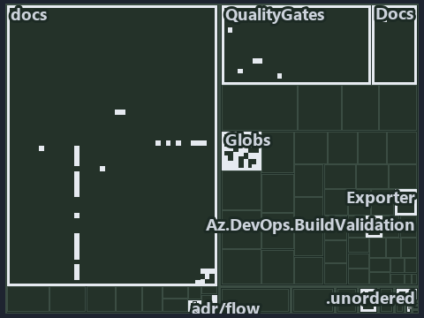

# docs/.assets/explanation/adr-flow-cd-globs--one-scan-program-feeds-three-roles--implementation.tree.md

`Tree minimap: adr-flow-cd-globs--one-scan-program-feeds-three-roles--implementation`

The tree minimap of the slide `adr-flow-cd-globs--one-scan-program-feeds-three-roles--implementation` (implementation lens). The slide
supports [ADR-FLOW-CD-GLOBS][1]; the highlight of those ADR codes selects what is lit, and each reason below names the code that selects it.

## What the minimap shows

The tree draws every file of the world map as a tile, grouped by top-level folder (under `automation/` by module, under `docs/adr/` by ADR
domain), and lights 91 files in 11 groups, filled in ink. A lit ADR file has a white rim; a file lit only by passing mentions is a lighter
ink. Every other tile is idle, a grey box: a file the slide's ADR codes do not select.

- Globs (automation/Catzc.Base.Globs): 37 lit files
- docs (docs/ outside docs/adr/): 34 lit files
- QualityGates (automation/Catzc.Base.QualityGates): 5 lit files
- .unordered: 4 lit files
- Az.DevOps.BuildValidation (automation/Catzc.Azure.DevOps.BuildValidation): 4 lit files
- adr/flow (docs/adr/flow): 2 lit files
- .github: 1 lit file
- Docs (automation/Catzc.Base.Docs): 1 lit file
- Exporter (automation/Catzc.Base.Exporter): 1 lit file
- adr/* (the files directly in docs/adr/): 1 lit file
- pipelines: 1 lit file

## Why each group is lit

### Globs (automation/Catzc.Base.Globs, 37 lit files)

The group holds the files of automation/Catzc.Base.Globs; each sits in its world-map cell and is lit by:

- [automation/Catzc.Base.Globs/Get-ChangedGlobSet.ps1][2], in the cell automation × powershell: selected by [ADR-FLOW-CD-GLOBS][1]: the file
  cites it at line 19 (header) and line 25 (header).
- [automation/Catzc.Base.Globs/Get-GlobSet.ps1][3], in the cell automation × powershell: selected by [ADR-FLOW-CD-GLOBS][1]: the file cites
  it at line 19 (header) and line 24 (header).
- [automation/Catzc.Base.Globs/Get-GlobSetFile.ps1][4], in the cell automation × powershell: selected by [ADR-FLOW-CD-GLOBS][1]: the file
  cites it at line 19 (header), line 24 (header) and line 27 (header).
- [automation/Catzc.Base.Globs/Get-GlobSetHash.ps1][5], in the cell automation × powershell: selected by [ADR-FLOW-CD-GLOBS][1]: the file
  cites it at line 19 (header) and line 27 (header).
- [automation/Catzc.Base.Globs/Get-GlobSetTrigger.ps1][6], in the cell automation × powershell: selected by [ADR-FLOW-CD-GLOBS][1]: the file
  cites it at line 19 (header) and line 24 (header).
- [automation/Catzc.Base.Globs/Get-MarkerBlastRadius.ps1][7], in the cell automation × powershell: selected by [ADR-FLOW-CD-GLOBS][1]: the
  file cites it at line 20 (header) and line 26 (header).
- [automation/Catzc.Base.Globs/Get-ModuleGlobSet.ps1][8], in the cell automation × powershell: selected by [ADR-FLOW-CD-GLOBS][1]: the file
  cites it at line 25 (header).
- [automation/Catzc.Base.Globs/Get-TrackedFile.ps1][9], in the cell automation × powershell: selected by [ADR-FLOW-CD-GLOBS][1]: the file
  cites it at line 20 (header) and line 25 (header).
- [automation/Catzc.Base.Globs/Test-AdoPipelineTriggerGlob.ps1][10], in the cell automation × powershell: selected by
  [ADR-FLOW-CD-GLOBS][1]: the file cites it at line 21 (header).
- [automation/Catzc.Base.Globs/Test-GitHubWorkflowTriggerGlob.ps1][11], in the cell automation × powershell: selected by
  [ADR-FLOW-CD-GLOBS][1]: the file cites it at line 21 (header).
- [automation/Catzc.Base.Globs/Test-GlobSetAffected.ps1][12], in the cell automation × powershell: selected by [ADR-FLOW-CD-GLOBS][1]: the
  file cites it at line 21 (header) and line 32 (header).
- [automation/Catzc.Base.Globs/Test-GlobSetIndependence.ps1][13], in the cell automation × powershell: selected by [ADR-FLOW-CD-GLOBS][1]:
  the file cites it at line 22 (header), line 35 (header) and line 94 (text).
- [automation/Catzc.Base.Globs/Test-GlobSetTriggerCoverage.ps1][14], in the cell automation × powershell: selected by
  [ADR-FLOW-CD-GLOBS][1]: the file cites it at line 21 (header) and line 27 (header).
- [automation/Catzc.Base.Globs/private/Get-ChangedFile.ps1][15], in the cell automation × powershell: selected by [ADR-FLOW-CD-GLOBS][1]:
  the file cites it at line 20 (header) and line 27 (header).
- [automation/Catzc.Base.Globs/private/Get-GlobSetMember.ps1][16], in the cell automation × powershell: selected by [ADR-FLOW-CD-GLOBS][1]:
  the file cites it at line 20 (header) and line 25 (header).
- [automation/Catzc.Base.Globs/private/Get-PipelineTrigger.ps1][17], in the cell automation × powershell: selected by
  [ADR-FLOW-CD-GLOBS][1]: the file cites it at line 20 (header) and line 26 (header).
- [automation/Catzc.Base.Globs/private/Test-GlobListEqual.ps1][18], in the cell automation × powershell: selected by [ADR-FLOW-CD-GLOBS][1]:
  the file cites it at line 20 (header) and line 30 (header).
- [automation/Catzc.Base.Globs/tests/Get-ChangedFile.Tests.ps1][19], in the cell automation × powershell: selected by
  [ADR-FLOW-CD-GLOBS][1]: the file cites it at line 19 (header).
- [automation/Catzc.Base.Globs/tests/Get-ChangedGlobSet.Tests.ps1][20], in the cell automation × powershell: selected by
  [ADR-FLOW-CD-GLOBS][1]: the file cites it at line 20 (header).
- [automation/Catzc.Base.Globs/tests/Get-GlobSetFile.Tests.ps1][21], in the cell automation × powershell: selected by
  [ADR-FLOW-CD-GLOBS][1]: the file cites it at line 19 (header).
- [automation/Catzc.Base.Globs/tests/Get-GlobSetHash.Tests.ps1][22], in the cell automation × powershell: selected by
  [ADR-FLOW-CD-GLOBS][1]: the file cites it at line 19 (header).
- [automation/Catzc.Base.Globs/tests/Get-GlobSetMember.Tests.ps1][23], in the cell automation × powershell: selected by
  [ADR-FLOW-CD-GLOBS][1]: the file cites it at line 19 (header).
- [automation/Catzc.Base.Globs/tests/Get-GlobSetTrigger.Tests.ps1][24], in the cell automation × powershell: selected by
  [ADR-FLOW-CD-GLOBS][1]: the file cites it at line 19 (header).
- [automation/Catzc.Base.Globs/tests/Get-PipelineTrigger.Tests.ps1][25], in the cell automation × powershell: selected by
  [ADR-FLOW-CD-GLOBS][1]: the file cites it at line 19 (header).
- [automation/Catzc.Base.Globs/tests/Get-TrackedFile.Tests.ps1][26], in the cell automation × powershell: selected by
  [ADR-FLOW-CD-GLOBS][1]: the file cites it at line 19 (header).
- [automation/Catzc.Base.Globs/tests/GlobSet-Independence.Tests.ps1][27], in the cell automation × powershell: selected by
  [ADR-FLOW-CD-GLOBS][1]: the file cites it at line 19 (header), line 24 (text) and line 26 (text).
- [automation/Catzc.Base.Globs/tests/GlobSetTrigger-Coverage.Tests.ps1][28], in the cell automation × powershell: selected by
  [ADR-FLOW-CD-GLOBS][1]: the file cites it at line 20 (header).
- [automation/Catzc.Base.Globs/tests/PipelineTrigger-Integrity.Tests.ps1][29], in the cell automation × powershell: selected by
  [ADR-FLOW-CD-GLOBS][1]: the file cites it at line 19 (header).
- [automation/Catzc.Base.Globs/tests/Test-GlobSetIndependence.Tests.ps1][30], in the cell automation × powershell: selected by
  [ADR-FLOW-CD-GLOBS][1]: the file cites it at line 20 (header).
- [automation/Catzc.Base.Globs/tests/types/GlobPattern.Tests.ps1][31], in the cell automation × powershell: selected by
  [ADR-FLOW-CD-GLOBS][1]: the file cites it at line 19 (header) and line 80 (text).
- [automation/Catzc.Base.Globs/tests/types/GlobSet.Tests.ps1][32], in the cell automation × powershell: selected by [ADR-FLOW-CD-GLOBS][1]:
  the file cites it at line 19 (header) and line 31 (text).
- [automation/Catzc.Base.Globs/tests/types/GlobsConfig.Tests.ps1][33], in the cell automation × powershell: selected by
  [ADR-FLOW-CD-GLOBS][1]: the file cites it at line 21 (header), line 77 (text), line 90 (text), line 101 (text) and line 113 (text).
- [automation/Catzc.Base.Globs/types/Aspect.cs][34], in the cell automation × csharp: selected by [ADR-FLOW-CD-GLOBS][1]: the file cites it
  at line 21 (text).
- [automation/Catzc.Base.Globs/types/DurableHash.cs][35], in the cell automation × csharp: selected by [ADR-FLOW-CD-GLOBS][1]: the file
  cites it at line 19 (text).
- [automation/Catzc.Base.Globs/types/GlobPattern.cs][36], in the cell automation × csharp: selected by [ADR-FLOW-CD-GLOBS][1]: the file
  cites it at line 20 (text), line 46 (text), line 50 (text), line 54 (text), line 66 (text), line 70 (text) and line 79 (text).
- [automation/Catzc.Base.Globs/types/GlobSet.cs][37], in the cell automation × csharp: selected by [ADR-FLOW-CD-GLOBS][1]: the file cites it
  at line 20 (text) and line 78 (text).
- [automation/Catzc.Base.Globs/types/GlobsConfig.cs][38], in the cell automation × csharp: selected by [ADR-FLOW-CD-GLOBS][1]: the file
  cites it at line 20 (text), line 97 (text), line 160 (text), line 164 (text) and line 178 (text).

### docs (docs/ outside docs/adr/, 34 lit files)

The group holds the files of docs/ outside docs/adr/; each sits in its world-map cell and is lit by:

- [docs/how-to/automation/manual-test-plan/pipelines-and-globs.md][39], in the cell docs × markdown: selected by [ADR-FLOW-CD-GLOBS][1]: the
  file cites it at line 15 (text) and line 35 (text).
- [docs/references/automation/catzc-azure-devops-buildvalidation/Register-AdoBuildValidation.ps1.md][40], in the cell docs × markdown:
  selected by [ADR-FLOW-CD-GLOBS][1]: the file cites it at line 28 (text).
- [docs/references/automation/catzc-azure-devops-buildvalidation/configs/build-validation.yml.md][41], in the cell docs × markdown: selected
  by [ADR-FLOW-CD-GLOBS][1]: the file cites it at line 34 (text).
- [docs/references/automation/catzc-base-globs.md][42], in the cell docs × markdown: selected by [ADR-FLOW-CD-GLOBS][1]: the file cites it
  at line 50 (text).
- [docs/references/automation/catzc-base-globs/Get-ModuleGlobSet.ps1.md][43], in the cell docs × markdown: selected by
  [ADR-FLOW-CD-GLOBS][1]: the file cites it at line 19 (text), line 34 (text), line 37 (text) and line 85 (text).
- [docs/references/automation/catzc-base-globs/Test-GlobSetIndependence.ps1.md][44], in the cell docs × markdown: selected by
  [ADR-FLOW-CD-GLOBS][1]: the file cites it at line 16 (text), line 30 (text) and line 40 (text).
- [docs/references/automation/catzc-base-globs/configs/globs.yml.md][45], in the cell docs × markdown: selected by [ADR-FLOW-CD-GLOBS][1]:
  the file cites it at line 17 (text), line 32 (text), line 37 (text), line 45 (text), line 47 (text), line 61 (text), line 91 (text) and
  line 105 (text).
- [docs/references/automation/catzc-base-globs/tests/Get-ChangedFile.Tests.ps1.md][46], in the cell docs × markdown: selected by
  [ADR-FLOW-CD-GLOBS][1]: the file cites it at line 16 (text) and line 31 (text).
- [docs/references/automation/catzc-base-globs/tests/Get-ChangedGlobSet.Tests.ps1.md][47], in the cell docs × markdown: selected by
  [ADR-FLOW-CD-GLOBS][1]: the file cites it at line 17 (text) and line 31 (text).
- [docs/references/automation/catzc-base-globs/tests/Get-GlobSetFile.Tests.ps1.md][48], in the cell docs × markdown: selected by
  [ADR-FLOW-CD-GLOBS][1]: the file cites it at line 16 (text), line 30 (text) and line 31 (text).
- [docs/references/automation/catzc-base-globs/tests/Get-GlobSetHash.Tests.ps1.md][49], in the cell docs × markdown: selected by
  [ADR-FLOW-CD-GLOBS][1]: the file cites it at line 16 (text) and line 31 (text).
- [docs/references/automation/catzc-base-globs/tests/Get-GlobSetMember.Tests.ps1.md][50], in the cell docs × markdown: selected by
  [ADR-FLOW-CD-GLOBS][1]: the file cites it at line 16 (text) and line 30 (text).
- [docs/references/automation/catzc-base-globs/tests/Get-GlobSetTrigger.Tests.ps1.md][51], in the cell docs × markdown: selected by
  [ADR-FLOW-CD-GLOBS][1]: the file cites it at line 16 (text) and line 30 (text).
- [docs/references/automation/catzc-base-globs/tests/Get-PipelineTrigger.Tests.ps1.md][52], in the cell docs × markdown: selected by
  [ADR-FLOW-CD-GLOBS][1]: the file cites it at line 16 (text) and line 30 (text).
- [docs/references/automation/catzc-base-globs/tests/Get-TrackedFile.Tests.ps1.md][53], in the cell docs × markdown: selected by
  [ADR-FLOW-CD-GLOBS][1]: the file cites it at line 16 (text) and line 29 (text).
- [docs/references/automation/catzc-base-globs/tests/GlobSet-Independence.Tests.ps1.md][54], in the cell docs × markdown: selected by
  [ADR-FLOW-CD-GLOBS][1]: the file cites it at line 16 (text) and line 30 (text).
- [docs/references/automation/catzc-base-globs/tests/GlobSetTrigger-Coverage.Tests.ps1.md][55], in the cell docs × markdown: selected by
  [ADR-FLOW-CD-GLOBS][1]: the file cites it at line 17 (text) and line 31 (text).
- [docs/references/automation/catzc-base-globs/tests/PipelineTrigger-Integrity.Tests.ps1.md][56], in the cell docs × markdown: selected by
  [ADR-FLOW-CD-GLOBS][1]: the file cites it at line 16 (text) and line 31 (text).
- [docs/references/automation/catzc-base-globs/tests/Test-GlobSetIndependence.Tests.ps1.md][57], in the cell docs × markdown: selected by
  [ADR-FLOW-CD-GLOBS][1]: the file cites it at line 17 (text) and line 32 (text).
- [docs/references/automation/catzc-base-globs/tests/types/GlobPattern.Tests.ps1.md][58], in the cell docs × markdown: selected by
  [ADR-FLOW-CD-GLOBS][1]: the file cites it at line 16 (text), line 29 (text) and line 31 (text).
- [docs/references/automation/catzc-base-globs/tests/types/GlobSet.Tests.ps1.md][59], in the cell docs × markdown: selected by
  [ADR-FLOW-CD-GLOBS][1]: the file cites it at line 16 (text), line 30 (text) and line 32 (text).
- [docs/references/automation/catzc-base-globs/tests/types/GlobsConfig.Tests.ps1.md][60], in the cell docs × markdown: selected by
  [ADR-FLOW-CD-GLOBS][1]: the file cites it at line 17 (text), line 33 (text), line 35 (text) and line 44 (text).
- [docs/references/automation/catzc-base-globs/types/Aspect.cs.md][61], in the cell docs × markdown: selected by [ADR-FLOW-CD-GLOBS][1]: the
  file cites it at line 17 (text) and line 38 (text).
- [docs/references/automation/catzc-base-globs/types/DurableHash.cs.md][62], in the cell docs × markdown: selected by
  [ADR-FLOW-CD-GLOBS][1]: the file cites it at line 16 (text), line 29 (text) and line 35 (text).
- [docs/references/automation/catzc-base-globs/types/GlobPattern.cs.md][63], in the cell docs × markdown: selected by
  [ADR-FLOW-CD-GLOBS][1]: the file cites it at line 16 (text), line 35 (text), line 36 (text) and line 37 (text).
- [docs/references/automation/catzc-base-globs/types/GlobSet.cs.md][64], in the cell docs × markdown: selected by [ADR-FLOW-CD-GLOBS][1]:
  the file cites it at line 16 (text), line 31 (text), line 33 (text), line 34 (text), line 40 (text), line 43 (text), line 45 (text), line
  48 (text), line 56 (text), line 65 (text), line 83 (text), line 100 (text), line 110 (text), line 134 (text) and line 142 (text).
- [docs/references/automation/catzc-base-globs/types/GlobsConfig.cs.md][65], in the cell docs × markdown: selected by
  [ADR-FLOW-CD-GLOBS][1]: the file cites it at line 16 (text), line 31 (text), line 35 (text), line 38 (text) and line 57 (text).
- [docs/references/automation/catzc-base-qualitygates/private/Get-ModuleProtectionIdentity.ps1.md][66], in the cell docs × markdown:
  selected by [ADR-FLOW-CD-GLOBS][1]: the file cites it at line 16 (text) and line 69 (text).
- [docs/references/pipelines/cd-apex.yaml.md][67], in the cell docs × markdown: selected by [ADR-FLOW-CD-GLOBS][1]: the file cites it at
  line 46 (text).
- [docs/references/pipelines/cd-flux.yaml.md][68], in the cell docs × markdown: selected by [ADR-FLOW-CD-GLOBS][1]: the file cites it at
  line 45 (text).
- [docs/references/pipelines/cd-nova.yaml.md][69], in the cell docs × markdown: selected by [ADR-FLOW-CD-GLOBS][1]: the file cites it at
  line 45 (text).
- [docs/references/pipelines/cd-shared.yaml.md][70], in the cell docs × markdown: selected by [ADR-FLOW-CD-GLOBS][1]: the file cites it at
  line 40 (text).
- [docs/references/pipelines/ci-automation.yaml.md][71], in the cell docs × markdown: selected by [ADR-FLOW-CD-GLOBS][1]: the file cites it
  at line 30 (text).
- [docs/references/pipelines/ci-infrastructure.yaml.md][72], in the cell docs × markdown: selected by [ADR-FLOW-CD-GLOBS][1]: the file cites
  it at line 32 (text).

### QualityGates (automation/Catzc.Base.QualityGates, 5 lit files)

The group holds the files of automation/Catzc.Base.QualityGates; each sits in its world-map cell and is lit by:

- [automation/Catzc.Base.QualityGates/Test-Automation.ps1][73], in the cell automation × powershell: selected by [ADR-FLOW-CD-GLOBS][1]: the
  file cites it at line 22 (header) and line 101 (header).
- [automation/Catzc.Base.QualityGates/configs/terminology.yml][74], in the cell automation × yaml: selected by [ADR-FLOW-CD-GLOBS][1]: the
  file cites it at line 1211 (text).
- [automation/Catzc.Base.QualityGates/private/Get-GuidScanFiles.ps1][75], in the cell automation × powershell: selected by
  [ADR-FLOW-CD-GLOBS][1]: the file cites it at line 21 (header) and line 27 (header).
- [automation/Catzc.Base.QualityGates/private/Get-ModuleProtectionIdentity.ps1][76], in the cell automation × powershell: selected by
  [ADR-FLOW-CD-GLOBS][1]: the file cites it at line 22 (header).
- [automation/Catzc.Base.QualityGates/private/Resolve-TestSuite.ps1][77], in the cell automation × powershell: selected by
  [ADR-FLOW-CD-GLOBS][1]: the file cites it at line 21 (header) and line 30 (header).

### .unordered (4 lit files)

The group holds the files of .unordered; each sits in its world-map cell and is lit by:

- [.unordered/15-10-2026/plan-adr-consistency.md][78], in the cell .unordered × markdown: selected by [ADR-FLOW-CD-GLOBS][1]: the file cites
  it at line 43 (text), line 96 (text), line 124 (text) and line 167 (text).
- [.unordered/15-10-2026/plan-caf-waf-automation.md][79], in the cell .unordered × markdown: selected by [ADR-FLOW-CD-GLOBS][1]: the file
  cites it at line 101 (text).
- [.unordered/15-10-2026/plan-concern-axis.md][80], in the cell .unordered × markdown: selected by [ADR-FLOW-CD-GLOBS][1]: the file cites it
  at line 97 (text).
- [.unordered/15-10-2026/plan-explanation-drift.md][81], in the cell .unordered × markdown: selected by [ADR-FLOW-CD-GLOBS][1]: the file
  cites it at line 38 (text), line 39 (text), line 58 (text), line 77 (text), line 103 (text) and line 103 (text).

### Az.DevOps.BuildValidation (automation/Catzc.Azure.DevOps.BuildValidation, 4 lit files)

The group holds the files of automation/Catzc.Azure.DevOps.BuildValidation; each sits in its world-map cell and is lit by:

- [automation/Catzc.Azure.DevOps.BuildValidation/Get-AdoBuildValidations.ps1][82], in the cell automation × powershell: selected by
  [ADR-FLOW-CD-GLOBS][1]: the file cites it at line 19 (header) and line 29 (header).
- [automation/Catzc.Azure.DevOps.BuildValidation/Register-AdoBuildValidation.ps1][83], in the cell automation × powershell: selected by
  [ADR-FLOW-CD-GLOBS][1]: the file cites it at line 21 (header) and line 27 (header).
- [automation/Catzc.Azure.DevOps.BuildValidation/Unregister-AdoBuildValidation.ps1][84], in the cell automation × powershell: selected by
  [ADR-FLOW-CD-GLOBS][1]: the file cites it at line 20 (header) and line 25 (header).
- [automation/Catzc.Azure.DevOps.BuildValidation/private/Get-BuildValidationPathFilter.ps1][85], in the cell automation × powershell:
  selected by [ADR-FLOW-CD-GLOBS][1]: the file cites it at line 19 (header) and line 27 (header).

### adr/flow (docs/adr/flow, 2 lit files)

The group holds the files of docs/adr/flow; each sits in its world-map cell and is lit by:

- [docs/adr/flow/dora-explains.md][86], in the cell docs × markdown: selected by [ADR-FLOW-CD-GLOBS][1]: the file cites it at line 123
  (text).
- [docs/adr/flow/durable-sha-globs.md][1], in the cell docs × markdown: selected by [ADR-FLOW-CD-GLOBS][1]: the ADR's own file.

### .github (1 lit file)

The group holds the files of .github; each sits in its world-map cell and is lit by:

- [.github/workflows/ci-automation.yml][87], in the cell github-workflows × yaml: selected by [ADR-FLOW-CD-GLOBS][1]: the file cites it at
  line 19 (body comment) (a passing mention only).

### Docs (automation/Catzc.Base.Docs, 1 lit file)

The group holds the files of automation/Catzc.Base.Docs; each sits in its world-map cell and is lit by:

- [automation/Catzc.Base.Docs/configs/adrs.yml][88], in the cell automation × yaml: selected by [ADR-FLOW-CD-GLOBS][1]: the file cites it at
  line 118 (text).

### Exporter (automation/Catzc.Base.Exporter, 1 lit file)

The group holds the files of automation/Catzc.Base.Exporter; each sits in its world-map cell and is lit by:

- [automation/Catzc.Base.Exporter/Get-CatzcContentHash.ps1][89], in the cell automation × powershell: selected by [ADR-FLOW-CD-GLOBS][1]:
  the file cites it at line 20 (header) and line 26 (header).

### adr/* (the files directly in docs/adr/, 1 lit file)

The group holds the files of the files directly in docs/adr/; each sits in its world-map cell and is lit by:

- [docs/adr/index.md][90], in the cell docs × markdown: selected by [ADR-FLOW-CD-GLOBS][1]: the file cites it at line 128 (text).

### pipelines (1 lit file)

The group holds the files of pipelines; each sits in its world-map cell and is lit by:

- [pipelines/ci-automation.yaml][91], in the cell pipelines × pipeline-yaml: selected by [ADR-FLOW-CD-GLOBS][1]: a pipeline that cites
  nothing itself carries its globset's citations, which cite it at
  `automation/Catzc.Azure.DevOps.BuildValidation/Get-AdoBuildValidations.ps1` line 19 (header),
  `automation/Catzc.Azure.DevOps.BuildValidation/Get-AdoBuildValidations.ps1` line 29 (header),
  `automation/Catzc.Azure.DevOps.BuildValidation/Register-AdoBuildValidation.ps1` line 21 (header),
  `automation/Catzc.Azure.DevOps.BuildValidation/Register-AdoBuildValidation.ps1` line 27 (header),
  `automation/Catzc.Azure.DevOps.BuildValidation/Unregister-AdoBuildValidation.ps1` line 20 (header),
  `automation/Catzc.Azure.DevOps.BuildValidation/Unregister-AdoBuildValidation.ps1` line 25 (header),
  `automation/Catzc.Azure.DevOps.BuildValidation/private/Get-BuildValidationPathFilter.ps1` line 19 (header),
  `automation/Catzc.Azure.DevOps.BuildValidation/private/Get-BuildValidationPathFilter.ps1` line 27 (header),
  `automation/Catzc.Base.Docs/configs/adrs.yml` line 118 (text), `automation/Catzc.Base.Exporter/Get-CatzcContentHash.ps1` line 20 (header),
  `automation/Catzc.Base.Exporter/Get-CatzcContentHash.ps1` line 26 (header), `automation/Catzc.Base.Globs/Get-ChangedGlobSet.ps1` line 19
  (header), `automation/Catzc.Base.Globs/Get-ChangedGlobSet.ps1` line 25 (header), `automation/Catzc.Base.Globs/Get-GlobSet.ps1` line 19
  (header), `automation/Catzc.Base.Globs/Get-GlobSet.ps1` line 24 (header), `automation/Catzc.Base.Globs/Get-GlobSetFile.ps1` line 19
  (header), `automation/Catzc.Base.Globs/Get-GlobSetFile.ps1` line 24 (header), `automation/Catzc.Base.Globs/Get-GlobSetFile.ps1` line 27
  (header), `automation/Catzc.Base.Globs/Get-GlobSetHash.ps1` line 19 (header), `automation/Catzc.Base.Globs/Get-GlobSetHash.ps1` line 27
  (header), `automation/Catzc.Base.Globs/Get-GlobSetTrigger.ps1` line 19 (header), `automation/Catzc.Base.Globs/Get-GlobSetTrigger.ps1` line
  24 (header), `automation/Catzc.Base.Globs/Get-MarkerBlastRadius.ps1` line 20 (header),
  `automation/Catzc.Base.Globs/Get-MarkerBlastRadius.ps1` line 26 (header), `automation/Catzc.Base.Globs/Get-ModuleGlobSet.ps1` line 25
  (header), `automation/Catzc.Base.Globs/Get-TrackedFile.ps1` line 20 (header), `automation/Catzc.Base.Globs/Get-TrackedFile.ps1` line 25
  (header), `automation/Catzc.Base.Globs/Test-AdoPipelineTriggerGlob.ps1` line 21 (header),
  `automation/Catzc.Base.Globs/Test-GitHubWorkflowTriggerGlob.ps1` line 21 (header), `automation/Catzc.Base.Globs/Test-GlobSetAffected.ps1`
  line 21 (header), `automation/Catzc.Base.Globs/Test-GlobSetAffected.ps1` line 32 (header),
  `automation/Catzc.Base.Globs/Test-GlobSetIndependence.ps1` line 22 (header), `automation/Catzc.Base.Globs/Test-GlobSetIndependence.ps1`
  line 35 (header), `automation/Catzc.Base.Globs/Test-GlobSetIndependence.ps1` line 94 (text),
  `automation/Catzc.Base.Globs/Test-GlobSetTriggerCoverage.ps1` line 21 (header),
  `automation/Catzc.Base.Globs/Test-GlobSetTriggerCoverage.ps1` line 27 (header), `automation/Catzc.Base.Globs/private/Get-ChangedFile.ps1`
  line 20 (header), `automation/Catzc.Base.Globs/private/Get-ChangedFile.ps1` line 27 (header),
  `automation/Catzc.Base.Globs/private/Get-GlobSetMember.ps1` line 20 (header), `automation/Catzc.Base.Globs/private/Get-GlobSetMember.ps1`
  line 25 (header), `automation/Catzc.Base.Globs/private/Get-PipelineTrigger.ps1` line 20 (header),
  `automation/Catzc.Base.Globs/private/Get-PipelineTrigger.ps1` line 26 (header),
  `automation/Catzc.Base.Globs/private/Test-GlobListEqual.ps1` line 20 (header),
  `automation/Catzc.Base.Globs/private/Test-GlobListEqual.ps1` line 30 (header),
  `automation/Catzc.Base.Globs/tests/Get-ChangedFile.Tests.ps1` line 19 (header),
  `automation/Catzc.Base.Globs/tests/Get-ChangedGlobSet.Tests.ps1` line 20 (header),
  `automation/Catzc.Base.Globs/tests/Get-GlobSetFile.Tests.ps1` line 19 (header),
  `automation/Catzc.Base.Globs/tests/Get-GlobSetHash.Tests.ps1` line 19 (header),
  `automation/Catzc.Base.Globs/tests/Get-GlobSetMember.Tests.ps1` line 19 (header),
  `automation/Catzc.Base.Globs/tests/Get-GlobSetTrigger.Tests.ps1` line 19 (header),
  `automation/Catzc.Base.Globs/tests/Get-PipelineTrigger.Tests.ps1` line 19 (header),
  `automation/Catzc.Base.Globs/tests/Get-TrackedFile.Tests.ps1` line 19 (header),
  `automation/Catzc.Base.Globs/tests/GlobSet-Independence.Tests.ps1` line 19 (header),
  `automation/Catzc.Base.Globs/tests/GlobSet-Independence.Tests.ps1` line 24 (text),
  `automation/Catzc.Base.Globs/tests/GlobSet-Independence.Tests.ps1` line 26 (text),
  `automation/Catzc.Base.Globs/tests/GlobSetTrigger-Coverage.Tests.ps1` line 20 (header),
  `automation/Catzc.Base.Globs/tests/PipelineTrigger-Integrity.Tests.ps1` line 19 (header),
  `automation/Catzc.Base.Globs/tests/Test-GlobSetIndependence.Tests.ps1` line 20 (header),
  `automation/Catzc.Base.Globs/tests/types/GlobPattern.Tests.ps1` line 19 (header),
  `automation/Catzc.Base.Globs/tests/types/GlobPattern.Tests.ps1` line 80 (text),
  `automation/Catzc.Base.Globs/tests/types/GlobSet.Tests.ps1` line 19 (header), `automation/Catzc.Base.Globs/tests/types/GlobSet.Tests.ps1`
  line 31 (text), `automation/Catzc.Base.Globs/tests/types/GlobsConfig.Tests.ps1` line 21 (header),
  `automation/Catzc.Base.Globs/tests/types/GlobsConfig.Tests.ps1` line 77 (text),
  `automation/Catzc.Base.Globs/tests/types/GlobsConfig.Tests.ps1` line 90 (text),
  `automation/Catzc.Base.Globs/tests/types/GlobsConfig.Tests.ps1` line 101 (text),
  `automation/Catzc.Base.Globs/tests/types/GlobsConfig.Tests.ps1` line 113 (text), `automation/Catzc.Base.Globs/types/Aspect.cs` line 21
  (text), `automation/Catzc.Base.Globs/types/DurableHash.cs` line 19 (text), `automation/Catzc.Base.Globs/types/GlobPattern.cs` line 20
  (text), `automation/Catzc.Base.Globs/types/GlobPattern.cs` line 46 (text), `automation/Catzc.Base.Globs/types/GlobPattern.cs` line 50
  (text), `automation/Catzc.Base.Globs/types/GlobPattern.cs` line 54 (text), `automation/Catzc.Base.Globs/types/GlobPattern.cs` line 66
  (text), `automation/Catzc.Base.Globs/types/GlobPattern.cs` line 70 (text), `automation/Catzc.Base.Globs/types/GlobPattern.cs` line 79
  (text), `automation/Catzc.Base.Globs/types/GlobSet.cs` line 20 (text), `automation/Catzc.Base.Globs/types/GlobSet.cs` line 78 (text),
  `automation/Catzc.Base.Globs/types/GlobsConfig.cs` line 20 (text), `automation/Catzc.Base.Globs/types/GlobsConfig.cs` line 97 (text),
  `automation/Catzc.Base.Globs/types/GlobsConfig.cs` line 160 (text), `automation/Catzc.Base.Globs/types/GlobsConfig.cs` line 164 (text),
  `automation/Catzc.Base.Globs/types/GlobsConfig.cs` line 178 (text), `automation/Catzc.Base.QualityGates/Test-Automation.ps1` line 22
  (header), `automation/Catzc.Base.QualityGates/Test-Automation.ps1` line 101 (header),
  `automation/Catzc.Base.QualityGates/configs/terminology.yml` line 1211 (text),
  `automation/Catzc.Base.QualityGates/private/Get-GuidScanFiles.ps1` line 21 (header),
  `automation/Catzc.Base.QualityGates/private/Get-GuidScanFiles.ps1` line 27 (header),
  `automation/Catzc.Base.QualityGates/private/Get-ModuleProtectionIdentity.ps1` line 22 (header),
  `automation/Catzc.Base.QualityGates/private/Resolve-TestSuite.ps1` line 21 (header) and
  `automation/Catzc.Base.QualityGates/private/Resolve-TestSuite.ps1` line 30 (header).

## Keywords

- [world map][92]
- [track][93]
- [file language][94]
- [cell][95]
- [lit cell][96]
- [.unordered][97]: a track
- [automation][97]: a track
- [docs][97]: a track
- [github-workflows][97]: a track
- [pipelines][97]: a track
- [csharp][98]: a file language
- [markdown][98]: a file language
- [pipeline-yaml][98]: a file language
- [powershell][98]: a file language
- [yaml][98]: a file language

[1]: ../../adr/flow/durable-sha-globs.md
[2]: ../../../automation/Catzc.Base.Globs/Get-ChangedGlobSet.ps1
[3]: ../../../automation/Catzc.Base.Globs/Get-GlobSet.ps1
[4]: ../../../automation/Catzc.Base.Globs/Get-GlobSetFile.ps1
[5]: ../../../automation/Catzc.Base.Globs/Get-GlobSetHash.ps1
[6]: ../../../automation/Catzc.Base.Globs/Get-GlobSetTrigger.ps1
[7]: ../../../automation/Catzc.Base.Globs/Get-MarkerBlastRadius.ps1
[8]: ../../../automation/Catzc.Base.Globs/Get-ModuleGlobSet.ps1
[9]: ../../../automation/Catzc.Base.Globs/Get-TrackedFile.ps1
[10]: ../../../automation/Catzc.Base.Globs/Test-AdoPipelineTriggerGlob.ps1
[11]: ../../../automation/Catzc.Base.Globs/Test-GitHubWorkflowTriggerGlob.ps1
[12]: ../../../automation/Catzc.Base.Globs/Test-GlobSetAffected.ps1
[13]: ../../../automation/Catzc.Base.Globs/Test-GlobSetIndependence.ps1
[14]: ../../../automation/Catzc.Base.Globs/Test-GlobSetTriggerCoverage.ps1
[15]: ../../../automation/Catzc.Base.Globs/private/Get-ChangedFile.ps1
[16]: ../../../automation/Catzc.Base.Globs/private/Get-GlobSetMember.ps1
[17]: ../../../automation/Catzc.Base.Globs/private/Get-PipelineTrigger.ps1
[18]: ../../../automation/Catzc.Base.Globs/private/Test-GlobListEqual.ps1
[19]: ../../../automation/Catzc.Base.Globs/tests/Get-ChangedFile.Tests.ps1
[20]: ../../../automation/Catzc.Base.Globs/tests/Get-ChangedGlobSet.Tests.ps1
[21]: ../../../automation/Catzc.Base.Globs/tests/Get-GlobSetFile.Tests.ps1
[22]: ../../../automation/Catzc.Base.Globs/tests/Get-GlobSetHash.Tests.ps1
[23]: ../../../automation/Catzc.Base.Globs/tests/Get-GlobSetMember.Tests.ps1
[24]: ../../../automation/Catzc.Base.Globs/tests/Get-GlobSetTrigger.Tests.ps1
[25]: ../../../automation/Catzc.Base.Globs/tests/Get-PipelineTrigger.Tests.ps1
[26]: ../../../automation/Catzc.Base.Globs/tests/Get-TrackedFile.Tests.ps1
[27]: ../../../automation/Catzc.Base.Globs/tests/GlobSet-Independence.Tests.ps1
[28]: ../../../automation/Catzc.Base.Globs/tests/GlobSetTrigger-Coverage.Tests.ps1
[29]: ../../../automation/Catzc.Base.Globs/tests/PipelineTrigger-Integrity.Tests.ps1
[30]: ../../../automation/Catzc.Base.Globs/tests/Test-GlobSetIndependence.Tests.ps1
[31]: ../../../automation/Catzc.Base.Globs/tests/types/GlobPattern.Tests.ps1
[32]: ../../../automation/Catzc.Base.Globs/tests/types/GlobSet.Tests.ps1
[33]: ../../../automation/Catzc.Base.Globs/tests/types/GlobsConfig.Tests.ps1
[34]: ../../../automation/Catzc.Base.Globs/types/Aspect.cs
[35]: ../../../automation/Catzc.Base.Globs/types/DurableHash.cs
[36]: ../../../automation/Catzc.Base.Globs/types/GlobPattern.cs
[37]: ../../../automation/Catzc.Base.Globs/types/GlobSet.cs
[38]: ../../../automation/Catzc.Base.Globs/types/GlobsConfig.cs
[39]: ../../how-to/automation/manual-test-plan/pipelines-and-globs.md
[40]: ../../references/automation/catzc-azure-devops-buildvalidation/Register-AdoBuildValidation.ps1.md
[41]: ../../references/automation/catzc-azure-devops-buildvalidation/configs/build-validation.yml.md
[42]: ../../references/automation/catzc-base-globs.md
[43]: ../../references/automation/catzc-base-globs/Get-ModuleGlobSet.ps1.md
[44]: ../../references/automation/catzc-base-globs/Test-GlobSetIndependence.ps1.md
[45]: ../../references/automation/catzc-base-globs/configs/globs.yml.md
[46]: ../../references/automation/catzc-base-globs/tests/Get-ChangedFile.Tests.ps1.md
[47]: ../../references/automation/catzc-base-globs/tests/Get-ChangedGlobSet.Tests.ps1.md
[48]: ../../references/automation/catzc-base-globs/tests/Get-GlobSetFile.Tests.ps1.md
[49]: ../../references/automation/catzc-base-globs/tests/Get-GlobSetHash.Tests.ps1.md
[50]: ../../references/automation/catzc-base-globs/tests/Get-GlobSetMember.Tests.ps1.md
[51]: ../../references/automation/catzc-base-globs/tests/Get-GlobSetTrigger.Tests.ps1.md
[52]: ../../references/automation/catzc-base-globs/tests/Get-PipelineTrigger.Tests.ps1.md
[53]: ../../references/automation/catzc-base-globs/tests/Get-TrackedFile.Tests.ps1.md
[54]: ../../references/automation/catzc-base-globs/tests/GlobSet-Independence.Tests.ps1.md
[55]: ../../references/automation/catzc-base-globs/tests/GlobSetTrigger-Coverage.Tests.ps1.md
[56]: ../../references/automation/catzc-base-globs/tests/PipelineTrigger-Integrity.Tests.ps1.md
[57]: ../../references/automation/catzc-base-globs/tests/Test-GlobSetIndependence.Tests.ps1.md
[58]: ../../references/automation/catzc-base-globs/tests/types/GlobPattern.Tests.ps1.md
[59]: ../../references/automation/catzc-base-globs/tests/types/GlobSet.Tests.ps1.md
[60]: ../../references/automation/catzc-base-globs/tests/types/GlobsConfig.Tests.ps1.md
[61]: ../../references/automation/catzc-base-globs/types/Aspect.cs.md
[62]: ../../references/automation/catzc-base-globs/types/DurableHash.cs.md
[63]: ../../references/automation/catzc-base-globs/types/GlobPattern.cs.md
[64]: ../../references/automation/catzc-base-globs/types/GlobSet.cs.md
[65]: ../../references/automation/catzc-base-globs/types/GlobsConfig.cs.md
[66]: ../../references/automation/catzc-base-qualitygates/private/Get-ModuleProtectionIdentity.ps1.md
[67]: ../../references/pipelines/cd-apex.yaml.md
[68]: ../../references/pipelines/cd-flux.yaml.md
[69]: ../../references/pipelines/cd-nova.yaml.md
[70]: ../../references/pipelines/cd-shared.yaml.md
[71]: ../../references/pipelines/ci-automation.yaml.md
[72]: ../../references/pipelines/ci-infrastructure.yaml.md
[73]: ../../../automation/Catzc.Base.QualityGates/Test-Automation.ps1
[74]: ../../../automation/Catzc.Base.QualityGates/configs/terminology.yml
[75]: ../../../automation/Catzc.Base.QualityGates/private/Get-GuidScanFiles.ps1
[76]: ../../../automation/Catzc.Base.QualityGates/private/Get-ModuleProtectionIdentity.ps1
[77]: ../../../automation/Catzc.Base.QualityGates/private/Resolve-TestSuite.ps1
[78]: ../../../.unordered/15-10-2026/plan-adr-consistency.md
[79]: ../../../.unordered/15-10-2026/plan-caf-waf-automation.md
[80]: ../../../.unordered/15-10-2026/plan-concern-axis.md
[81]: ../../../.unordered/15-10-2026/plan-explanation-drift.md
[82]: ../../../automation/Catzc.Azure.DevOps.BuildValidation/Get-AdoBuildValidations.ps1
[83]: ../../../automation/Catzc.Azure.DevOps.BuildValidation/Register-AdoBuildValidation.ps1
[84]: ../../../automation/Catzc.Azure.DevOps.BuildValidation/Unregister-AdoBuildValidation.ps1
[85]: ../../../automation/Catzc.Azure.DevOps.BuildValidation/private/Get-BuildValidationPathFilter.ps1
[86]: ../../adr/flow/dora-explains.md
[87]: ../../../.github/workflows/ci-automation.yml
[88]: ../../../automation/Catzc.Base.Docs/configs/adrs.yml
[89]: ../../../automation/Catzc.Base.Exporter/Get-CatzcContentHash.ps1
[90]: ../../adr/index.md
[91]: ../../../pipelines/ci-automation.yaml
[92]: ../../adr/glossary.md#world-map
[93]: ../../adr/glossary.md#track
[94]: ../../adr/glossary.md#file-language
[95]: ../../adr/glossary.md#cell
[96]: ../../adr/glossary.md#lit-cell
[97]: ../../../automation/Catzc.Base.Variants/configs/variants.yml
[98]: ../../../automation/Catzc.Base.Languages/configs/languages.yml
