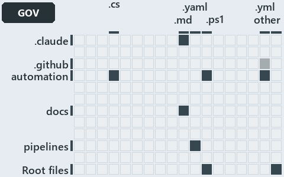

# docs/.assets/explanation/adr-flow-cd-globs--overlap-gated-for-units-and-modules--governance.grid.md

`Grid minimap: adr-flow-cd-globs--overlap-gated-for-units-and-modules--governance`

The grid minimap of the slide `adr-flow-cd-globs--overlap-gated-for-units-and-modules--governance` (governance lens). The slide supports
[ADR-AUTO-TEST][1], [ADR-FLOW-CD-GLOBS][2], [ADR-PRIN-ONELIVE][3] and [ADR-REPO-PROTGLOB][4]; the highlight of those ADR codes selects what
is lit, and each reason below names the code that selects it.

## What the minimap shows

The grid crosses the 12 tracks (rows) with the 18 file languages (columns) of the world map and lights 9 cells, filled in ink. A cell lit
only by passing mentions (citations in body comments, not in a file's header or text) is touched: a lighter ink. Every other cell is idle, a
grey box: it holds files the slide's ADR codes do not select, or no file at all (173 of the 216 cells hold none). The minimap shows where
the slide sits, not how many files a cell holds; the world-map PDFs show the counts.

- .claude × markdown: 4 lit of 9 files
- .github × yaml: 1 lit of 2 files, touched
- automation × csharp: 18 lit of 229 files
- automation × powershell: 377 lit of 1443 files
- automation × yaml: 19 lit of 97 files
- docs × markdown: 20 lit of 744 files
- pipelines × pipeline-yaml: 6 lit of 9 files
- Root files × powershell: 1 lit of 1 file
- Root files × Unlisted files: 2 lit of 4 files

## Key

A lit row prints its track's name; a lit column prints a short code, the first extension of its file language:

- `.cs`: csharp
- `.md`: markdown
- `.yaml`: pipeline-yaml
- `.ps1`: powershell
- `.yml`: yaml
- `other`: Unlisted files

## Why each cell is lit

### .claude × markdown (4 lit files)

Placed: the root folder `.claude/` names the track .claude ([ADR-DSGN-TRACK#1][5]); the extension `.md` names the file language markdown
([ADR-DSGN-TRACK#6][6]). Lit ([ADR-DSGN-TRACK#12][7]) by:

- [.claude/CLAUDE.md][8]: selected by [ADR-AUTO-TEST][1]: the file cites it at line 50 (text); selected by [ADR-PRIN-ONELIVE][3]: the file
  cites it at line 57 (text) and line 122 (text).
- [.claude/agents/build-inspiration-module.md][9]: selected by [ADR-AUTO-TEST][1]: the file cites it at line 45 (text).
- [.claude/agents/catzc-worker.md][10]: selected by [ADR-AUTO-TEST][1]: the file cites it at line 47 (text).
- [.claude/agents/test-optimization.md][11]: selected by [ADR-AUTO-TEST][1]: the file cites it at line 6 (text), line 21 (text), line 21
  (text), line 21 (text), line 22 (text), line 23 (text), line 52 (text), line 57 (text), line 58 (text), line 62 (text), line 62 (text),
  line 67 (text) and line 75 (text).

### .github × yaml (1 lit file, touched)

Placed: the root folder `.github/` names the track .github ([ADR-DSGN-TRACK#1][5]); the extension `.yml` names the file language yaml
([ADR-DSGN-TRACK#6][6]). Lit ([ADR-DSGN-TRACK#12][7]) by:

- [.github/workflows/ci-automation.yml][12]: selected by [ADR-FLOW-CD-GLOBS][2]: the file cites it at line 4 (body comment) (a passing
  mention only).

### automation × csharp (18 lit files)

Placed: the root folder `automation/` names the track automation ([ADR-DSGN-TRACK#1][5]); the extension `.cs` names the file language csharp
([ADR-DSGN-TRACK#6][6]). Lit ([ADR-DSGN-TRACK#12][7]) by:

- [automation/Catzc.Base.Docs/types/AdrChecksConfig.cs][13]: selected by [ADR-AUTO-TEST][1]: the file cites it at line 13 (header).
- [automation/Catzc.Base.Docs/types/CheckMode.cs][14]: selected by [ADR-AUTO-TEST][1]: the file cites it at line 5 (header).
- [automation/Catzc.Base.Docs/types/CheckModes.cs][15]: selected by [ADR-PRIN-ONELIVE][3]: the file cites it at line 3 (header).
- [automation/Catzc.Base.Docs/types/GlossaryConcept.cs][16]: selected by [ADR-AUTO-TEST][1]: the file cites it at line 40 (body comment) (a
  passing mention only).
- [automation/Catzc.Base.Globs/types/Aspect.cs][17]: selected by [ADR-FLOW-CD-GLOBS][2]: the file cites it at line 9 (header).
- [automation/Catzc.Base.Globs/types/DurableHash.cs][18]: selected by [ADR-FLOW-CD-GLOBS][2]: the file cites it at line 1 (header) and line
  7 (header).
- [automation/Catzc.Base.Globs/types/GlobPattern.cs][19]: selected by [ADR-FLOW-CD-GLOBS][2]: the file cites it at line 7 (header), line 8
  (header), line 9 (header), line 33 (text), line 37 (text), line 41 (text), line 53 (text), line 57 (text) and line 66 (text).
- [automation/Catzc.Base.Globs/types/GlobSet.cs][20]: selected by [ADR-FLOW-CD-GLOBS][2]: the file cites it at line 3 (header), line 5
  (header), line 6 (header), line 12 (header), line 15 (header), line 17 (header), line 20 (header), line 32 (body comment), line 41 (body
  comment), line 63 (body comment), line 89 (text), line 122 (body comment), line 135 (body comment), line 158 (body comment) and line 180
  (body comment); selected by [ADR-REPO-PROTGLOB][4]: the file cites it at line 37 (body comment) (a passing mention only).
- [automation/Catzc.Base.Globs/types/GlobsConfig.cs][21]: selected by [ADR-FLOW-CD-GLOBS][2]: the file cites it at line 3 (header), line 7
  (header), line 10 (header), line 88 (text), line 143 (body comment), line 154 (text), line 158 (text) and line 172 (text); selected by
  [ADR-REPO-PROTGLOB][4]: the file cites it at line 26 (body comment), line 83 (text) and line 88 (text).
- [automation/Catzc.Base.Languages/types/BashTestResult.cs][22]: selected by [ADR-AUTO-TEST][1]: the file cites it at line 8 (header).
- [automation/Catzc.Base.Languages/types/GoTestResult.cs][23]: selected by [ADR-AUTO-TEST][1]: the file cites it at line 8 (header).
- [automation/Catzc.Base.Languages/types/PythonTestResult.cs][24]: selected by [ADR-AUTO-TEST][1]: the file cites it at line 9 (header).
- [automation/Catzc.Base.ModuleSystem/types/ArtifactsConfig.cs][25]: selected by [ADR-AUTO-TEST][1]: the file cites it at line 3 (header).
- [automation/Catzc.Base.QualityGates/types/IdentityTokenRule.cs][26]: selected by [ADR-AUTO-TEST][1]: the file cites it at line 3 (header).
- [automation/Catzc.Base.QualityGates/types/SourceConventionsConfig.cs][27]: selected by [ADR-AUTO-TEST][1]: the file cites it at line 8
  (header).
- [automation/Catzc.Base.QualityGates/types/TestPolicyConfig.cs][28]: selected by [ADR-AUTO-TEST][1]: the file cites it at line 2 (header).
- [automation/Catzc.Base.Reports/types/ReportsConfig.cs][29]: selected by [ADR-AUTO-TEST][1]: the file cites it at line 4 (header).
- [automation/Catzc.Base.Timeouts/types/TestTiers.cs][30]: selected by [ADR-AUTO-TEST][1]: the file cites it at line 2 (header) and line 3
  (header).

### automation × powershell (377 lit files)

Placed: the root folder `automation/` names the track automation ([ADR-DSGN-TRACK#1][5]); the extension `.ps1` names the file language
powershell ([ADR-DSGN-TRACK#6][6]). Lit ([ADR-DSGN-TRACK#12][7]) by:

- [automation/.internal/tests/Import-AllModules.Tests.ps1][31]: selected by [ADR-AUTO-TEST][1]: the file cites it at line 206 (body comment)
  (a passing mention only).
- [automation/.internal/tests/New-BuiltCatzcRoot.Tests.ps1][32]: selected by [ADR-AUTO-TEST][1]: the file cites it at line 1 (text) and line
  80 (text).
- [automation/.internal/tests/Restart-ImporterSession.Tests.ps1][33]: selected by [ADR-AUTO-TEST][1]: the file cites it at line 5 (header).
- [automation/.internal/tests/Test-FolderConventions.Tests.ps1][34]: selected by [ADR-AUTO-TEST][1]: the file cites it at line 2 (header).
- [automation/.scriptanalyzer/tests/AnnounceStateChange.Tests.ps1][35]: selected by [ADR-AUTO-TEST][1]: the file cites it at line 154
  (text).
- [automation/Catzc.Azure.DevOps.BuildValidation/Get-AdoBuildValidations.ps1][36]: selected by [ADR-FLOW-CD-GLOBS][2]: the file cites it at
  line 10 (header).
- [automation/Catzc.Azure.DevOps.BuildValidation/Register-AdoBuildValidation.ps1][37]: selected by [ADR-FLOW-CD-GLOBS][2]: the file cites it
  at line 6 (header) and line 98 (body comment).
- [automation/Catzc.Azure.DevOps.BuildValidation/Unregister-AdoBuildValidation.ps1][38]: selected by [ADR-FLOW-CD-GLOBS][2]: the file cites
  it at line 6 (header).
- [automation/Catzc.Azure.DevOps.BuildValidation/private/Get-BuildValidationPathFilter.ps1][39]: selected by [ADR-FLOW-CD-GLOBS][2]: the
  file cites it at line 8 (header).
- [automation/Catzc.Azure.DevOps.BuildValidation/tests/types/BuildValidationConfig.Tests.ps1][40]: selected by [ADR-AUTO-TEST][1]: the file
  cites it at line 13 (body comment) (a passing mention only).
- [automation/Catzc.Azure.DevOps/Test-Pipelines.ps1][41]: selected by [ADR-AUTO-TEST][1]: the file cites it at line 9 (header).
- [automation/Catzc.Azure.DevOps/tests/Get-AdoYamlFiles.Tests.ps1][42]: selected by [ADR-AUTO-TEST][1]: the file cites it at line 207 (body
  comment) (a passing mention only).
- [automation/Catzc.Azure.DevOps/tests/Test-Pipelines.Tests.ps1][43]: selected by [ADR-AUTO-TEST][1]: the file cites it at line 44 (text)
  and line 53 (text).
- [automation/Catzc.Azure.Templates/Get-BicepTemplatesOutputRoot.ps1][44]: selected by [ADR-AUTO-TEST][1]: the file cites it at line 10
  (header).
- [automation/Catzc.Azure.Templates/tests/Assert-BicepTemplate.Tests.ps1][45]: selected by [ADR-AUTO-TEST][1]: the file cites it at line 23
  (body comment) (a passing mention only).
- [automation/Catzc.Azure.Templates/tests/Build-Bicep.Integrity.Tests.ps1][46]: selected by [ADR-AUTO-TEST][1]: the file cites it at line 8
  (header), line 10 (header) and line 13 (header).
- [automation/Catzc.Azure.Templates/tests/Build-Bicep.L2.Tests.ps1][47]: selected by [ADR-AUTO-TEST][1]: the file cites it at line 18
  (header) and line 26 (header).
- [automation/Catzc.Azure.Templates/tests/Build-Bicep.SampleCustomer.Tests.ps1][48]: selected by [ADR-AUTO-TEST][1]: the file cites it at
  line 5 (body comment), line 5 (body comment), line 11 (body comment) and line 40 (body comment) (a passing mention only).
- [automation/Catzc.Azure.Templates/tests/Build-Bicep.SampleIndexed.Tests.ps1][49]: selected by [ADR-AUTO-TEST][1]: the file cites it at
  line 5 (body comment), line 5 (body comment) and line 36 (body comment) (a passing mention only).
- [automation/Catzc.Azure.Templates/tests/Build-Bicep.SampleSubscription.Tests.ps1][50]: selected by [ADR-AUTO-TEST][1]: the file cites it
  at line 4 (body comment), line 4 (body comment), line 10 (body comment) and line 39 (body comment) (a passing mention only).
- [automation/Catzc.Azure.Templates/tests/Build-Bicep.SampleWithModule.Tests.ps1][51]: selected by [ADR-AUTO-TEST][1]: the file cites it at
  line 5 (body comment), line 5 (body comment), line 11 (body comment) and line 40 (body comment) (a passing mention only).
- [automation/Catzc.Azure.Templates/tests/Build-Bicep.SampleWithPrepost.Tests.ps1][52]: selected by [ADR-AUTO-TEST][1]: the file cites it at
  line 32 (body comment) and line 37 (body comment) (a passing mention only).
- [automation/Catzc.Azure.Templates/tests/Build-Bicep.Tests.ps1][53]: selected by [ADR-AUTO-TEST][1]: the file cites it at line 5 (body
  comment), line 5 (body comment), line 9 (body comment) and line 39 (body comment) (a passing mention only).
- [automation/Catzc.Azure.Templates/tests/Deploy-Bicep.SampleSubscription.Tests.ps1][54]: selected by [ADR-AUTO-TEST][1]: the file cites it
  at line 34 (body comment), line 124 (body comment) and line 176 (body comment) (a passing mention only).
- [automation/Catzc.Azure.Templates/tests/Deploy-Bicep.Tests.ps1][55]: selected by [ADR-AUTO-TEST][1]: the file cites it at line 46 (body
  comment), line 46 (body comment) and line 98 (body comment) (a passing mention only).
- [automation/Catzc.Azure.Templates/tests/Get-BicepDeploymentContext.Tests.ps1][56]: selected by [ADR-AUTO-TEST][1]: the file cites it at
  line 6 (body comment), line 6 (body comment), line 11 (body comment) and line 51 (body comment) (a passing mention only).
- [automation/Catzc.Azure.Templates/tests/Get-BicepParameterModel.Shipped.Tests.ps1][57]: selected by [ADR-AUTO-TEST][1]: the file cites it
  at line 9 (header), line 12 (header), line 15 (header), line 20 (header) and line 25 (body comment).
- [automation/Catzc.Azure.Templates/tests/Get-BicepParameterModel.Tests.ps1][58]: selected by [ADR-AUTO-TEST][1]: the file cites it at line
  3 (header).
- [automation/Catzc.Azure.Templates/tests/Get-BicepParameterViolations.Tests.ps1][59]: selected by [ADR-AUTO-TEST][1]: the file cites it at
  line 3 (header).
- [automation/Catzc.Azure.Templates/tests/Get-BicepResourceGroupName.Tests.ps1][60]: selected by [ADR-AUTO-TEST][1]: the file cites it at
  line 4 (body comment) and line 4 (body comment) (a passing mention only).
- [automation/Catzc.Azure.Templates/tests/Get-BicepResourceName.Tests.ps1][61]: selected by [ADR-AUTO-TEST][1]: the file cites it at line 7
  (body comment) and line 7 (body comment) (a passing mention only).
- [automation/Catzc.Azure.Templates/tests/Get-BicepTemplate.Tests.ps1][62]: selected by [ADR-AUTO-TEST][1]: the file cites it at line 4
  (body comment) and line 4 (body comment) (a passing mention only).
- [automation/Catzc.Azure.Templates/tests/Get-BicepTemplateConfiguration.Tests.ps1][63]: selected by [ADR-AUTO-TEST][1]: the file cites it
  at line 5 (body comment) and line 5 (body comment) (a passing mention only).
- [automation/Catzc.Azure.Templates/tests/Get-BicepTemplateCustomers.Tests.ps1][64]: selected by [ADR-AUTO-TEST][1]: the file cites it at
  line 4 (body comment), line 4 (body comment), line 42 (body comment) and line 42 (body comment) (a passing mention only).
- [automation/Catzc.Azure.Templates/tests/Get-BicepTemplateNames.Tests.ps1][65]: selected by [ADR-AUTO-TEST][1]: the file cites it at line 4
  (body comment) and line 4 (body comment) (a passing mention only).
- [automation/Catzc.Azure.Templates/tests/Get-BicepTemplateSlots.Tests.ps1][66]: selected by [ADR-AUTO-TEST][1]: the file cites it at line 4
  (body comment), line 4 (body comment), line 57 (body comment) and line 57 (body comment) (a passing mention only).
- [automation/Catzc.Azure.Templates/tests/Get-BicepTemplates.Tests.ps1][67]: selected by [ADR-AUTO-TEST][1]: the file cites it at line 7
  (body comment) and line 7 (body comment) (a passing mention only).
- [automation/Catzc.Azure.Templates/tests/Get-BicepTrackTagNameSet.Tests.ps1][68]: selected by [ADR-AUTO-TEST][1]: the file cites it at line
  4 (body comment) and line 4 (body comment) (a passing mention only).
- [automation/Catzc.Azure.Templates/tests/Resolve-BicepParameterAddresses.Tests.ps1][69]: selected by [ADR-AUTO-TEST][1]: the file cites it
  at line 4 (body comment) (a passing mention only).
- [automation/Catzc.Azure.Templates/tests/Set-BicepTemplateConfiguration.Tests.ps1][70]: selected by [ADR-AUTO-TEST][1]: the file cites it
  at line 43 (body comment) (a passing mention only).
- [automation/Catzc.Azure.Templates/tests/types/BicepShortName.Tests.ps1][71]: selected by [ADR-AUTO-TEST][1]: the file cites it at line 6
  (body comment) (a passing mention only).
- [automation/Catzc.Azure/Test-AzureNetworkPlan.ps1][72]: selected by [ADR-AUTO-TEST][1]: the file cites it at line 5 (header).
- [automation/Catzc.Azure/tests/Get-AzureBicepMinVersion.Tests.ps1][73]: selected by [ADR-AUTO-TEST][1]: the file cites it at line 4 (body
  comment) and line 4 (body comment) (a passing mention only).
- [automation/Catzc.Azure/tests/Get-AzureCustomer.Tests.ps1][74]: selected by [ADR-AUTO-TEST][1]: the file cites it at line 4 (body comment)
  (a passing mention only).
- [automation/Catzc.Azure/tests/Get-AzureCustomers.Tests.ps1][75]: selected by [ADR-AUTO-TEST][1]: the file cites it at line 4 (body
  comment) and line 4 (body comment) (a passing mention only).
- [automation/Catzc.Azure/tests/Get-AzureEnvironment.Tests.ps1][76]: selected by [ADR-AUTO-TEST][1]: the file cites it at line 4 (body
  comment) and line 4 (body comment) (a passing mention only).
- [automation/Catzc.Azure/tests/Get-AzureSubscription.Tests.ps1][77]: selected by [ADR-AUTO-TEST][1]: the file cites it at line 4 (body
  comment) and line 4 (body comment) (a passing mention only).
- [automation/Catzc.Azure/tests/Get-AzureSubscriptionEnvironment.Tests.ps1][78]: selected by [ADR-AUTO-TEST][1]: the file cites it at line 4
  (body comment) and line 4 (body comment) (a passing mention only).
- [automation/Catzc.Azure/tests/Test-AzureNetworkPlan.Tests.ps1][79]: selected by [ADR-AUTO-TEST][1]: the file cites it at line 4 (header).
- [automation/Catzc.Azure/tests/types/AzureConfig.Tests.ps1][80]: selected by [ADR-AUTO-TEST][1]: the file cites it at line 6 (body comment)
  and line 7 (body comment) (a passing mention only).
- [automation/Catzc.Azure/tests/types/NetworkConfig.Tests.ps1][81]: selected by [ADR-AUTO-TEST][1]: the file cites it at line 6 (body
  comment) and line 7 (body comment) (a passing mention only).
- [automation/Catzc.Base.Config/tests/Config-Conventions.Tests.ps1][82]: selected by [ADR-AUTO-TEST][1]: the file cites it at line 8 (body
  comment) (a passing mention only).
- [automation/Catzc.Base.Config/tests/Get-Config.Tests.ps1][83]: selected by [ADR-AUTO-TEST][1]: the file cites it at line 4 (body comment),
  line 15 (body comment), line 18 (body comment) and line 188 (body comment) (a passing mention only).
- [automation/Catzc.Base.Config/tests/Get-ConfigValue.Tests.ps1][84]: selected by [ADR-AUTO-TEST][1]: the file cites it at line 119 (body
  comment) (a passing mention only).
- [automation/Catzc.Base.ConfigExtensions/Test-ConfigValidators.ps1][85]: selected by [ADR-AUTO-TEST][1]: the file cites it at line 5
  (header).
- [automation/Catzc.Base.ConfigExtensions/tests/Invoke-ConfigValidator.Tests.ps1][86]: selected by [ADR-AUTO-TEST][1]: the file cites it at
  line 2 (header).
- [automation/Catzc.Base.ConfigExtensions/tests/Test-ConfigValidators.Tests.ps1][87]: selected by [ADR-AUTO-TEST][1]: the file cites it at
  line 3 (header).
- [automation/Catzc.Base.Contracts/Test-Contracts.ps1][88]: selected by [ADR-AUTO-TEST][1]: the file cites it at line 8 (header).
- [automation/Catzc.Base.Contracts/tests/Build-ContractReference.Tests.ps1][89]: selected by [ADR-AUTO-TEST][1]: the file cites it at line 4
  (header).
- [automation/Catzc.Base.Contracts/tests/ConvertTo-ContractNoteMarkdown.Tests.ps1][90]: selected by [ADR-AUTO-TEST][1]: the file cites it at
  line 5 (header).
- [automation/Catzc.Base.Contracts/tests/Get-ContractAssetNote.Tests.ps1][91]: selected by [ADR-AUTO-TEST][1]: the file cites it at line 4
  (header).
- [automation/Catzc.Base.Contracts/tests/Get-ContractFreezeFindings.Tests.ps1][92]: selected by [ADR-AUTO-TEST][1]: the file cites it at
  line 3 (header).
- [automation/Catzc.Base.Contracts/tests/Publish-ContractRelease.Tests.ps1][93]: selected by [ADR-AUTO-TEST][1]: the file cites it at line 4
  (header).
- [automation/Catzc.Base.Contracts/tests/Test-Contracts.Tests.ps1][94]: selected by [ADR-AUTO-TEST][1]: the file cites it at line 5
  (header), line 7 (header), line 35 (text), line 55 (body comment), line 79 (text) and line 208 (body comment).
- [automation/Catzc.Base.Docs/Test-AdrEngineNeutrality.ps1][95]: selected by [ADR-AUTO-TEST][1]: the file cites it at line 5 (header).
- [automation/Catzc.Base.Docs/Test-AdrRegistry.ps1][96]: selected by [ADR-AUTO-TEST][1]: the file cites it at line 5 (header).
- [automation/Catzc.Base.Docs/Test-AgentDefinitions.ps1][97]: selected by [ADR-AUTO-TEST][1]: the file cites it at line 5 (header).
- [automation/Catzc.Base.Docs/Test-GeneratedReadmes.ps1][98]: selected by [ADR-AUTO-TEST][1]: the file cites it at line 5 (header).
- [automation/Catzc.Base.Docs/Test-Glossary.ps1][99]: selected by [ADR-AUTO-TEST][1]: the file cites it at line 17 (header).
- [automation/Catzc.Base.Docs/private/Get-GlossaryRuleStatements.ps1][100]: selected by [ADR-AUTO-TEST][1]: the file cites it at line 18
  (header).
- [automation/Catzc.Base.Docs/tests/Build-Glossary.Tests.ps1][101]: selected by [ADR-AUTO-TEST][1]: the file cites it at line 4 (header).
- [automation/Catzc.Base.Docs/tests/ConvertTo-AdrDomainDiagram.Tests.ps1][102]: selected by [ADR-AUTO-TEST][1]: the file cites it at line 2
  (header).
- [automation/Catzc.Base.Docs/tests/Get-AdrCitationGraphViolations.Tests.ps1][103]: selected by [ADR-AUTO-TEST][1]: the file cites it at
  line 3 (header) and line 4 (text).
- [automation/Catzc.Base.Docs/tests/Get-AdrCitationMap.Tests.ps1][104]: selected by [ADR-AUTO-TEST][1]: the file cites it at line 4
  (header).
- [automation/Catzc.Base.Docs/tests/Get-AdrDomainEdges.Tests.ps1][105]: selected by [ADR-AUTO-TEST][1]: the file cites it at line 3
  (header).
- [automation/Catzc.Base.Docs/tests/Get-AdrDoraCoverageViolations.Tests.ps1][106]: selected by [ADR-AUTO-TEST][1]: the file cites it at line
  3 (header) and line 4 (text).
- [automation/Catzc.Base.Docs/tests/Get-AdrFileIndex.Tests.ps1][107]: selected by [ADR-AUTO-TEST][1]: the file cites it at line 3 (header).
- [automation/Catzc.Base.Docs/tests/Get-AdrRuleSet.Tests.ps1][108]: selected by [ADR-AUTO-TEST][1]: the file cites it at line 3 (header) and
  line 42 (body comment).
- [automation/Catzc.Base.Docs/tests/Get-AdrRuleSummaryLines.Tests.ps1][109]: selected by [ADR-AUTO-TEST][1]: the file cites it at line 2
  (header).
- [automation/Catzc.Base.Docs/tests/Get-AgentFrontMatter.Tests.ps1][110]: selected by [ADR-AUTO-TEST][1]: the file cites it at line 2
  (header).
- [automation/Catzc.Base.Docs/tests/Get-CatsRuleEnforcers.Tests.ps1][111]: selected by [ADR-AUTO-TEST][1]: the file cites it at line 4
  (header).
- [automation/Catzc.Base.Docs/tests/Get-ClaudeMdAgentNames.Tests.ps1][112]: selected by [ADR-AUTO-TEST][1]: the file cites it at line 2
  (header).
- [automation/Catzc.Base.Docs/tests/Get-Glossary.Tests.ps1][113]: selected by [ADR-AUTO-TEST][1]: the file cites it at line 6 (header).
- [automation/Catzc.Base.Docs/tests/Get-GlossaryAnchorViolations.Tests.ps1][114]: selected by [ADR-AUTO-TEST][1]: the file cites it at line
  6 (header).
- [automation/Catzc.Base.Docs/tests/Get-GlossaryDefinitionViolations.Tests.ps1][115]: selected by [ADR-AUTO-TEST][1]: the file cites it at
  line 5 (header).
- [automation/Catzc.Base.Docs/tests/Get-GlossaryEnforcementViolations.Tests.ps1][116]: selected by [ADR-AUTO-TEST][1]: the file cites it at
  line 6 (header).
- [automation/Catzc.Base.Docs/tests/Get-GlossaryFormViolations.Tests.ps1][117]: selected by [ADR-AUTO-TEST][1]: the file cites it at line 5
  (header).
- [automation/Catzc.Base.Docs/tests/Get-GlossaryPhrasingViolations.Tests.ps1][118]: selected by [ADR-AUTO-TEST][1]: the file cites it at
  line 6 (header).
- [automation/Catzc.Base.Docs/tests/Get-GlossaryRuleStatements.Tests.ps1][119]: selected by [ADR-AUTO-TEST][1]: the file cites it at line 4
  (header).
- [automation/Catzc.Base.Docs/tests/Get-GlossarySourceViolations.Tests.ps1][120]: selected by [ADR-AUTO-TEST][1]: the file cites it at line
  5 (header).
- [automation/Catzc.Base.Docs/tests/Get-GlossarySources.Tests.ps1][121]: selected by [ADR-AUTO-TEST][1]: the file cites it at line 6
  (header).
- [automation/Catzc.Base.Docs/tests/Resolve-AdrLinkTarget.Tests.ps1][122]: selected by [ADR-AUTO-TEST][1]: the file cites it at line 3
  (header).
- [automation/Catzc.Base.Docs/tests/Test-AdrEngineNeutrality.Tests.ps1][123]: selected by [ADR-AUTO-TEST][1]: the file cites it at line 3
  (header), line 4 (text) and line 126 (text).
- [automation/Catzc.Base.Docs/tests/Test-AdrRegistry.Tests.ps1][124]: selected by [ADR-AUTO-TEST][1]: the file cites it at line 3 (header),
  line 4 (text) and line 136 (text).
- [automation/Catzc.Base.Docs/tests/Test-AgentDefinitions.Tests.ps1][125]: selected by [ADR-AUTO-TEST][1]: the file cites it at line 3
  (header), line 45 (text), line 104 (text) and line 115 (text).
- [automation/Catzc.Base.Docs/tests/Test-GeneratedReadmes.Tests.ps1][126]: selected by [ADR-AUTO-TEST][1]: the file cites it at line 3
  (header).
- [automation/Catzc.Base.Docs/tests/Test-Glossary.Tests.ps1][127]: selected by [ADR-AUTO-TEST][1]: the file cites it at line 47 (body
  comment), line 82 (body comment), line 83 (body comment) and line 96 (text).
- [automation/Catzc.Base.Docs/tests/Update-AdrCitation.Tests.ps1][128]: selected by [ADR-AUTO-TEST][1]: the file cites it at line 3
  (header).
- [automation/Catzc.Base.Docs/tests/types/AdrChecksConfig.Tests.ps1][129]: selected by [ADR-AUTO-TEST][1]: the file cites it at line 2
  (header).
- [automation/Catzc.Base.Docs/tests/types/AdrDomainEdge.Tests.ps1][130]: selected by [ADR-AUTO-TEST][1]: the file cites it at line 2
  (header).
- [automation/Catzc.Base.Docs/tests/types/AgentEntry.Tests.ps1][131]: selected by [ADR-AUTO-TEST][1]: the file cites it at line 3 (header).
- [automation/Catzc.Base.Docs/tests/types/AgentsConfig.Tests.ps1][132]: selected by [ADR-AUTO-TEST][1]: the file cites it at line 3
  (header).
- [automation/Catzc.Base.Docs/tests/types/CheckModes.Tests.ps1][133]: selected by [ADR-AUTO-TEST][1]: the file cites it at line 3 (header);
  selected by [ADR-PRIN-ONELIVE][3]: the file cites it at line 4 (text).
- [automation/Catzc.Base.Docs/tests/types/GlossaryConfig.Tests.ps1][134]: selected by [ADR-AUTO-TEST][1]: the file cites it at line 5
  (header).
- [automation/Catzc.Base.Docs/tests/types/GlossaryEntry.Tests.ps1][135]: selected by [ADR-AUTO-TEST][1]: the file cites it at line 3
  (header).
- [automation/Catzc.Base.Environment/tests/Set-PermanentEnvironmentVariable.Tests.ps1][136]: selected by [ADR-AUTO-TEST][1]: the file cites
  it at line 6 (text).
- [automation/Catzc.Base.Execution/Invoke-Executable.ps1][137]: selected by [ADR-AUTO-TEST][1]: the file cites it at line 107 (body comment)
  (a passing mention only).
- [automation/Catzc.Base.Execution/tests/Find-Executable.Tests.ps1][138]: selected by [ADR-AUTO-TEST][1]: the file cites it at line 4
  (header).
- [automation/Catzc.Base.Execution/tests/Get-ExecutableVersion.Tests.ps1][139]: selected by [ADR-AUTO-TEST][1]: the file cites it at line 4
  (body comment) (a passing mention only).
- [automation/Catzc.Base.Execution/tests/Invoke-Executable.Tests.ps1][140]: selected by [ADR-AUTO-TEST][1]: the file cites it at line 81
  (text) and line 81 (body comment).
- [automation/Catzc.Base.Execution/tests/Resolve-EngineExecutable.Tests.ps1][141]: selected by [ADR-AUTO-TEST][1]: the file cites it at line
  3 (header).
- [automation/Catzc.Base.Execution/tests/Resolve-ToolExecutable.Tests.ps1][142]: selected by [ADR-AUTO-TEST][1]: the file cites it at line 5
  (body comment) (a passing mention only).
- [automation/Catzc.Base.Execution/tests/types/CliRunner.Tests.ps1][143]: selected by [ADR-AUTO-TEST][1]: the file cites it at line 4 (body
  comment) (a passing mention only).
- [automation/Catzc.Base.Execution/tests/types/ExecutableProbe.Tests.ps1][144]: selected by [ADR-AUTO-TEST][1]: the file cites it at line 3
  (body comment) (a passing mention only).
- [automation/Catzc.Base.Execution/tests/types/ToolConfig.Tests.ps1][145]: selected by [ADR-AUTO-TEST][1]: the file cites it at line 4 (body
  comment) (a passing mention only).
- [automation/Catzc.Base.Execution/tests/types/ToolsConfig.Tests.ps1][146]: selected by [ADR-AUTO-TEST][1]: the file cites it at line 3
  (body comment), line 13 (body comment) and line 15 (body comment) (a passing mention only).
- [automation/Catzc.Base.Exporter/Get-CatzcContentHash.ps1][147]: selected by [ADR-FLOW-CD-GLOBS][2]: the file cites it at line 6 (header).
- [automation/Catzc.Base.Exporter/tests/Assert-CatzcBundle.Tests.ps1][148]: selected by [ADR-AUTO-TEST][1]: the file cites it at line 5
  (body comment) (a passing mention only).
- [automation/Catzc.Base.Exporter/tests/Install-Catzc.Tests.ps1][149]: selected by [ADR-AUTO-TEST][1]: the file cites it at line 4 (body
  comment) (a passing mention only).
- [automation/Catzc.Base.Exporter/tests/New-CatzcNuGetPackage.Tests.ps1][150]: selected by [ADR-AUTO-TEST][1]: the file cites it at line 6
  (body comment) and line 8 (body comment) (a passing mention only).
- [automation/Catzc.Base.Files/Write-FileIfChanged.ps1][151]: selected by [ADR-PRIN-ONELIVE][3]: the file cites it at line 20 (header).
- [automation/Catzc.Base.Files/tests/Get-GitChangedPath.Tests.ps1][152]: selected by [ADR-AUTO-TEST][1]: the file cites it at line 3 (body
  comment) (a passing mention only).
- [automation/Catzc.Base.Globs/Clear-GlobSetProtection.ps1][153]: selected by [ADR-REPO-PROTGLOB][4]: the file cites it at line 6 (header).
- [automation/Catzc.Base.Globs/Get-ChangedGlobSet.ps1][154]: selected by [ADR-FLOW-CD-GLOBS][2]: the file cites it at line 4 (header) and
  line 8 (header).
- [automation/Catzc.Base.Globs/Get-GlobSet.ps1][155]: selected by [ADR-FLOW-CD-GLOBS][2]: the file cites it at line 6 (header).
- [automation/Catzc.Base.Globs/Get-GlobSetChangeRange.ps1][156]: selected by [ADR-REPO-PROTGLOB][4]: the file cites it at line 20 (header).
- [automation/Catzc.Base.Globs/Get-GlobSetFile.ps1][157]: selected by [ADR-FLOW-CD-GLOBS][2]: the file cites it at line 6 (header) and line
  9 (header).
- [automation/Catzc.Base.Globs/Get-GlobSetHash.ps1][158]: selected by [ADR-FLOW-CD-GLOBS][2]: the file cites it at line 4 (header) and line
  10 (header).
- [automation/Catzc.Base.Globs/Get-GlobSetTrigger.ps1][159]: selected by [ADR-FLOW-CD-GLOBS][2]: the file cites it at line 4 (header) and
  line 7 (header).
- [automation/Catzc.Base.Globs/Get-MarkerBlastRadius.ps1][160]: selected by [ADR-FLOW-CD-GLOBS][2]: the file cites it at line 6 (header);
  selected by [ADR-REPO-PROTGLOB][4]: the file cites it at line 10 (header).
- [automation/Catzc.Base.Globs/Get-ModuleGlobSet.ps1][161]: selected by [ADR-FLOW-CD-GLOBS][2]: the file cites it at line 72 (body comment),
  line 75 (body comment) and line 163 (body comment) (a passing mention only); selected by [ADR-REPO-PROTGLOB][4]: the file cites it at line
  5 (header), line 23 (header), line 113 (text), line 120 (text), line 148 (text) and line 166 (text).
- [automation/Catzc.Base.Globs/Get-TrackedFile.ps1][162]: selected by [ADR-FLOW-CD-GLOBS][2]: the file cites it at line 6 (header).
- [automation/Catzc.Base.Globs/Protect-GlobSet.ps1][163]: selected by [ADR-REPO-PROTGLOB][4]: the file cites it at line 6 (header) and line
  19 (header).
- [automation/Catzc.Base.Globs/Test-AdoPipelineTriggerGlob.ps1][164]: selected by [ADR-AUTO-TEST][1]: the file cites it at line 14 (header);
  selected by [ADR-FLOW-CD-GLOBS][2]: the file cites it at line 4 (header).
- [automation/Catzc.Base.Globs/Test-GitHubWorkflowTriggerGlob.ps1][165]: selected by [ADR-AUTO-TEST][1]: the file cites it at line 14
  (header); selected by [ADR-FLOW-CD-GLOBS][2]: the file cites it at line 4 (header).
- [automation/Catzc.Base.Globs/Test-GlobSetAffected.ps1][166]: selected by [ADR-FLOW-CD-GLOBS][2]: the file cites it at line 10 (header);
  selected by [ADR-REPO-PROTGLOB][4]: the file cites it at line 14 (header).
- [automation/Catzc.Base.Globs/Test-GlobSetIndependence.ps1][167]: selected by [ADR-AUTO-TEST][1]: the file cites it at line 18 (header);
  selected by [ADR-FLOW-CD-GLOBS][2]: the file cites it at line 4 (header), line 13 (header), line 42 (body comment), line 50 (body comment)
  and line 79 (text); selected by [ADR-REPO-PROTGLOB][4]: the file cites it at line 16 (header).
- [automation/Catzc.Base.Globs/Test-GlobSetProtection.ps1][168]: selected by [ADR-REPO-PROTGLOB][4]: the file cites it at line 6 (header).
- [automation/Catzc.Base.Globs/Test-GlobSetTriggerCoverage.ps1][169]: selected by [ADR-AUTO-TEST][1]: the file cites it at line 5 (header);
  selected by [ADR-FLOW-CD-GLOBS][2]: the file cites it at line 7 (header).
- [automation/Catzc.Base.Globs/private/Get-ChangedFile.ps1][170]: selected by [ADR-FLOW-CD-GLOBS][2]: the file cites it at line 7 (header).
- [automation/Catzc.Base.Globs/private/Get-GlobSetMember.ps1][171]: selected by [ADR-FLOW-CD-GLOBS][2]: the file cites it at line 6
  (header).
- [automation/Catzc.Base.Globs/private/Get-PipelineTrigger.ps1][172]: selected by [ADR-FLOW-CD-GLOBS][2]: the file cites it at line 7
  (header).
- [automation/Catzc.Base.Globs/private/Test-GlobListEqual.ps1][173]: selected by [ADR-FLOW-CD-GLOBS][2]: the file cites it at line 11
  (header).
- [automation/Catzc.Base.Globs/tests/Get-ChangedFile.Tests.ps1][174]: selected by [ADR-FLOW-CD-GLOBS][2]: the file cites it at line 2
  (header).
- [automation/Catzc.Base.Globs/tests/Get-ChangedGlobSet.Tests.ps1][175]: selected by [ADR-AUTO-TEST][1]: the file cites it at line 7 (body
  comment) (a passing mention only); selected by [ADR-FLOW-CD-GLOBS][2]: the file cites it at line 2 (header).
- [automation/Catzc.Base.Globs/tests/Get-GlobSet.Tests.ps1][176]: selected by [ADR-AUTO-TEST][1]: the file cites it at line 6 (body comment)
  (a passing mention only).
- [automation/Catzc.Base.Globs/tests/Get-GlobSetFile.Tests.ps1][177]: selected by [ADR-FLOW-CD-GLOBS][2]: the file cites it at line 2
  (header) and line 3 (header).
- [automation/Catzc.Base.Globs/tests/Get-GlobSetHash.Tests.ps1][178]: selected by [ADR-FLOW-CD-GLOBS][2]: the file cites it at line 2
  (header).
- [automation/Catzc.Base.Globs/tests/Get-GlobSetMember.Tests.ps1][179]: selected by [ADR-FLOW-CD-GLOBS][2]: the file cites it at line 2
  (header).
- [automation/Catzc.Base.Globs/tests/Get-GlobSetTrigger.Tests.ps1][180]: selected by [ADR-FLOW-CD-GLOBS][2]: the file cites it at line 2
  (header).
- [automation/Catzc.Base.Globs/tests/Get-ModuleGlobSet.Tests.ps1][181]: selected by [ADR-AUTO-TEST][1]: the file cites it at line 16 (body
  comment) (a passing mention only); selected by [ADR-REPO-PROTGLOB][4]: the file cites it at line 1 (header) and line 122 (body comment).
- [automation/Catzc.Base.Globs/tests/Get-PipelineTrigger.Tests.ps1][182]: selected by [ADR-FLOW-CD-GLOBS][2]: the file cites it at line 2
  (header).
- [automation/Catzc.Base.Globs/tests/Get-TrackedFile.Tests.ps1][183]: selected by [ADR-FLOW-CD-GLOBS][2]: the file cites it at line 1
  (header).
- [automation/Catzc.Base.Globs/tests/GlobSet-Independence.Tests.ps1][184]: selected by [ADR-FLOW-CD-GLOBS][2]: the file cites it at line 2
  (header), line 10 (text) and line 12 (text).
- [automation/Catzc.Base.Globs/tests/GlobSetTrigger-Coverage.Tests.ps1][185]: selected by [ADR-AUTO-TEST][1]: the file cites it at line 3
  (header); selected by [ADR-FLOW-CD-GLOBS][2]: the file cites it at line 2 (header).
- [automation/Catzc.Base.Globs/tests/PipelineTrigger-Integrity.Tests.ps1][186]: selected by [ADR-FLOW-CD-GLOBS][2]: the file cites it at
  line 3 (header).
- [automation/Catzc.Base.Globs/tests/Test-AdoPipelineTriggerGlob.Tests.ps1][187]: selected by [ADR-AUTO-TEST][1]: the file cites it at line
  2 (header), line 19 (text), line 30 (text) and line 42 (text).
- [automation/Catzc.Base.Globs/tests/Test-GitHubWorkflowTriggerGlob.Tests.ps1][188]: selected by [ADR-AUTO-TEST][1]: the file cites it at
  line 2 (header), line 4 (header), line 18 (text), line 25 (text) and line 36 (text).
- [automation/Catzc.Base.Globs/tests/Test-GlobSetAffected.Tests.ps1][189]: selected by [ADR-AUTO-TEST][1]: the file cites it at line 7 (body
  comment) (a passing mention only); selected by [ADR-REPO-PROTGLOB][4]: the file cites it at line 3 (header).
- [automation/Catzc.Base.Globs/tests/Test-GlobSetIndependence.Tests.ps1][190]: selected by [ADR-AUTO-TEST][1]: the file cites it at line 2
  (header), line 5 (header), line 29 (text), line 37 (text) and line 50 (text); selected by [ADR-FLOW-CD-GLOBS][2]: the file cites it at
  line 3 (header).
- [automation/Catzc.Base.Globs/tests/Test-GlobSetProtection.Tests.ps1][191]: selected by [ADR-REPO-PROTGLOB][4]: the file cites it at line 1
  (header) and line 98 (body comment).
- [automation/Catzc.Base.Globs/tests/Test-GlobSetTriggerCoverage.Tests.ps1][192]: selected by [ADR-AUTO-TEST][1]: the file cites it at line
  2 (header).
- [automation/Catzc.Base.Globs/tests/types/GlobPattern.Tests.ps1][193]: selected by [ADR-FLOW-CD-GLOBS][2]: the file cites it at line 1
  (header), line 3 (header) and line 63 (text).
- [automation/Catzc.Base.Globs/tests/types/GlobSet.Tests.ps1][194]: selected by [ADR-FLOW-CD-GLOBS][2]: the file cites it at line 2
  (header), line 4 (header) and line 15 (text).
- [automation/Catzc.Base.Globs/tests/types/GlobsConfig.Tests.ps1][195]: selected by [ADR-AUTO-TEST][1]: the file cites it at line 32 (body
  comment) and line 50 (body comment) (a passing mention only); selected by [ADR-FLOW-CD-GLOBS][2]: the file cites it at line 3 (header),
  line 5 (header), line 13 (body comment), line 62 (text), line 75 (text), line 86 (text) and line 98 (text).
- [automation/Catzc.Base.Languages/tests/ConvertFrom-BatsJunit.Tests.ps1][196]: selected by [ADR-AUTO-TEST][1]: the file cites it at line 3
  (header).
- [automation/Catzc.Base.Languages/tests/ConvertFrom-PytestJunit.Tests.ps1][197]: selected by [ADR-AUTO-TEST][1]: the file cites it at line
  2 (header).
- [automation/Catzc.Base.Languages/tests/Get-EngineContract.Tests.ps1][198]: selected by [ADR-AUTO-TEST][1]: the file cites it at line 3
  (header).
- [automation/Catzc.Base.Languages/tests/Invoke-BashTest.Tests.ps1][199]: selected by [ADR-AUTO-TEST][1]: the file cites it at line 3 (body
  comment) (a passing mention only).
- [automation/Catzc.Base.Languages/tests/Invoke-GoTest.Tests.ps1][200]: selected by [ADR-AUTO-TEST][1]: the file cites it at line 3 (body
  comment) (a passing mention only).
- [automation/Catzc.Base.Languages/tests/Invoke-PythonTest.Tests.ps1][201]: selected by [ADR-AUTO-TEST][1]: the file cites it at line 3
  (body comment) (a passing mention only).
- [automation/Catzc.Base.Languages/tests/New-GoWorkspace.Tests.ps1][202]: selected by [ADR-AUTO-TEST][1]: the file cites it at line 17 (body
  comment) (a passing mention only).
- [automation/Catzc.Base.Languages/tests/New-PythonProject.Tests.ps1][203]: selected by [ADR-AUTO-TEST][1]: the file cites it at line 3
  (header).
- [automation/Catzc.Base.Maps/Get-ValueChainHighlight.ps1][204]: selected by [ADR-AUTO-TEST][1]: the file cites it at line 22 (header).
- [automation/Catzc.Base.Maps/Test-ValueChainMap.ps1][205]: selected by [ADR-AUTO-TEST][1]: the file cites it at line 6 (header).
- [automation/Catzc.Base.Maps/Test-WorldMap.ps1][206]: selected by [ADR-AUTO-TEST][1]: the file cites it at line 6 (header).
- [automation/Catzc.Base.Maps/tests/Get-ValueChainHighlight.Tests.ps1][207]: selected by [ADR-AUTO-TEST][1]: the file cites it at line 4
  (header).
- [automation/Catzc.Base.Maps/tests/Get-ValueChainMap.Tests.ps1][208]: selected by [ADR-AUTO-TEST][1]: the file cites it at line 3 (header).
- [automation/Catzc.Base.Maps/tests/Test-ValueChainMap.Tests.ps1][209]: selected by [ADR-AUTO-TEST][1]: the file cites it at line 5
  (header), line 7 (header), line 45 (text), line 74 (text), line 80 (text) and line 90 (body comment).
- [automation/Catzc.Base.Maps/tests/Test-WorldMap.Tests.ps1][210]: selected by [ADR-AUTO-TEST][1]: the file cites it at line 5 (header),
  line 7 (header), line 53 (text), line 104 (text), line 111 (text) and line 121 (body comment).
- [automation/Catzc.Base.Maps/tests/types/ValueChainHighlight.Tests.ps1][211]: selected by [ADR-AUTO-TEST][1]: the file cites it at line 4
  (header).
- [automation/Catzc.Base.Maps/tests/types/ValueChainMap.Tests.ps1][212]: selected by [ADR-AUTO-TEST][1]: the file cites it at line 3
  (header).
- [automation/Catzc.Base.ModuleSystem/Get-FunctionDependency.ps1][213]: selected by [ADR-AUTO-TEST][1]: the file cites it at line 34 (body
  comment) (a passing mention only).
- [automation/Catzc.Base.ModuleSystem/Test-CheckedInBinaries.ps1][214]: selected by [ADR-AUTO-TEST][1]: the file cites it at line 5
  (header).
- [automation/Catzc.Base.ModuleSystem/Test-FolderConventions.ps1][215]: selected by [ADR-AUTO-TEST][1]: the file cites it at line 5
  (header).
- [automation/Catzc.Base.ModuleSystem/Test-FunctionDependency.ps1][216]: selected by [ADR-AUTO-TEST][1]: the file cites it at line 15
  (header).
- [automation/Catzc.Base.ModuleSystem/Test-InternalAssetDependency.ps1][217]: selected by [ADR-AUTO-TEST][1]: the file cites it at line 5
  (header).
- [automation/Catzc.Base.ModuleSystem/Test-ModuleCycles.ps1][218]: selected by [ADR-AUTO-TEST][1]: the file cites it at line 5 (header).
- [automation/Catzc.Base.ModuleSystem/Test-ModuleDependency.ps1][219]: selected by [ADR-AUTO-TEST][1]: the file cites it at line 8 (header).
- [automation/Catzc.Base.ModuleSystem/private/Get-UncoveredInternalAssetDependency.ps1][220]: selected by [ADR-AUTO-TEST][1]: the file cites
  it at line 13 (header).
- [automation/Catzc.Base.ModuleSystem/tests/Get-InternalAssetDependency.Integrity.Tests.ps1][221]: selected by [ADR-AUTO-TEST][1]: the file
  cites it at line 3 (header).
- [automation/Catzc.Base.ModuleSystem/tests/Get-InternalAssetDependency.Tests.ps1][222]: selected by [ADR-AUTO-TEST][1]: the file cites it
  at line 5 (header).
- [automation/Catzc.Base.ModuleSystem/tests/Get-UncoveredInternalAssetDependency.Tests.ps1][223]: selected by [ADR-AUTO-TEST][1]: the file
  cites it at line 7 (header).
- [automation/Catzc.Base.ModuleSystem/tests/Test-CheckedInBinaries.Tests.ps1][224]: selected by [ADR-AUTO-TEST][1]: the file cites it at
  line 3 (header) and line 92 (body comment).
- [automation/Catzc.Base.ModuleSystem/tests/Test-FolderConventions.Tests.ps1][225]: selected by [ADR-AUTO-TEST][1]: the file cites it at
  line 3 (header).
- [automation/Catzc.Base.ModuleSystem/tests/Test-FunctionDependency.Tests.ps1][226]: selected by [ADR-AUTO-TEST][1]: the file cites it at
  line 3 (header), line 31 (text), line 37 (text) and line 47 (text).
- [automation/Catzc.Base.ModuleSystem/tests/Test-InternalAssetDependency.Tests.ps1][227]: selected by [ADR-AUTO-TEST][1]: the file cites it
  at line 3 (header).
- [automation/Catzc.Base.ModuleSystem/tests/Test-ModuleCycles.Tests.ps1][228]: selected by [ADR-AUTO-TEST][1]: the file cites it at line 2
  (header).
- [automation/Catzc.Base.ModuleSystem/tests/Test-ModuleDependency.Tests.ps1][229]: selected by [ADR-AUTO-TEST][1]: the file cites it at line
  3 (header), line 19 (text) and line 31 (text).
- [automation/Catzc.Base.Objects/tests/types/ConsoleText.Tests.ps1][230]: selected by [ADR-AUTO-TEST][1]: the file cites it at line 4
  (header).
- [automation/Catzc.Base.Objects/tests/types/DictionaryRecord.Tests.ps1][231]: selected by [ADR-AUTO-TEST][1]: the file cites it at line 5
  (header).
- [automation/Catzc.Base.Overlay/tests/Overlay.Fixture.ps1][232]: selected by [ADR-AUTO-TEST][1]: the file cites it at line 3 (header).
- [automation/Catzc.Base.QualityGates/Get-TestTargetSkipReason.ps1][233]: selected by [ADR-AUTO-TEST][1]: the file cites it at line 6
  (header) and line 8 (header).
- [automation/Catzc.Base.QualityGates/Invoke-TestFile.ps1][234]: selected by [ADR-AUTO-TEST][1]: the file cites it at line 13 (header), line
  24 (header), line 28 (header), line 34 (header) and line 35 (header).
- [automation/Catzc.Base.QualityGates/Test-AnalyzerAdrMap.ps1][235]: selected by [ADR-AUTO-TEST][1]: the file cites it at line 5 (header).
- [automation/Catzc.Base.QualityGates/Test-Automation.ps1][236]: selected by [ADR-AUTO-TEST][1]: the file cites it at line 13 (header), line
  19 (header), line 21 (header), line 71 (header), line 87 (header), line 172 (body comment) and line 184 (body comment); selected by
  [ADR-FLOW-CD-GLOBS][2]: the file cites it at line 72 (header).
- [automation/Catzc.Base.QualityGates/Test-BuildArtifact.ps1][237]: selected by [ADR-AUTO-TEST][1]: the file cites it at line 6 (header) and
  line 7 (header).
- [automation/Catzc.Base.QualityGates/Test-CatzcBuild.ps1][238]: selected by [ADR-AUTO-TEST][1]: the file cites it at line 6 (header), line
  16 (header) and line 36 (header).
- [automation/Catzc.Base.QualityGates/Test-Change.ps1][239]: selected by [ADR-AUTO-TEST][1]: the file cites it at line 7 (header).
- [automation/Catzc.Base.QualityGates/Test-ConfigIdentityHygiene.ps1][240]: selected by [ADR-AUTO-TEST][1]: the file cites it at line 20
  (header).
- [automation/Catzc.Base.QualityGates/Test-Formatting.ps1][241]: selected by [ADR-AUTO-TEST][1]: the file cites it at line 5 (header).
- [automation/Catzc.Base.QualityGates/Test-GeneratedFiles.ps1][242]: selected by [ADR-AUTO-TEST][1]: the file cites it at line 6 (header).
- [automation/Catzc.Base.QualityGates/Test-Links.ps1][243]: selected by [ADR-AUTO-TEST][1]: the file cites it at line 19 (header).
- [automation/Catzc.Base.QualityGates/Test-LogicTestIdentity.ps1][244]: selected by [ADR-AUTO-TEST][1]: the file cites it at line 6 (header)
  and line 16 (header).
- [automation/Catzc.Base.QualityGates/Test-ManagedGuids.ps1][245]: selected by [ADR-AUTO-TEST][1]: the file cites it at line 5 (header);
  selected by [ADR-REPO-PROTGLOB][4]: the file cites it at line 11 (header).
- [automation/Catzc.Base.QualityGates/Test-ManualTestPlan.ps1][246]: selected by [ADR-AUTO-TEST][1]: the file cites it at line 5 (header)
  and line 10 (header).
- [automation/Catzc.Base.QualityGates/Test-MarkdownTitle.ps1][247]: selected by [ADR-AUTO-TEST][1]: the file cites it at line 12 (header).
- [automation/Catzc.Base.QualityGates/Test-Markdownlint.ps1][248]: selected by [ADR-AUTO-TEST][1]: the file cites it at line 12 (header).
- [automation/Catzc.Base.QualityGates/Test-ParameterConsistency.ps1][249]: selected by [ADR-AUTO-TEST][1]: the file cites it at line 7
  (header).
- [automation/Catzc.Base.QualityGates/Test-ScriptAnalyzer.ps1][250]: selected by [ADR-AUTO-TEST][1]: the file cites it at line 16 (header).
- [automation/Catzc.Base.QualityGates/Test-ShippedConfigs.ps1][251]: selected by [ADR-AUTO-TEST][1]: the file cites it at line 5 (header).
- [automation/Catzc.Base.QualityGates/Test-SourceConventions.ps1][252]: selected by [ADR-AUTO-TEST][1]: the file cites it at line 5 (header)
  and line 32 (header).
- [automation/Catzc.Base.QualityGates/Test-Spelling.ps1][253]: selected by [ADR-AUTO-TEST][1]: the file cites it at line 8 (header).
- [automation/Catzc.Base.QualityGates/Test-Terminology.ps1][254]: selected by [ADR-AUTO-TEST][1]: the file cites it at line 23 (header).
- [automation/Catzc.Base.QualityGates/Test-TestTitles.ps1][255]: selected by [ADR-AUTO-TEST][1]: the file cites it at line 5 (header) and
  line 10 (header).
- [automation/Catzc.Base.QualityGates/private/Assert-TestTagGate.ps1][256]: selected by [ADR-AUTO-TEST][1]: the file cites it at line 6
  (header).
- [automation/Catzc.Base.QualityGates/private/Enter-SystemTestLock.ps1][257]: selected by [ADR-AUTO-TEST][1]: the file cites it at line 7
  (header) and line 12 (header).
- [automation/Catzc.Base.QualityGates/private/Enter-TestRunLocation.ps1][258]: selected by [ADR-AUTO-TEST][1]: the file cites it at line 6
  (header).
- [automation/Catzc.Base.QualityGates/private/Get-GuidScanFiles.ps1][259]: selected by [ADR-FLOW-CD-GLOBS][2]: the file cites it at line 7
  (header).
- [automation/Catzc.Base.QualityGates/private/Get-LanguageTestOutcomes.ps1][260]: selected by [ADR-AUTO-TEST][1]: the file cites it at line
  12 (header).
- [automation/Catzc.Base.QualityGates/private/Get-LiveIdentityTokens.ps1][261]: selected by [ADR-AUTO-TEST][1]: the file cites it at line 24
  (header).
- [automation/Catzc.Base.QualityGates/private/Get-LogicTestIdentityFinding.ps1][262]: selected by [ADR-AUTO-TEST][1]: the file cites it at
  line 12 (header).
- [automation/Catzc.Base.QualityGates/private/Get-ModuleProtectionIdentity.ps1][263]: selected by [ADR-FLOW-CD-GLOBS][2]: the file cites it
  at line 143 (body comment) (a passing mention only); selected by [ADR-REPO-PROTGLOB][4]: the file cites it at line 5 (header).
- [automation/Catzc.Base.QualityGates/private/Get-NeutralCodeFinding.ps1][264]: selected by [ADR-AUTO-TEST][1]: the file cites it at line 6
  (header).
- [automation/Catzc.Base.QualityGates/private/Get-TestFileModule.ps1][265]: selected by [ADR-REPO-PROTGLOB][4]: the file cites it at line 7
  (header).
- [automation/Catzc.Base.QualityGates/private/Get-TestOptOutExclusion.ps1][266]: selected by [ADR-AUTO-TEST][1]: the file cites it at line 6
  (header).
- [automation/Catzc.Base.QualityGates/private/Get-TestRunLocationEntry.ps1][267]: selected by [ADR-AUTO-TEST][1]: the file cites it at line
  5 (header).
- [automation/Catzc.Base.QualityGates/private/Invoke-BuildArtifactProbe.ps1][268]: selected by [ADR-AUTO-TEST][1]: the file cites it at line
  6 (header).
- [automation/Catzc.Base.QualityGates/private/Invoke-TestAutomationWorkers.ps1][269]: selected by [ADR-AUTO-TEST][1]: the file cites it at
  line 7 (header).
- [automation/Catzc.Base.QualityGates/private/Invoke-TestRun.ps1][270]: selected by [ADR-AUTO-TEST][1]: the file cites it at line 5
  (header), line 16 (header) and line 185 (body comment); selected by [ADR-REPO-PROTGLOB][4]: the file cites it at line 192 (body comment)
  (a passing mention only).
- [automation/Catzc.Base.QualityGates/private/New-PesterRunConfiguration.ps1][271]: selected by [ADR-AUTO-TEST][1]: the file cites it at
  line 12 (header).
- [automation/Catzc.Base.QualityGates/private/New-TestAutomationShardScript.ps1][272]: selected by [ADR-AUTO-TEST][1]: the file cites it at
  line 11 (header), line 39 (header) and line 137 (body comment).
- [automation/Catzc.Base.QualityGates/private/Protect-TestedModule.ps1][273]: selected by [ADR-REPO-PROTGLOB][4]: the file cites it at line
  6 (header) and line 14 (header).
- [automation/Catzc.Base.QualityGates/private/Resolve-TestRunMaxLevel.ps1][274]: selected by [ADR-AUTO-TEST][1]: the file cites it at line 7
  (header) and line 20 (header).
- [automation/Catzc.Base.QualityGates/private/Resolve-TestSuite.ps1][275]: selected by [ADR-AUTO-TEST][1]: the file cites it at line 7
  (header) and line 27 (text); selected by [ADR-FLOW-CD-GLOBS][2]: the file cites it at line 9 (header).
- [automation/Catzc.Base.QualityGates/private/Select-ProtectedTestFile.ps1][276]: selected by [ADR-REPO-PROTGLOB][4]: the file cites it at
  line 3 (header).
- [automation/Catzc.Base.QualityGates/private/Select-TestRunFiles.ps1][277]: selected by [ADR-AUTO-TEST][1]: the file cites it at line 15
  (header).
- [automation/Catzc.Base.QualityGates/private/Split-TestAutomationFiles.ps1][278]: selected by [ADR-AUTO-TEST][1]: the file cites it at line
  20 (header) and line 24 (header).
- [automation/Catzc.Base.QualityGates/private/Write-TestAutomationHeader.ps1][279]: selected by [ADR-AUTO-TEST][1]: the file cites it at
  line 19 (header).
- [automation/Catzc.Base.QualityGates/private/Write-TestOptOutExclusion.ps1][280]: selected by [ADR-AUTO-TEST][1]: the file cites it at line
  4 (header).
- [automation/Catzc.Base.QualityGates/tests/Assert-TestTagGate.Tests.ps1][281]: selected by [ADR-AUTO-TEST][1]: the file cites it at line 1
  (text).
- [automation/Catzc.Base.QualityGates/tests/Build-EnglishDictionary.Tests.ps1][282]: selected by [ADR-AUTO-TEST][1]: the file cites it at
  line 14 (body comment) (a passing mention only).
- [automation/Catzc.Base.QualityGates/tests/ConvertTo-PesterRunTarget.Tests.ps1][283]: selected by [ADR-AUTO-TEST][1]: the file cites it at
  line 3 (header).
- [automation/Catzc.Base.QualityGates/tests/Enter-SystemTestLock.Tests.ps1][284]: selected by [ADR-AUTO-TEST][1]: the file cites it at line
  6 (text).
- [automation/Catzc.Base.QualityGates/tests/Format-Code.Tests.ps1][285]: selected by [ADR-AUTO-TEST][1]: the file cites it at line 1
  (header), line 3 (header) and line 231 (body comment).
- [automation/Catzc.Base.QualityGates/tests/Format-Links.Tests.ps1][286]: selected by [ADR-AUTO-TEST][1]: the file cites it at line 4
  (header).
- [automation/Catzc.Base.QualityGates/tests/Format-MarkdownTitle.Tests.ps1][287]: selected by [ADR-AUTO-TEST][1]: the file cites it at line
  40 (text).
- [automation/Catzc.Base.QualityGates/tests/Format-Types.Tests.ps1][288]: selected by [ADR-AUTO-TEST][1]: the file cites it at line 2
  (header) and line 4 (header).
- [automation/Catzc.Base.QualityGates/tests/Get-AnalyzerAdrCoverage.Tests.ps1][289]: selected by [ADR-AUTO-TEST][1]: the file cites it at
  line 1 (text) and line 23 (body comment).
- [automation/Catzc.Base.QualityGates/tests/Get-BashTestCases.Tests.ps1][290]: selected by [ADR-AUTO-TEST][1]: the file cites it at line 3
  (header).
- [automation/Catzc.Base.QualityGates/tests/Get-ChangeCheckPlan.Tests.ps1][291]: selected by [ADR-AUTO-TEST][1]: the file cites it at line 2
  (header).
- [automation/Catzc.Base.QualityGates/tests/Get-ChangeTestFile.Tests.ps1][292]: selected by [ADR-AUTO-TEST][1]: the file cites it at line 2
  (header).
- [automation/Catzc.Base.QualityGates/tests/Get-EngineSetFinding.Tests.ps1][293]: selected by [ADR-AUTO-TEST][1]: the file cites it at line
  2 (header).
- [automation/Catzc.Base.QualityGates/tests/Get-FixtureIdentityTokens.Tests.ps1][294]: selected by [ADR-AUTO-TEST][1]: the file cites it at
  line 4 (header).
- [automation/Catzc.Base.QualityGates/tests/Get-FormatScope.Tests.ps1][295]: selected by [ADR-AUTO-TEST][1]: the file cites it at line 2
  (header).
- [automation/Catzc.Base.QualityGates/tests/Get-GoTestCases.Tests.ps1][296]: selected by [ADR-AUTO-TEST][1]: the file cites it at line 4
  (header).
- [automation/Catzc.Base.QualityGates/tests/Get-LanguageTestExecutable.Tests.ps1][297]: selected by [ADR-AUTO-TEST][1]: the file cites it at
  line 3 (header).
- [automation/Catzc.Base.QualityGates/tests/Get-LanguageTestFolders.Tests.ps1][298]: selected by [ADR-AUTO-TEST][1]: the file cites it at
  line 4 (header).
- [automation/Catzc.Base.QualityGates/tests/Get-LanguageTestOutcomes.Tests.ps1][299]: selected by [ADR-AUTO-TEST][1]: the file cites it at
  line 3 (header).
- [automation/Catzc.Base.QualityGates/tests/Get-LiveIdentityTokens.Tests.ps1][300]: selected by [ADR-AUTO-TEST][1]: the file cites it at
  line 10 (body comment) (a passing mention only).
- [automation/Catzc.Base.QualityGates/tests/Get-ModuleProtectionIdentity.Tests.ps1][301]: selected by [ADR-REPO-PROTGLOB][4]: the file cites
  it at line 2 (header).
- [automation/Catzc.Base.QualityGates/tests/Get-NeutralCodeFinding.Tests.ps1][302]: selected by [ADR-AUTO-TEST][1]: the file cites it at
  line 3 (header), line 16 (text), line 28 (text), line 40 (text), line 52 (text), line 65 (text), line 75 (text) and line 88 (text).
- [automation/Catzc.Base.QualityGates/tests/Get-ParameterTypeConflict.Tests.ps1][303]: selected by [ADR-AUTO-TEST][1]: the file cites it at
  line 2 (header).
- [automation/Catzc.Base.QualityGates/tests/Get-PythonCheckScope.Tests.ps1][304]: selected by [ADR-AUTO-TEST][1]: the file cites it at line
  3 (header).
- [automation/Catzc.Base.QualityGates/tests/Get-PythonTestCases.Tests.ps1][305]: selected by [ADR-AUTO-TEST][1]: the file cites it at line 3
  (header).
- [automation/Catzc.Base.QualityGates/tests/Get-RepositoryGuids.Tests.ps1][306]: selected by [ADR-AUTO-TEST][1]: the file cites it at line
  62 (body comment) (a passing mention only); selected by [ADR-REPO-PROTGLOB][4]: the file cites it at line 64 (body comment) and line 66
  (text).
- [automation/Catzc.Base.QualityGates/tests/Get-TestAutomationTestPaths.Tests.ps1][307]: selected by [ADR-AUTO-TEST][1]: the file cites it
  at line 3 (header).
- [automation/Catzc.Base.QualityGates/tests/Get-TestBlockTag.Tests.ps1][308]: selected by [ADR-AUTO-TEST][1]: the file cites it at line 23
  (body comment) (a passing mention only).
- [automation/Catzc.Base.QualityGates/tests/Get-TestExcludeTag.Tests.ps1][309]: selected by [ADR-AUTO-TEST][1]: the file cites it at line 21
  (text).
- [automation/Catzc.Base.QualityGates/tests/Get-TestFileModule.Tests.ps1][310]: selected by [ADR-AUTO-TEST][1]: the file cites it at line 2
  (header).
- [automation/Catzc.Base.QualityGates/tests/Get-TestOptOutExclusion.Tests.ps1][311]: selected by [ADR-AUTO-TEST][1]: the file cites it at
  line 1 (text).
- [automation/Catzc.Base.QualityGates/tests/Get-TestRuleTags.Tests.ps1][312]: selected by [ADR-AUTO-TEST][1]: the file cites it at line 1
  (text).
- [automation/Catzc.Base.QualityGates/tests/Get-TestRunContext.Tests.ps1][313]: selected by [ADR-AUTO-TEST][1]: the file cites it at line 2
  (header).
- [automation/Catzc.Base.QualityGates/tests/Get-TestRunFile.Tests.ps1][314]: selected by [ADR-AUTO-TEST][1]: the file cites it at line 2
  (header).
- [automation/Catzc.Base.QualityGates/tests/Get-TestTagViolations.Tests.ps1][315]: selected by [ADR-AUTO-TEST][1]: the file cites it at line
  2 (text), line 2 (body comment), line 100 (text) and line 104 (body comment).
- [automation/Catzc.Base.QualityGates/tests/Get-TestTargetSkipReason.Tests.ps1][316]: selected by [ADR-AUTO-TEST][1]: the file cites it at
  line 1 (text).
- [automation/Catzc.Base.QualityGates/tests/Invoke-BicepFormat.Tests.ps1][317]: selected by [ADR-AUTO-TEST][1]: the file cites it at line 1
  (header) and line 3 (header).
- [automation/Catzc.Base.QualityGates/tests/Invoke-DotnetFormat.Tests.ps1][318]: selected by [ADR-AUTO-TEST][1]: the file cites it at line 1
  (header) and line 3 (header).
- [automation/Catzc.Base.QualityGates/tests/Invoke-Gofmt.Tests.ps1][319]: selected by [ADR-AUTO-TEST][1]: the file cites it at line 1
  (header) and line 3 (header).
- [automation/Catzc.Base.QualityGates/tests/Invoke-Prettier.Tests.ps1][320]: selected by [ADR-AUTO-TEST][1]: the file cites it at line 1
  (header) and line 3 (header).
- [automation/Catzc.Base.QualityGates/tests/Invoke-PythonWorkspaceTool.Tests.ps1][321]: selected by [ADR-AUTO-TEST][1]: the file cites it at
  line 2 (header).
- [automation/Catzc.Base.QualityGates/tests/Invoke-RuffFormat.Tests.ps1][322]: selected by [ADR-AUTO-TEST][1]: the file cites it at line 1
  (header) and line 3 (header).
- [automation/Catzc.Base.QualityGates/tests/Invoke-TestFile.Tests.ps1][323]: selected by [ADR-AUTO-TEST][1]: the file cites it at line 77
  (body comment), line 83 (body comment), line 127 (body comment) and line 132 (body comment) (a passing mention only).
- [automation/Catzc.Base.QualityGates/tests/Invoke-TestRun.Tests.ps1][324]: selected by [ADR-AUTO-TEST][1]: the file cites it at line 85
  (text), line 110 (text), line 183 (text), line 198 (text), line 198 (body comment) and line 238 (text).
- [automation/Catzc.Base.QualityGates/tests/Language.Bridge.ps1][325]: selected by [ADR-AUTO-TEST][1]: the file cites it at line 8 (header),
  line 13 (header) and line 15 (header).
- [automation/Catzc.Base.QualityGates/tests/ManualTestPlan-Coverage.Tests.ps1][326]: selected by [ADR-AUTO-TEST][1]: the file cites it at
  line 2 (header) and line 4 (header).
- [automation/Catzc.Base.QualityGates/tests/Measure-QualityGates.Tests.ps1][327]: selected by [ADR-AUTO-TEST][1]: the file cites it at line
  3 (header).
- [automation/Catzc.Base.QualityGates/tests/New-TestAutomationShardScript.Tests.ps1][328]: selected by [ADR-AUTO-TEST][1]: the file cites it
  at line 44 (body comment) (a passing mention only).
- [automation/Catzc.Base.QualityGates/tests/New-TestRunFinalManifest.Tests.ps1][329]: selected by [ADR-AUTO-TEST][1]: the file cites it at
  line 30 (body comment) (a passing mention only).
- [automation/Catzc.Base.QualityGates/tests/Resolve-TestSuite.Tests.ps1][330]: selected by [ADR-AUTO-TEST][1]: the file cites it at line 2
  (text) and line 13 (text).
- [automation/Catzc.Base.QualityGates/tests/Save-TestDurationHistory.Tests.ps1][331]: selected by [ADR-AUTO-TEST][1]: the file cites it at
  line 2 (header).
- [automation/Catzc.Base.QualityGates/tests/Select-RuleTaggedFiles.Tests.ps1][332]: selected by [ADR-AUTO-TEST][1]: the file cites it at
  line 1 (text).
- [automation/Catzc.Base.QualityGates/tests/Select-TestShardAssignment.Tests.ps1][333]: selected by [ADR-AUTO-TEST][1]: the file cites it at
  line 2 (header).
- [automation/Catzc.Base.QualityGates/tests/Split-CachedFile.Tests.ps1][334]: selected by [ADR-AUTO-TEST][1]: the file cites it at line 3
  (header).
- [automation/Catzc.Base.QualityGates/tests/Split-TestAutomationFiles.Tests.ps1][335]: selected by [ADR-AUTO-TEST][1]: the file cites it at
  line 16 (text).
- [automation/Catzc.Base.QualityGates/tests/Test-AnalyzerAdrMap.Tests.ps1][336]: selected by [ADR-AUTO-TEST][1]: the file cites it at line 2
  (header).
- [automation/Catzc.Base.QualityGates/tests/Test-Automation.Tests.ps1][337]: selected by [ADR-AUTO-TEST][1]: the file cites it at line 2
  (header) and line 18 (body comment).
- [automation/Catzc.Base.QualityGates/tests/Test-BuildArtifact.Tests.ps1][338]: selected by [ADR-AUTO-TEST][1]: the file cites it at line 2
  (header), line 57 (text), line 66 (text) and line 81 (text).
- [automation/Catzc.Base.QualityGates/tests/Test-CatzcBuild.Tests.ps1][339]: selected by [ADR-AUTO-TEST][1]: the file cites it at line 1
  (text).
- [automation/Catzc.Base.QualityGates/tests/Test-Change.Tests.ps1][340]: selected by [ADR-AUTO-TEST][1]: the file cites it at line 4
  (header).
- [automation/Catzc.Base.QualityGates/tests/Test-ConfigIdentityHygiene.Tests.ps1][341]: selected by [ADR-AUTO-TEST][1]: the file cites it at
  line 3 (header), line 4 (header), line 52 (text), line 56 (text) and line 74 (text).
- [automation/Catzc.Base.QualityGates/tests/Test-Formatting.Tests.ps1][342]: selected by [ADR-AUTO-TEST][1]: the file cites it at line 1
  (header), line 3 (header), line 29 (body comment), line 37 (text) and line 79 (body comment).
- [automation/Catzc.Base.QualityGates/tests/Test-GeneratedFiles.Tests.ps1][343]: selected by [ADR-AUTO-TEST][1]: the file cites it at line 2
  (header), line 23 (text), line 29 (text) and line 43 (text).
- [automation/Catzc.Base.QualityGates/tests/Test-Links.Tests.ps1][344]: selected by [ADR-AUTO-TEST][1]: the file cites it at line 3
  (header), line 5 (header), line 24 (body comment), line 29 (body comment) and line 42 (body comment).
- [automation/Catzc.Base.QualityGates/tests/Test-Links.Untracked.Tests.ps1][345]: selected by [ADR-AUTO-TEST][1]: the file cites it at line
  4 (header).
- [automation/Catzc.Base.QualityGates/tests/Test-LogicTestIdentity.Tests.ps1][346]: selected by [ADR-AUTO-TEST][1]: the file cites it at
  line 3 (header), line 6 (header), line 7 (header), line 43 (text), line 47 (text) and line 52 (text).
- [automation/Catzc.Base.QualityGates/tests/Test-ManagedGuids.Tests.ps1][347]: selected by [ADR-AUTO-TEST][1]: the file cites it at line 2
  (header).
- [automation/Catzc.Base.QualityGates/tests/Test-ManualTestPlan.Tests.ps1][348]: selected by [ADR-AUTO-TEST][1]: the file cites it at line 3
  (header).
- [automation/Catzc.Base.QualityGates/tests/Test-Markdownlint.Tests.ps1][349]: selected by [ADR-AUTO-TEST][1]: the file cites it at line 19
  (text), line 29 (text), line 39 (text), line 103 (body comment) and line 105 (body comment); selected by [ADR-REPO-PROTGLOB][4]: the file
  cites it at line 106 (body comment) (a passing mention only).
- [automation/Catzc.Base.QualityGates/tests/Test-ParameterConsistency.Tests.ps1][350]: selected by [ADR-AUTO-TEST][1]: the file cites it at
  line 1 (header) and line 4 (header).
- [automation/Catzc.Base.QualityGates/tests/Test-PythonLint.Tests.ps1][351]: selected by [ADR-AUTO-TEST][1]: the file cites it at line 1
  (header), line 3 (header), line 29 (text) and line 60 (body comment).
- [automation/Catzc.Base.QualityGates/tests/Test-ScriptAnalyzer.Tests.ps1][352]: selected by [ADR-AUTO-TEST][1]: the file cites it at line
  37 (text), line 46 (text) and line 58 (text).
- [automation/Catzc.Base.QualityGates/tests/Test-ShellScripts.Tests.ps1][353]: selected by [ADR-AUTO-TEST][1]: the file cites it at line 1
  (header), line 4 (header) and line 162 (body comment).
- [automation/Catzc.Base.QualityGates/tests/Test-ShippedConfigs.Tests.ps1][354]: selected by [ADR-AUTO-TEST][1]: the file cites it at line 2
  (header).
- [automation/Catzc.Base.QualityGates/tests/Test-SourceConventions.Tests.ps1][355]: selected by [ADR-AUTO-TEST][1]: the file cites it at
  line 3 (header), line 96 (body comment) and line 107 (body comment).
- [automation/Catzc.Base.QualityGates/tests/Test-Spelling.Tests.ps1][356]: selected by [ADR-AUTO-TEST][1]: the file cites it at line 20
  (text), line 29 (text), line 43 (text), line 115 (body comment) and line 117 (body comment); selected by [ADR-REPO-PROTGLOB][4]: the file
  cites it at line 118 (body comment) and line 124 (text).
- [automation/Catzc.Base.QualityGates/tests/Test-TestTitles.Tests.ps1][357]: selected by [ADR-AUTO-TEST][1]: the file cites it at line 3
  (header).
- [automation/Catzc.Base.QualityGates/tests/TestTitle-TemplateTokens.Tests.ps1][358]: selected by [ADR-AUTO-TEST][1]: the file cites it at
  line 2 (header) and line 6 (header).
- [automation/Catzc.Base.QualityGates/tests/Write-TestAutomationRuleCoverage.Tests.ps1][359]: selected by [ADR-AUTO-TEST][1]: the file cites
  it at line 1 (text).
- [automation/Catzc.Base.QualityGates/tests/Write-TestRunFailures.Tests.ps1][360]: selected by [ADR-AUTO-TEST][1]: the file cites it at line
  3 (header).
- [automation/Catzc.Base.QualityGates/tests/types/EngineSetCheck.Tests.ps1][361]: selected by [ADR-AUTO-TEST][1]: the file cites it at line
  3 (header).
- [automation/Catzc.Base.QualityGates/tests/types/SpellingOracle.Tests.ps1][362]: selected by [ADR-AUTO-TEST][1]: the file cites it at line
  35 (body comment) (a passing mention only).
- [automation/Catzc.Base.Reports/Write-QualityGateReport.ps1][363]: selected by [ADR-AUTO-TEST][1]: the file cites it at line 6 (header).
- [automation/Catzc.Base.Reports/tests/Write-QualityGateReport.Tests.ps1][364]: selected by [ADR-AUTO-TEST][1]: the file cites it at line 3
  (header), line 4 (header), line 14 (text), line 24 (text), line 32 (text) and line 42 (text).
- [automation/Catzc.Base.Reports/tests/types/ReportsConfig.Tests.ps1][365]: selected by [ADR-AUTO-TEST][1]: the file cites it at line 2
  (text), line 10 (text) and line 17 (text).
- [automation/Catzc.Base.Repository/tests/Get-RepositoryFile.Tests.ps1][366]: selected by [ADR-AUTO-TEST][1]: the file cites it at line 2
  (header).
- [automation/Catzc.Base.Repository/tests/Get-RepositoryFolder.Tests.ps1][367]: selected by [ADR-AUTO-TEST][1]: the file cites it at line 2
  (header).
- [automation/Catzc.Base.RootConfig/Test-RootAnalyzerSettings.ps1][368]: selected by [ADR-AUTO-TEST][1]: the file cites it at line 5
  (header).
- [automation/Catzc.Base.RootConfig/Test-RootConfigFiles.ps1][369]: selected by [ADR-AUTO-TEST][1]: the file cites it at line 6 (header).
- [automation/Catzc.Base.RootConfig/tests/Build-RootConfig.Tests.ps1][370]: selected by [ADR-AUTO-TEST][1]: the file cites it at line 138
  (body comment) and line 228 (body comment) (a passing mention only).
- [automation/Catzc.Base.RootConfig/tests/Get-RootConfigRenderedFile.Tests.ps1][371]: selected by [ADR-AUTO-TEST][1]: the file cites it at
  line 3 (header).
- [automation/Catzc.Base.RootConfig/tests/Test-RootAnalyzerSettings.Tests.ps1][372]: selected by [ADR-AUTO-TEST][1]: the file cites it at
  line 2 (header).
- [automation/Catzc.Base.RootConfig/tests/Test-RootConfigFiles.Tests.ps1][373]: selected by [ADR-AUTO-TEST][1]: the file cites it at line 3
  (header).
- [automation/Catzc.Base.RootConfig/tests/Test-RootConfigIntegrity.Tests.ps1][374]: selected by [ADR-AUTO-TEST][1]: the file cites it at
  line 2 (header).
- [automation/Catzc.Base.TypesSystem/Test-ShippedTypes.ps1][375]: selected by [ADR-AUTO-TEST][1]: the file cites it at line 5 (header).
- [automation/Catzc.Base.TypesSystem/tests/Assert-LoadedTypesCurrent.Tests.ps1][376]: selected by [ADR-AUTO-TEST][1]: the file cites it at
  line 2 (header) and line 3 (header).
- [automation/Catzc.Base.TypesSystem/tests/Test-ConsoleReadyType.Tests.ps1][377]: selected by [ADR-AUTO-TEST][1]: the file cites it at line
  3 (header).
- [automation/Catzc.Base.TypesSystem/tests/Test-LoadedTypesCurrent.Tests.ps1][378]: selected by [ADR-AUTO-TEST][1]: the file cites it at
  line 2 (header) and line 4 (header).
- [automation/Catzc.Base.TypesSystem/tests/Test-ShippedTypes.Tests.ps1][379]: selected by [ADR-AUTO-TEST][1]: the file cites it at line 3
  (header).
- [automation/Catzc.Tooling.Core/Remove-SystemInstallation.ps1][380]: selected by [ADR-AUTO-TEST][1]: the file cites it at line 13 (header).
- [automation/Catzc.Tooling.Core/tests/Assert-Tool.Tests.ps1][381]: selected by [ADR-AUTO-TEST][1]: the file cites it at line 4 (body
  comment) (a passing mention only).
- [automation/Catzc.Tooling.Core/tests/Assert-ToolVersion.Tests.ps1][382]: selected by [ADR-AUTO-TEST][1]: the file cites it at line 5 (body
  comment) (a passing mention only).
- [automation/Catzc.Tooling.Core/tests/Get-ToolConfig.Tests.ps1][383]: selected by [ADR-AUTO-TEST][1]: the file cites it at line 81 (body
  comment) (a passing mention only).
- [automation/Catzc.Tooling.Core/tests/Get-ToolInstallOrder.Tests.ps1][384]: selected by [ADR-AUTO-TEST][1]: the file cites it at line 7
  (body comment) and line 52 (body comment) (a passing mention only).
- [automation/Catzc.Tooling.Core/tests/Remove-LinuxToolInstall.Tests.ps1][385]: selected by [ADR-AUTO-TEST][1]: the file cites it at line 4
  (body comment) (a passing mention only).
- [automation/Catzc.Tooling.Core/tests/Remove-MacToolInstall.Tests.ps1][386]: selected by [ADR-AUTO-TEST][1]: the file cites it at line 4
  (body comment) (a passing mention only).
- [automation/Catzc.Tooling.Core/tests/Remove-SystemInstallation.Tests.ps1][387]: selected by [ADR-AUTO-TEST][1]: the file cites it at line
  4 (text).
- [automation/Catzc.Tooling.Core/tests/Test-ExpectedPackageManager.Tests.ps1][388]: selected by [ADR-AUTO-TEST][1]: the file cites it at
  line 35 (body comment) and line 87 (body comment) (a passing mention only).
- [automation/Catzc.Tooling.Core/tests/Test-ToolLocationManaged.Tests.ps1][389]: selected by [ADR-AUTO-TEST][1]: the file cites it at line
  82 (body comment) (a passing mention only).
- [automation/Catzc.Tooling.Core/tests/Write-ToolProbeReport.Tests.ps1][390]: selected by [ADR-AUTO-TEST][1]: the file cites it at line 3
  (body comment) (a passing mention only).
- [automation/Catzc.Tooling.Inspiration/tests/Get-Inspiration.Tests.ps1][391]: selected by [ADR-AUTO-TEST][1]: the file cites it at line 2
  (header).
- [automation/Catzc.Tooling.Inspiration/tests/Resolve-InspirationRoot.Tests.ps1][392]: selected by [ADR-AUTO-TEST][1]: the file cites it at
  line 2 (header).
- [automation/Catzc.Tooling.Inspiration/tests/types/InspirationConfig.Tests.ps1][393]: selected by [ADR-AUTO-TEST][1]: the file cites it at
  line 2 (header).
- [automation/Catzc.Tooling.Inspiration/tests/types/InspirationRoot.Tests.ps1][394]: selected by [ADR-AUTO-TEST][1]: the file cites it at
  line 2 (header).
- [automation/Catzc.Tooling.KeyHandler/private/Select-SupportedKeyHandler.ps1][395]: selected by [ADR-AUTO-TEST][1]: the file cites it at
  line 7 (header).
- [automation/Catzc.Tooling.KeyHandler/tests/Import-PSReadLineKeyHandlerSet.Tests.ps1][396]: selected by [ADR-AUTO-TEST][1]: the file cites
  it at line 5 (header).
- [automation/Catzc.Tooling.KeyHandler/tests/Select-SupportedKeyHandler.Tests.ps1][397]: selected by [ADR-AUTO-TEST][1]: the file cites it
  at line 3 (header) and line 4 (text).
- [automation/Catzc.Tooling.Provisioning/Uninstall-Chocolatey.ps1][398]: selected by [ADR-AUTO-TEST][1]: the file cites it at line 45 (body
  comment) (a passing mention only).
- [automation/Catzc.Tooling.Provisioning/tests/Get-PackageTreePlan.Tests.ps1][399]: selected by [ADR-AUTO-TEST][1]: the file cites it at
  line 2 (header).
- [automation/Catzc.Tooling.Provisioning/tests/Get-ToolsStatus.Tests.ps1][400]: selected by [ADR-AUTO-TEST][1]: the file cites it at line 5
  (body comment) (a passing mention only).
- [automation/Catzc.Tooling.Provisioning/tests/Get-ZshInstallLayout.Tests.ps1][401]: selected by [ADR-AUTO-TEST][1]: the file cites it at
  line 2 (header) and line 3 (header).
- [automation/Catzc.Tooling.Provisioning/tests/Install-Zsh.Tests.ps1][402]: selected by [ADR-AUTO-TEST][1]: the file cites it at line 3
  (header) and line 4 (header).
- [automation/Catzc.Tooling.Provisioning/tests/Uninstall-Chocolatey.Tests.ps1][403]: selected by [ADR-AUTO-TEST][1]: the file cites it at
  line 5 (body comment) (a passing mention only).
- [automation/Catzc.Tooling.Provisioning/tests/Uninstall-Zsh.Tests.ps1][404]: selected by [ADR-AUTO-TEST][1]: the file cites it at line 2
  (header) and line 3 (header).
- [automation/Catzc.Tooling.Python/tests/Install-PipTool.Tests.ps1][405]: selected by [ADR-AUTO-TEST][1]: the file cites it at line 3 (body
  comment) (a passing mention only).
- [automation/Catzc.Tooling.Toolchain/tests/Install-BicepStandalone.Tests.ps1][406]: selected by [ADR-AUTO-TEST][1]: the file cites it at
  line 2 (header).
- [automation/Catzc.Tooling.Toolchain/tests/Update-BatsVendor.Tests.ps1][407]: selected by [ADR-AUTO-TEST][1]: the file cites it at line 3
  (header).

### automation × yaml (19 lit files)

Placed: the root folder `automation/` names the track automation ([ADR-DSGN-TRACK#1][5]); the extension `.yml` names the file language yaml
([ADR-DSGN-TRACK#6][6]). Lit ([ADR-DSGN-TRACK#12][7]) by:

- [automation/Catzc.Azure.DevOps.BuildValidation/configs/build-validation.yml][408]: selected by [ADR-FLOW-CD-GLOBS][2]: the file cites it
  at line 5 (header).
- [automation/Catzc.Azure.DevOps/configs/identity-tokens.yml][409]: selected by [ADR-AUTO-TEST][1]: the file cites it at line 2 (header).
- [automation/Catzc.Azure.Templates/tests/assets/Get-AzureResourceName.Content.yml][410]: selected by [ADR-AUTO-TEST][1]: the file cites it
  at line 7 (header).
- [automation/Catzc.Azure/configs/identity-tokens.yml][411]: selected by [ADR-AUTO-TEST][1]: the file cites it at line 3 (header).
- [automation/Catzc.Base.Docs/configs/adr-checks.yml][412]: selected by [ADR-AUTO-TEST][1]: the file cites it at line 6 (header).
- [automation/Catzc.Base.Docs/configs/adrs.yml][413]: selected by [ADR-AUTO-TEST][1]: the file cites it at line 145 (text); selected by
  [ADR-FLOW-CD-GLOBS][2]: the file cites it at line 122 (text); selected by [ADR-PRIN-ONELIVE][3]: the file cites it at line 56 (text);
  selected by [ADR-REPO-PROTGLOB][4]: the file cites it at line 322 (text).
- [automation/Catzc.Base.Docs/configs/agents.yml][414]: selected by [ADR-AUTO-TEST][1]: the file cites it at line 57 (text), line 57 (body
  comment) and line 57 (body comment).
- [automation/Catzc.Base.Docs/tests/assets/glossary/gadget/glossary.yml][415]: selected by [ADR-AUTO-TEST][1]: the file cites it at line 1
  (header) and line 6 (text).
- [automation/Catzc.Base.Docs/tests/assets/glossary/widget/glossary.yml][416]: selected by [ADR-AUTO-TEST][1]: the file cites it at line 1
  (header), line 8 (text) and line 16 (text).
- [automation/Catzc.Base.Engines/tests/assets/engine-cases/engine-start.yml][417]: selected by [ADR-AUTO-TEST][1]: the file cites it at line
  5 (header).
- [automation/Catzc.Base.Globs/configs/globs.yml][418]: selected by [ADR-FLOW-CD-GLOBS][2]: the file cites it at line 2 (header), line 7
  (header), line 15 (header), line 17 (header), line 26 (body comment), line 61 (body comment) and line 81 (body comment); selected by
  [ADR-REPO-PROTGLOB][4]: the file cites it at line 13 (header) and line 174 (body comment).
- [automation/Catzc.Base.ModuleSystem/configs/artifacts.yml][419]: selected by [ADR-AUTO-TEST][1]: the file cites it at line 4 (header).
- [automation/Catzc.Base.QualityGates/configs/analyzer-adr-map.yml][420]: selected by [ADR-AUTO-TEST][1]: the file cites it at line 27
  (text).
- [automation/Catzc.Base.QualityGates/configs/glossary.yml][421]: selected by [ADR-AUTO-TEST][1]: the file cites it at line 9 (text), line
  25 (text), line 34 (text), line 44 (text), line 71 (text), line 86 (text), line 109 (text), line 121 (text), line 131 (text), line 141
  (text), line 156 (text) and line 170 (text).
- [automation/Catzc.Base.QualityGates/configs/source-conventions.yml][422]: selected by [ADR-AUTO-TEST][1]: the file cites it at line 30
  (body comment) (a passing mention only).
- [automation/Catzc.Base.QualityGates/configs/terminology.yml][423]: selected by [ADR-AUTO-TEST][1]: the file cites it at line 26 (header);
  selected by [ADR-PRIN-ONELIVE][3]: the file cites it at line 576 (text); selected by [ADR-REPO-PROTGLOB][4]: the file cites it at line 614
  (text) and line 1212 (text).
- [automation/Catzc.Base.QualityGates/configs/test-policy.yml][424]: selected by [ADR-AUTO-TEST][1]: the file cites it at line 1 (header).
- [automation/Catzc.Base.Reports/configs/reports.yml][425]: selected by [ADR-AUTO-TEST][1]: the file cites it at line 2 (header).
- [automation/Catzc.Base.RootConfig/assets/root/.markdownlint.yml][426]: selected by [ADR-AUTO-TEST][1]: the file cites it at line 120 (body
  comment) (a passing mention only).

### docs × markdown (20 lit files)

Placed: the root folder `docs/` names the track docs ([ADR-DSGN-TRACK#1][5]); the extension `.md` names the file language markdown
([ADR-DSGN-TRACK#6][6]). Lit ([ADR-DSGN-TRACK#12][7]) by:

- [docs/adr/automation/dora-explains.md][427]: selected by [ADR-AUTO-TEST][1]: the file cites it at line 142 (text).
- [docs/adr/automation/test-automation.md][1]: selected by [ADR-AUTO-TEST][1]: the ADR's own file.
- [docs/adr/flow/dora-explains.md][428]: selected by [ADR-FLOW-CD-GLOBS][2]: the file cites it at line 94 (text).
- [docs/adr/flow/durable-sha-globs.md][2]: selected by [ADR-FLOW-CD-GLOBS][2]: the ADR's own file.
- [docs/adr/glossary.md][429]: selected by [ADR-AUTO-TEST][1]: the file cites it at line 329 (text), line 367 (text), line 378 (text), line
  413 (text), line 459 (text), line 477 (text), line 489 (text), line 503 (text), line 525 (text), line 539 (text), line 550 (text) and line
  570 (text).
- [docs/adr/index.md][430]: selected by [ADR-AUTO-TEST][1]: the file cites it at line 133 (text); selected by [ADR-FLOW-CD-GLOBS][2]: the
  file cites it at line 111 (text); selected by [ADR-PRIN-ONELIVE][3]: the file cites it at line 53 (text); selected by
  [ADR-REPO-PROTGLOB][4]: the file cites it at line 300 (text).
- [docs/adr/principles/dora-explains.md][431]: selected by [ADR-PRIN-ONELIVE][3]: the file cites it at line 86 (text).
- [docs/adr/principles/one-living-version.md][3]: selected by [ADR-PRIN-ONELIVE][3]: the ADR's own file.
- [docs/adr/repository/dora-explains.md][432]: selected by [ADR-REPO-PROTGLOB][4]: the file cites it at line 257 (text).
- [docs/adr/repository/protected-globs.md][4]: selected by [ADR-REPO-PROTGLOB][4]: the ADR's own file.
- [docs/how-to/automation/manual-test-plan.md][433]: selected by [ADR-AUTO-TEST][1]: the file cites it at line 56 (text) and line 62 (text).
- [docs/how-to/automation/manual-test-plan/azure.md][434]: selected by [ADR-AUTO-TEST][1]: the file cites it at line 17 (text) and line 69
  (text).
- [docs/how-to/automation/manual-test-plan/pipelines-and-globs.md][435]: selected by [ADR-FLOW-CD-GLOBS][2]: the file cites it at line 18
  (text).
- [docs/how-to/automation/manual-test-plan/test-harness.md][436]: selected by [ADR-AUTO-TEST][1]: the file cites it at line 17 (text).
- [docs/how-to/getting-started/automation/run-tests-and-checks.md][437]: selected by [ADR-AUTO-TEST][1]: the file cites it at line 33
  (text).
- [docs/references/automation/catzc-base-docs.md][438]: selected by [ADR-AUTO-TEST][1]: the file cites it at line 34 (text).
- [docs/references/automation/catzc-base-globs.md][439]: selected by [ADR-AUTO-TEST][1]: the file cites it at line 44 (text); selected by
  [ADR-FLOW-CD-GLOBS][2]: the file cites it at line 29 (text).
- [docs/references/automation/catzc-base-languages.md][440]: selected by [ADR-AUTO-TEST][1]: the file cites it at line 39 (text).
- [docs/references/automation/catzc-base-modulesystem.md][441]: selected by [ADR-AUTO-TEST][1]: the file cites it at line 36 (text).
- [docs/references/automation/catzc-base-rootconfig.md][442]: selected by [ADR-AUTO-TEST][1]: the file cites it at line 50 (text).

### pipelines × pipeline-yaml (6 lit files)

Placed: the root folder `pipelines/` names the track pipelines ([ADR-DSGN-TRACK#1][5]); the extension `.yaml` names the file language
pipeline-yaml ([ADR-DSGN-TRACK#6][6]). Lit ([ADR-DSGN-TRACK#12][7]) by:

- [pipelines/cd-apex.yaml][443]: selected by [ADR-FLOW-CD-GLOBS][2]: the file cites it at line 15 (header).
- [pipelines/cd-flux.yaml][444]: selected by [ADR-FLOW-CD-GLOBS][2]: the file cites it at line 14 (header).
- [pipelines/cd-nova.yaml][445]: selected by [ADR-FLOW-CD-GLOBS][2]: the file cites it at line 14 (header).
- [pipelines/cd-shared.yaml][446]: selected by [ADR-FLOW-CD-GLOBS][2]: the file cites it at line 29 (header).
- [pipelines/ci-automation.yaml][447]: selected by [ADR-FLOW-CD-GLOBS][2]: the file cites it at line 4 (header).
- [pipelines/ci-infrastructure.yaml][448]: selected by [ADR-AUTO-TEST][1]: the file cites it at line 68 (body comment) (a passing mention
  only); selected by [ADR-FLOW-CD-GLOBS][2]: the file cites it at line 17 (header).

### Root files × powershell (1 lit file)

Placed: each file sits directly in the repository root, so it is a root file ([ADR-DSGN-TRACK#7][449]); the extension `.ps1` names the file
language powershell ([ADR-DSGN-TRACK#6][6]). Lit ([ADR-DSGN-TRACK#12][7]) by:

- [importer.ps1][450]: selected by [ADR-AUTO-TEST][1]: a root file carries the citations of its owner module's files (files.yml), which cite
  it at `automation/.internal/tests/Import-AllModules.Tests.ps1` line 206 (body comment),
  `automation/.internal/tests/New-BuiltCatzcRoot.Tests.ps1` line 1 (text), `automation/.internal/tests/New-BuiltCatzcRoot.Tests.ps1` line 80
  (text), `automation/.internal/tests/Restart-ImporterSession.Tests.ps1` line 5 (header) and
  `automation/.internal/tests/Test-FolderConventions.Tests.ps1` line 2 (header).

### Root files × Unlisted files (2 lit files)

Placed: each file sits directly in the repository root, so it is a root file ([ADR-DSGN-TRACK#7][449]); no extension names no file language,
so each is an unlisted file ([ADR-DSGN-TRACK#8][451]). Lit ([ADR-DSGN-TRACK#12][7]) by:

- [.gitattributes][452]: selected by [ADR-AUTO-TEST][1]: a root file carries the citations of its owner module's files (files.yml), which
  cite it at `automation/Catzc.Base.Repository/tests/Get-RepositoryFile.Tests.ps1` line 2 (header) and
  `automation/Catzc.Base.Repository/tests/Get-RepositoryFolder.Tests.ps1` line 2 (header).
- [.gitignore][453]: selected by [ADR-AUTO-TEST][1]: a root file carries the citations of its owner module's files (files.yml), which cite
  it at `automation/Catzc.Base.Repository/tests/Get-RepositoryFile.Tests.ps1` line 2 (header) and
  `automation/Catzc.Base.Repository/tests/Get-RepositoryFolder.Tests.ps1` line 2 (header).

## Keywords

- [world map][454]
- [track][455]
- [file language][456]
- [cell][457]
- [lit cell][458]
- [root file][459]
- [unlisted file][460]
- [.claude][461]: a track
- [.github][461]: a track
- [automation][461]: a track
- [docs][461]: a track
- [pipelines][461]: a track
- [csharp][462]: a file language
- [markdown][462]: a file language
- [pipeline-yaml][462]: a file language
- [powershell][462]: a file language
- [yaml][462]: a file language

Terms the cited ADRs define:

- [all tests][463], defined by [ADR-AUTO-TEST#36][464]
- [build verification test][465], defined by [ADR-AUTO-TEST#24][466]
- [category][467], defined by [ADR-AUTO-TEST#1][468]
- [phase][469], defined by [ADR-AUTO-TEST#26][470]
- [quality gate][471], defined by [ADR-AUTO-TEST#35][472]
- [test][473], defined by [ADR-AUTO-TEST#42][474]
- [test file][475], defined by [ADR-AUTO-TEST#43][476]
- [test run][477], defined by [ADR-AUTO-TEST#34][478]
- [test suite][479], defined by [ADR-AUTO-TEST#37][480]
- [testing in production][481], defined by [ADR-AUTO-TEST#41][482]
- [tier][483], defined by [ADR-AUTO-TEST#13][484]
- [vertical test][485], defined by [ADR-AUTO-TEST#38][486]

[1]: ../../adr/automation/test-automation.md
[2]: ../../adr/flow/durable-sha-globs.md
[3]: ../../adr/principles/one-living-version.md
[4]: ../../adr/repository/protected-globs.md
[5]: ../../adr/design/tracks.md#rule-adr-dsgn-track1
[6]: ../../adr/design/tracks.md#rule-adr-dsgn-track6
[7]: ../../adr/design/tracks.md#rule-adr-dsgn-track12
[8]: ../../../.claude/CLAUDE.md
[9]: ../../../.claude/agents/build-inspiration-module.md
[10]: ../../../.claude/agents/catzc-worker.md
[11]: ../../../.claude/agents/test-optimization.md
[12]: ../../../.github/workflows/ci-automation.yml
[13]: ../../../automation/Catzc.Base.Docs/types/AdrChecksConfig.cs
[14]: ../../../automation/Catzc.Base.Docs/types/CheckMode.cs
[15]: ../../../automation/Catzc.Base.Docs/types/CheckModes.cs
[16]: ../../../automation/Catzc.Base.Docs/types/GlossaryConcept.cs
[17]: ../../../automation/Catzc.Base.Globs/types/Aspect.cs
[18]: ../../../automation/Catzc.Base.Globs/types/DurableHash.cs
[19]: ../../../automation/Catzc.Base.Globs/types/GlobPattern.cs
[20]: ../../../automation/Catzc.Base.Globs/types/GlobSet.cs
[21]: ../../../automation/Catzc.Base.Globs/types/GlobsConfig.cs
[22]: ../../../automation/Catzc.Base.Languages/types/BashTestResult.cs
[23]: ../../../automation/Catzc.Base.Languages/types/GoTestResult.cs
[24]: ../../../automation/Catzc.Base.Languages/types/PythonTestResult.cs
[25]: ../../../automation/Catzc.Base.ModuleSystem/types/ArtifactsConfig.cs
[26]: ../../../automation/Catzc.Base.QualityGates/types/IdentityTokenRule.cs
[27]: ../../../automation/Catzc.Base.QualityGates/types/SourceConventionsConfig.cs
[28]: ../../../automation/Catzc.Base.QualityGates/types/TestPolicyConfig.cs
[29]: ../../../automation/Catzc.Base.Reports/types/ReportsConfig.cs
[30]: ../../../automation/Catzc.Base.Timeouts/types/TestTiers.cs
[31]: ../../../automation/.internal/tests/Import-AllModules.Tests.ps1
[32]: ../../../automation/.internal/tests/New-BuiltCatzcRoot.Tests.ps1
[33]: ../../../automation/.internal/tests/Restart-ImporterSession.Tests.ps1
[34]: ../../../automation/.internal/tests/Test-FolderConventions.Tests.ps1
[35]: ../../../automation/.scriptanalyzer/tests/AnnounceStateChange.Tests.ps1
[36]: ../../../automation/Catzc.Azure.DevOps.BuildValidation/Get-AdoBuildValidations.ps1
[37]: ../../../automation/Catzc.Azure.DevOps.BuildValidation/Register-AdoBuildValidation.ps1
[38]: ../../../automation/Catzc.Azure.DevOps.BuildValidation/Unregister-AdoBuildValidation.ps1
[39]: ../../../automation/Catzc.Azure.DevOps.BuildValidation/private/Get-BuildValidationPathFilter.ps1
[40]: ../../../automation/Catzc.Azure.DevOps.BuildValidation/tests/types/BuildValidationConfig.Tests.ps1
[41]: ../../../automation/Catzc.Azure.DevOps/Test-Pipelines.ps1
[42]: ../../../automation/Catzc.Azure.DevOps/tests/Get-AdoYamlFiles.Tests.ps1
[43]: ../../../automation/Catzc.Azure.DevOps/tests/Test-Pipelines.Tests.ps1
[44]: ../../../automation/Catzc.Azure.Templates/Get-BicepTemplatesOutputRoot.ps1
[45]: ../../../automation/Catzc.Azure.Templates/tests/Assert-BicepTemplate.Tests.ps1
[46]: ../../../automation/Catzc.Azure.Templates/tests/Build-Bicep.Integrity.Tests.ps1
[47]: ../../../automation/Catzc.Azure.Templates/tests/Build-Bicep.L2.Tests.ps1
[48]: ../../../automation/Catzc.Azure.Templates/tests/Build-Bicep.SampleCustomer.Tests.ps1
[49]: ../../../automation/Catzc.Azure.Templates/tests/Build-Bicep.SampleIndexed.Tests.ps1
[50]: ../../../automation/Catzc.Azure.Templates/tests/Build-Bicep.SampleSubscription.Tests.ps1
[51]: ../../../automation/Catzc.Azure.Templates/tests/Build-Bicep.SampleWithModule.Tests.ps1
[52]: ../../../automation/Catzc.Azure.Templates/tests/Build-Bicep.SampleWithPrepost.Tests.ps1
[53]: ../../../automation/Catzc.Azure.Templates/tests/Build-Bicep.Tests.ps1
[54]: ../../../automation/Catzc.Azure.Templates/tests/Deploy-Bicep.SampleSubscription.Tests.ps1
[55]: ../../../automation/Catzc.Azure.Templates/tests/Deploy-Bicep.Tests.ps1
[56]: ../../../automation/Catzc.Azure.Templates/tests/Get-BicepDeploymentContext.Tests.ps1
[57]: ../../../automation/Catzc.Azure.Templates/tests/Get-BicepParameterModel.Shipped.Tests.ps1
[58]: ../../../automation/Catzc.Azure.Templates/tests/Get-BicepParameterModel.Tests.ps1
[59]: ../../../automation/Catzc.Azure.Templates/tests/Get-BicepParameterViolations.Tests.ps1
[60]: ../../../automation/Catzc.Azure.Templates/tests/Get-BicepResourceGroupName.Tests.ps1
[61]: ../../../automation/Catzc.Azure.Templates/tests/Get-BicepResourceName.Tests.ps1
[62]: ../../../automation/Catzc.Azure.Templates/tests/Get-BicepTemplate.Tests.ps1
[63]: ../../../automation/Catzc.Azure.Templates/tests/Get-BicepTemplateConfiguration.Tests.ps1
[64]: ../../../automation/Catzc.Azure.Templates/tests/Get-BicepTemplateCustomers.Tests.ps1
[65]: ../../../automation/Catzc.Azure.Templates/tests/Get-BicepTemplateNames.Tests.ps1
[66]: ../../../automation/Catzc.Azure.Templates/tests/Get-BicepTemplateSlots.Tests.ps1
[67]: ../../../automation/Catzc.Azure.Templates/tests/Get-BicepTemplates.Tests.ps1
[68]: ../../../automation/Catzc.Azure.Templates/tests/Get-BicepTrackTagNameSet.Tests.ps1
[69]: ../../../automation/Catzc.Azure.Templates/tests/Resolve-BicepParameterAddresses.Tests.ps1
[70]: ../../../automation/Catzc.Azure.Templates/tests/Set-BicepTemplateConfiguration.Tests.ps1
[71]: ../../../automation/Catzc.Azure.Templates/tests/types/BicepShortName.Tests.ps1
[72]: ../../../automation/Catzc.Azure/Test-AzureNetworkPlan.ps1
[73]: ../../../automation/Catzc.Azure/tests/Get-AzureBicepMinVersion.Tests.ps1
[74]: ../../../automation/Catzc.Azure/tests/Get-AzureCustomer.Tests.ps1
[75]: ../../../automation/Catzc.Azure/tests/Get-AzureCustomers.Tests.ps1
[76]: ../../../automation/Catzc.Azure/tests/Get-AzureEnvironment.Tests.ps1
[77]: ../../../automation/Catzc.Azure/tests/Get-AzureSubscription.Tests.ps1
[78]: ../../../automation/Catzc.Azure/tests/Get-AzureSubscriptionEnvironment.Tests.ps1
[79]: ../../../automation/Catzc.Azure/tests/Test-AzureNetworkPlan.Tests.ps1
[80]: ../../../automation/Catzc.Azure/tests/types/AzureConfig.Tests.ps1
[81]: ../../../automation/Catzc.Azure/tests/types/NetworkConfig.Tests.ps1
[82]: ../../../automation/Catzc.Base.Config/tests/Config-Conventions.Tests.ps1
[83]: ../../../automation/Catzc.Base.Config/tests/Get-Config.Tests.ps1
[84]: ../../../automation/Catzc.Base.Config/tests/Get-ConfigValue.Tests.ps1
[85]: ../../../automation/Catzc.Base.ConfigExtensions/Test-ConfigValidators.ps1
[86]: ../../../automation/Catzc.Base.ConfigExtensions/tests/Invoke-ConfigValidator.Tests.ps1
[87]: ../../../automation/Catzc.Base.ConfigExtensions/tests/Test-ConfigValidators.Tests.ps1
[88]: ../../../automation/Catzc.Base.Contracts/Test-Contracts.ps1
[89]: ../../../automation/Catzc.Base.Contracts/tests/Build-ContractReference.Tests.ps1
[90]: ../../../automation/Catzc.Base.Contracts/tests/ConvertTo-ContractNoteMarkdown.Tests.ps1
[91]: ../../../automation/Catzc.Base.Contracts/tests/Get-ContractAssetNote.Tests.ps1
[92]: ../../../automation/Catzc.Base.Contracts/tests/Get-ContractFreezeFindings.Tests.ps1
[93]: ../../../automation/Catzc.Base.Contracts/tests/Publish-ContractRelease.Tests.ps1
[94]: ../../../automation/Catzc.Base.Contracts/tests/Test-Contracts.Tests.ps1
[95]: ../../../automation/Catzc.Base.Docs/Test-AdrEngineNeutrality.ps1
[96]: ../../../automation/Catzc.Base.Docs/Test-AdrRegistry.ps1
[97]: ../../../automation/Catzc.Base.Docs/Test-AgentDefinitions.ps1
[98]: ../../../automation/Catzc.Base.Docs/Test-GeneratedReadmes.ps1
[99]: ../../../automation/Catzc.Base.Docs/Test-Glossary.ps1
[100]: ../../../automation/Catzc.Base.Docs/private/Get-GlossaryRuleStatements.ps1
[101]: ../../../automation/Catzc.Base.Docs/tests/Build-Glossary.Tests.ps1
[102]: ../../../automation/Catzc.Base.Docs/tests/ConvertTo-AdrDomainDiagram.Tests.ps1
[103]: ../../../automation/Catzc.Base.Docs/tests/Get-AdrCitationGraphViolations.Tests.ps1
[104]: ../../../automation/Catzc.Base.Docs/tests/Get-AdrCitationMap.Tests.ps1
[105]: ../../../automation/Catzc.Base.Docs/tests/Get-AdrDomainEdges.Tests.ps1
[106]: ../../../automation/Catzc.Base.Docs/tests/Get-AdrDoraCoverageViolations.Tests.ps1
[107]: ../../../automation/Catzc.Base.Docs/tests/Get-AdrFileIndex.Tests.ps1
[108]: ../../../automation/Catzc.Base.Docs/tests/Get-AdrRuleSet.Tests.ps1
[109]: ../../../automation/Catzc.Base.Docs/tests/Get-AdrRuleSummaryLines.Tests.ps1
[110]: ../../../automation/Catzc.Base.Docs/tests/Get-AgentFrontMatter.Tests.ps1
[111]: ../../../automation/Catzc.Base.Docs/tests/Get-CatsRuleEnforcers.Tests.ps1
[112]: ../../../automation/Catzc.Base.Docs/tests/Get-ClaudeMdAgentNames.Tests.ps1
[113]: ../../../automation/Catzc.Base.Docs/tests/Get-Glossary.Tests.ps1
[114]: ../../../automation/Catzc.Base.Docs/tests/Get-GlossaryAnchorViolations.Tests.ps1
[115]: ../../../automation/Catzc.Base.Docs/tests/Get-GlossaryDefinitionViolations.Tests.ps1
[116]: ../../../automation/Catzc.Base.Docs/tests/Get-GlossaryEnforcementViolations.Tests.ps1
[117]: ../../../automation/Catzc.Base.Docs/tests/Get-GlossaryFormViolations.Tests.ps1
[118]: ../../../automation/Catzc.Base.Docs/tests/Get-GlossaryPhrasingViolations.Tests.ps1
[119]: ../../../automation/Catzc.Base.Docs/tests/Get-GlossaryRuleStatements.Tests.ps1
[120]: ../../../automation/Catzc.Base.Docs/tests/Get-GlossarySourceViolations.Tests.ps1
[121]: ../../../automation/Catzc.Base.Docs/tests/Get-GlossarySources.Tests.ps1
[122]: ../../../automation/Catzc.Base.Docs/tests/Resolve-AdrLinkTarget.Tests.ps1
[123]: ../../../automation/Catzc.Base.Docs/tests/Test-AdrEngineNeutrality.Tests.ps1
[124]: ../../../automation/Catzc.Base.Docs/tests/Test-AdrRegistry.Tests.ps1
[125]: ../../../automation/Catzc.Base.Docs/tests/Test-AgentDefinitions.Tests.ps1
[126]: ../../../automation/Catzc.Base.Docs/tests/Test-GeneratedReadmes.Tests.ps1
[127]: ../../../automation/Catzc.Base.Docs/tests/Test-Glossary.Tests.ps1
[128]: ../../../automation/Catzc.Base.Docs/tests/Update-AdrCitation.Tests.ps1
[129]: ../../../automation/Catzc.Base.Docs/tests/types/AdrChecksConfig.Tests.ps1
[130]: ../../../automation/Catzc.Base.Docs/tests/types/AdrDomainEdge.Tests.ps1
[131]: ../../../automation/Catzc.Base.Docs/tests/types/AgentEntry.Tests.ps1
[132]: ../../../automation/Catzc.Base.Docs/tests/types/AgentsConfig.Tests.ps1
[133]: ../../../automation/Catzc.Base.Docs/tests/types/CheckModes.Tests.ps1
[134]: ../../../automation/Catzc.Base.Docs/tests/types/GlossaryConfig.Tests.ps1
[135]: ../../../automation/Catzc.Base.Docs/tests/types/GlossaryEntry.Tests.ps1
[136]: ../../../automation/Catzc.Base.Environment/tests/Set-PermanentEnvironmentVariable.Tests.ps1
[137]: ../../../automation/Catzc.Base.Execution/Invoke-Executable.ps1
[138]: ../../../automation/Catzc.Base.Execution/tests/Find-Executable.Tests.ps1
[139]: ../../../automation/Catzc.Base.Execution/tests/Get-ExecutableVersion.Tests.ps1
[140]: ../../../automation/Catzc.Base.Execution/tests/Invoke-Executable.Tests.ps1
[141]: ../../../automation/Catzc.Base.Execution/tests/Resolve-EngineExecutable.Tests.ps1
[142]: ../../../automation/Catzc.Base.Execution/tests/Resolve-ToolExecutable.Tests.ps1
[143]: ../../../automation/Catzc.Base.Execution/tests/types/CliRunner.Tests.ps1
[144]: ../../../automation/Catzc.Base.Execution/tests/types/ExecutableProbe.Tests.ps1
[145]: ../../../automation/Catzc.Base.Execution/tests/types/ToolConfig.Tests.ps1
[146]: ../../../automation/Catzc.Base.Execution/tests/types/ToolsConfig.Tests.ps1
[147]: ../../../automation/Catzc.Base.Exporter/Get-CatzcContentHash.ps1
[148]: ../../../automation/Catzc.Base.Exporter/tests/Assert-CatzcBundle.Tests.ps1
[149]: ../../../automation/Catzc.Base.Exporter/tests/Install-Catzc.Tests.ps1
[150]: ../../../automation/Catzc.Base.Exporter/tests/New-CatzcNuGetPackage.Tests.ps1
[151]: ../../../automation/Catzc.Base.Files/Write-FileIfChanged.ps1
[152]: ../../../automation/Catzc.Base.Files/tests/Get-GitChangedPath.Tests.ps1
[153]: ../../../automation/Catzc.Base.Globs/Clear-GlobSetProtection.ps1
[154]: ../../../automation/Catzc.Base.Globs/Get-ChangedGlobSet.ps1
[155]: ../../../automation/Catzc.Base.Globs/Get-GlobSet.ps1
[156]: ../../../automation/Catzc.Base.Globs/Get-GlobSetChangeRange.ps1
[157]: ../../../automation/Catzc.Base.Globs/Get-GlobSetFile.ps1
[158]: ../../../automation/Catzc.Base.Globs/Get-GlobSetHash.ps1
[159]: ../../../automation/Catzc.Base.Globs/Get-GlobSetTrigger.ps1
[160]: ../../../automation/Catzc.Base.Globs/Get-MarkerBlastRadius.ps1
[161]: ../../../automation/Catzc.Base.Globs/Get-ModuleGlobSet.ps1
[162]: ../../../automation/Catzc.Base.Globs/Get-TrackedFile.ps1
[163]: ../../../automation/Catzc.Base.Globs/Protect-GlobSet.ps1
[164]: ../../../automation/Catzc.Base.Globs/Test-AdoPipelineTriggerGlob.ps1
[165]: ../../../automation/Catzc.Base.Globs/Test-GitHubWorkflowTriggerGlob.ps1
[166]: ../../../automation/Catzc.Base.Globs/Test-GlobSetAffected.ps1
[167]: ../../../automation/Catzc.Base.Globs/Test-GlobSetIndependence.ps1
[168]: ../../../automation/Catzc.Base.Globs/Test-GlobSetProtection.ps1
[169]: ../../../automation/Catzc.Base.Globs/Test-GlobSetTriggerCoverage.ps1
[170]: ../../../automation/Catzc.Base.Globs/private/Get-ChangedFile.ps1
[171]: ../../../automation/Catzc.Base.Globs/private/Get-GlobSetMember.ps1
[172]: ../../../automation/Catzc.Base.Globs/private/Get-PipelineTrigger.ps1
[173]: ../../../automation/Catzc.Base.Globs/private/Test-GlobListEqual.ps1
[174]: ../../../automation/Catzc.Base.Globs/tests/Get-ChangedFile.Tests.ps1
[175]: ../../../automation/Catzc.Base.Globs/tests/Get-ChangedGlobSet.Tests.ps1
[176]: ../../../automation/Catzc.Base.Globs/tests/Get-GlobSet.Tests.ps1
[177]: ../../../automation/Catzc.Base.Globs/tests/Get-GlobSetFile.Tests.ps1
[178]: ../../../automation/Catzc.Base.Globs/tests/Get-GlobSetHash.Tests.ps1
[179]: ../../../automation/Catzc.Base.Globs/tests/Get-GlobSetMember.Tests.ps1
[180]: ../../../automation/Catzc.Base.Globs/tests/Get-GlobSetTrigger.Tests.ps1
[181]: ../../../automation/Catzc.Base.Globs/tests/Get-ModuleGlobSet.Tests.ps1
[182]: ../../../automation/Catzc.Base.Globs/tests/Get-PipelineTrigger.Tests.ps1
[183]: ../../../automation/Catzc.Base.Globs/tests/Get-TrackedFile.Tests.ps1
[184]: ../../../automation/Catzc.Base.Globs/tests/GlobSet-Independence.Tests.ps1
[185]: ../../../automation/Catzc.Base.Globs/tests/GlobSetTrigger-Coverage.Tests.ps1
[186]: ../../../automation/Catzc.Base.Globs/tests/PipelineTrigger-Integrity.Tests.ps1
[187]: ../../../automation/Catzc.Base.Globs/tests/Test-AdoPipelineTriggerGlob.Tests.ps1
[188]: ../../../automation/Catzc.Base.Globs/tests/Test-GitHubWorkflowTriggerGlob.Tests.ps1
[189]: ../../../automation/Catzc.Base.Globs/tests/Test-GlobSetAffected.Tests.ps1
[190]: ../../../automation/Catzc.Base.Globs/tests/Test-GlobSetIndependence.Tests.ps1
[191]: ../../../automation/Catzc.Base.Globs/tests/Test-GlobSetProtection.Tests.ps1
[192]: ../../../automation/Catzc.Base.Globs/tests/Test-GlobSetTriggerCoverage.Tests.ps1
[193]: ../../../automation/Catzc.Base.Globs/tests/types/GlobPattern.Tests.ps1
[194]: ../../../automation/Catzc.Base.Globs/tests/types/GlobSet.Tests.ps1
[195]: ../../../automation/Catzc.Base.Globs/tests/types/GlobsConfig.Tests.ps1
[196]: ../../../automation/Catzc.Base.Languages/tests/ConvertFrom-BatsJunit.Tests.ps1
[197]: ../../../automation/Catzc.Base.Languages/tests/ConvertFrom-PytestJunit.Tests.ps1
[198]: ../../../automation/Catzc.Base.Languages/tests/Get-EngineContract.Tests.ps1
[199]: ../../../automation/Catzc.Base.Languages/tests/Invoke-BashTest.Tests.ps1
[200]: ../../../automation/Catzc.Base.Languages/tests/Invoke-GoTest.Tests.ps1
[201]: ../../../automation/Catzc.Base.Languages/tests/Invoke-PythonTest.Tests.ps1
[202]: ../../../automation/Catzc.Base.Languages/tests/New-GoWorkspace.Tests.ps1
[203]: ../../../automation/Catzc.Base.Languages/tests/New-PythonProject.Tests.ps1
[204]: ../../../automation/Catzc.Base.Maps/Get-ValueChainHighlight.ps1
[205]: ../../../automation/Catzc.Base.Maps/Test-ValueChainMap.ps1
[206]: ../../../automation/Catzc.Base.Maps/Test-WorldMap.ps1
[207]: ../../../automation/Catzc.Base.Maps/tests/Get-ValueChainHighlight.Tests.ps1
[208]: ../../../automation/Catzc.Base.Maps/tests/Get-ValueChainMap.Tests.ps1
[209]: ../../../automation/Catzc.Base.Maps/tests/Test-ValueChainMap.Tests.ps1
[210]: ../../../automation/Catzc.Base.Maps/tests/Test-WorldMap.Tests.ps1
[211]: ../../../automation/Catzc.Base.Maps/tests/types/ValueChainHighlight.Tests.ps1
[212]: ../../../automation/Catzc.Base.Maps/tests/types/ValueChainMap.Tests.ps1
[213]: ../../../automation/Catzc.Base.ModuleSystem/Get-FunctionDependency.ps1
[214]: ../../../automation/Catzc.Base.ModuleSystem/Test-CheckedInBinaries.ps1
[215]: ../../../automation/Catzc.Base.ModuleSystem/Test-FolderConventions.ps1
[216]: ../../../automation/Catzc.Base.ModuleSystem/Test-FunctionDependency.ps1
[217]: ../../../automation/Catzc.Base.ModuleSystem/Test-InternalAssetDependency.ps1
[218]: ../../../automation/Catzc.Base.ModuleSystem/Test-ModuleCycles.ps1
[219]: ../../../automation/Catzc.Base.ModuleSystem/Test-ModuleDependency.ps1
[220]: ../../../automation/Catzc.Base.ModuleSystem/private/Get-UncoveredInternalAssetDependency.ps1
[221]: ../../../automation/Catzc.Base.ModuleSystem/tests/Get-InternalAssetDependency.Integrity.Tests.ps1
[222]: ../../../automation/Catzc.Base.ModuleSystem/tests/Get-InternalAssetDependency.Tests.ps1
[223]: ../../../automation/Catzc.Base.ModuleSystem/tests/Get-UncoveredInternalAssetDependency.Tests.ps1
[224]: ../../../automation/Catzc.Base.ModuleSystem/tests/Test-CheckedInBinaries.Tests.ps1
[225]: ../../../automation/Catzc.Base.ModuleSystem/tests/Test-FolderConventions.Tests.ps1
[226]: ../../../automation/Catzc.Base.ModuleSystem/tests/Test-FunctionDependency.Tests.ps1
[227]: ../../../automation/Catzc.Base.ModuleSystem/tests/Test-InternalAssetDependency.Tests.ps1
[228]: ../../../automation/Catzc.Base.ModuleSystem/tests/Test-ModuleCycles.Tests.ps1
[229]: ../../../automation/Catzc.Base.ModuleSystem/tests/Test-ModuleDependency.Tests.ps1
[230]: ../../../automation/Catzc.Base.Objects/tests/types/ConsoleText.Tests.ps1
[231]: ../../../automation/Catzc.Base.Objects/tests/types/DictionaryRecord.Tests.ps1
[232]: ../../../automation/Catzc.Base.Overlay/tests/Overlay.Fixture.ps1
[233]: ../../../automation/Catzc.Base.QualityGates/Get-TestTargetSkipReason.ps1
[234]: ../../../automation/Catzc.Base.QualityGates/Invoke-TestFile.ps1
[235]: ../../../automation/Catzc.Base.QualityGates/Test-AnalyzerAdrMap.ps1
[236]: ../../../automation/Catzc.Base.QualityGates/Test-Automation.ps1
[237]: ../../../automation/Catzc.Base.QualityGates/Test-BuildArtifact.ps1
[238]: ../../../automation/Catzc.Base.QualityGates/Test-CatzcBuild.ps1
[239]: ../../../automation/Catzc.Base.QualityGates/Test-Change.ps1
[240]: ../../../automation/Catzc.Base.QualityGates/Test-ConfigIdentityHygiene.ps1
[241]: ../../../automation/Catzc.Base.QualityGates/Test-Formatting.ps1
[242]: ../../../automation/Catzc.Base.QualityGates/Test-GeneratedFiles.ps1
[243]: ../../../automation/Catzc.Base.QualityGates/Test-Links.ps1
[244]: ../../../automation/Catzc.Base.QualityGates/Test-LogicTestIdentity.ps1
[245]: ../../../automation/Catzc.Base.QualityGates/Test-ManagedGuids.ps1
[246]: ../../../automation/Catzc.Base.QualityGates/Test-ManualTestPlan.ps1
[247]: ../../../automation/Catzc.Base.QualityGates/Test-MarkdownTitle.ps1
[248]: ../../../automation/Catzc.Base.QualityGates/Test-Markdownlint.ps1
[249]: ../../../automation/Catzc.Base.QualityGates/Test-ParameterConsistency.ps1
[250]: ../../../automation/Catzc.Base.QualityGates/Test-ScriptAnalyzer.ps1
[251]: ../../../automation/Catzc.Base.QualityGates/Test-ShippedConfigs.ps1
[252]: ../../../automation/Catzc.Base.QualityGates/Test-SourceConventions.ps1
[253]: ../../../automation/Catzc.Base.QualityGates/Test-Spelling.ps1
[254]: ../../../automation/Catzc.Base.QualityGates/Test-Terminology.ps1
[255]: ../../../automation/Catzc.Base.QualityGates/Test-TestTitles.ps1
[256]: ../../../automation/Catzc.Base.QualityGates/private/Assert-TestTagGate.ps1
[257]: ../../../automation/Catzc.Base.QualityGates/private/Enter-SystemTestLock.ps1
[258]: ../../../automation/Catzc.Base.QualityGates/private/Enter-TestRunLocation.ps1
[259]: ../../../automation/Catzc.Base.QualityGates/private/Get-GuidScanFiles.ps1
[260]: ../../../automation/Catzc.Base.QualityGates/private/Get-LanguageTestOutcomes.ps1
[261]: ../../../automation/Catzc.Base.QualityGates/private/Get-LiveIdentityTokens.ps1
[262]: ../../../automation/Catzc.Base.QualityGates/private/Get-LogicTestIdentityFinding.ps1
[263]: ../../../automation/Catzc.Base.QualityGates/private/Get-ModuleProtectionIdentity.ps1
[264]: ../../../automation/Catzc.Base.QualityGates/private/Get-NeutralCodeFinding.ps1
[265]: ../../../automation/Catzc.Base.QualityGates/private/Get-TestFileModule.ps1
[266]: ../../../automation/Catzc.Base.QualityGates/private/Get-TestOptOutExclusion.ps1
[267]: ../../../automation/Catzc.Base.QualityGates/private/Get-TestRunLocationEntry.ps1
[268]: ../../../automation/Catzc.Base.QualityGates/private/Invoke-BuildArtifactProbe.ps1
[269]: ../../../automation/Catzc.Base.QualityGates/private/Invoke-TestAutomationWorkers.ps1
[270]: ../../../automation/Catzc.Base.QualityGates/private/Invoke-TestRun.ps1
[271]: ../../../automation/Catzc.Base.QualityGates/private/New-PesterRunConfiguration.ps1
[272]: ../../../automation/Catzc.Base.QualityGates/private/New-TestAutomationShardScript.ps1
[273]: ../../../automation/Catzc.Base.QualityGates/private/Protect-TestedModule.ps1
[274]: ../../../automation/Catzc.Base.QualityGates/private/Resolve-TestRunMaxLevel.ps1
[275]: ../../../automation/Catzc.Base.QualityGates/private/Resolve-TestSuite.ps1
[276]: ../../../automation/Catzc.Base.QualityGates/private/Select-ProtectedTestFile.ps1
[277]: ../../../automation/Catzc.Base.QualityGates/private/Select-TestRunFiles.ps1
[278]: ../../../automation/Catzc.Base.QualityGates/private/Split-TestAutomationFiles.ps1
[279]: ../../../automation/Catzc.Base.QualityGates/private/Write-TestAutomationHeader.ps1
[280]: ../../../automation/Catzc.Base.QualityGates/private/Write-TestOptOutExclusion.ps1
[281]: ../../../automation/Catzc.Base.QualityGates/tests/Assert-TestTagGate.Tests.ps1
[282]: ../../../automation/Catzc.Base.QualityGates/tests/Build-EnglishDictionary.Tests.ps1
[283]: ../../../automation/Catzc.Base.QualityGates/tests/ConvertTo-PesterRunTarget.Tests.ps1
[284]: ../../../automation/Catzc.Base.QualityGates/tests/Enter-SystemTestLock.Tests.ps1
[285]: ../../../automation/Catzc.Base.QualityGates/tests/Format-Code.Tests.ps1
[286]: ../../../automation/Catzc.Base.QualityGates/tests/Format-Links.Tests.ps1
[287]: ../../../automation/Catzc.Base.QualityGates/tests/Format-MarkdownTitle.Tests.ps1
[288]: ../../../automation/Catzc.Base.QualityGates/tests/Format-Types.Tests.ps1
[289]: ../../../automation/Catzc.Base.QualityGates/tests/Get-AnalyzerAdrCoverage.Tests.ps1
[290]: ../../../automation/Catzc.Base.QualityGates/tests/Get-BashTestCases.Tests.ps1
[291]: ../../../automation/Catzc.Base.QualityGates/tests/Get-ChangeCheckPlan.Tests.ps1
[292]: ../../../automation/Catzc.Base.QualityGates/tests/Get-ChangeTestFile.Tests.ps1
[293]: ../../../automation/Catzc.Base.QualityGates/tests/Get-EngineSetFinding.Tests.ps1
[294]: ../../../automation/Catzc.Base.QualityGates/tests/Get-FixtureIdentityTokens.Tests.ps1
[295]: ../../../automation/Catzc.Base.QualityGates/tests/Get-FormatScope.Tests.ps1
[296]: ../../../automation/Catzc.Base.QualityGates/tests/Get-GoTestCases.Tests.ps1
[297]: ../../../automation/Catzc.Base.QualityGates/tests/Get-LanguageTestExecutable.Tests.ps1
[298]: ../../../automation/Catzc.Base.QualityGates/tests/Get-LanguageTestFolders.Tests.ps1
[299]: ../../../automation/Catzc.Base.QualityGates/tests/Get-LanguageTestOutcomes.Tests.ps1
[300]: ../../../automation/Catzc.Base.QualityGates/tests/Get-LiveIdentityTokens.Tests.ps1
[301]: ../../../automation/Catzc.Base.QualityGates/tests/Get-ModuleProtectionIdentity.Tests.ps1
[302]: ../../../automation/Catzc.Base.QualityGates/tests/Get-NeutralCodeFinding.Tests.ps1
[303]: ../../../automation/Catzc.Base.QualityGates/tests/Get-ParameterTypeConflict.Tests.ps1
[304]: ../../../automation/Catzc.Base.QualityGates/tests/Get-PythonCheckScope.Tests.ps1
[305]: ../../../automation/Catzc.Base.QualityGates/tests/Get-PythonTestCases.Tests.ps1
[306]: ../../../automation/Catzc.Base.QualityGates/tests/Get-RepositoryGuids.Tests.ps1
[307]: ../../../automation/Catzc.Base.QualityGates/tests/Get-TestAutomationTestPaths.Tests.ps1
[308]: ../../../automation/Catzc.Base.QualityGates/tests/Get-TestBlockTag.Tests.ps1
[309]: ../../../automation/Catzc.Base.QualityGates/tests/Get-TestExcludeTag.Tests.ps1
[310]: ../../../automation/Catzc.Base.QualityGates/tests/Get-TestFileModule.Tests.ps1
[311]: ../../../automation/Catzc.Base.QualityGates/tests/Get-TestOptOutExclusion.Tests.ps1
[312]: ../../../automation/Catzc.Base.QualityGates/tests/Get-TestRuleTags.Tests.ps1
[313]: ../../../automation/Catzc.Base.QualityGates/tests/Get-TestRunContext.Tests.ps1
[314]: ../../../automation/Catzc.Base.QualityGates/tests/Get-TestRunFile.Tests.ps1
[315]: ../../../automation/Catzc.Base.QualityGates/tests/Get-TestTagViolations.Tests.ps1
[316]: ../../../automation/Catzc.Base.QualityGates/tests/Get-TestTargetSkipReason.Tests.ps1
[317]: ../../../automation/Catzc.Base.QualityGates/tests/Invoke-BicepFormat.Tests.ps1
[318]: ../../../automation/Catzc.Base.QualityGates/tests/Invoke-DotnetFormat.Tests.ps1
[319]: ../../../automation/Catzc.Base.QualityGates/tests/Invoke-Gofmt.Tests.ps1
[320]: ../../../automation/Catzc.Base.QualityGates/tests/Invoke-Prettier.Tests.ps1
[321]: ../../../automation/Catzc.Base.QualityGates/tests/Invoke-PythonWorkspaceTool.Tests.ps1
[322]: ../../../automation/Catzc.Base.QualityGates/tests/Invoke-RuffFormat.Tests.ps1
[323]: ../../../automation/Catzc.Base.QualityGates/tests/Invoke-TestFile.Tests.ps1
[324]: ../../../automation/Catzc.Base.QualityGates/tests/Invoke-TestRun.Tests.ps1
[325]: ../../../automation/Catzc.Base.QualityGates/tests/Language.Bridge.ps1
[326]: ../../../automation/Catzc.Base.QualityGates/tests/ManualTestPlan-Coverage.Tests.ps1
[327]: ../../../automation/Catzc.Base.QualityGates/tests/Measure-QualityGates.Tests.ps1
[328]: ../../../automation/Catzc.Base.QualityGates/tests/New-TestAutomationShardScript.Tests.ps1
[329]: ../../../automation/Catzc.Base.QualityGates/tests/New-TestRunFinalManifest.Tests.ps1
[330]: ../../../automation/Catzc.Base.QualityGates/tests/Resolve-TestSuite.Tests.ps1
[331]: ../../../automation/Catzc.Base.QualityGates/tests/Save-TestDurationHistory.Tests.ps1
[332]: ../../../automation/Catzc.Base.QualityGates/tests/Select-RuleTaggedFiles.Tests.ps1
[333]: ../../../automation/Catzc.Base.QualityGates/tests/Select-TestShardAssignment.Tests.ps1
[334]: ../../../automation/Catzc.Base.QualityGates/tests/Split-CachedFile.Tests.ps1
[335]: ../../../automation/Catzc.Base.QualityGates/tests/Split-TestAutomationFiles.Tests.ps1
[336]: ../../../automation/Catzc.Base.QualityGates/tests/Test-AnalyzerAdrMap.Tests.ps1
[337]: ../../../automation/Catzc.Base.QualityGates/tests/Test-Automation.Tests.ps1
[338]: ../../../automation/Catzc.Base.QualityGates/tests/Test-BuildArtifact.Tests.ps1
[339]: ../../../automation/Catzc.Base.QualityGates/tests/Test-CatzcBuild.Tests.ps1
[340]: ../../../automation/Catzc.Base.QualityGates/tests/Test-Change.Tests.ps1
[341]: ../../../automation/Catzc.Base.QualityGates/tests/Test-ConfigIdentityHygiene.Tests.ps1
[342]: ../../../automation/Catzc.Base.QualityGates/tests/Test-Formatting.Tests.ps1
[343]: ../../../automation/Catzc.Base.QualityGates/tests/Test-GeneratedFiles.Tests.ps1
[344]: ../../../automation/Catzc.Base.QualityGates/tests/Test-Links.Tests.ps1
[345]: ../../../automation/Catzc.Base.QualityGates/tests/Test-Links.Untracked.Tests.ps1
[346]: ../../../automation/Catzc.Base.QualityGates/tests/Test-LogicTestIdentity.Tests.ps1
[347]: ../../../automation/Catzc.Base.QualityGates/tests/Test-ManagedGuids.Tests.ps1
[348]: ../../../automation/Catzc.Base.QualityGates/tests/Test-ManualTestPlan.Tests.ps1
[349]: ../../../automation/Catzc.Base.QualityGates/tests/Test-Markdownlint.Tests.ps1
[350]: ../../../automation/Catzc.Base.QualityGates/tests/Test-ParameterConsistency.Tests.ps1
[351]: ../../../automation/Catzc.Base.QualityGates/tests/Test-PythonLint.Tests.ps1
[352]: ../../../automation/Catzc.Base.QualityGates/tests/Test-ScriptAnalyzer.Tests.ps1
[353]: ../../../automation/Catzc.Base.QualityGates/tests/Test-ShellScripts.Tests.ps1
[354]: ../../../automation/Catzc.Base.QualityGates/tests/Test-ShippedConfigs.Tests.ps1
[355]: ../../../automation/Catzc.Base.QualityGates/tests/Test-SourceConventions.Tests.ps1
[356]: ../../../automation/Catzc.Base.QualityGates/tests/Test-Spelling.Tests.ps1
[357]: ../../../automation/Catzc.Base.QualityGates/tests/Test-TestTitles.Tests.ps1
[358]: ../../../automation/Catzc.Base.QualityGates/tests/TestTitle-TemplateTokens.Tests.ps1
[359]: ../../../automation/Catzc.Base.QualityGates/tests/Write-TestAutomationRuleCoverage.Tests.ps1
[360]: ../../../automation/Catzc.Base.QualityGates/tests/Write-TestRunFailures.Tests.ps1
[361]: ../../../automation/Catzc.Base.QualityGates/tests/types/EngineSetCheck.Tests.ps1
[362]: ../../../automation/Catzc.Base.QualityGates/tests/types/SpellingOracle.Tests.ps1
[363]: ../../../automation/Catzc.Base.Reports/Write-QualityGateReport.ps1
[364]: ../../../automation/Catzc.Base.Reports/tests/Write-QualityGateReport.Tests.ps1
[365]: ../../../automation/Catzc.Base.Reports/tests/types/ReportsConfig.Tests.ps1
[366]: ../../../automation/Catzc.Base.Repository/tests/Get-RepositoryFile.Tests.ps1
[367]: ../../../automation/Catzc.Base.Repository/tests/Get-RepositoryFolder.Tests.ps1
[368]: ../../../automation/Catzc.Base.RootConfig/Test-RootAnalyzerSettings.ps1
[369]: ../../../automation/Catzc.Base.RootConfig/Test-RootConfigFiles.ps1
[370]: ../../../automation/Catzc.Base.RootConfig/tests/Build-RootConfig.Tests.ps1
[371]: ../../../automation/Catzc.Base.RootConfig/tests/Get-RootConfigRenderedFile.Tests.ps1
[372]: ../../../automation/Catzc.Base.RootConfig/tests/Test-RootAnalyzerSettings.Tests.ps1
[373]: ../../../automation/Catzc.Base.RootConfig/tests/Test-RootConfigFiles.Tests.ps1
[374]: ../../../automation/Catzc.Base.RootConfig/tests/Test-RootConfigIntegrity.Tests.ps1
[375]: ../../../automation/Catzc.Base.TypesSystem/Test-ShippedTypes.ps1
[376]: ../../../automation/Catzc.Base.TypesSystem/tests/Assert-LoadedTypesCurrent.Tests.ps1
[377]: ../../../automation/Catzc.Base.TypesSystem/tests/Test-ConsoleReadyType.Tests.ps1
[378]: ../../../automation/Catzc.Base.TypesSystem/tests/Test-LoadedTypesCurrent.Tests.ps1
[379]: ../../../automation/Catzc.Base.TypesSystem/tests/Test-ShippedTypes.Tests.ps1
[380]: ../../../automation/Catzc.Tooling.Core/Remove-SystemInstallation.ps1
[381]: ../../../automation/Catzc.Tooling.Core/tests/Assert-Tool.Tests.ps1
[382]: ../../../automation/Catzc.Tooling.Core/tests/Assert-ToolVersion.Tests.ps1
[383]: ../../../automation/Catzc.Tooling.Core/tests/Get-ToolConfig.Tests.ps1
[384]: ../../../automation/Catzc.Tooling.Core/tests/Get-ToolInstallOrder.Tests.ps1
[385]: ../../../automation/Catzc.Tooling.Core/tests/Remove-LinuxToolInstall.Tests.ps1
[386]: ../../../automation/Catzc.Tooling.Core/tests/Remove-MacToolInstall.Tests.ps1
[387]: ../../../automation/Catzc.Tooling.Core/tests/Remove-SystemInstallation.Tests.ps1
[388]: ../../../automation/Catzc.Tooling.Core/tests/Test-ExpectedPackageManager.Tests.ps1
[389]: ../../../automation/Catzc.Tooling.Core/tests/Test-ToolLocationManaged.Tests.ps1
[390]: ../../../automation/Catzc.Tooling.Core/tests/Write-ToolProbeReport.Tests.ps1
[391]: ../../../automation/Catzc.Tooling.Inspiration/tests/Get-Inspiration.Tests.ps1
[392]: ../../../automation/Catzc.Tooling.Inspiration/tests/Resolve-InspirationRoot.Tests.ps1
[393]: ../../../automation/Catzc.Tooling.Inspiration/tests/types/InspirationConfig.Tests.ps1
[394]: ../../../automation/Catzc.Tooling.Inspiration/tests/types/InspirationRoot.Tests.ps1
[395]: ../../../automation/Catzc.Tooling.KeyHandler/private/Select-SupportedKeyHandler.ps1
[396]: ../../../automation/Catzc.Tooling.KeyHandler/tests/Import-PSReadLineKeyHandlerSet.Tests.ps1
[397]: ../../../automation/Catzc.Tooling.KeyHandler/tests/Select-SupportedKeyHandler.Tests.ps1
[398]: ../../../automation/Catzc.Tooling.Provisioning/Uninstall-Chocolatey.ps1
[399]: ../../../automation/Catzc.Tooling.Provisioning/tests/Get-PackageTreePlan.Tests.ps1
[400]: ../../../automation/Catzc.Tooling.Provisioning/tests/Get-ToolsStatus.Tests.ps1
[401]: ../../../automation/Catzc.Tooling.Provisioning/tests/Get-ZshInstallLayout.Tests.ps1
[402]: ../../../automation/Catzc.Tooling.Provisioning/tests/Install-Zsh.Tests.ps1
[403]: ../../../automation/Catzc.Tooling.Provisioning/tests/Uninstall-Chocolatey.Tests.ps1
[404]: ../../../automation/Catzc.Tooling.Provisioning/tests/Uninstall-Zsh.Tests.ps1
[405]: ../../../automation/Catzc.Tooling.Python/tests/Install-PipTool.Tests.ps1
[406]: ../../../automation/Catzc.Tooling.Toolchain/tests/Install-BicepStandalone.Tests.ps1
[407]: ../../../automation/Catzc.Tooling.Toolchain/tests/Update-BatsVendor.Tests.ps1
[408]: ../../../automation/Catzc.Azure.DevOps.BuildValidation/configs/build-validation.yml
[409]: ../../../automation/Catzc.Azure.DevOps/configs/identity-tokens.yml
[410]: ../../../automation/Catzc.Azure.Templates/tests/assets/Get-AzureResourceName.Content.yml
[411]: ../../../automation/Catzc.Azure/configs/identity-tokens.yml
[412]: ../../../automation/Catzc.Base.Docs/configs/adr-checks.yml
[413]: ../../../automation/Catzc.Base.Docs/configs/adrs.yml
[414]: ../../../automation/Catzc.Base.Docs/configs/agents.yml
[415]: ../../../automation/Catzc.Base.Docs/tests/assets/glossary/gadget/glossary.yml
[416]: ../../../automation/Catzc.Base.Docs/tests/assets/glossary/widget/glossary.yml
[417]: ../../../automation/Catzc.Base.Engines/tests/assets/engine-cases/engine-start.yml
[418]: ../../../automation/Catzc.Base.Globs/configs/globs.yml
[419]: ../../../automation/Catzc.Base.ModuleSystem/configs/artifacts.yml
[420]: ../../../automation/Catzc.Base.QualityGates/configs/analyzer-adr-map.yml
[421]: ../../../automation/Catzc.Base.QualityGates/configs/glossary.yml
[422]: ../../../automation/Catzc.Base.QualityGates/configs/source-conventions.yml
[423]: ../../../automation/Catzc.Base.QualityGates/configs/terminology.yml
[424]: ../../../automation/Catzc.Base.QualityGates/configs/test-policy.yml
[425]: ../../../automation/Catzc.Base.Reports/configs/reports.yml
[426]: ../../../automation/Catzc.Base.RootConfig/assets/root/.markdownlint.yml
[427]: ../../adr/automation/dora-explains.md
[428]: ../../adr/flow/dora-explains.md
[429]: ../../adr/glossary.md
[430]: ../../adr/index.md
[431]: ../../adr/principles/dora-explains.md
[432]: ../../adr/repository/dora-explains.md
[433]: ../../how-to/automation/manual-test-plan.md
[434]: ../../how-to/automation/manual-test-plan/azure.md
[435]: ../../how-to/automation/manual-test-plan/pipelines-and-globs.md
[436]: ../../how-to/automation/manual-test-plan/test-harness.md
[437]: ../../how-to/getting-started/automation/run-tests-and-checks.md
[438]: ../../references/automation/catzc-base-docs.md
[439]: ../../references/automation/catzc-base-globs.md
[440]: ../../references/automation/catzc-base-languages.md
[441]: ../../references/automation/catzc-base-modulesystem.md
[442]: ../../references/automation/catzc-base-rootconfig.md
[443]: ../../../pipelines/cd-apex.yaml
[444]: ../../../pipelines/cd-flux.yaml
[445]: ../../../pipelines/cd-nova.yaml
[446]: ../../../pipelines/cd-shared.yaml
[447]: ../../../pipelines/ci-automation.yaml
[448]: ../../../pipelines/ci-infrastructure.yaml
[449]: ../../adr/design/tracks.md#rule-adr-dsgn-track7
[450]: ../../../importer.ps1
[451]: ../../adr/design/tracks.md#rule-adr-dsgn-track8
[452]: ../../../.gitattributes
[453]: ../../../.gitignore
[454]: ../../adr/glossary.md#world-map
[455]: ../../adr/glossary.md#track
[456]: ../../adr/glossary.md#file-language
[457]: ../../adr/glossary.md#cell
[458]: ../../adr/glossary.md#lit-cell
[459]: ../../adr/glossary.md#root-file
[460]: ../../adr/glossary.md#unlisted-file
[461]: ../../../automation/Catzc.Base.Variants/configs/variants.yml
[462]: ../../../automation/Catzc.Base.Languages/configs/languages.yml
[463]: ../../adr/glossary.md#all-tests
[464]: ../../adr/automation/test-automation.md#rule-adr-auto-test36
[465]: ../../adr/glossary.md#build-verification-test
[466]: ../../adr/automation/test-automation.md#rule-adr-auto-test24
[467]: ../../adr/glossary.md#category
[468]: ../../adr/automation/test-automation.md#rule-adr-auto-test1
[469]: ../../adr/glossary.md#phase
[470]: ../../adr/automation/test-automation.md#rule-adr-auto-test26
[471]: ../../adr/glossary.md#quality-gate
[472]: ../../adr/automation/test-automation.md#rule-adr-auto-test35
[473]: ../../adr/glossary.md#test
[474]: ../../adr/automation/test-automation.md#rule-adr-auto-test42
[475]: ../../adr/glossary.md#test-file
[476]: ../../adr/automation/test-automation.md#rule-adr-auto-test43
[477]: ../../adr/glossary.md#test-run
[478]: ../../adr/automation/test-automation.md#rule-adr-auto-test34
[479]: ../../adr/glossary.md#test-suite
[480]: ../../adr/automation/test-automation.md#rule-adr-auto-test37
[481]: ../../adr/glossary.md#testing-in-production
[482]: ../../adr/automation/test-automation.md#rule-adr-auto-test41
[483]: ../../adr/glossary.md#tier
[484]: ../../adr/automation/test-automation.md#rule-adr-auto-test13
[485]: ../../adr/glossary.md#vertical-test
[486]: ../../adr/automation/test-automation.md#rule-adr-auto-test38
