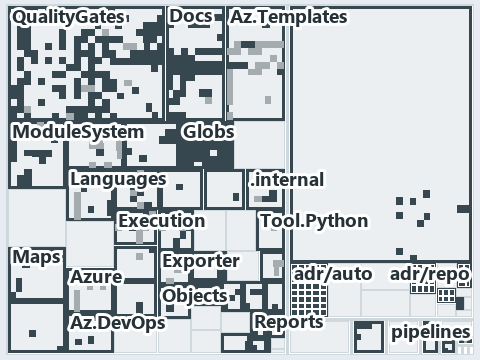

# docs/.assets/explanation/adr-flow-cd-globs--overlap-gated-for-units-and-modules--governance.tree.md

`Tree minimap: adr-flow-cd-globs--overlap-gated-for-units-and-modules--governance`

The tree minimap of the slide `adr-flow-cd-globs--overlap-gated-for-units-and-modules--governance` (governance lens). The slide supports
[ADR-AUTO-TEST][1], [ADR-FLOW-CD-GLOBS][2], [ADR-PRIN-ONELIVE][3] and [ADR-REPO-PROTGLOB][4]; the highlight of those ADR codes selects what
is lit, and each reason below names the code that selects it.

## What the minimap shows

The tree draws every file of the world map as a tile, grouped by top-level folder (under `automation/` by module, under `docs/adr/` by ADR
domain), and lights 509 files in 43 groups, filled in ink. A lit ADR file has a white rim; a file lit only by passing mentions is a lighter
ink. Every other tile is idle, a grey box: a file the slide's ADR codes do not select.

- QualityGates (automation/Catzc.Base.QualityGates): 138 lit files
- Docs (automation/Catzc.Base.Docs): 50 lit files
- Globs (automation/Catzc.Base.Globs): 49 lit files
- adr/auto (docs/adr/automation): 40 lit files
- Az.Templates (automation/Catzc.Azure.Templates): 29 lit files
- ModuleSystem (automation/Catzc.Base.ModuleSystem): 19 lit files
- adr/repo (docs/adr/repository): 16 lit files
- Azure (automation/Catzc.Azure): 11 lit files
- Languages (automation/Catzc.Base.Languages): 11 lit files
- Tool.Core (automation/Catzc.Tooling.Core): 11 lit files
- Execution (automation/Catzc.Base.Execution): 10 lit files
- docs (docs/ outside docs/adr/): 10 lit files
- Maps (automation/Catzc.Base.Maps): 9 lit files
- RootConfig (automation/Catzc.Base.RootConfig): 8 lit files
- Contracts (automation/Catzc.Base.Contracts): 7 lit files
- Tool.Provisioning (automation/Catzc.Tooling.Provisioning): 7 lit files
- adr/prin (docs/adr/principles): 7 lit files
- Az.DevOps.BuildValidation (automation/Catzc.Azure.DevOps.BuildValidation): 6 lit files
- adr/flow (docs/adr/flow): 6 lit files
- pipelines: 6 lit files
- Reports (automation/Catzc.Base.Reports): 5 lit files
- TypesSystem (automation/Catzc.Base.TypesSystem): 5 lit files
- .claude: 4 lit files
- .internal (automation/.internal): 4 lit files
- Az.DevOps (automation/Catzc.Azure.DevOps): 4 lit files
- Exporter (automation/Catzc.Base.Exporter): 4 lit files
- Tool.Inspiration (automation/Catzc.Tooling.Inspiration): 4 lit files
- Root files: 3 lit files
- Config (automation/Catzc.Base.Config): 3 lit files
- ConfigExtensions (automation/Catzc.Base.ConfigExtensions): 3 lit files
- Tool.KeyHandler (automation/Catzc.Tooling.KeyHandler): 3 lit files
- Files (automation/Catzc.Base.Files): 2 lit files
- Objects (automation/Catzc.Base.Objects): 2 lit files
- Repository (automation/Catzc.Base.Repository): 2 lit files
- Tool.Toolchain (automation/Catzc.Tooling.Toolchain): 2 lit files
- adr/* (the files directly in docs/adr/): 2 lit files
- .github: 1 lit file
- .scriptanalyzer (automation/.scriptanalyzer): 1 lit file
- Engines (automation/Catzc.Base.Engines): 1 lit file
- Environment (automation/Catzc.Base.Environment): 1 lit file
- Overlay (automation/Catzc.Base.Overlay): 1 lit file
- Timeouts (automation/Catzc.Base.Timeouts): 1 lit file
- Tool.Python (automation/Catzc.Tooling.Python): 1 lit file

## Why each group is lit

### QualityGates (138 lit files)

The group holds the files of automation/Catzc.Base.QualityGates; each sits in its world-map cell and is lit by:

- [automation/Catzc.Base.QualityGates/Get-TestTargetSkipReason.ps1][5], in the cell automation × powershell: selected by [ADR-AUTO-TEST][1]:
  the file cites it at line 6 (header) and line 8 (header).
- [automation/Catzc.Base.QualityGates/Invoke-TestFile.ps1][6], in the cell automation × powershell: selected by [ADR-AUTO-TEST][1]: the file
  cites it at line 13 (header), line 24 (header), line 28 (header), line 34 (header) and line 35 (header).
- [automation/Catzc.Base.QualityGates/Test-AnalyzerAdrMap.ps1][7], in the cell automation × powershell: selected by [ADR-AUTO-TEST][1]: the
  file cites it at line 5 (header).
- [automation/Catzc.Base.QualityGates/Test-Automation.ps1][8], in the cell automation × powershell: selected by [ADR-AUTO-TEST][1]: the file
  cites it at line 13 (header), line 19 (header), line 21 (header), line 71 (header), line 87 (header), line 172 (body comment) and line 184
  (body comment); selected by [ADR-FLOW-CD-GLOBS][2]: the file cites it at line 72 (header).
- [automation/Catzc.Base.QualityGates/Test-BuildArtifact.ps1][9], in the cell automation × powershell: selected by [ADR-AUTO-TEST][1]: the
  file cites it at line 6 (header) and line 7 (header).
- [automation/Catzc.Base.QualityGates/Test-CatzcBuild.ps1][10], in the cell automation × powershell: selected by [ADR-AUTO-TEST][1]: the
  file cites it at line 6 (header), line 16 (header) and line 36 (header).
- [automation/Catzc.Base.QualityGates/Test-Change.ps1][11], in the cell automation × powershell: selected by [ADR-AUTO-TEST][1]: the file
  cites it at line 7 (header).
- [automation/Catzc.Base.QualityGates/Test-ConfigIdentityHygiene.ps1][12], in the cell automation × powershell: selected by
  [ADR-AUTO-TEST][1]: the file cites it at line 20 (header).
- [automation/Catzc.Base.QualityGates/Test-Formatting.ps1][13], in the cell automation × powershell: selected by [ADR-AUTO-TEST][1]: the
  file cites it at line 5 (header).
- [automation/Catzc.Base.QualityGates/Test-GeneratedFiles.ps1][14], in the cell automation × powershell: selected by [ADR-AUTO-TEST][1]: the
  file cites it at line 6 (header).
- [automation/Catzc.Base.QualityGates/Test-Links.ps1][15], in the cell automation × powershell: selected by [ADR-AUTO-TEST][1]: the file
  cites it at line 19 (header).
- [automation/Catzc.Base.QualityGates/Test-LogicTestIdentity.ps1][16], in the cell automation × powershell: selected by [ADR-AUTO-TEST][1]:
  the file cites it at line 6 (header) and line 16 (header).
- [automation/Catzc.Base.QualityGates/Test-ManagedGuids.ps1][17], in the cell automation × powershell: selected by [ADR-AUTO-TEST][1]: the
  file cites it at line 5 (header); selected by [ADR-REPO-PROTGLOB][4]: the file cites it at line 11 (header).
- [automation/Catzc.Base.QualityGates/Test-ManualTestPlan.ps1][18], in the cell automation × powershell: selected by [ADR-AUTO-TEST][1]: the
  file cites it at line 5 (header) and line 10 (header).
- [automation/Catzc.Base.QualityGates/Test-MarkdownTitle.ps1][19], in the cell automation × powershell: selected by [ADR-AUTO-TEST][1]: the
  file cites it at line 12 (header).
- [automation/Catzc.Base.QualityGates/Test-Markdownlint.ps1][20], in the cell automation × powershell: selected by [ADR-AUTO-TEST][1]: the
  file cites it at line 12 (header).
- [automation/Catzc.Base.QualityGates/Test-ParameterConsistency.ps1][21], in the cell automation × powershell: selected by
  [ADR-AUTO-TEST][1]: the file cites it at line 7 (header).
- [automation/Catzc.Base.QualityGates/Test-ScriptAnalyzer.ps1][22], in the cell automation × powershell: selected by [ADR-AUTO-TEST][1]: the
  file cites it at line 16 (header).
- [automation/Catzc.Base.QualityGates/Test-ShippedConfigs.ps1][23], in the cell automation × powershell: selected by [ADR-AUTO-TEST][1]: the
  file cites it at line 5 (header).
- [automation/Catzc.Base.QualityGates/Test-SourceConventions.ps1][24], in the cell automation × powershell: selected by [ADR-AUTO-TEST][1]:
  the file cites it at line 5 (header) and line 32 (header).
- [automation/Catzc.Base.QualityGates/Test-Spelling.ps1][25], in the cell automation × powershell: selected by [ADR-AUTO-TEST][1]: the file
  cites it at line 8 (header).
- [automation/Catzc.Base.QualityGates/Test-Terminology.ps1][26], in the cell automation × powershell: selected by [ADR-AUTO-TEST][1]: the
  file cites it at line 23 (header).
- [automation/Catzc.Base.QualityGates/Test-TestTitles.ps1][27], in the cell automation × powershell: selected by [ADR-AUTO-TEST][1]: the
  file cites it at line 5 (header) and line 10 (header).
- [automation/Catzc.Base.QualityGates/configs/analyzer-adr-map.yml][28], in the cell automation × yaml: selected by [ADR-AUTO-TEST][1]: the
  file cites it at line 27 (text).
- [automation/Catzc.Base.QualityGates/configs/glossary.yml][29], in the cell automation × yaml: selected by [ADR-AUTO-TEST][1]: the file
  cites it at line 9 (text), line 25 (text), line 34 (text), line 44 (text), line 71 (text), line 86 (text), line 109 (text), line 121
  (text), line 131 (text), line 141 (text), line 156 (text) and line 170 (text).
- [automation/Catzc.Base.QualityGates/configs/source-conventions.yml][30], in the cell automation × yaml: selected by [ADR-AUTO-TEST][1]:
  the file cites it at line 30 (body comment) (a passing mention only).
- [automation/Catzc.Base.QualityGates/configs/terminology.yml][31], in the cell automation × yaml: selected by [ADR-AUTO-TEST][1]: the file
  cites it at line 26 (header); selected by [ADR-PRIN-ONELIVE][3]: the file cites it at line 576 (text); selected by [ADR-REPO-PROTGLOB][4]:
  the file cites it at line 614 (text) and line 1210 (text).
- [automation/Catzc.Base.QualityGates/configs/test-policy.yml][32], in the cell automation × yaml: selected by [ADR-AUTO-TEST][1]: the file
  cites it at line 1 (header).
- [automation/Catzc.Base.QualityGates/private/Assert-TestTagGate.ps1][33], in the cell automation × powershell: selected by
  [ADR-AUTO-TEST][1]: the file cites it at line 6 (header).
- [automation/Catzc.Base.QualityGates/private/Enter-SystemTestLock.ps1][34], in the cell automation × powershell: selected by
  [ADR-AUTO-TEST][1]: the file cites it at line 7 (header) and line 12 (header).
- [automation/Catzc.Base.QualityGates/private/Enter-TestRunLocation.ps1][35], in the cell automation × powershell: selected by
  [ADR-AUTO-TEST][1]: the file cites it at line 6 (header).
- [automation/Catzc.Base.QualityGates/private/Get-GuidScanFiles.ps1][36], in the cell automation × powershell: selected by
  [ADR-FLOW-CD-GLOBS][2]: the file cites it at line 7 (header).
- [automation/Catzc.Base.QualityGates/private/Get-LanguageTestOutcomes.ps1][37], in the cell automation × powershell: selected by
  [ADR-AUTO-TEST][1]: the file cites it at line 12 (header).
- [automation/Catzc.Base.QualityGates/private/Get-LiveIdentityTokens.ps1][38], in the cell automation × powershell: selected by
  [ADR-AUTO-TEST][1]: the file cites it at line 24 (header).
- [automation/Catzc.Base.QualityGates/private/Get-LogicTestIdentityFinding.ps1][39], in the cell automation × powershell: selected by
  [ADR-AUTO-TEST][1]: the file cites it at line 12 (header).
- [automation/Catzc.Base.QualityGates/private/Get-ModuleProtectionIdentity.ps1][40], in the cell automation × powershell: selected by
  [ADR-FLOW-CD-GLOBS][2]: the file cites it at line 143 (body comment) (a passing mention only); selected by [ADR-REPO-PROTGLOB][4]: the
  file cites it at line 5 (header).
- [automation/Catzc.Base.QualityGates/private/Get-NeutralCodeFinding.ps1][41], in the cell automation × powershell: selected by
  [ADR-AUTO-TEST][1]: the file cites it at line 6 (header).
- [automation/Catzc.Base.QualityGates/private/Get-TestFileModule.ps1][42], in the cell automation × powershell: selected by
  [ADR-REPO-PROTGLOB][4]: the file cites it at line 7 (header).
- [automation/Catzc.Base.QualityGates/private/Get-TestOptOutExclusion.ps1][43], in the cell automation × powershell: selected by
  [ADR-AUTO-TEST][1]: the file cites it at line 6 (header).
- [automation/Catzc.Base.QualityGates/private/Get-TestRunLocationEntry.ps1][44], in the cell automation × powershell: selected by
  [ADR-AUTO-TEST][1]: the file cites it at line 5 (header).
- [automation/Catzc.Base.QualityGates/private/Invoke-BuildArtifactProbe.ps1][45], in the cell automation × powershell: selected by
  [ADR-AUTO-TEST][1]: the file cites it at line 6 (header).
- [automation/Catzc.Base.QualityGates/private/Invoke-TestAutomationWorkers.ps1][46], in the cell automation × powershell: selected by
  [ADR-AUTO-TEST][1]: the file cites it at line 7 (header).
- [automation/Catzc.Base.QualityGates/private/Invoke-TestRun.ps1][47], in the cell automation × powershell: selected by [ADR-AUTO-TEST][1]:
  the file cites it at line 5 (header), line 16 (header) and line 185 (body comment); selected by [ADR-REPO-PROTGLOB][4]: the file cites it
  at line 192 (body comment) (a passing mention only).
- [automation/Catzc.Base.QualityGates/private/New-PesterRunConfiguration.ps1][48], in the cell automation × powershell: selected by
  [ADR-AUTO-TEST][1]: the file cites it at line 12 (header).
- [automation/Catzc.Base.QualityGates/private/New-TestAutomationShardScript.ps1][49], in the cell automation × powershell: selected by
  [ADR-AUTO-TEST][1]: the file cites it at line 11 (header), line 39 (header) and line 137 (body comment).
- [automation/Catzc.Base.QualityGates/private/Protect-TestedModule.ps1][50], in the cell automation × powershell: selected by
  [ADR-REPO-PROTGLOB][4]: the file cites it at line 6 (header) and line 14 (header).
- [automation/Catzc.Base.QualityGates/private/Resolve-TestRunMaxLevel.ps1][51], in the cell automation × powershell: selected by
  [ADR-AUTO-TEST][1]: the file cites it at line 7 (header) and line 20 (header).
- [automation/Catzc.Base.QualityGates/private/Resolve-TestSuite.ps1][52], in the cell automation × powershell: selected by
  [ADR-AUTO-TEST][1]: the file cites it at line 7 (header) and line 27 (text); selected by [ADR-FLOW-CD-GLOBS][2]: the file cites it at line
  9 (header).
- [automation/Catzc.Base.QualityGates/private/Select-ProtectedTestFile.ps1][53], in the cell automation × powershell: selected by
  [ADR-REPO-PROTGLOB][4]: the file cites it at line 3 (header).
- [automation/Catzc.Base.QualityGates/private/Select-TestRunFiles.ps1][54], in the cell automation × powershell: selected by
  [ADR-AUTO-TEST][1]: the file cites it at line 15 (header).
- [automation/Catzc.Base.QualityGates/private/Split-TestAutomationFiles.ps1][55], in the cell automation × powershell: selected by
  [ADR-AUTO-TEST][1]: the file cites it at line 20 (header) and line 24 (header).
- [automation/Catzc.Base.QualityGates/private/Write-TestAutomationHeader.ps1][56], in the cell automation × powershell: selected by
  [ADR-AUTO-TEST][1]: the file cites it at line 19 (header).
- [automation/Catzc.Base.QualityGates/private/Write-TestOptOutExclusion.ps1][57], in the cell automation × powershell: selected by
  [ADR-AUTO-TEST][1]: the file cites it at line 4 (header).
- [automation/Catzc.Base.QualityGates/tests/Assert-TestTagGate.Tests.ps1][58], in the cell automation × powershell: selected by
  [ADR-AUTO-TEST][1]: the file cites it at line 1 (text).
- [automation/Catzc.Base.QualityGates/tests/Build-EnglishDictionary.Tests.ps1][59], in the cell automation × powershell: selected by
  [ADR-AUTO-TEST][1]: the file cites it at line 14 (body comment) (a passing mention only).
- [automation/Catzc.Base.QualityGates/tests/ConvertTo-PesterRunTarget.Tests.ps1][60], in the cell automation × powershell: selected by
  [ADR-AUTO-TEST][1]: the file cites it at line 3 (header).
- [automation/Catzc.Base.QualityGates/tests/Enter-SystemTestLock.Tests.ps1][61], in the cell automation × powershell: selected by
  [ADR-AUTO-TEST][1]: the file cites it at line 6 (text).
- [automation/Catzc.Base.QualityGates/tests/Format-Code.Tests.ps1][62], in the cell automation × powershell: selected by [ADR-AUTO-TEST][1]:
  the file cites it at line 1 (header), line 3 (header) and line 231 (body comment).
- [automation/Catzc.Base.QualityGates/tests/Format-Links.Tests.ps1][63], in the cell automation × powershell: selected by
  [ADR-AUTO-TEST][1]: the file cites it at line 4 (header).
- [automation/Catzc.Base.QualityGates/tests/Format-MarkdownTitle.Tests.ps1][64], in the cell automation × powershell: selected by
  [ADR-AUTO-TEST][1]: the file cites it at line 40 (text).
- [automation/Catzc.Base.QualityGates/tests/Format-Types.Tests.ps1][65], in the cell automation × powershell: selected by
  [ADR-AUTO-TEST][1]: the file cites it at line 2 (header) and line 4 (header).
- [automation/Catzc.Base.QualityGates/tests/Get-AnalyzerAdrCoverage.Tests.ps1][66], in the cell automation × powershell: selected by
  [ADR-AUTO-TEST][1]: the file cites it at line 1 (text) and line 23 (body comment).
- [automation/Catzc.Base.QualityGates/tests/Get-BashTestCases.Tests.ps1][67], in the cell automation × powershell: selected by
  [ADR-AUTO-TEST][1]: the file cites it at line 3 (header).
- [automation/Catzc.Base.QualityGates/tests/Get-ChangeCheckPlan.Tests.ps1][68], in the cell automation × powershell: selected by
  [ADR-AUTO-TEST][1]: the file cites it at line 2 (header).
- [automation/Catzc.Base.QualityGates/tests/Get-ChangeTestFile.Tests.ps1][69], in the cell automation × powershell: selected by
  [ADR-AUTO-TEST][1]: the file cites it at line 2 (header).
- [automation/Catzc.Base.QualityGates/tests/Get-EngineSetFinding.Tests.ps1][70], in the cell automation × powershell: selected by
  [ADR-AUTO-TEST][1]: the file cites it at line 2 (header).
- [automation/Catzc.Base.QualityGates/tests/Get-FixtureIdentityTokens.Tests.ps1][71], in the cell automation × powershell: selected by
  [ADR-AUTO-TEST][1]: the file cites it at line 4 (header).
- [automation/Catzc.Base.QualityGates/tests/Get-FormatScope.Tests.ps1][72], in the cell automation × powershell: selected by
  [ADR-AUTO-TEST][1]: the file cites it at line 2 (header).
- [automation/Catzc.Base.QualityGates/tests/Get-GoTestCases.Tests.ps1][73], in the cell automation × powershell: selected by
  [ADR-AUTO-TEST][1]: the file cites it at line 4 (header).
- [automation/Catzc.Base.QualityGates/tests/Get-LanguageTestExecutable.Tests.ps1][74], in the cell automation × powershell: selected by
  [ADR-AUTO-TEST][1]: the file cites it at line 3 (header).
- [automation/Catzc.Base.QualityGates/tests/Get-LanguageTestFolders.Tests.ps1][75], in the cell automation × powershell: selected by
  [ADR-AUTO-TEST][1]: the file cites it at line 4 (header).
- [automation/Catzc.Base.QualityGates/tests/Get-LanguageTestOutcomes.Tests.ps1][76], in the cell automation × powershell: selected by
  [ADR-AUTO-TEST][1]: the file cites it at line 3 (header).
- [automation/Catzc.Base.QualityGates/tests/Get-LiveIdentityTokens.Tests.ps1][77], in the cell automation × powershell: selected by
  [ADR-AUTO-TEST][1]: the file cites it at line 10 (body comment) (a passing mention only).
- [automation/Catzc.Base.QualityGates/tests/Get-ModuleProtectionIdentity.Tests.ps1][78], in the cell automation × powershell: selected by
  [ADR-REPO-PROTGLOB][4]: the file cites it at line 2 (header).
- [automation/Catzc.Base.QualityGates/tests/Get-NeutralCodeFinding.Tests.ps1][79], in the cell automation × powershell: selected by
  [ADR-AUTO-TEST][1]: the file cites it at line 3 (header), line 16 (text), line 28 (text), line 40 (text), line 52 (text), line 65 (text),
  line 75 (text) and line 88 (text).
- [automation/Catzc.Base.QualityGates/tests/Get-ParameterTypeConflict.Tests.ps1][80], in the cell automation × powershell: selected by
  [ADR-AUTO-TEST][1]: the file cites it at line 2 (header).
- [automation/Catzc.Base.QualityGates/tests/Get-PythonCheckScope.Tests.ps1][81], in the cell automation × powershell: selected by
  [ADR-AUTO-TEST][1]: the file cites it at line 3 (header).
- [automation/Catzc.Base.QualityGates/tests/Get-PythonTestCases.Tests.ps1][82], in the cell automation × powershell: selected by
  [ADR-AUTO-TEST][1]: the file cites it at line 3 (header).
- [automation/Catzc.Base.QualityGates/tests/Get-RepositoryGuids.Tests.ps1][83], in the cell automation × powershell: selected by
  [ADR-AUTO-TEST][1]: the file cites it at line 62 (body comment) (a passing mention only); selected by [ADR-REPO-PROTGLOB][4]: the file
  cites it at line 64 (body comment) and line 66 (text).
- [automation/Catzc.Base.QualityGates/tests/Get-TestAutomationTestPaths.Tests.ps1][84], in the cell automation × powershell: selected by
  [ADR-AUTO-TEST][1]: the file cites it at line 3 (header).
- [automation/Catzc.Base.QualityGates/tests/Get-TestBlockTag.Tests.ps1][85], in the cell automation × powershell: selected by
  [ADR-AUTO-TEST][1]: the file cites it at line 23 (body comment) (a passing mention only).
- [automation/Catzc.Base.QualityGates/tests/Get-TestExcludeTag.Tests.ps1][86], in the cell automation × powershell: selected by
  [ADR-AUTO-TEST][1]: the file cites it at line 21 (text).
- [automation/Catzc.Base.QualityGates/tests/Get-TestFileModule.Tests.ps1][87], in the cell automation × powershell: selected by
  [ADR-AUTO-TEST][1]: the file cites it at line 2 (header).
- [automation/Catzc.Base.QualityGates/tests/Get-TestOptOutExclusion.Tests.ps1][88], in the cell automation × powershell: selected by
  [ADR-AUTO-TEST][1]: the file cites it at line 1 (text).
- [automation/Catzc.Base.QualityGates/tests/Get-TestRuleTags.Tests.ps1][89], in the cell automation × powershell: selected by
  [ADR-AUTO-TEST][1]: the file cites it at line 1 (text).
- [automation/Catzc.Base.QualityGates/tests/Get-TestRunContext.Tests.ps1][90], in the cell automation × powershell: selected by
  [ADR-AUTO-TEST][1]: the file cites it at line 2 (header).
- [automation/Catzc.Base.QualityGates/tests/Get-TestRunFile.Tests.ps1][91], in the cell automation × powershell: selected by
  [ADR-AUTO-TEST][1]: the file cites it at line 2 (header).
- [automation/Catzc.Base.QualityGates/tests/Get-TestTagViolations.Tests.ps1][92], in the cell automation × powershell: selected by
  [ADR-AUTO-TEST][1]: the file cites it at line 2 (text), line 2 (body comment), line 100 (text) and line 104 (body comment).
- [automation/Catzc.Base.QualityGates/tests/Get-TestTargetSkipReason.Tests.ps1][93], in the cell automation × powershell: selected by
  [ADR-AUTO-TEST][1]: the file cites it at line 1 (text).
- [automation/Catzc.Base.QualityGates/tests/Invoke-BicepFormat.Tests.ps1][94], in the cell automation × powershell: selected by
  [ADR-AUTO-TEST][1]: the file cites it at line 1 (header) and line 3 (header).
- [automation/Catzc.Base.QualityGates/tests/Invoke-DotnetFormat.Tests.ps1][95], in the cell automation × powershell: selected by
  [ADR-AUTO-TEST][1]: the file cites it at line 1 (header) and line 3 (header).
- [automation/Catzc.Base.QualityGates/tests/Invoke-Gofmt.Tests.ps1][96], in the cell automation × powershell: selected by
  [ADR-AUTO-TEST][1]: the file cites it at line 1 (header) and line 3 (header).
- [automation/Catzc.Base.QualityGates/tests/Invoke-Prettier.Tests.ps1][97], in the cell automation × powershell: selected by
  [ADR-AUTO-TEST][1]: the file cites it at line 1 (header) and line 3 (header).
- [automation/Catzc.Base.QualityGates/tests/Invoke-PythonWorkspaceTool.Tests.ps1][98], in the cell automation × powershell: selected by
  [ADR-AUTO-TEST][1]: the file cites it at line 2 (header).
- [automation/Catzc.Base.QualityGates/tests/Invoke-RuffFormat.Tests.ps1][99], in the cell automation × powershell: selected by
  [ADR-AUTO-TEST][1]: the file cites it at line 1 (header) and line 3 (header).
- [automation/Catzc.Base.QualityGates/tests/Invoke-TestFile.Tests.ps1][100], in the cell automation × powershell: selected by
  [ADR-AUTO-TEST][1]: the file cites it at line 77 (body comment), line 83 (body comment), line 127 (body comment) and line 132 (body
  comment) (a passing mention only).
- [automation/Catzc.Base.QualityGates/tests/Invoke-TestRun.Tests.ps1][101], in the cell automation × powershell: selected by
  [ADR-AUTO-TEST][1]: the file cites it at line 85 (text), line 110 (text), line 183 (text), line 198 (text), line 198 (body comment) and
  line 238 (text).
- [automation/Catzc.Base.QualityGates/tests/Language.Bridge.ps1][102], in the cell automation × powershell: selected by [ADR-AUTO-TEST][1]:
  the file cites it at line 8 (header), line 13 (header) and line 15 (header).
- [automation/Catzc.Base.QualityGates/tests/ManualTestPlan-Coverage.Tests.ps1][103], in the cell automation × powershell: selected by
  [ADR-AUTO-TEST][1]: the file cites it at line 2 (header) and line 4 (header).
- [automation/Catzc.Base.QualityGates/tests/Measure-QualityGates.Tests.ps1][104], in the cell automation × powershell: selected by
  [ADR-AUTO-TEST][1]: the file cites it at line 3 (header).
- [automation/Catzc.Base.QualityGates/tests/New-TestAutomationShardScript.Tests.ps1][105], in the cell automation × powershell: selected by
  [ADR-AUTO-TEST][1]: the file cites it at line 44 (body comment) (a passing mention only).
- [automation/Catzc.Base.QualityGates/tests/New-TestRunFinalManifest.Tests.ps1][106], in the cell automation × powershell: selected by
  [ADR-AUTO-TEST][1]: the file cites it at line 30 (body comment) (a passing mention only).
- [automation/Catzc.Base.QualityGates/tests/Resolve-TestSuite.Tests.ps1][107], in the cell automation × powershell: selected by
  [ADR-AUTO-TEST][1]: the file cites it at line 2 (text) and line 13 (text).
- [automation/Catzc.Base.QualityGates/tests/Save-TestDurationHistory.Tests.ps1][108], in the cell automation × powershell: selected by
  [ADR-AUTO-TEST][1]: the file cites it at line 2 (header).
- [automation/Catzc.Base.QualityGates/tests/Select-RuleTaggedFiles.Tests.ps1][109], in the cell automation × powershell: selected by
  [ADR-AUTO-TEST][1]: the file cites it at line 1 (text).
- [automation/Catzc.Base.QualityGates/tests/Select-TestShardAssignment.Tests.ps1][110], in the cell automation × powershell: selected by
  [ADR-AUTO-TEST][1]: the file cites it at line 2 (header).
- [automation/Catzc.Base.QualityGates/tests/Split-CachedFile.Tests.ps1][111], in the cell automation × powershell: selected by
  [ADR-AUTO-TEST][1]: the file cites it at line 3 (header).
- [automation/Catzc.Base.QualityGates/tests/Split-TestAutomationFiles.Tests.ps1][112], in the cell automation × powershell: selected by
  [ADR-AUTO-TEST][1]: the file cites it at line 16 (text).
- [automation/Catzc.Base.QualityGates/tests/Test-AnalyzerAdrMap.Tests.ps1][113], in the cell automation × powershell: selected by
  [ADR-AUTO-TEST][1]: the file cites it at line 2 (header).
- [automation/Catzc.Base.QualityGates/tests/Test-Automation.Tests.ps1][114], in the cell automation × powershell: selected by
  [ADR-AUTO-TEST][1]: the file cites it at line 2 (header) and line 18 (body comment).
- [automation/Catzc.Base.QualityGates/tests/Test-BuildArtifact.Tests.ps1][115], in the cell automation × powershell: selected by
  [ADR-AUTO-TEST][1]: the file cites it at line 2 (header), line 57 (text), line 66 (text) and line 81 (text).
- [automation/Catzc.Base.QualityGates/tests/Test-CatzcBuild.Tests.ps1][116], in the cell automation × powershell: selected by
  [ADR-AUTO-TEST][1]: the file cites it at line 1 (text).
- [automation/Catzc.Base.QualityGates/tests/Test-Change.Tests.ps1][117], in the cell automation × powershell: selected by
  [ADR-AUTO-TEST][1]: the file cites it at line 4 (header).
- [automation/Catzc.Base.QualityGates/tests/Test-ConfigIdentityHygiene.Tests.ps1][118], in the cell automation × powershell: selected by
  [ADR-AUTO-TEST][1]: the file cites it at line 3 (header), line 4 (header), line 52 (text), line 56 (text) and line 74 (text).
- [automation/Catzc.Base.QualityGates/tests/Test-Formatting.Tests.ps1][119], in the cell automation × powershell: selected by
  [ADR-AUTO-TEST][1]: the file cites it at line 1 (header), line 3 (header), line 29 (body comment), line 37 (text) and line 79 (body
  comment).
- [automation/Catzc.Base.QualityGates/tests/Test-GeneratedFiles.Tests.ps1][120], in the cell automation × powershell: selected by
  [ADR-AUTO-TEST][1]: the file cites it at line 2 (header), line 23 (text), line 29 (text) and line 43 (text).
- [automation/Catzc.Base.QualityGates/tests/Test-Links.Tests.ps1][121], in the cell automation × powershell: selected by [ADR-AUTO-TEST][1]:
  the file cites it at line 3 (header), line 5 (header), line 24 (body comment), line 29 (body comment) and line 42 (body comment).
- [automation/Catzc.Base.QualityGates/tests/Test-Links.Untracked.Tests.ps1][122], in the cell automation × powershell: selected by
  [ADR-AUTO-TEST][1]: the file cites it at line 4 (header).
- [automation/Catzc.Base.QualityGates/tests/Test-LogicTestIdentity.Tests.ps1][123], in the cell automation × powershell: selected by
  [ADR-AUTO-TEST][1]: the file cites it at line 3 (header), line 6 (header), line 7 (header), line 43 (text), line 47 (text) and line 52
  (text).
- [automation/Catzc.Base.QualityGates/tests/Test-ManagedGuids.Tests.ps1][124], in the cell automation × powershell: selected by
  [ADR-AUTO-TEST][1]: the file cites it at line 2 (header).
- [automation/Catzc.Base.QualityGates/tests/Test-ManualTestPlan.Tests.ps1][125], in the cell automation × powershell: selected by
  [ADR-AUTO-TEST][1]: the file cites it at line 3 (header).
- [automation/Catzc.Base.QualityGates/tests/Test-Markdownlint.Tests.ps1][126], in the cell automation × powershell: selected by
  [ADR-AUTO-TEST][1]: the file cites it at line 19 (text), line 29 (text), line 39 (text), line 103 (body comment) and line 105 (body
  comment); selected by [ADR-REPO-PROTGLOB][4]: the file cites it at line 106 (body comment) (a passing mention only).
- [automation/Catzc.Base.QualityGates/tests/Test-ParameterConsistency.Tests.ps1][127], in the cell automation × powershell: selected by
  [ADR-AUTO-TEST][1]: the file cites it at line 1 (header) and line 4 (header).
- [automation/Catzc.Base.QualityGates/tests/Test-PythonLint.Tests.ps1][128], in the cell automation × powershell: selected by
  [ADR-AUTO-TEST][1]: the file cites it at line 1 (header), line 3 (header), line 29 (text) and line 60 (body comment).
- [automation/Catzc.Base.QualityGates/tests/Test-ScriptAnalyzer.Tests.ps1][129], in the cell automation × powershell: selected by
  [ADR-AUTO-TEST][1]: the file cites it at line 37 (text), line 46 (text) and line 58 (text).
- [automation/Catzc.Base.QualityGates/tests/Test-ShellScripts.Tests.ps1][130], in the cell automation × powershell: selected by
  [ADR-AUTO-TEST][1]: the file cites it at line 1 (header), line 4 (header) and line 162 (body comment).
- [automation/Catzc.Base.QualityGates/tests/Test-ShippedConfigs.Tests.ps1][131], in the cell automation × powershell: selected by
  [ADR-AUTO-TEST][1]: the file cites it at line 2 (header).
- [automation/Catzc.Base.QualityGates/tests/Test-SourceConventions.Tests.ps1][132], in the cell automation × powershell: selected by
  [ADR-AUTO-TEST][1]: the file cites it at line 3 (header), line 96 (body comment) and line 107 (body comment).
- [automation/Catzc.Base.QualityGates/tests/Test-Spelling.Tests.ps1][133], in the cell automation × powershell: selected by
  [ADR-AUTO-TEST][1]: the file cites it at line 20 (text), line 29 (text), line 43 (text), line 115 (body comment) and line 117 (body
  comment); selected by [ADR-REPO-PROTGLOB][4]: the file cites it at line 118 (body comment) and line 124 (text).
- [automation/Catzc.Base.QualityGates/tests/Test-TestTitles.Tests.ps1][134], in the cell automation × powershell: selected by
  [ADR-AUTO-TEST][1]: the file cites it at line 3 (header).
- [automation/Catzc.Base.QualityGates/tests/TestTitle-TemplateTokens.Tests.ps1][135], in the cell automation × powershell: selected by
  [ADR-AUTO-TEST][1]: the file cites it at line 2 (header) and line 6 (header).
- [automation/Catzc.Base.QualityGates/tests/Write-TestAutomationRuleCoverage.Tests.ps1][136], in the cell automation × powershell: selected
  by [ADR-AUTO-TEST][1]: the file cites it at line 1 (text).
- [automation/Catzc.Base.QualityGates/tests/Write-TestRunFailures.Tests.ps1][137], in the cell automation × powershell: selected by
  [ADR-AUTO-TEST][1]: the file cites it at line 3 (header).
- [automation/Catzc.Base.QualityGates/tests/types/EngineSetCheck.Tests.ps1][138], in the cell automation × powershell: selected by
  [ADR-AUTO-TEST][1]: the file cites it at line 3 (header).
- [automation/Catzc.Base.QualityGates/tests/types/SpellingOracle.Tests.ps1][139], in the cell automation × powershell: selected by
  [ADR-AUTO-TEST][1]: the file cites it at line 35 (body comment) (a passing mention only).
- [automation/Catzc.Base.QualityGates/types/IdentityTokenRule.cs][140], in the cell automation × csharp: selected by [ADR-AUTO-TEST][1]: the
  file cites it at line 3 (header).
- [automation/Catzc.Base.QualityGates/types/SourceConventionsConfig.cs][141], in the cell automation × csharp: selected by
  [ADR-AUTO-TEST][1]: the file cites it at line 8 (header).
- [automation/Catzc.Base.QualityGates/types/TestPolicyConfig.cs][142], in the cell automation × csharp: selected by [ADR-AUTO-TEST][1]: the
  file cites it at line 2 (header).

### Docs (50 lit files)

The group holds the files of automation/Catzc.Base.Docs; each sits in its world-map cell and is lit by:

- [automation/Catzc.Base.Docs/Test-AdrEngineNeutrality.ps1][143], in the cell automation × powershell: selected by [ADR-AUTO-TEST][1]: the
  file cites it at line 5 (header).
- [automation/Catzc.Base.Docs/Test-AdrRegistry.ps1][144], in the cell automation × powershell: selected by [ADR-AUTO-TEST][1]: the file
  cites it at line 5 (header).
- [automation/Catzc.Base.Docs/Test-AgentDefinitions.ps1][145], in the cell automation × powershell: selected by [ADR-AUTO-TEST][1]: the file
  cites it at line 5 (header).
- [automation/Catzc.Base.Docs/Test-GeneratedReadmes.ps1][146], in the cell automation × powershell: selected by [ADR-AUTO-TEST][1]: the file
  cites it at line 5 (header).
- [automation/Catzc.Base.Docs/Test-Glossary.ps1][147], in the cell automation × powershell: selected by [ADR-AUTO-TEST][1]: the file cites
  it at line 17 (header).
- [automation/Catzc.Base.Docs/configs/adr-checks.yml][148], in the cell automation × yaml: selected by [ADR-AUTO-TEST][1]: the file cites it
  at line 6 (header).
- [automation/Catzc.Base.Docs/configs/adrs.yml][149], in the cell automation × yaml: selected by [ADR-AUTO-TEST][1]: the file cites it at
  line 145 (text); selected by [ADR-FLOW-CD-GLOBS][2]: the file cites it at line 122 (text); selected by [ADR-PRIN-ONELIVE][3]: the file
  cites it at line 56 (text); selected by [ADR-REPO-PROTGLOB][4]: the file cites it at line 322 (text).
- [automation/Catzc.Base.Docs/configs/agents.yml][150], in the cell automation × yaml: selected by [ADR-AUTO-TEST][1]: the file cites it at
  line 57 (text), line 57 (body comment) and line 57 (body comment).
- [automation/Catzc.Base.Docs/private/Get-GlossaryRuleStatements.ps1][151], in the cell automation × powershell: selected by
  [ADR-AUTO-TEST][1]: the file cites it at line 18 (header).
- [automation/Catzc.Base.Docs/tests/Build-Glossary.Tests.ps1][152], in the cell automation × powershell: selected by [ADR-AUTO-TEST][1]: the
  file cites it at line 4 (header).
- [automation/Catzc.Base.Docs/tests/ConvertTo-AdrDomainDiagram.Tests.ps1][153], in the cell automation × powershell: selected by
  [ADR-AUTO-TEST][1]: the file cites it at line 2 (header).
- [automation/Catzc.Base.Docs/tests/Get-AdrCitationGraphViolations.Tests.ps1][154], in the cell automation × powershell: selected by
  [ADR-AUTO-TEST][1]: the file cites it at line 3 (header) and line 4 (text).
- [automation/Catzc.Base.Docs/tests/Get-AdrCitationMap.Tests.ps1][155], in the cell automation × powershell: selected by [ADR-AUTO-TEST][1]:
  the file cites it at line 4 (header).
- [automation/Catzc.Base.Docs/tests/Get-AdrDomainEdges.Tests.ps1][156], in the cell automation × powershell: selected by [ADR-AUTO-TEST][1]:
  the file cites it at line 3 (header).
- [automation/Catzc.Base.Docs/tests/Get-AdrDoraCoverageViolations.Tests.ps1][157], in the cell automation × powershell: selected by
  [ADR-AUTO-TEST][1]: the file cites it at line 3 (header) and line 4 (text).
- [automation/Catzc.Base.Docs/tests/Get-AdrFileIndex.Tests.ps1][158], in the cell automation × powershell: selected by [ADR-AUTO-TEST][1]:
  the file cites it at line 3 (header).
- [automation/Catzc.Base.Docs/tests/Get-AdrRuleSet.Tests.ps1][159], in the cell automation × powershell: selected by [ADR-AUTO-TEST][1]: the
  file cites it at line 3 (header) and line 42 (body comment).
- [automation/Catzc.Base.Docs/tests/Get-AdrRuleSummaryLines.Tests.ps1][160], in the cell automation × powershell: selected by
  [ADR-AUTO-TEST][1]: the file cites it at line 2 (header).
- [automation/Catzc.Base.Docs/tests/Get-AgentFrontMatter.Tests.ps1][161], in the cell automation × powershell: selected by
  [ADR-AUTO-TEST][1]: the file cites it at line 2 (header).
- [automation/Catzc.Base.Docs/tests/Get-CatsRuleEnforcers.Tests.ps1][162], in the cell automation × powershell: selected by
  [ADR-AUTO-TEST][1]: the file cites it at line 4 (header).
- [automation/Catzc.Base.Docs/tests/Get-ClaudeMdAgentNames.Tests.ps1][163], in the cell automation × powershell: selected by
  [ADR-AUTO-TEST][1]: the file cites it at line 2 (header).
- [automation/Catzc.Base.Docs/tests/Get-Glossary.Tests.ps1][164], in the cell automation × powershell: selected by [ADR-AUTO-TEST][1]: the
  file cites it at line 6 (header).
- [automation/Catzc.Base.Docs/tests/Get-GlossaryAnchorViolations.Tests.ps1][165], in the cell automation × powershell: selected by
  [ADR-AUTO-TEST][1]: the file cites it at line 6 (header).
- [automation/Catzc.Base.Docs/tests/Get-GlossaryDefinitionViolations.Tests.ps1][166], in the cell automation × powershell: selected by
  [ADR-AUTO-TEST][1]: the file cites it at line 5 (header).
- [automation/Catzc.Base.Docs/tests/Get-GlossaryEnforcementViolations.Tests.ps1][167], in the cell automation × powershell: selected by
  [ADR-AUTO-TEST][1]: the file cites it at line 6 (header).
- [automation/Catzc.Base.Docs/tests/Get-GlossaryFormViolations.Tests.ps1][168], in the cell automation × powershell: selected by
  [ADR-AUTO-TEST][1]: the file cites it at line 5 (header).
- [automation/Catzc.Base.Docs/tests/Get-GlossaryPhrasingViolations.Tests.ps1][169], in the cell automation × powershell: selected by
  [ADR-AUTO-TEST][1]: the file cites it at line 6 (header).
- [automation/Catzc.Base.Docs/tests/Get-GlossaryRuleStatements.Tests.ps1][170], in the cell automation × powershell: selected by
  [ADR-AUTO-TEST][1]: the file cites it at line 4 (header).
- [automation/Catzc.Base.Docs/tests/Get-GlossarySourceViolations.Tests.ps1][171], in the cell automation × powershell: selected by
  [ADR-AUTO-TEST][1]: the file cites it at line 5 (header).
- [automation/Catzc.Base.Docs/tests/Get-GlossarySources.Tests.ps1][172], in the cell automation × powershell: selected by
  [ADR-AUTO-TEST][1]: the file cites it at line 6 (header).
- [automation/Catzc.Base.Docs/tests/Resolve-AdrLinkTarget.Tests.ps1][173], in the cell automation × powershell: selected by
  [ADR-AUTO-TEST][1]: the file cites it at line 3 (header).
- [automation/Catzc.Base.Docs/tests/Test-AdrEngineNeutrality.Tests.ps1][174], in the cell automation × powershell: selected by
  [ADR-AUTO-TEST][1]: the file cites it at line 3 (header), line 4 (text) and line 126 (text).
- [automation/Catzc.Base.Docs/tests/Test-AdrRegistry.Tests.ps1][175], in the cell automation × powershell: selected by [ADR-AUTO-TEST][1]:
  the file cites it at line 3 (header), line 4 (text) and line 136 (text).
- [automation/Catzc.Base.Docs/tests/Test-AgentDefinitions.Tests.ps1][176], in the cell automation × powershell: selected by
  [ADR-AUTO-TEST][1]: the file cites it at line 3 (header), line 45 (text), line 104 (text) and line 115 (text).
- [automation/Catzc.Base.Docs/tests/Test-GeneratedReadmes.Tests.ps1][177], in the cell automation × powershell: selected by
  [ADR-AUTO-TEST][1]: the file cites it at line 3 (header).
- [automation/Catzc.Base.Docs/tests/Test-Glossary.Tests.ps1][178], in the cell automation × powershell: selected by [ADR-AUTO-TEST][1]: the
  file cites it at line 47 (body comment), line 82 (body comment), line 83 (body comment) and line 96 (text).
- [automation/Catzc.Base.Docs/tests/Update-AdrCitation.Tests.ps1][179], in the cell automation × powershell: selected by [ADR-AUTO-TEST][1]:
  the file cites it at line 3 (header).
- [automation/Catzc.Base.Docs/tests/assets/glossary/gadget/glossary.yml][180], in the cell automation × yaml: selected by
  [ADR-AUTO-TEST][1]: the file cites it at line 1 (header) and line 6 (text).
- [automation/Catzc.Base.Docs/tests/assets/glossary/widget/glossary.yml][181], in the cell automation × yaml: selected by
  [ADR-AUTO-TEST][1]: the file cites it at line 1 (header), line 8 (text) and line 16 (text).
- [automation/Catzc.Base.Docs/tests/types/AdrChecksConfig.Tests.ps1][182], in the cell automation × powershell: selected by
  [ADR-AUTO-TEST][1]: the file cites it at line 2 (header).
- [automation/Catzc.Base.Docs/tests/types/AdrDomainEdge.Tests.ps1][183], in the cell automation × powershell: selected by
  [ADR-AUTO-TEST][1]: the file cites it at line 2 (header).
- [automation/Catzc.Base.Docs/tests/types/AgentEntry.Tests.ps1][184], in the cell automation × powershell: selected by [ADR-AUTO-TEST][1]:
  the file cites it at line 3 (header).
- [automation/Catzc.Base.Docs/tests/types/AgentsConfig.Tests.ps1][185], in the cell automation × powershell: selected by [ADR-AUTO-TEST][1]:
  the file cites it at line 3 (header).
- [automation/Catzc.Base.Docs/tests/types/CheckModes.Tests.ps1][186], in the cell automation × powershell: selected by [ADR-AUTO-TEST][1]:
  the file cites it at line 3 (header); selected by [ADR-PRIN-ONELIVE][3]: the file cites it at line 4 (text).
- [automation/Catzc.Base.Docs/tests/types/GlossaryConfig.Tests.ps1][187], in the cell automation × powershell: selected by
  [ADR-AUTO-TEST][1]: the file cites it at line 5 (header).
- [automation/Catzc.Base.Docs/tests/types/GlossaryEntry.Tests.ps1][188], in the cell automation × powershell: selected by
  [ADR-AUTO-TEST][1]: the file cites it at line 3 (header).
- [automation/Catzc.Base.Docs/types/AdrChecksConfig.cs][189], in the cell automation × csharp: selected by [ADR-AUTO-TEST][1]: the file
  cites it at line 13 (header).
- [automation/Catzc.Base.Docs/types/CheckMode.cs][190], in the cell automation × csharp: selected by [ADR-AUTO-TEST][1]: the file cites it
  at line 5 (header).
- [automation/Catzc.Base.Docs/types/CheckModes.cs][191], in the cell automation × csharp: selected by [ADR-PRIN-ONELIVE][3]: the file cites
  it at line 3 (header).
- [automation/Catzc.Base.Docs/types/GlossaryConcept.cs][192], in the cell automation × csharp: selected by [ADR-AUTO-TEST][1]: the file
  cites it at line 40 (body comment) (a passing mention only).

### Globs (49 lit files)

The group holds the files of automation/Catzc.Base.Globs; each sits in its world-map cell and is lit by:

- [automation/Catzc.Base.Globs/Clear-GlobSetProtection.ps1][193], in the cell automation × powershell: selected by [ADR-REPO-PROTGLOB][4]:
  the file cites it at line 6 (header).
- [automation/Catzc.Base.Globs/Get-ChangedGlobSet.ps1][194], in the cell automation × powershell: selected by [ADR-FLOW-CD-GLOBS][2]: the
  file cites it at line 4 (header) and line 8 (header).
- [automation/Catzc.Base.Globs/Get-GlobSet.ps1][195], in the cell automation × powershell: selected by [ADR-FLOW-CD-GLOBS][2]: the file
  cites it at line 6 (header).
- [automation/Catzc.Base.Globs/Get-GlobSetChangeRange.ps1][196], in the cell automation × powershell: selected by [ADR-REPO-PROTGLOB][4]:
  the file cites it at line 20 (header).
- [automation/Catzc.Base.Globs/Get-GlobSetFile.ps1][197], in the cell automation × powershell: selected by [ADR-FLOW-CD-GLOBS][2]: the file
  cites it at line 6 (header) and line 9 (header).
- [automation/Catzc.Base.Globs/Get-GlobSetHash.ps1][198], in the cell automation × powershell: selected by [ADR-FLOW-CD-GLOBS][2]: the file
  cites it at line 4 (header) and line 10 (header).
- [automation/Catzc.Base.Globs/Get-GlobSetTrigger.ps1][199], in the cell automation × powershell: selected by [ADR-FLOW-CD-GLOBS][2]: the
  file cites it at line 4 (header) and line 7 (header).
- [automation/Catzc.Base.Globs/Get-MarkerBlastRadius.ps1][200], in the cell automation × powershell: selected by [ADR-FLOW-CD-GLOBS][2]: the
  file cites it at line 6 (header); selected by [ADR-REPO-PROTGLOB][4]: the file cites it at line 10 (header).
- [automation/Catzc.Base.Globs/Get-ModuleGlobSet.ps1][201], in the cell automation × powershell: selected by [ADR-FLOW-CD-GLOBS][2]: the
  file cites it at line 72 (body comment), line 75 (body comment) and line 163 (body comment) (a passing mention only); selected by
  [ADR-REPO-PROTGLOB][4]: the file cites it at line 5 (header), line 23 (header), line 113 (text), line 120 (text), line 148 (text) and line
  166 (text).
- [automation/Catzc.Base.Globs/Get-TrackedFile.ps1][202], in the cell automation × powershell: selected by [ADR-FLOW-CD-GLOBS][2]: the file
  cites it at line 6 (header).
- [automation/Catzc.Base.Globs/Protect-GlobSet.ps1][203], in the cell automation × powershell: selected by [ADR-REPO-PROTGLOB][4]: the file
  cites it at line 6 (header) and line 19 (header).
- [automation/Catzc.Base.Globs/Test-AdoPipelineTriggerGlob.ps1][204], in the cell automation × powershell: selected by [ADR-AUTO-TEST][1]:
  the file cites it at line 14 (header); selected by [ADR-FLOW-CD-GLOBS][2]: the file cites it at line 4 (header).
- [automation/Catzc.Base.Globs/Test-GitHubWorkflowTriggerGlob.ps1][205], in the cell automation × powershell: selected by
  [ADR-AUTO-TEST][1]: the file cites it at line 14 (header); selected by [ADR-FLOW-CD-GLOBS][2]: the file cites it at line 4 (header).
- [automation/Catzc.Base.Globs/Test-GlobSetAffected.ps1][206], in the cell automation × powershell: selected by [ADR-FLOW-CD-GLOBS][2]: the
  file cites it at line 10 (header); selected by [ADR-REPO-PROTGLOB][4]: the file cites it at line 14 (header).
- [automation/Catzc.Base.Globs/Test-GlobSetIndependence.ps1][207], in the cell automation × powershell: selected by [ADR-AUTO-TEST][1]: the
  file cites it at line 18 (header); selected by [ADR-FLOW-CD-GLOBS][2]: the file cites it at line 4 (header), line 13 (header), line 42
  (body comment), line 50 (body comment) and line 79 (text); selected by [ADR-REPO-PROTGLOB][4]: the file cites it at line 16 (header).
- [automation/Catzc.Base.Globs/Test-GlobSetProtection.ps1][208], in the cell automation × powershell: selected by [ADR-REPO-PROTGLOB][4]:
  the file cites it at line 6 (header).
- [automation/Catzc.Base.Globs/Test-GlobSetTriggerCoverage.ps1][209], in the cell automation × powershell: selected by [ADR-AUTO-TEST][1]:
  the file cites it at line 5 (header); selected by [ADR-FLOW-CD-GLOBS][2]: the file cites it at line 7 (header).
- [automation/Catzc.Base.Globs/configs/globs.yml][210], in the cell automation × yaml: selected by [ADR-FLOW-CD-GLOBS][2]: the file cites it
  at line 2 (header), line 7 (header), line 15 (header), line 17 (header), line 26 (body comment), line 61 (body comment) and line 81 (body
  comment); selected by [ADR-REPO-PROTGLOB][4]: the file cites it at line 13 (header) and line 174 (body comment).
- [automation/Catzc.Base.Globs/private/Get-ChangedFile.ps1][211], in the cell automation × powershell: selected by [ADR-FLOW-CD-GLOBS][2]:
  the file cites it at line 7 (header).
- [automation/Catzc.Base.Globs/private/Get-GlobSetMember.ps1][212], in the cell automation × powershell: selected by [ADR-FLOW-CD-GLOBS][2]:
  the file cites it at line 6 (header).
- [automation/Catzc.Base.Globs/private/Get-PipelineTrigger.ps1][213], in the cell automation × powershell: selected by
  [ADR-FLOW-CD-GLOBS][2]: the file cites it at line 7 (header).
- [automation/Catzc.Base.Globs/private/Test-GlobListEqual.ps1][214], in the cell automation × powershell: selected by
  [ADR-FLOW-CD-GLOBS][2]: the file cites it at line 11 (header).
- [automation/Catzc.Base.Globs/tests/Get-ChangedFile.Tests.ps1][215], in the cell automation × powershell: selected by
  [ADR-FLOW-CD-GLOBS][2]: the file cites it at line 2 (header).
- [automation/Catzc.Base.Globs/tests/Get-ChangedGlobSet.Tests.ps1][216], in the cell automation × powershell: selected by
  [ADR-AUTO-TEST][1]: the file cites it at line 7 (body comment) (a passing mention only); selected by [ADR-FLOW-CD-GLOBS][2]: the file
  cites it at line 2 (header).
- [automation/Catzc.Base.Globs/tests/Get-GlobSet.Tests.ps1][217], in the cell automation × powershell: selected by [ADR-AUTO-TEST][1]: the
  file cites it at line 6 (body comment) (a passing mention only).
- [automation/Catzc.Base.Globs/tests/Get-GlobSetFile.Tests.ps1][218], in the cell automation × powershell: selected by
  [ADR-FLOW-CD-GLOBS][2]: the file cites it at line 2 (header) and line 3 (header).
- [automation/Catzc.Base.Globs/tests/Get-GlobSetHash.Tests.ps1][219], in the cell automation × powershell: selected by
  [ADR-FLOW-CD-GLOBS][2]: the file cites it at line 2 (header).
- [automation/Catzc.Base.Globs/tests/Get-GlobSetMember.Tests.ps1][220], in the cell automation × powershell: selected by
  [ADR-FLOW-CD-GLOBS][2]: the file cites it at line 2 (header).
- [automation/Catzc.Base.Globs/tests/Get-GlobSetTrigger.Tests.ps1][221], in the cell automation × powershell: selected by
  [ADR-FLOW-CD-GLOBS][2]: the file cites it at line 2 (header).
- [automation/Catzc.Base.Globs/tests/Get-ModuleGlobSet.Tests.ps1][222], in the cell automation × powershell: selected by [ADR-AUTO-TEST][1]:
  the file cites it at line 16 (body comment) (a passing mention only); selected by [ADR-REPO-PROTGLOB][4]: the file cites it at line 1
  (header) and line 122 (body comment).
- [automation/Catzc.Base.Globs/tests/Get-PipelineTrigger.Tests.ps1][223], in the cell automation × powershell: selected by
  [ADR-FLOW-CD-GLOBS][2]: the file cites it at line 2 (header).
- [automation/Catzc.Base.Globs/tests/Get-TrackedFile.Tests.ps1][224], in the cell automation × powershell: selected by
  [ADR-FLOW-CD-GLOBS][2]: the file cites it at line 1 (header).
- [automation/Catzc.Base.Globs/tests/GlobSet-Independence.Tests.ps1][225], in the cell automation × powershell: selected by
  [ADR-FLOW-CD-GLOBS][2]: the file cites it at line 2 (header), line 10 (text) and line 12 (text).
- [automation/Catzc.Base.Globs/tests/GlobSetTrigger-Coverage.Tests.ps1][226], in the cell automation × powershell: selected by
  [ADR-AUTO-TEST][1]: the file cites it at line 3 (header); selected by [ADR-FLOW-CD-GLOBS][2]: the file cites it at line 2 (header).
- [automation/Catzc.Base.Globs/tests/PipelineTrigger-Integrity.Tests.ps1][227], in the cell automation × powershell: selected by
  [ADR-FLOW-CD-GLOBS][2]: the file cites it at line 3 (header).
- [automation/Catzc.Base.Globs/tests/Test-AdoPipelineTriggerGlob.Tests.ps1][228], in the cell automation × powershell: selected by
  [ADR-AUTO-TEST][1]: the file cites it at line 2 (header), line 19 (text), line 30 (text) and line 42 (text).
- [automation/Catzc.Base.Globs/tests/Test-GitHubWorkflowTriggerGlob.Tests.ps1][229], in the cell automation × powershell: selected by
  [ADR-AUTO-TEST][1]: the file cites it at line 2 (header), line 4 (header), line 18 (text), line 25 (text) and line 36 (text).
- [automation/Catzc.Base.Globs/tests/Test-GlobSetAffected.Tests.ps1][230], in the cell automation × powershell: selected by
  [ADR-AUTO-TEST][1]: the file cites it at line 7 (body comment) (a passing mention only); selected by [ADR-REPO-PROTGLOB][4]: the file
  cites it at line 3 (header).
- [automation/Catzc.Base.Globs/tests/Test-GlobSetIndependence.Tests.ps1][231], in the cell automation × powershell: selected by
  [ADR-AUTO-TEST][1]: the file cites it at line 2 (header), line 5 (header), line 29 (text), line 37 (text) and line 50 (text); selected by
  [ADR-FLOW-CD-GLOBS][2]: the file cites it at line 3 (header).
- [automation/Catzc.Base.Globs/tests/Test-GlobSetProtection.Tests.ps1][232], in the cell automation × powershell: selected by
  [ADR-REPO-PROTGLOB][4]: the file cites it at line 1 (header) and line 98 (body comment).
- [automation/Catzc.Base.Globs/tests/Test-GlobSetTriggerCoverage.Tests.ps1][233], in the cell automation × powershell: selected by
  [ADR-AUTO-TEST][1]: the file cites it at line 2 (header).
- [automation/Catzc.Base.Globs/tests/types/GlobPattern.Tests.ps1][234], in the cell automation × powershell: selected by
  [ADR-FLOW-CD-GLOBS][2]: the file cites it at line 1 (header), line 3 (header) and line 63 (text).
- [automation/Catzc.Base.Globs/tests/types/GlobSet.Tests.ps1][235], in the cell automation × powershell: selected by [ADR-FLOW-CD-GLOBS][2]:
  the file cites it at line 2 (header), line 4 (header) and line 15 (text).
- [automation/Catzc.Base.Globs/tests/types/GlobsConfig.Tests.ps1][236], in the cell automation × powershell: selected by [ADR-AUTO-TEST][1]:
  the file cites it at line 32 (body comment) and line 50 (body comment) (a passing mention only); selected by [ADR-FLOW-CD-GLOBS][2]: the
  file cites it at line 3 (header), line 5 (header), line 13 (body comment), line 62 (text), line 75 (text), line 86 (text) and line 98
  (text).
- [automation/Catzc.Base.Globs/types/Aspect.cs][237], in the cell automation × csharp: selected by [ADR-FLOW-CD-GLOBS][2]: the file cites it
  at line 9 (header).
- [automation/Catzc.Base.Globs/types/DurableHash.cs][238], in the cell automation × csharp: selected by [ADR-FLOW-CD-GLOBS][2]: the file
  cites it at line 1 (header) and line 7 (header).
- [automation/Catzc.Base.Globs/types/GlobPattern.cs][239], in the cell automation × csharp: selected by [ADR-FLOW-CD-GLOBS][2]: the file
  cites it at line 7 (header), line 8 (header), line 9 (header), line 33 (text), line 37 (text), line 41 (text), line 53 (text), line 57
  (text) and line 66 (text).
- [automation/Catzc.Base.Globs/types/GlobSet.cs][240], in the cell automation × csharp: selected by [ADR-FLOW-CD-GLOBS][2]: the file cites
  it at line 3 (header), line 5 (header), line 6 (header), line 12 (header), line 15 (header), line 17 (header), line 20 (header), line 32
  (body comment), line 41 (body comment), line 63 (body comment), line 89 (text), line 122 (body comment), line 135 (body comment), line 158
  (body comment) and line 180 (body comment); selected by [ADR-REPO-PROTGLOB][4]: the file cites it at line 37 (body comment) (a passing
  mention only).
- [automation/Catzc.Base.Globs/types/GlobsConfig.cs][241], in the cell automation × csharp: selected by [ADR-FLOW-CD-GLOBS][2]: the file
  cites it at line 3 (header), line 7 (header), line 10 (header), line 88 (text), line 143 (body comment), line 154 (text), line 158 (text)
  and line 172 (text); selected by [ADR-REPO-PROTGLOB][4]: the file cites it at line 26 (body comment), line 83 (text) and line 88 (text).

### adr/auto (40 lit files)

The group holds the files of docs/adr/automation; each sits in its world-map cell and is lit by:

- [docs/adr/automation/BCL/index.md][242], in the cell docs × markdown: selected by [ADR-AUTO-TEST][1]: an ADR file of the `automation` ADR
  domain, the ADR domain of that code.
- [docs/adr/automation/BCL/native-csharp-types.md][243], in the cell docs × markdown: selected by [ADR-AUTO-TEST][1]: an ADR file of the
  `automation` ADR domain, the ADR domain of that code.
- [docs/adr/automation/avoid-deep-nesting.md][244], in the cell docs × markdown: selected by [ADR-AUTO-TEST][1]: an ADR file of the
  `automation` ADR domain, the ADR domain of that code.
- [docs/adr/automation/bash/bash-test-artifacts.md][245], in the cell docs × markdown: selected by [ADR-AUTO-TEST][1]: an ADR file of the
  `automation` ADR domain, the ADR domain of that code.
- [docs/adr/automation/bash/index.md][246], in the cell docs × markdown: selected by [ADR-AUTO-TEST][1]: an ADR file of the `automation` ADR
  domain, the ADR domain of that code.
- [docs/adr/automation/caching.md][247], in the cell docs × markdown: selected by [ADR-AUTO-TEST][1]: an ADR file of the `automation` ADR
  domain, the ADR domain of that code.
- [docs/adr/automation/console-output-matters.md][248], in the cell docs × markdown: selected by [ADR-AUTO-TEST][1]: an ADR file of the
  `automation` ADR domain, the ADR domain of that code.
- [docs/adr/automation/consumer-overlay.md][249], in the cell docs × markdown: selected by [ADR-AUTO-TEST][1]: an ADR file of the
  `automation` ADR domain, the ADR domain of that code.
- [docs/adr/automation/controlling-module-dependencies.md][250], in the cell docs × markdown: selected by [ADR-AUTO-TEST][1]: an ADR file of
  the `automation` ADR domain, the ADR domain of that code.
- [docs/adr/automation/controlling-systemwide-deps.md][251], in the cell docs × markdown: selected by [ADR-AUTO-TEST][1]: an ADR file of the
  `automation` ADR domain, the ADR domain of that code.
- [docs/adr/automation/cross-platform.md][252], in the cell docs × markdown: selected by [ADR-AUTO-TEST][1]: an ADR file of the `automation`
  ADR domain, the ADR domain of that code.
- [docs/adr/automation/devbox-pipeline-parity.md][253], in the cell docs × markdown: selected by [ADR-AUTO-TEST][1]: an ADR file of the
  `automation` ADR domain, the ADR domain of that code.
- [docs/adr/automation/dora-explains.md][254], in the cell docs × markdown: selected by [ADR-AUTO-TEST][1]: an ADR file of the `automation`
  ADR domain, the ADR domain of that code.
- [docs/adr/automation/dry-run.md][255], in the cell docs × markdown: selected by [ADR-AUTO-TEST][1]: an ADR file of the `automation` ADR
  domain, the ADR domain of that code.
- [docs/adr/automation/effective-in-enterprises.md][256], in the cell docs × markdown: selected by [ADR-AUTO-TEST][1]: an ADR file of the
  `automation` ADR domain, the ADR domain of that code.
- [docs/adr/automation/environment-variables.md][257], in the cell docs × markdown: selected by [ADR-AUTO-TEST][1]: an ADR file of the
  `automation` ADR domain, the ADR domain of that code.
- [docs/adr/automation/execution-engines.md][258], in the cell docs × markdown: selected by [ADR-AUTO-TEST][1]: an ADR file of the
  `automation` ADR domain, the ADR domain of that code.
- [docs/adr/automation/fail-fast-with-asserts.md][259], in the cell docs × markdown: selected by [ADR-AUTO-TEST][1]: an ADR file of the
  `automation` ADR domain, the ADR domain of that code.
- [docs/adr/automation/go/go-test-artifacts.md][260], in the cell docs × markdown: selected by [ADR-AUTO-TEST][1]: an ADR file of the
  `automation` ADR domain, the ADR domain of that code.
- [docs/adr/automation/go/index.md][261], in the cell docs × markdown: selected by [ADR-AUTO-TEST][1]: an ADR file of the `automation` ADR
  domain, the ADR domain of that code.
- [docs/adr/automation/idempotent-state-functions.md][262], in the cell docs × markdown: selected by [ADR-AUTO-TEST][1]: an ADR file of the
  `automation` ADR domain, the ADR domain of that code.
- [docs/adr/automation/internal-asset-dependencies.md][263], in the cell docs × markdown: selected by [ADR-AUTO-TEST][1]: an ADR file of the
  `automation` ADR domain, the ADR domain of that code.
- [docs/adr/automation/log-before-invoke.md][264], in the cell docs × markdown: selected by [ADR-AUTO-TEST][1]: an ADR file of the
  `automation` ADR domain, the ADR domain of that code.
- [docs/adr/automation/managed-guids.md][265], in the cell docs × markdown: selected by [ADR-AUTO-TEST][1]: an ADR file of the `automation`
  ADR domain, the ADR domain of that code.
- [docs/adr/automation/never-depend-on-pwd.md][266], in the cell docs × markdown: selected by [ADR-AUTO-TEST][1]: an ADR file of the
  `automation` ADR domain, the ADR domain of that code.
- [docs/adr/automation/open-closed-architecture.md][267], in the cell docs × markdown: selected by [ADR-AUTO-TEST][1]: an ADR file of the
  `automation` ADR domain, the ADR domain of that code.
- [docs/adr/automation/path-representation.md][268], in the cell docs × markdown: selected by [ADR-AUTO-TEST][1]: an ADR file of the
  `automation` ADR domain, the ADR domain of that code.
- [docs/adr/automation/platform-bundle.md][269], in the cell docs × markdown: selected by [ADR-AUTO-TEST][1]: an ADR file of the
  `automation` ADR domain, the ADR domain of that code.
- [docs/adr/automation/python/index.md][270], in the cell docs × markdown: selected by [ADR-AUTO-TEST][1]: an ADR file of the `automation`
  ADR domain, the ADR domain of that code.
- [docs/adr/automation/python/python-test-artifacts.md][271], in the cell docs × markdown: selected by [ADR-AUTO-TEST][1]: an ADR file of
  the `automation` ADR domain, the ADR domain of that code.
- [docs/adr/automation/retry-as-last-resort.md][272], in the cell docs × markdown: selected by [ADR-AUTO-TEST][1]: an ADR file of the
  `automation` ADR domain, the ADR domain of that code.
- [docs/adr/automation/sensible-defaults.md][273], in the cell docs × markdown: selected by [ADR-AUTO-TEST][1]: an ADR file of the
  `automation` ADR domain, the ADR domain of that code.
- [docs/adr/automation/single-responsibility-functions.md][274], in the cell docs × markdown: selected by [ADR-AUTO-TEST][1]: an ADR file of
  the `automation` ADR domain, the ADR domain of that code.
- [docs/adr/automation/spell-out-names.md][275], in the cell docs × markdown: selected by [ADR-AUTO-TEST][1]: an ADR file of the
  `automation` ADR domain, the ADR domain of that code.
- [docs/adr/automation/test-automation.md][1], in the cell docs × markdown: selected by [ADR-AUTO-TEST][1]: an ADR file of the `automation`
  ADR domain, the ADR domain of that code.
- [docs/adr/automation/tool-removal-lifecycle.md][276], in the cell docs × markdown: selected by [ADR-AUTO-TEST][1]: an ADR file of the
  `automation` ADR domain, the ADR domain of that code.
- [docs/adr/automation/tracked-files-from-the-index.md][277], in the cell docs × markdown: selected by [ADR-AUTO-TEST][1]: an ADR file of
  the `automation` ADR domain, the ADR domain of that code.
- [docs/adr/automation/use-proper-package-managers.md][278], in the cell docs × markdown: selected by [ADR-AUTO-TEST][1]: an ADR file of the
  `automation` ADR domain, the ADR domain of that code.
- [docs/adr/automation/uv-python-handler.md][279], in the cell docs × markdown: selected by [ADR-AUTO-TEST][1]: an ADR file of the
  `automation` ADR domain, the ADR domain of that code.
- [docs/adr/automation/zero-ceremony-poka-yoke.md][280], in the cell docs × markdown: selected by [ADR-AUTO-TEST][1]: an ADR file of the
  `automation` ADR domain, the ADR domain of that code.

### Az.Templates (29 lit files)

The group holds the files of automation/Catzc.Azure.Templates; each sits in its world-map cell and is lit by:

- [automation/Catzc.Azure.Templates/Get-BicepTemplatesOutputRoot.ps1][281], in the cell automation × powershell: selected by
  [ADR-AUTO-TEST][1]: the file cites it at line 10 (header).
- [automation/Catzc.Azure.Templates/tests/Assert-BicepTemplate.Tests.ps1][282], in the cell automation × powershell: selected by
  [ADR-AUTO-TEST][1]: the file cites it at line 23 (body comment) (a passing mention only).
- [automation/Catzc.Azure.Templates/tests/Build-Bicep.Integrity.Tests.ps1][283], in the cell automation × powershell: selected by
  [ADR-AUTO-TEST][1]: the file cites it at line 8 (header), line 10 (header) and line 13 (header).
- [automation/Catzc.Azure.Templates/tests/Build-Bicep.L2.Tests.ps1][284], in the cell automation × powershell: selected by
  [ADR-AUTO-TEST][1]: the file cites it at line 18 (header) and line 26 (header).
- [automation/Catzc.Azure.Templates/tests/Build-Bicep.SampleCustomer.Tests.ps1][285], in the cell automation × powershell: selected by
  [ADR-AUTO-TEST][1]: the file cites it at line 5 (body comment), line 5 (body comment), line 11 (body comment) and line 40 (body comment)
  (a passing mention only).
- [automation/Catzc.Azure.Templates/tests/Build-Bicep.SampleIndexed.Tests.ps1][286], in the cell automation × powershell: selected by
  [ADR-AUTO-TEST][1]: the file cites it at line 5 (body comment), line 5 (body comment) and line 36 (body comment) (a passing mention only).
- [automation/Catzc.Azure.Templates/tests/Build-Bicep.SampleSubscription.Tests.ps1][287], in the cell automation × powershell: selected by
  [ADR-AUTO-TEST][1]: the file cites it at line 4 (body comment), line 4 (body comment), line 10 (body comment) and line 39 (body comment)
  (a passing mention only).
- [automation/Catzc.Azure.Templates/tests/Build-Bicep.SampleWithModule.Tests.ps1][288], in the cell automation × powershell: selected by
  [ADR-AUTO-TEST][1]: the file cites it at line 5 (body comment), line 5 (body comment), line 11 (body comment) and line 40 (body comment)
  (a passing mention only).
- [automation/Catzc.Azure.Templates/tests/Build-Bicep.SampleWithPrepost.Tests.ps1][289], in the cell automation × powershell: selected by
  [ADR-AUTO-TEST][1]: the file cites it at line 32 (body comment) and line 37 (body comment) (a passing mention only).
- [automation/Catzc.Azure.Templates/tests/Build-Bicep.Tests.ps1][290], in the cell automation × powershell: selected by [ADR-AUTO-TEST][1]:
  the file cites it at line 5 (body comment), line 5 (body comment), line 9 (body comment) and line 39 (body comment) (a passing mention
  only).
- [automation/Catzc.Azure.Templates/tests/Deploy-Bicep.SampleSubscription.Tests.ps1][291], in the cell automation × powershell: selected by
  [ADR-AUTO-TEST][1]: the file cites it at line 34 (body comment), line 124 (body comment) and line 176 (body comment) (a passing mention
  only).
- [automation/Catzc.Azure.Templates/tests/Deploy-Bicep.Tests.ps1][292], in the cell automation × powershell: selected by [ADR-AUTO-TEST][1]:
  the file cites it at line 46 (body comment), line 46 (body comment) and line 98 (body comment) (a passing mention only).
- [automation/Catzc.Azure.Templates/tests/Get-BicepDeploymentContext.Tests.ps1][293], in the cell automation × powershell: selected by
  [ADR-AUTO-TEST][1]: the file cites it at line 6 (body comment), line 6 (body comment), line 11 (body comment) and line 51 (body comment)
  (a passing mention only).
- [automation/Catzc.Azure.Templates/tests/Get-BicepParameterModel.Shipped.Tests.ps1][294], in the cell automation × powershell: selected by
  [ADR-AUTO-TEST][1]: the file cites it at line 9 (header), line 12 (header), line 15 (header), line 20 (header) and line 25 (body comment).
- [automation/Catzc.Azure.Templates/tests/Get-BicepParameterModel.Tests.ps1][295], in the cell automation × powershell: selected by
  [ADR-AUTO-TEST][1]: the file cites it at line 3 (header).
- [automation/Catzc.Azure.Templates/tests/Get-BicepParameterViolations.Tests.ps1][296], in the cell automation × powershell: selected by
  [ADR-AUTO-TEST][1]: the file cites it at line 3 (header).
- [automation/Catzc.Azure.Templates/tests/Get-BicepResourceGroupName.Tests.ps1][297], in the cell automation × powershell: selected by
  [ADR-AUTO-TEST][1]: the file cites it at line 4 (body comment) and line 4 (body comment) (a passing mention only).
- [automation/Catzc.Azure.Templates/tests/Get-BicepResourceName.Tests.ps1][298], in the cell automation × powershell: selected by
  [ADR-AUTO-TEST][1]: the file cites it at line 7 (body comment) and line 7 (body comment) (a passing mention only).
- [automation/Catzc.Azure.Templates/tests/Get-BicepTemplate.Tests.ps1][299], in the cell automation × powershell: selected by
  [ADR-AUTO-TEST][1]: the file cites it at line 4 (body comment) and line 4 (body comment) (a passing mention only).
- [automation/Catzc.Azure.Templates/tests/Get-BicepTemplateConfiguration.Tests.ps1][300], in the cell automation × powershell: selected by
  [ADR-AUTO-TEST][1]: the file cites it at line 5 (body comment) and line 5 (body comment) (a passing mention only).
- [automation/Catzc.Azure.Templates/tests/Get-BicepTemplateCustomers.Tests.ps1][301], in the cell automation × powershell: selected by
  [ADR-AUTO-TEST][1]: the file cites it at line 4 (body comment), line 4 (body comment), line 42 (body comment) and line 42 (body comment)
  (a passing mention only).
- [automation/Catzc.Azure.Templates/tests/Get-BicepTemplateNames.Tests.ps1][302], in the cell automation × powershell: selected by
  [ADR-AUTO-TEST][1]: the file cites it at line 4 (body comment) and line 4 (body comment) (a passing mention only).
- [automation/Catzc.Azure.Templates/tests/Get-BicepTemplateSlots.Tests.ps1][303], in the cell automation × powershell: selected by
  [ADR-AUTO-TEST][1]: the file cites it at line 4 (body comment), line 4 (body comment), line 57 (body comment) and line 57 (body comment)
  (a passing mention only).
- [automation/Catzc.Azure.Templates/tests/Get-BicepTemplates.Tests.ps1][304], in the cell automation × powershell: selected by
  [ADR-AUTO-TEST][1]: the file cites it at line 7 (body comment) and line 7 (body comment) (a passing mention only).
- [automation/Catzc.Azure.Templates/tests/Get-BicepTrackTagNameSet.Tests.ps1][305], in the cell automation × powershell: selected by
  [ADR-AUTO-TEST][1]: the file cites it at line 4 (body comment) and line 4 (body comment) (a passing mention only).
- [automation/Catzc.Azure.Templates/tests/Resolve-BicepParameterAddresses.Tests.ps1][306], in the cell automation × powershell: selected by
  [ADR-AUTO-TEST][1]: the file cites it at line 4 (body comment) (a passing mention only).
- [automation/Catzc.Azure.Templates/tests/Set-BicepTemplateConfiguration.Tests.ps1][307], in the cell automation × powershell: selected by
  [ADR-AUTO-TEST][1]: the file cites it at line 43 (body comment) (a passing mention only).
- [automation/Catzc.Azure.Templates/tests/assets/Get-AzureResourceName.Content.yml][308], in the cell automation × yaml: selected by
  [ADR-AUTO-TEST][1]: the file cites it at line 7 (header).
- [automation/Catzc.Azure.Templates/tests/types/BicepShortName.Tests.ps1][309], in the cell automation × powershell: selected by
  [ADR-AUTO-TEST][1]: the file cites it at line 6 (body comment) (a passing mention only).

### ModuleSystem (19 lit files)

The group holds the files of automation/Catzc.Base.ModuleSystem; each sits in its world-map cell and is lit by:

- [automation/Catzc.Base.ModuleSystem/Get-FunctionDependency.ps1][310], in the cell automation × powershell: selected by [ADR-AUTO-TEST][1]:
  the file cites it at line 34 (body comment) (a passing mention only).
- [automation/Catzc.Base.ModuleSystem/Test-CheckedInBinaries.ps1][311], in the cell automation × powershell: selected by [ADR-AUTO-TEST][1]:
  the file cites it at line 5 (header).
- [automation/Catzc.Base.ModuleSystem/Test-FolderConventions.ps1][312], in the cell automation × powershell: selected by [ADR-AUTO-TEST][1]:
  the file cites it at line 5 (header).
- [automation/Catzc.Base.ModuleSystem/Test-FunctionDependency.ps1][313], in the cell automation × powershell: selected by
  [ADR-AUTO-TEST][1]: the file cites it at line 15 (header).
- [automation/Catzc.Base.ModuleSystem/Test-InternalAssetDependency.ps1][314], in the cell automation × powershell: selected by
  [ADR-AUTO-TEST][1]: the file cites it at line 5 (header).
- [automation/Catzc.Base.ModuleSystem/Test-ModuleCycles.ps1][315], in the cell automation × powershell: selected by [ADR-AUTO-TEST][1]: the
  file cites it at line 5 (header).
- [automation/Catzc.Base.ModuleSystem/Test-ModuleDependency.ps1][316], in the cell automation × powershell: selected by [ADR-AUTO-TEST][1]:
  the file cites it at line 8 (header).
- [automation/Catzc.Base.ModuleSystem/configs/artifacts.yml][317], in the cell automation × yaml: selected by [ADR-AUTO-TEST][1]: the file
  cites it at line 4 (header).
- [automation/Catzc.Base.ModuleSystem/private/Get-UncoveredInternalAssetDependency.ps1][318], in the cell automation × powershell: selected
  by [ADR-AUTO-TEST][1]: the file cites it at line 13 (header).
- [automation/Catzc.Base.ModuleSystem/tests/Get-InternalAssetDependency.Integrity.Tests.ps1][319], in the cell automation × powershell:
  selected by [ADR-AUTO-TEST][1]: the file cites it at line 3 (header).
- [automation/Catzc.Base.ModuleSystem/tests/Get-InternalAssetDependency.Tests.ps1][320], in the cell automation × powershell: selected by
  [ADR-AUTO-TEST][1]: the file cites it at line 5 (header).
- [automation/Catzc.Base.ModuleSystem/tests/Get-UncoveredInternalAssetDependency.Tests.ps1][321], in the cell automation × powershell:
  selected by [ADR-AUTO-TEST][1]: the file cites it at line 7 (header).
- [automation/Catzc.Base.ModuleSystem/tests/Test-CheckedInBinaries.Tests.ps1][322], in the cell automation × powershell: selected by
  [ADR-AUTO-TEST][1]: the file cites it at line 3 (header) and line 92 (body comment).
- [automation/Catzc.Base.ModuleSystem/tests/Test-FolderConventions.Tests.ps1][323], in the cell automation × powershell: selected by
  [ADR-AUTO-TEST][1]: the file cites it at line 3 (header).
- [automation/Catzc.Base.ModuleSystem/tests/Test-FunctionDependency.Tests.ps1][324], in the cell automation × powershell: selected by
  [ADR-AUTO-TEST][1]: the file cites it at line 3 (header), line 31 (text), line 37 (text) and line 47 (text).
- [automation/Catzc.Base.ModuleSystem/tests/Test-InternalAssetDependency.Tests.ps1][325], in the cell automation × powershell: selected by
  [ADR-AUTO-TEST][1]: the file cites it at line 3 (header).
- [automation/Catzc.Base.ModuleSystem/tests/Test-ModuleCycles.Tests.ps1][326], in the cell automation × powershell: selected by
  [ADR-AUTO-TEST][1]: the file cites it at line 2 (header).
- [automation/Catzc.Base.ModuleSystem/tests/Test-ModuleDependency.Tests.ps1][327], in the cell automation × powershell: selected by
  [ADR-AUTO-TEST][1]: the file cites it at line 3 (header), line 19 (text) and line 31 (text).
- [automation/Catzc.Base.ModuleSystem/types/ArtifactsConfig.cs][328], in the cell automation × csharp: selected by [ADR-AUTO-TEST][1]: the
  file cites it at line 3 (header).

### adr/repo (16 lit files)

The group holds the files of docs/adr/repository; each sits in its world-map cell and is lit by:

- [docs/adr/repository/agent-definitions.md][329], in the cell docs × markdown: selected by [ADR-REPO-PROTGLOB][4]: an ADR file of the
  `repository` ADR domain, the ADR domain of that code.
- [docs/adr/repository/api-contracts.md][330], in the cell docs × markdown: selected by [ADR-REPO-PROTGLOB][4]: an ADR file of the
  `repository` ADR domain, the ADR domain of that code.
- [docs/adr/repository/controlled-vocabulary.md][331], in the cell docs × markdown: selected by [ADR-REPO-PROTGLOB][4]: an ADR file of the
  `repository` ADR domain, the ADR domain of that code.
- [docs/adr/repository/conventional-folders.md][332], in the cell docs × markdown: selected by [ADR-REPO-PROTGLOB][4]: an ADR file of the
  `repository` ADR domain, the ADR domain of that code.
- [docs/adr/repository/dedicated-output-directory.md][333], in the cell docs × markdown: selected by [ADR-REPO-PROTGLOB][4]: an ADR file of
  the `repository` ADR domain, the ADR domain of that code.
- [docs/adr/repository/documentation-examples.md][334], in the cell docs × markdown: selected by [ADR-REPO-PROTGLOB][4]: an ADR file of the
  `repository` ADR domain, the ADR domain of that code.
- [docs/adr/repository/domain-language-separation.md][335], in the cell docs × markdown: selected by [ADR-REPO-PROTGLOB][4]: an ADR file of
  the `repository` ADR domain, the ADR domain of that code.
- [docs/adr/repository/dora-explains.md][336], in the cell docs × markdown: selected by [ADR-REPO-PROTGLOB][4]: an ADR file of the
  `repository` ADR domain, the ADR domain of that code.
- [docs/adr/repository/generated-readmes.md][337], in the cell docs × markdown: selected by [ADR-REPO-PROTGLOB][4]: an ADR file of the
  `repository` ADR domain, the ADR domain of that code.
- [docs/adr/repository/generated-root-configs.md][338], in the cell docs × markdown: selected by [ADR-REPO-PROTGLOB][4]: an ADR file of the
  `repository` ADR domain, the ADR domain of that code.
- [docs/adr/repository/inspiration.md][339], in the cell docs × markdown: selected by [ADR-REPO-PROTGLOB][4]: an ADR file of the
  `repository` ADR domain, the ADR domain of that code.
- [docs/adr/repository/markdown-links.md][340], in the cell docs × markdown: selected by [ADR-REPO-PROTGLOB][4]: an ADR file of the
  `repository` ADR domain, the ADR domain of that code.
- [docs/adr/repository/output-formats.md][341], in the cell docs × markdown: selected by [ADR-REPO-PROTGLOB][4]: an ADR file of the
  `repository` ADR domain, the ADR domain of that code.
- [docs/adr/repository/protected-globs.md][4], in the cell docs × markdown: selected by [ADR-REPO-PROTGLOB][4]: an ADR file of the
  `repository` ADR domain, the ADR domain of that code.
- [docs/adr/repository/repo-variants.md][342], in the cell docs × markdown: selected by [ADR-REPO-PROTGLOB][4]: an ADR file of the
  `repository` ADR domain, the ADR domain of that code.
- [docs/adr/repository/uniform-formatting.md][343], in the cell docs × markdown: selected by [ADR-REPO-PROTGLOB][4]: an ADR file of the
  `repository` ADR domain, the ADR domain of that code.

### Azure (11 lit files)

The group holds the files of automation/Catzc.Azure; each sits in its world-map cell and is lit by:

- [automation/Catzc.Azure/Test-AzureNetworkPlan.ps1][344], in the cell automation × powershell: selected by [ADR-AUTO-TEST][1]: the file
  cites it at line 5 (header).
- [automation/Catzc.Azure/configs/identity-tokens.yml][345], in the cell automation × yaml: selected by [ADR-AUTO-TEST][1]: the file cites
  it at line 3 (header).
- [automation/Catzc.Azure/tests/Get-AzureBicepMinVersion.Tests.ps1][346], in the cell automation × powershell: selected by
  [ADR-AUTO-TEST][1]: the file cites it at line 4 (body comment) and line 4 (body comment) (a passing mention only).
- [automation/Catzc.Azure/tests/Get-AzureCustomer.Tests.ps1][347], in the cell automation × powershell: selected by [ADR-AUTO-TEST][1]: the
  file cites it at line 4 (body comment) (a passing mention only).
- [automation/Catzc.Azure/tests/Get-AzureCustomers.Tests.ps1][348], in the cell automation × powershell: selected by [ADR-AUTO-TEST][1]: the
  file cites it at line 4 (body comment) and line 4 (body comment) (a passing mention only).
- [automation/Catzc.Azure/tests/Get-AzureEnvironment.Tests.ps1][349], in the cell automation × powershell: selected by [ADR-AUTO-TEST][1]:
  the file cites it at line 4 (body comment) and line 4 (body comment) (a passing mention only).
- [automation/Catzc.Azure/tests/Get-AzureSubscription.Tests.ps1][350], in the cell automation × powershell: selected by [ADR-AUTO-TEST][1]:
  the file cites it at line 4 (body comment) and line 4 (body comment) (a passing mention only).
- [automation/Catzc.Azure/tests/Get-AzureSubscriptionEnvironment.Tests.ps1][351], in the cell automation × powershell: selected by
  [ADR-AUTO-TEST][1]: the file cites it at line 4 (body comment) and line 4 (body comment) (a passing mention only).
- [automation/Catzc.Azure/tests/Test-AzureNetworkPlan.Tests.ps1][352], in the cell automation × powershell: selected by [ADR-AUTO-TEST][1]:
  the file cites it at line 4 (header).
- [automation/Catzc.Azure/tests/types/AzureConfig.Tests.ps1][353], in the cell automation × powershell: selected by [ADR-AUTO-TEST][1]: the
  file cites it at line 6 (body comment) and line 7 (body comment) (a passing mention only).
- [automation/Catzc.Azure/tests/types/NetworkConfig.Tests.ps1][354], in the cell automation × powershell: selected by [ADR-AUTO-TEST][1]:
  the file cites it at line 6 (body comment) and line 7 (body comment) (a passing mention only).

### Languages (11 lit files)

The group holds the files of automation/Catzc.Base.Languages; each sits in its world-map cell and is lit by:

- [automation/Catzc.Base.Languages/tests/ConvertFrom-BatsJunit.Tests.ps1][355], in the cell automation × powershell: selected by
  [ADR-AUTO-TEST][1]: the file cites it at line 3 (header).
- [automation/Catzc.Base.Languages/tests/ConvertFrom-PytestJunit.Tests.ps1][356], in the cell automation × powershell: selected by
  [ADR-AUTO-TEST][1]: the file cites it at line 2 (header).
- [automation/Catzc.Base.Languages/tests/Get-EngineContract.Tests.ps1][357], in the cell automation × powershell: selected by
  [ADR-AUTO-TEST][1]: the file cites it at line 3 (header).
- [automation/Catzc.Base.Languages/tests/Invoke-BashTest.Tests.ps1][358], in the cell automation × powershell: selected by
  [ADR-AUTO-TEST][1]: the file cites it at line 3 (body comment) (a passing mention only).
- [automation/Catzc.Base.Languages/tests/Invoke-GoTest.Tests.ps1][359], in the cell automation × powershell: selected by [ADR-AUTO-TEST][1]:
  the file cites it at line 3 (body comment) (a passing mention only).
- [automation/Catzc.Base.Languages/tests/Invoke-PythonTest.Tests.ps1][360], in the cell automation × powershell: selected by
  [ADR-AUTO-TEST][1]: the file cites it at line 3 (body comment) (a passing mention only).
- [automation/Catzc.Base.Languages/tests/New-GoWorkspace.Tests.ps1][361], in the cell automation × powershell: selected by
  [ADR-AUTO-TEST][1]: the file cites it at line 17 (body comment) (a passing mention only).
- [automation/Catzc.Base.Languages/tests/New-PythonProject.Tests.ps1][362], in the cell automation × powershell: selected by
  [ADR-AUTO-TEST][1]: the file cites it at line 3 (header).
- [automation/Catzc.Base.Languages/types/BashTestResult.cs][363], in the cell automation × csharp: selected by [ADR-AUTO-TEST][1]: the file
  cites it at line 8 (header).
- [automation/Catzc.Base.Languages/types/GoTestResult.cs][364], in the cell automation × csharp: selected by [ADR-AUTO-TEST][1]: the file
  cites it at line 8 (header).
- [automation/Catzc.Base.Languages/types/PythonTestResult.cs][365], in the cell automation × csharp: selected by [ADR-AUTO-TEST][1]: the
  file cites it at line 9 (header).

### Tool.Core (11 lit files)

The group holds the files of automation/Catzc.Tooling.Core; each sits in its world-map cell and is lit by:

- [automation/Catzc.Tooling.Core/Remove-SystemInstallation.ps1][366], in the cell automation × powershell: selected by [ADR-AUTO-TEST][1]:
  the file cites it at line 13 (header).
- [automation/Catzc.Tooling.Core/tests/Assert-Tool.Tests.ps1][367], in the cell automation × powershell: selected by [ADR-AUTO-TEST][1]: the
  file cites it at line 4 (body comment) (a passing mention only).
- [automation/Catzc.Tooling.Core/tests/Assert-ToolVersion.Tests.ps1][368], in the cell automation × powershell: selected by
  [ADR-AUTO-TEST][1]: the file cites it at line 5 (body comment) (a passing mention only).
- [automation/Catzc.Tooling.Core/tests/Get-ToolConfig.Tests.ps1][369], in the cell automation × powershell: selected by [ADR-AUTO-TEST][1]:
  the file cites it at line 81 (body comment) (a passing mention only).
- [automation/Catzc.Tooling.Core/tests/Get-ToolInstallOrder.Tests.ps1][370], in the cell automation × powershell: selected by
  [ADR-AUTO-TEST][1]: the file cites it at line 7 (body comment) and line 52 (body comment) (a passing mention only).
- [automation/Catzc.Tooling.Core/tests/Remove-LinuxToolInstall.Tests.ps1][371], in the cell automation × powershell: selected by
  [ADR-AUTO-TEST][1]: the file cites it at line 4 (body comment) (a passing mention only).
- [automation/Catzc.Tooling.Core/tests/Remove-MacToolInstall.Tests.ps1][372], in the cell automation × powershell: selected by
  [ADR-AUTO-TEST][1]: the file cites it at line 4 (body comment) (a passing mention only).
- [automation/Catzc.Tooling.Core/tests/Remove-SystemInstallation.Tests.ps1][373], in the cell automation × powershell: selected by
  [ADR-AUTO-TEST][1]: the file cites it at line 4 (text).
- [automation/Catzc.Tooling.Core/tests/Test-ExpectedPackageManager.Tests.ps1][374], in the cell automation × powershell: selected by
  [ADR-AUTO-TEST][1]: the file cites it at line 35 (body comment) and line 87 (body comment) (a passing mention only).
- [automation/Catzc.Tooling.Core/tests/Test-ToolLocationManaged.Tests.ps1][375], in the cell automation × powershell: selected by
  [ADR-AUTO-TEST][1]: the file cites it at line 82 (body comment) (a passing mention only).
- [automation/Catzc.Tooling.Core/tests/Write-ToolProbeReport.Tests.ps1][376], in the cell automation × powershell: selected by
  [ADR-AUTO-TEST][1]: the file cites it at line 3 (body comment) (a passing mention only).

### Execution (10 lit files)

The group holds the files of automation/Catzc.Base.Execution; each sits in its world-map cell and is lit by:

- [automation/Catzc.Base.Execution/Invoke-Executable.ps1][377], in the cell automation × powershell: selected by [ADR-AUTO-TEST][1]: the
  file cites it at line 107 (body comment) (a passing mention only).
- [automation/Catzc.Base.Execution/tests/Find-Executable.Tests.ps1][378], in the cell automation × powershell: selected by
  [ADR-AUTO-TEST][1]: the file cites it at line 4 (header).
- [automation/Catzc.Base.Execution/tests/Get-ExecutableVersion.Tests.ps1][379], in the cell automation × powershell: selected by
  [ADR-AUTO-TEST][1]: the file cites it at line 4 (body comment) (a passing mention only).
- [automation/Catzc.Base.Execution/tests/Invoke-Executable.Tests.ps1][380], in the cell automation × powershell: selected by
  [ADR-AUTO-TEST][1]: the file cites it at line 81 (text) and line 81 (body comment).
- [automation/Catzc.Base.Execution/tests/Resolve-EngineExecutable.Tests.ps1][381], in the cell automation × powershell: selected by
  [ADR-AUTO-TEST][1]: the file cites it at line 3 (header).
- [automation/Catzc.Base.Execution/tests/Resolve-ToolExecutable.Tests.ps1][382], in the cell automation × powershell: selected by
  [ADR-AUTO-TEST][1]: the file cites it at line 5 (body comment) (a passing mention only).
- [automation/Catzc.Base.Execution/tests/types/CliRunner.Tests.ps1][383], in the cell automation × powershell: selected by
  [ADR-AUTO-TEST][1]: the file cites it at line 4 (body comment) (a passing mention only).
- [automation/Catzc.Base.Execution/tests/types/ExecutableProbe.Tests.ps1][384], in the cell automation × powershell: selected by
  [ADR-AUTO-TEST][1]: the file cites it at line 3 (body comment) (a passing mention only).
- [automation/Catzc.Base.Execution/tests/types/ToolConfig.Tests.ps1][385], in the cell automation × powershell: selected by
  [ADR-AUTO-TEST][1]: the file cites it at line 4 (body comment) (a passing mention only).
- [automation/Catzc.Base.Execution/tests/types/ToolsConfig.Tests.ps1][386], in the cell automation × powershell: selected by
  [ADR-AUTO-TEST][1]: the file cites it at line 3 (body comment), line 13 (body comment) and line 15 (body comment) (a passing mention
  only).

### docs (10 lit files)

The group holds the files of docs/ outside docs/adr/; each sits in its world-map cell and is lit by:

- [docs/how-to/automation/manual-test-plan.md][387], in the cell docs × markdown: selected by [ADR-AUTO-TEST][1]: the file cites it at line
  56 (text) and line 62 (text).
- [docs/how-to/automation/manual-test-plan/azure.md][388], in the cell docs × markdown: selected by [ADR-AUTO-TEST][1]: the file cites it at
  line 17 (text) and line 69 (text).
- [docs/how-to/automation/manual-test-plan/pipelines-and-globs.md][389], in the cell docs × markdown: selected by [ADR-FLOW-CD-GLOBS][2]:
  the file cites it at line 18 (text).
- [docs/how-to/automation/manual-test-plan/test-harness.md][390], in the cell docs × markdown: selected by [ADR-AUTO-TEST][1]: the file
  cites it at line 17 (text).
- [docs/how-to/getting-started/automation/run-tests-and-checks.md][391], in the cell docs × markdown: selected by [ADR-AUTO-TEST][1]: the
  file cites it at line 33 (text).
- [docs/references/automation/catzc-base-docs.md][392], in the cell docs × markdown: selected by [ADR-AUTO-TEST][1]: the file cites it at
  line 34 (text).
- [docs/references/automation/catzc-base-globs.md][393], in the cell docs × markdown: selected by [ADR-AUTO-TEST][1]: the file cites it at
  line 44 (text); selected by [ADR-FLOW-CD-GLOBS][2]: the file cites it at line 29 (text).
- [docs/references/automation/catzc-base-languages.md][394], in the cell docs × markdown: selected by [ADR-AUTO-TEST][1]: the file cites it
  at line 39 (text).
- [docs/references/automation/catzc-base-modulesystem.md][395], in the cell docs × markdown: selected by [ADR-AUTO-TEST][1]: the file cites
  it at line 36 (text).
- [docs/references/automation/catzc-base-rootconfig.md][396], in the cell docs × markdown: selected by [ADR-AUTO-TEST][1]: the file cites it
  at line 50 (text).

### Maps (9 lit files)

The group holds the files of automation/Catzc.Base.Maps; each sits in its world-map cell and is lit by:

- [automation/Catzc.Base.Maps/Get-ValueChainHighlight.ps1][397], in the cell automation × powershell: selected by [ADR-AUTO-TEST][1]: the
  file cites it at line 22 (header).
- [automation/Catzc.Base.Maps/Test-ValueChainMap.ps1][398], in the cell automation × powershell: selected by [ADR-AUTO-TEST][1]: the file
  cites it at line 6 (header).
- [automation/Catzc.Base.Maps/Test-WorldMap.ps1][399], in the cell automation × powershell: selected by [ADR-AUTO-TEST][1]: the file cites
  it at line 6 (header).
- [automation/Catzc.Base.Maps/tests/Get-ValueChainHighlight.Tests.ps1][400], in the cell automation × powershell: selected by
  [ADR-AUTO-TEST][1]: the file cites it at line 4 (header).
- [automation/Catzc.Base.Maps/tests/Get-ValueChainMap.Tests.ps1][401], in the cell automation × powershell: selected by [ADR-AUTO-TEST][1]:
  the file cites it at line 3 (header).
- [automation/Catzc.Base.Maps/tests/Test-ValueChainMap.Tests.ps1][402], in the cell automation × powershell: selected by [ADR-AUTO-TEST][1]:
  the file cites it at line 5 (header), line 7 (header), line 45 (text), line 74 (text), line 80 (text) and line 90 (body comment).
- [automation/Catzc.Base.Maps/tests/Test-WorldMap.Tests.ps1][403], in the cell automation × powershell: selected by [ADR-AUTO-TEST][1]: the
  file cites it at line 5 (header), line 7 (header), line 53 (text), line 104 (text), line 111 (text) and line 121 (body comment).
- [automation/Catzc.Base.Maps/tests/types/ValueChainHighlight.Tests.ps1][404], in the cell automation × powershell: selected by
  [ADR-AUTO-TEST][1]: the file cites it at line 4 (header).
- [automation/Catzc.Base.Maps/tests/types/ValueChainMap.Tests.ps1][405], in the cell automation × powershell: selected by
  [ADR-AUTO-TEST][1]: the file cites it at line 3 (header).

### RootConfig (8 lit files)

The group holds the files of automation/Catzc.Base.RootConfig; each sits in its world-map cell and is lit by:

- [automation/Catzc.Base.RootConfig/Test-RootAnalyzerSettings.ps1][406], in the cell automation × powershell: selected by
  [ADR-AUTO-TEST][1]: the file cites it at line 5 (header).
- [automation/Catzc.Base.RootConfig/Test-RootConfigFiles.ps1][407], in the cell automation × powershell: selected by [ADR-AUTO-TEST][1]: the
  file cites it at line 6 (header).
- [automation/Catzc.Base.RootConfig/assets/root/.markdownlint.yml][408], in the cell automation × yaml: selected by [ADR-AUTO-TEST][1]: the
  file cites it at line 120 (body comment) (a passing mention only).
- [automation/Catzc.Base.RootConfig/tests/Build-RootConfig.Tests.ps1][409], in the cell automation × powershell: selected by
  [ADR-AUTO-TEST][1]: the file cites it at line 138 (body comment) and line 228 (body comment) (a passing mention only).
- [automation/Catzc.Base.RootConfig/tests/Get-RootConfigRenderedFile.Tests.ps1][410], in the cell automation × powershell: selected by
  [ADR-AUTO-TEST][1]: the file cites it at line 3 (header).
- [automation/Catzc.Base.RootConfig/tests/Test-RootAnalyzerSettings.Tests.ps1][411], in the cell automation × powershell: selected by
  [ADR-AUTO-TEST][1]: the file cites it at line 2 (header).
- [automation/Catzc.Base.RootConfig/tests/Test-RootConfigFiles.Tests.ps1][412], in the cell automation × powershell: selected by
  [ADR-AUTO-TEST][1]: the file cites it at line 3 (header).
- [automation/Catzc.Base.RootConfig/tests/Test-RootConfigIntegrity.Tests.ps1][413], in the cell automation × powershell: selected by
  [ADR-AUTO-TEST][1]: the file cites it at line 2 (header).

### Contracts (7 lit files)

The group holds the files of automation/Catzc.Base.Contracts; each sits in its world-map cell and is lit by:

- [automation/Catzc.Base.Contracts/Test-Contracts.ps1][414], in the cell automation × powershell: selected by [ADR-AUTO-TEST][1]: the file
  cites it at line 8 (header).
- [automation/Catzc.Base.Contracts/tests/Build-ContractReference.Tests.ps1][415], in the cell automation × powershell: selected by
  [ADR-AUTO-TEST][1]: the file cites it at line 4 (header).
- [automation/Catzc.Base.Contracts/tests/ConvertTo-ContractNoteMarkdown.Tests.ps1][416], in the cell automation × powershell: selected by
  [ADR-AUTO-TEST][1]: the file cites it at line 5 (header).
- [automation/Catzc.Base.Contracts/tests/Get-ContractAssetNote.Tests.ps1][417], in the cell automation × powershell: selected by
  [ADR-AUTO-TEST][1]: the file cites it at line 4 (header).
- [automation/Catzc.Base.Contracts/tests/Get-ContractFreezeFindings.Tests.ps1][418], in the cell automation × powershell: selected by
  [ADR-AUTO-TEST][1]: the file cites it at line 3 (header).
- [automation/Catzc.Base.Contracts/tests/Publish-ContractRelease.Tests.ps1][419], in the cell automation × powershell: selected by
  [ADR-AUTO-TEST][1]: the file cites it at line 4 (header).
- [automation/Catzc.Base.Contracts/tests/Test-Contracts.Tests.ps1][420], in the cell automation × powershell: selected by
  [ADR-AUTO-TEST][1]: the file cites it at line 5 (header), line 7 (header), line 35 (text), line 55 (body comment), line 79 (text) and line
  208 (body comment).

### Tool.Provisioning (7 lit files)

The group holds the files of automation/Catzc.Tooling.Provisioning; each sits in its world-map cell and is lit by:

- [automation/Catzc.Tooling.Provisioning/Uninstall-Chocolatey.ps1][421], in the cell automation × powershell: selected by
  [ADR-AUTO-TEST][1]: the file cites it at line 45 (body comment) (a passing mention only).
- [automation/Catzc.Tooling.Provisioning/tests/Get-PackageTreePlan.Tests.ps1][422], in the cell automation × powershell: selected by
  [ADR-AUTO-TEST][1]: the file cites it at line 2 (header).
- [automation/Catzc.Tooling.Provisioning/tests/Get-ToolsStatus.Tests.ps1][423], in the cell automation × powershell: selected by
  [ADR-AUTO-TEST][1]: the file cites it at line 5 (body comment) (a passing mention only).
- [automation/Catzc.Tooling.Provisioning/tests/Get-ZshInstallLayout.Tests.ps1][424], in the cell automation × powershell: selected by
  [ADR-AUTO-TEST][1]: the file cites it at line 2 (header) and line 3 (header).
- [automation/Catzc.Tooling.Provisioning/tests/Install-Zsh.Tests.ps1][425], in the cell automation × powershell: selected by
  [ADR-AUTO-TEST][1]: the file cites it at line 3 (header) and line 4 (header).
- [automation/Catzc.Tooling.Provisioning/tests/Uninstall-Chocolatey.Tests.ps1][426], in the cell automation × powershell: selected by
  [ADR-AUTO-TEST][1]: the file cites it at line 5 (body comment) (a passing mention only).
- [automation/Catzc.Tooling.Provisioning/tests/Uninstall-Zsh.Tests.ps1][427], in the cell automation × powershell: selected by
  [ADR-AUTO-TEST][1]: the file cites it at line 2 (header) and line 3 (header).

### adr/prin (7 lit files)

The group holds the files of docs/adr/principles; each sits in its world-map cell and is lit by:

- [docs/adr/principles/configure-not-program.md][428], in the cell docs × markdown: selected by [ADR-PRIN-ONELIVE][3]: an ADR file of the
  `principles` ADR domain, the ADR domain of that code.
- [docs/adr/principles/dora-explains.md][429], in the cell docs × markdown: selected by [ADR-PRIN-ONELIVE][3]: an ADR file of the
  `principles` ADR domain, the ADR domain of that code.
- [docs/adr/principles/everything-as-code.md][430], in the cell docs × markdown: selected by [ADR-PRIN-ONELIVE][3]: an ADR file of the
  `principles` ADR domain, the ADR domain of that code.
- [docs/adr/principles/one-living-version.md][3], in the cell docs × markdown: selected by [ADR-PRIN-ONELIVE][3]: an ADR file of the
  `principles` ADR domain, the ADR domain of that code.
- [docs/adr/principles/poka-yoke.md][431], in the cell docs × markdown: selected by [ADR-PRIN-ONELIVE][3]: an ADR file of the `principles`
  ADR domain, the ADR domain of that code.
- [docs/adr/principles/reduce-variability.md][432], in the cell docs × markdown: selected by [ADR-PRIN-ONELIVE][3]: an ADR file of the
  `principles` ADR domain, the ADR domain of that code.
- [docs/adr/principles/reduce-waste.md][433], in the cell docs × markdown: selected by [ADR-PRIN-ONELIVE][3]: an ADR file of the
  `principles` ADR domain, the ADR domain of that code.

### Az.DevOps.BuildValidation (6 lit files)

The group holds the files of automation/Catzc.Azure.DevOps.BuildValidation; each sits in its world-map cell and is lit by:

- [automation/Catzc.Azure.DevOps.BuildValidation/Get-AdoBuildValidations.ps1][434], in the cell automation × powershell: selected by
  [ADR-FLOW-CD-GLOBS][2]: the file cites it at line 10 (header).
- [automation/Catzc.Azure.DevOps.BuildValidation/Register-AdoBuildValidation.ps1][435], in the cell automation × powershell: selected by
  [ADR-FLOW-CD-GLOBS][2]: the file cites it at line 6 (header) and line 98 (body comment).
- [automation/Catzc.Azure.DevOps.BuildValidation/Unregister-AdoBuildValidation.ps1][436], in the cell automation × powershell: selected by
  [ADR-FLOW-CD-GLOBS][2]: the file cites it at line 6 (header).
- [automation/Catzc.Azure.DevOps.BuildValidation/configs/build-validation.yml][437], in the cell automation × yaml: selected by
  [ADR-FLOW-CD-GLOBS][2]: the file cites it at line 5 (header).
- [automation/Catzc.Azure.DevOps.BuildValidation/private/Get-BuildValidationPathFilter.ps1][438], in the cell automation × powershell:
  selected by [ADR-FLOW-CD-GLOBS][2]: the file cites it at line 8 (header).
- [automation/Catzc.Azure.DevOps.BuildValidation/tests/types/BuildValidationConfig.Tests.ps1][439], in the cell automation × powershell:
  selected by [ADR-AUTO-TEST][1]: the file cites it at line 13 (body comment) (a passing mention only).

### adr/flow (6 lit files)

The group holds the files of docs/adr/flow; each sits in its world-map cell and is lit by:

- [docs/adr/flow/cd-discipline-and-promotion-flow.md][440], in the cell docs × markdown: selected by [ADR-FLOW-CD-GLOBS][2]: an ADR file of
  the `flow` ADR domain, the ADR domain of that code.
- [docs/adr/flow/dora-explains.md][441], in the cell docs × markdown: selected by [ADR-FLOW-CD-GLOBS][2]: an ADR file of the `flow` ADR
  domain, the ADR domain of that code.
- [docs/adr/flow/durable-sha-globs.md][2], in the cell docs × markdown: selected by [ADR-FLOW-CD-GLOBS][2]: an ADR file of the `flow` ADR
  domain, the ADR domain of that code.
- [docs/adr/flow/pipeline-detection.md][442], in the cell docs × markdown: selected by [ADR-FLOW-CD-GLOBS][2]: an ADR file of the `flow` ADR
  domain, the ADR domain of that code.
- [docs/adr/flow/pipeline-runner-pattern.md][443], in the cell docs × markdown: selected by [ADR-FLOW-CD-GLOBS][2]: an ADR file of the
  `flow` ADR domain, the ADR domain of that code.
- [docs/adr/flow/pipeline-types.md][444], in the cell docs × markdown: selected by [ADR-FLOW-CD-GLOBS][2]: an ADR file of the `flow` ADR
  domain, the ADR domain of that code.

### pipelines (6 lit files)

The group holds the files of pipelines; each sits in its world-map cell and is lit by:

- [pipelines/cd-apex.yaml][445], in the cell pipelines × pipeline-yaml: selected by [ADR-FLOW-CD-GLOBS][2]: the file cites it at line 15
  (header).
- [pipelines/cd-flux.yaml][446], in the cell pipelines × pipeline-yaml: selected by [ADR-FLOW-CD-GLOBS][2]: the file cites it at line 14
  (header).
- [pipelines/cd-nova.yaml][447], in the cell pipelines × pipeline-yaml: selected by [ADR-FLOW-CD-GLOBS][2]: the file cites it at line 14
  (header).
- [pipelines/cd-shared.yaml][448], in the cell pipelines × pipeline-yaml: selected by [ADR-FLOW-CD-GLOBS][2]: the file cites it at line 29
  (header).
- [pipelines/ci-automation.yaml][449], in the cell pipelines × pipeline-yaml: selected by [ADR-FLOW-CD-GLOBS][2]: the file cites it at line
  4 (header).
- [pipelines/ci-infrastructure.yaml][450], in the cell pipelines × pipeline-yaml: selected by [ADR-AUTO-TEST][1]: the file cites it at line
  68 (body comment) (a passing mention only); selected by [ADR-FLOW-CD-GLOBS][2]: the file cites it at line 17 (header).

### Reports (5 lit files)

The group holds the files of automation/Catzc.Base.Reports; each sits in its world-map cell and is lit by:

- [automation/Catzc.Base.Reports/Write-QualityGateReport.ps1][451], in the cell automation × powershell: selected by [ADR-AUTO-TEST][1]: the
  file cites it at line 6 (header).
- [automation/Catzc.Base.Reports/configs/reports.yml][452], in the cell automation × yaml: selected by [ADR-AUTO-TEST][1]: the file cites it
  at line 2 (header).
- [automation/Catzc.Base.Reports/tests/Write-QualityGateReport.Tests.ps1][453], in the cell automation × powershell: selected by
  [ADR-AUTO-TEST][1]: the file cites it at line 3 (header), line 4 (header), line 14 (text), line 24 (text), line 32 (text) and line 42
  (text).
- [automation/Catzc.Base.Reports/tests/types/ReportsConfig.Tests.ps1][454], in the cell automation × powershell: selected by
  [ADR-AUTO-TEST][1]: the file cites it at line 2 (text), line 10 (text) and line 17 (text).
- [automation/Catzc.Base.Reports/types/ReportsConfig.cs][455], in the cell automation × csharp: selected by [ADR-AUTO-TEST][1]: the file
  cites it at line 4 (header).

### TypesSystem (5 lit files)

The group holds the files of automation/Catzc.Base.TypesSystem; each sits in its world-map cell and is lit by:

- [automation/Catzc.Base.TypesSystem/Test-ShippedTypes.ps1][456], in the cell automation × powershell: selected by [ADR-AUTO-TEST][1]: the
  file cites it at line 5 (header).
- [automation/Catzc.Base.TypesSystem/tests/Assert-LoadedTypesCurrent.Tests.ps1][457], in the cell automation × powershell: selected by
  [ADR-AUTO-TEST][1]: the file cites it at line 2 (header) and line 3 (header).
- [automation/Catzc.Base.TypesSystem/tests/Test-ConsoleReadyType.Tests.ps1][458], in the cell automation × powershell: selected by
  [ADR-AUTO-TEST][1]: the file cites it at line 3 (header).
- [automation/Catzc.Base.TypesSystem/tests/Test-LoadedTypesCurrent.Tests.ps1][459], in the cell automation × powershell: selected by
  [ADR-AUTO-TEST][1]: the file cites it at line 2 (header) and line 4 (header).
- [automation/Catzc.Base.TypesSystem/tests/Test-ShippedTypes.Tests.ps1][460], in the cell automation × powershell: selected by
  [ADR-AUTO-TEST][1]: the file cites it at line 3 (header).

### .claude (4 lit files)

The group holds the files of .claude; each sits in its world-map cell and is lit by:

- [.claude/CLAUDE.md][461], in the cell .claude × markdown: selected by [ADR-AUTO-TEST][1]: the file cites it at line 50 (text); selected by
  [ADR-PRIN-ONELIVE][3]: the file cites it at line 57 (text) and line 122 (text).
- [.claude/agents/build-inspiration-module.md][462], in the cell .claude × markdown: selected by [ADR-AUTO-TEST][1]: the file cites it at
  line 45 (text).
- [.claude/agents/catzc-worker.md][463], in the cell .claude × markdown: selected by [ADR-AUTO-TEST][1]: the file cites it at line 47
  (text).
- [.claude/agents/test-optimization.md][464], in the cell .claude × markdown: selected by [ADR-AUTO-TEST][1]: the file cites it at line 6
  (text), line 21 (text), line 21 (text), line 21 (text), line 22 (text), line 23 (text), line 52 (text), line 57 (text), line 58 (text),
  line 62 (text), line 62 (text), line 67 (text) and line 75 (text).

### .internal (4 lit files)

The group holds the files of automation/.internal; each sits in its world-map cell and is lit by:

- [automation/.internal/tests/Import-AllModules.Tests.ps1][465], in the cell automation × powershell: selected by [ADR-AUTO-TEST][1]: the
  file cites it at line 206 (body comment) (a passing mention only).
- [automation/.internal/tests/New-BuiltCatzcRoot.Tests.ps1][466], in the cell automation × powershell: selected by [ADR-AUTO-TEST][1]: the
  file cites it at line 1 (text) and line 80 (text).
- [automation/.internal/tests/Restart-ImporterSession.Tests.ps1][467], in the cell automation × powershell: selected by [ADR-AUTO-TEST][1]:
  the file cites it at line 5 (header).
- [automation/.internal/tests/Test-FolderConventions.Tests.ps1][468], in the cell automation × powershell: selected by [ADR-AUTO-TEST][1]:
  the file cites it at line 2 (header).

### Az.DevOps (4 lit files)

The group holds the files of automation/Catzc.Azure.DevOps; each sits in its world-map cell and is lit by:

- [automation/Catzc.Azure.DevOps/Test-Pipelines.ps1][469], in the cell automation × powershell: selected by [ADR-AUTO-TEST][1]: the file
  cites it at line 9 (header).
- [automation/Catzc.Azure.DevOps/configs/identity-tokens.yml][470], in the cell automation × yaml: selected by [ADR-AUTO-TEST][1]: the file
  cites it at line 2 (header).
- [automation/Catzc.Azure.DevOps/tests/Get-AdoYamlFiles.Tests.ps1][471], in the cell automation × powershell: selected by
  [ADR-AUTO-TEST][1]: the file cites it at line 207 (body comment) (a passing mention only).
- [automation/Catzc.Azure.DevOps/tests/Test-Pipelines.Tests.ps1][472], in the cell automation × powershell: selected by [ADR-AUTO-TEST][1]:
  the file cites it at line 44 (text) and line 53 (text).

### Exporter (4 lit files)

The group holds the files of automation/Catzc.Base.Exporter; each sits in its world-map cell and is lit by:

- [automation/Catzc.Base.Exporter/Get-CatzcContentHash.ps1][473], in the cell automation × powershell: selected by [ADR-FLOW-CD-GLOBS][2]:
  the file cites it at line 6 (header).
- [automation/Catzc.Base.Exporter/tests/Assert-CatzcBundle.Tests.ps1][474], in the cell automation × powershell: selected by
  [ADR-AUTO-TEST][1]: the file cites it at line 5 (body comment) (a passing mention only).
- [automation/Catzc.Base.Exporter/tests/Install-Catzc.Tests.ps1][475], in the cell automation × powershell: selected by [ADR-AUTO-TEST][1]:
  the file cites it at line 4 (body comment) (a passing mention only).
- [automation/Catzc.Base.Exporter/tests/New-CatzcNuGetPackage.Tests.ps1][476], in the cell automation × powershell: selected by
  [ADR-AUTO-TEST][1]: the file cites it at line 6 (body comment) and line 8 (body comment) (a passing mention only).

### Tool.Inspiration (4 lit files)

The group holds the files of automation/Catzc.Tooling.Inspiration; each sits in its world-map cell and is lit by:

- [automation/Catzc.Tooling.Inspiration/tests/Get-Inspiration.Tests.ps1][477], in the cell automation × powershell: selected by
  [ADR-AUTO-TEST][1]: the file cites it at line 2 (header).
- [automation/Catzc.Tooling.Inspiration/tests/Resolve-InspirationRoot.Tests.ps1][478], in the cell automation × powershell: selected by
  [ADR-AUTO-TEST][1]: the file cites it at line 2 (header).
- [automation/Catzc.Tooling.Inspiration/tests/types/InspirationConfig.Tests.ps1][479], in the cell automation × powershell: selected by
  [ADR-AUTO-TEST][1]: the file cites it at line 2 (header).
- [automation/Catzc.Tooling.Inspiration/tests/types/InspirationRoot.Tests.ps1][480], in the cell automation × powershell: selected by
  [ADR-AUTO-TEST][1]: the file cites it at line 2 (header).

### Root files (3 lit files)

The group holds the files of Root files; each sits in its world-map cell and is lit by:

- [.gitattributes][481], in the cell Root files × Unlisted files: selected by [ADR-AUTO-TEST][1]: a root file carries the citations of its
  owner module's files (files.yml), which cite it at `automation/Catzc.Base.Repository/tests/Get-RepositoryFile.Tests.ps1` line 2 (header)
  and `automation/Catzc.Base.Repository/tests/Get-RepositoryFolder.Tests.ps1` line 2 (header).
- [.gitignore][482], in the cell Root files × Unlisted files: selected by [ADR-AUTO-TEST][1]: a root file carries the citations of its owner
  module's files (files.yml), which cite it at `automation/Catzc.Base.Repository/tests/Get-RepositoryFile.Tests.ps1` line 2 (header) and
  `automation/Catzc.Base.Repository/tests/Get-RepositoryFolder.Tests.ps1` line 2 (header).
- [importer.ps1][483], in the cell Root files × powershell: selected by [ADR-AUTO-TEST][1]: a root file carries the citations of its owner
  module's files (files.yml), which cite it at `automation/.internal/tests/Import-AllModules.Tests.ps1` line 206 (body comment),
  `automation/.internal/tests/New-BuiltCatzcRoot.Tests.ps1` line 1 (text), `automation/.internal/tests/New-BuiltCatzcRoot.Tests.ps1` line 80
  (text), `automation/.internal/tests/Restart-ImporterSession.Tests.ps1` line 5 (header) and
  `automation/.internal/tests/Test-FolderConventions.Tests.ps1` line 2 (header).

### Config (3 lit files)

The group holds the files of automation/Catzc.Base.Config; each sits in its world-map cell and is lit by:

- [automation/Catzc.Base.Config/tests/Config-Conventions.Tests.ps1][484], in the cell automation × powershell: selected by
  [ADR-AUTO-TEST][1]: the file cites it at line 8 (body comment) (a passing mention only).
- [automation/Catzc.Base.Config/tests/Get-Config.Tests.ps1][485], in the cell automation × powershell: selected by [ADR-AUTO-TEST][1]: the
  file cites it at line 4 (body comment), line 15 (body comment), line 18 (body comment) and line 188 (body comment) (a passing mention
  only).
- [automation/Catzc.Base.Config/tests/Get-ConfigValue.Tests.ps1][486], in the cell automation × powershell: selected by [ADR-AUTO-TEST][1]:
  the file cites it at line 119 (body comment) (a passing mention only).

### ConfigExtensions (3 lit files)

The group holds the files of automation/Catzc.Base.ConfigExtensions; each sits in its world-map cell and is lit by:

- [automation/Catzc.Base.ConfigExtensions/Test-ConfigValidators.ps1][487], in the cell automation × powershell: selected by
  [ADR-AUTO-TEST][1]: the file cites it at line 5 (header).
- [automation/Catzc.Base.ConfigExtensions/tests/Invoke-ConfigValidator.Tests.ps1][488], in the cell automation × powershell: selected by
  [ADR-AUTO-TEST][1]: the file cites it at line 2 (header).
- [automation/Catzc.Base.ConfigExtensions/tests/Test-ConfigValidators.Tests.ps1][489], in the cell automation × powershell: selected by
  [ADR-AUTO-TEST][1]: the file cites it at line 3 (header).

### Tool.KeyHandler (3 lit files)

The group holds the files of automation/Catzc.Tooling.KeyHandler; each sits in its world-map cell and is lit by:

- [automation/Catzc.Tooling.KeyHandler/private/Select-SupportedKeyHandler.ps1][490], in the cell automation × powershell: selected by
  [ADR-AUTO-TEST][1]: the file cites it at line 7 (header).
- [automation/Catzc.Tooling.KeyHandler/tests/Import-PSReadLineKeyHandlerSet.Tests.ps1][491], in the cell automation × powershell: selected
  by [ADR-AUTO-TEST][1]: the file cites it at line 5 (header).
- [automation/Catzc.Tooling.KeyHandler/tests/Select-SupportedKeyHandler.Tests.ps1][492], in the cell automation × powershell: selected by
  [ADR-AUTO-TEST][1]: the file cites it at line 3 (header) and line 4 (text).

### Files (2 lit files)

The group holds the files of automation/Catzc.Base.Files; each sits in its world-map cell and is lit by:

- [automation/Catzc.Base.Files/Write-FileIfChanged.ps1][493], in the cell automation × powershell: selected by [ADR-PRIN-ONELIVE][3]: the
  file cites it at line 20 (header).
- [automation/Catzc.Base.Files/tests/Get-GitChangedPath.Tests.ps1][494], in the cell automation × powershell: selected by
  [ADR-AUTO-TEST][1]: the file cites it at line 3 (body comment) (a passing mention only).

### Objects (2 lit files)

The group holds the files of automation/Catzc.Base.Objects; each sits in its world-map cell and is lit by:

- [automation/Catzc.Base.Objects/tests/types/ConsoleText.Tests.ps1][495], in the cell automation × powershell: selected by
  [ADR-AUTO-TEST][1]: the file cites it at line 4 (header).
- [automation/Catzc.Base.Objects/tests/types/DictionaryRecord.Tests.ps1][496], in the cell automation × powershell: selected by
  [ADR-AUTO-TEST][1]: the file cites it at line 5 (header).

### Repository (2 lit files)

The group holds the files of automation/Catzc.Base.Repository; each sits in its world-map cell and is lit by:

- [automation/Catzc.Base.Repository/tests/Get-RepositoryFile.Tests.ps1][497], in the cell automation × powershell: selected by
  [ADR-AUTO-TEST][1]: the file cites it at line 2 (header).
- [automation/Catzc.Base.Repository/tests/Get-RepositoryFolder.Tests.ps1][498], in the cell automation × powershell: selected by
  [ADR-AUTO-TEST][1]: the file cites it at line 2 (header).

### Tool.Toolchain (2 lit files)

The group holds the files of automation/Catzc.Tooling.Toolchain; each sits in its world-map cell and is lit by:

- [automation/Catzc.Tooling.Toolchain/tests/Install-BicepStandalone.Tests.ps1][499], in the cell automation × powershell: selected by
  [ADR-AUTO-TEST][1]: the file cites it at line 2 (header).
- [automation/Catzc.Tooling.Toolchain/tests/Update-BatsVendor.Tests.ps1][500], in the cell automation × powershell: selected by
  [ADR-AUTO-TEST][1]: the file cites it at line 3 (header).

### adr/* (2 lit files)

The group holds the files of the files directly in docs/adr/; each sits in its world-map cell and is lit by:

- [docs/adr/glossary.md][501], in the cell docs × markdown: selected by [ADR-AUTO-TEST][1]: the file cites it at line 329 (text), line 367
  (text), line 378 (text), line 413 (text), line 459 (text), line 477 (text), line 489 (text), line 503 (text), line 525 (text), line 539
  (text), line 550 (text) and line 570 (text).
- [docs/adr/index.md][502], in the cell docs × markdown: selected by [ADR-AUTO-TEST][1]: the file cites it at line 133 (text); selected by
  [ADR-FLOW-CD-GLOBS][2]: the file cites it at line 111 (text); selected by [ADR-PRIN-ONELIVE][3]: the file cites it at line 53 (text);
  selected by [ADR-REPO-PROTGLOB][4]: the file cites it at line 300 (text).

### .github (1 lit file)

The group holds the files of .github; each sits in its world-map cell and is lit by:

- [.github/workflows/ci-automation.yml][503], in the cell .github × yaml: selected by [ADR-FLOW-CD-GLOBS][2]: the file cites it at line 4
  (body comment) (a passing mention only).

### .scriptanalyzer (1 lit file)

The group holds the files of automation/.scriptanalyzer; each sits in its world-map cell and is lit by:

- [automation/.scriptanalyzer/tests/AnnounceStateChange.Tests.ps1][504], in the cell automation × powershell: selected by
  [ADR-AUTO-TEST][1]: the file cites it at line 154 (text).

### Engines (1 lit file)

The group holds the files of automation/Catzc.Base.Engines; each sits in its world-map cell and is lit by:

- [automation/Catzc.Base.Engines/tests/assets/engine-cases/engine-start.yml][505], in the cell automation × yaml: selected by
  [ADR-AUTO-TEST][1]: the file cites it at line 5 (header).

### Environment (1 lit file)

The group holds the files of automation/Catzc.Base.Environment; each sits in its world-map cell and is lit by:

- [automation/Catzc.Base.Environment/tests/Set-PermanentEnvironmentVariable.Tests.ps1][506], in the cell automation × powershell: selected
  by [ADR-AUTO-TEST][1]: the file cites it at line 6 (text).

### Overlay (1 lit file)

The group holds the files of automation/Catzc.Base.Overlay; each sits in its world-map cell and is lit by:

- [automation/Catzc.Base.Overlay/tests/Overlay.Fixture.ps1][507], in the cell automation × powershell: selected by [ADR-AUTO-TEST][1]: the
  file cites it at line 3 (header).

### Timeouts (1 lit file)

The group holds the files of automation/Catzc.Base.Timeouts; each sits in its world-map cell and is lit by:

- [automation/Catzc.Base.Timeouts/types/TestTiers.cs][508], in the cell automation × csharp: selected by [ADR-AUTO-TEST][1]: the file cites
  it at line 2 (header) and line 3 (header).

### Tool.Python (1 lit file)

The group holds the files of automation/Catzc.Tooling.Python; each sits in its world-map cell and is lit by:

- [automation/Catzc.Tooling.Python/tests/Install-PipTool.Tests.ps1][509], in the cell automation × powershell: selected by
  [ADR-AUTO-TEST][1]: the file cites it at line 3 (body comment) (a passing mention only).

## Keywords

- [world map][510]
- [track][511]
- [file language][512]
- [cell][513]
- [lit cell][514]
- [root file][515]
- [unlisted file][516]
- [.claude][517]: a track
- [.github][517]: a track
- [automation][517]: a track
- [docs][517]: a track
- [pipelines][517]: a track
- [csharp][518]: a file language
- [markdown][518]: a file language
- [pipeline-yaml][518]: a file language
- [powershell][518]: a file language
- [yaml][518]: a file language

Terms the cited ADRs define:

- [all tests][519], defined by [ADR-AUTO-TEST#36][520]
- [build verification test][521], defined by [ADR-AUTO-TEST#24][522]
- [category][523], defined by [ADR-AUTO-TEST#1][524]
- [phase][525], defined by [ADR-AUTO-TEST#26][526]
- [quality gate][527], defined by [ADR-AUTO-TEST#35][528]
- [test][529], defined by [ADR-AUTO-TEST#42][530]
- [test file][531], defined by [ADR-AUTO-TEST#43][532]
- [test run][533], defined by [ADR-AUTO-TEST#34][534]
- [test suite][535], defined by [ADR-AUTO-TEST#37][536]
- [testing in production][537], defined by [ADR-AUTO-TEST#41][538]
- [tier][539], defined by [ADR-AUTO-TEST#13][540]
- [vertical test][541], defined by [ADR-AUTO-TEST#38][542]

[1]: ../../adr/automation/test-automation.md
[2]: ../../adr/flow/durable-sha-globs.md
[3]: ../../adr/principles/one-living-version.md
[4]: ../../adr/repository/protected-globs.md
[5]: ../../../automation/Catzc.Base.QualityGates/Get-TestTargetSkipReason.ps1
[6]: ../../../automation/Catzc.Base.QualityGates/Invoke-TestFile.ps1
[7]: ../../../automation/Catzc.Base.QualityGates/Test-AnalyzerAdrMap.ps1
[8]: ../../../automation/Catzc.Base.QualityGates/Test-Automation.ps1
[9]: ../../../automation/Catzc.Base.QualityGates/Test-BuildArtifact.ps1
[10]: ../../../automation/Catzc.Base.QualityGates/Test-CatzcBuild.ps1
[11]: ../../../automation/Catzc.Base.QualityGates/Test-Change.ps1
[12]: ../../../automation/Catzc.Base.QualityGates/Test-ConfigIdentityHygiene.ps1
[13]: ../../../automation/Catzc.Base.QualityGates/Test-Formatting.ps1
[14]: ../../../automation/Catzc.Base.QualityGates/Test-GeneratedFiles.ps1
[15]: ../../../automation/Catzc.Base.QualityGates/Test-Links.ps1
[16]: ../../../automation/Catzc.Base.QualityGates/Test-LogicTestIdentity.ps1
[17]: ../../../automation/Catzc.Base.QualityGates/Test-ManagedGuids.ps1
[18]: ../../../automation/Catzc.Base.QualityGates/Test-ManualTestPlan.ps1
[19]: ../../../automation/Catzc.Base.QualityGates/Test-MarkdownTitle.ps1
[20]: ../../../automation/Catzc.Base.QualityGates/Test-Markdownlint.ps1
[21]: ../../../automation/Catzc.Base.QualityGates/Test-ParameterConsistency.ps1
[22]: ../../../automation/Catzc.Base.QualityGates/Test-ScriptAnalyzer.ps1
[23]: ../../../automation/Catzc.Base.QualityGates/Test-ShippedConfigs.ps1
[24]: ../../../automation/Catzc.Base.QualityGates/Test-SourceConventions.ps1
[25]: ../../../automation/Catzc.Base.QualityGates/Test-Spelling.ps1
[26]: ../../../automation/Catzc.Base.QualityGates/Test-Terminology.ps1
[27]: ../../../automation/Catzc.Base.QualityGates/Test-TestTitles.ps1
[28]: ../../../automation/Catzc.Base.QualityGates/configs/analyzer-adr-map.yml
[29]: ../../../automation/Catzc.Base.QualityGates/configs/glossary.yml
[30]: ../../../automation/Catzc.Base.QualityGates/configs/source-conventions.yml
[31]: ../../../automation/Catzc.Base.QualityGates/configs/terminology.yml
[32]: ../../../automation/Catzc.Base.QualityGates/configs/test-policy.yml
[33]: ../../../automation/Catzc.Base.QualityGates/private/Assert-TestTagGate.ps1
[34]: ../../../automation/Catzc.Base.QualityGates/private/Enter-SystemTestLock.ps1
[35]: ../../../automation/Catzc.Base.QualityGates/private/Enter-TestRunLocation.ps1
[36]: ../../../automation/Catzc.Base.QualityGates/private/Get-GuidScanFiles.ps1
[37]: ../../../automation/Catzc.Base.QualityGates/private/Get-LanguageTestOutcomes.ps1
[38]: ../../../automation/Catzc.Base.QualityGates/private/Get-LiveIdentityTokens.ps1
[39]: ../../../automation/Catzc.Base.QualityGates/private/Get-LogicTestIdentityFinding.ps1
[40]: ../../../automation/Catzc.Base.QualityGates/private/Get-ModuleProtectionIdentity.ps1
[41]: ../../../automation/Catzc.Base.QualityGates/private/Get-NeutralCodeFinding.ps1
[42]: ../../../automation/Catzc.Base.QualityGates/private/Get-TestFileModule.ps1
[43]: ../../../automation/Catzc.Base.QualityGates/private/Get-TestOptOutExclusion.ps1
[44]: ../../../automation/Catzc.Base.QualityGates/private/Get-TestRunLocationEntry.ps1
[45]: ../../../automation/Catzc.Base.QualityGates/private/Invoke-BuildArtifactProbe.ps1
[46]: ../../../automation/Catzc.Base.QualityGates/private/Invoke-TestAutomationWorkers.ps1
[47]: ../../../automation/Catzc.Base.QualityGates/private/Invoke-TestRun.ps1
[48]: ../../../automation/Catzc.Base.QualityGates/private/New-PesterRunConfiguration.ps1
[49]: ../../../automation/Catzc.Base.QualityGates/private/New-TestAutomationShardScript.ps1
[50]: ../../../automation/Catzc.Base.QualityGates/private/Protect-TestedModule.ps1
[51]: ../../../automation/Catzc.Base.QualityGates/private/Resolve-TestRunMaxLevel.ps1
[52]: ../../../automation/Catzc.Base.QualityGates/private/Resolve-TestSuite.ps1
[53]: ../../../automation/Catzc.Base.QualityGates/private/Select-ProtectedTestFile.ps1
[54]: ../../../automation/Catzc.Base.QualityGates/private/Select-TestRunFiles.ps1
[55]: ../../../automation/Catzc.Base.QualityGates/private/Split-TestAutomationFiles.ps1
[56]: ../../../automation/Catzc.Base.QualityGates/private/Write-TestAutomationHeader.ps1
[57]: ../../../automation/Catzc.Base.QualityGates/private/Write-TestOptOutExclusion.ps1
[58]: ../../../automation/Catzc.Base.QualityGates/tests/Assert-TestTagGate.Tests.ps1
[59]: ../../../automation/Catzc.Base.QualityGates/tests/Build-EnglishDictionary.Tests.ps1
[60]: ../../../automation/Catzc.Base.QualityGates/tests/ConvertTo-PesterRunTarget.Tests.ps1
[61]: ../../../automation/Catzc.Base.QualityGates/tests/Enter-SystemTestLock.Tests.ps1
[62]: ../../../automation/Catzc.Base.QualityGates/tests/Format-Code.Tests.ps1
[63]: ../../../automation/Catzc.Base.QualityGates/tests/Format-Links.Tests.ps1
[64]: ../../../automation/Catzc.Base.QualityGates/tests/Format-MarkdownTitle.Tests.ps1
[65]: ../../../automation/Catzc.Base.QualityGates/tests/Format-Types.Tests.ps1
[66]: ../../../automation/Catzc.Base.QualityGates/tests/Get-AnalyzerAdrCoverage.Tests.ps1
[67]: ../../../automation/Catzc.Base.QualityGates/tests/Get-BashTestCases.Tests.ps1
[68]: ../../../automation/Catzc.Base.QualityGates/tests/Get-ChangeCheckPlan.Tests.ps1
[69]: ../../../automation/Catzc.Base.QualityGates/tests/Get-ChangeTestFile.Tests.ps1
[70]: ../../../automation/Catzc.Base.QualityGates/tests/Get-EngineSetFinding.Tests.ps1
[71]: ../../../automation/Catzc.Base.QualityGates/tests/Get-FixtureIdentityTokens.Tests.ps1
[72]: ../../../automation/Catzc.Base.QualityGates/tests/Get-FormatScope.Tests.ps1
[73]: ../../../automation/Catzc.Base.QualityGates/tests/Get-GoTestCases.Tests.ps1
[74]: ../../../automation/Catzc.Base.QualityGates/tests/Get-LanguageTestExecutable.Tests.ps1
[75]: ../../../automation/Catzc.Base.QualityGates/tests/Get-LanguageTestFolders.Tests.ps1
[76]: ../../../automation/Catzc.Base.QualityGates/tests/Get-LanguageTestOutcomes.Tests.ps1
[77]: ../../../automation/Catzc.Base.QualityGates/tests/Get-LiveIdentityTokens.Tests.ps1
[78]: ../../../automation/Catzc.Base.QualityGates/tests/Get-ModuleProtectionIdentity.Tests.ps1
[79]: ../../../automation/Catzc.Base.QualityGates/tests/Get-NeutralCodeFinding.Tests.ps1
[80]: ../../../automation/Catzc.Base.QualityGates/tests/Get-ParameterTypeConflict.Tests.ps1
[81]: ../../../automation/Catzc.Base.QualityGates/tests/Get-PythonCheckScope.Tests.ps1
[82]: ../../../automation/Catzc.Base.QualityGates/tests/Get-PythonTestCases.Tests.ps1
[83]: ../../../automation/Catzc.Base.QualityGates/tests/Get-RepositoryGuids.Tests.ps1
[84]: ../../../automation/Catzc.Base.QualityGates/tests/Get-TestAutomationTestPaths.Tests.ps1
[85]: ../../../automation/Catzc.Base.QualityGates/tests/Get-TestBlockTag.Tests.ps1
[86]: ../../../automation/Catzc.Base.QualityGates/tests/Get-TestExcludeTag.Tests.ps1
[87]: ../../../automation/Catzc.Base.QualityGates/tests/Get-TestFileModule.Tests.ps1
[88]: ../../../automation/Catzc.Base.QualityGates/tests/Get-TestOptOutExclusion.Tests.ps1
[89]: ../../../automation/Catzc.Base.QualityGates/tests/Get-TestRuleTags.Tests.ps1
[90]: ../../../automation/Catzc.Base.QualityGates/tests/Get-TestRunContext.Tests.ps1
[91]: ../../../automation/Catzc.Base.QualityGates/tests/Get-TestRunFile.Tests.ps1
[92]: ../../../automation/Catzc.Base.QualityGates/tests/Get-TestTagViolations.Tests.ps1
[93]: ../../../automation/Catzc.Base.QualityGates/tests/Get-TestTargetSkipReason.Tests.ps1
[94]: ../../../automation/Catzc.Base.QualityGates/tests/Invoke-BicepFormat.Tests.ps1
[95]: ../../../automation/Catzc.Base.QualityGates/tests/Invoke-DotnetFormat.Tests.ps1
[96]: ../../../automation/Catzc.Base.QualityGates/tests/Invoke-Gofmt.Tests.ps1
[97]: ../../../automation/Catzc.Base.QualityGates/tests/Invoke-Prettier.Tests.ps1
[98]: ../../../automation/Catzc.Base.QualityGates/tests/Invoke-PythonWorkspaceTool.Tests.ps1
[99]: ../../../automation/Catzc.Base.QualityGates/tests/Invoke-RuffFormat.Tests.ps1
[100]: ../../../automation/Catzc.Base.QualityGates/tests/Invoke-TestFile.Tests.ps1
[101]: ../../../automation/Catzc.Base.QualityGates/tests/Invoke-TestRun.Tests.ps1
[102]: ../../../automation/Catzc.Base.QualityGates/tests/Language.Bridge.ps1
[103]: ../../../automation/Catzc.Base.QualityGates/tests/ManualTestPlan-Coverage.Tests.ps1
[104]: ../../../automation/Catzc.Base.QualityGates/tests/Measure-QualityGates.Tests.ps1
[105]: ../../../automation/Catzc.Base.QualityGates/tests/New-TestAutomationShardScript.Tests.ps1
[106]: ../../../automation/Catzc.Base.QualityGates/tests/New-TestRunFinalManifest.Tests.ps1
[107]: ../../../automation/Catzc.Base.QualityGates/tests/Resolve-TestSuite.Tests.ps1
[108]: ../../../automation/Catzc.Base.QualityGates/tests/Save-TestDurationHistory.Tests.ps1
[109]: ../../../automation/Catzc.Base.QualityGates/tests/Select-RuleTaggedFiles.Tests.ps1
[110]: ../../../automation/Catzc.Base.QualityGates/tests/Select-TestShardAssignment.Tests.ps1
[111]: ../../../automation/Catzc.Base.QualityGates/tests/Split-CachedFile.Tests.ps1
[112]: ../../../automation/Catzc.Base.QualityGates/tests/Split-TestAutomationFiles.Tests.ps1
[113]: ../../../automation/Catzc.Base.QualityGates/tests/Test-AnalyzerAdrMap.Tests.ps1
[114]: ../../../automation/Catzc.Base.QualityGates/tests/Test-Automation.Tests.ps1
[115]: ../../../automation/Catzc.Base.QualityGates/tests/Test-BuildArtifact.Tests.ps1
[116]: ../../../automation/Catzc.Base.QualityGates/tests/Test-CatzcBuild.Tests.ps1
[117]: ../../../automation/Catzc.Base.QualityGates/tests/Test-Change.Tests.ps1
[118]: ../../../automation/Catzc.Base.QualityGates/tests/Test-ConfigIdentityHygiene.Tests.ps1
[119]: ../../../automation/Catzc.Base.QualityGates/tests/Test-Formatting.Tests.ps1
[120]: ../../../automation/Catzc.Base.QualityGates/tests/Test-GeneratedFiles.Tests.ps1
[121]: ../../../automation/Catzc.Base.QualityGates/tests/Test-Links.Tests.ps1
[122]: ../../../automation/Catzc.Base.QualityGates/tests/Test-Links.Untracked.Tests.ps1
[123]: ../../../automation/Catzc.Base.QualityGates/tests/Test-LogicTestIdentity.Tests.ps1
[124]: ../../../automation/Catzc.Base.QualityGates/tests/Test-ManagedGuids.Tests.ps1
[125]: ../../../automation/Catzc.Base.QualityGates/tests/Test-ManualTestPlan.Tests.ps1
[126]: ../../../automation/Catzc.Base.QualityGates/tests/Test-Markdownlint.Tests.ps1
[127]: ../../../automation/Catzc.Base.QualityGates/tests/Test-ParameterConsistency.Tests.ps1
[128]: ../../../automation/Catzc.Base.QualityGates/tests/Test-PythonLint.Tests.ps1
[129]: ../../../automation/Catzc.Base.QualityGates/tests/Test-ScriptAnalyzer.Tests.ps1
[130]: ../../../automation/Catzc.Base.QualityGates/tests/Test-ShellScripts.Tests.ps1
[131]: ../../../automation/Catzc.Base.QualityGates/tests/Test-ShippedConfigs.Tests.ps1
[132]: ../../../automation/Catzc.Base.QualityGates/tests/Test-SourceConventions.Tests.ps1
[133]: ../../../automation/Catzc.Base.QualityGates/tests/Test-Spelling.Tests.ps1
[134]: ../../../automation/Catzc.Base.QualityGates/tests/Test-TestTitles.Tests.ps1
[135]: ../../../automation/Catzc.Base.QualityGates/tests/TestTitle-TemplateTokens.Tests.ps1
[136]: ../../../automation/Catzc.Base.QualityGates/tests/Write-TestAutomationRuleCoverage.Tests.ps1
[137]: ../../../automation/Catzc.Base.QualityGates/tests/Write-TestRunFailures.Tests.ps1
[138]: ../../../automation/Catzc.Base.QualityGates/tests/types/EngineSetCheck.Tests.ps1
[139]: ../../../automation/Catzc.Base.QualityGates/tests/types/SpellingOracle.Tests.ps1
[140]: ../../../automation/Catzc.Base.QualityGates/types/IdentityTokenRule.cs
[141]: ../../../automation/Catzc.Base.QualityGates/types/SourceConventionsConfig.cs
[142]: ../../../automation/Catzc.Base.QualityGates/types/TestPolicyConfig.cs
[143]: ../../../automation/Catzc.Base.Docs/Test-AdrEngineNeutrality.ps1
[144]: ../../../automation/Catzc.Base.Docs/Test-AdrRegistry.ps1
[145]: ../../../automation/Catzc.Base.Docs/Test-AgentDefinitions.ps1
[146]: ../../../automation/Catzc.Base.Docs/Test-GeneratedReadmes.ps1
[147]: ../../../automation/Catzc.Base.Docs/Test-Glossary.ps1
[148]: ../../../automation/Catzc.Base.Docs/configs/adr-checks.yml
[149]: ../../../automation/Catzc.Base.Docs/configs/adrs.yml
[150]: ../../../automation/Catzc.Base.Docs/configs/agents.yml
[151]: ../../../automation/Catzc.Base.Docs/private/Get-GlossaryRuleStatements.ps1
[152]: ../../../automation/Catzc.Base.Docs/tests/Build-Glossary.Tests.ps1
[153]: ../../../automation/Catzc.Base.Docs/tests/ConvertTo-AdrDomainDiagram.Tests.ps1
[154]: ../../../automation/Catzc.Base.Docs/tests/Get-AdrCitationGraphViolations.Tests.ps1
[155]: ../../../automation/Catzc.Base.Docs/tests/Get-AdrCitationMap.Tests.ps1
[156]: ../../../automation/Catzc.Base.Docs/tests/Get-AdrDomainEdges.Tests.ps1
[157]: ../../../automation/Catzc.Base.Docs/tests/Get-AdrDoraCoverageViolations.Tests.ps1
[158]: ../../../automation/Catzc.Base.Docs/tests/Get-AdrFileIndex.Tests.ps1
[159]: ../../../automation/Catzc.Base.Docs/tests/Get-AdrRuleSet.Tests.ps1
[160]: ../../../automation/Catzc.Base.Docs/tests/Get-AdrRuleSummaryLines.Tests.ps1
[161]: ../../../automation/Catzc.Base.Docs/tests/Get-AgentFrontMatter.Tests.ps1
[162]: ../../../automation/Catzc.Base.Docs/tests/Get-CatsRuleEnforcers.Tests.ps1
[163]: ../../../automation/Catzc.Base.Docs/tests/Get-ClaudeMdAgentNames.Tests.ps1
[164]: ../../../automation/Catzc.Base.Docs/tests/Get-Glossary.Tests.ps1
[165]: ../../../automation/Catzc.Base.Docs/tests/Get-GlossaryAnchorViolations.Tests.ps1
[166]: ../../../automation/Catzc.Base.Docs/tests/Get-GlossaryDefinitionViolations.Tests.ps1
[167]: ../../../automation/Catzc.Base.Docs/tests/Get-GlossaryEnforcementViolations.Tests.ps1
[168]: ../../../automation/Catzc.Base.Docs/tests/Get-GlossaryFormViolations.Tests.ps1
[169]: ../../../automation/Catzc.Base.Docs/tests/Get-GlossaryPhrasingViolations.Tests.ps1
[170]: ../../../automation/Catzc.Base.Docs/tests/Get-GlossaryRuleStatements.Tests.ps1
[171]: ../../../automation/Catzc.Base.Docs/tests/Get-GlossarySourceViolations.Tests.ps1
[172]: ../../../automation/Catzc.Base.Docs/tests/Get-GlossarySources.Tests.ps1
[173]: ../../../automation/Catzc.Base.Docs/tests/Resolve-AdrLinkTarget.Tests.ps1
[174]: ../../../automation/Catzc.Base.Docs/tests/Test-AdrEngineNeutrality.Tests.ps1
[175]: ../../../automation/Catzc.Base.Docs/tests/Test-AdrRegistry.Tests.ps1
[176]: ../../../automation/Catzc.Base.Docs/tests/Test-AgentDefinitions.Tests.ps1
[177]: ../../../automation/Catzc.Base.Docs/tests/Test-GeneratedReadmes.Tests.ps1
[178]: ../../../automation/Catzc.Base.Docs/tests/Test-Glossary.Tests.ps1
[179]: ../../../automation/Catzc.Base.Docs/tests/Update-AdrCitation.Tests.ps1
[180]: ../../../automation/Catzc.Base.Docs/tests/assets/glossary/gadget/glossary.yml
[181]: ../../../automation/Catzc.Base.Docs/tests/assets/glossary/widget/glossary.yml
[182]: ../../../automation/Catzc.Base.Docs/tests/types/AdrChecksConfig.Tests.ps1
[183]: ../../../automation/Catzc.Base.Docs/tests/types/AdrDomainEdge.Tests.ps1
[184]: ../../../automation/Catzc.Base.Docs/tests/types/AgentEntry.Tests.ps1
[185]: ../../../automation/Catzc.Base.Docs/tests/types/AgentsConfig.Tests.ps1
[186]: ../../../automation/Catzc.Base.Docs/tests/types/CheckModes.Tests.ps1
[187]: ../../../automation/Catzc.Base.Docs/tests/types/GlossaryConfig.Tests.ps1
[188]: ../../../automation/Catzc.Base.Docs/tests/types/GlossaryEntry.Tests.ps1
[189]: ../../../automation/Catzc.Base.Docs/types/AdrChecksConfig.cs
[190]: ../../../automation/Catzc.Base.Docs/types/CheckMode.cs
[191]: ../../../automation/Catzc.Base.Docs/types/CheckModes.cs
[192]: ../../../automation/Catzc.Base.Docs/types/GlossaryConcept.cs
[193]: ../../../automation/Catzc.Base.Globs/Clear-GlobSetProtection.ps1
[194]: ../../../automation/Catzc.Base.Globs/Get-ChangedGlobSet.ps1
[195]: ../../../automation/Catzc.Base.Globs/Get-GlobSet.ps1
[196]: ../../../automation/Catzc.Base.Globs/Get-GlobSetChangeRange.ps1
[197]: ../../../automation/Catzc.Base.Globs/Get-GlobSetFile.ps1
[198]: ../../../automation/Catzc.Base.Globs/Get-GlobSetHash.ps1
[199]: ../../../automation/Catzc.Base.Globs/Get-GlobSetTrigger.ps1
[200]: ../../../automation/Catzc.Base.Globs/Get-MarkerBlastRadius.ps1
[201]: ../../../automation/Catzc.Base.Globs/Get-ModuleGlobSet.ps1
[202]: ../../../automation/Catzc.Base.Globs/Get-TrackedFile.ps1
[203]: ../../../automation/Catzc.Base.Globs/Protect-GlobSet.ps1
[204]: ../../../automation/Catzc.Base.Globs/Test-AdoPipelineTriggerGlob.ps1
[205]: ../../../automation/Catzc.Base.Globs/Test-GitHubWorkflowTriggerGlob.ps1
[206]: ../../../automation/Catzc.Base.Globs/Test-GlobSetAffected.ps1
[207]: ../../../automation/Catzc.Base.Globs/Test-GlobSetIndependence.ps1
[208]: ../../../automation/Catzc.Base.Globs/Test-GlobSetProtection.ps1
[209]: ../../../automation/Catzc.Base.Globs/Test-GlobSetTriggerCoverage.ps1
[210]: ../../../automation/Catzc.Base.Globs/configs/globs.yml
[211]: ../../../automation/Catzc.Base.Globs/private/Get-ChangedFile.ps1
[212]: ../../../automation/Catzc.Base.Globs/private/Get-GlobSetMember.ps1
[213]: ../../../automation/Catzc.Base.Globs/private/Get-PipelineTrigger.ps1
[214]: ../../../automation/Catzc.Base.Globs/private/Test-GlobListEqual.ps1
[215]: ../../../automation/Catzc.Base.Globs/tests/Get-ChangedFile.Tests.ps1
[216]: ../../../automation/Catzc.Base.Globs/tests/Get-ChangedGlobSet.Tests.ps1
[217]: ../../../automation/Catzc.Base.Globs/tests/Get-GlobSet.Tests.ps1
[218]: ../../../automation/Catzc.Base.Globs/tests/Get-GlobSetFile.Tests.ps1
[219]: ../../../automation/Catzc.Base.Globs/tests/Get-GlobSetHash.Tests.ps1
[220]: ../../../automation/Catzc.Base.Globs/tests/Get-GlobSetMember.Tests.ps1
[221]: ../../../automation/Catzc.Base.Globs/tests/Get-GlobSetTrigger.Tests.ps1
[222]: ../../../automation/Catzc.Base.Globs/tests/Get-ModuleGlobSet.Tests.ps1
[223]: ../../../automation/Catzc.Base.Globs/tests/Get-PipelineTrigger.Tests.ps1
[224]: ../../../automation/Catzc.Base.Globs/tests/Get-TrackedFile.Tests.ps1
[225]: ../../../automation/Catzc.Base.Globs/tests/GlobSet-Independence.Tests.ps1
[226]: ../../../automation/Catzc.Base.Globs/tests/GlobSetTrigger-Coverage.Tests.ps1
[227]: ../../../automation/Catzc.Base.Globs/tests/PipelineTrigger-Integrity.Tests.ps1
[228]: ../../../automation/Catzc.Base.Globs/tests/Test-AdoPipelineTriggerGlob.Tests.ps1
[229]: ../../../automation/Catzc.Base.Globs/tests/Test-GitHubWorkflowTriggerGlob.Tests.ps1
[230]: ../../../automation/Catzc.Base.Globs/tests/Test-GlobSetAffected.Tests.ps1
[231]: ../../../automation/Catzc.Base.Globs/tests/Test-GlobSetIndependence.Tests.ps1
[232]: ../../../automation/Catzc.Base.Globs/tests/Test-GlobSetProtection.Tests.ps1
[233]: ../../../automation/Catzc.Base.Globs/tests/Test-GlobSetTriggerCoverage.Tests.ps1
[234]: ../../../automation/Catzc.Base.Globs/tests/types/GlobPattern.Tests.ps1
[235]: ../../../automation/Catzc.Base.Globs/tests/types/GlobSet.Tests.ps1
[236]: ../../../automation/Catzc.Base.Globs/tests/types/GlobsConfig.Tests.ps1
[237]: ../../../automation/Catzc.Base.Globs/types/Aspect.cs
[238]: ../../../automation/Catzc.Base.Globs/types/DurableHash.cs
[239]: ../../../automation/Catzc.Base.Globs/types/GlobPattern.cs
[240]: ../../../automation/Catzc.Base.Globs/types/GlobSet.cs
[241]: ../../../automation/Catzc.Base.Globs/types/GlobsConfig.cs
[242]: ../../adr/automation/BCL/index.md
[243]: ../../adr/automation/BCL/native-csharp-types.md
[244]: ../../adr/automation/avoid-deep-nesting.md
[245]: ../../adr/automation/bash/bash-test-artifacts.md
[246]: ../../adr/automation/bash/index.md
[247]: ../../adr/automation/caching.md
[248]: ../../adr/automation/console-output-matters.md
[249]: ../../adr/automation/consumer-overlay.md
[250]: ../../adr/automation/controlling-module-dependencies.md
[251]: ../../adr/automation/controlling-systemwide-deps.md
[252]: ../../adr/automation/cross-platform.md
[253]: ../../adr/automation/devbox-pipeline-parity.md
[254]: ../../adr/automation/dora-explains.md
[255]: ../../adr/automation/dry-run.md
[256]: ../../adr/automation/effective-in-enterprises.md
[257]: ../../adr/automation/environment-variables.md
[258]: ../../adr/automation/execution-engines.md
[259]: ../../adr/automation/fail-fast-with-asserts.md
[260]: ../../adr/automation/go/go-test-artifacts.md
[261]: ../../adr/automation/go/index.md
[262]: ../../adr/automation/idempotent-state-functions.md
[263]: ../../adr/automation/internal-asset-dependencies.md
[264]: ../../adr/automation/log-before-invoke.md
[265]: ../../adr/automation/managed-guids.md
[266]: ../../adr/automation/never-depend-on-pwd.md
[267]: ../../adr/automation/open-closed-architecture.md
[268]: ../../adr/automation/path-representation.md
[269]: ../../adr/automation/platform-bundle.md
[270]: ../../adr/automation/python/index.md
[271]: ../../adr/automation/python/python-test-artifacts.md
[272]: ../../adr/automation/retry-as-last-resort.md
[273]: ../../adr/automation/sensible-defaults.md
[274]: ../../adr/automation/single-responsibility-functions.md
[275]: ../../adr/automation/spell-out-names.md
[276]: ../../adr/automation/tool-removal-lifecycle.md
[277]: ../../adr/automation/tracked-files-from-the-index.md
[278]: ../../adr/automation/use-proper-package-managers.md
[279]: ../../adr/automation/uv-python-handler.md
[280]: ../../adr/automation/zero-ceremony-poka-yoke.md
[281]: ../../../automation/Catzc.Azure.Templates/Get-BicepTemplatesOutputRoot.ps1
[282]: ../../../automation/Catzc.Azure.Templates/tests/Assert-BicepTemplate.Tests.ps1
[283]: ../../../automation/Catzc.Azure.Templates/tests/Build-Bicep.Integrity.Tests.ps1
[284]: ../../../automation/Catzc.Azure.Templates/tests/Build-Bicep.L2.Tests.ps1
[285]: ../../../automation/Catzc.Azure.Templates/tests/Build-Bicep.SampleCustomer.Tests.ps1
[286]: ../../../automation/Catzc.Azure.Templates/tests/Build-Bicep.SampleIndexed.Tests.ps1
[287]: ../../../automation/Catzc.Azure.Templates/tests/Build-Bicep.SampleSubscription.Tests.ps1
[288]: ../../../automation/Catzc.Azure.Templates/tests/Build-Bicep.SampleWithModule.Tests.ps1
[289]: ../../../automation/Catzc.Azure.Templates/tests/Build-Bicep.SampleWithPrepost.Tests.ps1
[290]: ../../../automation/Catzc.Azure.Templates/tests/Build-Bicep.Tests.ps1
[291]: ../../../automation/Catzc.Azure.Templates/tests/Deploy-Bicep.SampleSubscription.Tests.ps1
[292]: ../../../automation/Catzc.Azure.Templates/tests/Deploy-Bicep.Tests.ps1
[293]: ../../../automation/Catzc.Azure.Templates/tests/Get-BicepDeploymentContext.Tests.ps1
[294]: ../../../automation/Catzc.Azure.Templates/tests/Get-BicepParameterModel.Shipped.Tests.ps1
[295]: ../../../automation/Catzc.Azure.Templates/tests/Get-BicepParameterModel.Tests.ps1
[296]: ../../../automation/Catzc.Azure.Templates/tests/Get-BicepParameterViolations.Tests.ps1
[297]: ../../../automation/Catzc.Azure.Templates/tests/Get-BicepResourceGroupName.Tests.ps1
[298]: ../../../automation/Catzc.Azure.Templates/tests/Get-BicepResourceName.Tests.ps1
[299]: ../../../automation/Catzc.Azure.Templates/tests/Get-BicepTemplate.Tests.ps1
[300]: ../../../automation/Catzc.Azure.Templates/tests/Get-BicepTemplateConfiguration.Tests.ps1
[301]: ../../../automation/Catzc.Azure.Templates/tests/Get-BicepTemplateCustomers.Tests.ps1
[302]: ../../../automation/Catzc.Azure.Templates/tests/Get-BicepTemplateNames.Tests.ps1
[303]: ../../../automation/Catzc.Azure.Templates/tests/Get-BicepTemplateSlots.Tests.ps1
[304]: ../../../automation/Catzc.Azure.Templates/tests/Get-BicepTemplates.Tests.ps1
[305]: ../../../automation/Catzc.Azure.Templates/tests/Get-BicepTrackTagNameSet.Tests.ps1
[306]: ../../../automation/Catzc.Azure.Templates/tests/Resolve-BicepParameterAddresses.Tests.ps1
[307]: ../../../automation/Catzc.Azure.Templates/tests/Set-BicepTemplateConfiguration.Tests.ps1
[308]: ../../../automation/Catzc.Azure.Templates/tests/assets/Get-AzureResourceName.Content.yml
[309]: ../../../automation/Catzc.Azure.Templates/tests/types/BicepShortName.Tests.ps1
[310]: ../../../automation/Catzc.Base.ModuleSystem/Get-FunctionDependency.ps1
[311]: ../../../automation/Catzc.Base.ModuleSystem/Test-CheckedInBinaries.ps1
[312]: ../../../automation/Catzc.Base.ModuleSystem/Test-FolderConventions.ps1
[313]: ../../../automation/Catzc.Base.ModuleSystem/Test-FunctionDependency.ps1
[314]: ../../../automation/Catzc.Base.ModuleSystem/Test-InternalAssetDependency.ps1
[315]: ../../../automation/Catzc.Base.ModuleSystem/Test-ModuleCycles.ps1
[316]: ../../../automation/Catzc.Base.ModuleSystem/Test-ModuleDependency.ps1
[317]: ../../../automation/Catzc.Base.ModuleSystem/configs/artifacts.yml
[318]: ../../../automation/Catzc.Base.ModuleSystem/private/Get-UncoveredInternalAssetDependency.ps1
[319]: ../../../automation/Catzc.Base.ModuleSystem/tests/Get-InternalAssetDependency.Integrity.Tests.ps1
[320]: ../../../automation/Catzc.Base.ModuleSystem/tests/Get-InternalAssetDependency.Tests.ps1
[321]: ../../../automation/Catzc.Base.ModuleSystem/tests/Get-UncoveredInternalAssetDependency.Tests.ps1
[322]: ../../../automation/Catzc.Base.ModuleSystem/tests/Test-CheckedInBinaries.Tests.ps1
[323]: ../../../automation/Catzc.Base.ModuleSystem/tests/Test-FolderConventions.Tests.ps1
[324]: ../../../automation/Catzc.Base.ModuleSystem/tests/Test-FunctionDependency.Tests.ps1
[325]: ../../../automation/Catzc.Base.ModuleSystem/tests/Test-InternalAssetDependency.Tests.ps1
[326]: ../../../automation/Catzc.Base.ModuleSystem/tests/Test-ModuleCycles.Tests.ps1
[327]: ../../../automation/Catzc.Base.ModuleSystem/tests/Test-ModuleDependency.Tests.ps1
[328]: ../../../automation/Catzc.Base.ModuleSystem/types/ArtifactsConfig.cs
[329]: ../../adr/repository/agent-definitions.md
[330]: ../../adr/repository/api-contracts.md
[331]: ../../adr/repository/controlled-vocabulary.md
[332]: ../../adr/repository/conventional-folders.md
[333]: ../../adr/repository/dedicated-output-directory.md
[334]: ../../adr/repository/documentation-examples.md
[335]: ../../adr/repository/domain-language-separation.md
[336]: ../../adr/repository/dora-explains.md
[337]: ../../adr/repository/generated-readmes.md
[338]: ../../adr/repository/generated-root-configs.md
[339]: ../../adr/repository/inspiration.md
[340]: ../../adr/repository/markdown-links.md
[341]: ../../adr/repository/output-formats.md
[342]: ../../adr/repository/repo-variants.md
[343]: ../../adr/repository/uniform-formatting.md
[344]: ../../../automation/Catzc.Azure/Test-AzureNetworkPlan.ps1
[345]: ../../../automation/Catzc.Azure/configs/identity-tokens.yml
[346]: ../../../automation/Catzc.Azure/tests/Get-AzureBicepMinVersion.Tests.ps1
[347]: ../../../automation/Catzc.Azure/tests/Get-AzureCustomer.Tests.ps1
[348]: ../../../automation/Catzc.Azure/tests/Get-AzureCustomers.Tests.ps1
[349]: ../../../automation/Catzc.Azure/tests/Get-AzureEnvironment.Tests.ps1
[350]: ../../../automation/Catzc.Azure/tests/Get-AzureSubscription.Tests.ps1
[351]: ../../../automation/Catzc.Azure/tests/Get-AzureSubscriptionEnvironment.Tests.ps1
[352]: ../../../automation/Catzc.Azure/tests/Test-AzureNetworkPlan.Tests.ps1
[353]: ../../../automation/Catzc.Azure/tests/types/AzureConfig.Tests.ps1
[354]: ../../../automation/Catzc.Azure/tests/types/NetworkConfig.Tests.ps1
[355]: ../../../automation/Catzc.Base.Languages/tests/ConvertFrom-BatsJunit.Tests.ps1
[356]: ../../../automation/Catzc.Base.Languages/tests/ConvertFrom-PytestJunit.Tests.ps1
[357]: ../../../automation/Catzc.Base.Languages/tests/Get-EngineContract.Tests.ps1
[358]: ../../../automation/Catzc.Base.Languages/tests/Invoke-BashTest.Tests.ps1
[359]: ../../../automation/Catzc.Base.Languages/tests/Invoke-GoTest.Tests.ps1
[360]: ../../../automation/Catzc.Base.Languages/tests/Invoke-PythonTest.Tests.ps1
[361]: ../../../automation/Catzc.Base.Languages/tests/New-GoWorkspace.Tests.ps1
[362]: ../../../automation/Catzc.Base.Languages/tests/New-PythonProject.Tests.ps1
[363]: ../../../automation/Catzc.Base.Languages/types/BashTestResult.cs
[364]: ../../../automation/Catzc.Base.Languages/types/GoTestResult.cs
[365]: ../../../automation/Catzc.Base.Languages/types/PythonTestResult.cs
[366]: ../../../automation/Catzc.Tooling.Core/Remove-SystemInstallation.ps1
[367]: ../../../automation/Catzc.Tooling.Core/tests/Assert-Tool.Tests.ps1
[368]: ../../../automation/Catzc.Tooling.Core/tests/Assert-ToolVersion.Tests.ps1
[369]: ../../../automation/Catzc.Tooling.Core/tests/Get-ToolConfig.Tests.ps1
[370]: ../../../automation/Catzc.Tooling.Core/tests/Get-ToolInstallOrder.Tests.ps1
[371]: ../../../automation/Catzc.Tooling.Core/tests/Remove-LinuxToolInstall.Tests.ps1
[372]: ../../../automation/Catzc.Tooling.Core/tests/Remove-MacToolInstall.Tests.ps1
[373]: ../../../automation/Catzc.Tooling.Core/tests/Remove-SystemInstallation.Tests.ps1
[374]: ../../../automation/Catzc.Tooling.Core/tests/Test-ExpectedPackageManager.Tests.ps1
[375]: ../../../automation/Catzc.Tooling.Core/tests/Test-ToolLocationManaged.Tests.ps1
[376]: ../../../automation/Catzc.Tooling.Core/tests/Write-ToolProbeReport.Tests.ps1
[377]: ../../../automation/Catzc.Base.Execution/Invoke-Executable.ps1
[378]: ../../../automation/Catzc.Base.Execution/tests/Find-Executable.Tests.ps1
[379]: ../../../automation/Catzc.Base.Execution/tests/Get-ExecutableVersion.Tests.ps1
[380]: ../../../automation/Catzc.Base.Execution/tests/Invoke-Executable.Tests.ps1
[381]: ../../../automation/Catzc.Base.Execution/tests/Resolve-EngineExecutable.Tests.ps1
[382]: ../../../automation/Catzc.Base.Execution/tests/Resolve-ToolExecutable.Tests.ps1
[383]: ../../../automation/Catzc.Base.Execution/tests/types/CliRunner.Tests.ps1
[384]: ../../../automation/Catzc.Base.Execution/tests/types/ExecutableProbe.Tests.ps1
[385]: ../../../automation/Catzc.Base.Execution/tests/types/ToolConfig.Tests.ps1
[386]: ../../../automation/Catzc.Base.Execution/tests/types/ToolsConfig.Tests.ps1
[387]: ../../how-to/automation/manual-test-plan.md
[388]: ../../how-to/automation/manual-test-plan/azure.md
[389]: ../../how-to/automation/manual-test-plan/pipelines-and-globs.md
[390]: ../../how-to/automation/manual-test-plan/test-harness.md
[391]: ../../how-to/getting-started/automation/run-tests-and-checks.md
[392]: ../../references/automation/catzc-base-docs.md
[393]: ../../references/automation/catzc-base-globs.md
[394]: ../../references/automation/catzc-base-languages.md
[395]: ../../references/automation/catzc-base-modulesystem.md
[396]: ../../references/automation/catzc-base-rootconfig.md
[397]: ../../../automation/Catzc.Base.Maps/Get-ValueChainHighlight.ps1
[398]: ../../../automation/Catzc.Base.Maps/Test-ValueChainMap.ps1
[399]: ../../../automation/Catzc.Base.Maps/Test-WorldMap.ps1
[400]: ../../../automation/Catzc.Base.Maps/tests/Get-ValueChainHighlight.Tests.ps1
[401]: ../../../automation/Catzc.Base.Maps/tests/Get-ValueChainMap.Tests.ps1
[402]: ../../../automation/Catzc.Base.Maps/tests/Test-ValueChainMap.Tests.ps1
[403]: ../../../automation/Catzc.Base.Maps/tests/Test-WorldMap.Tests.ps1
[404]: ../../../automation/Catzc.Base.Maps/tests/types/ValueChainHighlight.Tests.ps1
[405]: ../../../automation/Catzc.Base.Maps/tests/types/ValueChainMap.Tests.ps1
[406]: ../../../automation/Catzc.Base.RootConfig/Test-RootAnalyzerSettings.ps1
[407]: ../../../automation/Catzc.Base.RootConfig/Test-RootConfigFiles.ps1
[408]: ../../../automation/Catzc.Base.RootConfig/assets/root/.markdownlint.yml
[409]: ../../../automation/Catzc.Base.RootConfig/tests/Build-RootConfig.Tests.ps1
[410]: ../../../automation/Catzc.Base.RootConfig/tests/Get-RootConfigRenderedFile.Tests.ps1
[411]: ../../../automation/Catzc.Base.RootConfig/tests/Test-RootAnalyzerSettings.Tests.ps1
[412]: ../../../automation/Catzc.Base.RootConfig/tests/Test-RootConfigFiles.Tests.ps1
[413]: ../../../automation/Catzc.Base.RootConfig/tests/Test-RootConfigIntegrity.Tests.ps1
[414]: ../../../automation/Catzc.Base.Contracts/Test-Contracts.ps1
[415]: ../../../automation/Catzc.Base.Contracts/tests/Build-ContractReference.Tests.ps1
[416]: ../../../automation/Catzc.Base.Contracts/tests/ConvertTo-ContractNoteMarkdown.Tests.ps1
[417]: ../../../automation/Catzc.Base.Contracts/tests/Get-ContractAssetNote.Tests.ps1
[418]: ../../../automation/Catzc.Base.Contracts/tests/Get-ContractFreezeFindings.Tests.ps1
[419]: ../../../automation/Catzc.Base.Contracts/tests/Publish-ContractRelease.Tests.ps1
[420]: ../../../automation/Catzc.Base.Contracts/tests/Test-Contracts.Tests.ps1
[421]: ../../../automation/Catzc.Tooling.Provisioning/Uninstall-Chocolatey.ps1
[422]: ../../../automation/Catzc.Tooling.Provisioning/tests/Get-PackageTreePlan.Tests.ps1
[423]: ../../../automation/Catzc.Tooling.Provisioning/tests/Get-ToolsStatus.Tests.ps1
[424]: ../../../automation/Catzc.Tooling.Provisioning/tests/Get-ZshInstallLayout.Tests.ps1
[425]: ../../../automation/Catzc.Tooling.Provisioning/tests/Install-Zsh.Tests.ps1
[426]: ../../../automation/Catzc.Tooling.Provisioning/tests/Uninstall-Chocolatey.Tests.ps1
[427]: ../../../automation/Catzc.Tooling.Provisioning/tests/Uninstall-Zsh.Tests.ps1
[428]: ../../adr/principles/configure-not-program.md
[429]: ../../adr/principles/dora-explains.md
[430]: ../../adr/principles/everything-as-code.md
[431]: ../../adr/principles/poka-yoke.md
[432]: ../../adr/principles/reduce-variability.md
[433]: ../../adr/principles/reduce-waste.md
[434]: ../../../automation/Catzc.Azure.DevOps.BuildValidation/Get-AdoBuildValidations.ps1
[435]: ../../../automation/Catzc.Azure.DevOps.BuildValidation/Register-AdoBuildValidation.ps1
[436]: ../../../automation/Catzc.Azure.DevOps.BuildValidation/Unregister-AdoBuildValidation.ps1
[437]: ../../../automation/Catzc.Azure.DevOps.BuildValidation/configs/build-validation.yml
[438]: ../../../automation/Catzc.Azure.DevOps.BuildValidation/private/Get-BuildValidationPathFilter.ps1
[439]: ../../../automation/Catzc.Azure.DevOps.BuildValidation/tests/types/BuildValidationConfig.Tests.ps1
[440]: ../../adr/flow/cd-discipline-and-promotion-flow.md
[441]: ../../adr/flow/dora-explains.md
[442]: ../../adr/flow/pipeline-detection.md
[443]: ../../adr/flow/pipeline-runner-pattern.md
[444]: ../../adr/flow/pipeline-types.md
[445]: ../../../pipelines/cd-apex.yaml
[446]: ../../../pipelines/cd-flux.yaml
[447]: ../../../pipelines/cd-nova.yaml
[448]: ../../../pipelines/cd-shared.yaml
[449]: ../../../pipelines/ci-automation.yaml
[450]: ../../../pipelines/ci-infrastructure.yaml
[451]: ../../../automation/Catzc.Base.Reports/Write-QualityGateReport.ps1
[452]: ../../../automation/Catzc.Base.Reports/configs/reports.yml
[453]: ../../../automation/Catzc.Base.Reports/tests/Write-QualityGateReport.Tests.ps1
[454]: ../../../automation/Catzc.Base.Reports/tests/types/ReportsConfig.Tests.ps1
[455]: ../../../automation/Catzc.Base.Reports/types/ReportsConfig.cs
[456]: ../../../automation/Catzc.Base.TypesSystem/Test-ShippedTypes.ps1
[457]: ../../../automation/Catzc.Base.TypesSystem/tests/Assert-LoadedTypesCurrent.Tests.ps1
[458]: ../../../automation/Catzc.Base.TypesSystem/tests/Test-ConsoleReadyType.Tests.ps1
[459]: ../../../automation/Catzc.Base.TypesSystem/tests/Test-LoadedTypesCurrent.Tests.ps1
[460]: ../../../automation/Catzc.Base.TypesSystem/tests/Test-ShippedTypes.Tests.ps1
[461]: ../../../.claude/CLAUDE.md
[462]: ../../../.claude/agents/build-inspiration-module.md
[463]: ../../../.claude/agents/catzc-worker.md
[464]: ../../../.claude/agents/test-optimization.md
[465]: ../../../automation/.internal/tests/Import-AllModules.Tests.ps1
[466]: ../../../automation/.internal/tests/New-BuiltCatzcRoot.Tests.ps1
[467]: ../../../automation/.internal/tests/Restart-ImporterSession.Tests.ps1
[468]: ../../../automation/.internal/tests/Test-FolderConventions.Tests.ps1
[469]: ../../../automation/Catzc.Azure.DevOps/Test-Pipelines.ps1
[470]: ../../../automation/Catzc.Azure.DevOps/configs/identity-tokens.yml
[471]: ../../../automation/Catzc.Azure.DevOps/tests/Get-AdoYamlFiles.Tests.ps1
[472]: ../../../automation/Catzc.Azure.DevOps/tests/Test-Pipelines.Tests.ps1
[473]: ../../../automation/Catzc.Base.Exporter/Get-CatzcContentHash.ps1
[474]: ../../../automation/Catzc.Base.Exporter/tests/Assert-CatzcBundle.Tests.ps1
[475]: ../../../automation/Catzc.Base.Exporter/tests/Install-Catzc.Tests.ps1
[476]: ../../../automation/Catzc.Base.Exporter/tests/New-CatzcNuGetPackage.Tests.ps1
[477]: ../../../automation/Catzc.Tooling.Inspiration/tests/Get-Inspiration.Tests.ps1
[478]: ../../../automation/Catzc.Tooling.Inspiration/tests/Resolve-InspirationRoot.Tests.ps1
[479]: ../../../automation/Catzc.Tooling.Inspiration/tests/types/InspirationConfig.Tests.ps1
[480]: ../../../automation/Catzc.Tooling.Inspiration/tests/types/InspirationRoot.Tests.ps1
[481]: ../../../.gitattributes
[482]: ../../../.gitignore
[483]: ../../../importer.ps1
[484]: ../../../automation/Catzc.Base.Config/tests/Config-Conventions.Tests.ps1
[485]: ../../../automation/Catzc.Base.Config/tests/Get-Config.Tests.ps1
[486]: ../../../automation/Catzc.Base.Config/tests/Get-ConfigValue.Tests.ps1
[487]: ../../../automation/Catzc.Base.ConfigExtensions/Test-ConfigValidators.ps1
[488]: ../../../automation/Catzc.Base.ConfigExtensions/tests/Invoke-ConfigValidator.Tests.ps1
[489]: ../../../automation/Catzc.Base.ConfigExtensions/tests/Test-ConfigValidators.Tests.ps1
[490]: ../../../automation/Catzc.Tooling.KeyHandler/private/Select-SupportedKeyHandler.ps1
[491]: ../../../automation/Catzc.Tooling.KeyHandler/tests/Import-PSReadLineKeyHandlerSet.Tests.ps1
[492]: ../../../automation/Catzc.Tooling.KeyHandler/tests/Select-SupportedKeyHandler.Tests.ps1
[493]: ../../../automation/Catzc.Base.Files/Write-FileIfChanged.ps1
[494]: ../../../automation/Catzc.Base.Files/tests/Get-GitChangedPath.Tests.ps1
[495]: ../../../automation/Catzc.Base.Objects/tests/types/ConsoleText.Tests.ps1
[496]: ../../../automation/Catzc.Base.Objects/tests/types/DictionaryRecord.Tests.ps1
[497]: ../../../automation/Catzc.Base.Repository/tests/Get-RepositoryFile.Tests.ps1
[498]: ../../../automation/Catzc.Base.Repository/tests/Get-RepositoryFolder.Tests.ps1
[499]: ../../../automation/Catzc.Tooling.Toolchain/tests/Install-BicepStandalone.Tests.ps1
[500]: ../../../automation/Catzc.Tooling.Toolchain/tests/Update-BatsVendor.Tests.ps1
[501]: ../../adr/glossary.md
[502]: ../../adr/index.md
[503]: ../../../.github/workflows/ci-automation.yml
[504]: ../../../automation/.scriptanalyzer/tests/AnnounceStateChange.Tests.ps1
[505]: ../../../automation/Catzc.Base.Engines/tests/assets/engine-cases/engine-start.yml
[506]: ../../../automation/Catzc.Base.Environment/tests/Set-PermanentEnvironmentVariable.Tests.ps1
[507]: ../../../automation/Catzc.Base.Overlay/tests/Overlay.Fixture.ps1
[508]: ../../../automation/Catzc.Base.Timeouts/types/TestTiers.cs
[509]: ../../../automation/Catzc.Tooling.Python/tests/Install-PipTool.Tests.ps1
[510]: ../../adr/glossary.md#world-map
[511]: ../../adr/glossary.md#track
[512]: ../../adr/glossary.md#file-language
[513]: ../../adr/glossary.md#cell
[514]: ../../adr/glossary.md#lit-cell
[515]: ../../adr/glossary.md#root-file
[516]: ../../adr/glossary.md#unlisted-file
[517]: ../../../automation/Catzc.Base.Variants/configs/variants.yml
[518]: ../../../automation/Catzc.Base.Languages/configs/languages.yml
[519]: ../../adr/glossary.md#all-tests
[520]: ../../adr/automation/test-automation.md#rule-adr-auto-test36
[521]: ../../adr/glossary.md#build-verification-test
[522]: ../../adr/automation/test-automation.md#rule-adr-auto-test24
[523]: ../../adr/glossary.md#category
[524]: ../../adr/automation/test-automation.md#rule-adr-auto-test1
[525]: ../../adr/glossary.md#phase
[526]: ../../adr/automation/test-automation.md#rule-adr-auto-test26
[527]: ../../adr/glossary.md#quality-gate
[528]: ../../adr/automation/test-automation.md#rule-adr-auto-test35
[529]: ../../adr/glossary.md#test
[530]: ../../adr/automation/test-automation.md#rule-adr-auto-test42
[531]: ../../adr/glossary.md#test-file
[532]: ../../adr/automation/test-automation.md#rule-adr-auto-test43
[533]: ../../adr/glossary.md#test-run
[534]: ../../adr/automation/test-automation.md#rule-adr-auto-test34
[535]: ../../adr/glossary.md#test-suite
[536]: ../../adr/automation/test-automation.md#rule-adr-auto-test37
[537]: ../../adr/glossary.md#testing-in-production
[538]: ../../adr/automation/test-automation.md#rule-adr-auto-test41
[539]: ../../adr/glossary.md#tier
[540]: ../../adr/automation/test-automation.md#rule-adr-auto-test13
[541]: ../../adr/glossary.md#vertical-test
[542]: ../../adr/automation/test-automation.md#rule-adr-auto-test38
