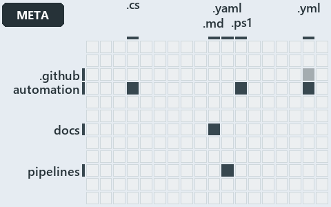

# docs/.assets/explanation/adr-flow-cd-globs--peers-in-a-layer-never-overlap--meta.grid.md

`Grid minimap: adr-flow-cd-globs--peers-in-a-layer-never-overlap--meta`

The grid minimap of the slide `adr-flow-cd-globs--peers-in-a-layer-never-overlap--meta` (meta lens). The slide supports
[ADR-FLOW-CD-GLOBS][1]; the highlight of those ADR codes selects what is lit, and each reason below names the code that selects it.

## What the minimap shows

The grid crosses the 12 tracks (rows) with the 18 file languages (columns) of the world map and lights 6 cells, filled in ink. A cell lit
only by passing mentions (citations in body comments, not in a file's header or text) is touched: a lighter ink. Every other cell is idle, a
grey box: it holds files the slide's ADR codes do not select, or no file at all (173 of the 216 cells hold none). The minimap shows where
the slide sits, not how many files a cell holds; the world-map PDFs show the counts.

- .github × yaml: 1 lit of 2 files, touched
- automation × csharp: 5 lit of 229 files
- automation × powershell: 41 lit of 1443 files
- automation × yaml: 3 lit of 97 files
- docs × markdown: 5 lit of 744 files
- pipelines × pipeline-yaml: 6 lit of 9 files

## Key

A lit row prints its track's name; a lit column prints a short code, the first extension of its file language:

- `.cs`: csharp
- `.md`: markdown
- `.yaml`: pipeline-yaml
- `.ps1`: powershell
- `.yml`: yaml

## Why each cell is lit

### .github × yaml (1 lit file, touched)

Placed: the root folder `.github/` names the track .github ([ADR-DSGN-TRACK#1][2]); the extension `.yml` names the file language yaml
([ADR-DSGN-TRACK#6][3]). Lit ([ADR-DSGN-TRACK#12][4]) by:

- [.github/workflows/ci-automation.yml][5]: selected by [ADR-FLOW-CD-GLOBS][1]: the file cites it at line 4 (body comment) (a passing
  mention only).

### automation × csharp (5 lit files)

Placed: the root folder `automation/` names the track automation ([ADR-DSGN-TRACK#1][2]); the extension `.cs` names the file language csharp
([ADR-DSGN-TRACK#6][3]). Lit ([ADR-DSGN-TRACK#12][4]) by:

- [automation/Catzc.Base.Globs/types/Aspect.cs][6]: selected by [ADR-FLOW-CD-GLOBS][1]: the file cites it at line 9 (header).
- [automation/Catzc.Base.Globs/types/DurableHash.cs][7]: selected by [ADR-FLOW-CD-GLOBS][1]: the file cites it at line 1 (header) and line 7
  (header).
- [automation/Catzc.Base.Globs/types/GlobPattern.cs][8]: selected by [ADR-FLOW-CD-GLOBS][1]: the file cites it at line 7 (header), line 8
  (header), line 9 (header), line 33 (text), line 37 (text), line 41 (text), line 53 (text), line 57 (text) and line 66 (text).
- [automation/Catzc.Base.Globs/types/GlobSet.cs][9]: selected by [ADR-FLOW-CD-GLOBS][1]: the file cites it at line 3 (header), line 5
  (header), line 6 (header), line 12 (header), line 15 (header), line 17 (header), line 20 (header), line 32 (body comment), line 41 (body
  comment), line 63 (body comment), line 89 (text), line 122 (body comment), line 135 (body comment), line 158 (body comment) and line 180
  (body comment).
- [automation/Catzc.Base.Globs/types/GlobsConfig.cs][10]: selected by [ADR-FLOW-CD-GLOBS][1]: the file cites it at line 3 (header), line 7
  (header), line 10 (header), line 88 (text), line 143 (body comment), line 154 (text), line 158 (text) and line 172 (text).

### automation × powershell (41 lit files)

Placed: the root folder `automation/` names the track automation ([ADR-DSGN-TRACK#1][2]); the extension `.ps1` names the file language
powershell ([ADR-DSGN-TRACK#6][3]). Lit ([ADR-DSGN-TRACK#12][4]) by:

- [automation/Catzc.Azure.DevOps.BuildValidation/Get-AdoBuildValidations.ps1][11]: selected by [ADR-FLOW-CD-GLOBS][1]: the file cites it at
  line 10 (header).
- [automation/Catzc.Azure.DevOps.BuildValidation/Register-AdoBuildValidation.ps1][12]: selected by [ADR-FLOW-CD-GLOBS][1]: the file cites it
  at line 6 (header) and line 98 (body comment).
- [automation/Catzc.Azure.DevOps.BuildValidation/Unregister-AdoBuildValidation.ps1][13]: selected by [ADR-FLOW-CD-GLOBS][1]: the file cites
  it at line 6 (header).
- [automation/Catzc.Azure.DevOps.BuildValidation/private/Get-BuildValidationPathFilter.ps1][14]: selected by [ADR-FLOW-CD-GLOBS][1]: the
  file cites it at line 8 (header).
- [automation/Catzc.Base.Exporter/Get-CatzcContentHash.ps1][15]: selected by [ADR-FLOW-CD-GLOBS][1]: the file cites it at line 6 (header).
- [automation/Catzc.Base.Globs/Get-ChangedGlobSet.ps1][16]: selected by [ADR-FLOW-CD-GLOBS][1]: the file cites it at line 4 (header) and
  line 8 (header).
- [automation/Catzc.Base.Globs/Get-GlobSet.ps1][17]: selected by [ADR-FLOW-CD-GLOBS][1]: the file cites it at line 6 (header).
- [automation/Catzc.Base.Globs/Get-GlobSetFile.ps1][18]: selected by [ADR-FLOW-CD-GLOBS][1]: the file cites it at line 6 (header) and line 9
  (header).
- [automation/Catzc.Base.Globs/Get-GlobSetHash.ps1][19]: selected by [ADR-FLOW-CD-GLOBS][1]: the file cites it at line 4 (header) and line
  10 (header).
- [automation/Catzc.Base.Globs/Get-GlobSetTrigger.ps1][20]: selected by [ADR-FLOW-CD-GLOBS][1]: the file cites it at line 4 (header) and
  line 7 (header).
- [automation/Catzc.Base.Globs/Get-MarkerBlastRadius.ps1][21]: selected by [ADR-FLOW-CD-GLOBS][1]: the file cites it at line 6 (header).
- [automation/Catzc.Base.Globs/Get-ModuleGlobSet.ps1][22]: selected by [ADR-FLOW-CD-GLOBS][1]: the file cites it at line 72 (body comment),
  line 75 (body comment) and line 163 (body comment) (a passing mention only).
- [automation/Catzc.Base.Globs/Get-TrackedFile.ps1][23]: selected by [ADR-FLOW-CD-GLOBS][1]: the file cites it at line 6 (header).
- [automation/Catzc.Base.Globs/Test-AdoPipelineTriggerGlob.ps1][24]: selected by [ADR-FLOW-CD-GLOBS][1]: the file cites it at line 4
  (header).
- [automation/Catzc.Base.Globs/Test-GitHubWorkflowTriggerGlob.ps1][25]: selected by [ADR-FLOW-CD-GLOBS][1]: the file cites it at line 4
  (header).
- [automation/Catzc.Base.Globs/Test-GlobSetAffected.ps1][26]: selected by [ADR-FLOW-CD-GLOBS][1]: the file cites it at line 10 (header).
- [automation/Catzc.Base.Globs/Test-GlobSetIndependence.ps1][27]: selected by [ADR-FLOW-CD-GLOBS][1]: the file cites it at line 4 (header),
  line 13 (header), line 42 (body comment), line 50 (body comment) and line 79 (text).
- [automation/Catzc.Base.Globs/Test-GlobSetTriggerCoverage.ps1][28]: selected by [ADR-FLOW-CD-GLOBS][1]: the file cites it at line 7
  (header).
- [automation/Catzc.Base.Globs/private/Get-ChangedFile.ps1][29]: selected by [ADR-FLOW-CD-GLOBS][1]: the file cites it at line 7 (header).
- [automation/Catzc.Base.Globs/private/Get-GlobSetMember.ps1][30]: selected by [ADR-FLOW-CD-GLOBS][1]: the file cites it at line 6 (header).
- [automation/Catzc.Base.Globs/private/Get-PipelineTrigger.ps1][31]: selected by [ADR-FLOW-CD-GLOBS][1]: the file cites it at line 7
  (header).
- [automation/Catzc.Base.Globs/private/Test-GlobListEqual.ps1][32]: selected by [ADR-FLOW-CD-GLOBS][1]: the file cites it at line 11
  (header).
- [automation/Catzc.Base.Globs/tests/Get-ChangedFile.Tests.ps1][33]: selected by [ADR-FLOW-CD-GLOBS][1]: the file cites it at line 2
  (header).
- [automation/Catzc.Base.Globs/tests/Get-ChangedGlobSet.Tests.ps1][34]: selected by [ADR-FLOW-CD-GLOBS][1]: the file cites it at line 2
  (header).
- [automation/Catzc.Base.Globs/tests/Get-GlobSetFile.Tests.ps1][35]: selected by [ADR-FLOW-CD-GLOBS][1]: the file cites it at line 2
  (header) and line 3 (header).
- [automation/Catzc.Base.Globs/tests/Get-GlobSetHash.Tests.ps1][36]: selected by [ADR-FLOW-CD-GLOBS][1]: the file cites it at line 2
  (header).
- [automation/Catzc.Base.Globs/tests/Get-GlobSetMember.Tests.ps1][37]: selected by [ADR-FLOW-CD-GLOBS][1]: the file cites it at line 2
  (header).
- [automation/Catzc.Base.Globs/tests/Get-GlobSetTrigger.Tests.ps1][38]: selected by [ADR-FLOW-CD-GLOBS][1]: the file cites it at line 2
  (header).
- [automation/Catzc.Base.Globs/tests/Get-PipelineTrigger.Tests.ps1][39]: selected by [ADR-FLOW-CD-GLOBS][1]: the file cites it at line 2
  (header).
- [automation/Catzc.Base.Globs/tests/Get-TrackedFile.Tests.ps1][40]: selected by [ADR-FLOW-CD-GLOBS][1]: the file cites it at line 1
  (header).
- [automation/Catzc.Base.Globs/tests/GlobSet-Independence.Tests.ps1][41]: selected by [ADR-FLOW-CD-GLOBS][1]: the file cites it at line 2
  (header), line 10 (text) and line 12 (text).
- [automation/Catzc.Base.Globs/tests/GlobSetTrigger-Coverage.Tests.ps1][42]: selected by [ADR-FLOW-CD-GLOBS][1]: the file cites it at line 2
  (header).
- [automation/Catzc.Base.Globs/tests/PipelineTrigger-Integrity.Tests.ps1][43]: selected by [ADR-FLOW-CD-GLOBS][1]: the file cites it at line
  3 (header).
- [automation/Catzc.Base.Globs/tests/Test-GlobSetIndependence.Tests.ps1][44]: selected by [ADR-FLOW-CD-GLOBS][1]: the file cites it at line
  3 (header).
- [automation/Catzc.Base.Globs/tests/types/GlobPattern.Tests.ps1][45]: selected by [ADR-FLOW-CD-GLOBS][1]: the file cites it at line 1
  (header), line 3 (header) and line 63 (text).
- [automation/Catzc.Base.Globs/tests/types/GlobSet.Tests.ps1][46]: selected by [ADR-FLOW-CD-GLOBS][1]: the file cites it at line 2 (header),
  line 4 (header) and line 15 (text).
- [automation/Catzc.Base.Globs/tests/types/GlobsConfig.Tests.ps1][47]: selected by [ADR-FLOW-CD-GLOBS][1]: the file cites it at line 3
  (header), line 5 (header), line 13 (body comment), line 62 (text), line 75 (text), line 86 (text) and line 98 (text).
- [automation/Catzc.Base.QualityGates/Test-Automation.ps1][48]: selected by [ADR-FLOW-CD-GLOBS][1]: the file cites it at line 72 (header).
- [automation/Catzc.Base.QualityGates/private/Get-GuidScanFiles.ps1][49]: selected by [ADR-FLOW-CD-GLOBS][1]: the file cites it at line 7
  (header).
- [automation/Catzc.Base.QualityGates/private/Get-ModuleProtectionIdentity.ps1][50]: selected by [ADR-FLOW-CD-GLOBS][1]: the file cites it
  at line 143 (body comment) (a passing mention only).
- [automation/Catzc.Base.QualityGates/private/Resolve-TestSuite.ps1][51]: selected by [ADR-FLOW-CD-GLOBS][1]: the file cites it at line 9
  (header).

### automation × yaml (3 lit files)

Placed: the root folder `automation/` names the track automation ([ADR-DSGN-TRACK#1][2]); the extension `.yml` names the file language yaml
([ADR-DSGN-TRACK#6][3]). Lit ([ADR-DSGN-TRACK#12][4]) by:

- [automation/Catzc.Azure.DevOps.BuildValidation/configs/build-validation.yml][52]: selected by [ADR-FLOW-CD-GLOBS][1]: the file cites it at
  line 5 (header).
- [automation/Catzc.Base.Docs/configs/adrs.yml][53]: selected by [ADR-FLOW-CD-GLOBS][1]: the file cites it at line 122 (text).
- [automation/Catzc.Base.Globs/configs/globs.yml][54]: selected by [ADR-FLOW-CD-GLOBS][1]: the file cites it at line 2 (header), line 7
  (header), line 15 (header), line 17 (header), line 26 (body comment), line 61 (body comment) and line 81 (body comment).

### docs × markdown (5 lit files)

Placed: the root folder `docs/` names the track docs ([ADR-DSGN-TRACK#1][2]); the extension `.md` names the file language markdown
([ADR-DSGN-TRACK#6][3]). Lit ([ADR-DSGN-TRACK#12][4]) by:

- [docs/adr/flow/dora-explains.md][55]: selected by [ADR-FLOW-CD-GLOBS][1]: the file cites it at line 94 (text).
- [docs/adr/flow/durable-sha-globs.md][1]: selected by [ADR-FLOW-CD-GLOBS][1]: the ADR's own file.
- [docs/adr/index.md][56]: selected by [ADR-FLOW-CD-GLOBS][1]: the file cites it at line 111 (text).
- [docs/how-to/automation/manual-test-plan/pipelines-and-globs.md][57]: selected by [ADR-FLOW-CD-GLOBS][1]: the file cites it at line 18
  (text).
- [docs/references/automation/catzc-base-globs.md][58]: selected by [ADR-FLOW-CD-GLOBS][1]: the file cites it at line 29 (text).

### pipelines × pipeline-yaml (6 lit files)

Placed: the root folder `pipelines/` names the track pipelines ([ADR-DSGN-TRACK#1][2]); the extension `.yaml` names the file language
pipeline-yaml ([ADR-DSGN-TRACK#6][3]). Lit ([ADR-DSGN-TRACK#12][4]) by:

- [pipelines/cd-apex.yaml][59]: selected by [ADR-FLOW-CD-GLOBS][1]: the file cites it at line 15 (header).
- [pipelines/cd-flux.yaml][60]: selected by [ADR-FLOW-CD-GLOBS][1]: the file cites it at line 14 (header).
- [pipelines/cd-nova.yaml][61]: selected by [ADR-FLOW-CD-GLOBS][1]: the file cites it at line 14 (header).
- [pipelines/cd-shared.yaml][62]: selected by [ADR-FLOW-CD-GLOBS][1]: the file cites it at line 29 (header).
- [pipelines/ci-automation.yaml][63]: selected by [ADR-FLOW-CD-GLOBS][1]: the file cites it at line 4 (header).
- [pipelines/ci-infrastructure.yaml][64]: selected by [ADR-FLOW-CD-GLOBS][1]: the file cites it at line 17 (header).

## Keywords

- [world map][65]
- [track][66]
- [file language][67]
- [cell][68]
- [lit cell][69]
- [.github][70]: a track
- [automation][70]: a track
- [docs][70]: a track
- [pipelines][70]: a track
- [csharp][71]: a file language
- [markdown][71]: a file language
- [pipeline-yaml][71]: a file language
- [powershell][71]: a file language
- [yaml][71]: a file language

[1]: ../../adr/flow/durable-sha-globs.md
[2]: ../../adr/design/tracks.md#rule-adr-dsgn-track1
[3]: ../../adr/design/tracks.md#rule-adr-dsgn-track6
[4]: ../../adr/design/tracks.md#rule-adr-dsgn-track12
[5]: ../../../.github/workflows/ci-automation.yml
[6]: ../../../automation/Catzc.Base.Globs/types/Aspect.cs
[7]: ../../../automation/Catzc.Base.Globs/types/DurableHash.cs
[8]: ../../../automation/Catzc.Base.Globs/types/GlobPattern.cs
[9]: ../../../automation/Catzc.Base.Globs/types/GlobSet.cs
[10]: ../../../automation/Catzc.Base.Globs/types/GlobsConfig.cs
[11]: ../../../automation/Catzc.Azure.DevOps.BuildValidation/Get-AdoBuildValidations.ps1
[12]: ../../../automation/Catzc.Azure.DevOps.BuildValidation/Register-AdoBuildValidation.ps1
[13]: ../../../automation/Catzc.Azure.DevOps.BuildValidation/Unregister-AdoBuildValidation.ps1
[14]: ../../../automation/Catzc.Azure.DevOps.BuildValidation/private/Get-BuildValidationPathFilter.ps1
[15]: ../../../automation/Catzc.Base.Exporter/Get-CatzcContentHash.ps1
[16]: ../../../automation/Catzc.Base.Globs/Get-ChangedGlobSet.ps1
[17]: ../../../automation/Catzc.Base.Globs/Get-GlobSet.ps1
[18]: ../../../automation/Catzc.Base.Globs/Get-GlobSetFile.ps1
[19]: ../../../automation/Catzc.Base.Globs/Get-GlobSetHash.ps1
[20]: ../../../automation/Catzc.Base.Globs/Get-GlobSetTrigger.ps1
[21]: ../../../automation/Catzc.Base.Globs/Get-MarkerBlastRadius.ps1
[22]: ../../../automation/Catzc.Base.Globs/Get-ModuleGlobSet.ps1
[23]: ../../../automation/Catzc.Base.Globs/Get-TrackedFile.ps1
[24]: ../../../automation/Catzc.Base.Globs/Test-AdoPipelineTriggerGlob.ps1
[25]: ../../../automation/Catzc.Base.Globs/Test-GitHubWorkflowTriggerGlob.ps1
[26]: ../../../automation/Catzc.Base.Globs/Test-GlobSetAffected.ps1
[27]: ../../../automation/Catzc.Base.Globs/Test-GlobSetIndependence.ps1
[28]: ../../../automation/Catzc.Base.Globs/Test-GlobSetTriggerCoverage.ps1
[29]: ../../../automation/Catzc.Base.Globs/private/Get-ChangedFile.ps1
[30]: ../../../automation/Catzc.Base.Globs/private/Get-GlobSetMember.ps1
[31]: ../../../automation/Catzc.Base.Globs/private/Get-PipelineTrigger.ps1
[32]: ../../../automation/Catzc.Base.Globs/private/Test-GlobListEqual.ps1
[33]: ../../../automation/Catzc.Base.Globs/tests/Get-ChangedFile.Tests.ps1
[34]: ../../../automation/Catzc.Base.Globs/tests/Get-ChangedGlobSet.Tests.ps1
[35]: ../../../automation/Catzc.Base.Globs/tests/Get-GlobSetFile.Tests.ps1
[36]: ../../../automation/Catzc.Base.Globs/tests/Get-GlobSetHash.Tests.ps1
[37]: ../../../automation/Catzc.Base.Globs/tests/Get-GlobSetMember.Tests.ps1
[38]: ../../../automation/Catzc.Base.Globs/tests/Get-GlobSetTrigger.Tests.ps1
[39]: ../../../automation/Catzc.Base.Globs/tests/Get-PipelineTrigger.Tests.ps1
[40]: ../../../automation/Catzc.Base.Globs/tests/Get-TrackedFile.Tests.ps1
[41]: ../../../automation/Catzc.Base.Globs/tests/GlobSet-Independence.Tests.ps1
[42]: ../../../automation/Catzc.Base.Globs/tests/GlobSetTrigger-Coverage.Tests.ps1
[43]: ../../../automation/Catzc.Base.Globs/tests/PipelineTrigger-Integrity.Tests.ps1
[44]: ../../../automation/Catzc.Base.Globs/tests/Test-GlobSetIndependence.Tests.ps1
[45]: ../../../automation/Catzc.Base.Globs/tests/types/GlobPattern.Tests.ps1
[46]: ../../../automation/Catzc.Base.Globs/tests/types/GlobSet.Tests.ps1
[47]: ../../../automation/Catzc.Base.Globs/tests/types/GlobsConfig.Tests.ps1
[48]: ../../../automation/Catzc.Base.QualityGates/Test-Automation.ps1
[49]: ../../../automation/Catzc.Base.QualityGates/private/Get-GuidScanFiles.ps1
[50]: ../../../automation/Catzc.Base.QualityGates/private/Get-ModuleProtectionIdentity.ps1
[51]: ../../../automation/Catzc.Base.QualityGates/private/Resolve-TestSuite.ps1
[52]: ../../../automation/Catzc.Azure.DevOps.BuildValidation/configs/build-validation.yml
[53]: ../../../automation/Catzc.Base.Docs/configs/adrs.yml
[54]: ../../../automation/Catzc.Base.Globs/configs/globs.yml
[55]: ../../adr/flow/dora-explains.md
[56]: ../../adr/index.md
[57]: ../../how-to/automation/manual-test-plan/pipelines-and-globs.md
[58]: ../../references/automation/catzc-base-globs.md
[59]: ../../../pipelines/cd-apex.yaml
[60]: ../../../pipelines/cd-flux.yaml
[61]: ../../../pipelines/cd-nova.yaml
[62]: ../../../pipelines/cd-shared.yaml
[63]: ../../../pipelines/ci-automation.yaml
[64]: ../../../pipelines/ci-infrastructure.yaml
[65]: ../../adr/glossary.md#world-map
[66]: ../../adr/glossary.md#track
[67]: ../../adr/glossary.md#file-language
[68]: ../../adr/glossary.md#cell
[69]: ../../adr/glossary.md#lit-cell
[70]: ../../../automation/Catzc.Base.Variants/configs/variants.yml
[71]: ../../../automation/Catzc.Base.Languages/configs/languages.yml
