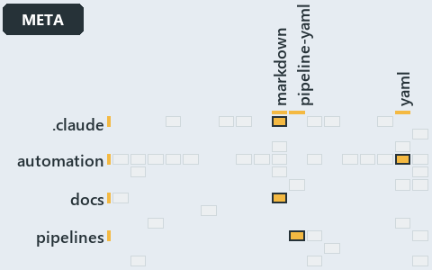

# docs/.assets/explanation/adr-flow-cd-runner--a-step-only-names-a-command--meta.grid.md

`Grid minimap: adr-flow-cd-runner--a-step-only-names-a-command--meta`

The grid minimap of the slide `adr-flow-cd-runner--a-step-only-names-a-command--meta` (meta lens). The slide supports
[ADR-FLOW-CD-RUNNER][1]; the highlight of those ADR codes selects what is lit, and each reason below names the code that selects it.

## What the minimap shows

The grid crosses the 12 tracks with the 18 file languages of the world map and lights 4 cells. A cell lit only by passing mentions
(citations in body comments, not in a file's header or text) is touched: drawn pale.

- .claude × markdown: 1 lit of 9 files
- automation × yaml: 1 lit of 95 files
- docs × markdown: 17 lit of 469 files
- pipelines × pipeline-yaml: 1 lit of 9 files

## Why each cell is lit

### .claude × markdown (1 lit file)

Placed: the root folder `.claude/` names the track .claude ([ADR-DSGN-TRACK#1][2]); the extension `.md` names the file language markdown
([ADR-DSGN-TRACK#6][3]). Lit ([ADR-DSGN-TRACK#12][4]) by:

- [.claude/CLAUDE.md][5]: selected by [ADR-FLOW-CD-RUNNER][1]: the file cites it at line 52 (text).

### automation × yaml (1 lit file)

Placed: the root folder `automation/` names the track automation ([ADR-DSGN-TRACK#1][2]); the extension `.yml` names the file language yaml
([ADR-DSGN-TRACK#6][3]). Lit ([ADR-DSGN-TRACK#12][4]) by:

- [automation/Catzc.Base.Docs/configs/adrs.yml][6]: selected by [ADR-FLOW-CD-RUNNER][1]: the file cites it at line 119 (text).

### docs × markdown (17 lit files)

Placed: the root folder `docs/` names the track docs ([ADR-DSGN-TRACK#1][2]); the extension `.md` names the file language markdown
([ADR-DSGN-TRACK#6][3]). Lit ([ADR-DSGN-TRACK#12][4]) by:

- [docs/.assets/explanation/adr-flow-cd-runner--a-step-only-names-a-command--meta.drawio.md][7]: selected by [ADR-FLOW-CD-RUNNER][1]: the
  file cites it at line 65 (text).
- [docs/.assets/explanation/adr-flow-cd-runner--no-gate-checks-rules-one-and-four--governance.drawio.md][8]: selected by
  [ADR-FLOW-CD-RUNNER][1]: the file cites it at line 62 (text) and line 71 (text).
- [docs/.assets/explanation/adr-flow-cd-runner--the-runner-is-the-only-seam--architecture.drawio.md][9]: selected by
  [ADR-FLOW-CD-RUNNER][1]: the file cites it at line 68 (text).
- [docs/.assets/explanation/adr-flow-cd-runner--the-step-is-named-after-its-command--operations.drawio.md][10]: selected by
  [ADR-FLOW-CD-RUNNER][1]: the file cites it at line 71 (text).
- [docs/.assets/explanation/adr-flow-cd-runner--three-tasks-one-guard-one-runner--implementation.drawio.md][11]: selected by
  [ADR-FLOW-CD-RUNNER][1]: the file cites it at line 70 (text).
- [docs/adr/flow/cd-discipline-and-promotion-flow.md][12]: selected by [ADR-FLOW-CD-RUNNER][1]: an ADR file of the `flow` ADR domain, the
  ADR domain of that code.
- [docs/adr/flow/dora-explains.md][13]: selected by [ADR-FLOW-CD-RUNNER][1]: an ADR file of the `flow` ADR domain, the ADR domain of that
  code.
- [docs/adr/flow/durable-sha-globs.md][14]: selected by [ADR-FLOW-CD-RUNNER][1]: an ADR file of the `flow` ADR domain, the ADR domain of
  that code.
- [docs/adr/flow/pipeline-detection.md][15]: selected by [ADR-FLOW-CD-RUNNER][1]: an ADR file of the `flow` ADR domain, the ADR domain of
  that code.
- [docs/adr/flow/pipeline-runner-pattern.md][1]: selected by [ADR-FLOW-CD-RUNNER][1]: an ADR file of the `flow` ADR domain, the ADR domain
  of that code.
- [docs/adr/flow/pipeline-types.md][16]: selected by [ADR-FLOW-CD-RUNNER][1]: an ADR file of the `flow` ADR domain, the ADR domain of that
  code.
- [docs/adr/index.md][17]: selected by [ADR-FLOW-CD-RUNNER][1]: the file cites it at line 108 (text).
- [docs/explanation/flow/a-step-only-names-a-command.md][18]: selected by [ADR-FLOW-CD-RUNNER][1]: the file cites it at line 14 (text), line
  41 (text) and line 42 (text).
- [docs/explanation/flow/no-gate-checks-rules-one-and-four.md][19]: selected by [ADR-FLOW-CD-RUNNER][1]: the file cites it at line 16
  (text), line 51 (text), line 52 (text), line 53 (text) and line 54 (text).
- [docs/explanation/flow/the-runner-is-the-only-seam.md][20]: selected by [ADR-FLOW-CD-RUNNER][1]: the file cites it at line 15 (text), line
  47 (text), line 48 (text) and line 49 (text).
- [docs/explanation/flow/the-step-is-named-after-its-command.md][21]: selected by [ADR-FLOW-CD-RUNNER][1]: the file cites it at line 16
  (text), line 49 (text) and line 50 (text).
- [docs/explanation/flow/three-tasks-one-guard-one-runner.md][22]: selected by [ADR-FLOW-CD-RUNNER][1]: the file cites it at line 17 (text),
  line 57 (text), line 58 (text) and line 59 (text).

### pipelines × pipeline-yaml (1 lit file)

Placed: the root folder `pipelines/` names the track pipelines ([ADR-DSGN-TRACK#1][2]); the extension `.yaml` names the file language
pipeline-yaml ([ADR-DSGN-TRACK#6][3]). Lit ([ADR-DSGN-TRACK#12][4]) by:

- [pipelines/steps/invoke-automation.yaml][23]: selected by [ADR-FLOW-CD-RUNNER][1]: the file cites it at line 18 (header).

## Keywords

- [world map][24]
- [track][25]
- [file language][26]
- [cell][27]
- [lit cell][28]
- [.claude][29]: a track
- [automation][29]: a track
- [docs][29]: a track
- [pipelines][29]: a track
- [markdown][30]: a file language
- [pipeline-yaml][30]: a file language
- [yaml][30]: a file language

[1]: ../../adr/flow/pipeline-runner-pattern.md
[2]: ../../adr/design/tracks.md#rule-adr-dsgn-track1
[3]: ../../adr/design/tracks.md#rule-adr-dsgn-track6
[4]: ../../adr/design/tracks.md#rule-adr-dsgn-track12
[5]: ../../../.claude/CLAUDE.md
[6]: ../../../automation/Catzc.Base.Docs/configs/adrs.yml
[7]: adr-flow-cd-runner--a-step-only-names-a-command--meta.drawio.md
[8]: adr-flow-cd-runner--no-gate-checks-rules-one-and-four--governance.drawio.md
[9]: adr-flow-cd-runner--the-runner-is-the-only-seam--architecture.drawio.md
[10]: adr-flow-cd-runner--the-step-is-named-after-its-command--operations.drawio.md
[11]: adr-flow-cd-runner--three-tasks-one-guard-one-runner--implementation.drawio.md
[12]: ../../adr/flow/cd-discipline-and-promotion-flow.md
[13]: ../../adr/flow/dora-explains.md
[14]: ../../adr/flow/durable-sha-globs.md
[15]: ../../adr/flow/pipeline-detection.md
[16]: ../../adr/flow/pipeline-types.md
[17]: ../../adr/index.md
[18]: ../../explanation/flow/a-step-only-names-a-command.md
[19]: ../../explanation/flow/no-gate-checks-rules-one-and-four.md
[20]: ../../explanation/flow/the-runner-is-the-only-seam.md
[21]: ../../explanation/flow/the-step-is-named-after-its-command.md
[22]: ../../explanation/flow/three-tasks-one-guard-one-runner.md
[23]: ../../../pipelines/steps/invoke-automation.yaml
[24]: ../../adr/glossary.md#world-map
[25]: ../../adr/glossary.md#track
[26]: ../../adr/glossary.md#file-language
[27]: ../../adr/glossary.md#cell
[28]: ../../adr/glossary.md#lit-cell
[29]: ../../../automation/Catzc.Base.Variants/configs/variants.yml
[30]: ../../../automation/Catzc.Base.Languages/configs/languages.yml
