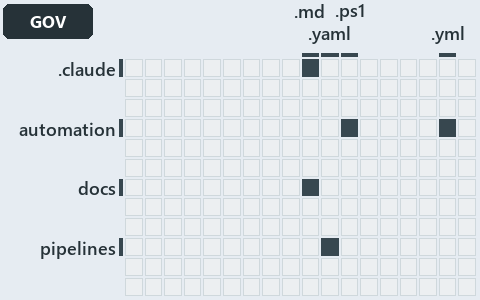

# docs/.assets/explanation/adr-flow-cd-runner--no-gate-checks-rules-one-and-four--governance.grid.md

`Grid minimap: adr-flow-cd-runner--no-gate-checks-rules-one-and-four--governance`

The grid minimap of the slide `adr-flow-cd-runner--no-gate-checks-rules-one-and-four--governance` (governance lens). The slide supports
[ADR-FLOW-CD-RUNNER][1] and [ADR-PIPE-NAME][2]; the highlight of those ADR codes selects what is lit, and each reason below names the code
that selects it.

## What the minimap shows

The grid crosses the 12 tracks (rows) with the 18 file languages (columns) of the world map and lights 5 cells, filled in ink. A cell lit
only by passing mentions (citations in body comments, not in a file's header or text) is touched: a lighter ink. Every other cell is idle, a
grey box: it holds files the slide's ADR codes do not select, or no file at all (173 of the 216 cells hold none). The minimap shows where
the slide sits, not how many files a cell holds; the world-map PDFs show the counts.

- .claude × markdown: 1 lit of 9 files
- automation × powershell: 3 lit of 1443 files
- automation × yaml: 4 lit of 97 files
- docs × markdown: 13 lit of 744 files
- pipelines × pipeline-yaml: 2 lit of 9 files

## Key

A lit row prints its track's name; a lit column prints a short code, the first extension of its file language:

- `.md`: markdown
- `.yaml`: pipeline-yaml
- `.ps1`: powershell
- `.yml`: yaml

## Why each cell is lit

### .claude × markdown (1 lit file)

Placed: the root folder `.claude/` names the track .claude ([ADR-DSGN-TRACK#1][3]); the extension `.md` names the file language markdown
([ADR-DSGN-TRACK#6][4]). Lit ([ADR-DSGN-TRACK#12][5]) by:

- [.claude/CLAUDE.md][6]: selected by [ADR-FLOW-CD-RUNNER][1]: the file cites it at line 52 (text).

### automation × powershell (3 lit files)

Placed: the root folder `automation/` names the track automation ([ADR-DSGN-TRACK#1][3]); the extension `.ps1` names the file language
powershell ([ADR-DSGN-TRACK#6][4]). Lit ([ADR-DSGN-TRACK#12][5]) by:

- [automation/Catzc.Azure.DevOps/Test-Pipelines.ps1][7]: selected by [ADR-PIPE-NAME][2]: the file cites it at line 4 (header), line 7
  (header), line 14 (header), line 17 (header), line 21 (header), line 24 (header), line 26 (header), line 31 (header), line 96 (text), line
  100 (body comment), line 103 (text), line 109 (body comment), line 113 (text), line 118 (body comment), line 121 (text), line 124 (text),
  line 127 (body comment), line 130 (text), line 132 (body comment), line 135 (text), line 140 (body comment) and line 144 (text).
- [automation/Catzc.Azure.DevOps/private/Get-PipelineTemplateReference.ps1][8]: selected by [ADR-PIPE-NAME][2]: the file cites it at line 5
  (header).
- [automation/Catzc.Azure.DevOps/tests/Test-Pipelines.Tests.ps1][9]: selected by [ADR-PIPE-NAME][2]: the file cites it at line 49 (text),
  line 50 (text), line 59 (text), line 62 (text), line 66 (text), line 74 (text), line 76 (text), line 79 (text), line 81 (text), line 84
  (text), line 86 (text), line 89 (text), line 91 (text), line 94 (text), line 96 (text), line 104 (text), line 107 (text), line 118 (text)
  and line 123 (text).

### automation × yaml (4 lit files)

Placed: the root folder `automation/` names the track automation ([ADR-DSGN-TRACK#1][3]); the extension `.yml` names the file language yaml
([ADR-DSGN-TRACK#6][4]). Lit ([ADR-DSGN-TRACK#12][5]) by:

- [automation/Catzc.Base.Docs/configs/adrs.yml][10]: selected by [ADR-FLOW-CD-RUNNER][1]: the file cites it at line 119 (text); selected by
  [ADR-PIPE-NAME][2]: the file cites it at line 237 (text).
- [automation/Catzc.Base.Languages/configs/languages.yml][11]: selected by [ADR-PIPE-NAME][2]: the file cites it at line 35 (header).
- [automation/Catzc.Base.RootConfig/assets/root/.markdownlint.yml][12]: selected by [ADR-PIPE-NAME][2]: the file cites it at line 9
  (header).
- [automation/Catzc.Base.RootConfig/assets/root/.prettierrc.yml][13]: selected by [ADR-PIPE-NAME][2]: the file cites it at line 8 (header).

### docs × markdown (13 lit files)

Placed: the root folder `docs/` names the track docs ([ADR-DSGN-TRACK#1][3]); the extension `.md` names the file language markdown
([ADR-DSGN-TRACK#6][4]). Lit ([ADR-DSGN-TRACK#12][5]) by:

- [docs/adr/flow/cd-discipline-and-promotion-flow.md][14]: selected by [ADR-FLOW-CD-RUNNER][1]: an ADR file of the `flow` ADR domain, the
  ADR domain of that code.
- [docs/adr/flow/dora-explains.md][15]: selected by [ADR-FLOW-CD-RUNNER][1]: an ADR file of the `flow` ADR domain, the ADR domain of that
  code.
- [docs/adr/flow/durable-sha-globs.md][16]: selected by [ADR-FLOW-CD-RUNNER][1]: an ADR file of the `flow` ADR domain, the ADR domain of
  that code.
- [docs/adr/flow/pipeline-detection.md][17]: selected by [ADR-FLOW-CD-RUNNER][1]: an ADR file of the `flow` ADR domain, the ADR domain of
  that code.
- [docs/adr/flow/pipeline-runner-pattern.md][1]: selected by [ADR-FLOW-CD-RUNNER][1]: an ADR file of the `flow` ADR domain, the ADR domain
  of that code.
- [docs/adr/flow/pipeline-types.md][18]: selected by [ADR-FLOW-CD-RUNNER][1]: an ADR file of the `flow` ADR domain, the ADR domain of that
  code.
- [docs/adr/index.md][19]: selected by [ADR-FLOW-CD-RUNNER][1]: the file cites it at line 108 (text); selected by [ADR-PIPE-NAME][2]: the
  file cites it at line 221 (text).
- [docs/adr/pipelines/custom-template-discipline.md][20]: selected by [ADR-PIPE-NAME][2]: an ADR file of the `pipelines` ADR domain, the ADR
  domain of that code.
- [docs/adr/pipelines/dora-explains.md][21]: selected by [ADR-PIPE-NAME][2]: an ADR file of the `pipelines` ADR domain, the ADR domain of
  that code.
- [docs/adr/pipelines/dual-authentication.md][22]: selected by [ADR-PIPE-NAME][2]: an ADR file of the `pipelines` ADR domain, the ADR domain
  of that code.
- [docs/adr/pipelines/pipeline-naming-and-placement.md][2]: selected by [ADR-PIPE-NAME][2]: an ADR file of the `pipelines` ADR domain, the
  ADR domain of that code.
- [docs/adr/pipelines/pipeline-variables.md][23]: selected by [ADR-PIPE-NAME][2]: an ADR file of the `pipelines` ADR domain, the ADR domain
  of that code.
- [docs/how-to/automation/manual-test-plan/pipelines-and-globs.md][24]: selected by [ADR-PIPE-NAME][2]: the file cites it at line 16 (text).

### pipelines × pipeline-yaml (2 lit files)

Placed: the root folder `pipelines/` names the track pipelines ([ADR-DSGN-TRACK#1][3]); the extension `.yaml` names the file language
pipeline-yaml ([ADR-DSGN-TRACK#6][4]). Lit ([ADR-DSGN-TRACK#12][5]) by:

- [pipelines/extends/cd-customer.yaml][25]: selected by [ADR-PIPE-NAME][2]: the file cites it at line 3 (header).
- [pipelines/steps/invoke-automation.yaml][26]: selected by [ADR-FLOW-CD-RUNNER][1]: the file cites it at line 18 (header).

## Keywords

- [world map][27]
- [track][28]
- [file language][29]
- [cell][30]
- [lit cell][31]
- [.claude][32]: a track
- [automation][32]: a track
- [docs][32]: a track
- [pipelines][32]: a track
- [markdown][11]: a file language
- [pipeline-yaml][11]: a file language
- [powershell][11]: a file language
- [yaml][11]: a file language

[1]: ../../adr/flow/pipeline-runner-pattern.md
[2]: ../../adr/pipelines/pipeline-naming-and-placement.md
[3]: ../../adr/design/tracks.md#rule-adr-dsgn-track1
[4]: ../../adr/design/tracks.md#rule-adr-dsgn-track6
[5]: ../../adr/design/tracks.md#rule-adr-dsgn-track12
[6]: ../../../.claude/CLAUDE.md
[7]: ../../../automation/Catzc.Azure.DevOps/Test-Pipelines.ps1
[8]: ../../../automation/Catzc.Azure.DevOps/private/Get-PipelineTemplateReference.ps1
[9]: ../../../automation/Catzc.Azure.DevOps/tests/Test-Pipelines.Tests.ps1
[10]: ../../../automation/Catzc.Base.Docs/configs/adrs.yml
[11]: ../../../automation/Catzc.Base.Languages/configs/languages.yml
[12]: ../../../automation/Catzc.Base.RootConfig/assets/root/.markdownlint.yml
[13]: ../../../automation/Catzc.Base.RootConfig/assets/root/.prettierrc.yml
[14]: ../../adr/flow/cd-discipline-and-promotion-flow.md
[15]: ../../adr/flow/dora-explains.md
[16]: ../../adr/flow/durable-sha-globs.md
[17]: ../../adr/flow/pipeline-detection.md
[18]: ../../adr/flow/pipeline-types.md
[19]: ../../adr/index.md
[20]: ../../adr/pipelines/custom-template-discipline.md
[21]: ../../adr/pipelines/dora-explains.md
[22]: ../../adr/pipelines/dual-authentication.md
[23]: ../../adr/pipelines/pipeline-variables.md
[24]: ../../how-to/automation/manual-test-plan/pipelines-and-globs.md
[25]: ../../../pipelines/extends/cd-customer.yaml
[26]: ../../../pipelines/steps/invoke-automation.yaml
[27]: ../../adr/glossary.md#world-map
[28]: ../../adr/glossary.md#track
[29]: ../../adr/glossary.md#file-language
[30]: ../../adr/glossary.md#cell
[31]: ../../adr/glossary.md#lit-cell
[32]: ../../../automation/Catzc.Base.Variants/configs/variants.yml
