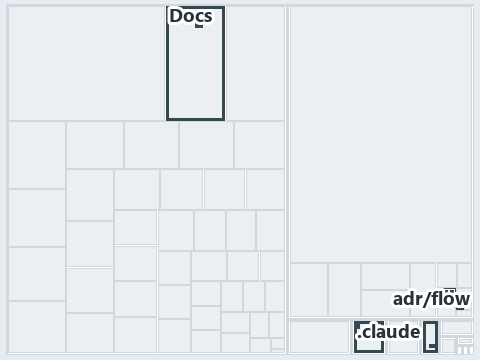

# docs/.assets/explanation/adr-flow-cd-runner--the-step-is-named-after-its-command--operations.tree.md

`Tree minimap: adr-flow-cd-runner--the-step-is-named-after-its-command--operations`

The tree minimap of the slide `adr-flow-cd-runner--the-step-is-named-after-its-command--operations` (operations lens). The slide supports
[ADR-FLOW-CD-RUNNER][1]; the highlight of those ADR codes selects what is lit, and each reason below names the code that selects it.

## What the minimap shows

The tree draws every file of the world map as a tile, grouped by top-level folder (under `automation/` by module, under `docs/adr/` by ADR
domain), and lights 10 files in 5 groups, filled in ink. A lit ADR file has a white rim; a file lit only by passing mentions is a lighter
ink. Every other tile is idle, a grey box: a file the slide's ADR codes do not select.

- adr/flow (docs/adr/flow): 6 lit files
- .claude: 1 lit file
- Docs (automation/Catzc.Base.Docs): 1 lit file
- adr/* (the files directly in docs/adr/): 1 lit file
- pipelines: 1 lit file

## Why each group is lit

### adr/flow (6 lit files)

The group holds the files of docs/adr/flow; each sits in its world-map cell and is lit by:

- [docs/adr/flow/cd-discipline-and-promotion-flow.md][2], in the cell docs × markdown: selected by [ADR-FLOW-CD-RUNNER][1]: an ADR file of
  the `flow` ADR domain, the ADR domain of that code.
- [docs/adr/flow/dora-explains.md][3], in the cell docs × markdown: selected by [ADR-FLOW-CD-RUNNER][1]: an ADR file of the `flow` ADR
  domain, the ADR domain of that code.
- [docs/adr/flow/durable-sha-globs.md][4], in the cell docs × markdown: selected by [ADR-FLOW-CD-RUNNER][1]: an ADR file of the `flow` ADR
  domain, the ADR domain of that code.
- [docs/adr/flow/pipeline-detection.md][5], in the cell docs × markdown: selected by [ADR-FLOW-CD-RUNNER][1]: an ADR file of the `flow` ADR
  domain, the ADR domain of that code.
- [docs/adr/flow/pipeline-runner-pattern.md][1], in the cell docs × markdown: selected by [ADR-FLOW-CD-RUNNER][1]: an ADR file of the `flow`
  ADR domain, the ADR domain of that code.
- [docs/adr/flow/pipeline-types.md][6], in the cell docs × markdown: selected by [ADR-FLOW-CD-RUNNER][1]: an ADR file of the `flow` ADR
  domain, the ADR domain of that code.

### .claude (1 lit file)

The group holds the files of .claude; each sits in its world-map cell and is lit by:

- [.claude/CLAUDE.md][7], in the cell .claude × markdown: selected by [ADR-FLOW-CD-RUNNER][1]: the file cites it at line 52 (text).

### Docs (1 lit file)

The group holds the files of automation/Catzc.Base.Docs; each sits in its world-map cell and is lit by:

- [automation/Catzc.Base.Docs/configs/adrs.yml][8], in the cell automation × yaml: selected by [ADR-FLOW-CD-RUNNER][1]: the file cites it at
  line 119 (text).

### adr/* (1 lit file)

The group holds the files of the files directly in docs/adr/; each sits in its world-map cell and is lit by:

- [docs/adr/index.md][9], in the cell docs × markdown: selected by [ADR-FLOW-CD-RUNNER][1]: the file cites it at line 108 (text).

### pipelines (1 lit file)

The group holds the files of pipelines; each sits in its world-map cell and is lit by:

- [pipelines/steps/invoke-automation.yaml][10], in the cell pipelines × pipeline-yaml: selected by [ADR-FLOW-CD-RUNNER][1]: the file cites
  it at line 18 (header).

## Keywords

- [world map][11]
- [track][12]
- [file language][13]
- [cell][14]
- [lit cell][15]
- [.claude][16]: a track
- [automation][16]: a track
- [docs][16]: a track
- [pipelines][16]: a track
- [markdown][17]: a file language
- [pipeline-yaml][17]: a file language
- [yaml][17]: a file language

[1]: ../../adr/flow/pipeline-runner-pattern.md
[2]: ../../adr/flow/cd-discipline-and-promotion-flow.md
[3]: ../../adr/flow/dora-explains.md
[4]: ../../adr/flow/durable-sha-globs.md
[5]: ../../adr/flow/pipeline-detection.md
[6]: ../../adr/flow/pipeline-types.md
[7]: ../../../.claude/CLAUDE.md
[8]: ../../../automation/Catzc.Base.Docs/configs/adrs.yml
[9]: ../../adr/index.md
[10]: ../../../pipelines/steps/invoke-automation.yaml
[11]: ../../adr/glossary.md#world-map
[12]: ../../adr/glossary.md#track
[13]: ../../adr/glossary.md#file-language
[14]: ../../adr/glossary.md#cell
[15]: ../../adr/glossary.md#lit-cell
[16]: ../../../automation/Catzc.Base.Variants/configs/variants.yml
[17]: ../../../automation/Catzc.Base.Languages/configs/languages.yml
