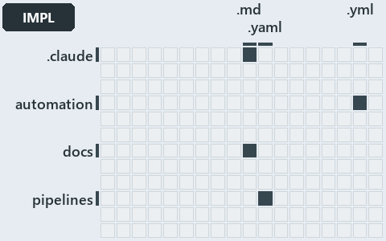

# docs/.assets/explanation/adr-flow-cd-runner--three-tasks-one-guard-one-runner--implementation.grid.md

`Grid minimap: adr-flow-cd-runner--three-tasks-one-guard-one-runner--implementation`

The grid minimap of the slide `adr-flow-cd-runner--three-tasks-one-guard-one-runner--implementation` (implementation lens). The slide
supports [ADR-FLOW-CD-RUNNER][1]; the highlight of those ADR codes selects what is lit, and each reason below names the code that selects
it.

## What the minimap shows

The grid crosses the 12 tracks (rows) with the 18 file languages (columns) of the world map and lights 4 cells, filled in ink. A cell lit
only by passing mentions (citations in body comments, not in a file's header or text) is touched: a lighter ink. Every other cell is idle, a
grey box: it holds files the slide's ADR codes do not select, or no file at all (173 of the 216 cells hold none). The minimap shows where
the slide sits, not how many files a cell holds; the world-map PDFs show the counts.

- .claude × markdown: 1 lit of 9 files
- automation × yaml: 1 lit of 97 files
- docs × markdown: 3 lit of 744 files
- pipelines × pipeline-yaml: 1 lit of 9 files

## Key

A lit row prints its track's name; a lit column prints a short code, the first extension of its file language:

- `.md`: markdown
- `.yaml`: pipeline-yaml
- `.yml`: yaml

## Why each cell is lit

### .claude × markdown (1 lit file)

Placed: the root folder `.claude/` names the track .claude ([ADR-DSGN-TRACK#1][2]); the extension `.md` names the file language markdown
([ADR-DSGN-TRACK#6][3]). Lit ([ADR-DSGN-TRACK#12][4]) by:

- [.claude/CLAUDE.md][5]: selected by [ADR-FLOW-CD-RUNNER][1]: the file cites it at line 52 (text).

### automation × yaml (1 lit file)

Placed: the root folder `automation/` names the track automation ([ADR-DSGN-TRACK#1][2]); the extension `.yml` names the file language yaml
([ADR-DSGN-TRACK#6][3]). Lit ([ADR-DSGN-TRACK#12][4]) by:

- [automation/Catzc.Base.Docs/configs/adrs.yml][6]: selected by [ADR-FLOW-CD-RUNNER][1]: the file cites it at line 119 (text).

### docs × markdown (3 lit files)

Placed: the root folder `docs/` names the track docs ([ADR-DSGN-TRACK#1][2]); the extension `.md` names the file language markdown
([ADR-DSGN-TRACK#6][3]). Lit ([ADR-DSGN-TRACK#12][4]) by:

- [docs/adr/flow/dora-explains.md][7]: selected by [ADR-FLOW-CD-RUNNER][1]: the file cites it at line 33 (text).
- [docs/adr/flow/pipeline-runner-pattern.md][1]: selected by [ADR-FLOW-CD-RUNNER][1]: the ADR's own file.
- [docs/adr/index.md][8]: selected by [ADR-FLOW-CD-RUNNER][1]: the file cites it at line 108 (text).

### pipelines × pipeline-yaml (1 lit file)

Placed: the root folder `pipelines/` names the track pipelines ([ADR-DSGN-TRACK#1][2]); the extension `.yaml` names the file language
pipeline-yaml ([ADR-DSGN-TRACK#6][3]). Lit ([ADR-DSGN-TRACK#12][4]) by:

- [pipelines/steps/invoke-automation.yaml][9]: selected by [ADR-FLOW-CD-RUNNER][1]: the file cites it at line 18 (header).

## Keywords

- [world map][10]
- [track][11]
- [file language][12]
- [cell][13]
- [lit cell][14]
- [.claude][15]: a track
- [automation][15]: a track
- [docs][15]: a track
- [pipelines][15]: a track
- [markdown][16]: a file language
- [pipeline-yaml][16]: a file language
- [yaml][16]: a file language

[1]: ../../adr/flow/pipeline-runner-pattern.md
[2]: ../../adr/design/tracks.md#rule-adr-dsgn-track1
[3]: ../../adr/design/tracks.md#rule-adr-dsgn-track6
[4]: ../../adr/design/tracks.md#rule-adr-dsgn-track12
[5]: ../../../.claude/CLAUDE.md
[6]: ../../../automation/Catzc.Base.Docs/configs/adrs.yml
[7]: ../../adr/flow/dora-explains.md
[8]: ../../adr/index.md
[9]: ../../../pipelines/steps/invoke-automation.yaml
[10]: ../../adr/glossary.md#world-map
[11]: ../../adr/glossary.md#track
[12]: ../../adr/glossary.md#file-language
[13]: ../../adr/glossary.md#cell
[14]: ../../adr/glossary.md#lit-cell
[15]: ../../../automation/Catzc.Base.Variants/configs/variants.yml
[16]: ../../../automation/Catzc.Base.Languages/configs/languages.yml
