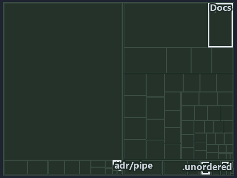

# docs/.assets/explanation/adr-pipe-auth--three-guarded-early-returns--implementation.tree.md

`Tree minimap: adr-pipe-auth--three-guarded-early-returns--implementation`

The tree minimap of the slide `adr-pipe-auth--three-guarded-early-returns--implementation` (implementation lens). The slide supports
[ADR-PIPE-AUTH][1]; the highlight of those ADR codes selects what is lit, and each reason below names the code that selects it.

## What the minimap shows

The tree draws every file of the world map as a tile, grouped by top-level folder (under `automation/` by module, under `docs/adr/` by ADR
domain), and lights 8 files in 5 groups, filled in ink. A lit ADR file has a white rim; a file lit only by passing mentions is a lighter
ink. Every other tile is idle, a grey box: a file the slide's ADR codes do not select.

- .unordered: 3 lit files
- adr/pipe (docs/adr/pipelines): 2 lit files
- Docs (automation/Catzc.Base.Docs): 1 lit file
- adr/* (the files directly in docs/adr/): 1 lit file
- pipelines: 1 lit file

## Why each group is lit

### .unordered (3 lit files)

The group holds the files of .unordered; each sits in its world-map cell and is lit by:

- [.unordered/15-10-2026/plan-concern-axis.md][2], in the cell .unordered × markdown: selected by [ADR-PIPE-AUTH][1]: the file cites it at
  line 109 (text).
- [.unordered/15-10-2026/plan-explanation-drift.md][3], in the cell .unordered × markdown: selected by [ADR-PIPE-AUTH][1]: the file cites it
  at line 40 (text), line 54 (text), line 60 (text), line 80 (text) and line 80 (text).
- [.unordered/15-10-2026/plan-worldmap-processor.md][4], in the cell .unordered × markdown: selected by [ADR-PIPE-AUTH][1]: the file cites
  it at line 11 (text).

### adr/pipe (docs/adr/pipelines, 2 lit files)

The group holds the files of docs/adr/pipelines; each sits in its world-map cell and is lit by:

- [docs/adr/pipelines/dora-explains.md][5], in the cell docs × markdown: selected by [ADR-PIPE-AUTH][1]: the file cites it at line 39
  (text).
- [docs/adr/pipelines/dual-authentication.md][1], in the cell docs × markdown: selected by [ADR-PIPE-AUTH][1]: the ADR's own file.

### Docs (automation/Catzc.Base.Docs, 1 lit file)

The group holds the files of automation/Catzc.Base.Docs; each sits in its world-map cell and is lit by:

- [automation/Catzc.Base.Docs/configs/adrs.yml][6], in the cell automation × yaml: selected by [ADR-PIPE-AUTH][1]: the file cites it at line
  235 (text).

### adr/* (the files directly in docs/adr/, 1 lit file)

The group holds the files of the files directly in docs/adr/; each sits in its world-map cell and is lit by:

- [docs/adr/index.md][7], in the cell docs × markdown: selected by [ADR-PIPE-AUTH][1]: the file cites it at line 240 (text).

### pipelines (1 lit file)

The group holds the files of pipelines; each sits in its world-map cell and is lit by:

- [pipelines/ci-automation.yaml][8], in the cell pipelines × pipeline-yaml: selected by [ADR-PIPE-AUTH][1]: a pipeline that cites nothing
  itself carries its globset's citations, which cite it at `automation/Catzc.Base.Docs/configs/adrs.yml` line 235 (text).

## Keywords

- [world map][9]
- [track][10]
- [file language][11]
- [cell][12]
- [lit cell][13]
- [.unordered][14]: a track
- [automation][14]: a track
- [docs][14]: a track
- [pipelines][14]: a track
- [markdown][15]: a file language
- [pipeline-yaml][15]: a file language
- [yaml][15]: a file language

[1]: ../../adr/pipelines/dual-authentication.md
[2]: ../../../.unordered/15-10-2026/plan-concern-axis.md
[3]: ../../../.unordered/15-10-2026/plan-explanation-drift.md
[4]: ../../../.unordered/15-10-2026/plan-worldmap-processor.md
[5]: ../../adr/pipelines/dora-explains.md
[6]: ../../../automation/Catzc.Base.Docs/configs/adrs.yml
[7]: ../../adr/index.md
[8]: ../../../pipelines/ci-automation.yaml
[9]: ../../adr/glossary.md#world-map
[10]: ../../adr/glossary.md#track
[11]: ../../adr/glossary.md#file-language
[12]: ../../adr/glossary.md#cell
[13]: ../../adr/glossary.md#lit-cell
[14]: ../../../automation/Catzc.Base.Variants/configs/variants.yml
[15]: ../../../automation/Catzc.Base.Languages/configs/languages.yml
