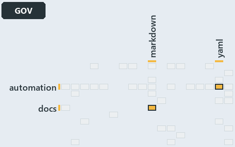

# docs/.assets/explanation/adr-pipe-auth--which-auth-rungs-have-a-gate--governance.grid.md

`Grid minimap: adr-pipe-auth--which-auth-rungs-have-a-gate--governance`

The grid minimap of the slide `adr-pipe-auth--which-auth-rungs-have-a-gate--governance` (governance lens). The slide supports
[ADR-PIPE-AUTH][1]; the highlight of those ADR codes selects what is lit, and each reason below names the code that selects it.

## What the minimap shows

The grid crosses the 12 tracks with the 18 file languages of the world map and lights 2 cells. A cell lit only by passing mentions
(citations in body comments, not in a file's header or text) is touched: drawn pale.

- automation × yaml: 1 lit of 95 files
- docs × markdown: 16 lit of 469 files

## Why each cell is lit

### automation × yaml (1 lit file)

Placed: the root folder `automation/` names the track automation ([ADR-DSGN-TRACK#1][2]); the extension `.yml` names the file language yaml
([ADR-DSGN-TRACK#6][3]). Lit ([ADR-DSGN-TRACK#12][4]) by:

- [automation/Catzc.Base.Docs/configs/adrs.yml][5]: selected by [ADR-PIPE-AUTH][1]: the file cites it at line 235 (text).

### docs × markdown (16 lit files)

Placed: the root folder `docs/` names the track docs ([ADR-DSGN-TRACK#1][2]); the extension `.md` names the file language markdown
([ADR-DSGN-TRACK#6][3]). Lit ([ADR-DSGN-TRACK#12][4]) by:

- [docs/.assets/explanation/adr-pipe-auth--configured-credential-proves-its-org--meta.drawio.md][6]: selected by [ADR-PIPE-AUTH][1]: the
  file cites it at line 65 (text).
- [docs/.assets/explanation/adr-pipe-auth--one-header-function-owns-precedence--architecture.drawio.md][7]: selected by [ADR-PIPE-AUTH][1]:
  the file cites it at line 69 (text).
- [docs/.assets/explanation/adr-pipe-auth--three-guarded-early-returns--implementation.drawio.md][8]: selected by [ADR-PIPE-AUTH][1]: the
  file cites it at line 69 (text).
- [docs/.assets/explanation/adr-pipe-auth--what-you-set-decides-the-credential--operations.drawio.md][9]: selected by [ADR-PIPE-AUTH][1]:
  the file cites it at line 69 (text).
- [docs/.assets/explanation/adr-pipe-auth--which-auth-rungs-have-a-gate--governance.drawio.md][10]: selected by [ADR-PIPE-AUTH][1]: the file
  cites it at line 57 (text) and line 67 (text).
- [docs/adr/index.md][11]: selected by [ADR-PIPE-AUTH][1]: the file cites it at line 219 (text).
- [docs/adr/pipelines/custom-template-discipline.md][12]: selected by [ADR-PIPE-AUTH][1]: an ADR file of the `pipelines` ADR domain, the ADR
  domain of that code.
- [docs/adr/pipelines/dora-explains.md][13]: selected by [ADR-PIPE-AUTH][1]: an ADR file of the `pipelines` ADR domain, the ADR domain of
  that code.
- [docs/adr/pipelines/dual-authentication.md][1]: selected by [ADR-PIPE-AUTH][1]: an ADR file of the `pipelines` ADR domain, the ADR domain
  of that code.
- [docs/adr/pipelines/pipeline-naming-and-placement.md][14]: selected by [ADR-PIPE-AUTH][1]: an ADR file of the `pipelines` ADR domain, the
  ADR domain of that code.
- [docs/adr/pipelines/pipeline-variables.md][15]: selected by [ADR-PIPE-AUTH][1]: an ADR file of the `pipelines` ADR domain, the ADR domain
  of that code.
- [docs/explanation/pipelines/configured-credential-proves-its-org.md][16]: selected by [ADR-PIPE-AUTH][1]: the file cites it at line 14
  (text), line 42 (text), line 44 (text) and line 45 (text).
- [docs/explanation/pipelines/one-header-function-owns-precedence.md][17]: selected by [ADR-PIPE-AUTH][1]: the file cites it at line 16
  (text), line 48 (text), line 49 (text), line 50 (text) and line 51 (text).
- [docs/explanation/pipelines/three-guarded-early-returns.md][18]: selected by [ADR-PIPE-AUTH][1]: the file cites it at line 16 (text), line
  54 (text), line 56 (text), line 57 (text) and line 58 (text).
- [docs/explanation/pipelines/what-you-set-decides-the-credential.md][19]: selected by [ADR-PIPE-AUTH][1]: the file cites it at line 17
  (text), line 51 (text), line 52 (text), line 53 (text), line 54 (text) and line 61 (text).
- [docs/explanation/pipelines/which-auth-rungs-have-a-gate.md][20]: selected by [ADR-PIPE-AUTH][1]: the file cites it at line 14 (text),
  line 17 (text), line 42 (text), line 47 (text), line 48 (text), line 49 (text), line 50 (text), line 51 (text), line 52 (text), line 53
  (text), line 57 (text) and line 58 (text).

## Keywords

- [world map][21]
- [track][22]
- [file language][23]
- [cell][24]
- [lit cell][25]
- [automation][26]: a track
- [docs][26]: a track
- [markdown][27]: a file language
- [yaml][27]: a file language

[1]: ../../adr/pipelines/dual-authentication.md
[2]: ../../adr/design/tracks.md#rule-adr-dsgn-track1
[3]: ../../adr/design/tracks.md#rule-adr-dsgn-track6
[4]: ../../adr/design/tracks.md#rule-adr-dsgn-track12
[5]: ../../../automation/Catzc.Base.Docs/configs/adrs.yml
[6]: adr-pipe-auth--configured-credential-proves-its-org--meta.drawio.md
[7]: adr-pipe-auth--one-header-function-owns-precedence--architecture.drawio.md
[8]: adr-pipe-auth--three-guarded-early-returns--implementation.drawio.md
[9]: adr-pipe-auth--what-you-set-decides-the-credential--operations.drawio.md
[10]: adr-pipe-auth--which-auth-rungs-have-a-gate--governance.drawio.md
[11]: ../../adr/index.md
[12]: ../../adr/pipelines/custom-template-discipline.md
[13]: ../../adr/pipelines/dora-explains.md
[14]: ../../adr/pipelines/pipeline-naming-and-placement.md
[15]: ../../adr/pipelines/pipeline-variables.md
[16]: ../../explanation/pipelines/configured-credential-proves-its-org.md
[17]: ../../explanation/pipelines/one-header-function-owns-precedence.md
[18]: ../../explanation/pipelines/three-guarded-early-returns.md
[19]: ../../explanation/pipelines/what-you-set-decides-the-credential.md
[20]: ../../explanation/pipelines/which-auth-rungs-have-a-gate.md
[21]: ../../adr/glossary.md#world-map
[22]: ../../adr/glossary.md#track
[23]: ../../adr/glossary.md#file-language
[24]: ../../adr/glossary.md#cell
[25]: ../../adr/glossary.md#lit-cell
[26]: ../../../automation/Catzc.Base.Variants/configs/variants.yml
[27]: ../../../automation/Catzc.Base.Languages/configs/languages.yml
