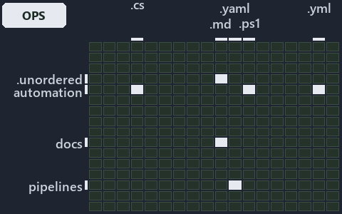

# docs/.assets/explanation/adr-repo-rootcfg--import-materialises-two-gates-name-the-fix--operations.grid.md

`Grid minimap: adr-repo-rootcfg--import-materialises-two-gates-name-the-fix--operations`

The grid minimap of the slide `adr-repo-rootcfg--import-materialises-two-gates-name-the-fix--operations` (operations lens). The slide
supports [ADR-REPO-ROOTCFG][1]; the highlight of those ADR codes selects what is lit, and each reason below names the code that selects it.

## What the minimap shows

The grid crosses the 16 tracks (rows) with the 18 file languages (columns) of the world map and lights 6 cells, filled in ink. A cell lit
only by passing mentions (citations in body comments, not in a file's header or text) is touched: a lighter ink. Every other cell is idle, a
grey box: it holds files the slide's ADR codes do not select, or no file at all (237 of the 288 cells hold none). The minimap shows where
the slide sits, not how many files a cell holds; the world-map PDFs show the counts.

- .unordered × markdown: 2 lit of 20 files
- automation × csharp: 8 lit of 272 files
- automation × powershell: 14 lit of 1563 files
- automation × yaml: 2 lit of 107 files
- docs × markdown: 21 lit of 1985 files
- pipelines × pipeline-yaml: 1 lit of 9 files

## Key

A lit row prints its track's name; a lit column prints a short code, the first extension of its file language:

- `.cs`: csharp
- `.md`: markdown
- `.yaml`: pipeline-yaml
- `.ps1`: powershell
- `.yml`: yaml

## Why each cell is lit

### .unordered × markdown (2 lit files)

Placed: the root folder `.unordered/` names the track .unordered ([ADR-DSGN-TRACK#1][2]); the extension `.md` names the file language
markdown ([ADR-DSGN-TRACK#6][3]). Lit ([ADR-DSGN-TRACK#12][4]) by:

- [.unordered/15-10-2026/plan-concern-axis.md][5]: selected by [ADR-REPO-ROOTCFG][1]: the file cites it at line 136 (text) and line 153
  (text).
- [.unordered/15-10-2026/plan-diagram-wave-8.md][6]: selected by [ADR-REPO-ROOTCFG][1]: the file cites it at line 20 (text).

### automation × csharp (8 lit files)

Placed: the root folder `automation/` names the track automation ([ADR-DSGN-TRACK#1][2]); the extension `.cs` names the file language csharp
([ADR-DSGN-TRACK#6][3]). Lit ([ADR-DSGN-TRACK#12][4]) by:

- [automation/Catzc.Base.Git/types/GitIgnoreConfig.cs][7]: selected by [ADR-REPO-ROOTCFG][1]: the file cites it at line 21 (text).
- [automation/Catzc.Base.Languages/types/GoWorkspaceFile.cs][8]: selected by [ADR-REPO-ROOTCFG][1]: the file cites it at line 21 (text).
- [automation/Catzc.Base.Languages/types/PythonWorkspaceFile.cs][9]: selected by [ADR-REPO-ROOTCFG][1]: the file cites it at line 20 (text).
- [automation/Catzc.Base.RootConfig/types/RootConfigFiles.cs][10]: selected by [ADR-REPO-ROOTCFG][1]: the file cites it at line 21 (text).
- [automation/Catzc.Base.VSCode/types/VscodeExtensionsConfig.cs][11]: selected by [ADR-REPO-ROOTCFG][1]: the file cites it at line 21
  (text).
- [automation/Catzc.Base.VSCode/types/VscodeLaunchConfig.cs][12]: selected by [ADR-REPO-ROOTCFG][1]: the file cites it at line 21 (text).
- [automation/Catzc.Base.VSCode/types/VscodePipelineSchemaConfig.cs][13]: selected by [ADR-REPO-ROOTCFG][1]: the file cites it at line 20
  (text).
- [automation/Catzc.Base.VSCode/types/VscodeSettingsConfig.cs][14]: selected by [ADR-REPO-ROOTCFG][1]: the file cites it at line 21 (text).

### automation × powershell (14 lit files)

Placed: the root folder `automation/` names the track automation ([ADR-DSGN-TRACK#1][2]); the extension `.ps1` names the file language
powershell ([ADR-DSGN-TRACK#6][3]). Lit ([ADR-DSGN-TRACK#12][4]) by:

- [automation/Catzc.Base.Files/Set-FileLink.ps1][15]: selected by [ADR-REPO-ROOTCFG][1]: the file cites it at line 22 (header) and line 38
  (header).
- [automation/Catzc.Base.Git/New-GitIgnore.ps1][16]: selected by [ADR-REPO-ROOTCFG][1]: the file cites it at line 21 (header) and line 38
  (header).
- [automation/Catzc.Base.Languages/New-GoWorkspace.ps1][17]: selected by [ADR-REPO-ROOTCFG][1]: the file cites it at line 22 (header) and
  line 47 (header).
- [automation/Catzc.Base.QualityGates/private/Get-ContentExemptPath.ps1][18]: selected by [ADR-REPO-ROOTCFG][1]: the file cites it at line
  21 (header) and line 32 (header).
- [automation/Catzc.Base.RootConfig/Build-RootConfig.ps1][19]: selected by [ADR-REPO-ROOTCFG][1]: the file cites it at line 23 (header) and
  line 44 (header).
- [automation/Catzc.Base.RootConfig/Test-RootAnalyzerSettings.ps1][20]: selected by [ADR-REPO-ROOTCFG][1]: the file cites it at line 21
  (header) and line 26 (header).
- [automation/Catzc.Base.RootConfig/Test-RootConfigFiles.ps1][21]: selected by [ADR-REPO-ROOTCFG][1]: the file cites it at line 21 (header)
  and line 28 (header).
- [automation/Catzc.Base.RootConfig/private/Get-RootConfigRenderedFile.ps1][22]: selected by [ADR-REPO-ROOTCFG][1]: the file cites it at
  line 20 (header) and line 35 (header).
- [automation/Catzc.Base.RootConfig/private/Get-RootConfigTargets.ps1][23]: selected by [ADR-REPO-ROOTCFG][1]: the file cites it at line 20
  (header) and line 27 (header).
- [automation/Catzc.Base.RootConfig/tests/Test-RootConfigIntegrity.Tests.ps1][24]: selected by [ADR-REPO-ROOTCFG][1]: the file cites it at
  line 20 (header).
- [automation/Catzc.Base.VSCode/New-VSCodeExtensions.ps1][25]: selected by [ADR-REPO-ROOTCFG][1]: the file cites it at line 21 (header) and
  line 35 (header).
- [automation/Catzc.Base.VSCode/New-VSCodeLaunch.ps1][26]: selected by [ADR-REPO-ROOTCFG][1]: the file cites it at line 20 (header) and line
  34 (header).
- [automation/Catzc.Base.VSCode/New-VSCodePipelineSchema.ps1][27]: selected by [ADR-REPO-ROOTCFG][1]: the file cites it at line 21 (header)
  and line 39 (header).
- [automation/Catzc.Base.VSCode/New-VSCodeSettings.ps1][28]: selected by [ADR-REPO-ROOTCFG][1]: the file cites it at line 22 (header) and
  line 42 (header).

### automation × yaml (2 lit files)

Placed: the root folder `automation/` names the track automation ([ADR-DSGN-TRACK#1][2]); the extension `.yml` names the file language yaml
([ADR-DSGN-TRACK#6][3]). Lit ([ADR-DSGN-TRACK#12][4]) by:

- [automation/Catzc.Base.Docs/configs/adrs.yml][29]: selected by [ADR-REPO-ROOTCFG][1]: the file cites it at line 312 (text).
- [automation/Catzc.Base.QualityGates/configs/terminology.yml][30]: selected by [ADR-REPO-ROOTCFG][1]: the file cites it at line 616 (text).

### docs × markdown (21 lit files)

Placed: the root folder `docs/` names the track docs ([ADR-DSGN-TRACK#1][2]); the extension `.md` names the file language markdown
([ADR-DSGN-TRACK#6][3]). Lit ([ADR-DSGN-TRACK#12][4]) by:

- [docs/adr/index.md][31]: selected by [ADR-REPO-ROOTCFG][1]: the file cites it at line 314 (text).
- [docs/adr/repository/dora-explains.md][32]: selected by [ADR-REPO-ROOTCFG][1]: the file cites it at line 163 (text).
- [docs/adr/repository/generated-root-configs.md][1]: selected by [ADR-REPO-ROOTCFG][1]: the ADR's own file.
- [docs/references/automation/catzc-base-git/configs/gitignore.yml.md][33]: selected by [ADR-REPO-ROOTCFG][1]: the file cites it at line 28
  (text).
- [docs/references/automation/catzc-base-git/types/GitIgnoreConfig.cs.md][34]: selected by [ADR-REPO-ROOTCFG][1]: the file cites it at line
  31 (text).
- [docs/references/automation/catzc-base-languages.md][35]: selected by [ADR-REPO-ROOTCFG][1]: the file cites it at line 41 (text).
- [docs/references/automation/catzc-base-languages/types/GoWorkspaceFile.cs.md][36]: selected by [ADR-REPO-ROOTCFG][1]: the file cites it at
  line 32 (text).
- [docs/references/automation/catzc-base-languages/types/PythonWorkspaceFile.cs.md][37]: selected by [ADR-REPO-ROOTCFG][1]: the file cites
  it at line 32 (text).
- [docs/references/automation/catzc-base-rootconfig.md][38]: selected by [ADR-REPO-ROOTCFG][1]: the file cites it at line 16 (text), line 68
  (text) and line 77 (text).
- [docs/references/automation/catzc-base-rootconfig/configs/rootconfig.yml.md][39]: selected by [ADR-REPO-ROOTCFG][1]: the file cites it at
  line 45 (text).
- [docs/references/automation/catzc-base-rootconfig/tests/Test-RootConfigIntegrity.Tests.ps1.md][40]: selected by [ADR-REPO-ROOTCFG][1]: the
  file cites it at line 40 (text).
- [docs/references/automation/catzc-base-rootconfig/types/RootConfigFiles.cs.md][41]: selected by [ADR-REPO-ROOTCFG][1]: the file cites it
  at line 31 (text).
- [docs/references/automation/catzc-base-vscode/configs/vscode-extensions.yml.md][42]: selected by [ADR-REPO-ROOTCFG][1]: the file cites it
  at line 35 (text).
- [docs/references/automation/catzc-base-vscode/configs/vscode-launch.yml.md][43]: selected by [ADR-REPO-ROOTCFG][1]: the file cites it at
  line 28 (text).
- [docs/references/automation/catzc-base-vscode/configs/vscode-pipeline-schema.yml.md][44]: selected by [ADR-REPO-ROOTCFG][1]: the file
  cites it at line 30 (text).
- [docs/references/automation/catzc-base-vscode/configs/vscode-settings.yml.md][45]: selected by [ADR-REPO-ROOTCFG][1]: the file cites it at
  line 34 (text).
- [docs/references/automation/catzc-base-vscode/types/VscodeExtensionsConfig.cs.md][46]: selected by [ADR-REPO-ROOTCFG][1]: the file cites
  it at line 31 (text).
- [docs/references/automation/catzc-base-vscode/types/VscodeLaunchConfig.cs.md][47]: selected by [ADR-REPO-ROOTCFG][1]: the file cites it at
  line 30 (text).
- [docs/references/automation/catzc-base-vscode/types/VscodePipelineSchemaConfig.cs.md][48]: selected by [ADR-REPO-ROOTCFG][1]: the file
  cites it at line 28 (text).
- [docs/references/automation/catzc-base-vscode/types/VscodeSettingsConfig.cs.md][49]: selected by [ADR-REPO-ROOTCFG][1]: the file cites it
  at line 31 (text).
- [docs/references/automation/internal/Catzc.Internal.Importer.psm1.md][50]: selected by [ADR-REPO-ROOTCFG][1]: the file cites it at line
  427 (text).

### pipelines × pipeline-yaml (1 lit file)

Placed: the root folder `pipelines/` names the track pipelines ([ADR-DSGN-TRACK#1][2]); the extension `.yaml` names the file language
pipeline-yaml ([ADR-DSGN-TRACK#6][3]). Lit ([ADR-DSGN-TRACK#12][4]) by:

- [pipelines/ci-automation.yaml][51]: selected by [ADR-REPO-ROOTCFG][1]: a pipeline that cites nothing itself carries its globset's
  citations, which cite it at `automation/Catzc.Base.Docs/configs/adrs.yml` line 312 (text), `automation/Catzc.Base.Files/Set-FileLink.ps1`
  line 22 (header), `automation/Catzc.Base.Files/Set-FileLink.ps1` line 38 (header), `automation/Catzc.Base.Git/New-GitIgnore.ps1` line 21
  (header), `automation/Catzc.Base.Git/New-GitIgnore.ps1` line 38 (header), `automation/Catzc.Base.Git/types/GitIgnoreConfig.cs` line 21
  (text), `automation/Catzc.Base.Languages/New-GoWorkspace.ps1` line 22 (header), `automation/Catzc.Base.Languages/New-GoWorkspace.ps1` line
  47 (header), `automation/Catzc.Base.Languages/types/GoWorkspaceFile.cs` line 21 (text),
  `automation/Catzc.Base.Languages/types/PythonWorkspaceFile.cs` line 20 (text),
  `automation/Catzc.Base.QualityGates/configs/terminology.yml` line 616 (text),
  `automation/Catzc.Base.QualityGates/private/Get-ContentExemptPath.ps1` line 21 (header),
  `automation/Catzc.Base.QualityGates/private/Get-ContentExemptPath.ps1` line 32 (header),
  `automation/Catzc.Base.RootConfig/Build-RootConfig.ps1` line 23 (header), `automation/Catzc.Base.RootConfig/Build-RootConfig.ps1` line 44
  (header), `automation/Catzc.Base.RootConfig/Test-RootAnalyzerSettings.ps1` line 21 (header),
  `automation/Catzc.Base.RootConfig/Test-RootAnalyzerSettings.ps1` line 26 (header),
  `automation/Catzc.Base.RootConfig/Test-RootConfigFiles.ps1` line 21 (header), `automation/Catzc.Base.RootConfig/Test-RootConfigFiles.ps1`
  line 28 (header), `automation/Catzc.Base.RootConfig/private/Get-RootConfigRenderedFile.ps1` line 20 (header),
  `automation/Catzc.Base.RootConfig/private/Get-RootConfigRenderedFile.ps1` line 35 (header),
  `automation/Catzc.Base.RootConfig/private/Get-RootConfigTargets.ps1` line 20 (header),
  `automation/Catzc.Base.RootConfig/private/Get-RootConfigTargets.ps1` line 27 (header),
  `automation/Catzc.Base.RootConfig/tests/Test-RootConfigIntegrity.Tests.ps1` line 20 (header),
  `automation/Catzc.Base.RootConfig/types/RootConfigFiles.cs` line 21 (text), `automation/Catzc.Base.VSCode/New-VSCodeExtensions.ps1` line
  21 (header), `automation/Catzc.Base.VSCode/New-VSCodeExtensions.ps1` line 35 (header), `automation/Catzc.Base.VSCode/New-VSCodeLaunch.ps1`
  line 20 (header), `automation/Catzc.Base.VSCode/New-VSCodeLaunch.ps1` line 34 (header),
  `automation/Catzc.Base.VSCode/New-VSCodePipelineSchema.ps1` line 21 (header), `automation/Catzc.Base.VSCode/New-VSCodePipelineSchema.ps1`
  line 39 (header), `automation/Catzc.Base.VSCode/New-VSCodeSettings.ps1` line 22 (header),
  `automation/Catzc.Base.VSCode/New-VSCodeSettings.ps1` line 42 (header), `automation/Catzc.Base.VSCode/types/VscodeExtensionsConfig.cs`
  line 21 (text), `automation/Catzc.Base.VSCode/types/VscodeLaunchConfig.cs` line 21 (text),
  `automation/Catzc.Base.VSCode/types/VscodePipelineSchemaConfig.cs` line 20 (text) and
  `automation/Catzc.Base.VSCode/types/VscodeSettingsConfig.cs` line 21 (text).

## Keywords

- [world map][52]
- [track][53]
- [file language][54]
- [cell][55]
- [lit cell][56]
- [.unordered][57]: a track
- [automation][57]: a track
- [docs][57]: a track
- [pipelines][57]: a track
- [csharp][58]: a file language
- [markdown][58]: a file language
- [pipeline-yaml][58]: a file language
- [powershell][58]: a file language
- [yaml][58]: a file language

[1]: ../../adr/repository/generated-root-configs.md
[2]: ../../adr/design/tracks.md#rule-adr-dsgn-track1
[3]: ../../adr/design/tracks.md#rule-adr-dsgn-track6
[4]: ../../adr/design/tracks.md#rule-adr-dsgn-track12
[5]: ../../../.unordered/15-10-2026/plan-concern-axis.md
[6]: ../../../.unordered/15-10-2026/plan-diagram-wave-8.md
[7]: ../../../automation/Catzc.Base.Git/types/GitIgnoreConfig.cs
[8]: ../../../automation/Catzc.Base.Languages/types/GoWorkspaceFile.cs
[9]: ../../../automation/Catzc.Base.Languages/types/PythonWorkspaceFile.cs
[10]: ../../../automation/Catzc.Base.RootConfig/types/RootConfigFiles.cs
[11]: ../../../automation/Catzc.Base.VSCode/types/VscodeExtensionsConfig.cs
[12]: ../../../automation/Catzc.Base.VSCode/types/VscodeLaunchConfig.cs
[13]: ../../../automation/Catzc.Base.VSCode/types/VscodePipelineSchemaConfig.cs
[14]: ../../../automation/Catzc.Base.VSCode/types/VscodeSettingsConfig.cs
[15]: ../../../automation/Catzc.Base.Files/Set-FileLink.ps1
[16]: ../../../automation/Catzc.Base.Git/New-GitIgnore.ps1
[17]: ../../../automation/Catzc.Base.Languages/New-GoWorkspace.ps1
[18]: ../../../automation/Catzc.Base.QualityGates/private/Get-ContentExemptPath.ps1
[19]: ../../../automation/Catzc.Base.RootConfig/Build-RootConfig.ps1
[20]: ../../../automation/Catzc.Base.RootConfig/Test-RootAnalyzerSettings.ps1
[21]: ../../../automation/Catzc.Base.RootConfig/Test-RootConfigFiles.ps1
[22]: ../../../automation/Catzc.Base.RootConfig/private/Get-RootConfigRenderedFile.ps1
[23]: ../../../automation/Catzc.Base.RootConfig/private/Get-RootConfigTargets.ps1
[24]: ../../../automation/Catzc.Base.RootConfig/tests/Test-RootConfigIntegrity.Tests.ps1
[25]: ../../../automation/Catzc.Base.VSCode/New-VSCodeExtensions.ps1
[26]: ../../../automation/Catzc.Base.VSCode/New-VSCodeLaunch.ps1
[27]: ../../../automation/Catzc.Base.VSCode/New-VSCodePipelineSchema.ps1
[28]: ../../../automation/Catzc.Base.VSCode/New-VSCodeSettings.ps1
[29]: ../../../automation/Catzc.Base.Docs/configs/adrs.yml
[30]: ../../../automation/Catzc.Base.QualityGates/configs/terminology.yml
[31]: ../../adr/index.md
[32]: ../../adr/repository/dora-explains.md
[33]: ../../references/automation/catzc-base-git/configs/gitignore.yml.md
[34]: ../../references/automation/catzc-base-git/types/GitIgnoreConfig.cs.md
[35]: ../../references/automation/catzc-base-languages.md
[36]: ../../references/automation/catzc-base-languages/types/GoWorkspaceFile.cs.md
[37]: ../../references/automation/catzc-base-languages/types/PythonWorkspaceFile.cs.md
[38]: ../../references/automation/catzc-base-rootconfig.md
[39]: ../../references/automation/catzc-base-rootconfig/configs/rootconfig.yml.md
[40]: ../../references/automation/catzc-base-rootconfig/tests/Test-RootConfigIntegrity.Tests.ps1.md
[41]: ../../references/automation/catzc-base-rootconfig/types/RootConfigFiles.cs.md
[42]: ../../references/automation/catzc-base-vscode/configs/vscode-extensions.yml.md
[43]: ../../references/automation/catzc-base-vscode/configs/vscode-launch.yml.md
[44]: ../../references/automation/catzc-base-vscode/configs/vscode-pipeline-schema.yml.md
[45]: ../../references/automation/catzc-base-vscode/configs/vscode-settings.yml.md
[46]: ../../references/automation/catzc-base-vscode/types/VscodeExtensionsConfig.cs.md
[47]: ../../references/automation/catzc-base-vscode/types/VscodeLaunchConfig.cs.md
[48]: ../../references/automation/catzc-base-vscode/types/VscodePipelineSchemaConfig.cs.md
[49]: ../../references/automation/catzc-base-vscode/types/VscodeSettingsConfig.cs.md
[50]: ../../references/automation/internal/Catzc.Internal.Importer.psm1.md
[51]: ../../../pipelines/ci-automation.yaml
[52]: ../../adr/glossary.md#world-map
[53]: ../../adr/glossary.md#track
[54]: ../../adr/glossary.md#file-language
[55]: ../../adr/glossary.md#cell
[56]: ../../adr/glossary.md#lit-cell
[57]: ../../../automation/Catzc.Base.Variants/configs/variants.yml
[58]: ../../../automation/Catzc.Base.Languages/configs/languages.yml
