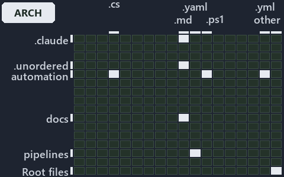

# docs/.assets/explanation/grid/adr-auto-path--two-crossers-and-three-anchors--architecture.grid.md

`Grid minimap: adr-auto-path--two-crossers-and-three-anchors--architecture`

The grid minimap of the slide `adr-auto-path--two-crossers-and-three-anchors--architecture` (architecture lens). The slide supports
[ADR-AUTO-PATH][1]; the highlight of those ADR codes selects what is lit, and each reason below names the code that selects it.

## What the minimap shows

The grid crosses the 16 tracks (rows) with the 18 file languages (columns) of the world map and lights 8 cells, filled in ink. A cell lit
only by passing mentions (citations in body comments, not in a file's header or text) is touched: a lighter ink. Every other cell is idle, a
grey box: it holds files the slide's ADR codes do not select, or no file at all (237 of the 288 cells hold none). The minimap shows where
the slide sits, not how many files a cell holds; the world-map PDFs show the counts.

- .claude × markdown: 2 lit of 51 files
- .unordered × markdown: 1 lit of 20 files
- automation × csharp: 8 lit of 272 files
- automation × powershell: 15 lit of 1563 files
- automation × yaml: 2 lit of 107 files
- docs × markdown: 19 lit of 1985 files
- pipelines × pipeline-yaml: 1 lit of 9 files
- Root files × Unlisted files: 2 lit of 3 files

## Key

A lit row prints its track's name; a lit column prints a short code, the first extension of its file language:

- `.cs`: csharp
- `.md`: markdown
- `.yaml`: pipeline-yaml
- `.ps1`: powershell
- `.yml`: yaml
- `other`: Unlisted files

## Why each cell is lit

### .claude × markdown (2 lit files)

Placed: the root folder `.claude/` names the track .claude ([ADR-DSGN-TRACK#1][2]); the extension `.md` names the file language markdown
([ADR-DSGN-TRACK#6][3]). Lit ([ADR-DSGN-TRACK#12][4]) by:

- [.claude/agents/build-inspiration-module.md][5]: selected by [ADR-AUTO-PATH][1]: the file cites it at line 27 (text), line 50 (text) and
  line 50 (text).
- [.claude/plans/plan-layers-vocabulary-rename-contracts.md][6]: selected by [ADR-AUTO-PATH][1]: the file cites it at line 648 (text).

### .unordered × markdown (1 lit file)

Placed: the root folder `.unordered/` names the track .unordered ([ADR-DSGN-TRACK#1][2]); the extension `.md` names the file language
markdown ([ADR-DSGN-TRACK#6][3]). Lit ([ADR-DSGN-TRACK#12][4]) by:

- [.unordered/15-10-2026/plan-diagram-wave-8.md][7]: selected by [ADR-AUTO-PATH][1]: the file cites it at line 15 (text).

### automation × csharp (8 lit files)

Placed: the root folder `automation/` names the track automation ([ADR-DSGN-TRACK#1][2]); the extension `.cs` names the file language csharp
([ADR-DSGN-TRACK#6][3]). Lit ([ADR-DSGN-TRACK#12][4]) by:

- [automation/Catzc.Base.Contracts/types/ContractAsset.cs][8]: selected by [ADR-AUTO-PATH][1]: the file cites it at line 20 (text).
- [automation/Catzc.Base.Docs/types/DocMapping.cs][9]: selected by [ADR-AUTO-PATH][1]: the file cites it at line 20 (text).
- [automation/Catzc.Base.Docs/types/DocPattern.cs][10]: selected by [ADR-AUTO-PATH][1]: the file cites it at line 20 (text).
- [automation/Catzc.Base.Objects/types/ArtifactRef.cs][11]: selected by [ADR-AUTO-PATH][1]: the file cites it at line 20 (text).
- [automation/Catzc.Base.Objects/types/RepoRelativePath.cs][12]: selected by [ADR-AUTO-PATH][1]: the file cites it at line 20 (text).
- [automation/Catzc.Base.RootConfig/types/RootConfigFile.cs][13]: selected by [ADR-AUTO-PATH][1]: the file cites it at line 20 (text).
- [automation/Catzc.Tooling.Inspiration/types/Inspiration.cs][14]: selected by [ADR-AUTO-PATH][1]: the file cites it at line 19 (text).
- [automation/Catzc.Tooling.Inspiration/types/InspirationRoot.cs][15]: selected by [ADR-AUTO-PATH][1]: the file cites it at line 20 (text).

### automation × powershell (15 lit files)

Placed: the root folder `automation/` names the track automation ([ADR-DSGN-TRACK#1][2]); the extension `.ps1` names the file language
powershell ([ADR-DSGN-TRACK#6][3]). Lit ([ADR-DSGN-TRACK#12][4]) by:

- [automation/Catzc.Base.Contracts/Get-Contract.ps1][16]: selected by [ADR-AUTO-PATH][1]: the file cites it at line 19 (header) and line 31
  (header).
- [automation/Catzc.Base.Contracts/Publish-ContractRelease.ps1][17]: selected by [ADR-AUTO-PATH][1]: the file cites it at line 21 (header)
  and line 50 (header).
- [automation/Catzc.Base.Contracts/private/Get-ContractFileHashes.ps1][18]: selected by [ADR-AUTO-PATH][1]: the file cites it at line 20
  (header) and line 38 (header).
- [automation/Catzc.Base.Contracts/tests/Get-Contract.Tests.ps1][19]: selected by [ADR-AUTO-PATH][1]: the file cites it at line 20 (header)
  and line 51 (body comment).
- [automation/Catzc.Base.Contracts/tests/types/ContractAsset.Tests.ps1][20]: selected by [ADR-AUTO-PATH][1]: the file cites it at line 19
  (header) and line 36 (text).
- [automation/Catzc.Base.ModuleSystem/Copy-Automation.ps1][21]: selected by [ADR-AUTO-PATH][1]: the file cites it at line 20 (header) and
  line 54 (header).
- [automation/Catzc.Base.Objects/tests/types/ArtifactRef.Tests.ps1][22]: selected by [ADR-AUTO-PATH][1]: the file cites it at line 18
  (header) and line 22 (text).
- [automation/Catzc.Base.Repository/ConvertTo-RepoRelativePath.ps1][23]: selected by [ADR-AUTO-PATH][1]: the file cites it at line 20
  (header), line 25 (header) and line 35 (header).
- [automation/Catzc.Base.Repository/Get-RepositoryFile.ps1][24]: selected by [ADR-AUTO-PATH][1]: the file cites it at line 19 (header) and
  line 24 (header).
- [automation/Catzc.Base.Repository/Get-RepositoryFolder.ps1][25]: selected by [ADR-AUTO-PATH][1]: the file cites it at line 19 (header) and
  line 24 (header).
- [automation/Catzc.Base.Repository/Resolve-RepoPath.ps1][26]: selected by [ADR-AUTO-PATH][1]: the file cites it at line 19 (header) and
  line 24 (header).
- [automation/Catzc.Tooling.Inspiration/private/Resolve-InspirationRoot.ps1][27]: selected by [ADR-AUTO-PATH][1]: the file cites it at line
  20 (header), line 25 (header), line 26 (header) and line 29 (header).
- [automation/Catzc.Tooling.Inspiration/tests/Resolve-InspirationRoot.Tests.ps1][28]: selected by [ADR-AUTO-PATH][1]: the file cites it at
  line 19 (header).
- [automation/Catzc.Tooling.Inspiration/tests/types/InspirationConfig.Tests.ps1][29]: selected by [ADR-AUTO-PATH][1]: the file cites it at
  line 20 (header).
- [automation/Catzc.Tooling.Inspiration/tests/types/InspirationRoot.Tests.ps1][30]: selected by [ADR-AUTO-PATH][1]: the file cites it at
  line 19 (header).

### automation × yaml (2 lit files)

Placed: the root folder `automation/` names the track automation ([ADR-DSGN-TRACK#1][2]); the extension `.yml` names the file language yaml
([ADR-DSGN-TRACK#6][3]). Lit ([ADR-DSGN-TRACK#12][4]) by:

- [automation/Catzc.Base.Docs/configs/adrs.yml][31]: selected by [ADR-AUTO-PATH][1]: the file cites it at line 155 (text).
- [automation/Catzc.Base.ModuleSystem/configs/glossary.yml][32]: selected by [ADR-AUTO-PATH][1]: the file cites it at line 56 (text).

### docs × markdown (19 lit files)

Placed: the root folder `docs/` names the track docs ([ADR-DSGN-TRACK#1][2]); the extension `.md` names the file language markdown
([ADR-DSGN-TRACK#6][3]). Lit ([ADR-DSGN-TRACK#12][4]) by:

- [docs/adr/automation/dora-explains.md][33]: selected by [ADR-AUTO-PATH][1]: the file cites it at line 449 (text).
- [docs/adr/automation/path-representation.md][1]: selected by [ADR-AUTO-PATH][1]: the ADR's own file.
- [docs/adr/glossary.md][34]: selected by [ADR-AUTO-PATH][1]: the file cites it at line 552 (text).
- [docs/adr/index.md][35]: selected by [ADR-AUTO-PATH][1]: the file cites it at line 164 (text).
- [docs/references/automation/catzc-base-contracts/tests/types/ContractAsset.Tests.ps1.md][36]: selected by [ADR-AUTO-PATH][1]: the file
  cites it at line 16 (text) and line 30 (text).
- [docs/references/automation/catzc-base-contracts/types/ContractAsset.cs.md][37]: selected by [ADR-AUTO-PATH][1]: the file cites it at line
  16 (text), line 37 (text) and line 38 (text).
- [docs/references/automation/catzc-base-docs/configs/readme.yml.md][38]: selected by [ADR-AUTO-PATH][1]: the file cites it at line 48
  (text).
- [docs/references/automation/catzc-base-docs/types/DocMapping.cs.md][39]: selected by [ADR-AUTO-PATH][1]: the file cites it at line 28
  (text).
- [docs/references/automation/catzc-base-docs/types/DocPattern.cs.md][40]: selected by [ADR-AUTO-PATH][1]: the file cites it at line 29
  (text).
- [docs/references/automation/catzc-base-objects/types/ArtifactRef.cs.md][41]: selected by [ADR-AUTO-PATH][1]: the file cites it at line 16
  (text) and line 35 (text).
- [docs/references/automation/catzc-base-objects/types/RepoRelativePath.cs.md][42]: selected by [ADR-AUTO-PATH][1]: the file cites it at
  line 16 (text), line 29 (text), line 34 (text), line 35 (text), line 39 (text) and line 58 (text).
- [docs/references/automation/catzc-base-rootconfig/configs/rootconfig.yml.md][43]: selected by [ADR-AUTO-PATH][1]: the file cites it at
  line 43 (text).
- [docs/references/automation/catzc-base-rootconfig/types/RootConfigFile.cs.md][44]: selected by [ADR-AUTO-PATH][1]: the file cites it at
  line 38 (text).
- [docs/references/automation/catzc-tooling-inspiration/configs/inspiration.yml.md][45]: selected by [ADR-AUTO-PATH][1]: the file cites it
  at line 17 (text) and line 43 (text).
- [docs/references/automation/catzc-tooling-inspiration/tests/Resolve-InspirationRoot.Tests.ps1.md][46]: selected by [ADR-AUTO-PATH][1]: the
  file cites it at line 16 (text) and line 33 (text).
- [docs/references/automation/catzc-tooling-inspiration/tests/types/InspirationConfig.Tests.ps1.md][47]: selected by [ADR-AUTO-PATH][1]: the
  file cites it at line 17 (text) and line 34 (text).
- [docs/references/automation/catzc-tooling-inspiration/tests/types/InspirationRoot.Tests.ps1.md][48]: selected by [ADR-AUTO-PATH][1]: the
  file cites it at line 16 (text) and line 32 (text).
- [docs/references/automation/catzc-tooling-inspiration/types/Inspiration.cs.md][49]: selected by [ADR-AUTO-PATH][1]: the file cites it at
  line 16 (text) and line 36 (text).
- [docs/references/automation/catzc-tooling-inspiration/types/InspirationRoot.cs.md][50]: selected by [ADR-AUTO-PATH][1]: the file cites it
  at line 16 (text), line 30 (text), line 32 (text) and line 33 (text).

### pipelines × pipeline-yaml (1 lit file)

Placed: the root folder `pipelines/` names the track pipelines ([ADR-DSGN-TRACK#1][2]); the extension `.yaml` names the file language
pipeline-yaml ([ADR-DSGN-TRACK#6][3]). Lit ([ADR-DSGN-TRACK#12][4]) by:

- [pipelines/ci-automation.yaml][51]: selected by [ADR-AUTO-PATH][1]: a pipeline that cites nothing itself carries its globset's citations,
  which cite it at `automation/Catzc.Base.Contracts/Get-Contract.ps1` line 19 (header), `automation/Catzc.Base.Contracts/Get-Contract.ps1`
  line 31 (header), `automation/Catzc.Base.Contracts/Publish-ContractRelease.ps1` line 21 (header),
  `automation/Catzc.Base.Contracts/Publish-ContractRelease.ps1` line 50 (header),
  `automation/Catzc.Base.Contracts/private/Get-ContractFileHashes.ps1` line 20 (header),
  `automation/Catzc.Base.Contracts/private/Get-ContractFileHashes.ps1` line 38 (header),
  `automation/Catzc.Base.Contracts/tests/Get-Contract.Tests.ps1` line 20 (header),
  `automation/Catzc.Base.Contracts/tests/Get-Contract.Tests.ps1` line 51 (body comment),
  `automation/Catzc.Base.Contracts/tests/types/ContractAsset.Tests.ps1` line 19 (header),
  `automation/Catzc.Base.Contracts/tests/types/ContractAsset.Tests.ps1` line 36 (text),
  `automation/Catzc.Base.Contracts/types/ContractAsset.cs` line 20 (text), `automation/Catzc.Base.Docs/configs/adrs.yml` line 155 (text),
  `automation/Catzc.Base.Docs/types/DocMapping.cs` line 20 (text), `automation/Catzc.Base.Docs/types/DocPattern.cs` line 20 (text),
  `automation/Catzc.Base.ModuleSystem/Copy-Automation.ps1` line 20 (header), `automation/Catzc.Base.ModuleSystem/Copy-Automation.ps1` line
  54 (header), `automation/Catzc.Base.ModuleSystem/configs/glossary.yml` line 56 (text),
  `automation/Catzc.Base.Objects/tests/types/ArtifactRef.Tests.ps1` line 18 (header),
  `automation/Catzc.Base.Objects/tests/types/ArtifactRef.Tests.ps1` line 22 (text), `automation/Catzc.Base.Objects/types/ArtifactRef.cs`
  line 20 (text), `automation/Catzc.Base.Objects/types/RepoRelativePath.cs` line 20 (text),
  `automation/Catzc.Base.Repository/ConvertTo-RepoRelativePath.ps1` line 20 (header),
  `automation/Catzc.Base.Repository/ConvertTo-RepoRelativePath.ps1` line 25 (header),
  `automation/Catzc.Base.Repository/ConvertTo-RepoRelativePath.ps1` line 35 (header),
  `automation/Catzc.Base.Repository/Get-RepositoryFile.ps1` line 19 (header), `automation/Catzc.Base.Repository/Get-RepositoryFile.ps1` line
  24 (header), `automation/Catzc.Base.Repository/Get-RepositoryFolder.ps1` line 19 (header),
  `automation/Catzc.Base.Repository/Get-RepositoryFolder.ps1` line 24 (header), `automation/Catzc.Base.Repository/Resolve-RepoPath.ps1` line
  19 (header), `automation/Catzc.Base.Repository/Resolve-RepoPath.ps1` line 24 (header),
  `automation/Catzc.Base.RootConfig/types/RootConfigFile.cs` line 20 (text),
  `automation/Catzc.Tooling.Inspiration/private/Resolve-InspirationRoot.ps1` line 20 (header),
  `automation/Catzc.Tooling.Inspiration/private/Resolve-InspirationRoot.ps1` line 25 (header),
  `automation/Catzc.Tooling.Inspiration/private/Resolve-InspirationRoot.ps1` line 26 (header),
  `automation/Catzc.Tooling.Inspiration/private/Resolve-InspirationRoot.ps1` line 29 (header),
  `automation/Catzc.Tooling.Inspiration/tests/Resolve-InspirationRoot.Tests.ps1` line 19 (header),
  `automation/Catzc.Tooling.Inspiration/tests/types/InspirationConfig.Tests.ps1` line 20 (header),
  `automation/Catzc.Tooling.Inspiration/tests/types/InspirationRoot.Tests.ps1` line 19 (header),
  `automation/Catzc.Tooling.Inspiration/types/Inspiration.cs` line 19 (text) and
  `automation/Catzc.Tooling.Inspiration/types/InspirationRoot.cs` line 20 (text).

### Root files × Unlisted files (2 lit files)

Placed: each file sits directly in the repository root, so it is a root file ([ADR-DSGN-TRACK#7][52]); no extension names no file language,
so each is an unlisted file ([ADR-DSGN-TRACK#8][53]). Lit ([ADR-DSGN-TRACK#12][4]) by:

- [.gitattributes][54]: selected by [ADR-AUTO-PATH][1]: a root file carries the citations of its owner module's files (files.yml), which
  cite it at `automation/Catzc.Base.Repository/ConvertTo-RepoRelativePath.ps1` line 20 (header),
  `automation/Catzc.Base.Repository/ConvertTo-RepoRelativePath.ps1` line 25 (header),
  `automation/Catzc.Base.Repository/ConvertTo-RepoRelativePath.ps1` line 35 (header),
  `automation/Catzc.Base.Repository/Get-RepositoryFile.ps1` line 19 (header), `automation/Catzc.Base.Repository/Get-RepositoryFile.ps1` line
  24 (header), `automation/Catzc.Base.Repository/Get-RepositoryFolder.ps1` line 19 (header),
  `automation/Catzc.Base.Repository/Get-RepositoryFolder.ps1` line 24 (header), `automation/Catzc.Base.Repository/Resolve-RepoPath.ps1` line
  19 (header) and `automation/Catzc.Base.Repository/Resolve-RepoPath.ps1` line 24 (header).
- [.gitignore][55]: selected by [ADR-AUTO-PATH][1]: a root file carries the citations of its owner module's files (files.yml), which cite it
  at `automation/Catzc.Base.Repository/ConvertTo-RepoRelativePath.ps1` line 20 (header),
  `automation/Catzc.Base.Repository/ConvertTo-RepoRelativePath.ps1` line 25 (header),
  `automation/Catzc.Base.Repository/ConvertTo-RepoRelativePath.ps1` line 35 (header),
  `automation/Catzc.Base.Repository/Get-RepositoryFile.ps1` line 19 (header), `automation/Catzc.Base.Repository/Get-RepositoryFile.ps1` line
  24 (header), `automation/Catzc.Base.Repository/Get-RepositoryFolder.ps1` line 19 (header),
  `automation/Catzc.Base.Repository/Get-RepositoryFolder.ps1` line 24 (header), `automation/Catzc.Base.Repository/Resolve-RepoPath.ps1` line
  19 (header) and `automation/Catzc.Base.Repository/Resolve-RepoPath.ps1` line 24 (header).

## Keywords

- [world map][56]
- [track][57]
- [file language][58]
- [cell][59]
- [lit cell][60]
- [root file][61]
- [unlisted file][62]
- [.claude][63]: a track
- [.unordered][63]: a track
- [automation][63]: a track
- [docs][63]: a track
- [pipelines][63]: a track
- [csharp][64]: a file language
- [markdown][64]: a file language
- [pipeline-yaml][64]: a file language
- [powershell][64]: a file language
- [yaml][64]: a file language

Terms the cited ADRs define:

- [published artifact][65], defined by [ADR-AUTO-PATH#10][66]

[1]: ../../../adr/automation/path-representation.md
[2]: ../../../adr/design/tracks.md#rule-adr-dsgn-track1
[3]: ../../../adr/design/tracks.md#rule-adr-dsgn-track6
[4]: ../../../adr/design/tracks.md#rule-adr-dsgn-track12
[5]: ../../../../.claude/agents/build-inspiration-module.md
[6]: ../../../../.claude/plans/plan-layers-vocabulary-rename-contracts.md
[7]: ../../../../.unordered/15-10-2026/plan-diagram-wave-8.md
[8]: ../../../../automation/Catzc.Base.Contracts/types/ContractAsset.cs
[9]: ../../../../automation/Catzc.Base.Docs/types/DocMapping.cs
[10]: ../../../../automation/Catzc.Base.Docs/types/DocPattern.cs
[11]: ../../../../automation/Catzc.Base.Objects/types/ArtifactRef.cs
[12]: ../../../../automation/Catzc.Base.Objects/types/RepoRelativePath.cs
[13]: ../../../../automation/Catzc.Base.RootConfig/types/RootConfigFile.cs
[14]: ../../../../automation/Catzc.Tooling.Inspiration/types/Inspiration.cs
[15]: ../../../../automation/Catzc.Tooling.Inspiration/types/InspirationRoot.cs
[16]: ../../../../automation/Catzc.Base.Contracts/Get-Contract.ps1
[17]: ../../../../automation/Catzc.Base.Contracts/Publish-ContractRelease.ps1
[18]: ../../../../automation/Catzc.Base.Contracts/private/Get-ContractFileHashes.ps1
[19]: ../../../../automation/Catzc.Base.Contracts/tests/Get-Contract.Tests.ps1
[20]: ../../../../automation/Catzc.Base.Contracts/tests/types/ContractAsset.Tests.ps1
[21]: ../../../../automation/Catzc.Base.ModuleSystem/Copy-Automation.ps1
[22]: ../../../../automation/Catzc.Base.Objects/tests/types/ArtifactRef.Tests.ps1
[23]: ../../../../automation/Catzc.Base.Repository/ConvertTo-RepoRelativePath.ps1
[24]: ../../../../automation/Catzc.Base.Repository/Get-RepositoryFile.ps1
[25]: ../../../../automation/Catzc.Base.Repository/Get-RepositoryFolder.ps1
[26]: ../../../../automation/Catzc.Base.Repository/Resolve-RepoPath.ps1
[27]: ../../../../automation/Catzc.Tooling.Inspiration/private/Resolve-InspirationRoot.ps1
[28]: ../../../../automation/Catzc.Tooling.Inspiration/tests/Resolve-InspirationRoot.Tests.ps1
[29]: ../../../../automation/Catzc.Tooling.Inspiration/tests/types/InspirationConfig.Tests.ps1
[30]: ../../../../automation/Catzc.Tooling.Inspiration/tests/types/InspirationRoot.Tests.ps1
[31]: ../../../../automation/Catzc.Base.Docs/configs/adrs.yml
[32]: ../../../../automation/Catzc.Base.ModuleSystem/configs/glossary.yml
[33]: ../../../adr/automation/dora-explains.md
[34]: ../../../adr/glossary.md
[35]: ../../../adr/index.md
[36]: ../../../references/automation/catzc-base-contracts/tests/types/ContractAsset.Tests.ps1.md
[37]: ../../../references/automation/catzc-base-contracts/types/ContractAsset.cs.md
[38]: ../../../references/automation/catzc-base-docs/configs/readme.yml.md
[39]: ../../../references/automation/catzc-base-docs/types/DocMapping.cs.md
[40]: ../../../references/automation/catzc-base-docs/types/DocPattern.cs.md
[41]: ../../../references/automation/catzc-base-objects/types/ArtifactRef.cs.md
[42]: ../../../references/automation/catzc-base-objects/types/RepoRelativePath.cs.md
[43]: ../../../references/automation/catzc-base-rootconfig/configs/rootconfig.yml.md
[44]: ../../../references/automation/catzc-base-rootconfig/types/RootConfigFile.cs.md
[45]: ../../../references/automation/catzc-tooling-inspiration/configs/inspiration.yml.md
[46]: ../../../references/automation/catzc-tooling-inspiration/tests/Resolve-InspirationRoot.Tests.ps1.md
[47]: ../../../references/automation/catzc-tooling-inspiration/tests/types/InspirationConfig.Tests.ps1.md
[48]: ../../../references/automation/catzc-tooling-inspiration/tests/types/InspirationRoot.Tests.ps1.md
[49]: ../../../references/automation/catzc-tooling-inspiration/types/Inspiration.cs.md
[50]: ../../../references/automation/catzc-tooling-inspiration/types/InspirationRoot.cs.md
[51]: ../../../../pipelines/ci-automation.yaml
[52]: ../../../adr/design/tracks.md#rule-adr-dsgn-track7
[53]: ../../../adr/design/tracks.md#rule-adr-dsgn-track8
[54]: ../../../../.gitattributes
[55]: ../../../../.gitignore
[56]: ../../../adr/glossary.md#world-map
[57]: ../../../adr/glossary.md#track
[58]: ../../../adr/glossary.md#file-language
[59]: ../../../adr/glossary.md#cell
[60]: ../../../adr/glossary.md#lit-cell
[61]: ../../../adr/glossary.md#root-file
[62]: ../../../adr/glossary.md#unlisted-file
[63]: ../../../../automation/Catzc.Base.Variants/configs/variants.yml
[64]: ../../../../automation/Catzc.Base.Languages/configs/languages.yml
[65]: ../../../adr/glossary.md#published-artifact
[66]: ../../../adr/automation/path-representation.md#rule-adr-auto-path10
