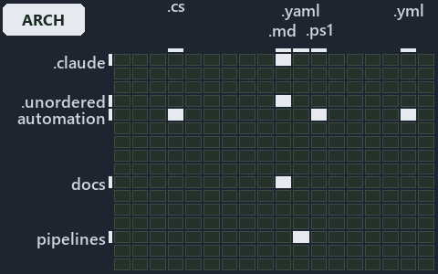

# docs/.assets/explanation/grid/adr-az-datamod--one-reverse-lookup-feeds-every-module--architecture.grid.md

`Grid minimap: adr-az-datamod--one-reverse-lookup-feeds-every-module--architecture`

The grid minimap of the slide `adr-az-datamod--one-reverse-lookup-feeds-every-module--architecture` (architecture lens). The slide supports
[ADR-AZ-DATAMOD][1] and [ADR-AZ-NAMING][2]; the highlight of those ADR codes selects what is lit, and each reason below names the code that
selects it.

## What the minimap shows

The grid crosses the 16 tracks (rows) with the 18 file languages (columns) of the world map and lights 7 cells, filled in ink. A cell lit
only by passing mentions (citations in body comments, not in a file's header or text) is touched: a lighter ink. Every other cell is idle, a
grey box: it holds files the slide's ADR codes do not select, or no file at all (237 of the 288 cells hold none). The minimap shows where
the slide sits, not how many files a cell holds; the world-map PDFs show the counts.

- .claude × markdown: 1 lit of 51 files
- .unordered × markdown: 5 lit of 20 files
- automation × csharp: 5 lit of 272 files
- automation × powershell: 32 lit of 1563 files
- automation × yaml: 4 lit of 107 files
- docs × markdown: 31 lit of 1985 files
- pipelines × pipeline-yaml: 1 lit of 9 files

## Key

A lit row prints its track's name; a lit column prints a short code, the first extension of its file language:

- `.cs`: csharp
- `.md`: markdown
- `.yaml`: pipeline-yaml
- `.ps1`: powershell
- `.yml`: yaml

## Why each cell is lit

### .claude × markdown (1 lit file)

Placed: the root folder `.claude/` names the track .claude ([ADR-DSGN-TRACK#1][3]); the extension `.md` names the file language markdown
([ADR-DSGN-TRACK#6][4]). Lit ([ADR-DSGN-TRACK#12][5]) by:

- [.claude/plans/plan-adr-link-cleanup-prose-to-pages.md][6]: selected by [ADR-AZ-DATAMOD][1]: the file cites it at line 134 (text).

### .unordered × markdown (5 lit files)

Placed: the root folder `.unordered/` names the track .unordered ([ADR-DSGN-TRACK#1][3]); the extension `.md` names the file language
markdown ([ADR-DSGN-TRACK#6][4]). Lit ([ADR-DSGN-TRACK#12][5]) by:

- [.unordered/15-10-2026/plan-adr-consistency.md][7]: selected by [ADR-AZ-DATAMOD][1]: the file cites it at line 72 (text).
- [.unordered/15-10-2026/plan-caf-code-segments.md][8]: selected by [ADR-AZ-DATAMOD][1]: the file cites it at line 66 (text).
- [.unordered/15-10-2026/plan-caf-waf-automation.md][9]: selected by [ADR-AZ-DATAMOD][1]: the file cites it at line 20 (text) and line 28
  (text); selected by [ADR-AZ-NAMING][2]: the file cites it at line 21 (text).
- [.unordered/15-10-2026/plan-concern-axis.md][10]: selected by [ADR-AZ-DATAMOD][1]: the file cites it at line 110 (text).
- [.unordered/15-10-2026/plan-diagram-wave-8.md][11]: selected by [ADR-AZ-DATAMOD][1]: the file cites it at line 17 (text) and line 18
  (text).

### automation × csharp (5 lit files)

Placed: the root folder `automation/` names the track automation ([ADR-DSGN-TRACK#1][3]); the extension `.cs` names the file language csharp
([ADR-DSGN-TRACK#6][4]). Lit ([ADR-DSGN-TRACK#12][5]) by:

- [automation/Catzc.Azure.Templates/types/BicepShortName.cs][12]: selected by [ADR-AZ-NAMING][2]: the file cites it at line 21 (text).
- [automation/Catzc.Azure/types/AzureConfig.cs][13]: selected by [ADR-AZ-DATAMOD][1]: the file cites it at line 23 (text); selected by
  [ADR-AZ-NAMING][2]: the file cites it at line 24 (text).
- [automation/Catzc.Azure/types/AzureEnvironmentRecord.cs][14]: selected by [ADR-AZ-DATAMOD][1]: the file cites it at line 20 (text);
  selected by [ADR-AZ-NAMING][2]: the file cites it at line 21 (text).
- [automation/Catzc.Azure/types/AzureSubscriptionRecord.cs][15]: selected by [ADR-AZ-DATAMOD][1]: the file cites it at line 21 (text).
- [automation/Catzc.Azure/types/AzureTenantRecord.cs][16]: selected by [ADR-AZ-DATAMOD][1]: the file cites it at line 20 (text).

### automation × powershell (32 lit files)

Placed: the root folder `automation/` names the track automation ([ADR-DSGN-TRACK#1][3]); the extension `.ps1` names the file language
powershell ([ADR-DSGN-TRACK#6][4]). Lit ([ADR-DSGN-TRACK#12][5]) by:

- [automation/Catzc.Azure.Cli/Assert-AzCliCanAccess.ps1][17]: selected by [ADR-AZ-DATAMOD][1]: the file cites it at line 21 (header) and
  line 34 (header).
- [automation/Catzc.Azure.Cli/Assert-AzCliIsConnected.ps1][18]: selected by [ADR-AZ-DATAMOD][1]: the file cites it at line 20 (header) and
  line 28 (header).
- [automation/Catzc.Azure.Cli/Test-AzCliCanAccess.ps1][19]: selected by [ADR-AZ-DATAMOD][1]: the file cites it at line 21 (header) and line
  33 (header).
- [automation/Catzc.Azure.Templates/Assert-BicepTemplate.ps1][20]: selected by [ADR-AZ-DATAMOD][1]: the file cites it at line 21 (header).
- [automation/Catzc.Azure.Templates/Build-Bicep.ps1][21]: selected by [ADR-AZ-DATAMOD][1]: the file cites it at line 21 (header).
- [automation/Catzc.Azure.Templates/Deploy-Bicep.ps1][22]: selected by [ADR-AZ-DATAMOD][1]: the file cites it at line 21 (header) and line
  33 (header).
- [automation/Catzc.Azure.Templates/Get-AzureBicepEnvironmentKinds.ps1][23]: selected by [ADR-AZ-DATAMOD][1]: the file cites it at line 19
  (header) and line 27 (header).
- [automation/Catzc.Azure.Templates/Get-AzureResourceName.ps1][24]: selected by [ADR-AZ-NAMING][2]: the file cites it at line 20 (header).
- [automation/Catzc.Azure.Templates/Get-AzureResourceTypeSet.ps1][25]: selected by [ADR-AZ-NAMING][2]: the file cites it at line 19
  (header), line 36 (header) and line 39 (header).
- [automation/Catzc.Azure.Templates/Get-BicepDeploymentContext.ps1][26]: selected by [ADR-AZ-DATAMOD][1]: the file cites it at line 20
  (header) and line 45 (header).
- [automation/Catzc.Azure.Templates/Get-BicepResourceName.ps1][27]: selected by [ADR-AZ-NAMING][2]: the file cites it at line 20 (header).
- [automation/Catzc.Azure.Templates/Get-BicepTemplateConfiguration.ps1][28]: selected by [ADR-AZ-DATAMOD][1]: the file cites it at line 20
  (header) and line 29 (header).
- [automation/Catzc.Azure.Templates/Get-BicepTemplates.ps1][29]: selected by [ADR-AZ-DATAMOD][1]: the file cites it at line 22 (header),
  line 34 (header) and line 60 (header); selected by [ADR-AZ-NAMING][2]: the file cites it at line 23 (header).
- [automation/Catzc.Azure.Templates/Set-BicepTemplateConfiguration.ps1][30]: selected by [ADR-AZ-DATAMOD][1]: the file cites it at line 21
  (header).
- [automation/Catzc.Azure.Templates/private/Get-BicepConfigClassViolations.ps1][31]: selected by [ADR-AZ-DATAMOD][1]: the file cites it at
  line 19 (header).
- [automation/Catzc.Azure.Templates/private/Get-BicepConfigName.ps1][32]: selected by [ADR-AZ-DATAMOD][1]: the file cites it at line 19
  (header) and line 26 (header).
- [automation/Catzc.Azure.Templates/private/Get-BicepConfigSubscriptionCandidates.ps1][33]: selected by [ADR-AZ-DATAMOD][1]: the file cites
  it at line 20 (header) and line 25 (header).
- [automation/Catzc.Azure.Templates/private/Get-BicepParametersFileName.ps1][34]: selected by [ADR-AZ-DATAMOD][1]: the file cites it at line
  20 (header) and line 33 (header).
- [automation/Catzc.Azure.Templates/private/Get-BicepSubscriptionConfigViolations.ps1][35]: selected by [ADR-AZ-DATAMOD][1]: the file cites
  it at line 20 (header).
- [automation/Catzc.Azure.Templates/private/Resolve-BicepConfigName.ps1][36]: selected by [ADR-AZ-DATAMOD][1]: the file cites it at line 19
  (header) and line 27 (header).
- [automation/Catzc.Azure.Templates/private/Resolve-BicepParameterAddresses.ps1][37]: selected by [ADR-AZ-DATAMOD][1]: the file cites it at
  line 20 (header) and line 27 (header).
- [automation/Catzc.Azure.Templates/tests/Build-Bicep.Integrity.Tests.ps1][38]: selected by [ADR-AZ-NAMING][2]: the file cites it at line 20
  (header) and line 69 (text).
- [automation/Catzc.Azure.Templates/tests/Get-BicepParameterModel.Shipped.Tests.ps1][39]: selected by [ADR-AZ-DATAMOD][1]: the file cites it
  at line 20 (header) and line 29 (text).
- [automation/Catzc.Azure.Templates/tests/Resolve-BicepParameterAddresses.Tests.ps1][40]: selected by [ADR-AZ-DATAMOD][1]: the file cites it
  at line 20 (header), line 48 (text), line 54 (text), line 71 (text), line 77 (text), line 82 (text), line 88 (text), line 125 (text), line
  129 (text), line 129 (body comment), line 134 (text) and line 138 (text).
- [automation/Catzc.Azure.Templates/tests/types/BicepShortName.Tests.ps1][41]: selected by [ADR-AZ-NAMING][2]: the file cites it at line 20
  (header).
- [automation/Catzc.Azure/Get-AzureEnvironment.ps1][42]: selected by [ADR-AZ-DATAMOD][1]: the file cites it at line 19 (header) and line 28
  (header).
- [automation/Catzc.Azure/Get-AzureSubscription.ps1][43]: selected by [ADR-AZ-DATAMOD][1]: the file cites it at line 21 (header) and line 31
  (header).
- [automation/Catzc.Azure/Get-AzureSubscriptionEnvironment.ps1][44]: selected by [ADR-AZ-DATAMOD][1]: the file cites it at line 19 (header)
  and line 24 (header).
- [automation/Catzc.Azure/tests/types/AzureConfig.Tests.ps1][45]: selected by [ADR-AZ-DATAMOD][1]: the file cites it at line 21 (header),
  line 249 (text), line 284 (text), line 290 (text), line 298 (text), line 306 (text), line 312 (text) and line 320 (text).
- [automation/Catzc.Base.Docs/Build-AdrIndex.ps1][46]: selected by [ADR-AZ-DATAMOD][1]: the file cites it at line 23 (header) and line 119
  (text); selected by [ADR-AZ-NAMING][2]: the file cites it at line 24 (header) and line 89 (body comment).
- [automation/Catzc.Base.QualityGates/private/Get-MarkdownHeadingFinding.ps1][47]: selected by [ADR-AZ-DATAMOD][1]: the file cites it at
  line 21 (header) and line 27 (header).
- [automation/Catzc.Base.QualityGates/private/Get-TerminologyCorpus.ps1][48]: selected by [ADR-AZ-DATAMOD][1]: the file cites it at line 20
  (header).

### automation × yaml (4 lit files)

Placed: the root folder `automation/` names the track automation ([ADR-DSGN-TRACK#1][3]); the extension `.yml` names the file language yaml
([ADR-DSGN-TRACK#6][4]). Lit ([ADR-DSGN-TRACK#12][5]) by:

- [automation/Catzc.Azure.Templates/configs/glossary.yml][49]: selected by [ADR-AZ-DATAMOD][1]: the file cites it at line 23 (text) and line
  115 (text).
- [automation/Catzc.Base.Docs/configs/adrs.yml][50]: selected by [ADR-AZ-DATAMOD][1]: the file cites it at line 267 (text); selected by
  [ADR-AZ-NAMING][2]: the file cites it at line 269 (text).
- [automation/Catzc.Base.QualityGates/configs/terminology.yml][51]: selected by [ADR-AZ-DATAMOD][1]: the file cites it at line 626 (text).
- [automation/Catzc.Base.RootConfig/assets/root/cspell.yml][52]: selected by [ADR-AZ-DATAMOD][1]: the file cites it at line 21 (body
  comment) (a passing mention only).

### docs × markdown (31 lit files)

Placed: the root folder `docs/` names the track docs ([ADR-DSGN-TRACK#1][3]); the extension `.md` names the file language markdown
([ADR-DSGN-TRACK#6][4]). Lit ([ADR-DSGN-TRACK#12][5]) by:

- [docs/adr/azure/azure-data-model.md][1]: selected by [ADR-AZ-DATAMOD][1]: the ADR's own file.
- [docs/adr/azure/azure-naming-standard.md][2]: selected by [ADR-AZ-NAMING][2]: the ADR's own file.
- [docs/adr/azure/dora-explains.md][53]: selected by [ADR-AZ-DATAMOD][1]: the file cites it at line 40 (text); selected by
  [ADR-AZ-NAMING][2]: the file cites it at line 74 (text).
- [docs/adr/glossary.md][54]: selected by [ADR-AZ-DATAMOD][1]: the file cites it at line 755 (text) and line 800 (text).
- [docs/adr/index.md][55]: selected by [ADR-AZ-DATAMOD][1]: the file cites it at line 270 (text) and line 390 (text); selected by
  [ADR-AZ-NAMING][2]: the file cites it at line 28 (text) and line 272 (text).
- [docs/how-to/automation/manual-test-plan/azure.md][56]: selected by [ADR-AZ-DATAMOD][1]: the file cites it at line 16 (text), line 36
  (text) and line 79 (text).
- [docs/how-to/getting-started/automation/add-a-doc-chapter.md][57]: selected by [ADR-AZ-NAMING][2]: the file cites it at line 89 (text).
- [docs/references/automation/catzc-azure-templates/Assert-BicepTemplate.ps1.md][58]: selected by [ADR-AZ-DATAMOD][1]: the file cites it at
  line 16 (text) and line 58 (text).
- [docs/references/automation/catzc-azure-templates/Build-Bicep.ps1.md][59]: selected by [ADR-AZ-DATAMOD][1]: the file cites it at line 16
  (text) and line 79 (text).
- [docs/references/automation/catzc-azure-templates/Deploy-Bicep.ps1.md][60]: selected by [ADR-AZ-DATAMOD][1]: the file cites it at line 41
  (text).
- [docs/references/automation/catzc-azure-templates/Get-AzureResourceName.ps1.md][61]: selected by [ADR-AZ-NAMING][2]: the file cites it at
  line 16 (text), line 33 (text), line 44 (text) and line 63 (text).
- [docs/references/automation/catzc-azure-templates/Get-BicepResourceName.ps1.md][62]: selected by [ADR-AZ-NAMING][2]: the file cites it at
  line 16 (text) and line 34 (text).
- [docs/references/automation/catzc-azure-templates/Get-BicepTemplates.ps1.md][63]: selected by [ADR-AZ-DATAMOD][1]: the file cites it at
  line 78 (text); selected by [ADR-AZ-NAMING][2]: the file cites it at line 16 (text) and line 103 (text).
- [docs/references/automation/catzc-azure-templates/tests/Get-BicepParameterModel.Shipped.Tests.ps1.md][64]: selected by
  [ADR-AZ-DATAMOD][1]: the file cites it at line 17 (text) and line 32 (text).
- [docs/references/automation/catzc-azure-templates/tests/types/BicepShortName.Tests.ps1.md][65]: selected by [ADR-AZ-NAMING][2]: the file
  cites it at line 17 (text) and line 33 (text).
- [docs/references/automation/catzc-azure-templates/types/BicepShortName.cs.md][66]: selected by [ADR-AZ-NAMING][2]: the file cites it at
  line 17 (text), line 31 (text), line 51 (text) and line 83 (text).
- [docs/references/automation/catzc-azure/configs/azure.yml.md][67]: selected by [ADR-AZ-DATAMOD][1]: the file cites it at line 16 (text),
  line 74 (text) and line 119 (text); selected by [ADR-AZ-NAMING][2]: the file cites it at line 50 (text), line 95 (text) and line 128
  (text).
- [docs/references/automation/catzc-azure/configs/customer.yml.md][68]: selected by [ADR-AZ-NAMING][2]: the file cites it at line 34 (text).
- [docs/references/automation/catzc-azure/tests/types/AzureConfig.Tests.ps1.md][69]: selected by [ADR-AZ-DATAMOD][1]: the file cites it at
  line 48 (text).
- [docs/references/automation/catzc-azure/types/AzureConfig.cs.md][70]: selected by [ADR-AZ-DATAMOD][1]: the file cites it at line 19
  (text), line 33 (text), line 48 (text), line 58 (text) and line 64 (text); selected by [ADR-AZ-NAMING][2]: the file cites it at line 20
  (text) and line 50 (text).
- [docs/references/automation/catzc-azure/types/AzureEnvironmentRecord.cs.md][71]: selected by [ADR-AZ-DATAMOD][1]: the file cites it at
  line 29 (text); selected by [ADR-AZ-NAMING][2]: the file cites it at line 30 (text).
- [docs/references/automation/catzc-azure/types/AzureSubscriptionRecord.cs.md][72]: selected by [ADR-AZ-DATAMOD][1]: the file cites it at
  line 30 (text).
- [docs/references/automation/catzc-azure/types/AzureTenantRecord.cs.md][73]: selected by [ADR-AZ-DATAMOD][1]: the file cites it at line 29
  (text).
- [docs/references/automation/catzc-base-qualitygates/private/Get-TerminologyCorpus.ps1.md][74]: selected by [ADR-AZ-DATAMOD][1]: the file
  cites it at line 41 (text).
- [docs/references/automation/catzc-base-variants/configs/variants.yml.md][75]: selected by [ADR-AZ-NAMING][2]: the file cites it at line 41
  (text).
- [docs/references/infrastructure/templates/discovery/options.yml.md][76]: selected by [ADR-AZ-DATAMOD][1]: the file cites it at line 29
  (text).
- [docs/references/infrastructure/templates/expedition/options.yml.md][77]: selected by [ADR-AZ-DATAMOD][1]: the file cites it at line 30
  (text).
- [docs/references/infrastructure/templates/foundation/options.yml.md][78]: selected by [ADR-AZ-DATAMOD][1]: the file cites it at line 29
  (text).
- [docs/references/pipelines/cd-shared.yaml.md][79]: selected by [ADR-AZ-DATAMOD][1]: the file cites it at line 31 (text).
- [docs/references/pipelines/ci-infrastructure.yaml.md][80]: selected by [ADR-AZ-DATAMOD][1]: the file cites it at line 17 (text) and line
  43 (text).
- [docs/references/pipelines/extends/cd-customer.yaml.md][81]: selected by [ADR-AZ-DATAMOD][1]: the file cites it at line 38 (text).

### pipelines × pipeline-yaml (1 lit file)

Placed: the root folder `pipelines/` names the track pipelines ([ADR-DSGN-TRACK#1][3]); the extension `.yaml` names the file language
pipeline-yaml ([ADR-DSGN-TRACK#6][4]). Lit ([ADR-DSGN-TRACK#12][5]) by:

- [pipelines/ci-automation.yaml][82]: selected by [ADR-AZ-DATAMOD][1]: a pipeline that cites nothing itself carries its globset's citations,
  which cite it at `automation/Catzc.Azure.Cli/Assert-AzCliCanAccess.ps1` line 21 (header),
  `automation/Catzc.Azure.Cli/Assert-AzCliCanAccess.ps1` line 34 (header), `automation/Catzc.Azure.Cli/Assert-AzCliIsConnected.ps1` line 20
  (header), `automation/Catzc.Azure.Cli/Assert-AzCliIsConnected.ps1` line 28 (header), `automation/Catzc.Azure.Cli/Test-AzCliCanAccess.ps1`
  line 21 (header), `automation/Catzc.Azure.Cli/Test-AzCliCanAccess.ps1` line 33 (header),
  `automation/Catzc.Azure.Templates/Assert-BicepTemplate.ps1` line 21 (header), `automation/Catzc.Azure.Templates/Build-Bicep.ps1` line 21
  (header), `automation/Catzc.Azure.Templates/Deploy-Bicep.ps1` line 21 (header), `automation/Catzc.Azure.Templates/Deploy-Bicep.ps1` line
  33 (header), `automation/Catzc.Azure.Templates/Get-AzureBicepEnvironmentKinds.ps1` line 19 (header),
  `automation/Catzc.Azure.Templates/Get-AzureBicepEnvironmentKinds.ps1` line 27 (header),
  `automation/Catzc.Azure.Templates/Get-BicepDeploymentContext.ps1` line 20 (header),
  `automation/Catzc.Azure.Templates/Get-BicepDeploymentContext.ps1` line 45 (header),
  `automation/Catzc.Azure.Templates/Get-BicepTemplateConfiguration.ps1` line 20 (header),
  `automation/Catzc.Azure.Templates/Get-BicepTemplateConfiguration.ps1` line 29 (header),
  `automation/Catzc.Azure.Templates/Get-BicepTemplates.ps1` line 22 (header), `automation/Catzc.Azure.Templates/Get-BicepTemplates.ps1` line
  34 (header), `automation/Catzc.Azure.Templates/Get-BicepTemplates.ps1` line 60 (header),
  `automation/Catzc.Azure.Templates/Set-BicepTemplateConfiguration.ps1` line 21 (header),
  `automation/Catzc.Azure.Templates/configs/glossary.yml` line 23 (text), `automation/Catzc.Azure.Templates/configs/glossary.yml` line 115
  (text), `automation/Catzc.Azure.Templates/private/Get-BicepConfigClassViolations.ps1` line 19 (header),
  `automation/Catzc.Azure.Templates/private/Get-BicepConfigName.ps1` line 19 (header),
  `automation/Catzc.Azure.Templates/private/Get-BicepConfigName.ps1` line 26 (header),
  `automation/Catzc.Azure.Templates/private/Get-BicepConfigSubscriptionCandidates.ps1` line 20 (header),
  `automation/Catzc.Azure.Templates/private/Get-BicepConfigSubscriptionCandidates.ps1` line 25 (header),
  `automation/Catzc.Azure.Templates/private/Get-BicepParametersFileName.ps1` line 20 (header),
  `automation/Catzc.Azure.Templates/private/Get-BicepParametersFileName.ps1` line 33 (header),
  `automation/Catzc.Azure.Templates/private/Get-BicepSubscriptionConfigViolations.ps1` line 20 (header),
  `automation/Catzc.Azure.Templates/private/Resolve-BicepConfigName.ps1` line 19 (header),
  `automation/Catzc.Azure.Templates/private/Resolve-BicepConfigName.ps1` line 27 (header),
  `automation/Catzc.Azure.Templates/private/Resolve-BicepParameterAddresses.ps1` line 20 (header),
  `automation/Catzc.Azure.Templates/private/Resolve-BicepParameterAddresses.ps1` line 27 (header),
  `automation/Catzc.Azure.Templates/tests/Get-BicepParameterModel.Shipped.Tests.ps1` line 20 (header),
  `automation/Catzc.Azure.Templates/tests/Get-BicepParameterModel.Shipped.Tests.ps1` line 29 (text),
  `automation/Catzc.Azure.Templates/tests/Resolve-BicepParameterAddresses.Tests.ps1` line 20 (header),
  `automation/Catzc.Azure.Templates/tests/Resolve-BicepParameterAddresses.Tests.ps1` line 48 (text),
  `automation/Catzc.Azure.Templates/tests/Resolve-BicepParameterAddresses.Tests.ps1` line 54 (text),
  `automation/Catzc.Azure.Templates/tests/Resolve-BicepParameterAddresses.Tests.ps1` line 71 (text),
  `automation/Catzc.Azure.Templates/tests/Resolve-BicepParameterAddresses.Tests.ps1` line 77 (text),
  `automation/Catzc.Azure.Templates/tests/Resolve-BicepParameterAddresses.Tests.ps1` line 82 (text),
  `automation/Catzc.Azure.Templates/tests/Resolve-BicepParameterAddresses.Tests.ps1` line 88 (text),
  `automation/Catzc.Azure.Templates/tests/Resolve-BicepParameterAddresses.Tests.ps1` line 125 (text),
  `automation/Catzc.Azure.Templates/tests/Resolve-BicepParameterAddresses.Tests.ps1` line 129 (text),
  `automation/Catzc.Azure.Templates/tests/Resolve-BicepParameterAddresses.Tests.ps1` line 129 (body comment),
  `automation/Catzc.Azure.Templates/tests/Resolve-BicepParameterAddresses.Tests.ps1` line 134 (text),
  `automation/Catzc.Azure.Templates/tests/Resolve-BicepParameterAddresses.Tests.ps1` line 138 (text),
  `automation/Catzc.Azure/Get-AzureEnvironment.ps1` line 19 (header), `automation/Catzc.Azure/Get-AzureEnvironment.ps1` line 28 (header),
  `automation/Catzc.Azure/Get-AzureSubscription.ps1` line 21 (header), `automation/Catzc.Azure/Get-AzureSubscription.ps1` line 31 (header),
  `automation/Catzc.Azure/Get-AzureSubscriptionEnvironment.ps1` line 19 (header),
  `automation/Catzc.Azure/Get-AzureSubscriptionEnvironment.ps1` line 24 (header), `automation/Catzc.Azure/tests/types/AzureConfig.Tests.ps1`
  line 21 (header), `automation/Catzc.Azure/tests/types/AzureConfig.Tests.ps1` line 249 (text),
  `automation/Catzc.Azure/tests/types/AzureConfig.Tests.ps1` line 284 (text), `automation/Catzc.Azure/tests/types/AzureConfig.Tests.ps1`
  line 290 (text), `automation/Catzc.Azure/tests/types/AzureConfig.Tests.ps1` line 298 (text),
  `automation/Catzc.Azure/tests/types/AzureConfig.Tests.ps1` line 306 (text), `automation/Catzc.Azure/tests/types/AzureConfig.Tests.ps1`
  line 312 (text), `automation/Catzc.Azure/tests/types/AzureConfig.Tests.ps1` line 320 (text), `automation/Catzc.Azure/types/AzureConfig.cs`
  line 23 (text), `automation/Catzc.Azure/types/AzureEnvironmentRecord.cs` line 20 (text),
  `automation/Catzc.Azure/types/AzureSubscriptionRecord.cs` line 21 (text), `automation/Catzc.Azure/types/AzureTenantRecord.cs` line 20
  (text), `automation/Catzc.Base.Docs/Build-AdrIndex.ps1` line 23 (header), `automation/Catzc.Base.Docs/Build-AdrIndex.ps1` line 119 (text),
  `automation/Catzc.Base.Docs/configs/adrs.yml` line 267 (text), `automation/Catzc.Base.QualityGates/configs/terminology.yml` line 626
  (text), `automation/Catzc.Base.QualityGates/private/Get-MarkdownHeadingFinding.ps1` line 21 (header),
  `automation/Catzc.Base.QualityGates/private/Get-MarkdownHeadingFinding.ps1` line 27 (header),
  `automation/Catzc.Base.QualityGates/private/Get-TerminologyCorpus.ps1` line 20 (header) and
  `automation/Catzc.Base.RootConfig/assets/root/cspell.yml` line 21 (body comment); selected by [ADR-AZ-NAMING][2]: a pipeline that cites
  nothing itself carries its globset's citations, which cite it at `automation/Catzc.Azure.Templates/Get-AzureResourceName.ps1` line 20
  (header), `automation/Catzc.Azure.Templates/Get-AzureResourceTypeSet.ps1` line 19 (header),
  `automation/Catzc.Azure.Templates/Get-AzureResourceTypeSet.ps1` line 36 (header),
  `automation/Catzc.Azure.Templates/Get-AzureResourceTypeSet.ps1` line 39 (header),
  `automation/Catzc.Azure.Templates/Get-BicepResourceName.ps1` line 20 (header), `automation/Catzc.Azure.Templates/Get-BicepTemplates.ps1`
  line 23 (header), `automation/Catzc.Azure.Templates/tests/Build-Bicep.Integrity.Tests.ps1` line 20 (header),
  `automation/Catzc.Azure.Templates/tests/Build-Bicep.Integrity.Tests.ps1` line 69 (text),
  `automation/Catzc.Azure.Templates/tests/types/BicepShortName.Tests.ps1` line 20 (header),
  `automation/Catzc.Azure.Templates/types/BicepShortName.cs` line 21 (text), `automation/Catzc.Azure/types/AzureConfig.cs` line 24 (text),
  `automation/Catzc.Azure/types/AzureEnvironmentRecord.cs` line 21 (text), `automation/Catzc.Base.Docs/Build-AdrIndex.ps1` line 24 (header),
  `automation/Catzc.Base.Docs/Build-AdrIndex.ps1` line 89 (body comment) and `automation/Catzc.Base.Docs/configs/adrs.yml` line 269 (text).

## Keywords

- [world map][83]
- [track][84]
- [file language][85]
- [cell][86]
- [lit cell][87]
- [.claude][88]: a track
- [.unordered][88]: a track
- [automation][88]: a track
- [docs][88]: a track
- [pipelines][88]: a track
- [csharp][89]: a file language
- [markdown][89]: a file language
- [pipeline-yaml][89]: a file language
- [powershell][89]: a file language
- [yaml][89]: a file language

Terms the cited ADRs define:

- [environment class][90], defined by [ADR-AZ-DATAMOD#11][91]
- [slot][92], defined by [ADR-AZ-DATAMOD#2][93]

[1]: ../../../adr/azure/azure-data-model.md
[2]: ../../../adr/azure/azure-naming-standard.md
[3]: ../../../adr/design/tracks.md#rule-adr-dsgn-track1
[4]: ../../../adr/design/tracks.md#rule-adr-dsgn-track6
[5]: ../../../adr/design/tracks.md#rule-adr-dsgn-track12
[6]: ../../../../.claude/plans/plan-adr-link-cleanup-prose-to-pages.md
[7]: ../../../../.unordered/15-10-2026/plan-adr-consistency.md
[8]: ../../../../.unordered/15-10-2026/plan-caf-code-segments.md
[9]: ../../../../.unordered/15-10-2026/plan-caf-waf-automation.md
[10]: ../../../../.unordered/15-10-2026/plan-concern-axis.md
[11]: ../../../../.unordered/15-10-2026/plan-diagram-wave-8.md
[12]: ../../../../automation/Catzc.Azure.Templates/types/BicepShortName.cs
[13]: ../../../../automation/Catzc.Azure/types/AzureConfig.cs
[14]: ../../../../automation/Catzc.Azure/types/AzureEnvironmentRecord.cs
[15]: ../../../../automation/Catzc.Azure/types/AzureSubscriptionRecord.cs
[16]: ../../../../automation/Catzc.Azure/types/AzureTenantRecord.cs
[17]: ../../../../automation/Catzc.Azure.Cli/Assert-AzCliCanAccess.ps1
[18]: ../../../../automation/Catzc.Azure.Cli/Assert-AzCliIsConnected.ps1
[19]: ../../../../automation/Catzc.Azure.Cli/Test-AzCliCanAccess.ps1
[20]: ../../../../automation/Catzc.Azure.Templates/Assert-BicepTemplate.ps1
[21]: ../../../../automation/Catzc.Azure.Templates/Build-Bicep.ps1
[22]: ../../../../automation/Catzc.Azure.Templates/Deploy-Bicep.ps1
[23]: ../../../../automation/Catzc.Azure.Templates/Get-AzureBicepEnvironmentKinds.ps1
[24]: ../../../../automation/Catzc.Azure.Templates/Get-AzureResourceName.ps1
[25]: ../../../../automation/Catzc.Azure.Templates/Get-AzureResourceTypeSet.ps1
[26]: ../../../../automation/Catzc.Azure.Templates/Get-BicepDeploymentContext.ps1
[27]: ../../../../automation/Catzc.Azure.Templates/Get-BicepResourceName.ps1
[28]: ../../../../automation/Catzc.Azure.Templates/Get-BicepTemplateConfiguration.ps1
[29]: ../../../../automation/Catzc.Azure.Templates/Get-BicepTemplates.ps1
[30]: ../../../../automation/Catzc.Azure.Templates/Set-BicepTemplateConfiguration.ps1
[31]: ../../../../automation/Catzc.Azure.Templates/private/Get-BicepConfigClassViolations.ps1
[32]: ../../../../automation/Catzc.Azure.Templates/private/Get-BicepConfigName.ps1
[33]: ../../../../automation/Catzc.Azure.Templates/private/Get-BicepConfigSubscriptionCandidates.ps1
[34]: ../../../../automation/Catzc.Azure.Templates/private/Get-BicepParametersFileName.ps1
[35]: ../../../../automation/Catzc.Azure.Templates/private/Get-BicepSubscriptionConfigViolations.ps1
[36]: ../../../../automation/Catzc.Azure.Templates/private/Resolve-BicepConfigName.ps1
[37]: ../../../../automation/Catzc.Azure.Templates/private/Resolve-BicepParameterAddresses.ps1
[38]: ../../../../automation/Catzc.Azure.Templates/tests/Build-Bicep.Integrity.Tests.ps1
[39]: ../../../../automation/Catzc.Azure.Templates/tests/Get-BicepParameterModel.Shipped.Tests.ps1
[40]: ../../../../automation/Catzc.Azure.Templates/tests/Resolve-BicepParameterAddresses.Tests.ps1
[41]: ../../../../automation/Catzc.Azure.Templates/tests/types/BicepShortName.Tests.ps1
[42]: ../../../../automation/Catzc.Azure/Get-AzureEnvironment.ps1
[43]: ../../../../automation/Catzc.Azure/Get-AzureSubscription.ps1
[44]: ../../../../automation/Catzc.Azure/Get-AzureSubscriptionEnvironment.ps1
[45]: ../../../../automation/Catzc.Azure/tests/types/AzureConfig.Tests.ps1
[46]: ../../../../automation/Catzc.Base.Docs/Build-AdrIndex.ps1
[47]: ../../../../automation/Catzc.Base.QualityGates/private/Get-MarkdownHeadingFinding.ps1
[48]: ../../../../automation/Catzc.Base.QualityGates/private/Get-TerminologyCorpus.ps1
[49]: ../../../../automation/Catzc.Azure.Templates/configs/glossary.yml
[50]: ../../../../automation/Catzc.Base.Docs/configs/adrs.yml
[51]: ../../../../automation/Catzc.Base.QualityGates/configs/terminology.yml
[52]: ../../../../automation/Catzc.Base.RootConfig/assets/root/cspell.yml
[53]: ../../../adr/azure/dora-explains.md
[54]: ../../../adr/glossary.md
[55]: ../../../adr/index.md
[56]: ../../../how-to/automation/manual-test-plan/azure.md
[57]: ../../../how-to/getting-started/automation/add-a-doc-chapter.md
[58]: ../../../references/automation/catzc-azure-templates/Assert-BicepTemplate.ps1.md
[59]: ../../../references/automation/catzc-azure-templates/Build-Bicep.ps1.md
[60]: ../../../references/automation/catzc-azure-templates/Deploy-Bicep.ps1.md
[61]: ../../../references/automation/catzc-azure-templates/Get-AzureResourceName.ps1.md
[62]: ../../../references/automation/catzc-azure-templates/Get-BicepResourceName.ps1.md
[63]: ../../../references/automation/catzc-azure-templates/Get-BicepTemplates.ps1.md
[64]: ../../../references/automation/catzc-azure-templates/tests/Get-BicepParameterModel.Shipped.Tests.ps1.md
[65]: ../../../references/automation/catzc-azure-templates/tests/types/BicepShortName.Tests.ps1.md
[66]: ../../../references/automation/catzc-azure-templates/types/BicepShortName.cs.md
[67]: ../../../references/automation/catzc-azure/configs/azure.yml.md
[68]: ../../../references/automation/catzc-azure/configs/customer.yml.md
[69]: ../../../references/automation/catzc-azure/tests/types/AzureConfig.Tests.ps1.md
[70]: ../../../references/automation/catzc-azure/types/AzureConfig.cs.md
[71]: ../../../references/automation/catzc-azure/types/AzureEnvironmentRecord.cs.md
[72]: ../../../references/automation/catzc-azure/types/AzureSubscriptionRecord.cs.md
[73]: ../../../references/automation/catzc-azure/types/AzureTenantRecord.cs.md
[74]: ../../../references/automation/catzc-base-qualitygates/private/Get-TerminologyCorpus.ps1.md
[75]: ../../../references/automation/catzc-base-variants/configs/variants.yml.md
[76]: ../../../references/infrastructure/templates/discovery/options.yml.md
[77]: ../../../references/infrastructure/templates/expedition/options.yml.md
[78]: ../../../references/infrastructure/templates/foundation/options.yml.md
[79]: ../../../references/pipelines/cd-shared.yaml.md
[80]: ../../../references/pipelines/ci-infrastructure.yaml.md
[81]: ../../../references/pipelines/extends/cd-customer.yaml.md
[82]: ../../../../pipelines/ci-automation.yaml
[83]: ../../../adr/glossary.md#world-map
[84]: ../../../adr/glossary.md#track
[85]: ../../../adr/glossary.md#file-language
[86]: ../../../adr/glossary.md#cell
[87]: ../../../adr/glossary.md#lit-cell
[88]: ../../../../automation/Catzc.Base.Variants/configs/variants.yml
[89]: ../../../../automation/Catzc.Base.Languages/configs/languages.yml
[90]: ../../../adr/glossary.md#environment-class
[91]: ../../../adr/azure/azure-data-model.md#rule-adr-az-datamod11
[92]: ../../../adr/glossary.md#slot
[93]: ../../../adr/azure/azure-data-model.md#rule-adr-az-datamod2
