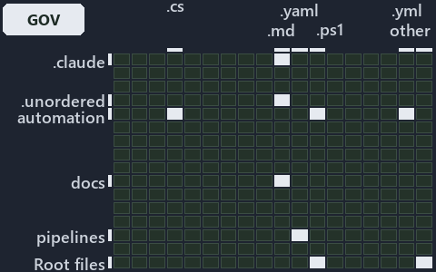

# docs/.assets/explanation/grid/adr-conf-loading--one-gate-guards-the-read-path--governance.grid.md

`Grid minimap: adr-conf-loading--one-gate-guards-the-read-path--governance`

The grid minimap of the slide `adr-conf-loading--one-gate-guards-the-read-path--governance` (governance lens). The slide supports
[ADR-AUTO-TEST][1], [ADR-CONF-ADDRESSING][2] and [ADR-CONF-LOADING][3]; the highlight of those ADR codes selects what is lit, and each
reason below names the code that selects it.

## What the minimap shows

The grid crosses the 16 tracks (rows) with the 18 file languages (columns) of the world map and lights 9 cells, filled in ink. A cell lit
only by passing mentions (citations in body comments, not in a file's header or text) is touched: a lighter ink. Every other cell is idle, a
grey box: it holds files the slide's ADR codes do not select, or no file at all (237 of the 288 cells hold none). The minimap shows where
the slide sits, not how many files a cell holds; the world-map PDFs show the counts.

- .claude × markdown: 15 lit of 71 files
- .unordered × markdown: 10 lit of 20 files
- automation × csharp: 21 lit of 274 files
- automation × powershell: 363 lit of 1579 files
- automation × yaml: 10 lit of 109 files
- docs × markdown: 298 lit of 2165 files
- pipelines × pipeline-yaml: 1 lit of 9 files
- Root files × powershell: 1 lit of 1 file
- Root files × Unlisted files: 2 lit of 3 files

## Key

A lit row prints its track's name; a lit column prints a short code, the first extension of its file language:

- `.cs`: csharp
- `.md`: markdown
- `.yaml`: pipeline-yaml
- `.ps1`: powershell
- `.yml`: yaml
- `other`: Unlisted files

## Why each cell is lit

### .claude × markdown (15 lit files)

Placed: the root folder `.claude/` names the track .claude ([ADR-DSGN-TRACK#1][4]); the extension `.md` names the file language markdown
([ADR-DSGN-TRACK#6][5]). Lit ([ADR-DSGN-TRACK#12][6]) by:

- [.claude/CLAUDE.md][7]: selected by [ADR-AUTO-TEST][1]: the file cites it at line 49 (text).
- [.claude/agents/test-optimization.md][8]: selected by [ADR-AUTO-TEST][1]: the file cites it at line 5 (text).
- [.claude/plans/decisions-2026-10-16.md][9]: selected by [ADR-AUTO-TEST][1]: the file cites it at line 112 (text) and line 115 (text);
  selected by [ADR-CONF-LOADING][3]: the file cites it at line 64 (text).
- [.claude/plans/plan-adr-link-cleanup-prose-to-pages.md][10]: selected by [ADR-AUTO-TEST][1]: the file cites it at line 26 (text) and line
  176 (text).
- [.claude/plans/plan-bounded-folder-enumeration.md][11]: selected by [ADR-AUTO-TEST][1]: the file cites it at line 164 (text); selected by
  [ADR-CONF-ADDRESSING][2]: the file cites it at line 29 (text) and line 304 (text); selected by [ADR-CONF-LOADING][3]: the file cites it at
  line 219 (text).
- [.claude/plans/plan-config-defaults.md][12]: selected by [ADR-CONF-LOADING][3]: the file cites it at line 99 (text), line 176 (text) and
  line 265 (text).
- [.claude/plans/plan-layers-vocabulary-rename-contracts.md][13]: selected by [ADR-AUTO-TEST][1]: the file cites it at line 475 (text).
- [.claude/plans/plan-lazy-types-load.md][14]: selected by [ADR-AUTO-TEST][1]: the file cites it at line 217 (text).
- [.claude/plans/plan-minimal-robots-agents.md][15]: selected by [ADR-AUTO-TEST][1]: the file cites it at line 26 (text) and line 91 (text).
- [.claude/plans/prompt-bounded-folder-enumeration-continue.md][16]: selected by [ADR-CONF-ADDRESSING][2]: the file cites it at line 20
  (text) and line 41 (text).
- [.claude/plans/prompt-config-defaults-continue.md][17]: selected by [ADR-CONF-LOADING][3]: the file cites it at line 38 (text) and line 59
  (text).
- [.claude/plans/prompt-k8s-kinds-2-implement.md][18]: selected by [ADR-AUTO-TEST][1]: the file cites it at line 40 (text).
- [.claude/plans/prompt-module-model-2-implement.md][19]: selected by [ADR-AUTO-TEST][1]: the file cites it at line 35 (text).
- [.claude/skills/catzc-module/SKILL.md][20]: selected by [ADR-AUTO-TEST][1]: the file cites it at line 29 (text) and line 42 (text).
- [.claude/skills/test-speed/SKILL.md][21]: selected by [ADR-AUTO-TEST][1]: the file cites it at line 4 (text), line 27 (text), line 39
  (text), line 40 (text), line 41 (text), line 43 (text) and line 46 (text).

### .unordered × markdown (10 lit files)

Placed: the root folder `.unordered/` names the track .unordered ([ADR-DSGN-TRACK#1][4]); the extension `.md` names the file language
markdown ([ADR-DSGN-TRACK#6][5]). Lit ([ADR-DSGN-TRACK#12][6]) by:

- [.unordered/15-10-2026/plan-adr-consistency.md][22]: selected by [ADR-AUTO-TEST][1]: the file cites it at line 263 (text).
- [.unordered/15-10-2026/plan-adr-pwsh-followups.md][23]: selected by [ADR-AUTO-TEST][1]: the file cites it at line 45 (text) and line 72
  (text).
- [.unordered/15-10-2026/plan-built-bundle.md][24]: selected by [ADR-AUTO-TEST][1]: the file cites it at line 13 (text) and line 276 (text).
- [.unordered/15-10-2026/plan-concern-axis.md][25]: selected by [ADR-AUTO-TEST][1]: the file cites it at line 98 (text).
- [.unordered/15-10-2026/plan-contracts.md][26]: selected by [ADR-AUTO-TEST][1]: the file cites it at line 158 (text).
- [.unordered/15-10-2026/plan-diagram-wave-8.md][27]: selected by [ADR-CONF-ADDRESSING][2]: the file cites it at line 19 (text).
- [.unordered/15-10-2026/plan-explanation-assets-source.md][28]: selected by [ADR-AUTO-TEST][1]: the file cites it at line 82 (text).
- [.unordered/15-10-2026/plan-explanation-drift.md][29]: selected by [ADR-AUTO-TEST][1]: the file cites it at line 98 (text) and line 98
  (text).
- [.unordered/15-10-2026/plan-strip-comments.md][30]: selected by [ADR-AUTO-TEST][1]: the file cites it at line 113 (text).
- [.unordered/15-10-2026/plan-test-runtime.md][31]: selected by [ADR-AUTO-TEST][1]: the file cites it at line 100 (text) and line 208
  (text).

### automation × csharp (21 lit files)

Placed: the root folder `automation/` names the track automation ([ADR-DSGN-TRACK#1][4]); the extension `.cs` names the file language csharp
([ADR-DSGN-TRACK#6][5]). Lit ([ADR-DSGN-TRACK#12][6]) by:

- [automation/Catzc.Base.Docs/types/AdrChecksConfig.cs][32]: selected by [ADR-AUTO-TEST][1]: the file cites it at line 22 (text); selected
  by [ADR-CONF-LOADING][3]: the file cites it at line 24 (text).
- [automation/Catzc.Base.Docs/types/AdrsConfig.cs][33]: selected by [ADR-CONF-LOADING][3]: the file cites it at line 24 (text).
- [automation/Catzc.Base.Docs/types/AgentsConfig.cs][34]: selected by [ADR-CONF-LOADING][3]: the file cites it at line 22 (text).
- [automation/Catzc.Base.Docs/types/CapabilitiesConfig.cs][35]: selected by [ADR-CONF-LOADING][3]: the file cites it at line 21 (text).
- [automation/Catzc.Base.Docs/types/CapabilityEntry.cs][36]: selected by [ADR-CONF-LOADING][3]: the file cites it at line 20 (text).
- [automation/Catzc.Base.Docs/types/CheckMode.cs][37]: selected by [ADR-AUTO-TEST][1]: the file cites it at line 21 (text).
- [automation/Catzc.Base.Docs/types/DocsConfig.cs][38]: selected by [ADR-CONF-LOADING][3]: the file cites it at line 21 (text).
- [automation/Catzc.Base.Docs/types/GlossaryConcept.cs][39]: selected by [ADR-AUTO-TEST][1]: the file cites it at line 20 (text).
- [automation/Catzc.Base.Git/types/GitIgnoreConfig.cs][40]: selected by [ADR-CONF-LOADING][3]: the file cites it at line 21 (text).
- [automation/Catzc.Base.Globs/types/FileKindsConfig.cs][41]: selected by [ADR-CONF-LOADING][3]: the file cites it at line 21 (text).
- [automation/Catzc.Base.Languages/types/BashTestResult.cs][42]: selected by [ADR-AUTO-TEST][1]: the file cites it at line 21 (text).
- [automation/Catzc.Base.Languages/types/GoTestResult.cs][43]: selected by [ADR-AUTO-TEST][1]: the file cites it at line 21 (text).
- [automation/Catzc.Base.Languages/types/PythonTestResult.cs][44]: selected by [ADR-AUTO-TEST][1]: the file cites it at line 21 (text).
- [automation/Catzc.Base.ModuleSystem/types/ArtifactsConfig.cs][45]: selected by [ADR-AUTO-TEST][1]: the file cites it at line 21 (text).
- [automation/Catzc.Base.QualityGates/types/FileMetaConfig.cs][46]: selected by [ADR-CONF-LOADING][3]: the file cites it at line 21 (text).
- [automation/Catzc.Base.QualityGates/types/IdentityTokenRule.cs][47]: selected by [ADR-AUTO-TEST][1]: the file cites it at line 20 (text).
- [automation/Catzc.Base.QualityGates/types/SourceConventionsConfig.cs][48]: selected by [ADR-AUTO-TEST][1]: the file cites it at line 23
  (text).
- [automation/Catzc.Base.QualityGates/types/TestPolicyConfig.cs][49]: selected by [ADR-AUTO-TEST][1]: the file cites it at line 22 (text).
- [automation/Catzc.Base.Reports/types/ReportsConfig.cs][50]: selected by [ADR-AUTO-TEST][1]: the file cites it at line 21 (text).
- [automation/Catzc.Base.RootConfig/types/RootConfigFiles.cs][51]: selected by [ADR-CONF-LOADING][3]: the file cites it at line 21 (text).
- [automation/Catzc.Base.Timeouts/types/TestTiers.cs][52]: selected by [ADR-AUTO-TEST][1]: the file cites it at line 21 (text).

### automation × powershell (363 lit files)

Placed: the root folder `automation/` names the track automation ([ADR-DSGN-TRACK#1][4]); the extension `.ps1` names the file language
powershell ([ADR-DSGN-TRACK#6][5]). Lit ([ADR-DSGN-TRACK#12][6]) by:

- [automation/.internal/tests/Import-AllModules.Tests.ps1][53]: selected by [ADR-AUTO-TEST][1]: the file cites it at line 20 (header).
- [automation/.internal/tests/New-BuiltCatzcRoot.Tests.ps1][54]: selected by [ADR-AUTO-TEST][1]: the file cites it at line 19 (header), line
  23 (text) and line 99 (text).
- [automation/.internal/tests/Test-FolderConventions.Tests.ps1][55]: selected by [ADR-AUTO-TEST][1]: the file cites it at line 19 (header).
- [automation/.scriptanalyzer/tests/AnnounceStateChange.Tests.ps1][56]: selected by [ADR-AUTO-TEST][1]: the file cites it at line 17
  (header) and line 168 (text).
- [automation/Catzc.Azure.DevOps.BuildValidation/tests/types/BuildValidationConfig.Tests.ps1][57]: selected by [ADR-AUTO-TEST][1]: the file
  cites it at line 20 (header).
- [automation/Catzc.Azure.DevOps/Test-Pipelines.ps1][58]: selected by [ADR-AUTO-TEST][1]: the file cites it at line 22 (header) and line 30
  (header).
- [automation/Catzc.Azure.DevOps/tests/Get-AdoYamlFiles.Tests.ps1][59]: selected by [ADR-AUTO-TEST][1]: the file cites it at line 20
  (header).
- [automation/Catzc.Azure.DevOps/tests/Test-Pipelines.Tests.ps1][60]: selected by [ADR-AUTO-TEST][1]: the file cites it at line 20 (header),
  line 67 (text) and line 76 (text).
- [automation/Catzc.Azure.Templates/Get-BicepTemplatesOutputRoot.ps1][61]: selected by [ADR-AUTO-TEST][1]: the file cites it at line 20
  (header) and line 30 (header).
- [automation/Catzc.Azure.Templates/private/Resolve-BicepParameterAddresses.ps1][62]: selected by [ADR-CONF-ADDRESSING][2]: the file cites
  it at line 22 (header), line 30 (header) and line 35 (header).
- [automation/Catzc.Azure.Templates/tests/Assert-BicepTemplate.Tests.ps1][63]: selected by [ADR-AUTO-TEST][1]: the file cites it at line 20
  (header).
- [automation/Catzc.Azure.Templates/tests/Build-Bicep.Integrity.Tests.ps1][64]: selected by [ADR-AUTO-TEST][1]: the file cites it at line 20
  (header).
- [automation/Catzc.Azure.Templates/tests/Build-Bicep.L2.Tests.ps1][65]: selected by [ADR-AUTO-TEST][1]: the file cites it at line 20
  (header).
- [automation/Catzc.Azure.Templates/tests/Build-Bicep.SampleCustomer.Tests.ps1][66]: selected by [ADR-AUTO-TEST][1]: the file cites it at
  line 20 (header).
- [automation/Catzc.Azure.Templates/tests/Build-Bicep.SampleIndexed.Tests.ps1][67]: selected by [ADR-AUTO-TEST][1]: the file cites it at
  line 20 (header).
- [automation/Catzc.Azure.Templates/tests/Build-Bicep.SampleSubscription.Tests.ps1][68]: selected by [ADR-AUTO-TEST][1]: the file cites it
  at line 20 (header).
- [automation/Catzc.Azure.Templates/tests/Build-Bicep.SampleWithModule.Tests.ps1][69]: selected by [ADR-AUTO-TEST][1]: the file cites it at
  line 20 (header).
- [automation/Catzc.Azure.Templates/tests/Build-Bicep.SampleWithPrepost.Tests.ps1][70]: selected by [ADR-AUTO-TEST][1]: the file cites it at
  line 20 (header).
- [automation/Catzc.Azure.Templates/tests/Build-Bicep.Tests.ps1][71]: selected by [ADR-AUTO-TEST][1]: the file cites it at line 20 (header).
- [automation/Catzc.Azure.Templates/tests/Deploy-Bicep.SampleSubscription.Tests.ps1][72]: selected by [ADR-AUTO-TEST][1]: the file cites it
  at line 20 (header).
- [automation/Catzc.Azure.Templates/tests/Deploy-Bicep.Tests.ps1][73]: selected by [ADR-AUTO-TEST][1]: the file cites it at line 20
  (header).
- [automation/Catzc.Azure.Templates/tests/Get-BicepDeploymentContext.Tests.ps1][74]: selected by [ADR-AUTO-TEST][1]: the file cites it at
  line 20 (header).
- [automation/Catzc.Azure.Templates/tests/Get-BicepParameterModel.Shipped.Tests.ps1][75]: selected by [ADR-AUTO-TEST][1]: the file cites it
  at line 20 (header) and line 30 (body comment).
- [automation/Catzc.Azure.Templates/tests/Get-BicepParameterModel.Tests.ps1][76]: selected by [ADR-AUTO-TEST][1]: the file cites it at line
  20 (header).
- [automation/Catzc.Azure.Templates/tests/Get-BicepParameterViolations.Tests.ps1][77]: selected by [ADR-AUTO-TEST][1]: the file cites it at
  line 20 (header).
- [automation/Catzc.Azure.Templates/tests/Get-BicepResourceGroupName.Tests.ps1][78]: selected by [ADR-AUTO-TEST][1]: the file cites it at
  line 20 (header).
- [automation/Catzc.Azure.Templates/tests/Get-BicepResourceName.Tests.ps1][79]: selected by [ADR-AUTO-TEST][1]: the file cites it at line 20
  (header).
- [automation/Catzc.Azure.Templates/tests/Get-BicepTemplate.Tests.ps1][80]: selected by [ADR-AUTO-TEST][1]: the file cites it at line 20
  (header).
- [automation/Catzc.Azure.Templates/tests/Get-BicepTemplateConfiguration.Tests.ps1][81]: selected by [ADR-AUTO-TEST][1]: the file cites it
  at line 20 (header).
- [automation/Catzc.Azure.Templates/tests/Get-BicepTemplateCustomers.Tests.ps1][82]: selected by [ADR-AUTO-TEST][1]: the file cites it at
  line 20 (header).
- [automation/Catzc.Azure.Templates/tests/Get-BicepTemplateNames.Tests.ps1][83]: selected by [ADR-AUTO-TEST][1]: the file cites it at line
  20 (header).
- [automation/Catzc.Azure.Templates/tests/Get-BicepTemplateSlots.Tests.ps1][84]: selected by [ADR-AUTO-TEST][1]: the file cites it at line
  20 (header).
- [automation/Catzc.Azure.Templates/tests/Get-BicepTemplates.Tests.ps1][85]: selected by [ADR-AUTO-TEST][1]: the file cites it at line 20
  (header).
- [automation/Catzc.Azure.Templates/tests/Get-BicepTrackTagNameSet.Tests.ps1][86]: selected by [ADR-AUTO-TEST][1]: the file cites it at line
  20 (header).
- [automation/Catzc.Azure.Templates/tests/Resolve-BicepParameterAddresses.Tests.ps1][87]: selected by [ADR-AUTO-TEST][1]: the file cites it
  at line 20 (header).
- [automation/Catzc.Azure.Templates/tests/Set-BicepTemplateConfiguration.Tests.ps1][88]: selected by [ADR-AUTO-TEST][1]: the file cites it
  at line 21 (header).
- [automation/Catzc.Azure.Templates/tests/types/BicepShortName.Tests.ps1][89]: selected by [ADR-AUTO-TEST][1]: the file cites it at line 20
  (header).
- [automation/Catzc.Azure/Test-AzureNetworkPlan.ps1][90]: selected by [ADR-AUTO-TEST][1]: the file cites it at line 21 (header) and line 26
  (header).
- [automation/Catzc.Azure/tests/Get-AzureBicepMinVersion.Tests.ps1][91]: selected by [ADR-AUTO-TEST][1]: the file cites it at line 20
  (header).
- [automation/Catzc.Azure/tests/Get-AzureCustomer.Tests.ps1][92]: selected by [ADR-AUTO-TEST][1]: the file cites it at line 20 (header).
- [automation/Catzc.Azure/tests/Get-AzureCustomers.Tests.ps1][93]: selected by [ADR-AUTO-TEST][1]: the file cites it at line 20 (header).
- [automation/Catzc.Azure/tests/Get-AzureEnvironment.Tests.ps1][94]: selected by [ADR-AUTO-TEST][1]: the file cites it at line 20 (header).
- [automation/Catzc.Azure/tests/Get-AzureSubscription.Tests.ps1][95]: selected by [ADR-AUTO-TEST][1]: the file cites it at line 20 (header).
- [automation/Catzc.Azure/tests/Get-AzureSubscriptionEnvironment.Tests.ps1][96]: selected by [ADR-AUTO-TEST][1]: the file cites it at line
  20 (header).
- [automation/Catzc.Azure/tests/Test-AzureNetworkPlan.Tests.ps1][97]: selected by [ADR-AUTO-TEST][1]: the file cites it at line 20 (header).
- [automation/Catzc.Azure/tests/types/AzureConfig.Tests.ps1][98]: selected by [ADR-AUTO-TEST][1]: the file cites it at line 20 (header).
- [automation/Catzc.Azure/tests/types/NetworkConfig.Tests.ps1][99]: selected by [ADR-AUTO-TEST][1]: the file cites it at line 20 (header).
- [automation/Catzc.Base.Config/Get-ConfigValue.ps1][100]: selected by [ADR-CONF-ADDRESSING][2]: the file cites it at line 21 (header), line
  38 (header), line 41 (header) and line 44 (header); selected by [ADR-CONF-LOADING][3]: the file cites it at line 22 (header), line 29
  (header) and line 35 (header).
- [automation/Catzc.Base.Config/private/Resolve-ConfigKeyPath.ps1][101]: selected by [ADR-CONF-ADDRESSING][2]: the file cites it at line 20
  (header), line 30 (header), line 32 (header) and line 37 (header).
- [automation/Catzc.Base.Config/tests/Config-Conventions.Tests.ps1][102]: selected by [ADR-AUTO-TEST][1]: the file cites it at line 20
  (header).
- [automation/Catzc.Base.Config/tests/Get-Config.Tests.ps1][103]: selected by [ADR-AUTO-TEST][1]: the file cites it at line 21 (header).
- [automation/Catzc.Base.Config/tests/Get-ConfigValue.Tests.ps1][104]: selected by [ADR-AUTO-TEST][1]: the file cites it at line 20
  (header); selected by [ADR-CONF-ADDRESSING][2]: the file cites it at line 21 (header), line 62 (text) and line 91 (text); selected by
  [ADR-CONF-LOADING][3]: the file cites it at line 22 (header).
- [automation/Catzc.Base.ConfigExtensions/Test-ConfigValidators.ps1][105]: selected by [ADR-AUTO-TEST][1]: the file cites it at line 21
  (header) and line 26 (header).
- [automation/Catzc.Base.ConfigExtensions/tests/Invoke-ConfigValidator.Tests.ps1][106]: selected by [ADR-AUTO-TEST][1]: the file cites it at
  line 20 (header).
- [automation/Catzc.Base.ConfigExtensions/tests/Test-ConfigValidators.Tests.ps1][107]: selected by [ADR-AUTO-TEST][1]: the file cites it at
  line 20 (header).
- [automation/Catzc.Base.Contracts/Test-Contracts.ps1][108]: selected by [ADR-AUTO-TEST][1]: the file cites it at line 21 (header) and line
  30 (header).
- [automation/Catzc.Base.Contracts/tests/Build-ContractReference.Tests.ps1][109]: selected by [ADR-AUTO-TEST][1]: the file cites it at line
  20 (header).
- [automation/Catzc.Base.Contracts/tests/ConvertTo-ContractNoteMarkdown.Tests.ps1][110]: selected by [ADR-AUTO-TEST][1]: the file cites it
  at line 20 (header).
- [automation/Catzc.Base.Contracts/tests/Get-ContractAssetNote.Tests.ps1][111]: selected by [ADR-AUTO-TEST][1]: the file cites it at line 20
  (header).
- [automation/Catzc.Base.Contracts/tests/Get-ContractFreezeFindings.Tests.ps1][112]: selected by [ADR-AUTO-TEST][1]: the file cites it at
  line 20 (header).
- [automation/Catzc.Base.Contracts/tests/Publish-ContractRelease.Tests.ps1][113]: selected by [ADR-AUTO-TEST][1]: the file cites it at line
  20 (header).
- [automation/Catzc.Base.Contracts/tests/Test-Contracts.Tests.ps1][114]: selected by [ADR-AUTO-TEST][1]: the file cites it at line 20
  (header), line 50 (text), line 70 (body comment), line 94 (text) and line 221 (body comment).
- [automation/Catzc.Base.Docs/Build-Readme.ps1][115]: selected by [ADR-CONF-LOADING][3]: the file cites it at line 23 (header) and line 45
  (header).
- [automation/Catzc.Base.Docs/Test-AdrEngineNeutrality.ps1][116]: selected by [ADR-AUTO-TEST][1]: the file cites it at line 22 (header) and
  line 26 (header).
- [automation/Catzc.Base.Docs/Test-AdrRegistry.ps1][117]: selected by [ADR-AUTO-TEST][1]: the file cites it at line 22 (header) and line 27
  (header).
- [automation/Catzc.Base.Docs/Test-AgentDefinitions.ps1][118]: selected by [ADR-AUTO-TEST][1]: the file cites it at line 21 (header) and
  line 26 (header).
- [automation/Catzc.Base.Docs/Test-GeneratedReadmes.ps1][119]: selected by [ADR-AUTO-TEST][1]: the file cites it at line 21 (header) and
  line 26 (header).
- [automation/Catzc.Base.Docs/Test-Glossary.ps1][120]: selected by [ADR-AUTO-TEST][1]: the file cites it at line 22 (header) and line 39
  (header).
- [automation/Catzc.Base.Docs/private/Get-CatsRuleEnforcers.ps1][121]: selected by [ADR-CONF-LOADING][3]: the file cites it at line 23
  (header) and line 39 (header).
- [automation/Catzc.Base.Docs/private/Get-GlossaryRuleStatements.ps1][122]: selected by [ADR-AUTO-TEST][1]: the file cites it at line 39
  (header).
- [automation/Catzc.Base.Docs/private/Get-GlossarySources.ps1][123]: selected by [ADR-CONF-LOADING][3]: the file cites it at line 21
  (header) and line 30 (header).
- [automation/Catzc.Base.Docs/tests/Build-Glossary.Tests.ps1][124]: selected by [ADR-AUTO-TEST][1]: the file cites it at line 20 (header).
- [automation/Catzc.Base.Docs/tests/ConvertTo-AdrDomainDiagram.Tests.ps1][125]: selected by [ADR-AUTO-TEST][1]: the file cites it at line 20
  (header).
- [automation/Catzc.Base.Docs/tests/Get-AdrCitationGraphViolations.Tests.ps1][126]: selected by [ADR-AUTO-TEST][1]: the file cites it at
  line 20 (header) and line 24 (text).
- [automation/Catzc.Base.Docs/tests/Get-AdrCitationMap.Tests.ps1][127]: selected by [ADR-AUTO-TEST][1]: the file cites it at line 20
  (header).
- [automation/Catzc.Base.Docs/tests/Get-AdrDomainEdges.Tests.ps1][128]: selected by [ADR-AUTO-TEST][1]: the file cites it at line 20
  (header).
- [automation/Catzc.Base.Docs/tests/Get-AdrDoraCoverageViolations.Tests.ps1][129]: selected by [ADR-AUTO-TEST][1]: the file cites it at line
  20 (header) and line 25 (text).
- [automation/Catzc.Base.Docs/tests/Get-AdrFileIndex.Tests.ps1][130]: selected by [ADR-AUTO-TEST][1]: the file cites it at line 20 (header).
- [automation/Catzc.Base.Docs/tests/Get-AdrRuleSet.Tests.ps1][131]: selected by [ADR-AUTO-TEST][1]: the file cites it at line 20 (header);
  selected by [ADR-CONF-LOADING][3]: the file cites it at line 21 (header) and line 62 (text).
- [automation/Catzc.Base.Docs/tests/Get-AdrRuleSummaryLines.Tests.ps1][132]: selected by [ADR-AUTO-TEST][1]: the file cites it at line 20
  (header).
- [automation/Catzc.Base.Docs/tests/Get-AgentFrontMatter.Tests.ps1][133]: selected by [ADR-AUTO-TEST][1]: the file cites it at line 20
  (header).
- [automation/Catzc.Base.Docs/tests/Get-CatsRuleEnforcers.Tests.ps1][134]: selected by [ADR-AUTO-TEST][1]: the file cites it at line 20
  (header).
- [automation/Catzc.Base.Docs/tests/Get-ClaudeMdAgentNames.Tests.ps1][135]: selected by [ADR-AUTO-TEST][1]: the file cites it at line 20
  (header).
- [automation/Catzc.Base.Docs/tests/Get-Glossary.Tests.ps1][136]: selected by [ADR-AUTO-TEST][1]: the file cites it at line 20 (header).
- [automation/Catzc.Base.Docs/tests/Get-GlossaryAnchorViolations.Tests.ps1][137]: selected by [ADR-AUTO-TEST][1]: the file cites it at line
  20 (header).
- [automation/Catzc.Base.Docs/tests/Get-GlossaryDefinitionViolations.Tests.ps1][138]: selected by [ADR-AUTO-TEST][1]: the file cites it at
  line 20 (header).
- [automation/Catzc.Base.Docs/tests/Get-GlossaryEnforcementViolations.Tests.ps1][139]: selected by [ADR-AUTO-TEST][1]: the file cites it at
  line 20 (header).
- [automation/Catzc.Base.Docs/tests/Get-GlossaryFormViolations.Tests.ps1][140]: selected by [ADR-AUTO-TEST][1]: the file cites it at line 20
  (header).
- [automation/Catzc.Base.Docs/tests/Get-GlossaryPhrasingViolations.Tests.ps1][141]: selected by [ADR-AUTO-TEST][1]: the file cites it at
  line 20 (header).
- [automation/Catzc.Base.Docs/tests/Get-GlossaryRuleStatements.Tests.ps1][142]: selected by [ADR-AUTO-TEST][1]: the file cites it at line 20
  (header).
- [automation/Catzc.Base.Docs/tests/Get-GlossarySourceViolations.Tests.ps1][143]: selected by [ADR-AUTO-TEST][1]: the file cites it at line
  20 (header).
- [automation/Catzc.Base.Docs/tests/Get-GlossarySources.Tests.ps1][144]: selected by [ADR-AUTO-TEST][1]: the file cites it at line 20
  (header).
- [automation/Catzc.Base.Docs/tests/Resolve-AdrLinkTarget.Tests.ps1][145]: selected by [ADR-AUTO-TEST][1]: the file cites it at line 20
  (header).
- [automation/Catzc.Base.Docs/tests/Test-AdrEngineNeutrality.Tests.ps1][146]: selected by [ADR-AUTO-TEST][1]: the file cites it at line 21
  (header), line 26 (text) and line 149 (text).
- [automation/Catzc.Base.Docs/tests/Test-AdrRegistry.Tests.ps1][147]: selected by [ADR-AUTO-TEST][1]: the file cites it at line 20 (header),
  line 25 (text) and line 158 (text).
- [automation/Catzc.Base.Docs/tests/Test-AgentDefinitions.Tests.ps1][148]: selected by [ADR-AUTO-TEST][1]: the file cites it at line 20
  (header), line 77 (text), line 205 (text) and line 214 (text).
- [automation/Catzc.Base.Docs/tests/Test-GeneratedReadmes.Tests.ps1][149]: selected by [ADR-AUTO-TEST][1]: the file cites it at line 20
  (header).
- [automation/Catzc.Base.Docs/tests/Test-Glossary.Tests.ps1][150]: selected by [ADR-AUTO-TEST][1]: the file cites it at line 21 (header),
  line 68 (body comment) and line 110 (text).
- [automation/Catzc.Base.Docs/tests/Update-AdrCitation.Tests.ps1][151]: selected by [ADR-AUTO-TEST][1]: the file cites it at line 22
  (header).
- [automation/Catzc.Base.Docs/tests/types/AdrChecksConfig.Tests.ps1][152]: selected by [ADR-AUTO-TEST][1]: the file cites it at line 21
  (header).
- [automation/Catzc.Base.Docs/tests/types/AdrDomainEdge.Tests.ps1][153]: selected by [ADR-AUTO-TEST][1]: the file cites it at line 20
  (header).
- [automation/Catzc.Base.Docs/tests/types/AgentEntry.Tests.ps1][154]: selected by [ADR-AUTO-TEST][1]: the file cites it at line 20 (header).
- [automation/Catzc.Base.Docs/tests/types/AgentsConfig.Tests.ps1][155]: selected by [ADR-AUTO-TEST][1]: the file cites it at line 20
  (header).
- [automation/Catzc.Base.Docs/tests/types/CapabilitiesConfig.Tests.ps1][156]: selected by [ADR-AUTO-TEST][1]: the file cites it at line 19
  (header).
- [automation/Catzc.Base.Docs/tests/types/CheckModes.Tests.ps1][157]: selected by [ADR-AUTO-TEST][1]: the file cites it at line 21 (header).
- [automation/Catzc.Base.Docs/tests/types/GlossaryConfig.Tests.ps1][158]: selected by [ADR-AUTO-TEST][1]: the file cites it at line 20
  (header).
- [automation/Catzc.Base.Docs/tests/types/GlossaryEntry.Tests.ps1][159]: selected by [ADR-AUTO-TEST][1]: the file cites it at line 20
  (header).
- [automation/Catzc.Base.Environment/tests/Set-PermanentEnvironmentVariable.Tests.ps1][160]: selected by [ADR-AUTO-TEST][1]: the file cites
  it at line 20 (header) and line 24 (text).
- [automation/Catzc.Base.Execution/Invoke-Executable.ps1][161]: selected by [ADR-AUTO-TEST][1]: the file cites it at line 22 (header).
- [automation/Catzc.Base.Execution/Resolve-ToolExecutable.ps1][162]: selected by [ADR-CONF-LOADING][3]: the file cites it at line 20
  (header) and line 29 (header).
- [automation/Catzc.Base.Execution/tests/Find-Executable.Tests.ps1][163]: selected by [ADR-AUTO-TEST][1]: the file cites it at line 20
  (header).
- [automation/Catzc.Base.Execution/tests/Get-ExecutableVersion.Tests.ps1][164]: selected by [ADR-AUTO-TEST][1]: the file cites it at line 20
  (header).
- [automation/Catzc.Base.Execution/tests/Invoke-Executable.Tests.ps1][165]: selected by [ADR-AUTO-TEST][1]: the file cites it at line 20
  (header), line 102 (text) and line 102 (body comment).
- [automation/Catzc.Base.Execution/tests/Resolve-EngineExecutable.Tests.ps1][166]: selected by [ADR-AUTO-TEST][1]: the file cites it at line
  20 (header).
- [automation/Catzc.Base.Execution/tests/Resolve-ToolExecutable.Tests.ps1][167]: selected by [ADR-AUTO-TEST][1]: the file cites it at line
  20 (header).
- [automation/Catzc.Base.Execution/tests/types/CliRunner.Tests.ps1][168]: selected by [ADR-AUTO-TEST][1]: the file cites it at line 20
  (header).
- [automation/Catzc.Base.Execution/tests/types/ExecutableProbe.Tests.ps1][169]: selected by [ADR-AUTO-TEST][1]: the file cites it at line 20
  (header).
- [automation/Catzc.Base.Execution/tests/types/ToolConfig.Tests.ps1][170]: selected by [ADR-AUTO-TEST][1]: the file cites it at line 22
  (header).
- [automation/Catzc.Base.Execution/tests/types/ToolsConfig.Tests.ps1][171]: selected by [ADR-AUTO-TEST][1]: the file cites it at line 21
  (header).
- [automation/Catzc.Base.Exporter/tests/Assert-CatzcBundle.Tests.ps1][172]: selected by [ADR-AUTO-TEST][1]: the file cites it at line 20
  (header).
- [automation/Catzc.Base.Exporter/tests/Install-Catzc.Tests.ps1][173]: selected by [ADR-AUTO-TEST][1]: the file cites it at line 20
  (header).
- [automation/Catzc.Base.Exporter/tests/New-CatzcNuGetPackage.Tests.ps1][174]: selected by [ADR-AUTO-TEST][1]: the file cites it at line 20
  (header).
- [automation/Catzc.Base.Files/tests/Get-GitChangedPath.Tests.ps1][175]: selected by [ADR-AUTO-TEST][1]: the file cites it at line 20
  (header).
- [automation/Catzc.Base.Folders/tests/types/FolderWalkConfig.Tests.ps1][176]: selected by [ADR-CONF-ADDRESSING][2]: the file cites it at
  line 21 (header) and line 78 (text).
- [automation/Catzc.Base.Git/private/Get-AutoControlledGlobs.ps1][177]: selected by [ADR-CONF-LOADING][3]: the file cites it at line 22
  (header) and line 34 (header).
- [automation/Catzc.Base.Globs/Test-AdoPipelineTriggerGlob.ps1][178]: selected by [ADR-AUTO-TEST][1]: the file cites it at line 21 (header)
  and line 36 (header).
- [automation/Catzc.Base.Globs/Test-GitHubWorkflowTriggerGlob.ps1][179]: selected by [ADR-AUTO-TEST][1]: the file cites it at line 21
  (header) and line 36 (header).
- [automation/Catzc.Base.Globs/Test-GlobSetIndependence.ps1][180]: selected by [ADR-AUTO-TEST][1]: the file cites it at line 22 (header) and
  line 41 (header).
- [automation/Catzc.Base.Globs/Test-GlobSetTriggerCoverage.ps1][181]: selected by [ADR-AUTO-TEST][1]: the file cites it at line 21 (header)
  and line 26 (header).
- [automation/Catzc.Base.Globs/tests/Get-ChangedGlobSet.Tests.ps1][182]: selected by [ADR-AUTO-TEST][1]: the file cites it at line 20
  (header).
- [automation/Catzc.Base.Globs/tests/Get-GlobSet.Tests.ps1][183]: selected by [ADR-AUTO-TEST][1]: the file cites it at line 20 (header).
- [automation/Catzc.Base.Globs/tests/Get-ModuleGlobSet.Tests.ps1][184]: selected by [ADR-AUTO-TEST][1]: the file cites it at line 23
  (header).
- [automation/Catzc.Base.Globs/tests/GlobSetTrigger-Coverage.Tests.ps1][185]: selected by [ADR-AUTO-TEST][1]: the file cites it at line 20
  (header).
- [automation/Catzc.Base.Globs/tests/Test-AdoPipelineTriggerGlob.Tests.ps1][186]: selected by [ADR-AUTO-TEST][1]: the file cites it at line
  20 (header), line 38 (text), line 49 (text) and line 61 (text).
- [automation/Catzc.Base.Globs/tests/Test-GitHubWorkflowTriggerGlob.Tests.ps1][187]: selected by [ADR-AUTO-TEST][1]: the file cites it at
  line 20 (header), line 37 (text), line 44 (text) and line 55 (text).
- [automation/Catzc.Base.Globs/tests/Test-GlobSetAffected.Tests.ps1][188]: selected by [ADR-AUTO-TEST][1]: the file cites it at line 20
  (header).
- [automation/Catzc.Base.Globs/tests/Test-GlobSetIndependence.Tests.ps1][189]: selected by [ADR-AUTO-TEST][1]: the file cites it at line 20
  (header), line 48 (text), line 56 (text) and line 69 (text).
- [automation/Catzc.Base.Globs/tests/Test-GlobSetTriggerCoverage.Tests.ps1][190]: selected by [ADR-AUTO-TEST][1]: the file cites it at line
  20 (header).
- [automation/Catzc.Base.Globs/tests/types/GlobsConfig.Tests.ps1][191]: selected by [ADR-AUTO-TEST][1]: the file cites it at line 20
  (header) and line 66 (body comment).
- [automation/Catzc.Base.Languages/New-GoWorkspace.ps1][192]: selected by [ADR-CONF-ADDRESSING][2]: the file cites it at line 22 (header).
- [automation/Catzc.Base.Languages/New-PythonProject.ps1][193]: selected by [ADR-CONF-ADDRESSING][2]: the file cites it at line 23 (header).
- [automation/Catzc.Base.Languages/tests/ConvertFrom-BatsJunit.Tests.ps1][194]: selected by [ADR-AUTO-TEST][1]: the file cites it at line 20
  (header).
- [automation/Catzc.Base.Languages/tests/ConvertFrom-PytestJunit.Tests.ps1][195]: selected by [ADR-AUTO-TEST][1]: the file cites it at line
  20 (header).
- [automation/Catzc.Base.Languages/tests/Get-EngineContract.Tests.ps1][196]: selected by [ADR-AUTO-TEST][1]: the file cites it at line 20
  (header).
- [automation/Catzc.Base.Languages/tests/Invoke-BashTest.Tests.ps1][197]: selected by [ADR-AUTO-TEST][1]: the file cites it at line 20
  (header).
- [automation/Catzc.Base.Languages/tests/Invoke-GoTest.Tests.ps1][198]: selected by [ADR-AUTO-TEST][1]: the file cites it at line 20
  (header).
- [automation/Catzc.Base.Languages/tests/Invoke-PythonTest.Tests.ps1][199]: selected by [ADR-AUTO-TEST][1]: the file cites it at line 20
  (header).
- [automation/Catzc.Base.Languages/tests/New-GoWorkspace.Tests.ps1][200]: selected by [ADR-AUTO-TEST][1]: the file cites it at line 20
  (header).
- [automation/Catzc.Base.Languages/tests/New-PythonProject.Tests.ps1][201]: selected by [ADR-AUTO-TEST][1]: the file cites it at line 20
  (header).
- [automation/Catzc.Base.Maps/Get-ValueChainHighlight.ps1][202]: selected by [ADR-AUTO-TEST][1]: the file cites it at line 20 (header) and
  line 42 (header).
- [automation/Catzc.Base.Maps/Test-ValueChainMap.ps1][203]: selected by [ADR-AUTO-TEST][1]: the file cites it at line 22 (header) and line
  29 (header).
- [automation/Catzc.Base.Maps/Test-WorldMap.ps1][204]: selected by [ADR-AUTO-TEST][1]: the file cites it at line 21 (header) and line 29
  (header).
- [automation/Catzc.Base.Maps/tests/Get-ValueChainHighlight.Tests.ps1][205]: selected by [ADR-AUTO-TEST][1]: the file cites it at line 20
  (header).
- [automation/Catzc.Base.Maps/tests/Get-ValueChainMap.Tests.ps1][206]: selected by [ADR-AUTO-TEST][1]: the file cites it at line 20
  (header).
- [automation/Catzc.Base.Maps/tests/Test-ValueChainMap.Tests.ps1][207]: selected by [ADR-AUTO-TEST][1]: the file cites it at line 20
  (header), line 61 (text), line 90 (text), line 96 (text) and line 104 (body comment).
- [automation/Catzc.Base.Maps/tests/Test-WorldMap.Tests.ps1][208]: selected by [ADR-AUTO-TEST][1]: the file cites it at line 20 (header),
  line 69 (text), line 120 (text), line 127 (text) and line 135 (body comment).
- [automation/Catzc.Base.Maps/tests/types/ValueChainHighlight.Tests.ps1][209]: selected by [ADR-AUTO-TEST][1]: the file cites it at line 20
  (header).
- [automation/Catzc.Base.Maps/tests/types/ValueChainMap.Tests.ps1][210]: selected by [ADR-AUTO-TEST][1]: the file cites it at line 20
  (header).
- [automation/Catzc.Base.ModuleSystem/Copy-Automation.ps1][211]: selected by [ADR-CONF-LOADING][3]: the file cites it at line 23 (header)
  and line 54 (header).
- [automation/Catzc.Base.ModuleSystem/Get-FunctionDependency.ps1][212]: selected by [ADR-AUTO-TEST][1]: the file cites it at line 22
  (header).
- [automation/Catzc.Base.ModuleSystem/Test-CheckedInBinaries.ps1][213]: selected by [ADR-AUTO-TEST][1]: the file cites it at line 21
  (header) and line 25 (header).
- [automation/Catzc.Base.ModuleSystem/Test-FolderConventions.ps1][214]: selected by [ADR-AUTO-TEST][1]: the file cites it at line 22
  (header) and line 27 (header).
- [automation/Catzc.Base.ModuleSystem/Test-FunctionDependency.ps1][215]: selected by [ADR-AUTO-TEST][1]: the file cites it at line 22
  (header) and line 38 (header).
- [automation/Catzc.Base.ModuleSystem/Test-InternalAssetDependency.ps1][216]: selected by [ADR-AUTO-TEST][1]: the file cites it at line 22
  (header) and line 26 (header).
- [automation/Catzc.Base.ModuleSystem/Test-ModuleCycles.ps1][217]: selected by [ADR-AUTO-TEST][1]: the file cites it at line 21 (header) and
  line 25 (header).
- [automation/Catzc.Base.ModuleSystem/Test-ModuleDependency.ps1][218]: selected by [ADR-AUTO-TEST][1]: the file cites it at line 21 (header)
  and line 28 (header).
- [automation/Catzc.Base.ModuleSystem/private/Get-UncoveredInternalAssetDependency.ps1][219]: selected by [ADR-AUTO-TEST][1]: the file cites
  it at line 22 (header) and line 36 (header).
- [automation/Catzc.Base.ModuleSystem/tests/Get-InternalAssetDependency.Integrity.Tests.ps1][220]: selected by [ADR-AUTO-TEST][1]: the file
  cites it at line 21 (header).
- [automation/Catzc.Base.ModuleSystem/tests/Get-InternalAssetDependency.Tests.ps1][221]: selected by [ADR-AUTO-TEST][1]: the file cites it
  at line 21 (header).
- [automation/Catzc.Base.ModuleSystem/tests/Get-UncoveredInternalAssetDependency.Tests.ps1][222]: selected by [ADR-AUTO-TEST][1]: the file
  cites it at line 21 (header).
- [automation/Catzc.Base.ModuleSystem/tests/Test-CheckedInBinaries.Tests.ps1][223]: selected by [ADR-AUTO-TEST][1]: the file cites it at
  line 20 (header).
- [automation/Catzc.Base.ModuleSystem/tests/Test-FolderConventions.Tests.ps1][224]: selected by [ADR-AUTO-TEST][1]: the file cites it at
  line 20 (header).
- [automation/Catzc.Base.ModuleSystem/tests/Test-FunctionDependency.Tests.ps1][225]: selected by [ADR-AUTO-TEST][1]: the file cites it at
  line 20 (header), line 50 (text), line 56 (text) and line 66 (text).
- [automation/Catzc.Base.ModuleSystem/tests/Test-InternalAssetDependency.Tests.ps1][226]: selected by [ADR-AUTO-TEST][1]: the file cites it
  at line 20 (header).
- [automation/Catzc.Base.ModuleSystem/tests/Test-ModuleCycles.Tests.ps1][227]: selected by [ADR-AUTO-TEST][1]: the file cites it at line 20
  (header).
- [automation/Catzc.Base.ModuleSystem/tests/Test-ModuleDependency.Tests.ps1][228]: selected by [ADR-AUTO-TEST][1]: the file cites it at line
  20 (header), line 39 (text) and line 51 (text).
- [automation/Catzc.Base.Modules/tests/Get-CatzcModule.Tests.ps1][229]: selected by [ADR-AUTO-TEST][1]: the file cites it at line 20
  (header).
- [automation/Catzc.Base.Objects/tests/types/ConsoleText.Tests.ps1][230]: selected by [ADR-AUTO-TEST][1]: the file cites it at line 20
  (header).
- [automation/Catzc.Base.Objects/tests/types/DictionaryRecord.Tests.ps1][231]: selected by [ADR-AUTO-TEST][1]: the file cites it at line 20
  (header).
- [automation/Catzc.Base.Overlay/tests/Overlay.Fixture.ps1][232]: selected by [ADR-AUTO-TEST][1]: the file cites it at line 20 (header).
- [automation/Catzc.Base.QualityGates/Get-TestTargetSkipReason.ps1][233]: selected by [ADR-AUTO-TEST][1]: the file cites it at line 20
  (header), line 25 (header) and line 27 (header).
- [automation/Catzc.Base.QualityGates/Invoke-TestFile.ps1][234]: selected by [ADR-AUTO-TEST][1]: the file cites it at line 22 (header), line
  35 (header), line 46 (header), line 50 (header), line 56 (header) and line 57 (header).
- [automation/Catzc.Base.QualityGates/Test-AnalyzerAdrMap.ps1][235]: selected by [ADR-AUTO-TEST][1]: the file cites it at line 22 (header)
  and line 27 (header).
- [automation/Catzc.Base.QualityGates/Test-Automation.ps1][236]: selected by [ADR-AUTO-TEST][1]: the file cites it at line 22 (header), line
  37 (header), line 47 (header), line 49 (header), line 101 (header) and line 113 (header).
- [automation/Catzc.Base.QualityGates/Test-BuildArtifact.ps1][237]: selected by [ADR-AUTO-TEST][1]: the file cites it at line 21 (header),
  line 27 (header) and line 28 (header).
- [automation/Catzc.Base.QualityGates/Test-CatzcBuild.ps1][238]: selected by [ADR-AUTO-TEST][1]: the file cites it at line 22 (header), line
  28 (header), line 38 (header) and line 57 (header).
- [automation/Catzc.Base.QualityGates/Test-Change.ps1][239]: selected by [ADR-AUTO-TEST][1]: the file cites it at line 21 (header) and line
  28 (header).
- [automation/Catzc.Base.QualityGates/Test-Comments.ps1][240]: selected by [ADR-AUTO-TEST][1]: the file cites it at line 21 (header) and
  line 27 (header).
- [automation/Catzc.Base.QualityGates/Test-ConfigIdentityHygiene.ps1][241]: selected by [ADR-AUTO-TEST][1]: the file cites it at line 21
  (header) and line 41 (header).
- [automation/Catzc.Base.QualityGates/Test-FileMeta.ps1][242]: selected by [ADR-AUTO-TEST][1]: the file cites it at line 20 (header).
- [automation/Catzc.Base.QualityGates/Test-FileMetaProcessors.ps1][243]: selected by [ADR-AUTO-TEST][1]: the file cites it at line 21
  (header).
- [automation/Catzc.Base.QualityGates/Test-Formatting.ps1][244]: selected by [ADR-AUTO-TEST][1]: the file cites it at line 21 (header) and
  line 26 (header).
- [automation/Catzc.Base.QualityGates/Test-GeneratedFiles.ps1][245]: selected by [ADR-AUTO-TEST][1]: the file cites it at line 21 (header)
  and line 26 (header).
- [automation/Catzc.Base.QualityGates/Test-Links.ps1][246]: selected by [ADR-AUTO-TEST][1]: the file cites it at line 21 (header) and line
  40 (header).
- [automation/Catzc.Base.QualityGates/Test-LogicTestIdentity.ps1][247]: selected by [ADR-AUTO-TEST][1]: the file cites it at line 22
  (header) and line 38 (header).
- [automation/Catzc.Base.QualityGates/Test-ManagedGuids.ps1][248]: selected by [ADR-AUTO-TEST][1]: the file cites it at line 22 (header) and
  line 27 (header).
- [automation/Catzc.Base.QualityGates/Test-ManualTestPlan.ps1][249]: selected by [ADR-AUTO-TEST][1]: the file cites it at line 21 (header),
  line 25 (header) and line 30 (header).
- [automation/Catzc.Base.QualityGates/Test-MarkdownTitle.ps1][250]: selected by [ADR-AUTO-TEST][1]: the file cites it at line 20 (header)
  and line 32 (header).
- [automation/Catzc.Base.QualityGates/Test-Markdownlint.ps1][251]: selected by [ADR-AUTO-TEST][1]: the file cites it at line 22 (header) and
  line 34 (header).
- [automation/Catzc.Base.QualityGates/Test-ParameterConsistency.ps1][252]: selected by [ADR-AUTO-TEST][1]: the file cites it at line 21
  (header) and line 28 (header).
- [automation/Catzc.Base.QualityGates/Test-ScriptAnalyzer.ps1][253]: selected by [ADR-AUTO-TEST][1]: the file cites it at line 24 (header)
  and line 39 (header).
- [automation/Catzc.Base.QualityGates/Test-ShippedConfigs.ps1][254]: selected by [ADR-AUTO-TEST][1]: the file cites it at line 21 (header)
  and line 26 (header); selected by [ADR-CONF-LOADING][3]: the file cites it at line 22 (header) and line 27 (header).
- [automation/Catzc.Base.QualityGates/Test-SourceConventions.ps1][255]: selected by [ADR-AUTO-TEST][1]: the file cites it at line 23
  (header), line 28 (header) and line 55 (header).
- [automation/Catzc.Base.QualityGates/Test-Spelling.ps1][256]: selected by [ADR-AUTO-TEST][1]: the file cites it at line 23 (header) and
  line 31 (header).
- [automation/Catzc.Base.QualityGates/Test-Terminology.ps1][257]: selected by [ADR-AUTO-TEST][1]: the file cites it at line 23 (header) and
  line 45 (header).
- [automation/Catzc.Base.QualityGates/Test-TestTitles.ps1][258]: selected by [ADR-AUTO-TEST][1]: the file cites it at line 21 (header), line
  25 (header) and line 30 (header).
- [automation/Catzc.Base.QualityGates/private/Assert-TestTagGate.ps1][259]: selected by [ADR-AUTO-TEST][1]: the file cites it at line 21
  (header) and line 26 (header).
- [automation/Catzc.Base.QualityGates/private/Enter-SystemTestLock.ps1][260]: selected by [ADR-AUTO-TEST][1]: the file cites it at line 21
  (header), line 27 (header) and line 32 (header).
- [automation/Catzc.Base.QualityGates/private/Enter-TestRunLocation.ps1][261]: selected by [ADR-AUTO-TEST][1]: the file cites it at line 24
  (header) and line 29 (header).
- [automation/Catzc.Base.QualityGates/private/Get-GeneratedFileGenerator.ps1][262]: selected by [ADR-AUTO-TEST][1]: the file cites it at
  line 20 (header) and line 25 (header).
- [automation/Catzc.Base.QualityGates/private/Get-LanguageTestOutcomes.ps1][263]: selected by [ADR-AUTO-TEST][1]: the file cites it at line
  25 (header) and line 36 (header).
- [automation/Catzc.Base.QualityGates/private/Get-LiveIdentityTokens.ps1][264]: selected by [ADR-AUTO-TEST][1]: the file cites it at line 22
  (header) and line 48 (header); selected by [ADR-CONF-LOADING][3]: the file cites it at line 23 (header) and line 37 (header).
- [automation/Catzc.Base.QualityGates/private/Get-LogicTestIdentityFinding.ps1][265]: selected by [ADR-AUTO-TEST][1]: the file cites it at
  line 22 (header) and line 35 (header).
- [automation/Catzc.Base.QualityGates/private/Get-NeutralCodeFinding.ps1][266]: selected by [ADR-AUTO-TEST][1]: the file cites it at line 21
  (header) and line 27 (header).
- [automation/Catzc.Base.QualityGates/private/Get-TestOptOutExclusion.ps1][267]: selected by [ADR-AUTO-TEST][1]: the file cites it at line
  22 (header) and line 27 (header).
- [automation/Catzc.Base.QualityGates/private/Get-TestRunLocationEntry.ps1][268]: selected by [ADR-AUTO-TEST][1]: the file cites it at line
  22 (header) and line 26 (header).
- [automation/Catzc.Base.QualityGates/private/Invoke-BuildArtifactProbe.ps1][269]: selected by [ADR-AUTO-TEST][1]: the file cites it at line
  20 (header) and line 25 (header).
- [automation/Catzc.Base.QualityGates/private/Invoke-TestAutomationWorkers.ps1][270]: selected by [ADR-AUTO-TEST][1]: the file cites it at
  line 22 (header) and line 28 (header).
- [automation/Catzc.Base.QualityGates/private/Invoke-TestRun.ps1][271]: selected by [ADR-AUTO-TEST][1]: the file cites it at line 22
  (header), line 29 (header) and line 40 (header).
- [automation/Catzc.Base.QualityGates/private/New-PesterRunConfiguration.ps1][272]: selected by [ADR-AUTO-TEST][1]: the file cites it at
  line 21 (header) and line 33 (header).
- [automation/Catzc.Base.QualityGates/private/New-TestAutomationShardScript.ps1][273]: selected by [ADR-AUTO-TEST][1]: the file cites it at
  line 23 (header), line 33 (header) and line 61 (header).
- [automation/Catzc.Base.QualityGates/private/Resolve-TestRunMaxLevel.ps1][274]: selected by [ADR-AUTO-TEST][1]: the file cites it at line
  22 (header), line 28 (header) and line 41 (header).
- [automation/Catzc.Base.QualityGates/private/Resolve-TestSuite.ps1][275]: selected by [ADR-AUTO-TEST][1]: the file cites it at line 21
  (header), line 29 (header) and line 50 (text).
- [automation/Catzc.Base.QualityGates/private/Select-TestRunFiles.ps1][276]: selected by [ADR-AUTO-TEST][1]: the file cites it at line 21
  (header) and line 36 (header).
- [automation/Catzc.Base.QualityGates/private/Split-TestAutomationFiles.ps1][277]: selected by [ADR-AUTO-TEST][1]: the file cites it at line
  21 (header), line 40 (header) and line 44 (header).
- [automation/Catzc.Base.QualityGates/private/Test-TestRunOverBudget.ps1][278]: selected by [ADR-AUTO-TEST][1]: the file cites it at line 22
  (header) and line 27 (header).
- [automation/Catzc.Base.QualityGates/private/Write-TestAutomationHeader.ps1][279]: selected by [ADR-AUTO-TEST][1]: the file cites it at
  line 21 (header) and line 36 (header).
- [automation/Catzc.Base.QualityGates/private/Write-TestAutomationReport.ps1][280]: selected by [ADR-AUTO-TEST][1]: the file cites it at
  line 22 (header) and line 46 (header).
- [automation/Catzc.Base.QualityGates/private/Write-TestOptOutExclusion.ps1][281]: selected by [ADR-AUTO-TEST][1]: the file cites it at line
  20 (header).
- [automation/Catzc.Base.QualityGates/tests/Assert-TestTagGate.Tests.ps1][282]: selected by [ADR-AUTO-TEST][1]: the file cites it at line 19
  (header) and line 23 (text).
- [automation/Catzc.Base.QualityGates/tests/Build-EnglishDictionary.Tests.ps1][283]: selected by [ADR-AUTO-TEST][1]: the file cites it at
  line 20 (header).
- [automation/Catzc.Base.QualityGates/tests/ConvertTo-PesterRunTarget.Tests.ps1][284]: selected by [ADR-AUTO-TEST][1]: the file cites it at
  line 20 (header).
- [automation/Catzc.Base.QualityGates/tests/Enter-SystemTestLock.Tests.ps1][285]: selected by [ADR-AUTO-TEST][1]: the file cites it at line
  20 (header) and line 27 (text).
- [automation/Catzc.Base.QualityGates/tests/Format-Code.Tests.ps1][286]: selected by [ADR-AUTO-TEST][1]: the file cites it at line 22
  (header).
- [automation/Catzc.Base.QualityGates/tests/Format-FileMeta.Tests.ps1][287]: selected by [ADR-AUTO-TEST][1]: the file cites it at line 19
  (header) and line 118 (text).
- [automation/Catzc.Base.QualityGates/tests/Format-Links.Tests.ps1][288]: selected by [ADR-AUTO-TEST][1]: the file cites it at line 20
  (header).
- [automation/Catzc.Base.QualityGates/tests/Format-MarkdownTitle.Tests.ps1][289]: selected by [ADR-AUTO-TEST][1]: the file cites it at line
  20 (header) and line 76 (text).
- [automation/Catzc.Base.QualityGates/tests/Format-Types.Tests.ps1][290]: selected by [ADR-AUTO-TEST][1]: the file cites it at line 20
  (header).
- [automation/Catzc.Base.QualityGates/tests/Get-AnalyzerAdrCoverage.Tests.ps1][291]: selected by [ADR-AUTO-TEST][1]: the file cites it at
  line 20 (header) and line 25 (text).
- [automation/Catzc.Base.QualityGates/tests/Get-BashTestCases.Tests.ps1][292]: selected by [ADR-AUTO-TEST][1]: the file cites it at line 20
  (header).
- [automation/Catzc.Base.QualityGates/tests/Get-ChangeCheckPlan.Tests.ps1][293]: selected by [ADR-AUTO-TEST][1]: the file cites it at line
  20 (header).
- [automation/Catzc.Base.QualityGates/tests/Get-ChangeTestFile.Tests.ps1][294]: selected by [ADR-AUTO-TEST][1]: the file cites it at line 20
  (header).
- [automation/Catzc.Base.QualityGates/tests/Get-EngineSetFinding.Tests.ps1][295]: selected by [ADR-AUTO-TEST][1]: the file cites it at line
  21 (header).
- [automation/Catzc.Base.QualityGates/tests/Get-FixtureIdentityTokens.Tests.ps1][296]: selected by [ADR-AUTO-TEST][1]: the file cites it at
  line 20 (header).
- [automation/Catzc.Base.QualityGates/tests/Get-FormatEngineStamp.Tests.ps1][297]: selected by [ADR-AUTO-TEST][1]: the file cites it at line
  21 (header).
- [automation/Catzc.Base.QualityGates/tests/Get-FormatScope.Tests.ps1][298]: selected by [ADR-AUTO-TEST][1]: the file cites it at line 20
  (header).
- [automation/Catzc.Base.QualityGates/tests/Get-GoTestCases.Tests.ps1][299]: selected by [ADR-AUTO-TEST][1]: the file cites it at line 20
  (header).
- [automation/Catzc.Base.QualityGates/tests/Get-LanguageTestExecutable.Tests.ps1][300]: selected by [ADR-AUTO-TEST][1]: the file cites it at
  line 20 (header).
- [automation/Catzc.Base.QualityGates/tests/Get-LanguageTestFolders.Tests.ps1][301]: selected by [ADR-AUTO-TEST][1]: the file cites it at
  line 20 (header).
- [automation/Catzc.Base.QualityGates/tests/Get-LanguageTestOutcomes.Tests.ps1][302]: selected by [ADR-AUTO-TEST][1]: the file cites it at
  line 21 (header).
- [automation/Catzc.Base.QualityGates/tests/Get-LiveIdentityTokens.Tests.ps1][303]: selected by [ADR-AUTO-TEST][1]: the file cites it at
  line 20 (header).
- [automation/Catzc.Base.QualityGates/tests/Get-NeutralCodeFinding.Tests.ps1][304]: selected by [ADR-AUTO-TEST][1]: the file cites it at
  line 20 (header), line 36 (text), line 48 (text), line 60 (text), line 72 (text), line 85 (text), line 95 (text) and line 108 (text).
- [automation/Catzc.Base.QualityGates/tests/Get-ParameterTypeConflict.Tests.ps1][305]: selected by [ADR-AUTO-TEST][1]: the file cites it at
  line 20 (header).
- [automation/Catzc.Base.QualityGates/tests/Get-PythonCheckScope.Tests.ps1][306]: selected by [ADR-AUTO-TEST][1]: the file cites it at line
  20 (header).
- [automation/Catzc.Base.QualityGates/tests/Get-PythonTestCases.Tests.ps1][307]: selected by [ADR-AUTO-TEST][1]: the file cites it at line
  20 (header).
- [automation/Catzc.Base.QualityGates/tests/Get-RepositoryGuids.Tests.ps1][308]: selected by [ADR-AUTO-TEST][1]: the file cites it at line
  20 (header).
- [automation/Catzc.Base.QualityGates/tests/Get-TestAutomationTestPaths.Tests.ps1][309]: selected by [ADR-AUTO-TEST][1]: the file cites it
  at line 20 (header).
- [automation/Catzc.Base.QualityGates/tests/Get-TestBlockTag.Tests.ps1][310]: selected by [ADR-AUTO-TEST][1]: the file cites it at line 20
  (header) and line 45 (body comment).
- [automation/Catzc.Base.QualityGates/tests/Get-TestExcludeTag.Tests.ps1][311]: selected by [ADR-AUTO-TEST][1]: the file cites it at line 20
  (header) and line 42 (text).
- [automation/Catzc.Base.QualityGates/tests/Get-TestFileModule.Tests.ps1][312]: selected by [ADR-AUTO-TEST][1]: the file cites it at line 20
  (header).
- [automation/Catzc.Base.QualityGates/tests/Get-TestOptOutExclusion.Tests.ps1][313]: selected by [ADR-AUTO-TEST][1]: the file cites it at
  line 19 (header) and line 23 (text).
- [automation/Catzc.Base.QualityGates/tests/Get-TestRuleTags.Tests.ps1][314]: selected by [ADR-AUTO-TEST][1]: the file cites it at line 20
  (header) and line 24 (text).
- [automation/Catzc.Base.QualityGates/tests/Get-TestRunContext.Tests.ps1][315]: selected by [ADR-AUTO-TEST][1]: the file cites it at line 20
  (header).
- [automation/Catzc.Base.QualityGates/tests/Get-TestRunFile.Tests.ps1][316]: selected by [ADR-AUTO-TEST][1]: the file cites it at line 20
  (header).
- [automation/Catzc.Base.QualityGates/tests/Get-TestTagViolations.Tests.ps1][317]: selected by [ADR-AUTO-TEST][1]: the file cites it at line
  20 (header), line 25 (text), line 25 (body comment) and line 123 (text).
- [automation/Catzc.Base.QualityGates/tests/Get-TestTargetSkipReason.Tests.ps1][318]: selected by [ADR-AUTO-TEST][1]: the file cites it at
  line 19 (header) and line 23 (text).
- [automation/Catzc.Base.QualityGates/tests/Invoke-BicepFormat.Tests.ps1][319]: selected by [ADR-AUTO-TEST][1]: the file cites it at line 20
  (header).
- [automation/Catzc.Base.QualityGates/tests/Invoke-DotnetFormat.Tests.ps1][320]: selected by [ADR-AUTO-TEST][1]: the file cites it at line
  20 (header).
- [automation/Catzc.Base.QualityGates/tests/Invoke-Gofmt.Tests.ps1][321]: selected by [ADR-AUTO-TEST][1]: the file cites it at line 20
  (header).
- [automation/Catzc.Base.QualityGates/tests/Invoke-ImprintStep.Tests.ps1][322]: selected by [ADR-AUTO-TEST][1]: the file cites it at line 20
  (header).
- [automation/Catzc.Base.QualityGates/tests/Invoke-Prettier.Tests.ps1][323]: selected by [ADR-AUTO-TEST][1]: the file cites it at line 20
  (header).
- [automation/Catzc.Base.QualityGates/tests/Invoke-PythonWorkspaceTool.Tests.ps1][324]: selected by [ADR-AUTO-TEST][1]: the file cites it at
  line 20 (header).
- [automation/Catzc.Base.QualityGates/tests/Invoke-RuffFormat.Tests.ps1][325]: selected by [ADR-AUTO-TEST][1]: the file cites it at line 20
  (header).
- [automation/Catzc.Base.QualityGates/tests/Invoke-TestFile.Tests.ps1][326]: selected by [ADR-AUTO-TEST][1]: the file cites it at line 20
  (header).
- [automation/Catzc.Base.QualityGates/tests/Invoke-TestRun.Tests.ps1][327]: selected by [ADR-AUTO-TEST][1]: the file cites it at line 20
  (header), line 151 (text), line 176 (text), line 249 (text), line 264 (text), line 264 (body comment) and line 304 (text).
- [automation/Catzc.Base.QualityGates/tests/Language.Bridge.ps1][328]: selected by [ADR-AUTO-TEST][1]: the file cites it at line 21
  (header).
- [automation/Catzc.Base.QualityGates/tests/ManualTestPlan-Coverage.Tests.ps1][329]: selected by [ADR-AUTO-TEST][1]: the file cites it at
  line 20 (header).
- [automation/Catzc.Base.QualityGates/tests/Measure-QualityGates.Tests.ps1][330]: selected by [ADR-AUTO-TEST][1]: the file cites it at line
  20 (header).
- [automation/Catzc.Base.QualityGates/tests/New-TestAutomationShardScript.Tests.ps1][331]: selected by [ADR-AUTO-TEST][1]: the file cites it
  at line 21 (header).
- [automation/Catzc.Base.QualityGates/tests/New-TestRunFinalManifest.Tests.ps1][332]: selected by [ADR-AUTO-TEST][1]: the file cites it at
  line 20 (header).
- [automation/Catzc.Base.QualityGates/tests/Resolve-TestSuite.Tests.ps1][333]: selected by [ADR-AUTO-TEST][1]: the file cites it at line 19
  (header), line 24 (text) and line 35 (text).
- [automation/Catzc.Base.QualityGates/tests/Save-TestDurationHistory.Tests.ps1][334]: selected by [ADR-AUTO-TEST][1]: the file cites it at
  line 20 (header).
- [automation/Catzc.Base.QualityGates/tests/Select-RuleTaggedFiles.Tests.ps1][335]: selected by [ADR-AUTO-TEST][1]: the file cites it at
  line 20 (header) and line 24 (text).
- [automation/Catzc.Base.QualityGates/tests/Select-TestShardAssignment.Tests.ps1][336]: selected by [ADR-AUTO-TEST][1]: the file cites it at
  line 20 (header).
- [automation/Catzc.Base.QualityGates/tests/Split-CachedFile.Tests.ps1][337]: selected by [ADR-AUTO-TEST][1]: the file cites it at line 21
  (header).
- [automation/Catzc.Base.QualityGates/tests/Split-TestAutomationFiles.Tests.ps1][338]: selected by [ADR-AUTO-TEST][1]: the file cites it at
  line 19 (header) and line 38 (text).
- [automation/Catzc.Base.QualityGates/tests/Test-AnalyzerAdrMap.Tests.ps1][339]: selected by [ADR-AUTO-TEST][1]: the file cites it at line
  20 (header).
- [automation/Catzc.Base.QualityGates/tests/Test-Automation.Tests.ps1][340]: selected by [ADR-AUTO-TEST][1]: the file cites it at line 21
  (header) and line 38 (body comment).
- [automation/Catzc.Base.QualityGates/tests/Test-BuildArtifact.Tests.ps1][341]: selected by [ADR-AUTO-TEST][1]: the file cites it at line 20
  (header), line 75 (text), line 84 (text) and line 99 (text).
- [automation/Catzc.Base.QualityGates/tests/Test-CatzcBuild.Tests.ps1][342]: selected by [ADR-AUTO-TEST][1]: the file cites it at line 20
  (header) and line 24 (text).
- [automation/Catzc.Base.QualityGates/tests/Test-Change.Tests.ps1][343]: selected by [ADR-AUTO-TEST][1]: the file cites it at line 20
  (header).
- [automation/Catzc.Base.QualityGates/tests/Test-ConfigIdentityHygiene.Tests.ps1][344]: selected by [ADR-AUTO-TEST][1]: the file cites it at
  line 20 (header), line 72 (text), line 76 (text) and line 94 (text).
- [automation/Catzc.Base.QualityGates/tests/Test-FileMetaProcessors.Tests.ps1][345]: selected by [ADR-AUTO-TEST][1]: the file cites it at
  line 20 (header).
- [automation/Catzc.Base.QualityGates/tests/Test-Formatting.Tests.ps1][346]: selected by [ADR-AUTO-TEST][1]: the file cites it at line 20
  (header), line 49 (text) and line 56 (text).
- [automation/Catzc.Base.QualityGates/tests/Test-GeneratedFiles.Tests.ps1][347]: selected by [ADR-AUTO-TEST][1]: the file cites it at line
  20 (header), line 42 (text), line 48 (text), line 62 (text), line 72 (text) and line 85 (text).
- [automation/Catzc.Base.QualityGates/tests/Test-Links.Tests.ps1][348]: selected by [ADR-AUTO-TEST][1]: the file cites it at line 20
  (header), line 44 (body comment), line 49 (body comment) and line 62 (body comment).
- [automation/Catzc.Base.QualityGates/tests/Test-Links.Untracked.Tests.ps1][349]: selected by [ADR-AUTO-TEST][1]: the file cites it at line
  20 (header).
- [automation/Catzc.Base.QualityGates/tests/Test-LogicTestIdentity.Tests.ps1][350]: selected by [ADR-AUTO-TEST][1]: the file cites it at
  line 20 (header), line 60 (text), line 64 (text) and line 69 (text).
- [automation/Catzc.Base.QualityGates/tests/Test-ManagedGuids.Tests.ps1][351]: selected by [ADR-AUTO-TEST][1]: the file cites it at line 20
  (header).
- [automation/Catzc.Base.QualityGates/tests/Test-ManualTestPlan.Tests.ps1][352]: selected by [ADR-AUTO-TEST][1]: the file cites it at line
  20 (header).
- [automation/Catzc.Base.QualityGates/tests/Test-Markdownlint.Tests.ps1][353]: selected by [ADR-AUTO-TEST][1]: the file cites it at line 20
  (header), line 43 (text), line 53 (text) and line 63 (text).
- [automation/Catzc.Base.QualityGates/tests/Test-ParameterConsistency.Tests.ps1][354]: selected by [ADR-AUTO-TEST][1]: the file cites it at
  line 20 (header).
- [automation/Catzc.Base.QualityGates/tests/Test-PythonLint.Tests.ps1][355]: selected by [ADR-AUTO-TEST][1]: the file cites it at line 20
  (header) and line 49 (text).
- [automation/Catzc.Base.QualityGates/tests/Test-ScriptAnalyzer.Tests.ps1][356]: selected by [ADR-AUTO-TEST][1]: the file cites it at line
  22 (header), line 57 (text), line 66 (text) and line 78 (text).
- [automation/Catzc.Base.QualityGates/tests/Test-ShellScripts.Tests.ps1][357]: selected by [ADR-AUTO-TEST][1]: the file cites it at line 20
  (header).
- [automation/Catzc.Base.QualityGates/tests/Test-ShippedConfigs.Tests.ps1][358]: selected by [ADR-AUTO-TEST][1]: the file cites it at line
  20 (header).
- [automation/Catzc.Base.QualityGates/tests/Test-SourceConventions.Tests.ps1][359]: selected by [ADR-AUTO-TEST][1]: the file cites it at
  line 21 (header), line 114 (body comment) and line 125 (body comment).
- [automation/Catzc.Base.QualityGates/tests/Test-Spelling.Tests.ps1][360]: selected by [ADR-AUTO-TEST][1]: the file cites it at line 20
  (header), line 44 (text), line 53 (text), line 67 (text) and line 77 (text).
- [automation/Catzc.Base.QualityGates/tests/Test-TestRunOverBudget.Tests.ps1][361]: selected by [ADR-AUTO-TEST][1]: the file cites it at
  line 19 (header) and line 23 (text).
- [automation/Catzc.Base.QualityGates/tests/Test-TestTitles.Tests.ps1][362]: selected by [ADR-AUTO-TEST][1]: the file cites it at line 20
  (header).
- [automation/Catzc.Base.QualityGates/tests/TestTitle-TemplateTokens.Tests.ps1][363]: selected by [ADR-AUTO-TEST][1]: the file cites it at
  line 20 (header).
- [automation/Catzc.Base.QualityGates/tests/Write-TestAutomationRuleCoverage.Tests.ps1][364]: selected by [ADR-AUTO-TEST][1]: the file cites
  it at line 20 (header) and line 24 (text).
- [automation/Catzc.Base.QualityGates/tests/Write-TestRunFailures.Tests.ps1][365]: selected by [ADR-AUTO-TEST][1]: the file cites it at line
  20 (header).
- [automation/Catzc.Base.QualityGates/tests/types/CommentsConfig.Tests.ps1][366]: selected by [ADR-CONF-LOADING][3]: the file cites it at
  line 21 (header) and line 158 (text).
- [automation/Catzc.Base.QualityGates/tests/types/EngineSetCheck.Tests.ps1][367]: selected by [ADR-AUTO-TEST][1]: the file cites it at line
  22 (header).
- [automation/Catzc.Base.QualityGates/tests/types/SpellingOracle.Tests.ps1][368]: selected by [ADR-AUTO-TEST][1]: the file cites it at line
  21 (header).
- [automation/Catzc.Base.Reports/Write-QualityGateReport.ps1][369]: selected by [ADR-AUTO-TEST][1]: the file cites it at line 21 (header)
  and line 27 (header).
- [automation/Catzc.Base.Reports/tests/Write-QualityGateReport.Tests.ps1][370]: selected by [ADR-AUTO-TEST][1]: the file cites it at line 20
  (header), line 33 (text), line 43 (text), line 51 (text) and line 61 (text).
- [automation/Catzc.Base.Reports/tests/types/ReportsConfig.Tests.ps1][371]: selected by [ADR-AUTO-TEST][1]: the file cites it at line 19
  (header), line 24 (text), line 32 (text) and line 39 (text).
- [automation/Catzc.Base.Repository/tests/Get-RepositoryFile.Tests.ps1][372]: selected by [ADR-AUTO-TEST][1]: the file cites it at line 20
  (header).
- [automation/Catzc.Base.Repository/tests/Get-RepositoryFolder.Tests.ps1][373]: selected by [ADR-AUTO-TEST][1]: the file cites it at line 20
  (header).
- [automation/Catzc.Base.Repository/tests/types/ParsedScripts.Tests.ps1][374]: selected by [ADR-AUTO-TEST][1]: the file cites it at line 20
  (header).
- [automation/Catzc.Base.Repository/tests/types/SyntaxSearch.Tests.ps1][375]: selected by [ADR-AUTO-TEST][1]: the file cites it at line 20
  (header).
- [automation/Catzc.Base.RootConfig/Test-RootAnalyzerSettings.ps1][376]: selected by [ADR-AUTO-TEST][1]: the file cites it at line 21
  (header) and line 26 (header).
- [automation/Catzc.Base.RootConfig/Test-RootConfigFiles.ps1][377]: selected by [ADR-AUTO-TEST][1]: the file cites it at line 21 (header)
  and line 28 (header).
- [automation/Catzc.Base.RootConfig/tests/Build-RootConfig.Tests.ps1][378]: selected by [ADR-AUTO-TEST][1]: the file cites it at line 20
  (header).
- [automation/Catzc.Base.RootConfig/tests/Get-RootConfigRenderedFile.Tests.ps1][379]: selected by [ADR-AUTO-TEST][1]: the file cites it at
  line 20 (header).
- [automation/Catzc.Base.RootConfig/tests/Test-RootAnalyzerSettings.Tests.ps1][380]: selected by [ADR-AUTO-TEST][1]: the file cites it at
  line 20 (header).
- [automation/Catzc.Base.RootConfig/tests/Test-RootConfigFiles.Tests.ps1][381]: selected by [ADR-AUTO-TEST][1]: the file cites it at line 20
  (header).
- [automation/Catzc.Base.RootConfig/tests/Test-RootConfigIntegrity.Tests.ps1][382]: selected by [ADR-AUTO-TEST][1]: the file cites it at
  line 20 (header).
- [automation/Catzc.Base.TypesSystem/Test-ShippedTypes.ps1][383]: selected by [ADR-AUTO-TEST][1]: the file cites it at line 21 (header) and
  line 25 (header).
- [automation/Catzc.Base.TypesSystem/tests/Assert-LoadedTypesCurrent.Tests.ps1][384]: selected by [ADR-AUTO-TEST][1]: the file cites it at
  line 20 (header).
- [automation/Catzc.Base.TypesSystem/tests/Test-ConsoleReadyType.Tests.ps1][385]: selected by [ADR-AUTO-TEST][1]: the file cites it at line
  20 (header).
- [automation/Catzc.Base.TypesSystem/tests/Test-LoadedTypesCurrent.Tests.ps1][386]: selected by [ADR-AUTO-TEST][1]: the file cites it at
  line 20 (header).
- [automation/Catzc.Base.TypesSystem/tests/Test-ShippedTypes.Tests.ps1][387]: selected by [ADR-AUTO-TEST][1]: the file cites it at line 20
  (header).
- [automation/Catzc.Tooling.Core/Remove-SystemInstallation.ps1][388]: selected by [ADR-AUTO-TEST][1]: the file cites it at line 20 (header)
  and line 32 (header).
- [automation/Catzc.Tooling.Core/tests/Assert-Tool.Tests.ps1][389]: selected by [ADR-AUTO-TEST][1]: the file cites it at line 20 (header).
- [automation/Catzc.Tooling.Core/tests/Assert-ToolVersion.Tests.ps1][390]: selected by [ADR-AUTO-TEST][1]: the file cites it at line 20
  (header).
- [automation/Catzc.Tooling.Core/tests/Get-ToolConfig.Tests.ps1][391]: selected by [ADR-AUTO-TEST][1]: the file cites it at line 20
  (header).
- [automation/Catzc.Tooling.Core/tests/Get-ToolInstallOrder.Tests.ps1][392]: selected by [ADR-AUTO-TEST][1]: the file cites it at line 20
  (header).
- [automation/Catzc.Tooling.Core/tests/Remove-LinuxToolInstall.Tests.ps1][393]: selected by [ADR-AUTO-TEST][1]: the file cites it at line 21
  (header).
- [automation/Catzc.Tooling.Core/tests/Remove-MacToolInstall.Tests.ps1][394]: selected by [ADR-AUTO-TEST][1]: the file cites it at line 21
  (header).
- [automation/Catzc.Tooling.Core/tests/Remove-SystemInstallation.Tests.ps1][395]: selected by [ADR-AUTO-TEST][1]: the file cites it at line
  20 (header) and line 24 (text).
- [automation/Catzc.Tooling.Core/tests/Test-ExpectedPackageManager.Tests.ps1][396]: selected by [ADR-AUTO-TEST][1]: the file cites it at
  line 21 (header).
- [automation/Catzc.Tooling.Core/tests/Test-ToolLocationManaged.Tests.ps1][397]: selected by [ADR-AUTO-TEST][1]: the file cites it at line
  20 (header) and line 97 (body comment).
- [automation/Catzc.Tooling.Core/tests/Write-ToolProbeReport.Tests.ps1][398]: selected by [ADR-AUTO-TEST][1]: the file cites it at line 20
  (header).
- [automation/Catzc.Tooling.Inspiration/tests/Get-Inspiration.Tests.ps1][399]: selected by [ADR-AUTO-TEST][1]: the file cites it at line 20
  (header).
- [automation/Catzc.Tooling.Inspiration/tests/Resolve-InspirationRoot.Tests.ps1][400]: selected by [ADR-AUTO-TEST][1]: the file cites it at
  line 21 (header).
- [automation/Catzc.Tooling.Inspiration/tests/types/InspirationConfig.Tests.ps1][401]: selected by [ADR-AUTO-TEST][1]: the file cites it at
  line 22 (header).
- [automation/Catzc.Tooling.Inspiration/tests/types/InspirationRoot.Tests.ps1][402]: selected by [ADR-AUTO-TEST][1]: the file cites it at
  line 21 (header).
- [automation/Catzc.Tooling.KeyHandler/private/Select-SupportedKeyHandler.ps1][403]: selected by [ADR-AUTO-TEST][1]: the file cites it at
  line 22 (header) and line 28 (header).
- [automation/Catzc.Tooling.KeyHandler/tests/Import-PSReadLineKeyHandlerSet.Tests.ps1][404]: selected by [ADR-AUTO-TEST][1]: the file cites
  it at line 20 (header).
- [automation/Catzc.Tooling.KeyHandler/tests/Select-SupportedKeyHandler.Tests.ps1][405]: selected by [ADR-AUTO-TEST][1]: the file cites it
  at line 20 (header) and line 24 (text).
- [automation/Catzc.Tooling.Provisioning/Uninstall-Chocolatey.ps1][406]: selected by [ADR-AUTO-TEST][1]: the file cites it at line 21
  (header).
- [automation/Catzc.Tooling.Provisioning/tests/Get-PackageTreePlan.Tests.ps1][407]: selected by [ADR-AUTO-TEST][1]: the file cites it at
  line 20 (header).
- [automation/Catzc.Tooling.Provisioning/tests/Get-ToolsStatus.Tests.ps1][408]: selected by [ADR-AUTO-TEST][1]: the file cites it at line 20
  (header).
- [automation/Catzc.Tooling.Provisioning/tests/Get-ZshInstallLayout.Tests.ps1][409]: selected by [ADR-AUTO-TEST][1]: the file cites it at
  line 20 (header).
- [automation/Catzc.Tooling.Provisioning/tests/Install-Zsh.Tests.ps1][410]: selected by [ADR-AUTO-TEST][1]: the file cites it at line 20
  (header).
- [automation/Catzc.Tooling.Provisioning/tests/Uninstall-Chocolatey.Tests.ps1][411]: selected by [ADR-AUTO-TEST][1]: the file cites it at
  line 20 (header).
- [automation/Catzc.Tooling.Provisioning/tests/Uninstall-Zsh.Tests.ps1][412]: selected by [ADR-AUTO-TEST][1]: the file cites it at line 20
  (header).
- [automation/Catzc.Tooling.Python/tests/Install-PipTool.Tests.ps1][413]: selected by [ADR-AUTO-TEST][1]: the file cites it at line 20
  (header).
- [automation/Catzc.Tooling.Toolchain/tests/Install-BicepStandalone.Tests.ps1][414]: selected by [ADR-AUTO-TEST][1]: the file cites it at
  line 20 (header).
- [automation/Catzc.Tooling.Toolchain/tests/Update-BatsVendor.Tests.ps1][415]: selected by [ADR-AUTO-TEST][1]: the file cites it at line 20
  (header).

### automation × yaml (10 lit files)

Placed: the root folder `automation/` names the track automation ([ADR-DSGN-TRACK#1][4]); the extension `.yml` names the file language yaml
([ADR-DSGN-TRACK#6][5]). Lit ([ADR-DSGN-TRACK#12][6]) by:

- [automation/Catzc.Azure.Templates/tests/assets/Get-AzureResourceName.Content.yml][416]: selected by [ADR-AUTO-TEST][1]: the file cites it
  at line 7 (header).
- [automation/Catzc.Base.Docs/configs/adrs.yml][417]: selected by [ADR-AUTO-TEST][1]: the file cites it at line 142 (text); selected by
  [ADR-CONF-ADDRESSING][2]: the file cites it at line 223 (text); selected by [ADR-CONF-LOADING][3]: the file cites it at line 222 (text).
- [automation/Catzc.Base.Docs/configs/agents.yml][418]: selected by [ADR-AUTO-TEST][1]: the file cites it at line 95 (body comment), line
  116 (text), line 116 (body comment) and line 116 (body comment).
- [automation/Catzc.Base.Docs/configs/capabilities.yml][419]: selected by [ADR-AUTO-TEST][1]: the file cites it at line 28 (text), line 33
  (body comment), line 38 (text), line 38 (body comment), line 38 (body comment) and line 43 (body comment).
- [automation/Catzc.Base.Docs/tests/assets/glossary/gadget/glossary.yml][420]: selected by [ADR-AUTO-TEST][1]: the file cites it at line 1
  (header) and line 6 (text).
- [automation/Catzc.Base.Docs/tests/assets/glossary/widget/glossary.yml][421]: selected by [ADR-AUTO-TEST][1]: the file cites it at line 1
  (header), line 8 (text) and line 16 (text).
- [automation/Catzc.Base.Engines/tests/assets/engine-cases/engine-start.yml][422]: selected by [ADR-AUTO-TEST][1]: the file cites it at line
  5 (header).
- [automation/Catzc.Base.QualityGates/configs/analyzer-adr-map.yml][423]: selected by [ADR-AUTO-TEST][1]: the file cites it at line 34
  (text).
- [automation/Catzc.Base.QualityGates/configs/glossary.yml][424]: selected by [ADR-AUTO-TEST][1]: the file cites it at line 24 (text), line
  40 (text), line 49 (text), line 59 (text), line 86 (text), line 101 (text), line 124 (text), line 136 (text), line 146 (text), line 156
  (text), line 171 (text) and line 185 (text).
- [automation/Catzc.Base.RootConfig/assets/root/.markdownlint.yml][425]: selected by [ADR-AUTO-TEST][1]: the file cites it at line 120 (body
  comment) (a passing mention only).

### docs × markdown (298 lit files)

Placed: the root folder `docs/` names the track docs ([ADR-DSGN-TRACK#1][4]); the extension `.md` names the file language markdown
([ADR-DSGN-TRACK#6][5]). Lit ([ADR-DSGN-TRACK#12][6]) by:

- [docs/adr/automation/dora-explains.md][426]: selected by [ADR-AUTO-TEST][1]: the file cites it at line 208 (text).
- [docs/adr/automation/test-automation.md][1]: selected by [ADR-AUTO-TEST][1]: the ADR's own file.
- [docs/adr/configuration/config-value-addressing.md][2]: selected by [ADR-CONF-ADDRESSING][2]: the ADR's own file.
- [docs/adr/configuration/dora-explains.md][427]: selected by [ADR-CONF-ADDRESSING][2]: the file cites it at line 53 (text); selected by
  [ADR-CONF-LOADING][3]: the file cites it at line 36 (text).
- [docs/adr/configuration/module-config-loading.md][3]: selected by [ADR-CONF-LOADING][3]: the ADR's own file.
- [docs/adr/glossary.md][428]: selected by [ADR-AUTO-TEST][1]: the file cites it at line 452 (text), line 490 (text), line 512 (text), line
  558 (text), line 604 (text), line 622 (text), line 634 (text), line 648 (text), line 670 (text), line 684 (text), line 695 (text) and line
  715 (text).
- [docs/adr/index.md][429]: selected by [ADR-AUTO-TEST][1]: the file cites it at line 153 (text); selected by [ADR-CONF-ADDRESSING][2]: the
  file cites it at line 231 (text); selected by [ADR-CONF-LOADING][3]: the file cites it at line 230 (text).
- [docs/adr/repository/ai-agent-contract.md][430]: selected by [ADR-AUTO-TEST][1]: the file cites it at line 51 (text).
- [docs/how-to/automation/manual-test-plan.md][431]: selected by [ADR-AUTO-TEST][1]: the file cites it at line 84 (text) and line 90 (text).
- [docs/how-to/automation/manual-test-plan/azure.md][432]: selected by [ADR-AUTO-TEST][1]: the file cites it at line 16 (text), line 37
  (text) and line 89 (text).
- [docs/how-to/automation/manual-test-plan/configs.md][433]: selected by [ADR-CONF-LOADING][3]: the file cites it at line 16 (text), line 66
  (text) and line 85 (text).
- [docs/how-to/automation/manual-test-plan/test-harness.md][434]: selected by [ADR-AUTO-TEST][1]: the file cites it at line 16 (text) and
  line 35 (text).
- [docs/how-to/getting-started/automation/add-a-module.md][435]: selected by [ADR-CONF-LOADING][3]: the file cites it at line 16 (text) and
  line 98 (text).
- [docs/how-to/getting-started/automation/run-tests-and-checks.md][436]: selected by [ADR-AUTO-TEST][1]: the file cites it at line 16 (text)
  and line 56 (text).
- [docs/references/automation/catzc-azure-devops-buildvalidation/tests/types/BuildValidationConfig.Tests.ps1.md][437]: selected by
  [ADR-AUTO-TEST][1]: the file cites it at line 17 (text) and line 44 (text).
- [docs/references/automation/catzc-azure-devops/configs/identity-tokens.yml.md][438]: selected by [ADR-AUTO-TEST][1]: the file cites it at
  line 17 (text) and line 31 (text).
- [docs/references/automation/catzc-azure-devops/tests/Get-AdoYamlFiles.Tests.ps1.md][439]: selected by [ADR-AUTO-TEST][1]: the file cites
  it at line 17 (text) and line 43 (text).
- [docs/references/automation/catzc-azure-templates/tests/Assert-BicepTemplate.Tests.ps1.md][440]: selected by [ADR-AUTO-TEST][1]: the file
  cites it at line 17 (text) and line 46 (text).
- [docs/references/automation/catzc-azure-templates/tests/Build-Bicep.Integrity.Tests.ps1.md][441]: selected by [ADR-AUTO-TEST][1]: the file
  cites it at line 17 (text), line 37 (text), line 39 (text) and line 42 (text).
- [docs/references/automation/catzc-azure-templates/tests/Build-Bicep.L2.Tests.ps1.md][442]: selected by [ADR-AUTO-TEST][1]: the file cites
  it at line 17 (text), line 48 (text) and line 56 (text).
- [docs/references/automation/catzc-azure-templates/tests/Build-Bicep.SampleCustomer.Tests.ps1.md][443]: selected by [ADR-AUTO-TEST][1]: the
  file cites it at line 17 (text), line 35 (text), line 35 (text), line 47 (text) and line 59 (text).
- [docs/references/automation/catzc-azure-templates/tests/Build-Bicep.SampleIndexed.Tests.ps1.md][444]: selected by [ADR-AUTO-TEST][1]: the
  file cites it at line 17 (text), line 34 (text), line 34 (text) and line 54 (text).
- [docs/references/automation/catzc-azure-templates/tests/Build-Bicep.SampleSubscription.Tests.ps1.md][445]: selected by [ADR-AUTO-TEST][1]:
  the file cites it at line 17 (text), line 33 (text), line 33 (text), line 45 (text) and line 57 (text).
- [docs/references/automation/catzc-azure-templates/tests/Build-Bicep.SampleWithModule.Tests.ps1.md][446]: selected by [ADR-AUTO-TEST][1]:
  the file cites it at line 17 (text), line 35 (text), line 35 (text), line 47 (text) and line 59 (text).
- [docs/references/automation/catzc-azure-templates/tests/Build-Bicep.SampleWithPrepost.Tests.ps1.md][447]: selected by [ADR-AUTO-TEST][1]:
  the file cites it at line 17 (text), line 40 (text) and line 49 (text).
- [docs/references/automation/catzc-azure-templates/tests/Build-Bicep.Tests.ps1.md][448]: selected by [ADR-AUTO-TEST][1]: the file cites it
  at line 17 (text), line 34 (text), line 34 (text), line 44 (text) and line 54 (text).
- [docs/references/automation/catzc-azure-templates/tests/Deploy-Bicep.SampleSubscription.Tests.ps1.md][449]: selected by
  [ADR-AUTO-TEST][1]: the file cites it at line 17 (text), line 42 (text), line 60 (text) and line 69 (text).
- [docs/references/automation/catzc-azure-templates/tests/Deploy-Bicep.Tests.ps1.md][450]: selected by [ADR-AUTO-TEST][1]: the file cites it
  at line 17 (text), line 77 (text), line 77 (text) and line 87 (text).
- [docs/references/automation/catzc-azure-templates/tests/Get-BicepDeploymentContext.Tests.ps1.md][451]: selected by [ADR-AUTO-TEST][1]: the
  file cites it at line 17 (text), line 35 (text), line 35 (text), line 46 (text) and line 76 (text).
- [docs/references/automation/catzc-azure-templates/tests/Get-BicepParameterModel.Shipped.Tests.ps1.md][452]: selected by
  [ADR-AUTO-TEST][1]: the file cites it at line 17 (text), line 40 (text), line 43 (text), line 46 (text), line 51 (text) and line 60
  (text).
- [docs/references/automation/catzc-azure-templates/tests/Get-BicepParameterModel.Tests.ps1.md][453]: selected by [ADR-AUTO-TEST][1]: the
  file cites it at line 17 (text) and line 33 (text).
- [docs/references/automation/catzc-azure-templates/tests/Get-BicepParameterViolations.Tests.ps1.md][454]: selected by [ADR-AUTO-TEST][1]:
  the file cites it at line 17 (text) and line 33 (text).
- [docs/references/automation/catzc-azure-templates/tests/Get-BicepResourceGroupName.Tests.ps1.md][455]: selected by [ADR-AUTO-TEST][1]: the
  file cites it at line 17 (text), line 32 (text) and line 32 (text).
- [docs/references/automation/catzc-azure-templates/tests/Get-BicepResourceName.Tests.ps1.md][456]: selected by [ADR-AUTO-TEST][1]: the file
  cites it at line 17 (text), line 36 (text) and line 36 (text).
- [docs/references/automation/catzc-azure-templates/tests/Get-BicepTemplate.Tests.ps1.md][457]: selected by [ADR-AUTO-TEST][1]: the file
  cites it at line 17 (text), line 32 (text) and line 32 (text).
- [docs/references/automation/catzc-azure-templates/tests/Get-BicepTemplateConfiguration.Tests.ps1.md][458]: selected by [ADR-AUTO-TEST][1]:
  the file cites it at line 17 (text), line 34 (text) and line 34 (text).
- [docs/references/automation/catzc-azure-templates/tests/Get-BicepTemplateCustomers.Tests.ps1.md][459]: selected by [ADR-AUTO-TEST][1]: the
  file cites it at line 17 (text), line 32 (text), line 32 (text), line 42 (text) and line 42 (text).
- [docs/references/automation/catzc-azure-templates/tests/Get-BicepTemplateNames.Tests.ps1.md][460]: selected by [ADR-AUTO-TEST][1]: the
  file cites it at line 17 (text), line 32 (text) and line 32 (text).
- [docs/references/automation/catzc-azure-templates/tests/Get-BicepTemplateSlots.Tests.ps1.md][461]: selected by [ADR-AUTO-TEST][1]: the
  file cites it at line 17 (text), line 32 (text), line 32 (text), line 51 (text) and line 51 (text).
- [docs/references/automation/catzc-azure-templates/tests/Get-BicepTemplates.Tests.ps1.md][462]: selected by [ADR-AUTO-TEST][1]: the file
  cites it at line 17 (text), line 36 (text) and line 36 (text).
- [docs/references/automation/catzc-azure-templates/tests/Get-BicepTrackTagNameSet.Tests.ps1.md][463]: selected by [ADR-AUTO-TEST][1]: the
  file cites it at line 17 (text), line 32 (text) and line 32 (text).
- [docs/references/automation/catzc-azure-templates/tests/Resolve-BicepParameterAddresses.Tests.ps1.md][464]: selected by
  [ADR-AUTO-TEST][1]: the file cites it at line 17 (text) and line 31 (text).
- [docs/references/automation/catzc-azure-templates/tests/Set-BicepTemplateConfiguration.Tests.ps1.md][465]: selected by [ADR-AUTO-TEST][1]:
  the file cites it at line 18 (text) and line 78 (text).
- [docs/references/automation/catzc-azure-templates/tests/types/BicepShortName.Tests.ps1.md][466]: selected by [ADR-AUTO-TEST][1]: the file
  cites it at line 17 (text) and line 36 (text).
- [docs/references/automation/catzc-azure/configs/identity-tokens.yml.md][467]: selected by [ADR-AUTO-TEST][1]: the file cites it at line 17
  (text) and line 32 (text).
- [docs/references/automation/catzc-azure/tests/Get-AzureBicepMinVersion.Tests.ps1.md][468]: selected by [ADR-AUTO-TEST][1]: the file cites
  it at line 17 (text), line 32 (text) and line 32 (text).
- [docs/references/automation/catzc-azure/tests/Get-AzureCustomer.Tests.ps1.md][469]: selected by [ADR-AUTO-TEST][1]: the file cites it at
  line 17 (text) and line 32 (text).
- [docs/references/automation/catzc-azure/tests/Get-AzureCustomers.Tests.ps1.md][470]: selected by [ADR-AUTO-TEST][1]: the file cites it at
  line 17 (text), line 32 (text) and line 32 (text).
- [docs/references/automation/catzc-azure/tests/Get-AzureEnvironment.Tests.ps1.md][471]: selected by [ADR-AUTO-TEST][1]: the file cites it
  at line 17 (text), line 32 (text) and line 32 (text).
- [docs/references/automation/catzc-azure/tests/Get-AzureSubscription.Tests.ps1.md][472]: selected by [ADR-AUTO-TEST][1]: the file cites it
  at line 17 (text), line 32 (text) and line 32 (text).
- [docs/references/automation/catzc-azure/tests/Get-AzureSubscriptionEnvironment.Tests.ps1.md][473]: selected by [ADR-AUTO-TEST][1]: the
  file cites it at line 17 (text), line 32 (text) and line 32 (text).
- [docs/references/automation/catzc-azure/tests/Test-AzureNetworkPlan.Tests.ps1.md][474]: selected by [ADR-AUTO-TEST][1]: the file cites it
  at line 17 (text) and line 33 (text).
- [docs/references/automation/catzc-azure/tests/types/AzureConfig.Tests.ps1.md][475]: selected by [ADR-AUTO-TEST][1]: the file cites it at
  line 17 (text), line 34 (text) and line 35 (text).
- [docs/references/automation/catzc-azure/tests/types/NetworkConfig.Tests.ps1.md][476]: selected by [ADR-AUTO-TEST][1]: the file cites it at
  line 17 (text), line 33 (text) and line 34 (text).
- [docs/references/automation/catzc-base-config/tests/Config-Conventions.Tests.ps1.md][477]: selected by [ADR-AUTO-TEST][1]: the file cites
  it at line 17 (text) and line 41 (text).
- [docs/references/automation/catzc-base-config/tests/Get-Config.Tests.ps1.md][478]: selected by [ADR-AUTO-TEST][1]: the file cites it at
  line 17 (text), line 31 (text), line 42 (text), line 45 (text) and line 63 (text).
- [docs/references/automation/catzc-base-config/tests/Get-ConfigValue.Tests.ps1.md][479]: selected by [ADR-AUTO-TEST][1]: the file cites it
  at line 17 (text) and line 42 (text); selected by [ADR-CONF-LOADING][3]: the file cites it at line 18 (text) and line 32 (text).
- [docs/references/automation/catzc-base-configextensions/tests/Invoke-ConfigValidator.Tests.ps1.md][480]: selected by [ADR-AUTO-TEST][1]:
  the file cites it at line 17 (text) and line 31 (text).
- [docs/references/automation/catzc-base-configextensions/tests/Test-ConfigValidators.Tests.ps1.md][481]: selected by [ADR-AUTO-TEST][1]:
  the file cites it at line 17 (text) and line 32 (text).
- [docs/references/automation/catzc-base-contracts/tests/Build-ContractReference.Tests.ps1.md][482]: selected by [ADR-AUTO-TEST][1]: the
  file cites it at line 17 (text) and line 35 (text).
- [docs/references/automation/catzc-base-contracts/tests/ConvertTo-ContractNoteMarkdown.Tests.ps1.md][483]: selected by [ADR-AUTO-TEST][1]:
  the file cites it at line 17 (text) and line 35 (text).
- [docs/references/automation/catzc-base-contracts/tests/Get-ContractAssetNote.Tests.ps1.md][484]: selected by [ADR-AUTO-TEST][1]: the file
  cites it at line 17 (text) and line 34 (text).
- [docs/references/automation/catzc-base-contracts/tests/Get-ContractFreezeFindings.Tests.ps1.md][485]: selected by [ADR-AUTO-TEST][1]: the
  file cites it at line 17 (text) and line 33 (text).
- [docs/references/automation/catzc-base-contracts/tests/Publish-ContractRelease.Tests.ps1.md][486]: selected by [ADR-AUTO-TEST][1]: the
  file cites it at line 17 (text) and line 35 (text).
- [docs/references/automation/catzc-base-contracts/tests/Test-Contracts.Tests.ps1.md][487]: selected by [ADR-AUTO-TEST][1]: the file cites
  it at line 17 (text), line 35 (text) and line 37 (text).
- [docs/references/automation/catzc-base-docs.md][488]: selected by [ADR-AUTO-TEST][1]: the file cites it at line 16 (text) and line 59
  (text).
- [docs/references/automation/catzc-base-docs/configs/adr-checks.yml.md][489]: selected by [ADR-AUTO-TEST][1]: the file cites it at line 18
  (text) and line 36 (text).
- [docs/references/automation/catzc-base-docs/tests/Build-Glossary.Tests.ps1.md][490]: selected by [ADR-AUTO-TEST][1]: the file cites it at
  line 17 (text) and line 33 (text).
- [docs/references/automation/catzc-base-docs/tests/ConvertTo-AdrDomainDiagram.Tests.ps1.md][491]: selected by [ADR-AUTO-TEST][1]: the file
  cites it at line 17 (text) and line 31 (text).
- [docs/references/automation/catzc-base-docs/tests/Get-AdrCitationGraphViolations.Tests.ps1.md][492]: selected by [ADR-AUTO-TEST][1]: the
  file cites it at line 17 (text) and line 32 (text).
- [docs/references/automation/catzc-base-docs/tests/Get-AdrCitationMap.Tests.ps1.md][493]: selected by [ADR-AUTO-TEST][1]: the file cites it
  at line 17 (text) and line 34 (text).
- [docs/references/automation/catzc-base-docs/tests/Get-AdrDomainEdges.Tests.ps1.md][494]: selected by [ADR-AUTO-TEST][1]: the file cites it
  at line 17 (text) and line 32 (text).
- [docs/references/automation/catzc-base-docs/tests/Get-AdrDoraCoverageViolations.Tests.ps1.md][495]: selected by [ADR-AUTO-TEST][1]: the
  file cites it at line 17 (text) and line 32 (text).
- [docs/references/automation/catzc-base-docs/tests/Get-AdrFileIndex.Tests.ps1.md][496]: selected by [ADR-AUTO-TEST][1]: the file cites it
  at line 17 (text) and line 32 (text).
- [docs/references/automation/catzc-base-docs/tests/Get-AdrRuleSet.Tests.ps1.md][497]: selected by [ADR-AUTO-TEST][1]: the file cites it at
  line 17 (text), line 32 (text) and line 41 (text).
- [docs/references/automation/catzc-base-docs/tests/Get-AdrRuleSummaryLines.Tests.ps1.md][498]: selected by [ADR-AUTO-TEST][1]: the file
  cites it at line 17 (text) and line 31 (text).
- [docs/references/automation/catzc-base-docs/tests/Get-AgentFrontMatter.Tests.ps1.md][499]: selected by [ADR-AUTO-TEST][1]: the file cites
  it at line 17 (text) and line 32 (text).
- [docs/references/automation/catzc-base-docs/tests/Get-CatsRuleEnforcers.Tests.ps1.md][500]: selected by [ADR-AUTO-TEST][1]: the file cites
  it at line 17 (text) and line 33 (text).
- [docs/references/automation/catzc-base-docs/tests/Get-ClaudeMdAgentNames.Tests.ps1.md][501]: selected by [ADR-AUTO-TEST][1]: the file
  cites it at line 17 (text) and line 32 (text).
- [docs/references/automation/catzc-base-docs/tests/Get-Glossary.Tests.ps1.md][502]: selected by [ADR-AUTO-TEST][1]: the file cites it at
  line 17 (text) and line 36 (text).
- [docs/references/automation/catzc-base-docs/tests/Get-GlossaryAnchorViolations.Tests.ps1.md][503]: selected by [ADR-AUTO-TEST][1]: the
  file cites it at line 17 (text) and line 36 (text).
- [docs/references/automation/catzc-base-docs/tests/Get-GlossaryDefinitionViolations.Tests.ps1.md][504]: selected by [ADR-AUTO-TEST][1]: the
  file cites it at line 17 (text) and line 35 (text).
- [docs/references/automation/catzc-base-docs/tests/Get-GlossaryEnforcementViolations.Tests.ps1.md][505]: selected by [ADR-AUTO-TEST][1]:
  the file cites it at line 17 (text) and line 36 (text).
- [docs/references/automation/catzc-base-docs/tests/Get-GlossaryFormViolations.Tests.ps1.md][506]: selected by [ADR-AUTO-TEST][1]: the file
  cites it at line 17 (text) and line 35 (text).
- [docs/references/automation/catzc-base-docs/tests/Get-GlossaryPhrasingViolations.Tests.ps1.md][507]: selected by [ADR-AUTO-TEST][1]: the
  file cites it at line 17 (text) and line 36 (text).
- [docs/references/automation/catzc-base-docs/tests/Get-GlossaryRuleStatements.Tests.ps1.md][508]: selected by [ADR-AUTO-TEST][1]: the file
  cites it at line 17 (text) and line 34 (text).
- [docs/references/automation/catzc-base-docs/tests/Get-GlossarySourceViolations.Tests.ps1.md][509]: selected by [ADR-AUTO-TEST][1]: the
  file cites it at line 17 (text) and line 35 (text).
- [docs/references/automation/catzc-base-docs/tests/Get-GlossarySources.Tests.ps1.md][510]: selected by [ADR-AUTO-TEST][1]: the file cites
  it at line 17 (text) and line 36 (text).
- [docs/references/automation/catzc-base-docs/tests/Resolve-AdrLinkTarget.Tests.ps1.md][511]: selected by [ADR-AUTO-TEST][1]: the file cites
  it at line 17 (text) and line 33 (text).
- [docs/references/automation/catzc-base-docs/tests/Test-AdrEngineNeutrality.Tests.ps1.md][512]: selected by [ADR-AUTO-TEST][1]: the file
  cites it at line 17 (text), line 27 (text) and line 32 (text).
- [docs/references/automation/catzc-base-docs/tests/Test-AdrRegistry.Tests.ps1.md][513]: selected by [ADR-AUTO-TEST][1]: the file cites it
  at line 17 (text), line 27 (text) and line 32 (text).
- [docs/references/automation/catzc-base-docs/tests/Test-AgentDefinitions.Tests.ps1.md][514]: selected by [ADR-AUTO-TEST][1]: the file cites
  it at line 17 (text) and line 32 (text).
- [docs/references/automation/catzc-base-docs/tests/Test-GeneratedReadmes.Tests.ps1.md][515]: selected by [ADR-AUTO-TEST][1]: the file cites
  it at line 17 (text) and line 32 (text).
- [docs/references/automation/catzc-base-docs/tests/Test-Glossary.Tests.ps1.md][516]: selected by [ADR-AUTO-TEST][1]: the file cites it at
  line 17 (text), line 44 (text) and line 45 (text).
- [docs/references/automation/catzc-base-docs/tests/Update-AdrCitation.Tests.ps1.md][517]: selected by [ADR-AUTO-TEST][1]: the file cites it
  at line 17 (text) and line 32 (text).
- [docs/references/automation/catzc-base-docs/tests/types/AdrChecksConfig.Tests.ps1.md][518]: selected by [ADR-AUTO-TEST][1]: the file cites
  it at line 17 (text) and line 32 (text).
- [docs/references/automation/catzc-base-docs/tests/types/AdrDomainEdge.Tests.ps1.md][519]: selected by [ADR-AUTO-TEST][1]: the file cites
  it at line 17 (text) and line 32 (text).
- [docs/references/automation/catzc-base-docs/tests/types/AgentEntry.Tests.ps1.md][520]: selected by [ADR-AUTO-TEST][1]: the file cites it
  at line 17 (text) and line 33 (text).
- [docs/references/automation/catzc-base-docs/tests/types/AgentsConfig.Tests.ps1.md][521]: selected by [ADR-AUTO-TEST][1]: the file cites it
  at line 17 (text) and line 33 (text).
- [docs/references/automation/catzc-base-docs/tests/types/CheckModes.Tests.ps1.md][522]: selected by [ADR-AUTO-TEST][1]: the file cites it
  at line 17 (text) and line 33 (text).
- [docs/references/automation/catzc-base-docs/tests/types/GlossaryConfig.Tests.ps1.md][523]: selected by [ADR-AUTO-TEST][1]: the file cites
  it at line 17 (text) and line 34 (text).
- [docs/references/automation/catzc-base-docs/tests/types/GlossaryEntry.Tests.ps1.md][524]: selected by [ADR-AUTO-TEST][1]: the file cites
  it at line 17 (text) and line 32 (text).
- [docs/references/automation/catzc-base-docs/types/AdrChecksConfig.cs.md][525]: selected by [ADR-AUTO-TEST][1]: the file cites it at line
  18 (text) and line 46 (text); selected by [ADR-CONF-LOADING][3]: the file cites it at line 20 (text) and line 39 (text).
- [docs/references/automation/catzc-base-docs/types/AdrsConfig.cs.md][526]: selected by [ADR-CONF-LOADING][3]: the file cites it at line 20
  (text) and line 38 (text).
- [docs/references/automation/catzc-base-docs/types/AgentsConfig.cs.md][527]: selected by [ADR-CONF-LOADING][3]: the file cites it at line
  18 (text) and line 37 (text).
- [docs/references/automation/catzc-base-docs/types/CheckMode.cs.md][528]: selected by [ADR-AUTO-TEST][1]: the file cites it at line 18
  (text) and line 36 (text).
- [docs/references/automation/catzc-base-docs/types/DocsConfig.cs.md][529]: selected by [ADR-CONF-LOADING][3]: the file cites it at line 32
  (text).
- [docs/references/automation/catzc-base-docs/types/GlossaryConcept.cs.md][530]: selected by [ADR-AUTO-TEST][1]: the file cites it at line
  17 (text) and line 56 (text).
- [docs/references/automation/catzc-base-execution/Invoke-Executable.ps1.md][531]: selected by [ADR-AUTO-TEST][1]: the file cites it at line
  43 (text).
- [docs/references/automation/catzc-base-execution/tests/Find-Executable.Tests.ps1.md][532]: selected by [ADR-AUTO-TEST][1]: the file cites
  it at line 17 (text) and line 34 (text).
- [docs/references/automation/catzc-base-execution/tests/Get-ExecutableVersion.Tests.ps1.md][533]: selected by [ADR-AUTO-TEST][1]: the file
  cites it at line 17 (text) and line 32 (text).
- [docs/references/automation/catzc-base-execution/tests/Resolve-EngineExecutable.Tests.ps1.md][534]: selected by [ADR-AUTO-TEST][1]: the
  file cites it at line 17 (text) and line 32 (text).
- [docs/references/automation/catzc-base-execution/tests/Resolve-ToolExecutable.Tests.ps1.md][535]: selected by [ADR-AUTO-TEST][1]: the file
  cites it at line 17 (text) and line 33 (text).
- [docs/references/automation/catzc-base-execution/tests/types/CliRunner.Tests.ps1.md][536]: selected by [ADR-AUTO-TEST][1]: the file cites
  it at line 17 (text) and line 32 (text).
- [docs/references/automation/catzc-base-execution/tests/types/ExecutableProbe.Tests.ps1.md][537]: selected by [ADR-AUTO-TEST][1]: the file
  cites it at line 17 (text) and line 31 (text).
- [docs/references/automation/catzc-base-execution/tests/types/ToolConfig.Tests.ps1.md][538]: selected by [ADR-AUTO-TEST][1]: the file cites
  it at line 17 (text) and line 32 (text).
- [docs/references/automation/catzc-base-execution/tests/types/ToolsConfig.Tests.ps1.md][539]: selected by [ADR-AUTO-TEST][1]: the file
  cites it at line 17 (text), line 31 (text), line 40 (text) and line 42 (text).
- [docs/references/automation/catzc-base-exporter/tests/Assert-CatzcBundle.Tests.ps1.md][540]: selected by [ADR-AUTO-TEST][1]: the file
  cites it at line 17 (text) and line 33 (text).
- [docs/references/automation/catzc-base-exporter/tests/Install-Catzc.Tests.ps1.md][541]: selected by [ADR-AUTO-TEST][1]: the file cites it
  at line 17 (text) and line 31 (text).
- [docs/references/automation/catzc-base-exporter/tests/New-CatzcNuGetPackage.Tests.ps1.md][542]: selected by [ADR-AUTO-TEST][1]: the file
  cites it at line 17 (text), line 33 (text) and line 35 (text).
- [docs/references/automation/catzc-base-files/tests/Get-GitChangedPath.Tests.ps1.md][543]: selected by [ADR-AUTO-TEST][1]: the file cites
  it at line 17 (text) and line 31 (text).
- [docs/references/automation/catzc-base-git/types/GitIgnoreConfig.cs.md][544]: selected by [ADR-CONF-LOADING][3]: the file cites it at line
  31 (text).
- [docs/references/automation/catzc-base-globs.md][545]: selected by [ADR-AUTO-TEST][1]: the file cites it at line 16 (text) and line 66
  (text).
- [docs/references/automation/catzc-base-globs/tests/Get-ChangedGlobSet.Tests.ps1.md][546]: selected by [ADR-AUTO-TEST][1]: the file cites
  it at line 17 (text) and line 42 (text).
- [docs/references/automation/catzc-base-globs/tests/Get-GlobSet.Tests.ps1.md][547]: selected by [ADR-AUTO-TEST][1]: the file cites it at
  line 17 (text) and line 32 (text).
- [docs/references/automation/catzc-base-globs/tests/Get-ModuleGlobSet.Tests.ps1.md][548]: selected by [ADR-AUTO-TEST][1]: the file cites it
  at line 17 (text) and line 43 (text).
- [docs/references/automation/catzc-base-globs/tests/GlobSetTrigger-Coverage.Tests.ps1.md][549]: selected by [ADR-AUTO-TEST][1]: the file
  cites it at line 17 (text) and line 33 (text).
- [docs/references/automation/catzc-base-globs/tests/Test-AdoPipelineTriggerGlob.Tests.ps1.md][550]: selected by [ADR-AUTO-TEST][1]: the
  file cites it at line 17 (text) and line 31 (text).
- [docs/references/automation/catzc-base-globs/tests/Test-GitHubWorkflowTriggerGlob.Tests.ps1.md][551]: selected by [ADR-AUTO-TEST][1]: the
  file cites it at line 17 (text), line 31 (text) and line 33 (text).
- [docs/references/automation/catzc-base-globs/tests/Test-GlobSetAffected.Tests.ps1.md][552]: selected by [ADR-AUTO-TEST][1]: the file cites
  it at line 17 (text) and line 42 (text).
- [docs/references/automation/catzc-base-globs/tests/Test-GlobSetIndependence.Tests.ps1.md][553]: selected by [ADR-AUTO-TEST][1]: the file
  cites it at line 17 (text), line 32 (text) and line 35 (text).
- [docs/references/automation/catzc-base-globs/tests/Test-GlobSetTriggerCoverage.Tests.ps1.md][554]: selected by [ADR-AUTO-TEST][1]: the
  file cites it at line 17 (text) and line 31 (text).
- [docs/references/automation/catzc-base-globs/tests/types/GlobsConfig.Tests.ps1.md][555]: selected by [ADR-AUTO-TEST][1]: the file cites it
  at line 17 (text) and line 55 (text).
- [docs/references/automation/catzc-base-languages.md][556]: selected by [ADR-AUTO-TEST][1]: the file cites it at line 16 (text) and line 71
  (text).
- [docs/references/automation/catzc-base-languages/New-GoWorkspace.ps1.md][557]: selected by [ADR-CONF-ADDRESSING][2]: the file cites it at
  line 28 (text).
- [docs/references/automation/catzc-base-languages/New-PythonProject.ps1.md][558]: selected by [ADR-CONF-ADDRESSING][2]: the file cites it
  at line 28 (text).
- [docs/references/automation/catzc-base-languages/tests/ConvertFrom-BatsJunit.Tests.ps1.md][559]: selected by [ADR-AUTO-TEST][1]: the file
  cites it at line 17 (text) and line 32 (text).
- [docs/references/automation/catzc-base-languages/tests/ConvertFrom-PytestJunit.Tests.ps1.md][560]: selected by [ADR-AUTO-TEST][1]: the
  file cites it at line 17 (text) and line 31 (text).
- [docs/references/automation/catzc-base-languages/tests/Get-EngineContract.Tests.ps1.md][561]: selected by [ADR-AUTO-TEST][1]: the file
  cites it at line 17 (text) and line 32 (text).
- [docs/references/automation/catzc-base-languages/tests/Invoke-BashTest.Tests.ps1.md][562]: selected by [ADR-AUTO-TEST][1]: the file cites
  it at line 17 (text) and line 30 (text).
- [docs/references/automation/catzc-base-languages/tests/Invoke-GoTest.Tests.ps1.md][563]: selected by [ADR-AUTO-TEST][1]: the file cites it
  at line 17 (text) and line 30 (text).
- [docs/references/automation/catzc-base-languages/tests/Invoke-PythonTest.Tests.ps1.md][564]: selected by [ADR-AUTO-TEST][1]: the file
  cites it at line 17 (text) and line 30 (text).
- [docs/references/automation/catzc-base-languages/tests/New-GoWorkspace.Tests.ps1.md][565]: selected by [ADR-AUTO-TEST][1]: the file cites
  it at line 17 (text) and line 30 (text).
- [docs/references/automation/catzc-base-languages/tests/New-PythonProject.Tests.ps1.md][566]: selected by [ADR-AUTO-TEST][1]: the file
  cites it at line 17 (text) and line 32 (text).
- [docs/references/automation/catzc-base-languages/types/BashTestResult.cs.md][567]: selected by [ADR-AUTO-TEST][1]: the file cites it at
  line 17 (text) and line 38 (text).
- [docs/references/automation/catzc-base-languages/types/GoTestResult.cs.md][568]: selected by [ADR-AUTO-TEST][1]: the file cites it at line
  17 (text) and line 38 (text).
- [docs/references/automation/catzc-base-languages/types/PythonTestResult.cs.md][569]: selected by [ADR-AUTO-TEST][1]: the file cites it at
  line 17 (text) and line 39 (text).
- [docs/references/automation/catzc-base-maps/tests/Get-ValueChainHighlight.Tests.ps1.md][570]: selected by [ADR-AUTO-TEST][1]: the file
  cites it at line 17 (text) and line 34 (text).
- [docs/references/automation/catzc-base-maps/tests/Get-ValueChainMap.Tests.ps1.md][571]: selected by [ADR-AUTO-TEST][1]: the file cites it
  at line 17 (text) and line 33 (text).
- [docs/references/automation/catzc-base-maps/tests/Test-ValueChainMap.Tests.ps1.md][572]: selected by [ADR-AUTO-TEST][1]: the file cites it
  at line 17 (text), line 35 (text) and line 37 (text).
- [docs/references/automation/catzc-base-maps/tests/Test-WorldMap.Tests.ps1.md][573]: selected by [ADR-AUTO-TEST][1]: the file cites it at
  line 17 (text), line 35 (text) and line 37 (text).
- [docs/references/automation/catzc-base-maps/tests/types/ValueChainHighlight.Tests.ps1.md][574]: selected by [ADR-AUTO-TEST][1]: the file
  cites it at line 17 (text) and line 34 (text).
- [docs/references/automation/catzc-base-maps/tests/types/ValueChainMap.Tests.ps1.md][575]: selected by [ADR-AUTO-TEST][1]: the file cites
  it at line 17 (text) and line 33 (text).
- [docs/references/automation/catzc-base-modulesystem.md][576]: selected by [ADR-AUTO-TEST][1]: the file cites it at line 16 (text) and line
  63 (text).
- [docs/references/automation/catzc-base-modulesystem/Get-FunctionDependency.ps1.md][577]: selected by [ADR-AUTO-TEST][1]: the file cites it
  at line 18 (text) and line 40 (text).
- [docs/references/automation/catzc-base-modulesystem/configs/artifacts.yml.md][578]: selected by [ADR-AUTO-TEST][1]: the file cites it at
  line 30 (text).
- [docs/references/automation/catzc-base-modulesystem/tests/Get-InternalAssetDependency.Integrity.Tests.ps1.md][579]: selected by
  [ADR-AUTO-TEST][1]: the file cites it at line 18 (text) and line 33 (text).
- [docs/references/automation/catzc-base-modulesystem/tests/Get-InternalAssetDependency.Tests.ps1.md][580]: selected by [ADR-AUTO-TEST][1]:
  the file cites it at line 18 (text) and line 35 (text).
- [docs/references/automation/catzc-base-modulesystem/tests/Get-UncoveredInternalAssetDependency.Tests.ps1.md][581]: selected by
  [ADR-AUTO-TEST][1]: the file cites it at line 18 (text) and line 37 (text).
- [docs/references/automation/catzc-base-modulesystem/tests/Test-CheckedInBinaries.Tests.ps1.md][582]: selected by [ADR-AUTO-TEST][1]: the
  file cites it at line 17 (text), line 32 (text) and line 41 (text).
- [docs/references/automation/catzc-base-modulesystem/tests/Test-FolderConventions.Tests.ps1.md][583]: selected by [ADR-AUTO-TEST][1]: the
  file cites it at line 17 (text) and line 32 (text).
- [docs/references/automation/catzc-base-modulesystem/tests/Test-FunctionDependency.Tests.ps1.md][584]: selected by [ADR-AUTO-TEST][1]: the
  file cites it at line 17 (text) and line 32 (text).
- [docs/references/automation/catzc-base-modulesystem/tests/Test-InternalAssetDependency.Tests.ps1.md][585]: selected by [ADR-AUTO-TEST][1]:
  the file cites it at line 17 (text) and line 32 (text).
- [docs/references/automation/catzc-base-modulesystem/tests/Test-ModuleCycles.Tests.ps1.md][586]: selected by [ADR-AUTO-TEST][1]: the file
  cites it at line 17 (text) and line 31 (text).
- [docs/references/automation/catzc-base-modulesystem/tests/Test-ModuleDependency.Tests.ps1.md][587]: selected by [ADR-AUTO-TEST][1]: the
  file cites it at line 17 (text) and line 33 (text).
- [docs/references/automation/catzc-base-modulesystem/types/ArtifactsConfig.cs.md][588]: selected by [ADR-AUTO-TEST][1]: the file cites it
  at line 17 (text) and line 33 (text).
- [docs/references/automation/catzc-base-objects/tests/types/ConsoleText.Tests.ps1.md][589]: selected by [ADR-AUTO-TEST][1]: the file cites
  it at line 17 (text) and line 34 (text).
- [docs/references/automation/catzc-base-objects/tests/types/DictionaryRecord.Tests.ps1.md][590]: selected by [ADR-AUTO-TEST][1]: the file
  cites it at line 17 (text) and line 35 (text).
- [docs/references/automation/catzc-base-overlay/tests/Overlay.Fixture.ps1.md][591]: selected by [ADR-AUTO-TEST][1]: the file cites it at
  line 17 (text) and line 32 (text).
- [docs/references/automation/catzc-base-qualitygates/Test-Automation.ps1.md][592]: selected by [ADR-AUTO-TEST][1]: the file cites it at
  line 17 (text), line 31 (text) and line 41 (text).
- [docs/references/automation/catzc-base-qualitygates/configs/generated-files.yml.md][593]: selected by [ADR-AUTO-TEST][1]: the file cites
  it at line 17 (text) and line 30 (text).
- [docs/references/automation/catzc-base-qualitygates/configs/source-conventions.yml.md][594]: selected by [ADR-AUTO-TEST][1]: the file
  cites it at line 19 (text) and line 63 (text).
- [docs/references/automation/catzc-base-qualitygates/configs/terminology.yml.md][595]: selected by [ADR-AUTO-TEST][1]: the file cites it at
  line 61 (text).
- [docs/references/automation/catzc-base-qualitygates/configs/test-policy.yml.md][596]: selected by [ADR-AUTO-TEST][1]: the file cites it at
  line 18 (text) and line 31 (text).
- [docs/references/automation/catzc-base-qualitygates/private/Invoke-TestRun.ps1.md][597]: selected by [ADR-AUTO-TEST][1]: the file cites it
  at line 17 (text), line 136 (text) and line 216 (text).
- [docs/references/automation/catzc-base-qualitygates/private/New-TestAutomationShardScript.ps1.md][598]: selected by [ADR-AUTO-TEST][1]:
  the file cites it at line 17 (text) and line 62 (text).
- [docs/references/automation/catzc-base-qualitygates/tests/Build-EnglishDictionary.Tests.ps1.md][599]: selected by [ADR-AUTO-TEST][1]: the
  file cites it at line 17 (text) and line 31 (text).
- [docs/references/automation/catzc-base-qualitygates/tests/ConvertTo-PesterRunTarget.Tests.ps1.md][600]: selected by [ADR-AUTO-TEST][1]:
  the file cites it at line 17 (text) and line 32 (text).
- [docs/references/automation/catzc-base-qualitygates/tests/Enter-SystemTestLock.Tests.ps1.md][601]: selected by [ADR-AUTO-TEST][1]: the
  file cites it at line 17 (text) and line 27 (text).
- [docs/references/automation/catzc-base-qualitygates/tests/Format-Code.Tests.ps1.md][602]: selected by [ADR-AUTO-TEST][1]: the file cites
  it at line 18 (text), line 33 (text), line 35 (text) and line 82 (text).
- [docs/references/automation/catzc-base-qualitygates/tests/Format-Links.Tests.ps1.md][603]: selected by [ADR-AUTO-TEST][1]: the file cites
  it at line 17 (text) and line 34 (text).
- [docs/references/automation/catzc-base-qualitygates/tests/Format-Types.Tests.ps1.md][604]: selected by [ADR-AUTO-TEST][1]: the file cites
  it at line 17 (text), line 31 (text) and line 33 (text).
- [docs/references/automation/catzc-base-qualitygates/tests/Get-AnalyzerAdrCoverage.Tests.ps1.md][605]: selected by [ADR-AUTO-TEST][1]: the
  file cites it at line 17 (text) and line 32 (text).
- [docs/references/automation/catzc-base-qualitygates/tests/Get-BashTestCases.Tests.ps1.md][606]: selected by [ADR-AUTO-TEST][1]: the file
  cites it at line 17 (text) and line 32 (text).
- [docs/references/automation/catzc-base-qualitygates/tests/Get-ChangeCheckPlan.Tests.ps1.md][607]: selected by [ADR-AUTO-TEST][1]: the file
  cites it at line 17 (text) and line 31 (text).
- [docs/references/automation/catzc-base-qualitygates/tests/Get-ChangeTestFile.Tests.ps1.md][608]: selected by [ADR-AUTO-TEST][1]: the file
  cites it at line 17 (text) and line 31 (text).
- [docs/references/automation/catzc-base-qualitygates/tests/Get-EngineSetFinding.Tests.ps1.md][609]: selected by [ADR-AUTO-TEST][1]: the
  file cites it at line 17 (text) and line 31 (text).
- [docs/references/automation/catzc-base-qualitygates/tests/Get-FixtureIdentityTokens.Tests.ps1.md][610]: selected by [ADR-AUTO-TEST][1]:
  the file cites it at line 17 (text) and line 33 (text).
- [docs/references/automation/catzc-base-qualitygates/tests/Get-FormatEngineStamp.Tests.ps1.md][611]: selected by [ADR-AUTO-TEST][1]: the
  file cites it at line 18 (text) and line 32 (text).
- [docs/references/automation/catzc-base-qualitygates/tests/Get-FormatScope.Tests.ps1.md][612]: selected by [ADR-AUTO-TEST][1]: the file
  cites it at line 17 (text) and line 31 (text).
- [docs/references/automation/catzc-base-qualitygates/tests/Get-GoTestCases.Tests.ps1.md][613]: selected by [ADR-AUTO-TEST][1]: the file
  cites it at line 17 (text) and line 34 (text).
- [docs/references/automation/catzc-base-qualitygates/tests/Get-LanguageTestExecutable.Tests.ps1.md][614]: selected by [ADR-AUTO-TEST][1]:
  the file cites it at line 17 (text) and line 32 (text).
- [docs/references/automation/catzc-base-qualitygates/tests/Get-LanguageTestFolders.Tests.ps1.md][615]: selected by [ADR-AUTO-TEST][1]: the
  file cites it at line 17 (text) and line 33 (text).
- [docs/references/automation/catzc-base-qualitygates/tests/Get-LanguageTestOutcomes.Tests.ps1.md][616]: selected by [ADR-AUTO-TEST][1]: the
  file cites it at line 18 (text) and line 33 (text).
- [docs/references/automation/catzc-base-qualitygates/tests/Get-LiveIdentityTokens.Tests.ps1.md][617]: selected by [ADR-AUTO-TEST][1]: the
  file cites it at line 17 (text) and line 33 (text).
- [docs/references/automation/catzc-base-qualitygates/tests/Get-NeutralCodeFinding.Tests.ps1.md][618]: selected by [ADR-AUTO-TEST][1]: the
  file cites it at line 17 (text) and line 32 (text).
- [docs/references/automation/catzc-base-qualitygates/tests/Get-ParameterTypeConflict.Tests.ps1.md][619]: selected by [ADR-AUTO-TEST][1]:
  the file cites it at line 17 (text) and line 31 (text).
- [docs/references/automation/catzc-base-qualitygates/tests/Get-PythonCheckScope.Tests.ps1.md][620]: selected by [ADR-AUTO-TEST][1]: the
  file cites it at line 17 (text) and line 32 (text).
- [docs/references/automation/catzc-base-qualitygates/tests/Get-PythonTestCases.Tests.ps1.md][621]: selected by [ADR-AUTO-TEST][1]: the file
  cites it at line 17 (text) and line 32 (text).
- [docs/references/automation/catzc-base-qualitygates/tests/Get-RepositoryGuids.Tests.ps1.md][622]: selected by [ADR-AUTO-TEST][1]: the file
  cites it at line 17 (text) and line 41 (text).
- [docs/references/automation/catzc-base-qualitygates/tests/Get-TestAutomationTestPaths.Tests.ps1.md][623]: selected by [ADR-AUTO-TEST][1]:
  the file cites it at line 17 (text) and line 32 (text).
- [docs/references/automation/catzc-base-qualitygates/tests/Get-TestFileModule.Tests.ps1.md][624]: selected by [ADR-AUTO-TEST][1]: the file
  cites it at line 17 (text) and line 31 (text).
- [docs/references/automation/catzc-base-qualitygates/tests/Get-TestRunContext.Tests.ps1.md][625]: selected by [ADR-AUTO-TEST][1]: the file
  cites it at line 17 (text) and line 31 (text).
- [docs/references/automation/catzc-base-qualitygates/tests/Get-TestRunFile.Tests.ps1.md][626]: selected by [ADR-AUTO-TEST][1]: the file
  cites it at line 17 (text) and line 31 (text).
- [docs/references/automation/catzc-base-qualitygates/tests/Get-TestTagViolations.Tests.ps1.md][627]: selected by [ADR-AUTO-TEST][1]: the
  file cites it at line 29 (text).
- [docs/references/automation/catzc-base-qualitygates/tests/Invoke-BicepFormat.Tests.ps1.md][628]: selected by [ADR-AUTO-TEST][1]: the file
  cites it at line 17 (text), line 30 (text) and line 32 (text).
- [docs/references/automation/catzc-base-qualitygates/tests/Invoke-DotnetFormat.Tests.ps1.md][629]: selected by [ADR-AUTO-TEST][1]: the file
  cites it at line 17 (text), line 30 (text) and line 32 (text).
- [docs/references/automation/catzc-base-qualitygates/tests/Invoke-Gofmt.Tests.ps1.md][630]: selected by [ADR-AUTO-TEST][1]: the file cites
  it at line 17 (text), line 30 (text) and line 32 (text).
- [docs/references/automation/catzc-base-qualitygates/tests/Invoke-ImprintStep.Tests.ps1.md][631]: selected by [ADR-AUTO-TEST][1]: the file
  cites it at line 17 (text) and line 32 (text).
- [docs/references/automation/catzc-base-qualitygates/tests/Invoke-Prettier.Tests.ps1.md][632]: selected by [ADR-AUTO-TEST][1]: the file
  cites it at line 17 (text), line 30 (text) and line 32 (text).
- [docs/references/automation/catzc-base-qualitygates/tests/Invoke-PythonWorkspaceTool.Tests.ps1.md][633]: selected by [ADR-AUTO-TEST][1]:
  the file cites it at line 17 (text) and line 31 (text).
- [docs/references/automation/catzc-base-qualitygates/tests/Invoke-RuffFormat.Tests.ps1.md][634]: selected by [ADR-AUTO-TEST][1]: the file
  cites it at line 17 (text), line 30 (text) and line 32 (text).
- [docs/references/automation/catzc-base-qualitygates/tests/Invoke-TestFile.Tests.ps1.md][635]: selected by [ADR-AUTO-TEST][1]: the file
  cites it at line 17 (text), line 40 (text), line 46 (text), line 55 (text) and line 60 (text).
- [docs/references/automation/catzc-base-qualitygates/tests/Language.Bridge.ps1.md][636]: selected by [ADR-AUTO-TEST][1]: the file cites it
  at line 18 (text), line 38 (text), line 43 (text) and line 45 (text).
- [docs/references/automation/catzc-base-qualitygates/tests/ManualTestPlan-Coverage.Tests.ps1.md][637]: selected by [ADR-AUTO-TEST][1]: the
  file cites it at line 17 (text), line 31 (text) and line 33 (text).
- [docs/references/automation/catzc-base-qualitygates/tests/Measure-QualityGates.Tests.ps1.md][638]: selected by [ADR-AUTO-TEST][1]: the
  file cites it at line 17 (text) and line 32 (text).
- [docs/references/automation/catzc-base-qualitygates/tests/New-TestAutomationShardScript.Tests.ps1.md][639]: selected by
  [ADR-AUTO-TEST][1]: the file cites it at line 18 (text) and line 33 (text).
- [docs/references/automation/catzc-base-qualitygates/tests/New-TestRunFinalManifest.Tests.ps1.md][640]: selected by [ADR-AUTO-TEST][1]: the
  file cites it at line 17 (text) and line 40 (text).
- [docs/references/automation/catzc-base-qualitygates/tests/Save-TestDurationHistory.Tests.ps1.md][641]: selected by [ADR-AUTO-TEST][1]: the
  file cites it at line 17 (text) and line 31 (text).
- [docs/references/automation/catzc-base-qualitygates/tests/Select-TestShardAssignment.Tests.ps1.md][642]: selected by [ADR-AUTO-TEST][1]:
  the file cites it at line 17 (text) and line 31 (text).
- [docs/references/automation/catzc-base-qualitygates/tests/Split-CachedFile.Tests.ps1.md][643]: selected by [ADR-AUTO-TEST][1]: the file
  cites it at line 18 (text) and line 33 (text).
- [docs/references/automation/catzc-base-qualitygates/tests/Test-AnalyzerAdrMap.Tests.ps1.md][644]: selected by [ADR-AUTO-TEST][1]: the file
  cites it at line 17 (text) and line 31 (text).
- [docs/references/automation/catzc-base-qualitygates/tests/Test-Automation.Tests.ps1.md][645]: selected by [ADR-AUTO-TEST][1]: the file
  cites it at line 18 (text) and line 32 (text).
- [docs/references/automation/catzc-base-qualitygates/tests/Test-BuildArtifact.Tests.ps1.md][646]: selected by [ADR-AUTO-TEST][1]: the file
  cites it at line 17 (text) and line 31 (text).
- [docs/references/automation/catzc-base-qualitygates/tests/Test-Change.Tests.ps1.md][647]: selected by [ADR-AUTO-TEST][1]: the file cites
  it at line 17 (text) and line 33 (text).
- [docs/references/automation/catzc-base-qualitygates/tests/Test-ConfigIdentityHygiene.Tests.ps1.md][648]: selected by [ADR-AUTO-TEST][1]:
  the file cites it at line 17 (text), line 32 (text) and line 33 (text).
- [docs/references/automation/catzc-base-qualitygates/tests/Test-FileMetaProcessors.Tests.ps1.md][649]: selected by [ADR-AUTO-TEST][1]: the
  file cites it at line 17 (text) and line 32 (text).
- [docs/references/automation/catzc-base-qualitygates/tests/Test-Formatting.Tests.ps1.md][650]: selected by [ADR-AUTO-TEST][1]: the file
  cites it at line 17 (text), line 30 (text), line 32 (text) and line 43 (text).
- [docs/references/automation/catzc-base-qualitygates/tests/Test-GeneratedFiles.Tests.ps1.md][651]: selected by [ADR-AUTO-TEST][1]: the file
  cites it at line 17 (text) and line 31 (text).
- [docs/references/automation/catzc-base-qualitygates/tests/Test-Links.Tests.ps1.md][652]: selected by [ADR-AUTO-TEST][1]: the file cites it
  at line 17 (text), line 33 (text) and line 35 (text).
- [docs/references/automation/catzc-base-qualitygates/tests/Test-Links.Untracked.Tests.ps1.md][653]: selected by [ADR-AUTO-TEST][1]: the
  file cites it at line 17 (text) and line 34 (text).
- [docs/references/automation/catzc-base-qualitygates/tests/Test-LogicTestIdentity.Tests.ps1.md][654]: selected by [ADR-AUTO-TEST][1]: the
  file cites it at line 17 (text), line 32 (text), line 35 (text) and line 36 (text).
- [docs/references/automation/catzc-base-qualitygates/tests/Test-ManagedGuids.Tests.ps1.md][655]: selected by [ADR-AUTO-TEST][1]: the file
  cites it at line 17 (text) and line 31 (text).
- [docs/references/automation/catzc-base-qualitygates/tests/Test-ManualTestPlan.Tests.ps1.md][656]: selected by [ADR-AUTO-TEST][1]: the file
  cites it at line 17 (text) and line 32 (text).
- [docs/references/automation/catzc-base-qualitygates/tests/Test-Markdownlint.Tests.ps1.md][657]: selected by [ADR-AUTO-TEST][1]: the file
  cites it at line 17 (text), line 32 (text) and line 34 (text).
- [docs/references/automation/catzc-base-qualitygates/tests/Test-ParameterConsistency.Tests.ps1.md][658]: selected by [ADR-AUTO-TEST][1]:
  the file cites it at line 17 (text), line 30 (text) and line 33 (text).
- [docs/references/automation/catzc-base-qualitygates/tests/Test-PythonLint.Tests.ps1.md][659]: selected by [ADR-AUTO-TEST][1]: the file
  cites it at line 17 (text), line 30 (text), line 32 (text) and line 42 (text).
- [docs/references/automation/catzc-base-qualitygates/tests/Test-ShellScripts.Tests.ps1.md][660]: selected by [ADR-AUTO-TEST][1]: the file
  cites it at line 17 (text), line 30 (text), line 33 (text) and line 42 (text).
- [docs/references/automation/catzc-base-qualitygates/tests/Test-ShippedConfigs.Tests.ps1.md][661]: selected by [ADR-AUTO-TEST][1]: the file
  cites it at line 17 (text) and line 31 (text).
- [docs/references/automation/catzc-base-qualitygates/tests/Test-SourceConventions.Tests.ps1.md][662]: selected by [ADR-AUTO-TEST][1]: the
  file cites it at line 17 (text) and line 33 (text).
- [docs/references/automation/catzc-base-qualitygates/tests/Test-Spelling.Tests.ps1.md][663]: selected by [ADR-AUTO-TEST][1]: the file cites
  it at line 17 (text), line 43 (text) and line 45 (text).
- [docs/references/automation/catzc-base-qualitygates/tests/Test-TestTitles.Tests.ps1.md][664]: selected by [ADR-AUTO-TEST][1]: the file
  cites it at line 17 (text) and line 32 (text).
- [docs/references/automation/catzc-base-qualitygates/tests/TestTitle-TemplateTokens.Tests.ps1.md][665]: selected by [ADR-AUTO-TEST][1]: the
  file cites it at line 17 (text), line 31 (text) and line 35 (text).
- [docs/references/automation/catzc-base-qualitygates/tests/Write-TestRunFailures.Tests.ps1.md][666]: selected by [ADR-AUTO-TEST][1]: the
  file cites it at line 17 (text) and line 32 (text).
- [docs/references/automation/catzc-base-qualitygates/tests/types/EngineSetCheck.Tests.ps1.md][667]: selected by [ADR-AUTO-TEST][1]: the
  file cites it at line 18 (text) and line 33 (text).
- [docs/references/automation/catzc-base-qualitygates/tests/types/SpellingOracle.Tests.ps1.md][668]: selected by [ADR-AUTO-TEST][1]: the
  file cites it at line 17 (text) and line 40 (text).
- [docs/references/automation/catzc-base-qualitygates/types/FileMetaConfig.cs.md][669]: selected by [ADR-CONF-LOADING][3]: the file cites it
  at line 17 (text) and line 33 (text).
- [docs/references/automation/catzc-base-qualitygates/types/IdentityTokenRule.cs.md][670]: selected by [ADR-AUTO-TEST][1]: the file cites it
  at line 17 (text) and line 32 (text).
- [docs/references/automation/catzc-base-qualitygates/types/SourceConventionsConfig.cs.md][671]: selected by [ADR-AUTO-TEST][1]: the file
  cites it at line 19 (text) and line 40 (text).
- [docs/references/automation/catzc-base-qualitygates/types/TestPolicyConfig.cs.md][672]: selected by [ADR-AUTO-TEST][1]: the file cites it
  at line 18 (text) and line 33 (text).
- [docs/references/automation/catzc-base-reports/configs/reports.yml.md][673]: selected by [ADR-AUTO-TEST][1]: the file cites it at line 17
  (text) and line 31 (text).
- [docs/references/automation/catzc-base-reports/tests/Write-QualityGateReport.Tests.ps1.md][674]: selected by [ADR-AUTO-TEST][1]: the file
  cites it at line 17 (text), line 32 (text) and line 33 (text).
- [docs/references/automation/catzc-base-reports/types/ReportsConfig.cs.md][675]: selected by [ADR-AUTO-TEST][1]: the file cites it at line
  17 (text) and line 34 (text).
- [docs/references/automation/catzc-base-repository/tests/Get-RepositoryFile.Tests.ps1.md][676]: selected by [ADR-AUTO-TEST][1]: the file
  cites it at line 17 (text) and line 31 (text).
- [docs/references/automation/catzc-base-repository/tests/Get-RepositoryFolder.Tests.ps1.md][677]: selected by [ADR-AUTO-TEST][1]: the file
  cites it at line 17 (text) and line 31 (text).
- [docs/references/automation/catzc-base-repository/tests/types/ParsedScripts.Tests.ps1.md][678]: selected by [ADR-AUTO-TEST][1]: the file
  cites it at line 17 (text) and line 31 (text).
- [docs/references/automation/catzc-base-repository/tests/types/SyntaxSearch.Tests.ps1.md][679]: selected by [ADR-AUTO-TEST][1]: the file
  cites it at line 17 (text) and line 31 (text).
- [docs/references/automation/catzc-base-rootconfig.md][680]: selected by [ADR-AUTO-TEST][1]: the file cites it at line 16 (text) and line
  76 (text).
- [docs/references/automation/catzc-base-rootconfig/tests/Build-RootConfig.Tests.ps1.md][681]: selected by [ADR-AUTO-TEST][1]: the file
  cites it at line 17 (text), line 65 (text) and line 76 (text).
- [docs/references/automation/catzc-base-rootconfig/tests/Get-RootConfigRenderedFile.Tests.ps1.md][682]: selected by [ADR-AUTO-TEST][1]: the
  file cites it at line 17 (text) and line 32 (text).
- [docs/references/automation/catzc-base-rootconfig/tests/Test-RootAnalyzerSettings.Tests.ps1.md][683]: selected by [ADR-AUTO-TEST][1]: the
  file cites it at line 17 (text) and line 31 (text).
- [docs/references/automation/catzc-base-rootconfig/tests/Test-RootConfigFiles.Tests.ps1.md][684]: selected by [ADR-AUTO-TEST][1]: the file
  cites it at line 17 (text) and line 32 (text).
- [docs/references/automation/catzc-base-rootconfig/tests/Test-RootConfigIntegrity.Tests.ps1.md][685]: selected by [ADR-AUTO-TEST][1]: the
  file cites it at line 17 (text) and line 31 (text).
- [docs/references/automation/catzc-base-rootconfig/types/RootConfigFiles.cs.md][686]: selected by [ADR-CONF-LOADING][3]: the file cites it
  at line 31 (text).
- [docs/references/automation/catzc-base-timeouts/types/TestTiers.cs.md][687]: selected by [ADR-AUTO-TEST][1]: the file cites it at line 17
  (text), line 31 (text) and line 32 (text).
- [docs/references/automation/catzc-base-typessystem/tests/Assert-LoadedTypesCurrent.Tests.ps1.md][688]: selected by [ADR-AUTO-TEST][1]: the
  file cites it at line 17 (text), line 32 (text) and line 33 (text).
- [docs/references/automation/catzc-base-typessystem/tests/Test-ConsoleReadyType.Tests.ps1.md][689]: selected by [ADR-AUTO-TEST][1]: the
  file cites it at line 17 (text) and line 32 (text).
- [docs/references/automation/catzc-base-typessystem/tests/Test-LoadedTypesCurrent.Tests.ps1.md][690]: selected by [ADR-AUTO-TEST][1]: the
  file cites it at line 17 (text), line 32 (text) and line 34 (text).
- [docs/references/automation/catzc-base-typessystem/tests/Test-ShippedTypes.Tests.ps1.md][691]: selected by [ADR-AUTO-TEST][1]: the file
  cites it at line 17 (text) and line 32 (text).
- [docs/references/automation/catzc-tooling-core/tests/Assert-Tool.Tests.ps1.md][692]: selected by [ADR-AUTO-TEST][1]: the file cites it at
  line 17 (text) and line 32 (text).
- [docs/references/automation/catzc-tooling-core/tests/Assert-ToolVersion.Tests.ps1.md][693]: selected by [ADR-AUTO-TEST][1]: the file cites
  it at line 17 (text) and line 34 (text).
- [docs/references/automation/catzc-tooling-core/tests/Get-ToolConfig.Tests.ps1.md][694]: selected by [ADR-AUTO-TEST][1]: the file cites it
  at line 17 (text) and line 40 (text).
- [docs/references/automation/catzc-tooling-core/tests/Get-ToolInstallOrder.Tests.ps1.md][695]: selected by [ADR-AUTO-TEST][1]: the file
  cites it at line 17 (text), line 35 (text) and line 46 (text).
- [docs/references/automation/catzc-tooling-core/tests/Remove-LinuxToolInstall.Tests.ps1.md][696]: selected by [ADR-AUTO-TEST][1]: the file
  cites it at line 17 (text) and line 31 (text).
- [docs/references/automation/catzc-tooling-core/tests/Remove-MacToolInstall.Tests.ps1.md][697]: selected by [ADR-AUTO-TEST][1]: the file
  cites it at line 17 (text) and line 31 (text).
- [docs/references/automation/catzc-tooling-core/tests/Remove-SystemInstallation.Tests.ps1.md][698]: selected by [ADR-AUTO-TEST][1]: the
  file cites it at line 17 (text) and line 27 (text).
- [docs/references/automation/catzc-tooling-core/tests/Test-ExpectedPackageManager.Tests.ps1.md][699]: selected by [ADR-AUTO-TEST][1]: the
  file cites it at line 17 (text), line 30 (text) and line 39 (text).
- [docs/references/automation/catzc-tooling-core/tests/Write-ToolProbeReport.Tests.ps1.md][700]: selected by [ADR-AUTO-TEST][1]: the file
  cites it at line 17 (text) and line 31 (text).
- [docs/references/automation/catzc-tooling-inspiration/tests/Get-Inspiration.Tests.ps1.md][701]: selected by [ADR-AUTO-TEST][1]: the file
  cites it at line 17 (text) and line 32 (text).
- [docs/references/automation/catzc-tooling-inspiration/tests/Resolve-InspirationRoot.Tests.ps1.md][702]: selected by [ADR-AUTO-TEST][1]:
  the file cites it at line 18 (text) and line 32 (text).
- [docs/references/automation/catzc-tooling-inspiration/tests/types/InspirationConfig.Tests.ps1.md][703]: selected by [ADR-AUTO-TEST][1]:
  the file cites it at line 19 (text) and line 33 (text).
- [docs/references/automation/catzc-tooling-inspiration/tests/types/InspirationRoot.Tests.ps1.md][704]: selected by [ADR-AUTO-TEST][1]: the
  file cites it at line 18 (text) and line 32 (text).
- [docs/references/automation/catzc-tooling-keyhandler/tests/Import-PSReadLineKeyHandlerSet.Tests.ps1.md][705]: selected by
  [ADR-AUTO-TEST][1]: the file cites it at line 17 (text) and line 34 (text).
- [docs/references/automation/catzc-tooling-keyhandler/tests/Select-SupportedKeyHandler.Tests.ps1.md][706]: selected by [ADR-AUTO-TEST][1]:
  the file cites it at line 17 (text), line 27 (text) and line 32 (text).
- [docs/references/automation/catzc-tooling-provisioning/Uninstall-Chocolatey.ps1.md][707]: selected by [ADR-AUTO-TEST][1]: the file cites
  it at line 17 (text) and line 40 (text).
- [docs/references/automation/catzc-tooling-provisioning/tests/Get-PackageTreePlan.Tests.ps1.md][708]: selected by [ADR-AUTO-TEST][1]: the
  file cites it at line 17 (text) and line 31 (text).
- [docs/references/automation/catzc-tooling-provisioning/tests/Get-ToolsStatus.Tests.ps1.md][709]: selected by [ADR-AUTO-TEST][1]: the file
  cites it at line 17 (text) and line 33 (text).
- [docs/references/automation/catzc-tooling-provisioning/tests/Get-ZshInstallLayout.Tests.ps1.md][710]: selected by [ADR-AUTO-TEST][1]: the
  file cites it at line 17 (text), line 31 (text) and line 32 (text).
- [docs/references/automation/catzc-tooling-provisioning/tests/Install-Zsh.Tests.ps1.md][711]: selected by [ADR-AUTO-TEST][1]: the file
  cites it at line 17 (text), line 32 (text) and line 33 (text).
- [docs/references/automation/catzc-tooling-provisioning/tests/Uninstall-Chocolatey.Tests.ps1.md][712]: selected by [ADR-AUTO-TEST][1]: the
  file cites it at line 17 (text) and line 33 (text).
- [docs/references/automation/catzc-tooling-provisioning/tests/Uninstall-Zsh.Tests.ps1.md][713]: selected by [ADR-AUTO-TEST][1]: the file
  cites it at line 17 (text), line 31 (text) and line 32 (text).
- [docs/references/automation/catzc-tooling-python/tests/Install-PipTool.Tests.ps1.md][714]: selected by [ADR-AUTO-TEST][1]: the file cites
  it at line 17 (text) and line 30 (text).
- [docs/references/automation/catzc-tooling-toolchain/tests/Install-BicepStandalone.Tests.ps1.md][715]: selected by [ADR-AUTO-TEST][1]: the
  file cites it at line 17 (text) and line 31 (text).
- [docs/references/automation/catzc-tooling-toolchain/tests/Update-BatsVendor.Tests.ps1.md][716]: selected by [ADR-AUTO-TEST][1]: the file
  cites it at line 17 (text) and line 33 (text).
- [docs/references/automation/internal/tests/Import-AllModules.Tests.ps1.md][717]: selected by [ADR-AUTO-TEST][1]: the file cites it at line
  18 (text) and line 102 (text).
- [docs/references/automation/internal/tests/New-BuiltCatzcRoot.Tests.ps1.md][718]: selected by [ADR-AUTO-TEST][1]: the file cites it at
  line 17 (text) and line 27 (text).
- [docs/references/automation/internal/tests/Test-FolderConventions.Tests.ps1.md][719]: selected by [ADR-AUTO-TEST][1]: the file cites it at
  line 17 (text) and line 31 (text).
- [docs/references/pipelines/ci-infrastructure.yaml.md][720]: selected by [ADR-AUTO-TEST][1]: the file cites it at line 17 (text) and line
  42 (text).

### pipelines × pipeline-yaml (1 lit file)

Placed: the root folder `pipelines/` names the track pipelines ([ADR-DSGN-TRACK#1][4]); the extension `.yaml` names the file language
pipeline-yaml ([ADR-DSGN-TRACK#6][5]). Lit ([ADR-DSGN-TRACK#12][6]) by:

- [pipelines/ci-automation.yaml][721]: selected by [ADR-AUTO-TEST][1]: a pipeline that cites nothing itself carries its globset's citations,
  which cite it at `automation/.internal/tests/Import-AllModules.Tests.ps1` line 20 (header),
  `automation/.internal/tests/New-BuiltCatzcRoot.Tests.ps1` line 19 (header), `automation/.internal/tests/New-BuiltCatzcRoot.Tests.ps1` line
  23 (text), `automation/.internal/tests/New-BuiltCatzcRoot.Tests.ps1` line 99 (text),
  `automation/.internal/tests/Test-FolderConventions.Tests.ps1` line 19 (header),
  `automation/.scriptanalyzer/tests/AnnounceStateChange.Tests.ps1` line 17 (header),
  `automation/.scriptanalyzer/tests/AnnounceStateChange.Tests.ps1` line 168 (text),
  `automation/Catzc.Azure.DevOps.BuildValidation/tests/types/BuildValidationConfig.Tests.ps1` line 20 (header),
  `automation/Catzc.Azure.DevOps/Test-Pipelines.ps1` line 22 (header), `automation/Catzc.Azure.DevOps/Test-Pipelines.ps1` line 30 (header),
  `automation/Catzc.Azure.DevOps/tests/Get-AdoYamlFiles.Tests.ps1` line 20 (header),
  `automation/Catzc.Azure.DevOps/tests/Test-Pipelines.Tests.ps1` line 20 (header),
  `automation/Catzc.Azure.DevOps/tests/Test-Pipelines.Tests.ps1` line 67 (text),
  `automation/Catzc.Azure.DevOps/tests/Test-Pipelines.Tests.ps1` line 76 (text),
  `automation/Catzc.Azure.Templates/Get-BicepTemplatesOutputRoot.ps1` line 20 (header),
  `automation/Catzc.Azure.Templates/Get-BicepTemplatesOutputRoot.ps1` line 30 (header),
  `automation/Catzc.Azure.Templates/tests/Assert-BicepTemplate.Tests.ps1` line 20 (header),
  `automation/Catzc.Azure.Templates/tests/Build-Bicep.Integrity.Tests.ps1` line 20 (header),
  `automation/Catzc.Azure.Templates/tests/Build-Bicep.L2.Tests.ps1` line 20 (header),
  `automation/Catzc.Azure.Templates/tests/Build-Bicep.SampleCustomer.Tests.ps1` line 20 (header),
  `automation/Catzc.Azure.Templates/tests/Build-Bicep.SampleIndexed.Tests.ps1` line 20 (header),
  `automation/Catzc.Azure.Templates/tests/Build-Bicep.SampleSubscription.Tests.ps1` line 20 (header),
  `automation/Catzc.Azure.Templates/tests/Build-Bicep.SampleWithModule.Tests.ps1` line 20 (header),
  `automation/Catzc.Azure.Templates/tests/Build-Bicep.SampleWithPrepost.Tests.ps1` line 20 (header),
  `automation/Catzc.Azure.Templates/tests/Build-Bicep.Tests.ps1` line 20 (header),
  `automation/Catzc.Azure.Templates/tests/Deploy-Bicep.SampleSubscription.Tests.ps1` line 20 (header),
  `automation/Catzc.Azure.Templates/tests/Deploy-Bicep.Tests.ps1` line 20 (header),
  `automation/Catzc.Azure.Templates/tests/Get-BicepDeploymentContext.Tests.ps1` line 20 (header),
  `automation/Catzc.Azure.Templates/tests/Get-BicepParameterModel.Shipped.Tests.ps1` line 20 (header),
  `automation/Catzc.Azure.Templates/tests/Get-BicepParameterModel.Shipped.Tests.ps1` line 30 (body comment),
  `automation/Catzc.Azure.Templates/tests/Get-BicepParameterModel.Tests.ps1` line 20 (header),
  `automation/Catzc.Azure.Templates/tests/Get-BicepParameterViolations.Tests.ps1` line 20 (header),
  `automation/Catzc.Azure.Templates/tests/Get-BicepResourceGroupName.Tests.ps1` line 20 (header),
  `automation/Catzc.Azure.Templates/tests/Get-BicepResourceName.Tests.ps1` line 20 (header),
  `automation/Catzc.Azure.Templates/tests/Get-BicepTemplate.Tests.ps1` line 20 (header),
  `automation/Catzc.Azure.Templates/tests/Get-BicepTemplateConfiguration.Tests.ps1` line 20 (header),
  `automation/Catzc.Azure.Templates/tests/Get-BicepTemplateCustomers.Tests.ps1` line 20 (header),
  `automation/Catzc.Azure.Templates/tests/Get-BicepTemplateNames.Tests.ps1` line 20 (header),
  `automation/Catzc.Azure.Templates/tests/Get-BicepTemplateSlots.Tests.ps1` line 20 (header),
  `automation/Catzc.Azure.Templates/tests/Get-BicepTemplates.Tests.ps1` line 20 (header),
  `automation/Catzc.Azure.Templates/tests/Get-BicepTrackTagNameSet.Tests.ps1` line 20 (header),
  `automation/Catzc.Azure.Templates/tests/Resolve-BicepParameterAddresses.Tests.ps1` line 20 (header),
  `automation/Catzc.Azure.Templates/tests/Set-BicepTemplateConfiguration.Tests.ps1` line 21 (header),
  `automation/Catzc.Azure.Templates/tests/assets/Get-AzureResourceName.Content.yml` line 7 (header),
  `automation/Catzc.Azure.Templates/tests/types/BicepShortName.Tests.ps1` line 20 (header),
  `automation/Catzc.Azure/Test-AzureNetworkPlan.ps1` line 21 (header), `automation/Catzc.Azure/Test-AzureNetworkPlan.ps1` line 26 (header),
  `automation/Catzc.Azure/tests/Get-AzureBicepMinVersion.Tests.ps1` line 20 (header),
  `automation/Catzc.Azure/tests/Get-AzureCustomer.Tests.ps1` line 20 (header), `automation/Catzc.Azure/tests/Get-AzureCustomers.Tests.ps1`
  line 20 (header), `automation/Catzc.Azure/tests/Get-AzureEnvironment.Tests.ps1` line 20 (header),
  `automation/Catzc.Azure/tests/Get-AzureSubscription.Tests.ps1` line 20 (header),
  `automation/Catzc.Azure/tests/Get-AzureSubscriptionEnvironment.Tests.ps1` line 20 (header),
  `automation/Catzc.Azure/tests/Test-AzureNetworkPlan.Tests.ps1` line 20 (header),
  `automation/Catzc.Azure/tests/types/AzureConfig.Tests.ps1` line 20 (header), `automation/Catzc.Azure/tests/types/NetworkConfig.Tests.ps1`
  line 20 (header), `automation/Catzc.Base.Config/tests/Config-Conventions.Tests.ps1` line 20 (header),
  `automation/Catzc.Base.Config/tests/Get-Config.Tests.ps1` line 21 (header), `automation/Catzc.Base.Config/tests/Get-ConfigValue.Tests.ps1`
  line 20 (header), `automation/Catzc.Base.ConfigExtensions/Test-ConfigValidators.ps1` line 21 (header),
  `automation/Catzc.Base.ConfigExtensions/Test-ConfigValidators.ps1` line 26 (header),
  `automation/Catzc.Base.ConfigExtensions/tests/Invoke-ConfigValidator.Tests.ps1` line 20 (header),
  `automation/Catzc.Base.ConfigExtensions/tests/Test-ConfigValidators.Tests.ps1` line 20 (header),
  `automation/Catzc.Base.Contracts/Test-Contracts.ps1` line 21 (header), `automation/Catzc.Base.Contracts/Test-Contracts.ps1` line 30
  (header), `automation/Catzc.Base.Contracts/tests/Build-ContractReference.Tests.ps1` line 20 (header),
  `automation/Catzc.Base.Contracts/tests/ConvertTo-ContractNoteMarkdown.Tests.ps1` line 20 (header),
  `automation/Catzc.Base.Contracts/tests/Get-ContractAssetNote.Tests.ps1` line 20 (header),
  `automation/Catzc.Base.Contracts/tests/Get-ContractFreezeFindings.Tests.ps1` line 20 (header),
  `automation/Catzc.Base.Contracts/tests/Publish-ContractRelease.Tests.ps1` line 20 (header),
  `automation/Catzc.Base.Contracts/tests/Test-Contracts.Tests.ps1` line 20 (header),
  `automation/Catzc.Base.Contracts/tests/Test-Contracts.Tests.ps1` line 50 (text),
  `automation/Catzc.Base.Contracts/tests/Test-Contracts.Tests.ps1` line 70 (body comment),
  `automation/Catzc.Base.Contracts/tests/Test-Contracts.Tests.ps1` line 94 (text),
  `automation/Catzc.Base.Contracts/tests/Test-Contracts.Tests.ps1` line 221 (body comment),
  `automation/Catzc.Base.Docs/Test-AdrEngineNeutrality.ps1` line 22 (header), `automation/Catzc.Base.Docs/Test-AdrEngineNeutrality.ps1` line
  26 (header), `automation/Catzc.Base.Docs/Test-AdrRegistry.ps1` line 22 (header), `automation/Catzc.Base.Docs/Test-AdrRegistry.ps1` line 27
  (header), `automation/Catzc.Base.Docs/Test-AgentDefinitions.ps1` line 21 (header), `automation/Catzc.Base.Docs/Test-AgentDefinitions.ps1`
  line 26 (header), `automation/Catzc.Base.Docs/Test-GeneratedReadmes.ps1` line 21 (header),
  `automation/Catzc.Base.Docs/Test-GeneratedReadmes.ps1` line 26 (header), `automation/Catzc.Base.Docs/Test-Glossary.ps1` line 22 (header),
  `automation/Catzc.Base.Docs/Test-Glossary.ps1` line 39 (header), `automation/Catzc.Base.Docs/configs/adrs.yml` line 142 (text),
  `automation/Catzc.Base.Docs/configs/agents.yml` line 95 (body comment), `automation/Catzc.Base.Docs/configs/agents.yml` line 116 (text),
  `automation/Catzc.Base.Docs/configs/agents.yml` line 116 (body comment), `automation/Catzc.Base.Docs/configs/agents.yml` line 116 (body
  comment), `automation/Catzc.Base.Docs/configs/capabilities.yml` line 28 (text), `automation/Catzc.Base.Docs/configs/capabilities.yml` line
  33 (body comment), `automation/Catzc.Base.Docs/configs/capabilities.yml` line 38 (text),
  `automation/Catzc.Base.Docs/configs/capabilities.yml` line 38 (body comment), `automation/Catzc.Base.Docs/configs/capabilities.yml` line
  38 (body comment), `automation/Catzc.Base.Docs/configs/capabilities.yml` line 43 (body comment),
  `automation/Catzc.Base.Docs/private/Get-GlossaryRuleStatements.ps1` line 39 (header),
  `automation/Catzc.Base.Docs/tests/Build-Glossary.Tests.ps1` line 20 (header),
  `automation/Catzc.Base.Docs/tests/ConvertTo-AdrDomainDiagram.Tests.ps1` line 20 (header),
  `automation/Catzc.Base.Docs/tests/Get-AdrCitationGraphViolations.Tests.ps1` line 20 (header),
  `automation/Catzc.Base.Docs/tests/Get-AdrCitationGraphViolations.Tests.ps1` line 24 (text),
  `automation/Catzc.Base.Docs/tests/Get-AdrCitationMap.Tests.ps1` line 20 (header),
  `automation/Catzc.Base.Docs/tests/Get-AdrDomainEdges.Tests.ps1` line 20 (header),
  `automation/Catzc.Base.Docs/tests/Get-AdrDoraCoverageViolations.Tests.ps1` line 20 (header),
  `automation/Catzc.Base.Docs/tests/Get-AdrDoraCoverageViolations.Tests.ps1` line 25 (text),
  `automation/Catzc.Base.Docs/tests/Get-AdrFileIndex.Tests.ps1` line 20 (header),
  `automation/Catzc.Base.Docs/tests/Get-AdrRuleSet.Tests.ps1` line 20 (header),
  `automation/Catzc.Base.Docs/tests/Get-AdrRuleSummaryLines.Tests.ps1` line 20 (header),
  `automation/Catzc.Base.Docs/tests/Get-AgentFrontMatter.Tests.ps1` line 20 (header),
  `automation/Catzc.Base.Docs/tests/Get-CatsRuleEnforcers.Tests.ps1` line 20 (header),
  `automation/Catzc.Base.Docs/tests/Get-ClaudeMdAgentNames.Tests.ps1` line 20 (header),
  `automation/Catzc.Base.Docs/tests/Get-Glossary.Tests.ps1` line 20 (header),
  `automation/Catzc.Base.Docs/tests/Get-GlossaryAnchorViolations.Tests.ps1` line 20 (header),
  `automation/Catzc.Base.Docs/tests/Get-GlossaryDefinitionViolations.Tests.ps1` line 20 (header),
  `automation/Catzc.Base.Docs/tests/Get-GlossaryEnforcementViolations.Tests.ps1` line 20 (header),
  `automation/Catzc.Base.Docs/tests/Get-GlossaryFormViolations.Tests.ps1` line 20 (header),
  `automation/Catzc.Base.Docs/tests/Get-GlossaryPhrasingViolations.Tests.ps1` line 20 (header),
  `automation/Catzc.Base.Docs/tests/Get-GlossaryRuleStatements.Tests.ps1` line 20 (header),
  `automation/Catzc.Base.Docs/tests/Get-GlossarySourceViolations.Tests.ps1` line 20 (header),
  `automation/Catzc.Base.Docs/tests/Get-GlossarySources.Tests.ps1` line 20 (header),
  `automation/Catzc.Base.Docs/tests/Resolve-AdrLinkTarget.Tests.ps1` line 20 (header),
  `automation/Catzc.Base.Docs/tests/Test-AdrEngineNeutrality.Tests.ps1` line 21 (header),
  `automation/Catzc.Base.Docs/tests/Test-AdrEngineNeutrality.Tests.ps1` line 26 (text),
  `automation/Catzc.Base.Docs/tests/Test-AdrEngineNeutrality.Tests.ps1` line 149 (text),
  `automation/Catzc.Base.Docs/tests/Test-AdrRegistry.Tests.ps1` line 20 (header),
  `automation/Catzc.Base.Docs/tests/Test-AdrRegistry.Tests.ps1` line 25 (text),
  `automation/Catzc.Base.Docs/tests/Test-AdrRegistry.Tests.ps1` line 158 (text),
  `automation/Catzc.Base.Docs/tests/Test-AgentDefinitions.Tests.ps1` line 20 (header),
  `automation/Catzc.Base.Docs/tests/Test-AgentDefinitions.Tests.ps1` line 77 (text),
  `automation/Catzc.Base.Docs/tests/Test-AgentDefinitions.Tests.ps1` line 205 (text),
  `automation/Catzc.Base.Docs/tests/Test-AgentDefinitions.Tests.ps1` line 214 (text),
  `automation/Catzc.Base.Docs/tests/Test-GeneratedReadmes.Tests.ps1` line 20 (header),
  `automation/Catzc.Base.Docs/tests/Test-Glossary.Tests.ps1` line 21 (header), `automation/Catzc.Base.Docs/tests/Test-Glossary.Tests.ps1`
  line 68 (body comment), `automation/Catzc.Base.Docs/tests/Test-Glossary.Tests.ps1` line 110 (text),
  `automation/Catzc.Base.Docs/tests/Update-AdrCitation.Tests.ps1` line 22 (header),
  `automation/Catzc.Base.Docs/tests/assets/glossary/gadget/glossary.yml` line 1 (header),
  `automation/Catzc.Base.Docs/tests/assets/glossary/gadget/glossary.yml` line 6 (text),
  `automation/Catzc.Base.Docs/tests/assets/glossary/widget/glossary.yml` line 1 (header),
  `automation/Catzc.Base.Docs/tests/assets/glossary/widget/glossary.yml` line 8 (text),
  `automation/Catzc.Base.Docs/tests/assets/glossary/widget/glossary.yml` line 16 (text),
  `automation/Catzc.Base.Docs/tests/types/AdrChecksConfig.Tests.ps1` line 21 (header),
  `automation/Catzc.Base.Docs/tests/types/AdrDomainEdge.Tests.ps1` line 20 (header),
  `automation/Catzc.Base.Docs/tests/types/AgentEntry.Tests.ps1` line 20 (header),
  `automation/Catzc.Base.Docs/tests/types/AgentsConfig.Tests.ps1` line 20 (header),
  `automation/Catzc.Base.Docs/tests/types/CapabilitiesConfig.Tests.ps1` line 19 (header),
  `automation/Catzc.Base.Docs/tests/types/CheckModes.Tests.ps1` line 21 (header),
  `automation/Catzc.Base.Docs/tests/types/GlossaryConfig.Tests.ps1` line 20 (header),
  `automation/Catzc.Base.Docs/tests/types/GlossaryEntry.Tests.ps1` line 20 (header), `automation/Catzc.Base.Docs/types/AdrChecksConfig.cs`
  line 22 (text), `automation/Catzc.Base.Docs/types/CheckMode.cs` line 21 (text), `automation/Catzc.Base.Docs/types/GlossaryConcept.cs` line
  20 (text), `automation/Catzc.Base.Engines/tests/assets/engine-cases/engine-start.yml` line 5 (header),
  `automation/Catzc.Base.Environment/tests/Set-PermanentEnvironmentVariable.Tests.ps1` line 20 (header),
  `automation/Catzc.Base.Environment/tests/Set-PermanentEnvironmentVariable.Tests.ps1` line 24 (text),
  `automation/Catzc.Base.Execution/Invoke-Executable.ps1` line 22 (header),
  `automation/Catzc.Base.Execution/tests/Find-Executable.Tests.ps1` line 20 (header),
  `automation/Catzc.Base.Execution/tests/Get-ExecutableVersion.Tests.ps1` line 20 (header),
  `automation/Catzc.Base.Execution/tests/Invoke-Executable.Tests.ps1` line 20 (header),
  `automation/Catzc.Base.Execution/tests/Invoke-Executable.Tests.ps1` line 102 (text),
  `automation/Catzc.Base.Execution/tests/Invoke-Executable.Tests.ps1` line 102 (body comment),
  `automation/Catzc.Base.Execution/tests/Resolve-EngineExecutable.Tests.ps1` line 20 (header),
  `automation/Catzc.Base.Execution/tests/Resolve-ToolExecutable.Tests.ps1` line 20 (header),
  `automation/Catzc.Base.Execution/tests/types/CliRunner.Tests.ps1` line 20 (header),
  `automation/Catzc.Base.Execution/tests/types/ExecutableProbe.Tests.ps1` line 20 (header),
  `automation/Catzc.Base.Execution/tests/types/ToolConfig.Tests.ps1` line 22 (header),
  `automation/Catzc.Base.Execution/tests/types/ToolsConfig.Tests.ps1` line 21 (header),
  `automation/Catzc.Base.Exporter/tests/Assert-CatzcBundle.Tests.ps1` line 20 (header),
  `automation/Catzc.Base.Exporter/tests/Install-Catzc.Tests.ps1` line 20 (header),
  `automation/Catzc.Base.Exporter/tests/New-CatzcNuGetPackage.Tests.ps1` line 20 (header),
  `automation/Catzc.Base.Files/tests/Get-GitChangedPath.Tests.ps1` line 20 (header),
  `automation/Catzc.Base.Globs/Test-AdoPipelineTriggerGlob.ps1` line 21 (header),
  `automation/Catzc.Base.Globs/Test-AdoPipelineTriggerGlob.ps1` line 36 (header),
  `automation/Catzc.Base.Globs/Test-GitHubWorkflowTriggerGlob.ps1` line 21 (header),
  `automation/Catzc.Base.Globs/Test-GitHubWorkflowTriggerGlob.ps1` line 36 (header),
  `automation/Catzc.Base.Globs/Test-GlobSetIndependence.ps1` line 22 (header), `automation/Catzc.Base.Globs/Test-GlobSetIndependence.ps1`
  line 41 (header), `automation/Catzc.Base.Globs/Test-GlobSetTriggerCoverage.ps1` line 21 (header),
  `automation/Catzc.Base.Globs/Test-GlobSetTriggerCoverage.ps1` line 26 (header),
  `automation/Catzc.Base.Globs/tests/Get-ChangedGlobSet.Tests.ps1` line 20 (header),
  `automation/Catzc.Base.Globs/tests/Get-GlobSet.Tests.ps1` line 20 (header),
  `automation/Catzc.Base.Globs/tests/Get-ModuleGlobSet.Tests.ps1` line 23 (header),
  `automation/Catzc.Base.Globs/tests/GlobSetTrigger-Coverage.Tests.ps1` line 20 (header),
  `automation/Catzc.Base.Globs/tests/Test-AdoPipelineTriggerGlob.Tests.ps1` line 20 (header),
  `automation/Catzc.Base.Globs/tests/Test-AdoPipelineTriggerGlob.Tests.ps1` line 38 (text),
  `automation/Catzc.Base.Globs/tests/Test-AdoPipelineTriggerGlob.Tests.ps1` line 49 (text),
  `automation/Catzc.Base.Globs/tests/Test-AdoPipelineTriggerGlob.Tests.ps1` line 61 (text),
  `automation/Catzc.Base.Globs/tests/Test-GitHubWorkflowTriggerGlob.Tests.ps1` line 20 (header),
  `automation/Catzc.Base.Globs/tests/Test-GitHubWorkflowTriggerGlob.Tests.ps1` line 37 (text),
  `automation/Catzc.Base.Globs/tests/Test-GitHubWorkflowTriggerGlob.Tests.ps1` line 44 (text),
  `automation/Catzc.Base.Globs/tests/Test-GitHubWorkflowTriggerGlob.Tests.ps1` line 55 (text),
  `automation/Catzc.Base.Globs/tests/Test-GlobSetAffected.Tests.ps1` line 20 (header),
  `automation/Catzc.Base.Globs/tests/Test-GlobSetIndependence.Tests.ps1` line 20 (header),
  `automation/Catzc.Base.Globs/tests/Test-GlobSetIndependence.Tests.ps1` line 48 (text),
  `automation/Catzc.Base.Globs/tests/Test-GlobSetIndependence.Tests.ps1` line 56 (text),
  `automation/Catzc.Base.Globs/tests/Test-GlobSetIndependence.Tests.ps1` line 69 (text),
  `automation/Catzc.Base.Globs/tests/Test-GlobSetTriggerCoverage.Tests.ps1` line 20 (header),
  `automation/Catzc.Base.Globs/tests/types/GlobsConfig.Tests.ps1` line 20 (header),
  `automation/Catzc.Base.Globs/tests/types/GlobsConfig.Tests.ps1` line 66 (body comment),
  `automation/Catzc.Base.Languages/tests/ConvertFrom-BatsJunit.Tests.ps1` line 20 (header),
  `automation/Catzc.Base.Languages/tests/ConvertFrom-PytestJunit.Tests.ps1` line 20 (header),
  `automation/Catzc.Base.Languages/tests/Get-EngineContract.Tests.ps1` line 20 (header),
  `automation/Catzc.Base.Languages/tests/Invoke-BashTest.Tests.ps1` line 20 (header),
  `automation/Catzc.Base.Languages/tests/Invoke-GoTest.Tests.ps1` line 20 (header),
  `automation/Catzc.Base.Languages/tests/Invoke-PythonTest.Tests.ps1` line 20 (header),
  `automation/Catzc.Base.Languages/tests/New-GoWorkspace.Tests.ps1` line 20 (header),
  `automation/Catzc.Base.Languages/tests/New-PythonProject.Tests.ps1` line 20 (header),
  `automation/Catzc.Base.Languages/types/BashTestResult.cs` line 21 (text), `automation/Catzc.Base.Languages/types/GoTestResult.cs` line 21
  (text), `automation/Catzc.Base.Languages/types/PythonTestResult.cs` line 21 (text),
  `automation/Catzc.Base.Maps/Get-ValueChainHighlight.ps1` line 20 (header), `automation/Catzc.Base.Maps/Get-ValueChainHighlight.ps1` line
  42 (header), `automation/Catzc.Base.Maps/Test-ValueChainMap.ps1` line 22 (header), `automation/Catzc.Base.Maps/Test-ValueChainMap.ps1`
  line 29 (header), `automation/Catzc.Base.Maps/Test-WorldMap.ps1` line 21 (header), `automation/Catzc.Base.Maps/Test-WorldMap.ps1` line 29
  (header), `automation/Catzc.Base.Maps/tests/Get-ValueChainHighlight.Tests.ps1` line 20 (header),
  `automation/Catzc.Base.Maps/tests/Get-ValueChainMap.Tests.ps1` line 20 (header),
  `automation/Catzc.Base.Maps/tests/Test-ValueChainMap.Tests.ps1` line 20 (header),
  `automation/Catzc.Base.Maps/tests/Test-ValueChainMap.Tests.ps1` line 61 (text),
  `automation/Catzc.Base.Maps/tests/Test-ValueChainMap.Tests.ps1` line 90 (text),
  `automation/Catzc.Base.Maps/tests/Test-ValueChainMap.Tests.ps1` line 96 (text),
  `automation/Catzc.Base.Maps/tests/Test-ValueChainMap.Tests.ps1` line 104 (body comment),
  `automation/Catzc.Base.Maps/tests/Test-WorldMap.Tests.ps1` line 20 (header), `automation/Catzc.Base.Maps/tests/Test-WorldMap.Tests.ps1`
  line 69 (text), `automation/Catzc.Base.Maps/tests/Test-WorldMap.Tests.ps1` line 120 (text),
  `automation/Catzc.Base.Maps/tests/Test-WorldMap.Tests.ps1` line 127 (text), `automation/Catzc.Base.Maps/tests/Test-WorldMap.Tests.ps1`
  line 135 (body comment), `automation/Catzc.Base.Maps/tests/types/ValueChainHighlight.Tests.ps1` line 20 (header),
  `automation/Catzc.Base.Maps/tests/types/ValueChainMap.Tests.ps1` line 20 (header),
  `automation/Catzc.Base.ModuleSystem/Get-FunctionDependency.ps1` line 22 (header),
  `automation/Catzc.Base.ModuleSystem/Test-CheckedInBinaries.ps1` line 21 (header),
  `automation/Catzc.Base.ModuleSystem/Test-CheckedInBinaries.ps1` line 25 (header),
  `automation/Catzc.Base.ModuleSystem/Test-FolderConventions.ps1` line 22 (header),
  `automation/Catzc.Base.ModuleSystem/Test-FolderConventions.ps1` line 27 (header),
  `automation/Catzc.Base.ModuleSystem/Test-FunctionDependency.ps1` line 22 (header),
  `automation/Catzc.Base.ModuleSystem/Test-FunctionDependency.ps1` line 38 (header),
  `automation/Catzc.Base.ModuleSystem/Test-InternalAssetDependency.ps1` line 22 (header),
  `automation/Catzc.Base.ModuleSystem/Test-InternalAssetDependency.ps1` line 26 (header),
  `automation/Catzc.Base.ModuleSystem/Test-ModuleCycles.ps1` line 21 (header), `automation/Catzc.Base.ModuleSystem/Test-ModuleCycles.ps1`
  line 25 (header), `automation/Catzc.Base.ModuleSystem/Test-ModuleDependency.ps1` line 21 (header),
  `automation/Catzc.Base.ModuleSystem/Test-ModuleDependency.ps1` line 28 (header),
  `automation/Catzc.Base.ModuleSystem/private/Get-UncoveredInternalAssetDependency.ps1` line 22 (header),
  `automation/Catzc.Base.ModuleSystem/private/Get-UncoveredInternalAssetDependency.ps1` line 36 (header),
  `automation/Catzc.Base.ModuleSystem/tests/Get-InternalAssetDependency.Integrity.Tests.ps1` line 21 (header),
  `automation/Catzc.Base.ModuleSystem/tests/Get-InternalAssetDependency.Tests.ps1` line 21 (header),
  `automation/Catzc.Base.ModuleSystem/tests/Get-UncoveredInternalAssetDependency.Tests.ps1` line 21 (header),
  `automation/Catzc.Base.ModuleSystem/tests/Test-CheckedInBinaries.Tests.ps1` line 20 (header),
  `automation/Catzc.Base.ModuleSystem/tests/Test-FolderConventions.Tests.ps1` line 20 (header),
  `automation/Catzc.Base.ModuleSystem/tests/Test-FunctionDependency.Tests.ps1` line 20 (header),
  `automation/Catzc.Base.ModuleSystem/tests/Test-FunctionDependency.Tests.ps1` line 50 (text),
  `automation/Catzc.Base.ModuleSystem/tests/Test-FunctionDependency.Tests.ps1` line 56 (text),
  `automation/Catzc.Base.ModuleSystem/tests/Test-FunctionDependency.Tests.ps1` line 66 (text),
  `automation/Catzc.Base.ModuleSystem/tests/Test-InternalAssetDependency.Tests.ps1` line 20 (header),
  `automation/Catzc.Base.ModuleSystem/tests/Test-ModuleCycles.Tests.ps1` line 20 (header),
  `automation/Catzc.Base.ModuleSystem/tests/Test-ModuleDependency.Tests.ps1` line 20 (header),
  `automation/Catzc.Base.ModuleSystem/tests/Test-ModuleDependency.Tests.ps1` line 39 (text),
  `automation/Catzc.Base.ModuleSystem/tests/Test-ModuleDependency.Tests.ps1` line 51 (text),
  `automation/Catzc.Base.ModuleSystem/types/ArtifactsConfig.cs` line 21 (text),
  `automation/Catzc.Base.Modules/tests/Get-CatzcModule.Tests.ps1` line 20 (header),
  `automation/Catzc.Base.Objects/tests/types/ConsoleText.Tests.ps1` line 20 (header),
  `automation/Catzc.Base.Objects/tests/types/DictionaryRecord.Tests.ps1` line 20 (header),
  `automation/Catzc.Base.Overlay/tests/Overlay.Fixture.ps1` line 20 (header),
  `automation/Catzc.Base.QualityGates/Get-TestTargetSkipReason.ps1` line 20 (header),
  `automation/Catzc.Base.QualityGates/Get-TestTargetSkipReason.ps1` line 25 (header),
  `automation/Catzc.Base.QualityGates/Get-TestTargetSkipReason.ps1` line 27 (header),
  `automation/Catzc.Base.QualityGates/Invoke-TestFile.ps1` line 22 (header), `automation/Catzc.Base.QualityGates/Invoke-TestFile.ps1` line
  35 (header), `automation/Catzc.Base.QualityGates/Invoke-TestFile.ps1` line 46 (header),
  `automation/Catzc.Base.QualityGates/Invoke-TestFile.ps1` line 50 (header), `automation/Catzc.Base.QualityGates/Invoke-TestFile.ps1` line
  56 (header), `automation/Catzc.Base.QualityGates/Invoke-TestFile.ps1` line 57 (header),
  `automation/Catzc.Base.QualityGates/Test-AnalyzerAdrMap.ps1` line 22 (header),
  `automation/Catzc.Base.QualityGates/Test-AnalyzerAdrMap.ps1` line 27 (header), `automation/Catzc.Base.QualityGates/Test-Automation.ps1`
  line 22 (header), `automation/Catzc.Base.QualityGates/Test-Automation.ps1` line 37 (header),
  `automation/Catzc.Base.QualityGates/Test-Automation.ps1` line 47 (header), `automation/Catzc.Base.QualityGates/Test-Automation.ps1` line
  49 (header), `automation/Catzc.Base.QualityGates/Test-Automation.ps1` line 101 (header),
  `automation/Catzc.Base.QualityGates/Test-Automation.ps1` line 113 (header), `automation/Catzc.Base.QualityGates/Test-BuildArtifact.ps1`
  line 21 (header), `automation/Catzc.Base.QualityGates/Test-BuildArtifact.ps1` line 27 (header),
  `automation/Catzc.Base.QualityGates/Test-BuildArtifact.ps1` line 28 (header), `automation/Catzc.Base.QualityGates/Test-CatzcBuild.ps1`
  line 22 (header), `automation/Catzc.Base.QualityGates/Test-CatzcBuild.ps1` line 28 (header),
  `automation/Catzc.Base.QualityGates/Test-CatzcBuild.ps1` line 38 (header), `automation/Catzc.Base.QualityGates/Test-CatzcBuild.ps1` line
  57 (header), `automation/Catzc.Base.QualityGates/Test-Change.ps1` line 21 (header), `automation/Catzc.Base.QualityGates/Test-Change.ps1`
  line 28 (header), `automation/Catzc.Base.QualityGates/Test-Comments.ps1` line 21 (header),
  `automation/Catzc.Base.QualityGates/Test-Comments.ps1` line 27 (header),
  `automation/Catzc.Base.QualityGates/Test-ConfigIdentityHygiene.ps1` line 21 (header),
  `automation/Catzc.Base.QualityGates/Test-ConfigIdentityHygiene.ps1` line 41 (header),
  `automation/Catzc.Base.QualityGates/Test-FileMeta.ps1` line 20 (header), `automation/Catzc.Base.QualityGates/Test-FileMetaProcessors.ps1`
  line 21 (header), `automation/Catzc.Base.QualityGates/Test-Formatting.ps1` line 21 (header),
  `automation/Catzc.Base.QualityGates/Test-Formatting.ps1` line 26 (header), `automation/Catzc.Base.QualityGates/Test-GeneratedFiles.ps1`
  line 21 (header), `automation/Catzc.Base.QualityGates/Test-GeneratedFiles.ps1` line 26 (header),
  `automation/Catzc.Base.QualityGates/Test-Links.ps1` line 21 (header), `automation/Catzc.Base.QualityGates/Test-Links.ps1` line 40
  (header), `automation/Catzc.Base.QualityGates/Test-LogicTestIdentity.ps1` line 22 (header),
  `automation/Catzc.Base.QualityGates/Test-LogicTestIdentity.ps1` line 38 (header),
  `automation/Catzc.Base.QualityGates/Test-ManagedGuids.ps1` line 22 (header), `automation/Catzc.Base.QualityGates/Test-ManagedGuids.ps1`
  line 27 (header), `automation/Catzc.Base.QualityGates/Test-ManualTestPlan.ps1` line 21 (header),
  `automation/Catzc.Base.QualityGates/Test-ManualTestPlan.ps1` line 25 (header),
  `automation/Catzc.Base.QualityGates/Test-ManualTestPlan.ps1` line 30 (header), `automation/Catzc.Base.QualityGates/Test-MarkdownTitle.ps1`
  line 20 (header), `automation/Catzc.Base.QualityGates/Test-MarkdownTitle.ps1` line 32 (header),
  `automation/Catzc.Base.QualityGates/Test-Markdownlint.ps1` line 22 (header), `automation/Catzc.Base.QualityGates/Test-Markdownlint.ps1`
  line 34 (header), `automation/Catzc.Base.QualityGates/Test-ParameterConsistency.ps1` line 21 (header),
  `automation/Catzc.Base.QualityGates/Test-ParameterConsistency.ps1` line 28 (header),
  `automation/Catzc.Base.QualityGates/Test-ScriptAnalyzer.ps1` line 24 (header),
  `automation/Catzc.Base.QualityGates/Test-ScriptAnalyzer.ps1` line 39 (header),
  `automation/Catzc.Base.QualityGates/Test-ShippedConfigs.ps1` line 21 (header),
  `automation/Catzc.Base.QualityGates/Test-ShippedConfigs.ps1` line 26 (header),
  `automation/Catzc.Base.QualityGates/Test-SourceConventions.ps1` line 23 (header),
  `automation/Catzc.Base.QualityGates/Test-SourceConventions.ps1` line 28 (header),
  `automation/Catzc.Base.QualityGates/Test-SourceConventions.ps1` line 55 (header), `automation/Catzc.Base.QualityGates/Test-Spelling.ps1`
  line 23 (header), `automation/Catzc.Base.QualityGates/Test-Spelling.ps1` line 31 (header),
  `automation/Catzc.Base.QualityGates/Test-Terminology.ps1` line 23 (header), `automation/Catzc.Base.QualityGates/Test-Terminology.ps1` line
  45 (header), `automation/Catzc.Base.QualityGates/Test-TestTitles.ps1` line 21 (header),
  `automation/Catzc.Base.QualityGates/Test-TestTitles.ps1` line 25 (header), `automation/Catzc.Base.QualityGates/Test-TestTitles.ps1` line
  30 (header), `automation/Catzc.Base.QualityGates/configs/analyzer-adr-map.yml` line 34 (text),
  `automation/Catzc.Base.QualityGates/configs/glossary.yml` line 24 (text), `automation/Catzc.Base.QualityGates/configs/glossary.yml` line
  40 (text), `automation/Catzc.Base.QualityGates/configs/glossary.yml` line 49 (text),
  `automation/Catzc.Base.QualityGates/configs/glossary.yml` line 59 (text), `automation/Catzc.Base.QualityGates/configs/glossary.yml` line
  86 (text), `automation/Catzc.Base.QualityGates/configs/glossary.yml` line 101 (text),
  `automation/Catzc.Base.QualityGates/configs/glossary.yml` line 124 (text), `automation/Catzc.Base.QualityGates/configs/glossary.yml` line
  136 (text), `automation/Catzc.Base.QualityGates/configs/glossary.yml` line 146 (text),
  `automation/Catzc.Base.QualityGates/configs/glossary.yml` line 156 (text), `automation/Catzc.Base.QualityGates/configs/glossary.yml` line
  171 (text), `automation/Catzc.Base.QualityGates/configs/glossary.yml` line 185 (text),
  `automation/Catzc.Base.QualityGates/private/Assert-TestTagGate.ps1` line 21 (header),
  `automation/Catzc.Base.QualityGates/private/Assert-TestTagGate.ps1` line 26 (header),
  `automation/Catzc.Base.QualityGates/private/Enter-SystemTestLock.ps1` line 21 (header),
  `automation/Catzc.Base.QualityGates/private/Enter-SystemTestLock.ps1` line 27 (header),
  `automation/Catzc.Base.QualityGates/private/Enter-SystemTestLock.ps1` line 32 (header),
  `automation/Catzc.Base.QualityGates/private/Enter-TestRunLocation.ps1` line 24 (header),
  `automation/Catzc.Base.QualityGates/private/Enter-TestRunLocation.ps1` line 29 (header),
  `automation/Catzc.Base.QualityGates/private/Get-GeneratedFileGenerator.ps1` line 20 (header),
  `automation/Catzc.Base.QualityGates/private/Get-GeneratedFileGenerator.ps1` line 25 (header),
  `automation/Catzc.Base.QualityGates/private/Get-LanguageTestOutcomes.ps1` line 25 (header),
  `automation/Catzc.Base.QualityGates/private/Get-LanguageTestOutcomes.ps1` line 36 (header),
  `automation/Catzc.Base.QualityGates/private/Get-LiveIdentityTokens.ps1` line 22 (header),
  `automation/Catzc.Base.QualityGates/private/Get-LiveIdentityTokens.ps1` line 48 (header),
  `automation/Catzc.Base.QualityGates/private/Get-LogicTestIdentityFinding.ps1` line 22 (header),
  `automation/Catzc.Base.QualityGates/private/Get-LogicTestIdentityFinding.ps1` line 35 (header),
  `automation/Catzc.Base.QualityGates/private/Get-NeutralCodeFinding.ps1` line 21 (header),
  `automation/Catzc.Base.QualityGates/private/Get-NeutralCodeFinding.ps1` line 27 (header),
  `automation/Catzc.Base.QualityGates/private/Get-TestOptOutExclusion.ps1` line 22 (header),
  `automation/Catzc.Base.QualityGates/private/Get-TestOptOutExclusion.ps1` line 27 (header),
  `automation/Catzc.Base.QualityGates/private/Get-TestRunLocationEntry.ps1` line 22 (header),
  `automation/Catzc.Base.QualityGates/private/Get-TestRunLocationEntry.ps1` line 26 (header),
  `automation/Catzc.Base.QualityGates/private/Invoke-BuildArtifactProbe.ps1` line 20 (header),
  `automation/Catzc.Base.QualityGates/private/Invoke-BuildArtifactProbe.ps1` line 25 (header),
  `automation/Catzc.Base.QualityGates/private/Invoke-TestAutomationWorkers.ps1` line 22 (header),
  `automation/Catzc.Base.QualityGates/private/Invoke-TestAutomationWorkers.ps1` line 28 (header),
  `automation/Catzc.Base.QualityGates/private/Invoke-TestRun.ps1` line 22 (header),
  `automation/Catzc.Base.QualityGates/private/Invoke-TestRun.ps1` line 29 (header),
  `automation/Catzc.Base.QualityGates/private/Invoke-TestRun.ps1` line 40 (header),
  `automation/Catzc.Base.QualityGates/private/New-PesterRunConfiguration.ps1` line 21 (header),
  `automation/Catzc.Base.QualityGates/private/New-PesterRunConfiguration.ps1` line 33 (header),
  `automation/Catzc.Base.QualityGates/private/New-TestAutomationShardScript.ps1` line 23 (header),
  `automation/Catzc.Base.QualityGates/private/New-TestAutomationShardScript.ps1` line 33 (header),
  `automation/Catzc.Base.QualityGates/private/New-TestAutomationShardScript.ps1` line 61 (header),
  `automation/Catzc.Base.QualityGates/private/Resolve-TestRunMaxLevel.ps1` line 22 (header),
  `automation/Catzc.Base.QualityGates/private/Resolve-TestRunMaxLevel.ps1` line 28 (header),
  `automation/Catzc.Base.QualityGates/private/Resolve-TestRunMaxLevel.ps1` line 41 (header),
  `automation/Catzc.Base.QualityGates/private/Resolve-TestSuite.ps1` line 21 (header),
  `automation/Catzc.Base.QualityGates/private/Resolve-TestSuite.ps1` line 29 (header),
  `automation/Catzc.Base.QualityGates/private/Resolve-TestSuite.ps1` line 50 (text),
  `automation/Catzc.Base.QualityGates/private/Select-TestRunFiles.ps1` line 21 (header),
  `automation/Catzc.Base.QualityGates/private/Select-TestRunFiles.ps1` line 36 (header),
  `automation/Catzc.Base.QualityGates/private/Split-TestAutomationFiles.ps1` line 21 (header),
  `automation/Catzc.Base.QualityGates/private/Split-TestAutomationFiles.ps1` line 40 (header),
  `automation/Catzc.Base.QualityGates/private/Split-TestAutomationFiles.ps1` line 44 (header),
  `automation/Catzc.Base.QualityGates/private/Test-TestRunOverBudget.ps1` line 22 (header),
  `automation/Catzc.Base.QualityGates/private/Test-TestRunOverBudget.ps1` line 27 (header),
  `automation/Catzc.Base.QualityGates/private/Write-TestAutomationHeader.ps1` line 21 (header),
  `automation/Catzc.Base.QualityGates/private/Write-TestAutomationHeader.ps1` line 36 (header),
  `automation/Catzc.Base.QualityGates/private/Write-TestAutomationReport.ps1` line 22 (header),
  `automation/Catzc.Base.QualityGates/private/Write-TestAutomationReport.ps1` line 46 (header),
  `automation/Catzc.Base.QualityGates/private/Write-TestOptOutExclusion.ps1` line 20 (header),
  `automation/Catzc.Base.QualityGates/tests/Assert-TestTagGate.Tests.ps1` line 19 (header),
  `automation/Catzc.Base.QualityGates/tests/Assert-TestTagGate.Tests.ps1` line 23 (text),
  `automation/Catzc.Base.QualityGates/tests/Build-EnglishDictionary.Tests.ps1` line 20 (header),
  `automation/Catzc.Base.QualityGates/tests/ConvertTo-PesterRunTarget.Tests.ps1` line 20 (header),
  `automation/Catzc.Base.QualityGates/tests/Enter-SystemTestLock.Tests.ps1` line 20 (header),
  `automation/Catzc.Base.QualityGates/tests/Enter-SystemTestLock.Tests.ps1` line 27 (text),
  `automation/Catzc.Base.QualityGates/tests/Format-Code.Tests.ps1` line 22 (header),
  `automation/Catzc.Base.QualityGates/tests/Format-FileMeta.Tests.ps1` line 19 (header),
  `automation/Catzc.Base.QualityGates/tests/Format-FileMeta.Tests.ps1` line 118 (text),
  `automation/Catzc.Base.QualityGates/tests/Format-Links.Tests.ps1` line 20 (header),
  `automation/Catzc.Base.QualityGates/tests/Format-MarkdownTitle.Tests.ps1` line 20 (header),
  `automation/Catzc.Base.QualityGates/tests/Format-MarkdownTitle.Tests.ps1` line 76 (text),
  `automation/Catzc.Base.QualityGates/tests/Format-Types.Tests.ps1` line 20 (header),
  `automation/Catzc.Base.QualityGates/tests/Get-AnalyzerAdrCoverage.Tests.ps1` line 20 (header),
  `automation/Catzc.Base.QualityGates/tests/Get-AnalyzerAdrCoverage.Tests.ps1` line 25 (text),
  `automation/Catzc.Base.QualityGates/tests/Get-BashTestCases.Tests.ps1` line 20 (header),
  `automation/Catzc.Base.QualityGates/tests/Get-ChangeCheckPlan.Tests.ps1` line 20 (header),
  `automation/Catzc.Base.QualityGates/tests/Get-ChangeTestFile.Tests.ps1` line 20 (header),
  `automation/Catzc.Base.QualityGates/tests/Get-EngineSetFinding.Tests.ps1` line 21 (header),
  `automation/Catzc.Base.QualityGates/tests/Get-FixtureIdentityTokens.Tests.ps1` line 20 (header),
  `automation/Catzc.Base.QualityGates/tests/Get-FormatEngineStamp.Tests.ps1` line 21 (header),
  `automation/Catzc.Base.QualityGates/tests/Get-FormatScope.Tests.ps1` line 20 (header),
  `automation/Catzc.Base.QualityGates/tests/Get-GoTestCases.Tests.ps1` line 20 (header),
  `automation/Catzc.Base.QualityGates/tests/Get-LanguageTestExecutable.Tests.ps1` line 20 (header),
  `automation/Catzc.Base.QualityGates/tests/Get-LanguageTestFolders.Tests.ps1` line 20 (header),
  `automation/Catzc.Base.QualityGates/tests/Get-LanguageTestOutcomes.Tests.ps1` line 21 (header),
  `automation/Catzc.Base.QualityGates/tests/Get-LiveIdentityTokens.Tests.ps1` line 20 (header),
  `automation/Catzc.Base.QualityGates/tests/Get-NeutralCodeFinding.Tests.ps1` line 20 (header),
  `automation/Catzc.Base.QualityGates/tests/Get-NeutralCodeFinding.Tests.ps1` line 36 (text),
  `automation/Catzc.Base.QualityGates/tests/Get-NeutralCodeFinding.Tests.ps1` line 48 (text),
  `automation/Catzc.Base.QualityGates/tests/Get-NeutralCodeFinding.Tests.ps1` line 60 (text),
  `automation/Catzc.Base.QualityGates/tests/Get-NeutralCodeFinding.Tests.ps1` line 72 (text),
  `automation/Catzc.Base.QualityGates/tests/Get-NeutralCodeFinding.Tests.ps1` line 85 (text),
  `automation/Catzc.Base.QualityGates/tests/Get-NeutralCodeFinding.Tests.ps1` line 95 (text),
  `automation/Catzc.Base.QualityGates/tests/Get-NeutralCodeFinding.Tests.ps1` line 108 (text),
  `automation/Catzc.Base.QualityGates/tests/Get-ParameterTypeConflict.Tests.ps1` line 20 (header),
  `automation/Catzc.Base.QualityGates/tests/Get-PythonCheckScope.Tests.ps1` line 20 (header),
  `automation/Catzc.Base.QualityGates/tests/Get-PythonTestCases.Tests.ps1` line 20 (header),
  `automation/Catzc.Base.QualityGates/tests/Get-RepositoryGuids.Tests.ps1` line 20 (header),
  `automation/Catzc.Base.QualityGates/tests/Get-TestAutomationTestPaths.Tests.ps1` line 20 (header),
  `automation/Catzc.Base.QualityGates/tests/Get-TestBlockTag.Tests.ps1` line 20 (header),
  `automation/Catzc.Base.QualityGates/tests/Get-TestBlockTag.Tests.ps1` line 45 (body comment),
  `automation/Catzc.Base.QualityGates/tests/Get-TestExcludeTag.Tests.ps1` line 20 (header),
  `automation/Catzc.Base.QualityGates/tests/Get-TestExcludeTag.Tests.ps1` line 42 (text),
  `automation/Catzc.Base.QualityGates/tests/Get-TestFileModule.Tests.ps1` line 20 (header),
  `automation/Catzc.Base.QualityGates/tests/Get-TestOptOutExclusion.Tests.ps1` line 19 (header),
  `automation/Catzc.Base.QualityGates/tests/Get-TestOptOutExclusion.Tests.ps1` line 23 (text),
  `automation/Catzc.Base.QualityGates/tests/Get-TestRuleTags.Tests.ps1` line 20 (header),
  `automation/Catzc.Base.QualityGates/tests/Get-TestRuleTags.Tests.ps1` line 24 (text),
  `automation/Catzc.Base.QualityGates/tests/Get-TestRunContext.Tests.ps1` line 20 (header),
  `automation/Catzc.Base.QualityGates/tests/Get-TestRunFile.Tests.ps1` line 20 (header),
  `automation/Catzc.Base.QualityGates/tests/Get-TestTagViolations.Tests.ps1` line 20 (header),
  `automation/Catzc.Base.QualityGates/tests/Get-TestTagViolations.Tests.ps1` line 25 (text),
  `automation/Catzc.Base.QualityGates/tests/Get-TestTagViolations.Tests.ps1` line 25 (body comment),
  `automation/Catzc.Base.QualityGates/tests/Get-TestTagViolations.Tests.ps1` line 123 (text),
  `automation/Catzc.Base.QualityGates/tests/Get-TestTargetSkipReason.Tests.ps1` line 19 (header),
  `automation/Catzc.Base.QualityGates/tests/Get-TestTargetSkipReason.Tests.ps1` line 23 (text),
  `automation/Catzc.Base.QualityGates/tests/Invoke-BicepFormat.Tests.ps1` line 20 (header),
  `automation/Catzc.Base.QualityGates/tests/Invoke-DotnetFormat.Tests.ps1` line 20 (header),
  `automation/Catzc.Base.QualityGates/tests/Invoke-Gofmt.Tests.ps1` line 20 (header),
  `automation/Catzc.Base.QualityGates/tests/Invoke-ImprintStep.Tests.ps1` line 20 (header),
  `automation/Catzc.Base.QualityGates/tests/Invoke-Prettier.Tests.ps1` line 20 (header),
  `automation/Catzc.Base.QualityGates/tests/Invoke-PythonWorkspaceTool.Tests.ps1` line 20 (header),
  `automation/Catzc.Base.QualityGates/tests/Invoke-RuffFormat.Tests.ps1` line 20 (header),
  `automation/Catzc.Base.QualityGates/tests/Invoke-TestFile.Tests.ps1` line 20 (header),
  `automation/Catzc.Base.QualityGates/tests/Invoke-TestRun.Tests.ps1` line 20 (header),
  `automation/Catzc.Base.QualityGates/tests/Invoke-TestRun.Tests.ps1` line 151 (text),
  `automation/Catzc.Base.QualityGates/tests/Invoke-TestRun.Tests.ps1` line 176 (text),
  `automation/Catzc.Base.QualityGates/tests/Invoke-TestRun.Tests.ps1` line 249 (text),
  `automation/Catzc.Base.QualityGates/tests/Invoke-TestRun.Tests.ps1` line 264 (text),
  `automation/Catzc.Base.QualityGates/tests/Invoke-TestRun.Tests.ps1` line 264 (body comment),
  `automation/Catzc.Base.QualityGates/tests/Invoke-TestRun.Tests.ps1` line 304 (text),
  `automation/Catzc.Base.QualityGates/tests/Language.Bridge.ps1` line 21 (header),
  `automation/Catzc.Base.QualityGates/tests/ManualTestPlan-Coverage.Tests.ps1` line 20 (header),
  `automation/Catzc.Base.QualityGates/tests/Measure-QualityGates.Tests.ps1` line 20 (header),
  `automation/Catzc.Base.QualityGates/tests/New-TestAutomationShardScript.Tests.ps1` line 21 (header),
  `automation/Catzc.Base.QualityGates/tests/New-TestRunFinalManifest.Tests.ps1` line 20 (header),
  `automation/Catzc.Base.QualityGates/tests/Resolve-TestSuite.Tests.ps1` line 19 (header),
  `automation/Catzc.Base.QualityGates/tests/Resolve-TestSuite.Tests.ps1` line 24 (text),
  `automation/Catzc.Base.QualityGates/tests/Resolve-TestSuite.Tests.ps1` line 35 (text),
  `automation/Catzc.Base.QualityGates/tests/Save-TestDurationHistory.Tests.ps1` line 20 (header),
  `automation/Catzc.Base.QualityGates/tests/Select-RuleTaggedFiles.Tests.ps1` line 20 (header),
  `automation/Catzc.Base.QualityGates/tests/Select-RuleTaggedFiles.Tests.ps1` line 24 (text),
  `automation/Catzc.Base.QualityGates/tests/Select-TestShardAssignment.Tests.ps1` line 20 (header),
  `automation/Catzc.Base.QualityGates/tests/Split-CachedFile.Tests.ps1` line 21 (header),
  `automation/Catzc.Base.QualityGates/tests/Split-TestAutomationFiles.Tests.ps1` line 19 (header),
  `automation/Catzc.Base.QualityGates/tests/Split-TestAutomationFiles.Tests.ps1` line 38 (text),
  `automation/Catzc.Base.QualityGates/tests/Test-AnalyzerAdrMap.Tests.ps1` line 20 (header),
  `automation/Catzc.Base.QualityGates/tests/Test-Automation.Tests.ps1` line 21 (header),
  `automation/Catzc.Base.QualityGates/tests/Test-Automation.Tests.ps1` line 38 (body comment),
  `automation/Catzc.Base.QualityGates/tests/Test-BuildArtifact.Tests.ps1` line 20 (header),
  `automation/Catzc.Base.QualityGates/tests/Test-BuildArtifact.Tests.ps1` line 75 (text),
  `automation/Catzc.Base.QualityGates/tests/Test-BuildArtifact.Tests.ps1` line 84 (text),
  `automation/Catzc.Base.QualityGates/tests/Test-BuildArtifact.Tests.ps1` line 99 (text),
  `automation/Catzc.Base.QualityGates/tests/Test-CatzcBuild.Tests.ps1` line 20 (header),
  `automation/Catzc.Base.QualityGates/tests/Test-CatzcBuild.Tests.ps1` line 24 (text),
  `automation/Catzc.Base.QualityGates/tests/Test-Change.Tests.ps1` line 20 (header),
  `automation/Catzc.Base.QualityGates/tests/Test-ConfigIdentityHygiene.Tests.ps1` line 20 (header),
  `automation/Catzc.Base.QualityGates/tests/Test-ConfigIdentityHygiene.Tests.ps1` line 72 (text),
  `automation/Catzc.Base.QualityGates/tests/Test-ConfigIdentityHygiene.Tests.ps1` line 76 (text),
  `automation/Catzc.Base.QualityGates/tests/Test-ConfigIdentityHygiene.Tests.ps1` line 94 (text),
  `automation/Catzc.Base.QualityGates/tests/Test-FileMetaProcessors.Tests.ps1` line 20 (header),
  `automation/Catzc.Base.QualityGates/tests/Test-Formatting.Tests.ps1` line 20 (header),
  `automation/Catzc.Base.QualityGates/tests/Test-Formatting.Tests.ps1` line 49 (text),
  `automation/Catzc.Base.QualityGates/tests/Test-Formatting.Tests.ps1` line 56 (text),
  `automation/Catzc.Base.QualityGates/tests/Test-GeneratedFiles.Tests.ps1` line 20 (header),
  `automation/Catzc.Base.QualityGates/tests/Test-GeneratedFiles.Tests.ps1` line 42 (text),
  `automation/Catzc.Base.QualityGates/tests/Test-GeneratedFiles.Tests.ps1` line 48 (text),
  `automation/Catzc.Base.QualityGates/tests/Test-GeneratedFiles.Tests.ps1` line 62 (text),
  `automation/Catzc.Base.QualityGates/tests/Test-GeneratedFiles.Tests.ps1` line 72 (text),
  `automation/Catzc.Base.QualityGates/tests/Test-GeneratedFiles.Tests.ps1` line 85 (text),
  `automation/Catzc.Base.QualityGates/tests/Test-Links.Tests.ps1` line 20 (header),
  `automation/Catzc.Base.QualityGates/tests/Test-Links.Tests.ps1` line 44 (body comment),
  `automation/Catzc.Base.QualityGates/tests/Test-Links.Tests.ps1` line 49 (body comment),
  `automation/Catzc.Base.QualityGates/tests/Test-Links.Tests.ps1` line 62 (body comment),
  `automation/Catzc.Base.QualityGates/tests/Test-Links.Untracked.Tests.ps1` line 20 (header),
  `automation/Catzc.Base.QualityGates/tests/Test-LogicTestIdentity.Tests.ps1` line 20 (header),
  `automation/Catzc.Base.QualityGates/tests/Test-LogicTestIdentity.Tests.ps1` line 60 (text),
  `automation/Catzc.Base.QualityGates/tests/Test-LogicTestIdentity.Tests.ps1` line 64 (text),
  `automation/Catzc.Base.QualityGates/tests/Test-LogicTestIdentity.Tests.ps1` line 69 (text),
  `automation/Catzc.Base.QualityGates/tests/Test-ManagedGuids.Tests.ps1` line 20 (header),
  `automation/Catzc.Base.QualityGates/tests/Test-ManualTestPlan.Tests.ps1` line 20 (header),
  `automation/Catzc.Base.QualityGates/tests/Test-Markdownlint.Tests.ps1` line 20 (header),
  `automation/Catzc.Base.QualityGates/tests/Test-Markdownlint.Tests.ps1` line 43 (text),
  `automation/Catzc.Base.QualityGates/tests/Test-Markdownlint.Tests.ps1` line 53 (text),
  `automation/Catzc.Base.QualityGates/tests/Test-Markdownlint.Tests.ps1` line 63 (text),
  `automation/Catzc.Base.QualityGates/tests/Test-ParameterConsistency.Tests.ps1` line 20 (header),
  `automation/Catzc.Base.QualityGates/tests/Test-PythonLint.Tests.ps1` line 20 (header),
  `automation/Catzc.Base.QualityGates/tests/Test-PythonLint.Tests.ps1` line 49 (text),
  `automation/Catzc.Base.QualityGates/tests/Test-ScriptAnalyzer.Tests.ps1` line 22 (header),
  `automation/Catzc.Base.QualityGates/tests/Test-ScriptAnalyzer.Tests.ps1` line 57 (text),
  `automation/Catzc.Base.QualityGates/tests/Test-ScriptAnalyzer.Tests.ps1` line 66 (text),
  `automation/Catzc.Base.QualityGates/tests/Test-ScriptAnalyzer.Tests.ps1` line 78 (text),
  `automation/Catzc.Base.QualityGates/tests/Test-ShellScripts.Tests.ps1` line 20 (header),
  `automation/Catzc.Base.QualityGates/tests/Test-ShippedConfigs.Tests.ps1` line 20 (header),
  `automation/Catzc.Base.QualityGates/tests/Test-SourceConventions.Tests.ps1` line 21 (header),
  `automation/Catzc.Base.QualityGates/tests/Test-SourceConventions.Tests.ps1` line 114 (body comment),
  `automation/Catzc.Base.QualityGates/tests/Test-SourceConventions.Tests.ps1` line 125 (body comment),
  `automation/Catzc.Base.QualityGates/tests/Test-Spelling.Tests.ps1` line 20 (header),
  `automation/Catzc.Base.QualityGates/tests/Test-Spelling.Tests.ps1` line 44 (text),
  `automation/Catzc.Base.QualityGates/tests/Test-Spelling.Tests.ps1` line 53 (text),
  `automation/Catzc.Base.QualityGates/tests/Test-Spelling.Tests.ps1` line 67 (text),
  `automation/Catzc.Base.QualityGates/tests/Test-Spelling.Tests.ps1` line 77 (text),
  `automation/Catzc.Base.QualityGates/tests/Test-TestRunOverBudget.Tests.ps1` line 19 (header),
  `automation/Catzc.Base.QualityGates/tests/Test-TestRunOverBudget.Tests.ps1` line 23 (text),
  `automation/Catzc.Base.QualityGates/tests/Test-TestTitles.Tests.ps1` line 20 (header),
  `automation/Catzc.Base.QualityGates/tests/TestTitle-TemplateTokens.Tests.ps1` line 20 (header),
  `automation/Catzc.Base.QualityGates/tests/Write-TestAutomationRuleCoverage.Tests.ps1` line 20 (header),
  `automation/Catzc.Base.QualityGates/tests/Write-TestAutomationRuleCoverage.Tests.ps1` line 24 (text),
  `automation/Catzc.Base.QualityGates/tests/Write-TestRunFailures.Tests.ps1` line 20 (header),
  `automation/Catzc.Base.QualityGates/tests/types/EngineSetCheck.Tests.ps1` line 22 (header),
  `automation/Catzc.Base.QualityGates/tests/types/SpellingOracle.Tests.ps1` line 21 (header),
  `automation/Catzc.Base.QualityGates/types/IdentityTokenRule.cs` line 20 (text),
  `automation/Catzc.Base.QualityGates/types/SourceConventionsConfig.cs` line 23 (text),
  `automation/Catzc.Base.QualityGates/types/TestPolicyConfig.cs` line 22 (text), `automation/Catzc.Base.Reports/Write-QualityGateReport.ps1`
  line 21 (header), `automation/Catzc.Base.Reports/Write-QualityGateReport.ps1` line 27 (header),
  `automation/Catzc.Base.Reports/tests/Write-QualityGateReport.Tests.ps1` line 20 (header),
  `automation/Catzc.Base.Reports/tests/Write-QualityGateReport.Tests.ps1` line 33 (text),
  `automation/Catzc.Base.Reports/tests/Write-QualityGateReport.Tests.ps1` line 43 (text),
  `automation/Catzc.Base.Reports/tests/Write-QualityGateReport.Tests.ps1` line 51 (text),
  `automation/Catzc.Base.Reports/tests/Write-QualityGateReport.Tests.ps1` line 61 (text),
  `automation/Catzc.Base.Reports/tests/types/ReportsConfig.Tests.ps1` line 19 (header),
  `automation/Catzc.Base.Reports/tests/types/ReportsConfig.Tests.ps1` line 24 (text),
  `automation/Catzc.Base.Reports/tests/types/ReportsConfig.Tests.ps1` line 32 (text),
  `automation/Catzc.Base.Reports/tests/types/ReportsConfig.Tests.ps1` line 39 (text), `automation/Catzc.Base.Reports/types/ReportsConfig.cs`
  line 21 (text), `automation/Catzc.Base.Repository/tests/Get-RepositoryFile.Tests.ps1` line 20 (header),
  `automation/Catzc.Base.Repository/tests/Get-RepositoryFolder.Tests.ps1` line 20 (header),
  `automation/Catzc.Base.Repository/tests/types/ParsedScripts.Tests.ps1` line 20 (header),
  `automation/Catzc.Base.Repository/tests/types/SyntaxSearch.Tests.ps1` line 20 (header),
  `automation/Catzc.Base.RootConfig/Test-RootAnalyzerSettings.ps1` line 21 (header),
  `automation/Catzc.Base.RootConfig/Test-RootAnalyzerSettings.ps1` line 26 (header),
  `automation/Catzc.Base.RootConfig/Test-RootConfigFiles.ps1` line 21 (header), `automation/Catzc.Base.RootConfig/Test-RootConfigFiles.ps1`
  line 28 (header), `automation/Catzc.Base.RootConfig/assets/root/.markdownlint.yml` line 120 (body comment),
  `automation/Catzc.Base.RootConfig/tests/Build-RootConfig.Tests.ps1` line 20 (header),
  `automation/Catzc.Base.RootConfig/tests/Get-RootConfigRenderedFile.Tests.ps1` line 20 (header),
  `automation/Catzc.Base.RootConfig/tests/Test-RootAnalyzerSettings.Tests.ps1` line 20 (header),
  `automation/Catzc.Base.RootConfig/tests/Test-RootConfigFiles.Tests.ps1` line 20 (header),
  `automation/Catzc.Base.RootConfig/tests/Test-RootConfigIntegrity.Tests.ps1` line 20 (header),
  `automation/Catzc.Base.Timeouts/types/TestTiers.cs` line 21 (text), `automation/Catzc.Base.TypesSystem/Test-ShippedTypes.ps1` line 21
  (header), `automation/Catzc.Base.TypesSystem/Test-ShippedTypes.ps1` line 25 (header),
  `automation/Catzc.Base.TypesSystem/tests/Assert-LoadedTypesCurrent.Tests.ps1` line 20 (header),
  `automation/Catzc.Base.TypesSystem/tests/Test-ConsoleReadyType.Tests.ps1` line 20 (header),
  `automation/Catzc.Base.TypesSystem/tests/Test-LoadedTypesCurrent.Tests.ps1` line 20 (header),
  `automation/Catzc.Base.TypesSystem/tests/Test-ShippedTypes.Tests.ps1` line 20 (header),
  `automation/Catzc.Tooling.Core/Remove-SystemInstallation.ps1` line 20 (header),
  `automation/Catzc.Tooling.Core/Remove-SystemInstallation.ps1` line 32 (header),
  `automation/Catzc.Tooling.Core/tests/Assert-Tool.Tests.ps1` line 20 (header),
  `automation/Catzc.Tooling.Core/tests/Assert-ToolVersion.Tests.ps1` line 20 (header),
  `automation/Catzc.Tooling.Core/tests/Get-ToolConfig.Tests.ps1` line 20 (header),
  `automation/Catzc.Tooling.Core/tests/Get-ToolInstallOrder.Tests.ps1` line 20 (header),
  `automation/Catzc.Tooling.Core/tests/Remove-LinuxToolInstall.Tests.ps1` line 21 (header),
  `automation/Catzc.Tooling.Core/tests/Remove-MacToolInstall.Tests.ps1` line 21 (header),
  `automation/Catzc.Tooling.Core/tests/Remove-SystemInstallation.Tests.ps1` line 20 (header),
  `automation/Catzc.Tooling.Core/tests/Remove-SystemInstallation.Tests.ps1` line 24 (text),
  `automation/Catzc.Tooling.Core/tests/Test-ExpectedPackageManager.Tests.ps1` line 21 (header),
  `automation/Catzc.Tooling.Core/tests/Test-ToolLocationManaged.Tests.ps1` line 20 (header),
  `automation/Catzc.Tooling.Core/tests/Test-ToolLocationManaged.Tests.ps1` line 97 (body comment),
  `automation/Catzc.Tooling.Core/tests/Write-ToolProbeReport.Tests.ps1` line 20 (header),
  `automation/Catzc.Tooling.Inspiration/tests/Get-Inspiration.Tests.ps1` line 20 (header),
  `automation/Catzc.Tooling.Inspiration/tests/Resolve-InspirationRoot.Tests.ps1` line 21 (header),
  `automation/Catzc.Tooling.Inspiration/tests/types/InspirationConfig.Tests.ps1` line 22 (header),
  `automation/Catzc.Tooling.Inspiration/tests/types/InspirationRoot.Tests.ps1` line 21 (header),
  `automation/Catzc.Tooling.KeyHandler/private/Select-SupportedKeyHandler.ps1` line 22 (header),
  `automation/Catzc.Tooling.KeyHandler/private/Select-SupportedKeyHandler.ps1` line 28 (header),
  `automation/Catzc.Tooling.KeyHandler/tests/Import-PSReadLineKeyHandlerSet.Tests.ps1` line 20 (header),
  `automation/Catzc.Tooling.KeyHandler/tests/Select-SupportedKeyHandler.Tests.ps1` line 20 (header),
  `automation/Catzc.Tooling.KeyHandler/tests/Select-SupportedKeyHandler.Tests.ps1` line 24 (text),
  `automation/Catzc.Tooling.Provisioning/Uninstall-Chocolatey.ps1` line 21 (header),
  `automation/Catzc.Tooling.Provisioning/tests/Get-PackageTreePlan.Tests.ps1` line 20 (header),
  `automation/Catzc.Tooling.Provisioning/tests/Get-ToolsStatus.Tests.ps1` line 20 (header),
  `automation/Catzc.Tooling.Provisioning/tests/Get-ZshInstallLayout.Tests.ps1` line 20 (header),
  `automation/Catzc.Tooling.Provisioning/tests/Install-Zsh.Tests.ps1` line 20 (header),
  `automation/Catzc.Tooling.Provisioning/tests/Uninstall-Chocolatey.Tests.ps1` line 20 (header),
  `automation/Catzc.Tooling.Provisioning/tests/Uninstall-Zsh.Tests.ps1` line 20 (header),
  `automation/Catzc.Tooling.Python/tests/Install-PipTool.Tests.ps1` line 20 (header),
  `automation/Catzc.Tooling.Toolchain/tests/Install-BicepStandalone.Tests.ps1` line 20 (header) and
  `automation/Catzc.Tooling.Toolchain/tests/Update-BatsVendor.Tests.ps1` line 20 (header); selected by [ADR-CONF-ADDRESSING][2]: a pipeline
  that cites nothing itself carries its globset's citations, which cite it at
  `automation/Catzc.Azure.Templates/private/Resolve-BicepParameterAddresses.ps1` line 22 (header),
  `automation/Catzc.Azure.Templates/private/Resolve-BicepParameterAddresses.ps1` line 30 (header),
  `automation/Catzc.Azure.Templates/private/Resolve-BicepParameterAddresses.ps1` line 35 (header),
  `automation/Catzc.Base.Config/Get-ConfigValue.ps1` line 21 (header), `automation/Catzc.Base.Config/Get-ConfigValue.ps1` line 38 (header),
  `automation/Catzc.Base.Config/Get-ConfigValue.ps1` line 41 (header), `automation/Catzc.Base.Config/Get-ConfigValue.ps1` line 44 (header),
  `automation/Catzc.Base.Config/private/Resolve-ConfigKeyPath.ps1` line 20 (header),
  `automation/Catzc.Base.Config/private/Resolve-ConfigKeyPath.ps1` line 30 (header),
  `automation/Catzc.Base.Config/private/Resolve-ConfigKeyPath.ps1` line 32 (header),
  `automation/Catzc.Base.Config/private/Resolve-ConfigKeyPath.ps1` line 37 (header),
  `automation/Catzc.Base.Config/tests/Get-ConfigValue.Tests.ps1` line 21 (header),
  `automation/Catzc.Base.Config/tests/Get-ConfigValue.Tests.ps1` line 62 (text),
  `automation/Catzc.Base.Config/tests/Get-ConfigValue.Tests.ps1` line 91 (text), `automation/Catzc.Base.Docs/configs/adrs.yml` line 223
  (text), `automation/Catzc.Base.Folders/tests/types/FolderWalkConfig.Tests.ps1` line 21 (header),
  `automation/Catzc.Base.Folders/tests/types/FolderWalkConfig.Tests.ps1` line 78 (text),
  `automation/Catzc.Base.Languages/New-GoWorkspace.ps1` line 22 (header) and `automation/Catzc.Base.Languages/New-PythonProject.ps1` line 23
  (header); selected by [ADR-CONF-LOADING][3]: a pipeline that cites nothing itself carries its globset's citations, which cite it at
  `automation/Catzc.Base.Config/Get-ConfigValue.ps1` line 22 (header), `automation/Catzc.Base.Config/Get-ConfigValue.ps1` line 29 (header),
  `automation/Catzc.Base.Config/Get-ConfigValue.ps1` line 35 (header), `automation/Catzc.Base.Config/tests/Get-ConfigValue.Tests.ps1` line
  22 (header), `automation/Catzc.Base.Docs/Build-Readme.ps1` line 23 (header), `automation/Catzc.Base.Docs/Build-Readme.ps1` line 45
  (header), `automation/Catzc.Base.Docs/configs/adrs.yml` line 222 (text), `automation/Catzc.Base.Docs/private/Get-CatsRuleEnforcers.ps1`
  line 23 (header), `automation/Catzc.Base.Docs/private/Get-CatsRuleEnforcers.ps1` line 39 (header),
  `automation/Catzc.Base.Docs/private/Get-GlossarySources.ps1` line 21 (header),
  `automation/Catzc.Base.Docs/private/Get-GlossarySources.ps1` line 30 (header), `automation/Catzc.Base.Docs/tests/Get-AdrRuleSet.Tests.ps1`
  line 21 (header), `automation/Catzc.Base.Docs/tests/Get-AdrRuleSet.Tests.ps1` line 62 (text),
  `automation/Catzc.Base.Docs/types/AdrChecksConfig.cs` line 24 (text), `automation/Catzc.Base.Docs/types/AdrsConfig.cs` line 24 (text),
  `automation/Catzc.Base.Docs/types/AgentsConfig.cs` line 22 (text), `automation/Catzc.Base.Docs/types/CapabilitiesConfig.cs` line 21
  (text), `automation/Catzc.Base.Docs/types/CapabilityEntry.cs` line 20 (text), `automation/Catzc.Base.Docs/types/DocsConfig.cs` line 21
  (text), `automation/Catzc.Base.Execution/Resolve-ToolExecutable.ps1` line 20 (header),
  `automation/Catzc.Base.Execution/Resolve-ToolExecutable.ps1` line 29 (header),
  `automation/Catzc.Base.Git/private/Get-AutoControlledGlobs.ps1` line 22 (header),
  `automation/Catzc.Base.Git/private/Get-AutoControlledGlobs.ps1` line 34 (header), `automation/Catzc.Base.Git/types/GitIgnoreConfig.cs`
  line 21 (text), `automation/Catzc.Base.Globs/types/FileKindsConfig.cs` line 21 (text),
  `automation/Catzc.Base.ModuleSystem/Copy-Automation.ps1` line 23 (header), `automation/Catzc.Base.ModuleSystem/Copy-Automation.ps1` line
  54 (header), `automation/Catzc.Base.QualityGates/Test-ShippedConfigs.ps1` line 22 (header),
  `automation/Catzc.Base.QualityGates/Test-ShippedConfigs.ps1` line 27 (header),
  `automation/Catzc.Base.QualityGates/private/Get-LiveIdentityTokens.ps1` line 23 (header),
  `automation/Catzc.Base.QualityGates/private/Get-LiveIdentityTokens.ps1` line 37 (header),
  `automation/Catzc.Base.QualityGates/tests/types/CommentsConfig.Tests.ps1` line 21 (header),
  `automation/Catzc.Base.QualityGates/tests/types/CommentsConfig.Tests.ps1` line 158 (text),
  `automation/Catzc.Base.QualityGates/types/FileMetaConfig.cs` line 21 (text) and
  `automation/Catzc.Base.RootConfig/types/RootConfigFiles.cs` line 21 (text).

### Root files × powershell (1 lit file)

Placed: each file sits directly in the repository root, so it is a root file ([ADR-DSGN-TRACK#7][722]); the extension `.ps1` names the file
language powershell ([ADR-DSGN-TRACK#6][5]). Lit ([ADR-DSGN-TRACK#12][6]) by:

- [importer.ps1][723]: selected by [ADR-AUTO-TEST][1]: a root file carries the citations of its owner module's files (files.yml), which cite
  it at `automation/.internal/tests/Import-AllModules.Tests.ps1` line 20 (header), `automation/.internal/tests/New-BuiltCatzcRoot.Tests.ps1`
  line 19 (header), `automation/.internal/tests/New-BuiltCatzcRoot.Tests.ps1` line 23 (text),
  `automation/.internal/tests/New-BuiltCatzcRoot.Tests.ps1` line 99 (text) and `automation/.internal/tests/Test-FolderConventions.Tests.ps1`
  line 19 (header).

### Root files × Unlisted files (2 lit files)

Placed: each file sits directly in the repository root, so it is a root file ([ADR-DSGN-TRACK#7][722]); no extension names no file language,
so each is an unlisted file ([ADR-DSGN-TRACK#8][724]). Lit ([ADR-DSGN-TRACK#12][6]) by:

- [.gitattributes][725]: selected by [ADR-AUTO-TEST][1]: a root file carries the citations of its owner module's files (files.yml), which
  cite it at `automation/Catzc.Base.Repository/tests/Get-RepositoryFile.Tests.ps1` line 20 (header),
  `automation/Catzc.Base.Repository/tests/Get-RepositoryFolder.Tests.ps1` line 20 (header),
  `automation/Catzc.Base.Repository/tests/types/ParsedScripts.Tests.ps1` line 20 (header) and
  `automation/Catzc.Base.Repository/tests/types/SyntaxSearch.Tests.ps1` line 20 (header).
- [.gitignore][726]: selected by [ADR-AUTO-TEST][1]: a root file carries the citations of its owner module's files (files.yml), which cite
  it at `automation/Catzc.Base.Repository/tests/Get-RepositoryFile.Tests.ps1` line 20 (header),
  `automation/Catzc.Base.Repository/tests/Get-RepositoryFolder.Tests.ps1` line 20 (header),
  `automation/Catzc.Base.Repository/tests/types/ParsedScripts.Tests.ps1` line 20 (header) and
  `automation/Catzc.Base.Repository/tests/types/SyntaxSearch.Tests.ps1` line 20 (header).

## Keywords

- [world map][727]
- [track][728]
- [file language][729]
- [cell][730]
- [lit cell][731]
- [root file][732]
- [unlisted file][733]
- [.claude][734]: a track
- [.unordered][734]: a track
- [automation][734]: a track
- [docs][734]: a track
- [pipelines][734]: a track
- [csharp][735]: a file language
- [markdown][735]: a file language
- [pipeline-yaml][735]: a file language
- [powershell][735]: a file language
- [yaml][735]: a file language

Terms the cited ADRs define:

- [all tests][736], defined by [ADR-AUTO-TEST#36][737]
- [build verification test][738], defined by [ADR-AUTO-TEST#24][739]
- [category][740], defined by [ADR-AUTO-TEST#1][741]
- [phase][742], defined by [ADR-AUTO-TEST#26][743]
- [quality gate][744], defined by [ADR-AUTO-TEST#35][745]
- [test][746], defined by [ADR-AUTO-TEST#42][747]
- [test file][748], defined by [ADR-AUTO-TEST#43][749]
- [test run][750], defined by [ADR-AUTO-TEST#34][751]
- [test suite][752], defined by [ADR-AUTO-TEST#37][753]
- [testing in production][754], defined by [ADR-AUTO-TEST#41][755]
- [tier][756], defined by [ADR-AUTO-TEST#13][757]
- [vertical test][758], defined by [ADR-AUTO-TEST#38][759]

[1]: ../../../adr/automation/test-automation.md
[2]: ../../../adr/configuration/config-value-addressing.md
[3]: ../../../adr/configuration/module-config-loading.md
[4]: ../../../adr/design/tracks.md#rule-adr-dsgn-track1
[5]: ../../../adr/design/tracks.md#rule-adr-dsgn-track6
[6]: ../../../adr/design/tracks.md#rule-adr-dsgn-track12
[7]: ../../../../.claude/CLAUDE.md
[8]: ../../../../.claude/agents/test-optimization.md
[9]: ../../../../.claude/plans/decisions-2026-10-16.md
[10]: ../../../../.claude/plans/plan-adr-link-cleanup-prose-to-pages.md
[11]: ../../../../.claude/plans/plan-bounded-folder-enumeration.md
[12]: ../../../../.claude/plans/plan-config-defaults.md
[13]: ../../../../.claude/plans/plan-layers-vocabulary-rename-contracts.md
[14]: ../../../../.claude/plans/plan-lazy-types-load.md
[15]: ../../../../.claude/plans/plan-minimal-robots-agents.md
[16]: ../../../../.claude/plans/prompt-bounded-folder-enumeration-continue.md
[17]: ../../../../.claude/plans/prompt-config-defaults-continue.md
[18]: ../../../../.claude/plans/prompt-k8s-kinds-2-implement.md
[19]: ../../../../.claude/plans/prompt-module-model-2-implement.md
[20]: ../../../../.claude/skills/catzc-module/SKILL.md
[21]: ../../../../.claude/skills/test-speed/SKILL.md
[22]: ../../../../.unordered/15-10-2026/plan-adr-consistency.md
[23]: ../../../../.unordered/15-10-2026/plan-adr-pwsh-followups.md
[24]: ../../../../.unordered/15-10-2026/plan-built-bundle.md
[25]: ../../../../.unordered/15-10-2026/plan-concern-axis.md
[26]: ../../../../.unordered/15-10-2026/plan-contracts.md
[27]: ../../../../.unordered/15-10-2026/plan-diagram-wave-8.md
[28]: ../../../../.unordered/15-10-2026/plan-explanation-assets-source.md
[29]: ../../../../.unordered/15-10-2026/plan-explanation-drift.md
[30]: ../../../../.unordered/15-10-2026/plan-strip-comments.md
[31]: ../../../../.unordered/15-10-2026/plan-test-runtime.md
[32]: ../../../../automation/Catzc.Base.Docs/types/AdrChecksConfig.cs
[33]: ../../../../automation/Catzc.Base.Docs/types/AdrsConfig.cs
[34]: ../../../../automation/Catzc.Base.Docs/types/AgentsConfig.cs
[35]: ../../../../automation/Catzc.Base.Docs/types/CapabilitiesConfig.cs
[36]: ../../../../automation/Catzc.Base.Docs/types/CapabilityEntry.cs
[37]: ../../../../automation/Catzc.Base.Docs/types/CheckMode.cs
[38]: ../../../../automation/Catzc.Base.Docs/types/DocsConfig.cs
[39]: ../../../../automation/Catzc.Base.Docs/types/GlossaryConcept.cs
[40]: ../../../../automation/Catzc.Base.Git/types/GitIgnoreConfig.cs
[41]: ../../../../automation/Catzc.Base.Globs/types/FileKindsConfig.cs
[42]: ../../../../automation/Catzc.Base.Languages/types/BashTestResult.cs
[43]: ../../../../automation/Catzc.Base.Languages/types/GoTestResult.cs
[44]: ../../../../automation/Catzc.Base.Languages/types/PythonTestResult.cs
[45]: ../../../../automation/Catzc.Base.ModuleSystem/types/ArtifactsConfig.cs
[46]: ../../../../automation/Catzc.Base.QualityGates/types/FileMetaConfig.cs
[47]: ../../../../automation/Catzc.Base.QualityGates/types/IdentityTokenRule.cs
[48]: ../../../../automation/Catzc.Base.QualityGates/types/SourceConventionsConfig.cs
[49]: ../../../../automation/Catzc.Base.QualityGates/types/TestPolicyConfig.cs
[50]: ../../../../automation/Catzc.Base.Reports/types/ReportsConfig.cs
[51]: ../../../../automation/Catzc.Base.RootConfig/types/RootConfigFiles.cs
[52]: ../../../../automation/Catzc.Base.Timeouts/types/TestTiers.cs
[53]: ../../../../automation/.internal/tests/Import-AllModules.Tests.ps1
[54]: ../../../../automation/.internal/tests/New-BuiltCatzcRoot.Tests.ps1
[55]: ../../../../automation/.internal/tests/Test-FolderConventions.Tests.ps1
[56]: ../../../../automation/.scriptanalyzer/tests/AnnounceStateChange.Tests.ps1
[57]: ../../../../automation/Catzc.Azure.DevOps.BuildValidation/tests/types/BuildValidationConfig.Tests.ps1
[58]: ../../../../automation/Catzc.Azure.DevOps/Test-Pipelines.ps1
[59]: ../../../../automation/Catzc.Azure.DevOps/tests/Get-AdoYamlFiles.Tests.ps1
[60]: ../../../../automation/Catzc.Azure.DevOps/tests/Test-Pipelines.Tests.ps1
[61]: ../../../../automation/Catzc.Azure.Templates/Get-BicepTemplatesOutputRoot.ps1
[62]: ../../../../automation/Catzc.Azure.Templates/private/Resolve-BicepParameterAddresses.ps1
[63]: ../../../../automation/Catzc.Azure.Templates/tests/Assert-BicepTemplate.Tests.ps1
[64]: ../../../../automation/Catzc.Azure.Templates/tests/Build-Bicep.Integrity.Tests.ps1
[65]: ../../../../automation/Catzc.Azure.Templates/tests/Build-Bicep.L2.Tests.ps1
[66]: ../../../../automation/Catzc.Azure.Templates/tests/Build-Bicep.SampleCustomer.Tests.ps1
[67]: ../../../../automation/Catzc.Azure.Templates/tests/Build-Bicep.SampleIndexed.Tests.ps1
[68]: ../../../../automation/Catzc.Azure.Templates/tests/Build-Bicep.SampleSubscription.Tests.ps1
[69]: ../../../../automation/Catzc.Azure.Templates/tests/Build-Bicep.SampleWithModule.Tests.ps1
[70]: ../../../../automation/Catzc.Azure.Templates/tests/Build-Bicep.SampleWithPrepost.Tests.ps1
[71]: ../../../../automation/Catzc.Azure.Templates/tests/Build-Bicep.Tests.ps1
[72]: ../../../../automation/Catzc.Azure.Templates/tests/Deploy-Bicep.SampleSubscription.Tests.ps1
[73]: ../../../../automation/Catzc.Azure.Templates/tests/Deploy-Bicep.Tests.ps1
[74]: ../../../../automation/Catzc.Azure.Templates/tests/Get-BicepDeploymentContext.Tests.ps1
[75]: ../../../../automation/Catzc.Azure.Templates/tests/Get-BicepParameterModel.Shipped.Tests.ps1
[76]: ../../../../automation/Catzc.Azure.Templates/tests/Get-BicepParameterModel.Tests.ps1
[77]: ../../../../automation/Catzc.Azure.Templates/tests/Get-BicepParameterViolations.Tests.ps1
[78]: ../../../../automation/Catzc.Azure.Templates/tests/Get-BicepResourceGroupName.Tests.ps1
[79]: ../../../../automation/Catzc.Azure.Templates/tests/Get-BicepResourceName.Tests.ps1
[80]: ../../../../automation/Catzc.Azure.Templates/tests/Get-BicepTemplate.Tests.ps1
[81]: ../../../../automation/Catzc.Azure.Templates/tests/Get-BicepTemplateConfiguration.Tests.ps1
[82]: ../../../../automation/Catzc.Azure.Templates/tests/Get-BicepTemplateCustomers.Tests.ps1
[83]: ../../../../automation/Catzc.Azure.Templates/tests/Get-BicepTemplateNames.Tests.ps1
[84]: ../../../../automation/Catzc.Azure.Templates/tests/Get-BicepTemplateSlots.Tests.ps1
[85]: ../../../../automation/Catzc.Azure.Templates/tests/Get-BicepTemplates.Tests.ps1
[86]: ../../../../automation/Catzc.Azure.Templates/tests/Get-BicepTrackTagNameSet.Tests.ps1
[87]: ../../../../automation/Catzc.Azure.Templates/tests/Resolve-BicepParameterAddresses.Tests.ps1
[88]: ../../../../automation/Catzc.Azure.Templates/tests/Set-BicepTemplateConfiguration.Tests.ps1
[89]: ../../../../automation/Catzc.Azure.Templates/tests/types/BicepShortName.Tests.ps1
[90]: ../../../../automation/Catzc.Azure/Test-AzureNetworkPlan.ps1
[91]: ../../../../automation/Catzc.Azure/tests/Get-AzureBicepMinVersion.Tests.ps1
[92]: ../../../../automation/Catzc.Azure/tests/Get-AzureCustomer.Tests.ps1
[93]: ../../../../automation/Catzc.Azure/tests/Get-AzureCustomers.Tests.ps1
[94]: ../../../../automation/Catzc.Azure/tests/Get-AzureEnvironment.Tests.ps1
[95]: ../../../../automation/Catzc.Azure/tests/Get-AzureSubscription.Tests.ps1
[96]: ../../../../automation/Catzc.Azure/tests/Get-AzureSubscriptionEnvironment.Tests.ps1
[97]: ../../../../automation/Catzc.Azure/tests/Test-AzureNetworkPlan.Tests.ps1
[98]: ../../../../automation/Catzc.Azure/tests/types/AzureConfig.Tests.ps1
[99]: ../../../../automation/Catzc.Azure/tests/types/NetworkConfig.Tests.ps1
[100]: ../../../../automation/Catzc.Base.Config/Get-ConfigValue.ps1
[101]: ../../../../automation/Catzc.Base.Config/private/Resolve-ConfigKeyPath.ps1
[102]: ../../../../automation/Catzc.Base.Config/tests/Config-Conventions.Tests.ps1
[103]: ../../../../automation/Catzc.Base.Config/tests/Get-Config.Tests.ps1
[104]: ../../../../automation/Catzc.Base.Config/tests/Get-ConfigValue.Tests.ps1
[105]: ../../../../automation/Catzc.Base.ConfigExtensions/Test-ConfigValidators.ps1
[106]: ../../../../automation/Catzc.Base.ConfigExtensions/tests/Invoke-ConfigValidator.Tests.ps1
[107]: ../../../../automation/Catzc.Base.ConfigExtensions/tests/Test-ConfigValidators.Tests.ps1
[108]: ../../../../automation/Catzc.Base.Contracts/Test-Contracts.ps1
[109]: ../../../../automation/Catzc.Base.Contracts/tests/Build-ContractReference.Tests.ps1
[110]: ../../../../automation/Catzc.Base.Contracts/tests/ConvertTo-ContractNoteMarkdown.Tests.ps1
[111]: ../../../../automation/Catzc.Base.Contracts/tests/Get-ContractAssetNote.Tests.ps1
[112]: ../../../../automation/Catzc.Base.Contracts/tests/Get-ContractFreezeFindings.Tests.ps1
[113]: ../../../../automation/Catzc.Base.Contracts/tests/Publish-ContractRelease.Tests.ps1
[114]: ../../../../automation/Catzc.Base.Contracts/tests/Test-Contracts.Tests.ps1
[115]: ../../../../automation/Catzc.Base.Docs/Build-Readme.ps1
[116]: ../../../../automation/Catzc.Base.Docs/Test-AdrEngineNeutrality.ps1
[117]: ../../../../automation/Catzc.Base.Docs/Test-AdrRegistry.ps1
[118]: ../../../../automation/Catzc.Base.Docs/Test-AgentDefinitions.ps1
[119]: ../../../../automation/Catzc.Base.Docs/Test-GeneratedReadmes.ps1
[120]: ../../../../automation/Catzc.Base.Docs/Test-Glossary.ps1
[121]: ../../../../automation/Catzc.Base.Docs/private/Get-CatsRuleEnforcers.ps1
[122]: ../../../../automation/Catzc.Base.Docs/private/Get-GlossaryRuleStatements.ps1
[123]: ../../../../automation/Catzc.Base.Docs/private/Get-GlossarySources.ps1
[124]: ../../../../automation/Catzc.Base.Docs/tests/Build-Glossary.Tests.ps1
[125]: ../../../../automation/Catzc.Base.Docs/tests/ConvertTo-AdrDomainDiagram.Tests.ps1
[126]: ../../../../automation/Catzc.Base.Docs/tests/Get-AdrCitationGraphViolations.Tests.ps1
[127]: ../../../../automation/Catzc.Base.Docs/tests/Get-AdrCitationMap.Tests.ps1
[128]: ../../../../automation/Catzc.Base.Docs/tests/Get-AdrDomainEdges.Tests.ps1
[129]: ../../../../automation/Catzc.Base.Docs/tests/Get-AdrDoraCoverageViolations.Tests.ps1
[130]: ../../../../automation/Catzc.Base.Docs/tests/Get-AdrFileIndex.Tests.ps1
[131]: ../../../../automation/Catzc.Base.Docs/tests/Get-AdrRuleSet.Tests.ps1
[132]: ../../../../automation/Catzc.Base.Docs/tests/Get-AdrRuleSummaryLines.Tests.ps1
[133]: ../../../../automation/Catzc.Base.Docs/tests/Get-AgentFrontMatter.Tests.ps1
[134]: ../../../../automation/Catzc.Base.Docs/tests/Get-CatsRuleEnforcers.Tests.ps1
[135]: ../../../../automation/Catzc.Base.Docs/tests/Get-ClaudeMdAgentNames.Tests.ps1
[136]: ../../../../automation/Catzc.Base.Docs/tests/Get-Glossary.Tests.ps1
[137]: ../../../../automation/Catzc.Base.Docs/tests/Get-GlossaryAnchorViolations.Tests.ps1
[138]: ../../../../automation/Catzc.Base.Docs/tests/Get-GlossaryDefinitionViolations.Tests.ps1
[139]: ../../../../automation/Catzc.Base.Docs/tests/Get-GlossaryEnforcementViolations.Tests.ps1
[140]: ../../../../automation/Catzc.Base.Docs/tests/Get-GlossaryFormViolations.Tests.ps1
[141]: ../../../../automation/Catzc.Base.Docs/tests/Get-GlossaryPhrasingViolations.Tests.ps1
[142]: ../../../../automation/Catzc.Base.Docs/tests/Get-GlossaryRuleStatements.Tests.ps1
[143]: ../../../../automation/Catzc.Base.Docs/tests/Get-GlossarySourceViolations.Tests.ps1
[144]: ../../../../automation/Catzc.Base.Docs/tests/Get-GlossarySources.Tests.ps1
[145]: ../../../../automation/Catzc.Base.Docs/tests/Resolve-AdrLinkTarget.Tests.ps1
[146]: ../../../../automation/Catzc.Base.Docs/tests/Test-AdrEngineNeutrality.Tests.ps1
[147]: ../../../../automation/Catzc.Base.Docs/tests/Test-AdrRegistry.Tests.ps1
[148]: ../../../../automation/Catzc.Base.Docs/tests/Test-AgentDefinitions.Tests.ps1
[149]: ../../../../automation/Catzc.Base.Docs/tests/Test-GeneratedReadmes.Tests.ps1
[150]: ../../../../automation/Catzc.Base.Docs/tests/Test-Glossary.Tests.ps1
[151]: ../../../../automation/Catzc.Base.Docs/tests/Update-AdrCitation.Tests.ps1
[152]: ../../../../automation/Catzc.Base.Docs/tests/types/AdrChecksConfig.Tests.ps1
[153]: ../../../../automation/Catzc.Base.Docs/tests/types/AdrDomainEdge.Tests.ps1
[154]: ../../../../automation/Catzc.Base.Docs/tests/types/AgentEntry.Tests.ps1
[155]: ../../../../automation/Catzc.Base.Docs/tests/types/AgentsConfig.Tests.ps1
[156]: ../../../../automation/Catzc.Base.Docs/tests/types/CapabilitiesConfig.Tests.ps1
[157]: ../../../../automation/Catzc.Base.Docs/tests/types/CheckModes.Tests.ps1
[158]: ../../../../automation/Catzc.Base.Docs/tests/types/GlossaryConfig.Tests.ps1
[159]: ../../../../automation/Catzc.Base.Docs/tests/types/GlossaryEntry.Tests.ps1
[160]: ../../../../automation/Catzc.Base.Environment/tests/Set-PermanentEnvironmentVariable.Tests.ps1
[161]: ../../../../automation/Catzc.Base.Execution/Invoke-Executable.ps1
[162]: ../../../../automation/Catzc.Base.Execution/Resolve-ToolExecutable.ps1
[163]: ../../../../automation/Catzc.Base.Execution/tests/Find-Executable.Tests.ps1
[164]: ../../../../automation/Catzc.Base.Execution/tests/Get-ExecutableVersion.Tests.ps1
[165]: ../../../../automation/Catzc.Base.Execution/tests/Invoke-Executable.Tests.ps1
[166]: ../../../../automation/Catzc.Base.Execution/tests/Resolve-EngineExecutable.Tests.ps1
[167]: ../../../../automation/Catzc.Base.Execution/tests/Resolve-ToolExecutable.Tests.ps1
[168]: ../../../../automation/Catzc.Base.Execution/tests/types/CliRunner.Tests.ps1
[169]: ../../../../automation/Catzc.Base.Execution/tests/types/ExecutableProbe.Tests.ps1
[170]: ../../../../automation/Catzc.Base.Execution/tests/types/ToolConfig.Tests.ps1
[171]: ../../../../automation/Catzc.Base.Execution/tests/types/ToolsConfig.Tests.ps1
[172]: ../../../../automation/Catzc.Base.Exporter/tests/Assert-CatzcBundle.Tests.ps1
[173]: ../../../../automation/Catzc.Base.Exporter/tests/Install-Catzc.Tests.ps1
[174]: ../../../../automation/Catzc.Base.Exporter/tests/New-CatzcNuGetPackage.Tests.ps1
[175]: ../../../../automation/Catzc.Base.Files/tests/Get-GitChangedPath.Tests.ps1
[176]: ../../../../automation/Catzc.Base.Folders/tests/types/FolderWalkConfig.Tests.ps1
[177]: ../../../../automation/Catzc.Base.Git/private/Get-AutoControlledGlobs.ps1
[178]: ../../../../automation/Catzc.Base.Globs/Test-AdoPipelineTriggerGlob.ps1
[179]: ../../../../automation/Catzc.Base.Globs/Test-GitHubWorkflowTriggerGlob.ps1
[180]: ../../../../automation/Catzc.Base.Globs/Test-GlobSetIndependence.ps1
[181]: ../../../../automation/Catzc.Base.Globs/Test-GlobSetTriggerCoverage.ps1
[182]: ../../../../automation/Catzc.Base.Globs/tests/Get-ChangedGlobSet.Tests.ps1
[183]: ../../../../automation/Catzc.Base.Globs/tests/Get-GlobSet.Tests.ps1
[184]: ../../../../automation/Catzc.Base.Globs/tests/Get-ModuleGlobSet.Tests.ps1
[185]: ../../../../automation/Catzc.Base.Globs/tests/GlobSetTrigger-Coverage.Tests.ps1
[186]: ../../../../automation/Catzc.Base.Globs/tests/Test-AdoPipelineTriggerGlob.Tests.ps1
[187]: ../../../../automation/Catzc.Base.Globs/tests/Test-GitHubWorkflowTriggerGlob.Tests.ps1
[188]: ../../../../automation/Catzc.Base.Globs/tests/Test-GlobSetAffected.Tests.ps1
[189]: ../../../../automation/Catzc.Base.Globs/tests/Test-GlobSetIndependence.Tests.ps1
[190]: ../../../../automation/Catzc.Base.Globs/tests/Test-GlobSetTriggerCoverage.Tests.ps1
[191]: ../../../../automation/Catzc.Base.Globs/tests/types/GlobsConfig.Tests.ps1
[192]: ../../../../automation/Catzc.Base.Languages/New-GoWorkspace.ps1
[193]: ../../../../automation/Catzc.Base.Languages/New-PythonProject.ps1
[194]: ../../../../automation/Catzc.Base.Languages/tests/ConvertFrom-BatsJunit.Tests.ps1
[195]: ../../../../automation/Catzc.Base.Languages/tests/ConvertFrom-PytestJunit.Tests.ps1
[196]: ../../../../automation/Catzc.Base.Languages/tests/Get-EngineContract.Tests.ps1
[197]: ../../../../automation/Catzc.Base.Languages/tests/Invoke-BashTest.Tests.ps1
[198]: ../../../../automation/Catzc.Base.Languages/tests/Invoke-GoTest.Tests.ps1
[199]: ../../../../automation/Catzc.Base.Languages/tests/Invoke-PythonTest.Tests.ps1
[200]: ../../../../automation/Catzc.Base.Languages/tests/New-GoWorkspace.Tests.ps1
[201]: ../../../../automation/Catzc.Base.Languages/tests/New-PythonProject.Tests.ps1
[202]: ../../../../automation/Catzc.Base.Maps/Get-ValueChainHighlight.ps1
[203]: ../../../../automation/Catzc.Base.Maps/Test-ValueChainMap.ps1
[204]: ../../../../automation/Catzc.Base.Maps/Test-WorldMap.ps1
[205]: ../../../../automation/Catzc.Base.Maps/tests/Get-ValueChainHighlight.Tests.ps1
[206]: ../../../../automation/Catzc.Base.Maps/tests/Get-ValueChainMap.Tests.ps1
[207]: ../../../../automation/Catzc.Base.Maps/tests/Test-ValueChainMap.Tests.ps1
[208]: ../../../../automation/Catzc.Base.Maps/tests/Test-WorldMap.Tests.ps1
[209]: ../../../../automation/Catzc.Base.Maps/tests/types/ValueChainHighlight.Tests.ps1
[210]: ../../../../automation/Catzc.Base.Maps/tests/types/ValueChainMap.Tests.ps1
[211]: ../../../../automation/Catzc.Base.ModuleSystem/Copy-Automation.ps1
[212]: ../../../../automation/Catzc.Base.ModuleSystem/Get-FunctionDependency.ps1
[213]: ../../../../automation/Catzc.Base.ModuleSystem/Test-CheckedInBinaries.ps1
[214]: ../../../../automation/Catzc.Base.ModuleSystem/Test-FolderConventions.ps1
[215]: ../../../../automation/Catzc.Base.ModuleSystem/Test-FunctionDependency.ps1
[216]: ../../../../automation/Catzc.Base.ModuleSystem/Test-InternalAssetDependency.ps1
[217]: ../../../../automation/Catzc.Base.ModuleSystem/Test-ModuleCycles.ps1
[218]: ../../../../automation/Catzc.Base.ModuleSystem/Test-ModuleDependency.ps1
[219]: ../../../../automation/Catzc.Base.ModuleSystem/private/Get-UncoveredInternalAssetDependency.ps1
[220]: ../../../../automation/Catzc.Base.ModuleSystem/tests/Get-InternalAssetDependency.Integrity.Tests.ps1
[221]: ../../../../automation/Catzc.Base.ModuleSystem/tests/Get-InternalAssetDependency.Tests.ps1
[222]: ../../../../automation/Catzc.Base.ModuleSystem/tests/Get-UncoveredInternalAssetDependency.Tests.ps1
[223]: ../../../../automation/Catzc.Base.ModuleSystem/tests/Test-CheckedInBinaries.Tests.ps1
[224]: ../../../../automation/Catzc.Base.ModuleSystem/tests/Test-FolderConventions.Tests.ps1
[225]: ../../../../automation/Catzc.Base.ModuleSystem/tests/Test-FunctionDependency.Tests.ps1
[226]: ../../../../automation/Catzc.Base.ModuleSystem/tests/Test-InternalAssetDependency.Tests.ps1
[227]: ../../../../automation/Catzc.Base.ModuleSystem/tests/Test-ModuleCycles.Tests.ps1
[228]: ../../../../automation/Catzc.Base.ModuleSystem/tests/Test-ModuleDependency.Tests.ps1
[229]: ../../../../automation/Catzc.Base.Modules/tests/Get-CatzcModule.Tests.ps1
[230]: ../../../../automation/Catzc.Base.Objects/tests/types/ConsoleText.Tests.ps1
[231]: ../../../../automation/Catzc.Base.Objects/tests/types/DictionaryRecord.Tests.ps1
[232]: ../../../../automation/Catzc.Base.Overlay/tests/Overlay.Fixture.ps1
[233]: ../../../../automation/Catzc.Base.QualityGates/Get-TestTargetSkipReason.ps1
[234]: ../../../../automation/Catzc.Base.QualityGates/Invoke-TestFile.ps1
[235]: ../../../../automation/Catzc.Base.QualityGates/Test-AnalyzerAdrMap.ps1
[236]: ../../../../automation/Catzc.Base.QualityGates/Test-Automation.ps1
[237]: ../../../../automation/Catzc.Base.QualityGates/Test-BuildArtifact.ps1
[238]: ../../../../automation/Catzc.Base.QualityGates/Test-CatzcBuild.ps1
[239]: ../../../../automation/Catzc.Base.QualityGates/Test-Change.ps1
[240]: ../../../../automation/Catzc.Base.QualityGates/Test-Comments.ps1
[241]: ../../../../automation/Catzc.Base.QualityGates/Test-ConfigIdentityHygiene.ps1
[242]: ../../../../automation/Catzc.Base.QualityGates/Test-FileMeta.ps1
[243]: ../../../../automation/Catzc.Base.QualityGates/Test-FileMetaProcessors.ps1
[244]: ../../../../automation/Catzc.Base.QualityGates/Test-Formatting.ps1
[245]: ../../../../automation/Catzc.Base.QualityGates/Test-GeneratedFiles.ps1
[246]: ../../../../automation/Catzc.Base.QualityGates/Test-Links.ps1
[247]: ../../../../automation/Catzc.Base.QualityGates/Test-LogicTestIdentity.ps1
[248]: ../../../../automation/Catzc.Base.QualityGates/Test-ManagedGuids.ps1
[249]: ../../../../automation/Catzc.Base.QualityGates/Test-ManualTestPlan.ps1
[250]: ../../../../automation/Catzc.Base.QualityGates/Test-MarkdownTitle.ps1
[251]: ../../../../automation/Catzc.Base.QualityGates/Test-Markdownlint.ps1
[252]: ../../../../automation/Catzc.Base.QualityGates/Test-ParameterConsistency.ps1
[253]: ../../../../automation/Catzc.Base.QualityGates/Test-ScriptAnalyzer.ps1
[254]: ../../../../automation/Catzc.Base.QualityGates/Test-ShippedConfigs.ps1
[255]: ../../../../automation/Catzc.Base.QualityGates/Test-SourceConventions.ps1
[256]: ../../../../automation/Catzc.Base.QualityGates/Test-Spelling.ps1
[257]: ../../../../automation/Catzc.Base.QualityGates/Test-Terminology.ps1
[258]: ../../../../automation/Catzc.Base.QualityGates/Test-TestTitles.ps1
[259]: ../../../../automation/Catzc.Base.QualityGates/private/Assert-TestTagGate.ps1
[260]: ../../../../automation/Catzc.Base.QualityGates/private/Enter-SystemTestLock.ps1
[261]: ../../../../automation/Catzc.Base.QualityGates/private/Enter-TestRunLocation.ps1
[262]: ../../../../automation/Catzc.Base.QualityGates/private/Get-GeneratedFileGenerator.ps1
[263]: ../../../../automation/Catzc.Base.QualityGates/private/Get-LanguageTestOutcomes.ps1
[264]: ../../../../automation/Catzc.Base.QualityGates/private/Get-LiveIdentityTokens.ps1
[265]: ../../../../automation/Catzc.Base.QualityGates/private/Get-LogicTestIdentityFinding.ps1
[266]: ../../../../automation/Catzc.Base.QualityGates/private/Get-NeutralCodeFinding.ps1
[267]: ../../../../automation/Catzc.Base.QualityGates/private/Get-TestOptOutExclusion.ps1
[268]: ../../../../automation/Catzc.Base.QualityGates/private/Get-TestRunLocationEntry.ps1
[269]: ../../../../automation/Catzc.Base.QualityGates/private/Invoke-BuildArtifactProbe.ps1
[270]: ../../../../automation/Catzc.Base.QualityGates/private/Invoke-TestAutomationWorkers.ps1
[271]: ../../../../automation/Catzc.Base.QualityGates/private/Invoke-TestRun.ps1
[272]: ../../../../automation/Catzc.Base.QualityGates/private/New-PesterRunConfiguration.ps1
[273]: ../../../../automation/Catzc.Base.QualityGates/private/New-TestAutomationShardScript.ps1
[274]: ../../../../automation/Catzc.Base.QualityGates/private/Resolve-TestRunMaxLevel.ps1
[275]: ../../../../automation/Catzc.Base.QualityGates/private/Resolve-TestSuite.ps1
[276]: ../../../../automation/Catzc.Base.QualityGates/private/Select-TestRunFiles.ps1
[277]: ../../../../automation/Catzc.Base.QualityGates/private/Split-TestAutomationFiles.ps1
[278]: ../../../../automation/Catzc.Base.QualityGates/private/Test-TestRunOverBudget.ps1
[279]: ../../../../automation/Catzc.Base.QualityGates/private/Write-TestAutomationHeader.ps1
[280]: ../../../../automation/Catzc.Base.QualityGates/private/Write-TestAutomationReport.ps1
[281]: ../../../../automation/Catzc.Base.QualityGates/private/Write-TestOptOutExclusion.ps1
[282]: ../../../../automation/Catzc.Base.QualityGates/tests/Assert-TestTagGate.Tests.ps1
[283]: ../../../../automation/Catzc.Base.QualityGates/tests/Build-EnglishDictionary.Tests.ps1
[284]: ../../../../automation/Catzc.Base.QualityGates/tests/ConvertTo-PesterRunTarget.Tests.ps1
[285]: ../../../../automation/Catzc.Base.QualityGates/tests/Enter-SystemTestLock.Tests.ps1
[286]: ../../../../automation/Catzc.Base.QualityGates/tests/Format-Code.Tests.ps1
[287]: ../../../../automation/Catzc.Base.QualityGates/tests/Format-FileMeta.Tests.ps1
[288]: ../../../../automation/Catzc.Base.QualityGates/tests/Format-Links.Tests.ps1
[289]: ../../../../automation/Catzc.Base.QualityGates/tests/Format-MarkdownTitle.Tests.ps1
[290]: ../../../../automation/Catzc.Base.QualityGates/tests/Format-Types.Tests.ps1
[291]: ../../../../automation/Catzc.Base.QualityGates/tests/Get-AnalyzerAdrCoverage.Tests.ps1
[292]: ../../../../automation/Catzc.Base.QualityGates/tests/Get-BashTestCases.Tests.ps1
[293]: ../../../../automation/Catzc.Base.QualityGates/tests/Get-ChangeCheckPlan.Tests.ps1
[294]: ../../../../automation/Catzc.Base.QualityGates/tests/Get-ChangeTestFile.Tests.ps1
[295]: ../../../../automation/Catzc.Base.QualityGates/tests/Get-EngineSetFinding.Tests.ps1
[296]: ../../../../automation/Catzc.Base.QualityGates/tests/Get-FixtureIdentityTokens.Tests.ps1
[297]: ../../../../automation/Catzc.Base.QualityGates/tests/Get-FormatEngineStamp.Tests.ps1
[298]: ../../../../automation/Catzc.Base.QualityGates/tests/Get-FormatScope.Tests.ps1
[299]: ../../../../automation/Catzc.Base.QualityGates/tests/Get-GoTestCases.Tests.ps1
[300]: ../../../../automation/Catzc.Base.QualityGates/tests/Get-LanguageTestExecutable.Tests.ps1
[301]: ../../../../automation/Catzc.Base.QualityGates/tests/Get-LanguageTestFolders.Tests.ps1
[302]: ../../../../automation/Catzc.Base.QualityGates/tests/Get-LanguageTestOutcomes.Tests.ps1
[303]: ../../../../automation/Catzc.Base.QualityGates/tests/Get-LiveIdentityTokens.Tests.ps1
[304]: ../../../../automation/Catzc.Base.QualityGates/tests/Get-NeutralCodeFinding.Tests.ps1
[305]: ../../../../automation/Catzc.Base.QualityGates/tests/Get-ParameterTypeConflict.Tests.ps1
[306]: ../../../../automation/Catzc.Base.QualityGates/tests/Get-PythonCheckScope.Tests.ps1
[307]: ../../../../automation/Catzc.Base.QualityGates/tests/Get-PythonTestCases.Tests.ps1
[308]: ../../../../automation/Catzc.Base.QualityGates/tests/Get-RepositoryGuids.Tests.ps1
[309]: ../../../../automation/Catzc.Base.QualityGates/tests/Get-TestAutomationTestPaths.Tests.ps1
[310]: ../../../../automation/Catzc.Base.QualityGates/tests/Get-TestBlockTag.Tests.ps1
[311]: ../../../../automation/Catzc.Base.QualityGates/tests/Get-TestExcludeTag.Tests.ps1
[312]: ../../../../automation/Catzc.Base.QualityGates/tests/Get-TestFileModule.Tests.ps1
[313]: ../../../../automation/Catzc.Base.QualityGates/tests/Get-TestOptOutExclusion.Tests.ps1
[314]: ../../../../automation/Catzc.Base.QualityGates/tests/Get-TestRuleTags.Tests.ps1
[315]: ../../../../automation/Catzc.Base.QualityGates/tests/Get-TestRunContext.Tests.ps1
[316]: ../../../../automation/Catzc.Base.QualityGates/tests/Get-TestRunFile.Tests.ps1
[317]: ../../../../automation/Catzc.Base.QualityGates/tests/Get-TestTagViolations.Tests.ps1
[318]: ../../../../automation/Catzc.Base.QualityGates/tests/Get-TestTargetSkipReason.Tests.ps1
[319]: ../../../../automation/Catzc.Base.QualityGates/tests/Invoke-BicepFormat.Tests.ps1
[320]: ../../../../automation/Catzc.Base.QualityGates/tests/Invoke-DotnetFormat.Tests.ps1
[321]: ../../../../automation/Catzc.Base.QualityGates/tests/Invoke-Gofmt.Tests.ps1
[322]: ../../../../automation/Catzc.Base.QualityGates/tests/Invoke-ImprintStep.Tests.ps1
[323]: ../../../../automation/Catzc.Base.QualityGates/tests/Invoke-Prettier.Tests.ps1
[324]: ../../../../automation/Catzc.Base.QualityGates/tests/Invoke-PythonWorkspaceTool.Tests.ps1
[325]: ../../../../automation/Catzc.Base.QualityGates/tests/Invoke-RuffFormat.Tests.ps1
[326]: ../../../../automation/Catzc.Base.QualityGates/tests/Invoke-TestFile.Tests.ps1
[327]: ../../../../automation/Catzc.Base.QualityGates/tests/Invoke-TestRun.Tests.ps1
[328]: ../../../../automation/Catzc.Base.QualityGates/tests/Language.Bridge.ps1
[329]: ../../../../automation/Catzc.Base.QualityGates/tests/ManualTestPlan-Coverage.Tests.ps1
[330]: ../../../../automation/Catzc.Base.QualityGates/tests/Measure-QualityGates.Tests.ps1
[331]: ../../../../automation/Catzc.Base.QualityGates/tests/New-TestAutomationShardScript.Tests.ps1
[332]: ../../../../automation/Catzc.Base.QualityGates/tests/New-TestRunFinalManifest.Tests.ps1
[333]: ../../../../automation/Catzc.Base.QualityGates/tests/Resolve-TestSuite.Tests.ps1
[334]: ../../../../automation/Catzc.Base.QualityGates/tests/Save-TestDurationHistory.Tests.ps1
[335]: ../../../../automation/Catzc.Base.QualityGates/tests/Select-RuleTaggedFiles.Tests.ps1
[336]: ../../../../automation/Catzc.Base.QualityGates/tests/Select-TestShardAssignment.Tests.ps1
[337]: ../../../../automation/Catzc.Base.QualityGates/tests/Split-CachedFile.Tests.ps1
[338]: ../../../../automation/Catzc.Base.QualityGates/tests/Split-TestAutomationFiles.Tests.ps1
[339]: ../../../../automation/Catzc.Base.QualityGates/tests/Test-AnalyzerAdrMap.Tests.ps1
[340]: ../../../../automation/Catzc.Base.QualityGates/tests/Test-Automation.Tests.ps1
[341]: ../../../../automation/Catzc.Base.QualityGates/tests/Test-BuildArtifact.Tests.ps1
[342]: ../../../../automation/Catzc.Base.QualityGates/tests/Test-CatzcBuild.Tests.ps1
[343]: ../../../../automation/Catzc.Base.QualityGates/tests/Test-Change.Tests.ps1
[344]: ../../../../automation/Catzc.Base.QualityGates/tests/Test-ConfigIdentityHygiene.Tests.ps1
[345]: ../../../../automation/Catzc.Base.QualityGates/tests/Test-FileMetaProcessors.Tests.ps1
[346]: ../../../../automation/Catzc.Base.QualityGates/tests/Test-Formatting.Tests.ps1
[347]: ../../../../automation/Catzc.Base.QualityGates/tests/Test-GeneratedFiles.Tests.ps1
[348]: ../../../../automation/Catzc.Base.QualityGates/tests/Test-Links.Tests.ps1
[349]: ../../../../automation/Catzc.Base.QualityGates/tests/Test-Links.Untracked.Tests.ps1
[350]: ../../../../automation/Catzc.Base.QualityGates/tests/Test-LogicTestIdentity.Tests.ps1
[351]: ../../../../automation/Catzc.Base.QualityGates/tests/Test-ManagedGuids.Tests.ps1
[352]: ../../../../automation/Catzc.Base.QualityGates/tests/Test-ManualTestPlan.Tests.ps1
[353]: ../../../../automation/Catzc.Base.QualityGates/tests/Test-Markdownlint.Tests.ps1
[354]: ../../../../automation/Catzc.Base.QualityGates/tests/Test-ParameterConsistency.Tests.ps1
[355]: ../../../../automation/Catzc.Base.QualityGates/tests/Test-PythonLint.Tests.ps1
[356]: ../../../../automation/Catzc.Base.QualityGates/tests/Test-ScriptAnalyzer.Tests.ps1
[357]: ../../../../automation/Catzc.Base.QualityGates/tests/Test-ShellScripts.Tests.ps1
[358]: ../../../../automation/Catzc.Base.QualityGates/tests/Test-ShippedConfigs.Tests.ps1
[359]: ../../../../automation/Catzc.Base.QualityGates/tests/Test-SourceConventions.Tests.ps1
[360]: ../../../../automation/Catzc.Base.QualityGates/tests/Test-Spelling.Tests.ps1
[361]: ../../../../automation/Catzc.Base.QualityGates/tests/Test-TestRunOverBudget.Tests.ps1
[362]: ../../../../automation/Catzc.Base.QualityGates/tests/Test-TestTitles.Tests.ps1
[363]: ../../../../automation/Catzc.Base.QualityGates/tests/TestTitle-TemplateTokens.Tests.ps1
[364]: ../../../../automation/Catzc.Base.QualityGates/tests/Write-TestAutomationRuleCoverage.Tests.ps1
[365]: ../../../../automation/Catzc.Base.QualityGates/tests/Write-TestRunFailures.Tests.ps1
[366]: ../../../../automation/Catzc.Base.QualityGates/tests/types/CommentsConfig.Tests.ps1
[367]: ../../../../automation/Catzc.Base.QualityGates/tests/types/EngineSetCheck.Tests.ps1
[368]: ../../../../automation/Catzc.Base.QualityGates/tests/types/SpellingOracle.Tests.ps1
[369]: ../../../../automation/Catzc.Base.Reports/Write-QualityGateReport.ps1
[370]: ../../../../automation/Catzc.Base.Reports/tests/Write-QualityGateReport.Tests.ps1
[371]: ../../../../automation/Catzc.Base.Reports/tests/types/ReportsConfig.Tests.ps1
[372]: ../../../../automation/Catzc.Base.Repository/tests/Get-RepositoryFile.Tests.ps1
[373]: ../../../../automation/Catzc.Base.Repository/tests/Get-RepositoryFolder.Tests.ps1
[374]: ../../../../automation/Catzc.Base.Repository/tests/types/ParsedScripts.Tests.ps1
[375]: ../../../../automation/Catzc.Base.Repository/tests/types/SyntaxSearch.Tests.ps1
[376]: ../../../../automation/Catzc.Base.RootConfig/Test-RootAnalyzerSettings.ps1
[377]: ../../../../automation/Catzc.Base.RootConfig/Test-RootConfigFiles.ps1
[378]: ../../../../automation/Catzc.Base.RootConfig/tests/Build-RootConfig.Tests.ps1
[379]: ../../../../automation/Catzc.Base.RootConfig/tests/Get-RootConfigRenderedFile.Tests.ps1
[380]: ../../../../automation/Catzc.Base.RootConfig/tests/Test-RootAnalyzerSettings.Tests.ps1
[381]: ../../../../automation/Catzc.Base.RootConfig/tests/Test-RootConfigFiles.Tests.ps1
[382]: ../../../../automation/Catzc.Base.RootConfig/tests/Test-RootConfigIntegrity.Tests.ps1
[383]: ../../../../automation/Catzc.Base.TypesSystem/Test-ShippedTypes.ps1
[384]: ../../../../automation/Catzc.Base.TypesSystem/tests/Assert-LoadedTypesCurrent.Tests.ps1
[385]: ../../../../automation/Catzc.Base.TypesSystem/tests/Test-ConsoleReadyType.Tests.ps1
[386]: ../../../../automation/Catzc.Base.TypesSystem/tests/Test-LoadedTypesCurrent.Tests.ps1
[387]: ../../../../automation/Catzc.Base.TypesSystem/tests/Test-ShippedTypes.Tests.ps1
[388]: ../../../../automation/Catzc.Tooling.Core/Remove-SystemInstallation.ps1
[389]: ../../../../automation/Catzc.Tooling.Core/tests/Assert-Tool.Tests.ps1
[390]: ../../../../automation/Catzc.Tooling.Core/tests/Assert-ToolVersion.Tests.ps1
[391]: ../../../../automation/Catzc.Tooling.Core/tests/Get-ToolConfig.Tests.ps1
[392]: ../../../../automation/Catzc.Tooling.Core/tests/Get-ToolInstallOrder.Tests.ps1
[393]: ../../../../automation/Catzc.Tooling.Core/tests/Remove-LinuxToolInstall.Tests.ps1
[394]: ../../../../automation/Catzc.Tooling.Core/tests/Remove-MacToolInstall.Tests.ps1
[395]: ../../../../automation/Catzc.Tooling.Core/tests/Remove-SystemInstallation.Tests.ps1
[396]: ../../../../automation/Catzc.Tooling.Core/tests/Test-ExpectedPackageManager.Tests.ps1
[397]: ../../../../automation/Catzc.Tooling.Core/tests/Test-ToolLocationManaged.Tests.ps1
[398]: ../../../../automation/Catzc.Tooling.Core/tests/Write-ToolProbeReport.Tests.ps1
[399]: ../../../../automation/Catzc.Tooling.Inspiration/tests/Get-Inspiration.Tests.ps1
[400]: ../../../../automation/Catzc.Tooling.Inspiration/tests/Resolve-InspirationRoot.Tests.ps1
[401]: ../../../../automation/Catzc.Tooling.Inspiration/tests/types/InspirationConfig.Tests.ps1
[402]: ../../../../automation/Catzc.Tooling.Inspiration/tests/types/InspirationRoot.Tests.ps1
[403]: ../../../../automation/Catzc.Tooling.KeyHandler/private/Select-SupportedKeyHandler.ps1
[404]: ../../../../automation/Catzc.Tooling.KeyHandler/tests/Import-PSReadLineKeyHandlerSet.Tests.ps1
[405]: ../../../../automation/Catzc.Tooling.KeyHandler/tests/Select-SupportedKeyHandler.Tests.ps1
[406]: ../../../../automation/Catzc.Tooling.Provisioning/Uninstall-Chocolatey.ps1
[407]: ../../../../automation/Catzc.Tooling.Provisioning/tests/Get-PackageTreePlan.Tests.ps1
[408]: ../../../../automation/Catzc.Tooling.Provisioning/tests/Get-ToolsStatus.Tests.ps1
[409]: ../../../../automation/Catzc.Tooling.Provisioning/tests/Get-ZshInstallLayout.Tests.ps1
[410]: ../../../../automation/Catzc.Tooling.Provisioning/tests/Install-Zsh.Tests.ps1
[411]: ../../../../automation/Catzc.Tooling.Provisioning/tests/Uninstall-Chocolatey.Tests.ps1
[412]: ../../../../automation/Catzc.Tooling.Provisioning/tests/Uninstall-Zsh.Tests.ps1
[413]: ../../../../automation/Catzc.Tooling.Python/tests/Install-PipTool.Tests.ps1
[414]: ../../../../automation/Catzc.Tooling.Toolchain/tests/Install-BicepStandalone.Tests.ps1
[415]: ../../../../automation/Catzc.Tooling.Toolchain/tests/Update-BatsVendor.Tests.ps1
[416]: ../../../../automation/Catzc.Azure.Templates/tests/assets/Get-AzureResourceName.Content.yml
[417]: ../../../../automation/Catzc.Base.Docs/configs/adrs.yml
[418]: ../../../../automation/Catzc.Base.Docs/configs/agents.yml
[419]: ../../../../automation/Catzc.Base.Docs/configs/capabilities.yml
[420]: ../../../../automation/Catzc.Base.Docs/tests/assets/glossary/gadget/glossary.yml
[421]: ../../../../automation/Catzc.Base.Docs/tests/assets/glossary/widget/glossary.yml
[422]: ../../../../automation/Catzc.Base.Engines/tests/assets/engine-cases/engine-start.yml
[423]: ../../../../automation/Catzc.Base.QualityGates/configs/analyzer-adr-map.yml
[424]: ../../../../automation/Catzc.Base.QualityGates/configs/glossary.yml
[425]: ../../../../automation/Catzc.Base.RootConfig/assets/root/.markdownlint.yml
[426]: ../../../adr/automation/dora-explains.md
[427]: ../../../adr/configuration/dora-explains.md
[428]: ../../../adr/glossary.md
[429]: ../../../adr/index.md
[430]: ../../../adr/repository/ai-agent-contract.md
[431]: ../../../how-to/automation/manual-test-plan.md
[432]: ../../../how-to/automation/manual-test-plan/azure.md
[433]: ../../../how-to/automation/manual-test-plan/configs.md
[434]: ../../../how-to/automation/manual-test-plan/test-harness.md
[435]: ../../../how-to/getting-started/automation/add-a-module.md
[436]: ../../../how-to/getting-started/automation/run-tests-and-checks.md
[437]: ../../../references/automation/catzc-azure-devops-buildvalidation/tests/types/BuildValidationConfig.Tests.ps1.md
[438]: ../../../references/automation/catzc-azure-devops/configs/identity-tokens.yml.md
[439]: ../../../references/automation/catzc-azure-devops/tests/Get-AdoYamlFiles.Tests.ps1.md
[440]: ../../../references/automation/catzc-azure-templates/tests/Assert-BicepTemplate.Tests.ps1.md
[441]: ../../../references/automation/catzc-azure-templates/tests/Build-Bicep.Integrity.Tests.ps1.md
[442]: ../../../references/automation/catzc-azure-templates/tests/Build-Bicep.L2.Tests.ps1.md
[443]: ../../../references/automation/catzc-azure-templates/tests/Build-Bicep.SampleCustomer.Tests.ps1.md
[444]: ../../../references/automation/catzc-azure-templates/tests/Build-Bicep.SampleIndexed.Tests.ps1.md
[445]: ../../../references/automation/catzc-azure-templates/tests/Build-Bicep.SampleSubscription.Tests.ps1.md
[446]: ../../../references/automation/catzc-azure-templates/tests/Build-Bicep.SampleWithModule.Tests.ps1.md
[447]: ../../../references/automation/catzc-azure-templates/tests/Build-Bicep.SampleWithPrepost.Tests.ps1.md
[448]: ../../../references/automation/catzc-azure-templates/tests/Build-Bicep.Tests.ps1.md
[449]: ../../../references/automation/catzc-azure-templates/tests/Deploy-Bicep.SampleSubscription.Tests.ps1.md
[450]: ../../../references/automation/catzc-azure-templates/tests/Deploy-Bicep.Tests.ps1.md
[451]: ../../../references/automation/catzc-azure-templates/tests/Get-BicepDeploymentContext.Tests.ps1.md
[452]: ../../../references/automation/catzc-azure-templates/tests/Get-BicepParameterModel.Shipped.Tests.ps1.md
[453]: ../../../references/automation/catzc-azure-templates/tests/Get-BicepParameterModel.Tests.ps1.md
[454]: ../../../references/automation/catzc-azure-templates/tests/Get-BicepParameterViolations.Tests.ps1.md
[455]: ../../../references/automation/catzc-azure-templates/tests/Get-BicepResourceGroupName.Tests.ps1.md
[456]: ../../../references/automation/catzc-azure-templates/tests/Get-BicepResourceName.Tests.ps1.md
[457]: ../../../references/automation/catzc-azure-templates/tests/Get-BicepTemplate.Tests.ps1.md
[458]: ../../../references/automation/catzc-azure-templates/tests/Get-BicepTemplateConfiguration.Tests.ps1.md
[459]: ../../../references/automation/catzc-azure-templates/tests/Get-BicepTemplateCustomers.Tests.ps1.md
[460]: ../../../references/automation/catzc-azure-templates/tests/Get-BicepTemplateNames.Tests.ps1.md
[461]: ../../../references/automation/catzc-azure-templates/tests/Get-BicepTemplateSlots.Tests.ps1.md
[462]: ../../../references/automation/catzc-azure-templates/tests/Get-BicepTemplates.Tests.ps1.md
[463]: ../../../references/automation/catzc-azure-templates/tests/Get-BicepTrackTagNameSet.Tests.ps1.md
[464]: ../../../references/automation/catzc-azure-templates/tests/Resolve-BicepParameterAddresses.Tests.ps1.md
[465]: ../../../references/automation/catzc-azure-templates/tests/Set-BicepTemplateConfiguration.Tests.ps1.md
[466]: ../../../references/automation/catzc-azure-templates/tests/types/BicepShortName.Tests.ps1.md
[467]: ../../../references/automation/catzc-azure/configs/identity-tokens.yml.md
[468]: ../../../references/automation/catzc-azure/tests/Get-AzureBicepMinVersion.Tests.ps1.md
[469]: ../../../references/automation/catzc-azure/tests/Get-AzureCustomer.Tests.ps1.md
[470]: ../../../references/automation/catzc-azure/tests/Get-AzureCustomers.Tests.ps1.md
[471]: ../../../references/automation/catzc-azure/tests/Get-AzureEnvironment.Tests.ps1.md
[472]: ../../../references/automation/catzc-azure/tests/Get-AzureSubscription.Tests.ps1.md
[473]: ../../../references/automation/catzc-azure/tests/Get-AzureSubscriptionEnvironment.Tests.ps1.md
[474]: ../../../references/automation/catzc-azure/tests/Test-AzureNetworkPlan.Tests.ps1.md
[475]: ../../../references/automation/catzc-azure/tests/types/AzureConfig.Tests.ps1.md
[476]: ../../../references/automation/catzc-azure/tests/types/NetworkConfig.Tests.ps1.md
[477]: ../../../references/automation/catzc-base-config/tests/Config-Conventions.Tests.ps1.md
[478]: ../../../references/automation/catzc-base-config/tests/Get-Config.Tests.ps1.md
[479]: ../../../references/automation/catzc-base-config/tests/Get-ConfigValue.Tests.ps1.md
[480]: ../../../references/automation/catzc-base-configextensions/tests/Invoke-ConfigValidator.Tests.ps1.md
[481]: ../../../references/automation/catzc-base-configextensions/tests/Test-ConfigValidators.Tests.ps1.md
[482]: ../../../references/automation/catzc-base-contracts/tests/Build-ContractReference.Tests.ps1.md
[483]: ../../../references/automation/catzc-base-contracts/tests/ConvertTo-ContractNoteMarkdown.Tests.ps1.md
[484]: ../../../references/automation/catzc-base-contracts/tests/Get-ContractAssetNote.Tests.ps1.md
[485]: ../../../references/automation/catzc-base-contracts/tests/Get-ContractFreezeFindings.Tests.ps1.md
[486]: ../../../references/automation/catzc-base-contracts/tests/Publish-ContractRelease.Tests.ps1.md
[487]: ../../../references/automation/catzc-base-contracts/tests/Test-Contracts.Tests.ps1.md
[488]: ../../../references/automation/catzc-base-docs.md
[489]: ../../../references/automation/catzc-base-docs/configs/adr-checks.yml.md
[490]: ../../../references/automation/catzc-base-docs/tests/Build-Glossary.Tests.ps1.md
[491]: ../../../references/automation/catzc-base-docs/tests/ConvertTo-AdrDomainDiagram.Tests.ps1.md
[492]: ../../../references/automation/catzc-base-docs/tests/Get-AdrCitationGraphViolations.Tests.ps1.md
[493]: ../../../references/automation/catzc-base-docs/tests/Get-AdrCitationMap.Tests.ps1.md
[494]: ../../../references/automation/catzc-base-docs/tests/Get-AdrDomainEdges.Tests.ps1.md
[495]: ../../../references/automation/catzc-base-docs/tests/Get-AdrDoraCoverageViolations.Tests.ps1.md
[496]: ../../../references/automation/catzc-base-docs/tests/Get-AdrFileIndex.Tests.ps1.md
[497]: ../../../references/automation/catzc-base-docs/tests/Get-AdrRuleSet.Tests.ps1.md
[498]: ../../../references/automation/catzc-base-docs/tests/Get-AdrRuleSummaryLines.Tests.ps1.md
[499]: ../../../references/automation/catzc-base-docs/tests/Get-AgentFrontMatter.Tests.ps1.md
[500]: ../../../references/automation/catzc-base-docs/tests/Get-CatsRuleEnforcers.Tests.ps1.md
[501]: ../../../references/automation/catzc-base-docs/tests/Get-ClaudeMdAgentNames.Tests.ps1.md
[502]: ../../../references/automation/catzc-base-docs/tests/Get-Glossary.Tests.ps1.md
[503]: ../../../references/automation/catzc-base-docs/tests/Get-GlossaryAnchorViolations.Tests.ps1.md
[504]: ../../../references/automation/catzc-base-docs/tests/Get-GlossaryDefinitionViolations.Tests.ps1.md
[505]: ../../../references/automation/catzc-base-docs/tests/Get-GlossaryEnforcementViolations.Tests.ps1.md
[506]: ../../../references/automation/catzc-base-docs/tests/Get-GlossaryFormViolations.Tests.ps1.md
[507]: ../../../references/automation/catzc-base-docs/tests/Get-GlossaryPhrasingViolations.Tests.ps1.md
[508]: ../../../references/automation/catzc-base-docs/tests/Get-GlossaryRuleStatements.Tests.ps1.md
[509]: ../../../references/automation/catzc-base-docs/tests/Get-GlossarySourceViolations.Tests.ps1.md
[510]: ../../../references/automation/catzc-base-docs/tests/Get-GlossarySources.Tests.ps1.md
[511]: ../../../references/automation/catzc-base-docs/tests/Resolve-AdrLinkTarget.Tests.ps1.md
[512]: ../../../references/automation/catzc-base-docs/tests/Test-AdrEngineNeutrality.Tests.ps1.md
[513]: ../../../references/automation/catzc-base-docs/tests/Test-AdrRegistry.Tests.ps1.md
[514]: ../../../references/automation/catzc-base-docs/tests/Test-AgentDefinitions.Tests.ps1.md
[515]: ../../../references/automation/catzc-base-docs/tests/Test-GeneratedReadmes.Tests.ps1.md
[516]: ../../../references/automation/catzc-base-docs/tests/Test-Glossary.Tests.ps1.md
[517]: ../../../references/automation/catzc-base-docs/tests/Update-AdrCitation.Tests.ps1.md
[518]: ../../../references/automation/catzc-base-docs/tests/types/AdrChecksConfig.Tests.ps1.md
[519]: ../../../references/automation/catzc-base-docs/tests/types/AdrDomainEdge.Tests.ps1.md
[520]: ../../../references/automation/catzc-base-docs/tests/types/AgentEntry.Tests.ps1.md
[521]: ../../../references/automation/catzc-base-docs/tests/types/AgentsConfig.Tests.ps1.md
[522]: ../../../references/automation/catzc-base-docs/tests/types/CheckModes.Tests.ps1.md
[523]: ../../../references/automation/catzc-base-docs/tests/types/GlossaryConfig.Tests.ps1.md
[524]: ../../../references/automation/catzc-base-docs/tests/types/GlossaryEntry.Tests.ps1.md
[525]: ../../../references/automation/catzc-base-docs/types/AdrChecksConfig.cs.md
[526]: ../../../references/automation/catzc-base-docs/types/AdrsConfig.cs.md
[527]: ../../../references/automation/catzc-base-docs/types/AgentsConfig.cs.md
[528]: ../../../references/automation/catzc-base-docs/types/CheckMode.cs.md
[529]: ../../../references/automation/catzc-base-docs/types/DocsConfig.cs.md
[530]: ../../../references/automation/catzc-base-docs/types/GlossaryConcept.cs.md
[531]: ../../../references/automation/catzc-base-execution/Invoke-Executable.ps1.md
[532]: ../../../references/automation/catzc-base-execution/tests/Find-Executable.Tests.ps1.md
[533]: ../../../references/automation/catzc-base-execution/tests/Get-ExecutableVersion.Tests.ps1.md
[534]: ../../../references/automation/catzc-base-execution/tests/Resolve-EngineExecutable.Tests.ps1.md
[535]: ../../../references/automation/catzc-base-execution/tests/Resolve-ToolExecutable.Tests.ps1.md
[536]: ../../../references/automation/catzc-base-execution/tests/types/CliRunner.Tests.ps1.md
[537]: ../../../references/automation/catzc-base-execution/tests/types/ExecutableProbe.Tests.ps1.md
[538]: ../../../references/automation/catzc-base-execution/tests/types/ToolConfig.Tests.ps1.md
[539]: ../../../references/automation/catzc-base-execution/tests/types/ToolsConfig.Tests.ps1.md
[540]: ../../../references/automation/catzc-base-exporter/tests/Assert-CatzcBundle.Tests.ps1.md
[541]: ../../../references/automation/catzc-base-exporter/tests/Install-Catzc.Tests.ps1.md
[542]: ../../../references/automation/catzc-base-exporter/tests/New-CatzcNuGetPackage.Tests.ps1.md
[543]: ../../../references/automation/catzc-base-files/tests/Get-GitChangedPath.Tests.ps1.md
[544]: ../../../references/automation/catzc-base-git/types/GitIgnoreConfig.cs.md
[545]: ../../../references/automation/catzc-base-globs.md
[546]: ../../../references/automation/catzc-base-globs/tests/Get-ChangedGlobSet.Tests.ps1.md
[547]: ../../../references/automation/catzc-base-globs/tests/Get-GlobSet.Tests.ps1.md
[548]: ../../../references/automation/catzc-base-globs/tests/Get-ModuleGlobSet.Tests.ps1.md
[549]: ../../../references/automation/catzc-base-globs/tests/GlobSetTrigger-Coverage.Tests.ps1.md
[550]: ../../../references/automation/catzc-base-globs/tests/Test-AdoPipelineTriggerGlob.Tests.ps1.md
[551]: ../../../references/automation/catzc-base-globs/tests/Test-GitHubWorkflowTriggerGlob.Tests.ps1.md
[552]: ../../../references/automation/catzc-base-globs/tests/Test-GlobSetAffected.Tests.ps1.md
[553]: ../../../references/automation/catzc-base-globs/tests/Test-GlobSetIndependence.Tests.ps1.md
[554]: ../../../references/automation/catzc-base-globs/tests/Test-GlobSetTriggerCoverage.Tests.ps1.md
[555]: ../../../references/automation/catzc-base-globs/tests/types/GlobsConfig.Tests.ps1.md
[556]: ../../../references/automation/catzc-base-languages.md
[557]: ../../../references/automation/catzc-base-languages/New-GoWorkspace.ps1.md
[558]: ../../../references/automation/catzc-base-languages/New-PythonProject.ps1.md
[559]: ../../../references/automation/catzc-base-languages/tests/ConvertFrom-BatsJunit.Tests.ps1.md
[560]: ../../../references/automation/catzc-base-languages/tests/ConvertFrom-PytestJunit.Tests.ps1.md
[561]: ../../../references/automation/catzc-base-languages/tests/Get-EngineContract.Tests.ps1.md
[562]: ../../../references/automation/catzc-base-languages/tests/Invoke-BashTest.Tests.ps1.md
[563]: ../../../references/automation/catzc-base-languages/tests/Invoke-GoTest.Tests.ps1.md
[564]: ../../../references/automation/catzc-base-languages/tests/Invoke-PythonTest.Tests.ps1.md
[565]: ../../../references/automation/catzc-base-languages/tests/New-GoWorkspace.Tests.ps1.md
[566]: ../../../references/automation/catzc-base-languages/tests/New-PythonProject.Tests.ps1.md
[567]: ../../../references/automation/catzc-base-languages/types/BashTestResult.cs.md
[568]: ../../../references/automation/catzc-base-languages/types/GoTestResult.cs.md
[569]: ../../../references/automation/catzc-base-languages/types/PythonTestResult.cs.md
[570]: ../../../references/automation/catzc-base-maps/tests/Get-ValueChainHighlight.Tests.ps1.md
[571]: ../../../references/automation/catzc-base-maps/tests/Get-ValueChainMap.Tests.ps1.md
[572]: ../../../references/automation/catzc-base-maps/tests/Test-ValueChainMap.Tests.ps1.md
[573]: ../../../references/automation/catzc-base-maps/tests/Test-WorldMap.Tests.ps1.md
[574]: ../../../references/automation/catzc-base-maps/tests/types/ValueChainHighlight.Tests.ps1.md
[575]: ../../../references/automation/catzc-base-maps/tests/types/ValueChainMap.Tests.ps1.md
[576]: ../../../references/automation/catzc-base-modulesystem.md
[577]: ../../../references/automation/catzc-base-modulesystem/Get-FunctionDependency.ps1.md
[578]: ../../../references/automation/catzc-base-modulesystem/configs/artifacts.yml.md
[579]: ../../../references/automation/catzc-base-modulesystem/tests/Get-InternalAssetDependency.Integrity.Tests.ps1.md
[580]: ../../../references/automation/catzc-base-modulesystem/tests/Get-InternalAssetDependency.Tests.ps1.md
[581]: ../../../references/automation/catzc-base-modulesystem/tests/Get-UncoveredInternalAssetDependency.Tests.ps1.md
[582]: ../../../references/automation/catzc-base-modulesystem/tests/Test-CheckedInBinaries.Tests.ps1.md
[583]: ../../../references/automation/catzc-base-modulesystem/tests/Test-FolderConventions.Tests.ps1.md
[584]: ../../../references/automation/catzc-base-modulesystem/tests/Test-FunctionDependency.Tests.ps1.md
[585]: ../../../references/automation/catzc-base-modulesystem/tests/Test-InternalAssetDependency.Tests.ps1.md
[586]: ../../../references/automation/catzc-base-modulesystem/tests/Test-ModuleCycles.Tests.ps1.md
[587]: ../../../references/automation/catzc-base-modulesystem/tests/Test-ModuleDependency.Tests.ps1.md
[588]: ../../../references/automation/catzc-base-modulesystem/types/ArtifactsConfig.cs.md
[589]: ../../../references/automation/catzc-base-objects/tests/types/ConsoleText.Tests.ps1.md
[590]: ../../../references/automation/catzc-base-objects/tests/types/DictionaryRecord.Tests.ps1.md
[591]: ../../../references/automation/catzc-base-overlay/tests/Overlay.Fixture.ps1.md
[592]: ../../../references/automation/catzc-base-qualitygates/Test-Automation.ps1.md
[593]: ../../../references/automation/catzc-base-qualitygates/configs/generated-files.yml.md
[594]: ../../../references/automation/catzc-base-qualitygates/configs/source-conventions.yml.md
[595]: ../../../references/automation/catzc-base-qualitygates/configs/terminology.yml.md
[596]: ../../../references/automation/catzc-base-qualitygates/configs/test-policy.yml.md
[597]: ../../../references/automation/catzc-base-qualitygates/private/Invoke-TestRun.ps1.md
[598]: ../../../references/automation/catzc-base-qualitygates/private/New-TestAutomationShardScript.ps1.md
[599]: ../../../references/automation/catzc-base-qualitygates/tests/Build-EnglishDictionary.Tests.ps1.md
[600]: ../../../references/automation/catzc-base-qualitygates/tests/ConvertTo-PesterRunTarget.Tests.ps1.md
[601]: ../../../references/automation/catzc-base-qualitygates/tests/Enter-SystemTestLock.Tests.ps1.md
[602]: ../../../references/automation/catzc-base-qualitygates/tests/Format-Code.Tests.ps1.md
[603]: ../../../references/automation/catzc-base-qualitygates/tests/Format-Links.Tests.ps1.md
[604]: ../../../references/automation/catzc-base-qualitygates/tests/Format-Types.Tests.ps1.md
[605]: ../../../references/automation/catzc-base-qualitygates/tests/Get-AnalyzerAdrCoverage.Tests.ps1.md
[606]: ../../../references/automation/catzc-base-qualitygates/tests/Get-BashTestCases.Tests.ps1.md
[607]: ../../../references/automation/catzc-base-qualitygates/tests/Get-ChangeCheckPlan.Tests.ps1.md
[608]: ../../../references/automation/catzc-base-qualitygates/tests/Get-ChangeTestFile.Tests.ps1.md
[609]: ../../../references/automation/catzc-base-qualitygates/tests/Get-EngineSetFinding.Tests.ps1.md
[610]: ../../../references/automation/catzc-base-qualitygates/tests/Get-FixtureIdentityTokens.Tests.ps1.md
[611]: ../../../references/automation/catzc-base-qualitygates/tests/Get-FormatEngineStamp.Tests.ps1.md
[612]: ../../../references/automation/catzc-base-qualitygates/tests/Get-FormatScope.Tests.ps1.md
[613]: ../../../references/automation/catzc-base-qualitygates/tests/Get-GoTestCases.Tests.ps1.md
[614]: ../../../references/automation/catzc-base-qualitygates/tests/Get-LanguageTestExecutable.Tests.ps1.md
[615]: ../../../references/automation/catzc-base-qualitygates/tests/Get-LanguageTestFolders.Tests.ps1.md
[616]: ../../../references/automation/catzc-base-qualitygates/tests/Get-LanguageTestOutcomes.Tests.ps1.md
[617]: ../../../references/automation/catzc-base-qualitygates/tests/Get-LiveIdentityTokens.Tests.ps1.md
[618]: ../../../references/automation/catzc-base-qualitygates/tests/Get-NeutralCodeFinding.Tests.ps1.md
[619]: ../../../references/automation/catzc-base-qualitygates/tests/Get-ParameterTypeConflict.Tests.ps1.md
[620]: ../../../references/automation/catzc-base-qualitygates/tests/Get-PythonCheckScope.Tests.ps1.md
[621]: ../../../references/automation/catzc-base-qualitygates/tests/Get-PythonTestCases.Tests.ps1.md
[622]: ../../../references/automation/catzc-base-qualitygates/tests/Get-RepositoryGuids.Tests.ps1.md
[623]: ../../../references/automation/catzc-base-qualitygates/tests/Get-TestAutomationTestPaths.Tests.ps1.md
[624]: ../../../references/automation/catzc-base-qualitygates/tests/Get-TestFileModule.Tests.ps1.md
[625]: ../../../references/automation/catzc-base-qualitygates/tests/Get-TestRunContext.Tests.ps1.md
[626]: ../../../references/automation/catzc-base-qualitygates/tests/Get-TestRunFile.Tests.ps1.md
[627]: ../../../references/automation/catzc-base-qualitygates/tests/Get-TestTagViolations.Tests.ps1.md
[628]: ../../../references/automation/catzc-base-qualitygates/tests/Invoke-BicepFormat.Tests.ps1.md
[629]: ../../../references/automation/catzc-base-qualitygates/tests/Invoke-DotnetFormat.Tests.ps1.md
[630]: ../../../references/automation/catzc-base-qualitygates/tests/Invoke-Gofmt.Tests.ps1.md
[631]: ../../../references/automation/catzc-base-qualitygates/tests/Invoke-ImprintStep.Tests.ps1.md
[632]: ../../../references/automation/catzc-base-qualitygates/tests/Invoke-Prettier.Tests.ps1.md
[633]: ../../../references/automation/catzc-base-qualitygates/tests/Invoke-PythonWorkspaceTool.Tests.ps1.md
[634]: ../../../references/automation/catzc-base-qualitygates/tests/Invoke-RuffFormat.Tests.ps1.md
[635]: ../../../references/automation/catzc-base-qualitygates/tests/Invoke-TestFile.Tests.ps1.md
[636]: ../../../references/automation/catzc-base-qualitygates/tests/Language.Bridge.ps1.md
[637]: ../../../references/automation/catzc-base-qualitygates/tests/ManualTestPlan-Coverage.Tests.ps1.md
[638]: ../../../references/automation/catzc-base-qualitygates/tests/Measure-QualityGates.Tests.ps1.md
[639]: ../../../references/automation/catzc-base-qualitygates/tests/New-TestAutomationShardScript.Tests.ps1.md
[640]: ../../../references/automation/catzc-base-qualitygates/tests/New-TestRunFinalManifest.Tests.ps1.md
[641]: ../../../references/automation/catzc-base-qualitygates/tests/Save-TestDurationHistory.Tests.ps1.md
[642]: ../../../references/automation/catzc-base-qualitygates/tests/Select-TestShardAssignment.Tests.ps1.md
[643]: ../../../references/automation/catzc-base-qualitygates/tests/Split-CachedFile.Tests.ps1.md
[644]: ../../../references/automation/catzc-base-qualitygates/tests/Test-AnalyzerAdrMap.Tests.ps1.md
[645]: ../../../references/automation/catzc-base-qualitygates/tests/Test-Automation.Tests.ps1.md
[646]: ../../../references/automation/catzc-base-qualitygates/tests/Test-BuildArtifact.Tests.ps1.md
[647]: ../../../references/automation/catzc-base-qualitygates/tests/Test-Change.Tests.ps1.md
[648]: ../../../references/automation/catzc-base-qualitygates/tests/Test-ConfigIdentityHygiene.Tests.ps1.md
[649]: ../../../references/automation/catzc-base-qualitygates/tests/Test-FileMetaProcessors.Tests.ps1.md
[650]: ../../../references/automation/catzc-base-qualitygates/tests/Test-Formatting.Tests.ps1.md
[651]: ../../../references/automation/catzc-base-qualitygates/tests/Test-GeneratedFiles.Tests.ps1.md
[652]: ../../../references/automation/catzc-base-qualitygates/tests/Test-Links.Tests.ps1.md
[653]: ../../../references/automation/catzc-base-qualitygates/tests/Test-Links.Untracked.Tests.ps1.md
[654]: ../../../references/automation/catzc-base-qualitygates/tests/Test-LogicTestIdentity.Tests.ps1.md
[655]: ../../../references/automation/catzc-base-qualitygates/tests/Test-ManagedGuids.Tests.ps1.md
[656]: ../../../references/automation/catzc-base-qualitygates/tests/Test-ManualTestPlan.Tests.ps1.md
[657]: ../../../references/automation/catzc-base-qualitygates/tests/Test-Markdownlint.Tests.ps1.md
[658]: ../../../references/automation/catzc-base-qualitygates/tests/Test-ParameterConsistency.Tests.ps1.md
[659]: ../../../references/automation/catzc-base-qualitygates/tests/Test-PythonLint.Tests.ps1.md
[660]: ../../../references/automation/catzc-base-qualitygates/tests/Test-ShellScripts.Tests.ps1.md
[661]: ../../../references/automation/catzc-base-qualitygates/tests/Test-ShippedConfigs.Tests.ps1.md
[662]: ../../../references/automation/catzc-base-qualitygates/tests/Test-SourceConventions.Tests.ps1.md
[663]: ../../../references/automation/catzc-base-qualitygates/tests/Test-Spelling.Tests.ps1.md
[664]: ../../../references/automation/catzc-base-qualitygates/tests/Test-TestTitles.Tests.ps1.md
[665]: ../../../references/automation/catzc-base-qualitygates/tests/TestTitle-TemplateTokens.Tests.ps1.md
[666]: ../../../references/automation/catzc-base-qualitygates/tests/Write-TestRunFailures.Tests.ps1.md
[667]: ../../../references/automation/catzc-base-qualitygates/tests/types/EngineSetCheck.Tests.ps1.md
[668]: ../../../references/automation/catzc-base-qualitygates/tests/types/SpellingOracle.Tests.ps1.md
[669]: ../../../references/automation/catzc-base-qualitygates/types/FileMetaConfig.cs.md
[670]: ../../../references/automation/catzc-base-qualitygates/types/IdentityTokenRule.cs.md
[671]: ../../../references/automation/catzc-base-qualitygates/types/SourceConventionsConfig.cs.md
[672]: ../../../references/automation/catzc-base-qualitygates/types/TestPolicyConfig.cs.md
[673]: ../../../references/automation/catzc-base-reports/configs/reports.yml.md
[674]: ../../../references/automation/catzc-base-reports/tests/Write-QualityGateReport.Tests.ps1.md
[675]: ../../../references/automation/catzc-base-reports/types/ReportsConfig.cs.md
[676]: ../../../references/automation/catzc-base-repository/tests/Get-RepositoryFile.Tests.ps1.md
[677]: ../../../references/automation/catzc-base-repository/tests/Get-RepositoryFolder.Tests.ps1.md
[678]: ../../../references/automation/catzc-base-repository/tests/types/ParsedScripts.Tests.ps1.md
[679]: ../../../references/automation/catzc-base-repository/tests/types/SyntaxSearch.Tests.ps1.md
[680]: ../../../references/automation/catzc-base-rootconfig.md
[681]: ../../../references/automation/catzc-base-rootconfig/tests/Build-RootConfig.Tests.ps1.md
[682]: ../../../references/automation/catzc-base-rootconfig/tests/Get-RootConfigRenderedFile.Tests.ps1.md
[683]: ../../../references/automation/catzc-base-rootconfig/tests/Test-RootAnalyzerSettings.Tests.ps1.md
[684]: ../../../references/automation/catzc-base-rootconfig/tests/Test-RootConfigFiles.Tests.ps1.md
[685]: ../../../references/automation/catzc-base-rootconfig/tests/Test-RootConfigIntegrity.Tests.ps1.md
[686]: ../../../references/automation/catzc-base-rootconfig/types/RootConfigFiles.cs.md
[687]: ../../../references/automation/catzc-base-timeouts/types/TestTiers.cs.md
[688]: ../../../references/automation/catzc-base-typessystem/tests/Assert-LoadedTypesCurrent.Tests.ps1.md
[689]: ../../../references/automation/catzc-base-typessystem/tests/Test-ConsoleReadyType.Tests.ps1.md
[690]: ../../../references/automation/catzc-base-typessystem/tests/Test-LoadedTypesCurrent.Tests.ps1.md
[691]: ../../../references/automation/catzc-base-typessystem/tests/Test-ShippedTypes.Tests.ps1.md
[692]: ../../../references/automation/catzc-tooling-core/tests/Assert-Tool.Tests.ps1.md
[693]: ../../../references/automation/catzc-tooling-core/tests/Assert-ToolVersion.Tests.ps1.md
[694]: ../../../references/automation/catzc-tooling-core/tests/Get-ToolConfig.Tests.ps1.md
[695]: ../../../references/automation/catzc-tooling-core/tests/Get-ToolInstallOrder.Tests.ps1.md
[696]: ../../../references/automation/catzc-tooling-core/tests/Remove-LinuxToolInstall.Tests.ps1.md
[697]: ../../../references/automation/catzc-tooling-core/tests/Remove-MacToolInstall.Tests.ps1.md
[698]: ../../../references/automation/catzc-tooling-core/tests/Remove-SystemInstallation.Tests.ps1.md
[699]: ../../../references/automation/catzc-tooling-core/tests/Test-ExpectedPackageManager.Tests.ps1.md
[700]: ../../../references/automation/catzc-tooling-core/tests/Write-ToolProbeReport.Tests.ps1.md
[701]: ../../../references/automation/catzc-tooling-inspiration/tests/Get-Inspiration.Tests.ps1.md
[702]: ../../../references/automation/catzc-tooling-inspiration/tests/Resolve-InspirationRoot.Tests.ps1.md
[703]: ../../../references/automation/catzc-tooling-inspiration/tests/types/InspirationConfig.Tests.ps1.md
[704]: ../../../references/automation/catzc-tooling-inspiration/tests/types/InspirationRoot.Tests.ps1.md
[705]: ../../../references/automation/catzc-tooling-keyhandler/tests/Import-PSReadLineKeyHandlerSet.Tests.ps1.md
[706]: ../../../references/automation/catzc-tooling-keyhandler/tests/Select-SupportedKeyHandler.Tests.ps1.md
[707]: ../../../references/automation/catzc-tooling-provisioning/Uninstall-Chocolatey.ps1.md
[708]: ../../../references/automation/catzc-tooling-provisioning/tests/Get-PackageTreePlan.Tests.ps1.md
[709]: ../../../references/automation/catzc-tooling-provisioning/tests/Get-ToolsStatus.Tests.ps1.md
[710]: ../../../references/automation/catzc-tooling-provisioning/tests/Get-ZshInstallLayout.Tests.ps1.md
[711]: ../../../references/automation/catzc-tooling-provisioning/tests/Install-Zsh.Tests.ps1.md
[712]: ../../../references/automation/catzc-tooling-provisioning/tests/Uninstall-Chocolatey.Tests.ps1.md
[713]: ../../../references/automation/catzc-tooling-provisioning/tests/Uninstall-Zsh.Tests.ps1.md
[714]: ../../../references/automation/catzc-tooling-python/tests/Install-PipTool.Tests.ps1.md
[715]: ../../../references/automation/catzc-tooling-toolchain/tests/Install-BicepStandalone.Tests.ps1.md
[716]: ../../../references/automation/catzc-tooling-toolchain/tests/Update-BatsVendor.Tests.ps1.md
[717]: ../../../references/automation/internal/tests/Import-AllModules.Tests.ps1.md
[718]: ../../../references/automation/internal/tests/New-BuiltCatzcRoot.Tests.ps1.md
[719]: ../../../references/automation/internal/tests/Test-FolderConventions.Tests.ps1.md
[720]: ../../../references/pipelines/ci-infrastructure.yaml.md
[721]: ../../../../pipelines/ci-automation.yaml
[722]: ../../../adr/design/tracks.md#rule-adr-dsgn-track7
[723]: ../../../../importer.ps1
[724]: ../../../adr/design/tracks.md#rule-adr-dsgn-track8
[725]: ../../../../.gitattributes
[726]: ../../../../.gitignore
[727]: ../../../adr/glossary.md#world-map
[728]: ../../../adr/glossary.md#track
[729]: ../../../adr/glossary.md#file-language
[730]: ../../../adr/glossary.md#cell
[731]: ../../../adr/glossary.md#lit-cell
[732]: ../../../adr/glossary.md#root-file
[733]: ../../../adr/glossary.md#unlisted-file
[734]: ../../../../automation/Catzc.Base.Variants/configs/variants.yml
[735]: ../../../../automation/Catzc.Base.Languages/configs/languages.yml
[736]: ../../../adr/glossary.md#all-tests
[737]: ../../../adr/automation/test-automation.md#rule-adr-auto-test36
[738]: ../../../adr/glossary.md#build-verification-test
[739]: ../../../adr/automation/test-automation.md#rule-adr-auto-test24
[740]: ../../../adr/glossary.md#category
[741]: ../../../adr/automation/test-automation.md#rule-adr-auto-test1
[742]: ../../../adr/glossary.md#phase
[743]: ../../../adr/automation/test-automation.md#rule-adr-auto-test26
[744]: ../../../adr/glossary.md#quality-gate
[745]: ../../../adr/automation/test-automation.md#rule-adr-auto-test35
[746]: ../../../adr/glossary.md#test
[747]: ../../../adr/automation/test-automation.md#rule-adr-auto-test42
[748]: ../../../adr/glossary.md#test-file
[749]: ../../../adr/automation/test-automation.md#rule-adr-auto-test43
[750]: ../../../adr/glossary.md#test-run
[751]: ../../../adr/automation/test-automation.md#rule-adr-auto-test34
[752]: ../../../adr/glossary.md#test-suite
[753]: ../../../adr/automation/test-automation.md#rule-adr-auto-test37
[754]: ../../../adr/glossary.md#testing-in-production
[755]: ../../../adr/automation/test-automation.md#rule-adr-auto-test41
[756]: ../../../adr/glossary.md#tier
[757]: ../../../adr/automation/test-automation.md#rule-adr-auto-test13
[758]: ../../../adr/glossary.md#vertical-test
[759]: ../../../adr/automation/test-automation.md#rule-adr-auto-test38
