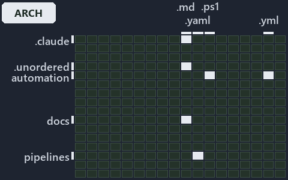

# docs/.assets/explanation/grid/adr-dsgn-life--deploy-and-integrate-share-only-the-topic--architecture.grid.md

`Grid minimap: adr-dsgn-life--deploy-and-integrate-share-only-the-topic--architecture`

The grid minimap of the slide `adr-dsgn-life--deploy-and-integrate-share-only-the-topic--architecture` (architecture lens). The slide
supports [ADR-DSGN-LIFE][1] and [ADR-DSGN-VISUAL][2]; the highlight of those ADR codes selects what is lit, and each reason below names the
code that selects it.

## What the minimap shows

The grid crosses the 16 tracks (rows) with the 18 file languages (columns) of the world map and lights 6 cells, filled in ink. A cell lit
only by passing mentions (citations in body comments, not in a file's header or text) is touched: a lighter ink. Every other cell is idle, a
grey box: it holds files the slide's ADR codes do not select, or no file at all (237 of the 288 cells hold none). The minimap shows where
the slide sits, not how many files a cell holds; the world-map PDFs show the counts.

- .claude × markdown: 2 lit of 71 files
- .unordered × markdown: 4 lit of 20 files
- automation × powershell: 1 lit of 1579 files
- automation × yaml: 4 lit of 109 files
- docs × markdown: 5 lit of 2165 files
- pipelines × pipeline-yaml: 1 lit of 9 files

## Key

A lit row prints its track's name; a lit column prints a short code, the first extension of its file language:

- `.md`: markdown
- `.yaml`: pipeline-yaml
- `.ps1`: powershell
- `.yml`: yaml

## Why each cell is lit

### .claude × markdown (2 lit files)

Placed: the root folder `.claude/` names the track .claude ([ADR-DSGN-TRACK#1][3]); the extension `.md` names the file language markdown
([ADR-DSGN-TRACK#6][4]). Lit ([ADR-DSGN-TRACK#12][5]) by:

- [.claude/plans/plan-minimal-robots-agents.md][6]: selected by [ADR-DSGN-VISUAL][2]: the file cites it at line 27 (text) and line 66
  (text).
- [.claude/plans/plan-minimal-robots-capabilities.md][7]: selected by [ADR-DSGN-VISUAL][2]: the file cites it at line 26 (text), line 90
  (text) and line 133 (text).

### .unordered × markdown (4 lit files)

Placed: the root folder `.unordered/` names the track .unordered ([ADR-DSGN-TRACK#1][3]); the extension `.md` names the file language
markdown ([ADR-DSGN-TRACK#6][4]). Lit ([ADR-DSGN-TRACK#12][5]) by:

- [.unordered/15-10-2026/plan-adr-consistency.md][8]: selected by [ADR-DSGN-LIFE][1]: the file cites it at line 100 (text), line 183 (text)
  and line 268 (text); selected by [ADR-DSGN-VISUAL][2]: the file cites it at line 46 (text), line 108 (text), line 184 (text) and line 268
  (text).
- [.unordered/15-10-2026/plan-concern-axis.md][9]: selected by [ADR-DSGN-LIFE][1]: the file cites it at line 91 (text); selected by
  [ADR-DSGN-VISUAL][2]: the file cites it at line 90 (text).
- [.unordered/15-10-2026/plan-diagram-wave-7.md][10]: selected by [ADR-DSGN-VISUAL][2]: the file cites it at line 25 (text).
- [.unordered/15-10-2026/plan-explanation-drift.md][11]: selected by [ADR-DSGN-LIFE][1]: the file cites it at line 84 (text), line 86
  (text), line 86 (text), line 97 (text), line 99 (text), line 101 (text) and line 101 (text); selected by [ADR-DSGN-VISUAL][2]: the file
  cites it at line 83 (text), line 83 (text), line 102 (text) and line 102 (text).

### automation × powershell (1 lit file)

Placed: the root folder `automation/` names the track automation ([ADR-DSGN-TRACK#1][3]); the extension `.ps1` names the file language
powershell ([ADR-DSGN-TRACK#6][4]). Lit ([ADR-DSGN-TRACK#12][5]) by:

- [automation/Catzc.Base.Git/Push-Dirty.ps1][12]: selected by [ADR-DSGN-LIFE][1]: the file cites it at line 21 (header) and line 26
  (header).

### automation × yaml (4 lit files)

Placed: the root folder `automation/` names the track automation ([ADR-DSGN-TRACK#1][3]); the extension `.yml` names the file language yaml
([ADR-DSGN-TRACK#6][4]). Lit ([ADR-DSGN-TRACK#12][5]) by:

- [automation/Catzc.Base.Docs/configs/adrs.yml][13]: selected by [ADR-DSGN-LIFE][1]: the file cites it at line 96 (text); selected by
  [ADR-DSGN-VISUAL][2]: the file cites it at line 95 (text).
- [automation/Catzc.Base.Docs/configs/agents.yml][14]: selected by [ADR-DSGN-VISUAL][2]: the file cites it at line 47 (text), line 47 (body
  comment), line 53 (text) and line 58 (text).
- [automation/Catzc.Base.Docs/configs/capabilities.yml][15]: selected by [ADR-DSGN-VISUAL][2]: the file cites it at line 73 (text), line 78
  (text), line 83 (text), line 83 (body comment) and line 88 (text).
- [automation/Catzc.Base.ModuleSystem/configs/glossary.yml][16]: selected by [ADR-DSGN-LIFE][1]: the file cites it at line 69 (text).

### docs × markdown (5 lit files)

Placed: the root folder `docs/` names the track docs ([ADR-DSGN-TRACK#1][3]); the extension `.md` names the file language markdown
([ADR-DSGN-TRACK#6][4]). Lit ([ADR-DSGN-TRACK#12][5]) by:

- [docs/adr/design/commit-lifecycle.md][1]: selected by [ADR-DSGN-LIFE][1]: the ADR's own file.
- [docs/adr/design/dora-explains.md][17]: selected by [ADR-DSGN-LIFE][1]: the file cites it at line 122 (text); selected by
  [ADR-DSGN-VISUAL][2]: the file cites it at line 103 (text).
- [docs/adr/design/visual-design.md][2]: selected by [ADR-DSGN-VISUAL][2]: the ADR's own file.
- [docs/adr/glossary.md][18]: selected by [ADR-DSGN-LIFE][1]: the file cites it at line 218 (text).
- [docs/adr/index.md][19]: selected by [ADR-DSGN-LIFE][1]: the file cites it at line 110 (text); selected by [ADR-DSGN-VISUAL][2]: the file
  cites it at line 109 (text).

### pipelines × pipeline-yaml (1 lit file)

Placed: the root folder `pipelines/` names the track pipelines ([ADR-DSGN-TRACK#1][3]); the extension `.yaml` names the file language
pipeline-yaml ([ADR-DSGN-TRACK#6][4]). Lit ([ADR-DSGN-TRACK#12][5]) by:

- [pipelines/ci-automation.yaml][20]: selected by [ADR-DSGN-LIFE][1]: a pipeline that cites nothing itself carries its globset's citations,
  which cite it at `automation/Catzc.Base.Docs/configs/adrs.yml` line 96 (text), `automation/Catzc.Base.Git/Push-Dirty.ps1` line 21
  (header), `automation/Catzc.Base.Git/Push-Dirty.ps1` line 26 (header) and `automation/Catzc.Base.ModuleSystem/configs/glossary.yml` line
  69 (text); selected by [ADR-DSGN-VISUAL][2]: a pipeline that cites nothing itself carries its globset's citations, which cite it at
  `automation/Catzc.Base.Docs/configs/adrs.yml` line 95 (text), `automation/Catzc.Base.Docs/configs/agents.yml` line 47 (text),
  `automation/Catzc.Base.Docs/configs/agents.yml` line 47 (body comment), `automation/Catzc.Base.Docs/configs/agents.yml` line 53 (text),
  `automation/Catzc.Base.Docs/configs/agents.yml` line 58 (text), `automation/Catzc.Base.Docs/configs/capabilities.yml` line 73 (text),
  `automation/Catzc.Base.Docs/configs/capabilities.yml` line 78 (text), `automation/Catzc.Base.Docs/configs/capabilities.yml` line 83
  (text), `automation/Catzc.Base.Docs/configs/capabilities.yml` line 83 (body comment) and
  `automation/Catzc.Base.Docs/configs/capabilities.yml` line 88 (text).

## Keywords

- [world map][21]
- [track][22]
- [file language][23]
- [cell][24]
- [lit cell][25]
- [.claude][26]: a track
- [.unordered][26]: a track
- [automation][26]: a track
- [docs][26]: a track
- [pipelines][26]: a track
- [markdown][27]: a file language
- [pipeline-yaml][27]: a file language
- [powershell][27]: a file language
- [yaml][27]: a file language

Terms the cited ADRs define:

- [occupant][28], defined by [ADR-DSGN-LIFE#5][29]

[1]: ../../../adr/design/commit-lifecycle.md
[2]: ../../../adr/design/visual-design.md
[3]: ../../../adr/design/tracks.md#rule-adr-dsgn-track1
[4]: ../../../adr/design/tracks.md#rule-adr-dsgn-track6
[5]: ../../../adr/design/tracks.md#rule-adr-dsgn-track12
[6]: ../../../../.claude/plans/plan-minimal-robots-agents.md
[7]: ../../../../.claude/plans/plan-minimal-robots-capabilities.md
[8]: ../../../../.unordered/15-10-2026/plan-adr-consistency.md
[9]: ../../../../.unordered/15-10-2026/plan-concern-axis.md
[10]: ../../../../.unordered/15-10-2026/plan-diagram-wave-7.md
[11]: ../../../../.unordered/15-10-2026/plan-explanation-drift.md
[12]: ../../../../automation/Catzc.Base.Git/Push-Dirty.ps1
[13]: ../../../../automation/Catzc.Base.Docs/configs/adrs.yml
[14]: ../../../../automation/Catzc.Base.Docs/configs/agents.yml
[15]: ../../../../automation/Catzc.Base.Docs/configs/capabilities.yml
[16]: ../../../../automation/Catzc.Base.ModuleSystem/configs/glossary.yml
[17]: ../../../adr/design/dora-explains.md
[18]: ../../../adr/glossary.md
[19]: ../../../adr/index.md
[20]: ../../../../pipelines/ci-automation.yaml
[21]: ../../../adr/glossary.md#world-map
[22]: ../../../adr/glossary.md#track
[23]: ../../../adr/glossary.md#file-language
[24]: ../../../adr/glossary.md#cell
[25]: ../../../adr/glossary.md#lit-cell
[26]: ../../../../automation/Catzc.Base.Variants/configs/variants.yml
[27]: ../../../../automation/Catzc.Base.Languages/configs/languages.yml
[28]: ../../../adr/glossary.md#occupant
[29]: ../../../adr/design/commit-lifecycle.md#rule-adr-dsgn-life5
