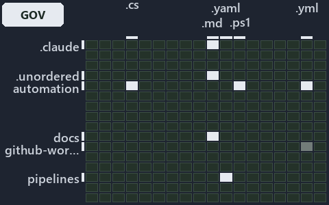

# docs/.assets/explanation/grid/adr-dsgn-track--unit-to-pipeline-rule-is-review-only--governance.grid.md

`Grid minimap: adr-dsgn-track--unit-to-pipeline-rule-is-review-only--governance`

The grid minimap of the slide `adr-dsgn-track--unit-to-pipeline-rule-is-review-only--governance` (governance lens). The slide supports
[ADR-DSGN-TRACK][1], [ADR-FLOW-CD-GLOBS][2] and [ADR-REPO-FOLDERS][3]; the highlight of those ADR codes selects what is lit, and each reason
below names the code that selects it.

## What the minimap shows

The grid crosses the 16 tracks (rows) with the 18 file languages (columns) of the world map and lights 8 cells, filled in ink. A cell lit
only by passing mentions (citations in body comments, not in a file's header or text) is touched: a lighter ink. Every other cell is idle, a
grey box: it holds files the slide's ADR codes do not select, or no file at all (237 of the 288 cells hold none). The minimap shows where
the slide sits, not how many files a cell holds; the world-map PDFs show the counts.

- .claude × markdown: 8 lit of 51 files
- .unordered × markdown: 8 lit of 20 files
- automation × csharp: 30 lit of 272 files
- automation × powershell: 78 lit of 1563 files
- automation × yaml: 6 lit of 107 files
- docs × markdown: 79 lit of 1985 files
- github-workflows × yaml: 1 lit of 2 files, touched
- pipelines × pipeline-yaml: 1 lit of 9 files

## Key

A lit row prints its track's name; a lit column prints a short code, the first extension of its file language:

- `.cs`: csharp
- `.md`: markdown
- `.yaml`: pipeline-yaml
- `.ps1`: powershell
- `.yml`: yaml

## Why each cell is lit

### .claude × markdown (8 lit files)

Placed: the root folder `.claude/` names the track .claude ([ADR-DSGN-TRACK#1][4]); the extension `.md` names the file language markdown
([ADR-DSGN-TRACK#6][5]). Lit ([ADR-DSGN-TRACK#12][6]) by:

- [.claude/plans/decisions-2026-10-16.md][7]: selected by [ADR-DSGN-TRACK][1]: the file cites it at line 51 (text).
- [.claude/plans/plan-layers-vocabulary-rename-contracts.md][8]: selected by [ADR-DSGN-TRACK][1]: the file cites it at line 123 (text), line
  344 (text), line 384 (text), line 408 (text), line 482 (text), line 677 (text), line 700 (text), line 796 (text) and line 800 (text);
  selected by [ADR-REPO-FOLDERS][3]: the file cites it at line 796 (text).
- [.claude/plans/plan-minimal-robots-agents.md][9]: selected by [ADR-REPO-FOLDERS][3]: the file cites it at line 39 (text).
- [.claude/plans/plan-module-kinds-tracks.md][10]: selected by [ADR-DSGN-TRACK][1]: the file cites it at line 36 (text), line 56 (text),
  line 74 (text), line 137 (text), line 254 (text), line 374 (text), line 388 (text), line 419 (text), line 424 (text), line 472 (text),
  line 489 (text), line 489 (text), line 514 (text), line 516 (text), line 518 (text), line 528 (text), line 536 (text), line 537 (text),
  line 547 (text), line 566 (text), line 677 (text), line 689 (text), line 694 (text), line 697 (text), line 725 (text), line 733 (text),
  line 755 (text), line 793 (text), line 812 (text), line 821 (text), line 863 (text) and line 918 (text).
- [.claude/plans/plan-plans-body-sha-landing-zone.md][11]: selected by [ADR-DSGN-TRACK][1]: the file cites it at line 30 (text) and line 130
  (text).
- [.claude/plans/prompt-k8s-kinds-1-prepare.md][12]: selected by [ADR-DSGN-TRACK][1]: the file cites it at line 18 (text) and line 45
  (text).
- [.claude/plans/prompt-k8s-kinds-2-implement.md][13]: selected by [ADR-DSGN-TRACK][1]: the file cites it at line 32 (text).
- [.claude/plans/prompt-module-model-1-prepare.md][14]: selected by [ADR-DSGN-TRACK][1]: the file cites it at line 18 (text).

### .unordered × markdown (8 lit files)

Placed: the root folder `.unordered/` names the track .unordered ([ADR-DSGN-TRACK#1][4]); the extension `.md` names the file language
markdown ([ADR-DSGN-TRACK#6][5]). Lit ([ADR-DSGN-TRACK#12][6]) by:

- [.unordered/15-10-2026/plan-adr-consistency.md][15]: selected by [ADR-DSGN-TRACK][1]: the file cites it at line 90 (text) and line 248
  (text); selected by [ADR-FLOW-CD-GLOBS][2]: the file cites it at line 43 (text), line 96 (text), line 124 (text) and line 167 (text);
  selected by [ADR-REPO-FOLDERS][3]: the file cites it at line 105 (text), line 117 (text), line 248 (text) and line 324 (text).
- [.unordered/15-10-2026/plan-caf-waf-automation.md][16]: selected by [ADR-FLOW-CD-GLOBS][2]: the file cites it at line 101 (text).
- [.unordered/15-10-2026/plan-concern-axis.md][17]: selected by [ADR-DSGN-TRACK][1]: the file cites it at line 32 (text), line 50 (text),
  line 51 (text), line 51 (text), line 54 (text), line 162 (text) and line 187 (text); selected by [ADR-FLOW-CD-GLOBS][2]: the file cites it
  at line 97 (text).
- [.unordered/15-10-2026/plan-contracts.md][18]: selected by [ADR-REPO-FOLDERS][3]: the file cites it at line 23 (text), line 76 (text),
  line 122 (text) and line 294 (text).
- [.unordered/15-10-2026/plan-diagram-wave-7.md][19]: selected by [ADR-DSGN-TRACK][1]: the file cites it at line 101 (text) and line 102
  (text); selected by [ADR-REPO-FOLDERS][3]: the file cites it at line 31 (text).
- [.unordered/15-10-2026/plan-diagram-wave-9.md][20]: selected by [ADR-REPO-FOLDERS][3]: the file cites it at line 45 (text), line 74 (text)
  and line 150 (text).
- [.unordered/15-10-2026/plan-explanation-assets-source.md][21]: selected by [ADR-DSGN-TRACK][1]: the file cites it at line 29 (text), line
  39 (text), line 41 (text), line 54 (text), line 56 (text) and line 110 (text); selected by [ADR-REPO-FOLDERS][3]: the file cites it at
  line 74 (text) and line 101 (text).
- [.unordered/15-10-2026/plan-explanation-drift.md][22]: selected by [ADR-FLOW-CD-GLOBS][2]: the file cites it at line 38 (text), line 39
  (text), line 58 (text), line 77 (text), line 103 (text) and line 103 (text); selected by [ADR-REPO-FOLDERS][3]: the file cites it at line
  63 (text), line 63 (text), line 78 (text) and line 78 (text).

### automation × csharp (30 lit files)

Placed: the root folder `automation/` names the track automation ([ADR-DSGN-TRACK#1][4]); the extension `.cs` names the file language csharp
([ADR-DSGN-TRACK#6][5]). Lit ([ADR-DSGN-TRACK#12][6]) by:

- [automation/Catzc.Base.Docs/types/AdrDomain.cs][23]: selected by [ADR-DSGN-TRACK][1]: the file cites it at line 20 (text).
- [automation/Catzc.Base.Docs/types/AdrRuleSet.cs][24]: selected by [ADR-DSGN-TRACK][1]: the file cites it at line 20 (text).
- [automation/Catzc.Base.Docs/types/AdrsConfig.cs][25]: selected by [ADR-DSGN-TRACK][1]: the file cites it at line 24 (text) and line 43
  (body comment).
- [automation/Catzc.Base.Globs/types/Aspect.cs][26]: selected by [ADR-FLOW-CD-GLOBS][2]: the file cites it at line 21 (text).
- [automation/Catzc.Base.Globs/types/DurableHash.cs][27]: selected by [ADR-FLOW-CD-GLOBS][2]: the file cites it at line 19 (text).
- [automation/Catzc.Base.Globs/types/GlobPattern.cs][28]: selected by [ADR-FLOW-CD-GLOBS][2]: the file cites it at line 20 (text), line 46
  (text), line 50 (text), line 54 (text), line 66 (text), line 70 (text) and line 79 (text).
- [automation/Catzc.Base.Globs/types/GlobSet.cs][29]: selected by [ADR-FLOW-CD-GLOBS][2]: the file cites it at line 20 (text) and line 78
  (text).
- [automation/Catzc.Base.Globs/types/GlobsConfig.cs][30]: selected by [ADR-FLOW-CD-GLOBS][2]: the file cites it at line 20 (text), line 97
  (text), line 160 (text), line 164 (text) and line 178 (text).
- [automation/Catzc.Base.Languages/types/BashConfig.cs][31]: selected by [ADR-REPO-FOLDERS][3]: the file cites it at line 21 (text).
- [automation/Catzc.Base.Languages/types/FileLanguage.cs][32]: selected by [ADR-DSGN-TRACK][1]: the file cites it at line 20 (text).
- [automation/Catzc.Base.Languages/types/GoConfig.cs][33]: selected by [ADR-REPO-FOLDERS][3]: the file cites it at line 22 (text).
- [automation/Catzc.Base.Languages/types/LanguagesConfig.cs][34]: selected by [ADR-DSGN-TRACK][1]: the file cites it at line 22 (text).
- [automation/Catzc.Base.Languages/types/PythonConfig.cs][35]: selected by [ADR-REPO-FOLDERS][3]: the file cites it at line 21 (text).
- [automation/Catzc.Base.Maps/types/MapCell.cs][36]: selected by [ADR-DSGN-TRACK][1]: the file cites it at line 20 (text).
- [automation/Catzc.Base.Maps/types/MapsLabels.cs][37]: selected by [ADR-DSGN-TRACK][1]: the file cites it at line 21 (text).
- [automation/Catzc.Base.Maps/types/ValueChainCell.cs][38]: selected by [ADR-DSGN-TRACK][1]: the file cites it at line 20 (text), line 32
  (body comment) and line 35 (body comment).
- [automation/Catzc.Base.Maps/types/ValueChainHighlight.cs][39]: selected by [ADR-DSGN-TRACK][1]: the file cites it at line 20 (text).
- [automation/Catzc.Base.Maps/types/ValueChainMap.cs][40]: selected by [ADR-DSGN-TRACK][1]: the file cites it at line 20 (text).
- [automation/Catzc.Base.Maps/types/ValueChainReason.cs][41]: selected by [ADR-DSGN-TRACK][1]: the file cites it at line 20 (text).
- [automation/Catzc.Base.Maps/types/WorldMap.cs][42]: selected by [ADR-DSGN-TRACK][1]: the file cites it at line 19 (text).
- [automation/Catzc.Base.Maps/types/WorldMapBuilder.cs][43]: selected by [ADR-DSGN-TRACK][1]: the file cites it at line 21 (text) and line
  163 (body comment).
- [automation/Catzc.Base.Maps/types/WorldMapGridLayout.cs][44]: selected by [ADR-DSGN-TRACK][1]: the file cites it at line 20 (text).
- [automation/Catzc.Base.Maps/types/WorldMapHighlight.cs][45]: selected by [ADR-DSGN-TRACK][1]: the file cites it at line 20 (text).
- [automation/Catzc.Base.Maps/types/WorldMapPdf.cs][46]: selected by [ADR-DSGN-TRACK][1]: the file cites it at line 20 (text).
- [automation/Catzc.Base.Variants/types/ModulePlace.cs][47]: selected by [ADR-DSGN-TRACK][1]: the file cites it at line 19 (text).
- [automation/Catzc.Base.Variants/types/ModuleTypeEntry.cs][48]: selected by [ADR-DSGN-TRACK][1]: the file cites it at line 18 (text).
- [automation/Catzc.Base.Variants/types/ModuleTypesConfig.cs][49]: selected by [ADR-DSGN-TRACK][1]: the file cites it at line 20 (text).
- [automation/Catzc.Base.Variants/types/PathModule.cs][50]: selected by [ADR-DSGN-TRACK][1]: the file cites it at line 18 (text).
- [automation/Catzc.Base.Variants/types/VariantTrack.cs][51]: selected by [ADR-DSGN-TRACK][1]: the file cites it at line 20 (text).
- [automation/Catzc.Base.Variants/types/VariantsConfig.cs][52]: selected by [ADR-DSGN-TRACK][1]: the file cites it at line 22 (text) and
  line 265 (text).

### automation × powershell (78 lit files)

Placed: the root folder `automation/` names the track automation ([ADR-DSGN-TRACK#1][4]); the extension `.ps1` names the file language
powershell ([ADR-DSGN-TRACK#6][5]). Lit ([ADR-DSGN-TRACK#12][6]) by:

- [automation/Catzc.Azure.DevOps.BuildValidation/Get-AdoBuildValidations.ps1][53]: selected by [ADR-FLOW-CD-GLOBS][2]: the file cites it at
  line 19 (header) and line 29 (header).
- [automation/Catzc.Azure.DevOps.BuildValidation/Register-AdoBuildValidation.ps1][54]: selected by [ADR-FLOW-CD-GLOBS][2]: the file cites it
  at line 21 (header) and line 27 (header).
- [automation/Catzc.Azure.DevOps.BuildValidation/Unregister-AdoBuildValidation.ps1][55]: selected by [ADR-FLOW-CD-GLOBS][2]: the file cites
  it at line 20 (header) and line 25 (header).
- [automation/Catzc.Azure.DevOps.BuildValidation/private/Get-BuildValidationPathFilter.ps1][56]: selected by [ADR-FLOW-CD-GLOBS][2]: the
  file cites it at line 19 (header) and line 27 (header).
- [automation/Catzc.Base.Contracts/private/Get-ContractDotFolderFindings.ps1][57]: selected by [ADR-REPO-FOLDERS][3]: the file cites it at
  line 22 (header) and line 28 (header).
- [automation/Catzc.Base.Docs/private/Get-CatsModules.ps1][58]: selected by [ADR-REPO-FOLDERS][3]: the file cites it at line 22 (header) and
  line 28 (header).
- [automation/Catzc.Base.Docs/tests/types/AdrsConfig.Tests.ps1][59]: selected by [ADR-DSGN-TRACK][1]: the file cites it at line 20 (header),
  line 119 (text) and line 119 (body comment).
- [automation/Catzc.Base.Exporter/Get-CatzcContentHash.ps1][60]: selected by [ADR-FLOW-CD-GLOBS][2]: the file cites it at line 20 (header)
  and line 26 (header).
- [automation/Catzc.Base.Globs/Get-ChangedGlobSet.ps1][61]: selected by [ADR-FLOW-CD-GLOBS][2]: the file cites it at line 19 (header) and
  line 25 (header).
- [automation/Catzc.Base.Globs/Get-GlobSet.ps1][62]: selected by [ADR-FLOW-CD-GLOBS][2]: the file cites it at line 19 (header) and line 24
  (header).
- [automation/Catzc.Base.Globs/Get-GlobSetFile.ps1][63]: selected by [ADR-FLOW-CD-GLOBS][2]: the file cites it at line 19 (header), line 24
  (header) and line 27 (header).
- [automation/Catzc.Base.Globs/Get-GlobSetHash.ps1][64]: selected by [ADR-FLOW-CD-GLOBS][2]: the file cites it at line 19 (header) and line
  27 (header).
- [automation/Catzc.Base.Globs/Get-GlobSetTrigger.ps1][65]: selected by [ADR-FLOW-CD-GLOBS][2]: the file cites it at line 19 (header) and
  line 24 (header).
- [automation/Catzc.Base.Globs/Get-MarkerBlastRadius.ps1][66]: selected by [ADR-FLOW-CD-GLOBS][2]: the file cites it at line 20 (header) and
  line 26 (header).
- [automation/Catzc.Base.Globs/Get-ModuleGlobSet.ps1][67]: selected by [ADR-FLOW-CD-GLOBS][2]: the file cites it at line 25 (header).
- [automation/Catzc.Base.Globs/Get-TrackedFile.ps1][68]: selected by [ADR-FLOW-CD-GLOBS][2]: the file cites it at line 20 (header) and line
  25 (header).
- [automation/Catzc.Base.Globs/Test-AdoPipelineTriggerGlob.ps1][69]: selected by [ADR-FLOW-CD-GLOBS][2]: the file cites it at line 21
  (header).
- [automation/Catzc.Base.Globs/Test-GitHubWorkflowTriggerGlob.ps1][70]: selected by [ADR-FLOW-CD-GLOBS][2]: the file cites it at line 21
  (header).
- [automation/Catzc.Base.Globs/Test-GlobSetAffected.ps1][71]: selected by [ADR-FLOW-CD-GLOBS][2]: the file cites it at line 21 (header) and
  line 32 (header).
- [automation/Catzc.Base.Globs/Test-GlobSetIndependence.ps1][72]: selected by [ADR-FLOW-CD-GLOBS][2]: the file cites it at line 22 (header),
  line 35 (header) and line 94 (text).
- [automation/Catzc.Base.Globs/Test-GlobSetTriggerCoverage.ps1][73]: selected by [ADR-FLOW-CD-GLOBS][2]: the file cites it at line 21
  (header) and line 27 (header).
- [automation/Catzc.Base.Globs/private/Get-ChangedFile.ps1][74]: selected by [ADR-FLOW-CD-GLOBS][2]: the file cites it at line 20 (header)
  and line 27 (header).
- [automation/Catzc.Base.Globs/private/Get-GlobSetMember.ps1][75]: selected by [ADR-FLOW-CD-GLOBS][2]: the file cites it at line 20 (header)
  and line 25 (header).
- [automation/Catzc.Base.Globs/private/Get-PipelineTrigger.ps1][76]: selected by [ADR-FLOW-CD-GLOBS][2]: the file cites it at line 20
  (header) and line 26 (header).
- [automation/Catzc.Base.Globs/private/Test-GlobListEqual.ps1][77]: selected by [ADR-FLOW-CD-GLOBS][2]: the file cites it at line 20
  (header) and line 30 (header).
- [automation/Catzc.Base.Globs/tests/Get-ChangedFile.Tests.ps1][78]: selected by [ADR-FLOW-CD-GLOBS][2]: the file cites it at line 19
  (header).
- [automation/Catzc.Base.Globs/tests/Get-ChangedGlobSet.Tests.ps1][79]: selected by [ADR-FLOW-CD-GLOBS][2]: the file cites it at line 20
  (header).
- [automation/Catzc.Base.Globs/tests/Get-GlobSetFile.Tests.ps1][80]: selected by [ADR-FLOW-CD-GLOBS][2]: the file cites it at line 19
  (header).
- [automation/Catzc.Base.Globs/tests/Get-GlobSetHash.Tests.ps1][81]: selected by [ADR-FLOW-CD-GLOBS][2]: the file cites it at line 19
  (header).
- [automation/Catzc.Base.Globs/tests/Get-GlobSetMember.Tests.ps1][82]: selected by [ADR-FLOW-CD-GLOBS][2]: the file cites it at line 19
  (header).
- [automation/Catzc.Base.Globs/tests/Get-GlobSetTrigger.Tests.ps1][83]: selected by [ADR-FLOW-CD-GLOBS][2]: the file cites it at line 19
  (header).
- [automation/Catzc.Base.Globs/tests/Get-PipelineTrigger.Tests.ps1][84]: selected by [ADR-FLOW-CD-GLOBS][2]: the file cites it at line 19
  (header).
- [automation/Catzc.Base.Globs/tests/Get-TrackedFile.Tests.ps1][85]: selected by [ADR-FLOW-CD-GLOBS][2]: the file cites it at line 19
  (header).
- [automation/Catzc.Base.Globs/tests/GlobSet-Independence.Tests.ps1][86]: selected by [ADR-FLOW-CD-GLOBS][2]: the file cites it at line 19
  (header), line 24 (text) and line 26 (text).
- [automation/Catzc.Base.Globs/tests/GlobSetTrigger-Coverage.Tests.ps1][87]: selected by [ADR-FLOW-CD-GLOBS][2]: the file cites it at line
  20 (header).
- [automation/Catzc.Base.Globs/tests/PipelineTrigger-Integrity.Tests.ps1][88]: selected by [ADR-FLOW-CD-GLOBS][2]: the file cites it at line
  19 (header).
- [automation/Catzc.Base.Globs/tests/Test-GlobSetIndependence.Tests.ps1][89]: selected by [ADR-FLOW-CD-GLOBS][2]: the file cites it at line
  20 (header).
- [automation/Catzc.Base.Globs/tests/types/GlobPattern.Tests.ps1][90]: selected by [ADR-FLOW-CD-GLOBS][2]: the file cites it at line 19
  (header) and line 80 (text).
- [automation/Catzc.Base.Globs/tests/types/GlobSet.Tests.ps1][91]: selected by [ADR-FLOW-CD-GLOBS][2]: the file cites it at line 19 (header)
  and line 31 (text).
- [automation/Catzc.Base.Globs/tests/types/GlobsConfig.Tests.ps1][92]: selected by [ADR-DSGN-TRACK][1]: the file cites it at line 20
  (header) and line 65 (text); selected by [ADR-FLOW-CD-GLOBS][2]: the file cites it at line 21 (header), line 77 (text), line 90 (text),
  line 101 (text) and line 113 (text).
- [automation/Catzc.Base.Languages/Get-FileLanguage.ps1][93]: selected by [ADR-DSGN-TRACK][1]: the file cites it at line 19 (header) and
  line 24 (header).
- [automation/Catzc.Base.Languages/Get-PathFileType.ps1][94]: selected by [ADR-DSGN-TRACK][1]: the file cites it at line 19 (header) and
  line 26 (header).
- [automation/Catzc.Base.Languages/tests/Get-FileLanguage.Tests.ps1][95]: selected by [ADR-DSGN-TRACK][1]: the file cites it at line 19
  (header), line 133 (text), line 145 (text) and line 183 (text).
- [automation/Catzc.Base.Languages/tests/Get-PathFileType.Tests.ps1][96]: selected by [ADR-DSGN-TRACK][1]: the file cites it at line 18
  (header) and line 22 (text).
- [automation/Catzc.Base.Maps/Export-WorldMapPdf.ps1][97]: selected by [ADR-DSGN-TRACK][1]: the file cites it at line 19 (header), line 29
  (header), line 30 (header), line 32 (header) and line 48 (header).
- [automation/Catzc.Base.Maps/Get-ValueChainHighlight.ps1][98]: selected by [ADR-DSGN-TRACK][1]: the file cites it at line 20 (header), line
  29 (header), line 30 (header) and line 41 (header).
- [automation/Catzc.Base.Maps/Get-ValueChainMap.ps1][99]: selected by [ADR-DSGN-TRACK][1]: the file cites it at line 19 (header), line 26
  (header), line 28 (header) and line 30 (header).
- [automation/Catzc.Base.Maps/Get-WorldMap.ps1][100]: selected by [ADR-DSGN-TRACK][1]: the file cites it at line 22 (header), line 29
  (header), line 30 (header) and line 42 (header).
- [automation/Catzc.Base.Maps/Get-WorldMapHighlight.ps1][101]: selected by [ADR-DSGN-TRACK][1]: the file cites it at line 19 (header), line
  32 (header) and line 49 (header).
- [automation/Catzc.Base.Maps/Test-ValueChainMap.ps1][102]: selected by [ADR-DSGN-TRACK][1]: the file cites it at line 22 (header), line 36
  (header), line 38 (header), line 41 (header), line 45 (header), line 76 (text), line 77 (text), line 87 (text), line 90 (text) and line
  107 (text).
- [automation/Catzc.Base.Maps/Test-WorldMap.ps1][103]: selected by [ADR-DSGN-TRACK][1]: the file cites it at line 21 (header), line 33
  (header), line 36 (header), line 40 (header), line 45 (header), line 46 (header), line 89 (text), line 108 (text), line 125 (text), line
  129 (text) and line 130 (text).
- [automation/Catzc.Base.Maps/private/Resolve-MapLabelTerm.ps1][104]: selected by [ADR-DSGN-TRACK][1]: the file cites it at line 20
  (header), line 28 (header) and line 29 (header).
- [automation/Catzc.Base.Maps/tests/Get-ValueChainHighlight.Tests.ps1][105]: selected by [ADR-DSGN-TRACK][1]: the file cites it at line 20
  (header), line 41 (text), line 47 (text) and line 66 (text).
- [automation/Catzc.Base.Maps/tests/Get-ValueChainMap.Tests.ps1][106]: selected by [ADR-DSGN-TRACK][1]: the file cites it at line 20
  (header), line 41 (text), line 60 (text) and line 60 (body comment).
- [automation/Catzc.Base.Maps/tests/Get-WorldMap.Tests.ps1][107]: selected by [ADR-DSGN-TRACK][1]: the file cites it at line 19 (header) and
  line 111 (text).
- [automation/Catzc.Base.Maps/tests/Get-WorldMapHighlight.Tests.ps1][108]: selected by [ADR-DSGN-TRACK][1]: the file cites it at line 18
  (header) and line 96 (text).
- [automation/Catzc.Base.Maps/tests/Test-ValueChainMap.Tests.ps1][109]: selected by [ADR-DSGN-TRACK][1]: the file cites it at line 20
  (header), line 72 (text), line 72 (body comment), line 76 (text), line 77 (text), line 78 (text), line 79 (text), line 83 (text), line 86
  (text), line 103 (text), line 103 (body comment) and line 103 (body comment).
- [automation/Catzc.Base.Maps/tests/Test-WorldMap.Tests.ps1][110]: selected by [ADR-DSGN-TRACK][1]: the file cites it at line 20 (header),
  line 80 (text), line 84 (text), line 87 (text), line 91 (text), line 92 (text), line 96 (text), line 105 (text), line 106 (text), line 110
  (text), line 114 (text), line 115 (text), line 134 (text), line 134 (body comment) and line 134 (body comment).
- [automation/Catzc.Base.Maps/tests/types/ValueChainHighlight.Tests.ps1][111]: selected by [ADR-DSGN-TRACK][1]: the file cites it at line 20
  (header), line 39 (text), line 46 (text), line 52 (text), line 69 (text) and line 69 (body comment).
- [automation/Catzc.Base.Maps/tests/types/ValueChainMap.Tests.ps1][112]: selected by [ADR-DSGN-TRACK][1]: the file cites it at line 20
  (header), line 41 (text), line 50 (text), line 55 (text) and line 63 (text).
- [automation/Catzc.Base.Maps/tests/types/WorldMapHighlight.Tests.ps1][113]: selected by [ADR-DSGN-TRACK][1]: the file cites it at line 18
  (header), line 90 (text), line 134 (text) and line 148 (text).
- [automation/Catzc.Base.ModuleSystem/Test-FolderConventions.ps1][114]: selected by [ADR-REPO-FOLDERS][3]: the file cites it at line 22
  (header) and line 29 (header).
- [automation/Catzc.Base.QualityGates/Test-Automation.ps1][115]: selected by [ADR-FLOW-CD-GLOBS][2]: the file cites it at line 22 (header)
  and line 101 (header).
- [automation/Catzc.Base.QualityGates/private/Get-FileTypeFileMetaFact.ps1][116]: selected by [ADR-DSGN-TRACK][1]: the file cites it at line
  21 (header) and line 25 (header).
- [automation/Catzc.Base.QualityGates/private/Get-GuidScanFiles.ps1][117]: selected by [ADR-FLOW-CD-GLOBS][2]: the file cites it at line 21
  (header) and line 27 (header).
- [automation/Catzc.Base.QualityGates/private/Get-LanguageTestFolders.ps1][118]: selected by [ADR-DSGN-TRACK][1]: the file cites it at line
  24 (header) and line 31 (header).
- [automation/Catzc.Base.QualityGates/private/Get-ModuleProtectionIdentity.ps1][119]: selected by [ADR-FLOW-CD-GLOBS][2]: the file cites it
  at line 22 (header).
- [automation/Catzc.Base.QualityGates/private/Get-ModuleTypeFileMetaFact.ps1][120]: selected by [ADR-DSGN-TRACK][1]: the file cites it at
  line 21 (header) and line 25 (header).
- [automation/Catzc.Base.QualityGates/private/Get-TrackFileMetaFact.ps1][121]: selected by [ADR-DSGN-TRACK][1]: the file cites it at line 21
  (header) and line 26 (header).
- [automation/Catzc.Base.QualityGates/private/Resolve-TestSuite.ps1][122]: selected by [ADR-FLOW-CD-GLOBS][2]: the file cites it at line 21
  (header) and line 30 (header).
- [automation/Catzc.Base.QualityGates/tests/Get-FileTypeFileMetaFact.Tests.ps1][123]: selected by [ADR-DSGN-TRACK][1]: the file cites it at
  line 18 (header) and line 22 (text).
- [automation/Catzc.Base.QualityGates/tests/Get-ModuleTypeFileMetaFact.Tests.ps1][124]: selected by [ADR-DSGN-TRACK][1]: the file cites it
  at line 18 (header) and line 22 (text).
- [automation/Catzc.Base.QualityGates/tests/Get-TrackFileMetaFact.Tests.ps1][125]: selected by [ADR-DSGN-TRACK][1]: the file cites it at
  line 18 (header) and line 22 (text).
- [automation/Catzc.Base.Variants/Get-PathModule.ps1][126]: selected by [ADR-DSGN-TRACK][1]: the file cites it at line 19 (header) and line
  24 (header).
- [automation/Catzc.Base.Variants/Get-Track.ps1][127]: selected by [ADR-DSGN-TRACK][1]: the file cites it at line 19 (header), line 23
  (header), line 26 (header) and line 30 (header).
- [automation/Catzc.Base.Variants/tests/Get-PathModule.Tests.ps1][128]: selected by [ADR-DSGN-TRACK][1]: the file cites it at line 18
  (header), line 22 (text) and line 73 (text).
- [automation/Catzc.Base.Variants/tests/Get-Track.Tests.ps1][129]: selected by [ADR-DSGN-TRACK][1]: the file cites it at line 18 (header)
  and line 97 (text).
- [automation/Catzc.Base.Variants/tests/types/ModuleTypesConfig.Tests.ps1][130]: selected by [ADR-DSGN-TRACK][1]: the file cites it at line
  18 (header) and line 22 (text).

### automation × yaml (6 lit files)

Placed: the root folder `automation/` names the track automation ([ADR-DSGN-TRACK#1][4]); the extension `.yml` names the file language yaml
([ADR-DSGN-TRACK#6][5]). Lit ([ADR-DSGN-TRACK#12][6]) by:

- [automation/Catzc.Base.Docs/configs/adrs.yml][131]: selected by [ADR-DSGN-TRACK][1]: the file cites it at line 91 (text); selected by
  [ADR-FLOW-CD-GLOBS][2]: the file cites it at line 118 (text); selected by [ADR-REPO-FOLDERS][3]: the file cites it at line 306 (text).
- [automation/Catzc.Base.Docs/configs/agents.yml][132]: selected by [ADR-REPO-FOLDERS][3]: the file cites it at line 39 (body comment), line
  44 (body comment) and line 49 (body comment) (a passing mention only).
- [automation/Catzc.Base.Docs/configs/glossary.yml][133]: selected by [ADR-REPO-FOLDERS][3]: the file cites it at line 39 (text).
- [automation/Catzc.Base.Languages/configs/glossary.yml][134]: selected by [ADR-DSGN-TRACK][1]: the file cites it at line 23 (text).
- [automation/Catzc.Base.ModuleSystem/configs/glossary.yml][135]: selected by [ADR-DSGN-TRACK][1]: the file cites it at line 23 (text), line
  81 (text), line 147 (text), line 155 (text), line 166 (text), line 183 (text), line 196 (text), line 210 (text), line 225 (text), line 238
  (text), line 250 (text), line 263 (text), line 265 (text) and line 277 (text).
- [automation/Catzc.Base.QualityGates/configs/terminology.yml][136]: selected by [ADR-DSGN-TRACK][1]: the file cites it at line 312 (text)
  and line 315 (text); selected by [ADR-FLOW-CD-GLOBS][2]: the file cites it at line 1211 (text).

### docs × markdown (79 lit files)

Placed: the root folder `docs/` names the track docs ([ADR-DSGN-TRACK#1][4]); the extension `.md` names the file language markdown
([ADR-DSGN-TRACK#6][5]). Lit ([ADR-DSGN-TRACK#12][6]) by:

- [docs/adr/design/dora-explains.md][137]: selected by [ADR-DSGN-TRACK][1]: the file cites it at line 50 (text).
- [docs/adr/design/tracks.md][1]: selected by [ADR-DSGN-TRACK][1]: the ADR's own file.
- [docs/adr/flow/dora-explains.md][138]: selected by [ADR-FLOW-CD-GLOBS][2]: the file cites it at line 123 (text).
- [docs/adr/flow/durable-sha-globs.md][2]: selected by [ADR-FLOW-CD-GLOBS][2]: the ADR's own file.
- [docs/adr/glossary.md][139]: selected by [ADR-DSGN-TRACK][1]: the file cites it at line 103 (text), line 130 (text), line 147 (text), line
  176 (text), line 219 (text), line 229 (text), line 239 (text), line 241 (text), line 256 (text), line 295 (text), line 309 (text), line
  323 (text), line 336 (text), line 370 (text) and line 382 (text); selected by [ADR-REPO-FOLDERS][3]: the file cites it at line 900 (text).
- [docs/adr/index.md][140]: selected by [ADR-DSGN-TRACK][1]: the file cites it at line 103 (text); selected by [ADR-FLOW-CD-GLOBS][2]: the
  file cites it at line 128 (text); selected by [ADR-REPO-FOLDERS][3]: the file cites it at line 308 (text).
- [docs/adr/repository/conventional-folders.md][3]: selected by [ADR-REPO-FOLDERS][3]: the ADR's own file.
- [docs/adr/repository/dora-explains.md][141]: selected by [ADR-REPO-FOLDERS][3]: the file cites it at line 61 (text).
- [docs/how-to/automation/manual-test-plan/pipelines-and-globs.md][142]: selected by [ADR-FLOW-CD-GLOBS][2]: the file cites it at line 15
  (text) and line 35 (text).
- [docs/how-to/automation/manual-test-plan/repository-conventions.md][143]: selected by [ADR-DSGN-TRACK][1]: the file cites it at line 15
  (text), line 38 (text), line 44 (text), line 44 (text), line 47 (text), line 47 (text), line 49 (text), line 49 (text), line 49 (text),
  line 50 (text), line 51 (text) and line 53 (text).
- [docs/references/automation/catzc-azure-devops-buildvalidation/Register-AdoBuildValidation.ps1.md][144]: selected by
  [ADR-FLOW-CD-GLOBS][2]: the file cites it at line 28 (text).
- [docs/references/automation/catzc-azure-devops-buildvalidation/configs/build-validation.yml.md][145]: selected by [ADR-FLOW-CD-GLOBS][2]:
  the file cites it at line 34 (text).
- [docs/references/automation/catzc-base-docs/configs/adrs.yml.md][146]: selected by [ADR-DSGN-TRACK][1]: the file cites it at line 16
  (text), line 39 (text) and line 40 (text).
- [docs/references/automation/catzc-base-docs/types/AdrDomain.cs.md][147]: selected by [ADR-DSGN-TRACK][1]: the file cites it at line 17
  (text), line 35 (text) and line 36 (text).
- [docs/references/automation/catzc-base-docs/types/AdrRuleSet.cs.md][148]: selected by [ADR-DSGN-TRACK][1]: the file cites it at line 17
  (text) and line 37 (text).
- [docs/references/automation/catzc-base-docs/types/AdrsConfig.cs.md][149]: selected by [ADR-DSGN-TRACK][1]: the file cites it at line 20
  (text), line 53 (text), line 56 (text) and line 68 (text).
- [docs/references/automation/catzc-base-globs.md][150]: selected by [ADR-FLOW-CD-GLOBS][2]: the file cites it at line 50 (text).
- [docs/references/automation/catzc-base-globs/Get-ModuleGlobSet.ps1.md][151]: selected by [ADR-FLOW-CD-GLOBS][2]: the file cites it at line
  19 (text), line 34 (text), line 37 (text) and line 85 (text).
- [docs/references/automation/catzc-base-globs/Test-GlobSetIndependence.ps1.md][152]: selected by [ADR-FLOW-CD-GLOBS][2]: the file cites it
  at line 16 (text), line 30 (text) and line 40 (text).
- [docs/references/automation/catzc-base-globs/configs/globs.yml.md][153]: selected by [ADR-DSGN-TRACK][1]: the file cites it at line 16
  (text) and line 125 (text); selected by [ADR-FLOW-CD-GLOBS][2]: the file cites it at line 17 (text), line 32 (text), line 37 (text), line
  45 (text), line 47 (text), line 61 (text), line 91 (text) and line 105 (text).
- [docs/references/automation/catzc-base-globs/tests/Get-ChangedFile.Tests.ps1.md][154]: selected by [ADR-FLOW-CD-GLOBS][2]: the file cites
  it at line 16 (text) and line 31 (text).
- [docs/references/automation/catzc-base-globs/tests/Get-ChangedGlobSet.Tests.ps1.md][155]: selected by [ADR-FLOW-CD-GLOBS][2]: the file
  cites it at line 17 (text) and line 31 (text).
- [docs/references/automation/catzc-base-globs/tests/Get-GlobSetFile.Tests.ps1.md][156]: selected by [ADR-FLOW-CD-GLOBS][2]: the file cites
  it at line 16 (text), line 30 (text) and line 31 (text).
- [docs/references/automation/catzc-base-globs/tests/Get-GlobSetHash.Tests.ps1.md][157]: selected by [ADR-FLOW-CD-GLOBS][2]: the file cites
  it at line 16 (text) and line 31 (text).
- [docs/references/automation/catzc-base-globs/tests/Get-GlobSetMember.Tests.ps1.md][158]: selected by [ADR-FLOW-CD-GLOBS][2]: the file
  cites it at line 16 (text) and line 30 (text).
- [docs/references/automation/catzc-base-globs/tests/Get-GlobSetTrigger.Tests.ps1.md][159]: selected by [ADR-FLOW-CD-GLOBS][2]: the file
  cites it at line 16 (text) and line 30 (text).
- [docs/references/automation/catzc-base-globs/tests/Get-PipelineTrigger.Tests.ps1.md][160]: selected by [ADR-FLOW-CD-GLOBS][2]: the file
  cites it at line 16 (text) and line 30 (text).
- [docs/references/automation/catzc-base-globs/tests/Get-TrackedFile.Tests.ps1.md][161]: selected by [ADR-FLOW-CD-GLOBS][2]: the file cites
  it at line 16 (text) and line 29 (text).
- [docs/references/automation/catzc-base-globs/tests/GlobSet-Independence.Tests.ps1.md][162]: selected by [ADR-FLOW-CD-GLOBS][2]: the file
  cites it at line 16 (text) and line 30 (text).
- [docs/references/automation/catzc-base-globs/tests/GlobSetTrigger-Coverage.Tests.ps1.md][163]: selected by [ADR-FLOW-CD-GLOBS][2]: the
  file cites it at line 17 (text) and line 31 (text).
- [docs/references/automation/catzc-base-globs/tests/PipelineTrigger-Integrity.Tests.ps1.md][164]: selected by [ADR-FLOW-CD-GLOBS][2]: the
  file cites it at line 16 (text) and line 31 (text).
- [docs/references/automation/catzc-base-globs/tests/Test-GlobSetIndependence.Tests.ps1.md][165]: selected by [ADR-FLOW-CD-GLOBS][2]: the
  file cites it at line 17 (text) and line 32 (text).
- [docs/references/automation/catzc-base-globs/tests/types/GlobPattern.Tests.ps1.md][166]: selected by [ADR-FLOW-CD-GLOBS][2]: the file
  cites it at line 16 (text), line 29 (text) and line 31 (text).
- [docs/references/automation/catzc-base-globs/tests/types/GlobSet.Tests.ps1.md][167]: selected by [ADR-FLOW-CD-GLOBS][2]: the file cites it
  at line 16 (text), line 30 (text) and line 32 (text).
- [docs/references/automation/catzc-base-globs/tests/types/GlobsConfig.Tests.ps1.md][168]: selected by [ADR-FLOW-CD-GLOBS][2]: the file
  cites it at line 17 (text), line 33 (text), line 35 (text) and line 44 (text).
- [docs/references/automation/catzc-base-globs/types/Aspect.cs.md][169]: selected by [ADR-FLOW-CD-GLOBS][2]: the file cites it at line 17
  (text) and line 38 (text).
- [docs/references/automation/catzc-base-globs/types/DurableHash.cs.md][170]: selected by [ADR-FLOW-CD-GLOBS][2]: the file cites it at line
  16 (text), line 29 (text) and line 35 (text).
- [docs/references/automation/catzc-base-globs/types/GlobPattern.cs.md][171]: selected by [ADR-FLOW-CD-GLOBS][2]: the file cites it at line
  16 (text), line 35 (text), line 36 (text) and line 37 (text).
- [docs/references/automation/catzc-base-globs/types/GlobSet.cs.md][172]: selected by [ADR-FLOW-CD-GLOBS][2]: the file cites it at line 16
  (text), line 31 (text), line 33 (text), line 34 (text), line 40 (text), line 43 (text), line 45 (text), line 48 (text), line 56 (text),
  line 65 (text), line 83 (text), line 100 (text), line 110 (text), line 134 (text) and line 142 (text).
- [docs/references/automation/catzc-base-globs/types/GlobsConfig.cs.md][173]: selected by [ADR-FLOW-CD-GLOBS][2]: the file cites it at line
  16 (text), line 31 (text), line 35 (text), line 38 (text) and line 57 (text).
- [docs/references/automation/catzc-base-languages.md][174]: selected by [ADR-REPO-FOLDERS][3]: the file cites it at line 78 (text) and line
  108 (text).
- [docs/references/automation/catzc-base-languages/configs/languages.yml.md][175]: selected by [ADR-DSGN-TRACK][1]: the file cites it at
  line 17 (text) and line 34 (text).
- [docs/references/automation/catzc-base-languages/tests/Get-FileLanguage.Tests.ps1.md][176]: selected by [ADR-DSGN-TRACK][1]: the file
  cites it at line 16 (text) and line 31 (text).
- [docs/references/automation/catzc-base-languages/types/BashConfig.cs.md][177]: selected by [ADR-REPO-FOLDERS][3]: the file cites it at
  line 17 (text) and line 41 (text).
- [docs/references/automation/catzc-base-languages/types/FileLanguage.cs.md][178]: selected by [ADR-DSGN-TRACK][1]: the file cites it at
  line 17 (text) and line 31 (text).
- [docs/references/automation/catzc-base-languages/types/GoConfig.cs.md][179]: selected by [ADR-REPO-FOLDERS][3]: the file cites it at line
  18 (text) and line 45 (text).
- [docs/references/automation/catzc-base-languages/types/LanguagesConfig.cs.md][180]: selected by [ADR-DSGN-TRACK][1]: the file cites it at
  line 18 (text) and line 34 (text).
- [docs/references/automation/catzc-base-languages/types/PythonConfig.cs.md][181]: selected by [ADR-REPO-FOLDERS][3]: the file cites it at
  line 17 (text) and line 44 (text).
- [docs/references/automation/catzc-base-maps.md][182]: selected by [ADR-DSGN-TRACK][1]: the file cites it at line 15 (text), line 96
  (text), line 98 (text) and line 110 (text).
- [docs/references/automation/catzc-base-maps/configs/maps.yml.md][183]: selected by [ADR-DSGN-TRACK][1]: the file cites it at line 17
  (text), line 56 (text), line 62 (text), line 64 (text) and line 69 (text).
- [docs/references/automation/catzc-base-maps/tests/Get-ValueChainHighlight.Tests.ps1.md][184]: selected by [ADR-DSGN-TRACK][1]: the file
  cites it at line 17 (text), line 31 (text) and line 32 (text).
- [docs/references/automation/catzc-base-maps/tests/Get-ValueChainMap.Tests.ps1.md][185]: selected by [ADR-DSGN-TRACK][1]: the file cites it
  at line 17 (text) and line 31 (text).
- [docs/references/automation/catzc-base-maps/tests/Get-WorldMap.Tests.ps1.md][186]: selected by [ADR-DSGN-TRACK][1]: the file cites it at
  line 16 (text) and line 30 (text).
- [docs/references/automation/catzc-base-maps/tests/Test-ValueChainMap.Tests.ps1.md][187]: selected by [ADR-DSGN-TRACK][1]: the file cites
  it at line 17 (text), line 31 (text), line 32 (text) and line 33 (text).
- [docs/references/automation/catzc-base-maps/tests/Test-WorldMap.Tests.ps1.md][188]: selected by [ADR-DSGN-TRACK][1]: the file cites it at
  line 17 (text), line 31 (text) and line 32 (text).
- [docs/references/automation/catzc-base-maps/tests/types/ValueChainHighlight.Tests.ps1.md][189]: selected by [ADR-DSGN-TRACK][1]: the file
  cites it at line 17 (text), line 31 (text) and line 32 (text).
- [docs/references/automation/catzc-base-maps/tests/types/ValueChainMap.Tests.ps1.md][190]: selected by [ADR-DSGN-TRACK][1]: the file cites
  it at line 17 (text) and line 31 (text).
- [docs/references/automation/catzc-base-maps/types/MapCell.cs.md][191]: selected by [ADR-DSGN-TRACK][1]: the file cites it at line 17
  (text), line 31 (text), line 32 (text) and line 33 (text).
- [docs/references/automation/catzc-base-maps/types/MapsLabels.cs.md][192]: selected by [ADR-DSGN-TRACK][1]: the file cites it at line 18
  (text), line 35 (text), line 36 (text) and line 40 (text).
- [docs/references/automation/catzc-base-maps/types/ValueChainCell.cs.md][193]: selected by [ADR-DSGN-TRACK][1]: the file cites it at line
  17 (text), line 31 (text) and line 32 (text).
- [docs/references/automation/catzc-base-maps/types/ValueChainHighlight.cs.md][194]: selected by [ADR-DSGN-TRACK][1]: the file cites it at
  line 16 (text), line 31 (text) and line 32 (text).
- [docs/references/automation/catzc-base-maps/types/ValueChainMap.cs.md][195]: selected by [ADR-DSGN-TRACK][1]: the file cites it at line 16
  (text), line 31 (text), line 32 (text) and line 34 (text).
- [docs/references/automation/catzc-base-maps/types/ValueChainReason.cs.md][196]: selected by [ADR-DSGN-TRACK][1]: the file cites it at line
  17 (text), line 31 (text) and line 33 (text).
- [docs/references/automation/catzc-base-maps/types/WorldMap.cs.md][197]: selected by [ADR-DSGN-TRACK][1]: the file cites it at line 16
  (text), line 32 (text) and line 33 (text).
- [docs/references/automation/catzc-base-maps/types/WorldMapBuilder.cs.md][198]: selected by [ADR-DSGN-TRACK][1]: the file cites it at line
  17 (text), line 37 (text), line 38 (text) and line 41 (text).
- [docs/references/automation/catzc-base-maps/types/WorldMapGridLayout.cs.md][199]: selected by [ADR-DSGN-TRACK][1]: the file cites it at
  line 17 (text), line 32 (text) and line 33 (text).
- [docs/references/automation/catzc-base-maps/types/WorldMapHighlight.cs.md][200]: selected by [ADR-DSGN-TRACK][1]: the file cites it at
  line 16 (text) and line 31 (text).
- [docs/references/automation/catzc-base-maps/types/WorldMapPdf.cs.md][201]: selected by [ADR-DSGN-TRACK][1]: the file cites it at line 16
  (text), line 32 (text), line 33 (text) and line 34 (text).
- [docs/references/automation/catzc-base-modulesystem/Test-FolderConventions.ps1.md][202]: selected by [ADR-REPO-FOLDERS][3]: the file cites
  it at line 16 (text) and line 39 (text).
- [docs/references/automation/catzc-base-qualitygates/private/Get-ModuleProtectionIdentity.ps1.md][203]: selected by [ADR-FLOW-CD-GLOBS][2]:
  the file cites it at line 16 (text) and line 69 (text).
- [docs/references/automation/catzc-base-variants/configs/variants.yml.md][204]: selected by [ADR-DSGN-TRACK][1]: the file cites it at line
  16 (text), line 93 (text), line 96 (text) and line 98 (text).
- [docs/references/automation/catzc-base-variants/types/VariantTrack.cs.md][205]: selected by [ADR-DSGN-TRACK][1]: the file cites it at line
  17 (text), line 30 (text) and line 32 (text).
- [docs/references/automation/catzc-base-variants/types/VariantsConfig.cs.md][206]: selected by [ADR-DSGN-TRACK][1]: the file cites it at
  line 17 (text), line 51 (text), line 54 (text) and line 56 (text).
- [docs/references/pipelines/cd-apex.yaml.md][207]: selected by [ADR-FLOW-CD-GLOBS][2]: the file cites it at line 46 (text).
- [docs/references/pipelines/cd-flux.yaml.md][208]: selected by [ADR-FLOW-CD-GLOBS][2]: the file cites it at line 45 (text).
- [docs/references/pipelines/cd-nova.yaml.md][209]: selected by [ADR-FLOW-CD-GLOBS][2]: the file cites it at line 45 (text).
- [docs/references/pipelines/cd-shared.yaml.md][210]: selected by [ADR-FLOW-CD-GLOBS][2]: the file cites it at line 40 (text).
- [docs/references/pipelines/ci-automation.yaml.md][211]: selected by [ADR-DSGN-TRACK][1]: the file cites it at line 16 (text) and line 31
  (text); selected by [ADR-FLOW-CD-GLOBS][2]: the file cites it at line 30 (text).
- [docs/references/pipelines/ci-infrastructure.yaml.md][212]: selected by [ADR-FLOW-CD-GLOBS][2]: the file cites it at line 32 (text).

### github-workflows × yaml (1 lit file, touched)

Placed: the root folder `.github/` names the track github-workflows ([ADR-DSGN-TRACK#1][4]); the extension `.yml` names the file language
yaml ([ADR-DSGN-TRACK#6][5]). Lit ([ADR-DSGN-TRACK#12][6]) by:

- [.github/workflows/ci-automation.yml][213]: selected by [ADR-FLOW-CD-GLOBS][2]: the file cites it at line 19 (body comment) (a passing
  mention only).

### pipelines × pipeline-yaml (1 lit file)

Placed: the root folder `pipelines/` names the track pipelines ([ADR-DSGN-TRACK#1][4]); the extension `.yaml` names the file language
pipeline-yaml ([ADR-DSGN-TRACK#6][5]). Lit ([ADR-DSGN-TRACK#12][6]) by:

- [pipelines/ci-automation.yaml][214]: selected by [ADR-DSGN-TRACK][1]: a pipeline that cites nothing itself carries its globset's
  citations, which cite it at `automation/Catzc.Base.Docs/configs/adrs.yml` line 91 (text),
  `automation/Catzc.Base.Docs/tests/types/AdrsConfig.Tests.ps1` line 20 (header),
  `automation/Catzc.Base.Docs/tests/types/AdrsConfig.Tests.ps1` line 119 (text),
  `automation/Catzc.Base.Docs/tests/types/AdrsConfig.Tests.ps1` line 119 (body comment), `automation/Catzc.Base.Docs/types/AdrDomain.cs`
  line 20 (text), `automation/Catzc.Base.Docs/types/AdrRuleSet.cs` line 20 (text), `automation/Catzc.Base.Docs/types/AdrsConfig.cs` line 24
  (text), `automation/Catzc.Base.Docs/types/AdrsConfig.cs` line 43 (body comment),
  `automation/Catzc.Base.Globs/tests/types/GlobsConfig.Tests.ps1` line 20 (header),
  `automation/Catzc.Base.Globs/tests/types/GlobsConfig.Tests.ps1` line 65 (text), `automation/Catzc.Base.Languages/Get-FileLanguage.ps1`
  line 19 (header), `automation/Catzc.Base.Languages/Get-FileLanguage.ps1` line 24 (header),
  `automation/Catzc.Base.Languages/Get-PathFileType.ps1` line 19 (header), `automation/Catzc.Base.Languages/Get-PathFileType.ps1` line 26
  (header), `automation/Catzc.Base.Languages/configs/glossary.yml` line 23 (text),
  `automation/Catzc.Base.Languages/tests/Get-FileLanguage.Tests.ps1` line 19 (header),
  `automation/Catzc.Base.Languages/tests/Get-FileLanguage.Tests.ps1` line 133 (text),
  `automation/Catzc.Base.Languages/tests/Get-FileLanguage.Tests.ps1` line 145 (text),
  `automation/Catzc.Base.Languages/tests/Get-FileLanguage.Tests.ps1` line 183 (text),
  `automation/Catzc.Base.Languages/tests/Get-PathFileType.Tests.ps1` line 18 (header),
  `automation/Catzc.Base.Languages/tests/Get-PathFileType.Tests.ps1` line 22 (text), `automation/Catzc.Base.Languages/types/FileLanguage.cs`
  line 20 (text), `automation/Catzc.Base.Languages/types/LanguagesConfig.cs` line 22 (text),
  `automation/Catzc.Base.Maps/Export-WorldMapPdf.ps1` line 19 (header), `automation/Catzc.Base.Maps/Export-WorldMapPdf.ps1` line 29
  (header), `automation/Catzc.Base.Maps/Export-WorldMapPdf.ps1` line 30 (header), `automation/Catzc.Base.Maps/Export-WorldMapPdf.ps1` line
  32 (header), `automation/Catzc.Base.Maps/Export-WorldMapPdf.ps1` line 48 (header),
  `automation/Catzc.Base.Maps/Get-ValueChainHighlight.ps1` line 20 (header), `automation/Catzc.Base.Maps/Get-ValueChainHighlight.ps1` line
  29 (header), `automation/Catzc.Base.Maps/Get-ValueChainHighlight.ps1` line 30 (header),
  `automation/Catzc.Base.Maps/Get-ValueChainHighlight.ps1` line 41 (header), `automation/Catzc.Base.Maps/Get-ValueChainMap.ps1` line 19
  (header), `automation/Catzc.Base.Maps/Get-ValueChainMap.ps1` line 26 (header), `automation/Catzc.Base.Maps/Get-ValueChainMap.ps1` line 28
  (header), `automation/Catzc.Base.Maps/Get-ValueChainMap.ps1` line 30 (header), `automation/Catzc.Base.Maps/Get-WorldMap.ps1` line 22
  (header), `automation/Catzc.Base.Maps/Get-WorldMap.ps1` line 29 (header), `automation/Catzc.Base.Maps/Get-WorldMap.ps1` line 30 (header),
  `automation/Catzc.Base.Maps/Get-WorldMap.ps1` line 42 (header), `automation/Catzc.Base.Maps/Get-WorldMapHighlight.ps1` line 19 (header),
  `automation/Catzc.Base.Maps/Get-WorldMapHighlight.ps1` line 32 (header), `automation/Catzc.Base.Maps/Get-WorldMapHighlight.ps1` line 49
  (header), `automation/Catzc.Base.Maps/Test-ValueChainMap.ps1` line 22 (header), `automation/Catzc.Base.Maps/Test-ValueChainMap.ps1` line
  36 (header), `automation/Catzc.Base.Maps/Test-ValueChainMap.ps1` line 38 (header), `automation/Catzc.Base.Maps/Test-ValueChainMap.ps1`
  line 41 (header), `automation/Catzc.Base.Maps/Test-ValueChainMap.ps1` line 45 (header),
  `automation/Catzc.Base.Maps/Test-ValueChainMap.ps1` line 76 (text), `automation/Catzc.Base.Maps/Test-ValueChainMap.ps1` line 77 (text),
  `automation/Catzc.Base.Maps/Test-ValueChainMap.ps1` line 87 (text), `automation/Catzc.Base.Maps/Test-ValueChainMap.ps1` line 90 (text),
  `automation/Catzc.Base.Maps/Test-ValueChainMap.ps1` line 107 (text), `automation/Catzc.Base.Maps/Test-WorldMap.ps1` line 21 (header),
  `automation/Catzc.Base.Maps/Test-WorldMap.ps1` line 33 (header), `automation/Catzc.Base.Maps/Test-WorldMap.ps1` line 36 (header),
  `automation/Catzc.Base.Maps/Test-WorldMap.ps1` line 40 (header), `automation/Catzc.Base.Maps/Test-WorldMap.ps1` line 45 (header),
  `automation/Catzc.Base.Maps/Test-WorldMap.ps1` line 46 (header), `automation/Catzc.Base.Maps/Test-WorldMap.ps1` line 89 (text),
  `automation/Catzc.Base.Maps/Test-WorldMap.ps1` line 108 (text), `automation/Catzc.Base.Maps/Test-WorldMap.ps1` line 125 (text),
  `automation/Catzc.Base.Maps/Test-WorldMap.ps1` line 129 (text), `automation/Catzc.Base.Maps/Test-WorldMap.ps1` line 130 (text),
  `automation/Catzc.Base.Maps/private/Resolve-MapLabelTerm.ps1` line 20 (header),
  `automation/Catzc.Base.Maps/private/Resolve-MapLabelTerm.ps1` line 28 (header),
  `automation/Catzc.Base.Maps/private/Resolve-MapLabelTerm.ps1` line 29 (header),
  `automation/Catzc.Base.Maps/tests/Get-ValueChainHighlight.Tests.ps1` line 20 (header),
  `automation/Catzc.Base.Maps/tests/Get-ValueChainHighlight.Tests.ps1` line 41 (text),
  `automation/Catzc.Base.Maps/tests/Get-ValueChainHighlight.Tests.ps1` line 47 (text),
  `automation/Catzc.Base.Maps/tests/Get-ValueChainHighlight.Tests.ps1` line 66 (text),
  `automation/Catzc.Base.Maps/tests/Get-ValueChainMap.Tests.ps1` line 20 (header),
  `automation/Catzc.Base.Maps/tests/Get-ValueChainMap.Tests.ps1` line 41 (text),
  `automation/Catzc.Base.Maps/tests/Get-ValueChainMap.Tests.ps1` line 60 (text),
  `automation/Catzc.Base.Maps/tests/Get-ValueChainMap.Tests.ps1` line 60 (body comment),
  `automation/Catzc.Base.Maps/tests/Get-WorldMap.Tests.ps1` line 19 (header), `automation/Catzc.Base.Maps/tests/Get-WorldMap.Tests.ps1` line
  111 (text), `automation/Catzc.Base.Maps/tests/Get-WorldMapHighlight.Tests.ps1` line 18 (header),
  `automation/Catzc.Base.Maps/tests/Get-WorldMapHighlight.Tests.ps1` line 96 (text),
  `automation/Catzc.Base.Maps/tests/Test-ValueChainMap.Tests.ps1` line 20 (header),
  `automation/Catzc.Base.Maps/tests/Test-ValueChainMap.Tests.ps1` line 72 (text),
  `automation/Catzc.Base.Maps/tests/Test-ValueChainMap.Tests.ps1` line 72 (body comment),
  `automation/Catzc.Base.Maps/tests/Test-ValueChainMap.Tests.ps1` line 76 (text),
  `automation/Catzc.Base.Maps/tests/Test-ValueChainMap.Tests.ps1` line 77 (text),
  `automation/Catzc.Base.Maps/tests/Test-ValueChainMap.Tests.ps1` line 78 (text),
  `automation/Catzc.Base.Maps/tests/Test-ValueChainMap.Tests.ps1` line 79 (text),
  `automation/Catzc.Base.Maps/tests/Test-ValueChainMap.Tests.ps1` line 83 (text),
  `automation/Catzc.Base.Maps/tests/Test-ValueChainMap.Tests.ps1` line 86 (text),
  `automation/Catzc.Base.Maps/tests/Test-ValueChainMap.Tests.ps1` line 103 (text),
  `automation/Catzc.Base.Maps/tests/Test-ValueChainMap.Tests.ps1` line 103 (body comment),
  `automation/Catzc.Base.Maps/tests/Test-ValueChainMap.Tests.ps1` line 103 (body comment),
  `automation/Catzc.Base.Maps/tests/Test-WorldMap.Tests.ps1` line 20 (header), `automation/Catzc.Base.Maps/tests/Test-WorldMap.Tests.ps1`
  line 80 (text), `automation/Catzc.Base.Maps/tests/Test-WorldMap.Tests.ps1` line 84 (text),
  `automation/Catzc.Base.Maps/tests/Test-WorldMap.Tests.ps1` line 87 (text), `automation/Catzc.Base.Maps/tests/Test-WorldMap.Tests.ps1` line
  91 (text), `automation/Catzc.Base.Maps/tests/Test-WorldMap.Tests.ps1` line 92 (text),
  `automation/Catzc.Base.Maps/tests/Test-WorldMap.Tests.ps1` line 96 (text), `automation/Catzc.Base.Maps/tests/Test-WorldMap.Tests.ps1` line
  105 (text), `automation/Catzc.Base.Maps/tests/Test-WorldMap.Tests.ps1` line 106 (text),
  `automation/Catzc.Base.Maps/tests/Test-WorldMap.Tests.ps1` line 110 (text), `automation/Catzc.Base.Maps/tests/Test-WorldMap.Tests.ps1`
  line 114 (text), `automation/Catzc.Base.Maps/tests/Test-WorldMap.Tests.ps1` line 115 (text),
  `automation/Catzc.Base.Maps/tests/Test-WorldMap.Tests.ps1` line 134 (text), `automation/Catzc.Base.Maps/tests/Test-WorldMap.Tests.ps1`
  line 134 (body comment), `automation/Catzc.Base.Maps/tests/Test-WorldMap.Tests.ps1` line 134 (body comment),
  `automation/Catzc.Base.Maps/tests/types/ValueChainHighlight.Tests.ps1` line 20 (header),
  `automation/Catzc.Base.Maps/tests/types/ValueChainHighlight.Tests.ps1` line 39 (text),
  `automation/Catzc.Base.Maps/tests/types/ValueChainHighlight.Tests.ps1` line 46 (text),
  `automation/Catzc.Base.Maps/tests/types/ValueChainHighlight.Tests.ps1` line 52 (text),
  `automation/Catzc.Base.Maps/tests/types/ValueChainHighlight.Tests.ps1` line 69 (text),
  `automation/Catzc.Base.Maps/tests/types/ValueChainHighlight.Tests.ps1` line 69 (body comment),
  `automation/Catzc.Base.Maps/tests/types/ValueChainMap.Tests.ps1` line 20 (header),
  `automation/Catzc.Base.Maps/tests/types/ValueChainMap.Tests.ps1` line 41 (text),
  `automation/Catzc.Base.Maps/tests/types/ValueChainMap.Tests.ps1` line 50 (text),
  `automation/Catzc.Base.Maps/tests/types/ValueChainMap.Tests.ps1` line 55 (text),
  `automation/Catzc.Base.Maps/tests/types/ValueChainMap.Tests.ps1` line 63 (text),
  `automation/Catzc.Base.Maps/tests/types/WorldMapHighlight.Tests.ps1` line 18 (header),
  `automation/Catzc.Base.Maps/tests/types/WorldMapHighlight.Tests.ps1` line 90 (text),
  `automation/Catzc.Base.Maps/tests/types/WorldMapHighlight.Tests.ps1` line 134 (text),
  `automation/Catzc.Base.Maps/tests/types/WorldMapHighlight.Tests.ps1` line 148 (text), `automation/Catzc.Base.Maps/types/MapCell.cs` line
  20 (text), `automation/Catzc.Base.Maps/types/MapsLabels.cs` line 21 (text), `automation/Catzc.Base.Maps/types/ValueChainCell.cs` line 20
  (text), `automation/Catzc.Base.Maps/types/ValueChainCell.cs` line 32 (body comment), `automation/Catzc.Base.Maps/types/ValueChainCell.cs`
  line 35 (body comment), `automation/Catzc.Base.Maps/types/ValueChainHighlight.cs` line 20 (text),
  `automation/Catzc.Base.Maps/types/ValueChainMap.cs` line 20 (text), `automation/Catzc.Base.Maps/types/ValueChainReason.cs` line 20 (text),
  `automation/Catzc.Base.Maps/types/WorldMap.cs` line 19 (text), `automation/Catzc.Base.Maps/types/WorldMapBuilder.cs` line 21 (text),
  `automation/Catzc.Base.Maps/types/WorldMapBuilder.cs` line 163 (body comment), `automation/Catzc.Base.Maps/types/WorldMapGridLayout.cs`
  line 20 (text), `automation/Catzc.Base.Maps/types/WorldMapHighlight.cs` line 20 (text), `automation/Catzc.Base.Maps/types/WorldMapPdf.cs`
  line 20 (text), `automation/Catzc.Base.ModuleSystem/configs/glossary.yml` line 23 (text),
  `automation/Catzc.Base.ModuleSystem/configs/glossary.yml` line 81 (text), `automation/Catzc.Base.ModuleSystem/configs/glossary.yml` line
  147 (text), `automation/Catzc.Base.ModuleSystem/configs/glossary.yml` line 155 (text),
  `automation/Catzc.Base.ModuleSystem/configs/glossary.yml` line 166 (text), `automation/Catzc.Base.ModuleSystem/configs/glossary.yml` line
  183 (text), `automation/Catzc.Base.ModuleSystem/configs/glossary.yml` line 196 (text),
  `automation/Catzc.Base.ModuleSystem/configs/glossary.yml` line 210 (text), `automation/Catzc.Base.ModuleSystem/configs/glossary.yml` line
  225 (text), `automation/Catzc.Base.ModuleSystem/configs/glossary.yml` line 238 (text),
  `automation/Catzc.Base.ModuleSystem/configs/glossary.yml` line 250 (text), `automation/Catzc.Base.ModuleSystem/configs/glossary.yml` line
  263 (text), `automation/Catzc.Base.ModuleSystem/configs/glossary.yml` line 265 (text),
  `automation/Catzc.Base.ModuleSystem/configs/glossary.yml` line 277 (text), `automation/Catzc.Base.QualityGates/configs/terminology.yml`
  line 312 (text), `automation/Catzc.Base.QualityGates/configs/terminology.yml` line 315 (text),
  `automation/Catzc.Base.QualityGates/private/Get-FileTypeFileMetaFact.ps1` line 21 (header),
  `automation/Catzc.Base.QualityGates/private/Get-FileTypeFileMetaFact.ps1` line 25 (header),
  `automation/Catzc.Base.QualityGates/private/Get-LanguageTestFolders.ps1` line 24 (header),
  `automation/Catzc.Base.QualityGates/private/Get-LanguageTestFolders.ps1` line 31 (header),
  `automation/Catzc.Base.QualityGates/private/Get-ModuleTypeFileMetaFact.ps1` line 21 (header),
  `automation/Catzc.Base.QualityGates/private/Get-ModuleTypeFileMetaFact.ps1` line 25 (header),
  `automation/Catzc.Base.QualityGates/private/Get-TrackFileMetaFact.ps1` line 21 (header),
  `automation/Catzc.Base.QualityGates/private/Get-TrackFileMetaFact.ps1` line 26 (header),
  `automation/Catzc.Base.QualityGates/tests/Get-FileTypeFileMetaFact.Tests.ps1` line 18 (header),
  `automation/Catzc.Base.QualityGates/tests/Get-FileTypeFileMetaFact.Tests.ps1` line 22 (text),
  `automation/Catzc.Base.QualityGates/tests/Get-ModuleTypeFileMetaFact.Tests.ps1` line 18 (header),
  `automation/Catzc.Base.QualityGates/tests/Get-ModuleTypeFileMetaFact.Tests.ps1` line 22 (text),
  `automation/Catzc.Base.QualityGates/tests/Get-TrackFileMetaFact.Tests.ps1` line 18 (header),
  `automation/Catzc.Base.QualityGates/tests/Get-TrackFileMetaFact.Tests.ps1` line 22 (text),
  `automation/Catzc.Base.Variants/Get-PathModule.ps1` line 19 (header), `automation/Catzc.Base.Variants/Get-PathModule.ps1` line 24
  (header), `automation/Catzc.Base.Variants/Get-Track.ps1` line 19 (header), `automation/Catzc.Base.Variants/Get-Track.ps1` line 23
  (header), `automation/Catzc.Base.Variants/Get-Track.ps1` line 26 (header), `automation/Catzc.Base.Variants/Get-Track.ps1` line 30
  (header), `automation/Catzc.Base.Variants/tests/Get-PathModule.Tests.ps1` line 18 (header),
  `automation/Catzc.Base.Variants/tests/Get-PathModule.Tests.ps1` line 22 (text),
  `automation/Catzc.Base.Variants/tests/Get-PathModule.Tests.ps1` line 73 (text), `automation/Catzc.Base.Variants/tests/Get-Track.Tests.ps1`
  line 18 (header), `automation/Catzc.Base.Variants/tests/Get-Track.Tests.ps1` line 97 (text),
  `automation/Catzc.Base.Variants/tests/types/ModuleTypesConfig.Tests.ps1` line 18 (header),
  `automation/Catzc.Base.Variants/tests/types/ModuleTypesConfig.Tests.ps1` line 22 (text),
  `automation/Catzc.Base.Variants/types/ModulePlace.cs` line 19 (text), `automation/Catzc.Base.Variants/types/ModuleTypeEntry.cs` line 18
  (text), `automation/Catzc.Base.Variants/types/ModuleTypesConfig.cs` line 20 (text), `automation/Catzc.Base.Variants/types/PathModule.cs`
  line 18 (text), `automation/Catzc.Base.Variants/types/VariantTrack.cs` line 20 (text),
  `automation/Catzc.Base.Variants/types/VariantsConfig.cs` line 22 (text) and `automation/Catzc.Base.Variants/types/VariantsConfig.cs` line
  265 (text); selected by [ADR-FLOW-CD-GLOBS][2]: a pipeline that cites nothing itself carries its globset's citations, which cite it at
  `automation/Catzc.Azure.DevOps.BuildValidation/Get-AdoBuildValidations.ps1` line 19 (header),
  `automation/Catzc.Azure.DevOps.BuildValidation/Get-AdoBuildValidations.ps1` line 29 (header),
  `automation/Catzc.Azure.DevOps.BuildValidation/Register-AdoBuildValidation.ps1` line 21 (header),
  `automation/Catzc.Azure.DevOps.BuildValidation/Register-AdoBuildValidation.ps1` line 27 (header),
  `automation/Catzc.Azure.DevOps.BuildValidation/Unregister-AdoBuildValidation.ps1` line 20 (header),
  `automation/Catzc.Azure.DevOps.BuildValidation/Unregister-AdoBuildValidation.ps1` line 25 (header),
  `automation/Catzc.Azure.DevOps.BuildValidation/private/Get-BuildValidationPathFilter.ps1` line 19 (header),
  `automation/Catzc.Azure.DevOps.BuildValidation/private/Get-BuildValidationPathFilter.ps1` line 27 (header),
  `automation/Catzc.Base.Docs/configs/adrs.yml` line 118 (text), `automation/Catzc.Base.Exporter/Get-CatzcContentHash.ps1` line 20 (header),
  `automation/Catzc.Base.Exporter/Get-CatzcContentHash.ps1` line 26 (header), `automation/Catzc.Base.Globs/Get-ChangedGlobSet.ps1` line 19
  (header), `automation/Catzc.Base.Globs/Get-ChangedGlobSet.ps1` line 25 (header), `automation/Catzc.Base.Globs/Get-GlobSet.ps1` line 19
  (header), `automation/Catzc.Base.Globs/Get-GlobSet.ps1` line 24 (header), `automation/Catzc.Base.Globs/Get-GlobSetFile.ps1` line 19
  (header), `automation/Catzc.Base.Globs/Get-GlobSetFile.ps1` line 24 (header), `automation/Catzc.Base.Globs/Get-GlobSetFile.ps1` line 27
  (header), `automation/Catzc.Base.Globs/Get-GlobSetHash.ps1` line 19 (header), `automation/Catzc.Base.Globs/Get-GlobSetHash.ps1` line 27
  (header), `automation/Catzc.Base.Globs/Get-GlobSetTrigger.ps1` line 19 (header), `automation/Catzc.Base.Globs/Get-GlobSetTrigger.ps1` line
  24 (header), `automation/Catzc.Base.Globs/Get-MarkerBlastRadius.ps1` line 20 (header),
  `automation/Catzc.Base.Globs/Get-MarkerBlastRadius.ps1` line 26 (header), `automation/Catzc.Base.Globs/Get-ModuleGlobSet.ps1` line 25
  (header), `automation/Catzc.Base.Globs/Get-TrackedFile.ps1` line 20 (header), `automation/Catzc.Base.Globs/Get-TrackedFile.ps1` line 25
  (header), `automation/Catzc.Base.Globs/Test-AdoPipelineTriggerGlob.ps1` line 21 (header),
  `automation/Catzc.Base.Globs/Test-GitHubWorkflowTriggerGlob.ps1` line 21 (header), `automation/Catzc.Base.Globs/Test-GlobSetAffected.ps1`
  line 21 (header), `automation/Catzc.Base.Globs/Test-GlobSetAffected.ps1` line 32 (header),
  `automation/Catzc.Base.Globs/Test-GlobSetIndependence.ps1` line 22 (header), `automation/Catzc.Base.Globs/Test-GlobSetIndependence.ps1`
  line 35 (header), `automation/Catzc.Base.Globs/Test-GlobSetIndependence.ps1` line 94 (text),
  `automation/Catzc.Base.Globs/Test-GlobSetTriggerCoverage.ps1` line 21 (header),
  `automation/Catzc.Base.Globs/Test-GlobSetTriggerCoverage.ps1` line 27 (header), `automation/Catzc.Base.Globs/private/Get-ChangedFile.ps1`
  line 20 (header), `automation/Catzc.Base.Globs/private/Get-ChangedFile.ps1` line 27 (header),
  `automation/Catzc.Base.Globs/private/Get-GlobSetMember.ps1` line 20 (header), `automation/Catzc.Base.Globs/private/Get-GlobSetMember.ps1`
  line 25 (header), `automation/Catzc.Base.Globs/private/Get-PipelineTrigger.ps1` line 20 (header),
  `automation/Catzc.Base.Globs/private/Get-PipelineTrigger.ps1` line 26 (header),
  `automation/Catzc.Base.Globs/private/Test-GlobListEqual.ps1` line 20 (header),
  `automation/Catzc.Base.Globs/private/Test-GlobListEqual.ps1` line 30 (header),
  `automation/Catzc.Base.Globs/tests/Get-ChangedFile.Tests.ps1` line 19 (header),
  `automation/Catzc.Base.Globs/tests/Get-ChangedGlobSet.Tests.ps1` line 20 (header),
  `automation/Catzc.Base.Globs/tests/Get-GlobSetFile.Tests.ps1` line 19 (header),
  `automation/Catzc.Base.Globs/tests/Get-GlobSetHash.Tests.ps1` line 19 (header),
  `automation/Catzc.Base.Globs/tests/Get-GlobSetMember.Tests.ps1` line 19 (header),
  `automation/Catzc.Base.Globs/tests/Get-GlobSetTrigger.Tests.ps1` line 19 (header),
  `automation/Catzc.Base.Globs/tests/Get-PipelineTrigger.Tests.ps1` line 19 (header),
  `automation/Catzc.Base.Globs/tests/Get-TrackedFile.Tests.ps1` line 19 (header),
  `automation/Catzc.Base.Globs/tests/GlobSet-Independence.Tests.ps1` line 19 (header),
  `automation/Catzc.Base.Globs/tests/GlobSet-Independence.Tests.ps1` line 24 (text),
  `automation/Catzc.Base.Globs/tests/GlobSet-Independence.Tests.ps1` line 26 (text),
  `automation/Catzc.Base.Globs/tests/GlobSetTrigger-Coverage.Tests.ps1` line 20 (header),
  `automation/Catzc.Base.Globs/tests/PipelineTrigger-Integrity.Tests.ps1` line 19 (header),
  `automation/Catzc.Base.Globs/tests/Test-GlobSetIndependence.Tests.ps1` line 20 (header),
  `automation/Catzc.Base.Globs/tests/types/GlobPattern.Tests.ps1` line 19 (header),
  `automation/Catzc.Base.Globs/tests/types/GlobPattern.Tests.ps1` line 80 (text),
  `automation/Catzc.Base.Globs/tests/types/GlobSet.Tests.ps1` line 19 (header), `automation/Catzc.Base.Globs/tests/types/GlobSet.Tests.ps1`
  line 31 (text), `automation/Catzc.Base.Globs/tests/types/GlobsConfig.Tests.ps1` line 21 (header),
  `automation/Catzc.Base.Globs/tests/types/GlobsConfig.Tests.ps1` line 77 (text),
  `automation/Catzc.Base.Globs/tests/types/GlobsConfig.Tests.ps1` line 90 (text),
  `automation/Catzc.Base.Globs/tests/types/GlobsConfig.Tests.ps1` line 101 (text),
  `automation/Catzc.Base.Globs/tests/types/GlobsConfig.Tests.ps1` line 113 (text), `automation/Catzc.Base.Globs/types/Aspect.cs` line 21
  (text), `automation/Catzc.Base.Globs/types/DurableHash.cs` line 19 (text), `automation/Catzc.Base.Globs/types/GlobPattern.cs` line 20
  (text), `automation/Catzc.Base.Globs/types/GlobPattern.cs` line 46 (text), `automation/Catzc.Base.Globs/types/GlobPattern.cs` line 50
  (text), `automation/Catzc.Base.Globs/types/GlobPattern.cs` line 54 (text), `automation/Catzc.Base.Globs/types/GlobPattern.cs` line 66
  (text), `automation/Catzc.Base.Globs/types/GlobPattern.cs` line 70 (text), `automation/Catzc.Base.Globs/types/GlobPattern.cs` line 79
  (text), `automation/Catzc.Base.Globs/types/GlobSet.cs` line 20 (text), `automation/Catzc.Base.Globs/types/GlobSet.cs` line 78 (text),
  `automation/Catzc.Base.Globs/types/GlobsConfig.cs` line 20 (text), `automation/Catzc.Base.Globs/types/GlobsConfig.cs` line 97 (text),
  `automation/Catzc.Base.Globs/types/GlobsConfig.cs` line 160 (text), `automation/Catzc.Base.Globs/types/GlobsConfig.cs` line 164 (text),
  `automation/Catzc.Base.Globs/types/GlobsConfig.cs` line 178 (text), `automation/Catzc.Base.QualityGates/Test-Automation.ps1` line 22
  (header), `automation/Catzc.Base.QualityGates/Test-Automation.ps1` line 101 (header),
  `automation/Catzc.Base.QualityGates/configs/terminology.yml` line 1211 (text),
  `automation/Catzc.Base.QualityGates/private/Get-GuidScanFiles.ps1` line 21 (header),
  `automation/Catzc.Base.QualityGates/private/Get-GuidScanFiles.ps1` line 27 (header),
  `automation/Catzc.Base.QualityGates/private/Get-ModuleProtectionIdentity.ps1` line 22 (header),
  `automation/Catzc.Base.QualityGates/private/Resolve-TestSuite.ps1` line 21 (header) and
  `automation/Catzc.Base.QualityGates/private/Resolve-TestSuite.ps1` line 30 (header); selected by [ADR-REPO-FOLDERS][3]: a pipeline that
  cites nothing itself carries its globset's citations, which cite it at
  `automation/Catzc.Base.Contracts/private/Get-ContractDotFolderFindings.ps1` line 22 (header),
  `automation/Catzc.Base.Contracts/private/Get-ContractDotFolderFindings.ps1` line 28 (header),
  `automation/Catzc.Base.Docs/configs/adrs.yml` line 306 (text), `automation/Catzc.Base.Docs/configs/agents.yml` line 39 (body comment),
  `automation/Catzc.Base.Docs/configs/agents.yml` line 44 (body comment), `automation/Catzc.Base.Docs/configs/agents.yml` line 49 (body
  comment), `automation/Catzc.Base.Docs/configs/glossary.yml` line 39 (text), `automation/Catzc.Base.Docs/private/Get-CatsModules.ps1` line
  22 (header), `automation/Catzc.Base.Docs/private/Get-CatsModules.ps1` line 28 (header),
  `automation/Catzc.Base.Languages/types/BashConfig.cs` line 21 (text), `automation/Catzc.Base.Languages/types/GoConfig.cs` line 22 (text),
  `automation/Catzc.Base.Languages/types/PythonConfig.cs` line 21 (text), `automation/Catzc.Base.ModuleSystem/Test-FolderConventions.ps1`
  line 22 (header) and `automation/Catzc.Base.ModuleSystem/Test-FolderConventions.ps1` line 29 (header).

## Keywords

- [world map][215]
- [track][216]
- [file language][217]
- [cell][218]
- [lit cell][219]
- [.claude][220]: a track
- [.unordered][220]: a track
- [automation][220]: a track
- [docs][220]: a track
- [github-workflows][220]: a track
- [pipelines][220]: a track
- [csharp][221]: a file language
- [markdown][221]: a file language
- [pipeline-yaml][221]: a file language
- [powershell][221]: a file language
- [yaml][221]: a file language

Terms the cited ADRs define:

- [cell][218], defined by [ADR-DSGN-TRACK#10][222]
- [deployable-unit][223], defined by [ADR-DSGN-TRACK#5][224]
- [domain][225], defined by [ADR-REPO-FOLDERS#5][226]
- [file language][217], defined by [ADR-DSGN-TRACK#6][5]
- [lit cell][219], defined by [ADR-DSGN-TRACK#12][6]
- [place][227], defined by [ADR-DSGN-TRACK#1][4]
- [root file][228], defined by [ADR-DSGN-TRACK#7][229]
- [stack violation][230], defined by [ADR-DSGN-TRACK#11][231]
- [track][216], defined by [ADR-DSGN-TRACK#1][4]
- [unlisted file][232], defined by [ADR-DSGN-TRACK#8][233]
- [value-chain concern][234], defined by [ADR-DSGN-TRACK#15][235]
- [value-chain map][236], defined by [ADR-DSGN-TRACK#16][237]
- [value-chain stack][238], defined by [ADR-DSGN-TRACK#14][239]
- [verification track][240], defined by [ADR-DSGN-TRACK#2][241]
- [world map][215], defined by [ADR-DSGN-TRACK#9][242]

[1]: ../../../adr/design/tracks.md
[2]: ../../../adr/flow/durable-sha-globs.md
[3]: ../../../adr/repository/conventional-folders.md
[4]: ../../../adr/design/tracks.md#rule-adr-dsgn-track1
[5]: ../../../adr/design/tracks.md#rule-adr-dsgn-track6
[6]: ../../../adr/design/tracks.md#rule-adr-dsgn-track12
[7]: ../../../../.claude/plans/decisions-2026-10-16.md
[8]: ../../../../.claude/plans/plan-layers-vocabulary-rename-contracts.md
[9]: ../../../../.claude/plans/plan-minimal-robots-agents.md
[10]: ../../../../.claude/plans/plan-module-kinds-tracks.md
[11]: ../../../../.claude/plans/plan-plans-body-sha-landing-zone.md
[12]: ../../../../.claude/plans/prompt-k8s-kinds-1-prepare.md
[13]: ../../../../.claude/plans/prompt-k8s-kinds-2-implement.md
[14]: ../../../../.claude/plans/prompt-module-model-1-prepare.md
[15]: ../../../../.unordered/15-10-2026/plan-adr-consistency.md
[16]: ../../../../.unordered/15-10-2026/plan-caf-waf-automation.md
[17]: ../../../../.unordered/15-10-2026/plan-concern-axis.md
[18]: ../../../../.unordered/15-10-2026/plan-contracts.md
[19]: ../../../../.unordered/15-10-2026/plan-diagram-wave-7.md
[20]: ../../../../.unordered/15-10-2026/plan-diagram-wave-9.md
[21]: ../../../../.unordered/15-10-2026/plan-explanation-assets-source.md
[22]: ../../../../.unordered/15-10-2026/plan-explanation-drift.md
[23]: ../../../../automation/Catzc.Base.Docs/types/AdrDomain.cs
[24]: ../../../../automation/Catzc.Base.Docs/types/AdrRuleSet.cs
[25]: ../../../../automation/Catzc.Base.Docs/types/AdrsConfig.cs
[26]: ../../../../automation/Catzc.Base.Globs/types/Aspect.cs
[27]: ../../../../automation/Catzc.Base.Globs/types/DurableHash.cs
[28]: ../../../../automation/Catzc.Base.Globs/types/GlobPattern.cs
[29]: ../../../../automation/Catzc.Base.Globs/types/GlobSet.cs
[30]: ../../../../automation/Catzc.Base.Globs/types/GlobsConfig.cs
[31]: ../../../../automation/Catzc.Base.Languages/types/BashConfig.cs
[32]: ../../../../automation/Catzc.Base.Languages/types/FileLanguage.cs
[33]: ../../../../automation/Catzc.Base.Languages/types/GoConfig.cs
[34]: ../../../../automation/Catzc.Base.Languages/types/LanguagesConfig.cs
[35]: ../../../../automation/Catzc.Base.Languages/types/PythonConfig.cs
[36]: ../../../../automation/Catzc.Base.Maps/types/MapCell.cs
[37]: ../../../../automation/Catzc.Base.Maps/types/MapsLabels.cs
[38]: ../../../../automation/Catzc.Base.Maps/types/ValueChainCell.cs
[39]: ../../../../automation/Catzc.Base.Maps/types/ValueChainHighlight.cs
[40]: ../../../../automation/Catzc.Base.Maps/types/ValueChainMap.cs
[41]: ../../../../automation/Catzc.Base.Maps/types/ValueChainReason.cs
[42]: ../../../../automation/Catzc.Base.Maps/types/WorldMap.cs
[43]: ../../../../automation/Catzc.Base.Maps/types/WorldMapBuilder.cs
[44]: ../../../../automation/Catzc.Base.Maps/types/WorldMapGridLayout.cs
[45]: ../../../../automation/Catzc.Base.Maps/types/WorldMapHighlight.cs
[46]: ../../../../automation/Catzc.Base.Maps/types/WorldMapPdf.cs
[47]: ../../../../automation/Catzc.Base.Variants/types/ModulePlace.cs
[48]: ../../../../automation/Catzc.Base.Variants/types/ModuleTypeEntry.cs
[49]: ../../../../automation/Catzc.Base.Variants/types/ModuleTypesConfig.cs
[50]: ../../../../automation/Catzc.Base.Variants/types/PathModule.cs
[51]: ../../../../automation/Catzc.Base.Variants/types/VariantTrack.cs
[52]: ../../../../automation/Catzc.Base.Variants/types/VariantsConfig.cs
[53]: ../../../../automation/Catzc.Azure.DevOps.BuildValidation/Get-AdoBuildValidations.ps1
[54]: ../../../../automation/Catzc.Azure.DevOps.BuildValidation/Register-AdoBuildValidation.ps1
[55]: ../../../../automation/Catzc.Azure.DevOps.BuildValidation/Unregister-AdoBuildValidation.ps1
[56]: ../../../../automation/Catzc.Azure.DevOps.BuildValidation/private/Get-BuildValidationPathFilter.ps1
[57]: ../../../../automation/Catzc.Base.Contracts/private/Get-ContractDotFolderFindings.ps1
[58]: ../../../../automation/Catzc.Base.Docs/private/Get-CatsModules.ps1
[59]: ../../../../automation/Catzc.Base.Docs/tests/types/AdrsConfig.Tests.ps1
[60]: ../../../../automation/Catzc.Base.Exporter/Get-CatzcContentHash.ps1
[61]: ../../../../automation/Catzc.Base.Globs/Get-ChangedGlobSet.ps1
[62]: ../../../../automation/Catzc.Base.Globs/Get-GlobSet.ps1
[63]: ../../../../automation/Catzc.Base.Globs/Get-GlobSetFile.ps1
[64]: ../../../../automation/Catzc.Base.Globs/Get-GlobSetHash.ps1
[65]: ../../../../automation/Catzc.Base.Globs/Get-GlobSetTrigger.ps1
[66]: ../../../../automation/Catzc.Base.Globs/Get-MarkerBlastRadius.ps1
[67]: ../../../../automation/Catzc.Base.Globs/Get-ModuleGlobSet.ps1
[68]: ../../../../automation/Catzc.Base.Globs/Get-TrackedFile.ps1
[69]: ../../../../automation/Catzc.Base.Globs/Test-AdoPipelineTriggerGlob.ps1
[70]: ../../../../automation/Catzc.Base.Globs/Test-GitHubWorkflowTriggerGlob.ps1
[71]: ../../../../automation/Catzc.Base.Globs/Test-GlobSetAffected.ps1
[72]: ../../../../automation/Catzc.Base.Globs/Test-GlobSetIndependence.ps1
[73]: ../../../../automation/Catzc.Base.Globs/Test-GlobSetTriggerCoverage.ps1
[74]: ../../../../automation/Catzc.Base.Globs/private/Get-ChangedFile.ps1
[75]: ../../../../automation/Catzc.Base.Globs/private/Get-GlobSetMember.ps1
[76]: ../../../../automation/Catzc.Base.Globs/private/Get-PipelineTrigger.ps1
[77]: ../../../../automation/Catzc.Base.Globs/private/Test-GlobListEqual.ps1
[78]: ../../../../automation/Catzc.Base.Globs/tests/Get-ChangedFile.Tests.ps1
[79]: ../../../../automation/Catzc.Base.Globs/tests/Get-ChangedGlobSet.Tests.ps1
[80]: ../../../../automation/Catzc.Base.Globs/tests/Get-GlobSetFile.Tests.ps1
[81]: ../../../../automation/Catzc.Base.Globs/tests/Get-GlobSetHash.Tests.ps1
[82]: ../../../../automation/Catzc.Base.Globs/tests/Get-GlobSetMember.Tests.ps1
[83]: ../../../../automation/Catzc.Base.Globs/tests/Get-GlobSetTrigger.Tests.ps1
[84]: ../../../../automation/Catzc.Base.Globs/tests/Get-PipelineTrigger.Tests.ps1
[85]: ../../../../automation/Catzc.Base.Globs/tests/Get-TrackedFile.Tests.ps1
[86]: ../../../../automation/Catzc.Base.Globs/tests/GlobSet-Independence.Tests.ps1
[87]: ../../../../automation/Catzc.Base.Globs/tests/GlobSetTrigger-Coverage.Tests.ps1
[88]: ../../../../automation/Catzc.Base.Globs/tests/PipelineTrigger-Integrity.Tests.ps1
[89]: ../../../../automation/Catzc.Base.Globs/tests/Test-GlobSetIndependence.Tests.ps1
[90]: ../../../../automation/Catzc.Base.Globs/tests/types/GlobPattern.Tests.ps1
[91]: ../../../../automation/Catzc.Base.Globs/tests/types/GlobSet.Tests.ps1
[92]: ../../../../automation/Catzc.Base.Globs/tests/types/GlobsConfig.Tests.ps1
[93]: ../../../../automation/Catzc.Base.Languages/Get-FileLanguage.ps1
[94]: ../../../../automation/Catzc.Base.Languages/Get-PathFileType.ps1
[95]: ../../../../automation/Catzc.Base.Languages/tests/Get-FileLanguage.Tests.ps1
[96]: ../../../../automation/Catzc.Base.Languages/tests/Get-PathFileType.Tests.ps1
[97]: ../../../../automation/Catzc.Base.Maps/Export-WorldMapPdf.ps1
[98]: ../../../../automation/Catzc.Base.Maps/Get-ValueChainHighlight.ps1
[99]: ../../../../automation/Catzc.Base.Maps/Get-ValueChainMap.ps1
[100]: ../../../../automation/Catzc.Base.Maps/Get-WorldMap.ps1
[101]: ../../../../automation/Catzc.Base.Maps/Get-WorldMapHighlight.ps1
[102]: ../../../../automation/Catzc.Base.Maps/Test-ValueChainMap.ps1
[103]: ../../../../automation/Catzc.Base.Maps/Test-WorldMap.ps1
[104]: ../../../../automation/Catzc.Base.Maps/private/Resolve-MapLabelTerm.ps1
[105]: ../../../../automation/Catzc.Base.Maps/tests/Get-ValueChainHighlight.Tests.ps1
[106]: ../../../../automation/Catzc.Base.Maps/tests/Get-ValueChainMap.Tests.ps1
[107]: ../../../../automation/Catzc.Base.Maps/tests/Get-WorldMap.Tests.ps1
[108]: ../../../../automation/Catzc.Base.Maps/tests/Get-WorldMapHighlight.Tests.ps1
[109]: ../../../../automation/Catzc.Base.Maps/tests/Test-ValueChainMap.Tests.ps1
[110]: ../../../../automation/Catzc.Base.Maps/tests/Test-WorldMap.Tests.ps1
[111]: ../../../../automation/Catzc.Base.Maps/tests/types/ValueChainHighlight.Tests.ps1
[112]: ../../../../automation/Catzc.Base.Maps/tests/types/ValueChainMap.Tests.ps1
[113]: ../../../../automation/Catzc.Base.Maps/tests/types/WorldMapHighlight.Tests.ps1
[114]: ../../../../automation/Catzc.Base.ModuleSystem/Test-FolderConventions.ps1
[115]: ../../../../automation/Catzc.Base.QualityGates/Test-Automation.ps1
[116]: ../../../../automation/Catzc.Base.QualityGates/private/Get-FileTypeFileMetaFact.ps1
[117]: ../../../../automation/Catzc.Base.QualityGates/private/Get-GuidScanFiles.ps1
[118]: ../../../../automation/Catzc.Base.QualityGates/private/Get-LanguageTestFolders.ps1
[119]: ../../../../automation/Catzc.Base.QualityGates/private/Get-ModuleProtectionIdentity.ps1
[120]: ../../../../automation/Catzc.Base.QualityGates/private/Get-ModuleTypeFileMetaFact.ps1
[121]: ../../../../automation/Catzc.Base.QualityGates/private/Get-TrackFileMetaFact.ps1
[122]: ../../../../automation/Catzc.Base.QualityGates/private/Resolve-TestSuite.ps1
[123]: ../../../../automation/Catzc.Base.QualityGates/tests/Get-FileTypeFileMetaFact.Tests.ps1
[124]: ../../../../automation/Catzc.Base.QualityGates/tests/Get-ModuleTypeFileMetaFact.Tests.ps1
[125]: ../../../../automation/Catzc.Base.QualityGates/tests/Get-TrackFileMetaFact.Tests.ps1
[126]: ../../../../automation/Catzc.Base.Variants/Get-PathModule.ps1
[127]: ../../../../automation/Catzc.Base.Variants/Get-Track.ps1
[128]: ../../../../automation/Catzc.Base.Variants/tests/Get-PathModule.Tests.ps1
[129]: ../../../../automation/Catzc.Base.Variants/tests/Get-Track.Tests.ps1
[130]: ../../../../automation/Catzc.Base.Variants/tests/types/ModuleTypesConfig.Tests.ps1
[131]: ../../../../automation/Catzc.Base.Docs/configs/adrs.yml
[132]: ../../../../automation/Catzc.Base.Docs/configs/agents.yml
[133]: ../../../../automation/Catzc.Base.Docs/configs/glossary.yml
[134]: ../../../../automation/Catzc.Base.Languages/configs/glossary.yml
[135]: ../../../../automation/Catzc.Base.ModuleSystem/configs/glossary.yml
[136]: ../../../../automation/Catzc.Base.QualityGates/configs/terminology.yml
[137]: ../../../adr/design/dora-explains.md
[138]: ../../../adr/flow/dora-explains.md
[139]: ../../../adr/glossary.md
[140]: ../../../adr/index.md
[141]: ../../../adr/repository/dora-explains.md
[142]: ../../../how-to/automation/manual-test-plan/pipelines-and-globs.md
[143]: ../../../how-to/automation/manual-test-plan/repository-conventions.md
[144]: ../../../references/automation/catzc-azure-devops-buildvalidation/Register-AdoBuildValidation.ps1.md
[145]: ../../../references/automation/catzc-azure-devops-buildvalidation/configs/build-validation.yml.md
[146]: ../../../references/automation/catzc-base-docs/configs/adrs.yml.md
[147]: ../../../references/automation/catzc-base-docs/types/AdrDomain.cs.md
[148]: ../../../references/automation/catzc-base-docs/types/AdrRuleSet.cs.md
[149]: ../../../references/automation/catzc-base-docs/types/AdrsConfig.cs.md
[150]: ../../../references/automation/catzc-base-globs.md
[151]: ../../../references/automation/catzc-base-globs/Get-ModuleGlobSet.ps1.md
[152]: ../../../references/automation/catzc-base-globs/Test-GlobSetIndependence.ps1.md
[153]: ../../../references/automation/catzc-base-globs/configs/globs.yml.md
[154]: ../../../references/automation/catzc-base-globs/tests/Get-ChangedFile.Tests.ps1.md
[155]: ../../../references/automation/catzc-base-globs/tests/Get-ChangedGlobSet.Tests.ps1.md
[156]: ../../../references/automation/catzc-base-globs/tests/Get-GlobSetFile.Tests.ps1.md
[157]: ../../../references/automation/catzc-base-globs/tests/Get-GlobSetHash.Tests.ps1.md
[158]: ../../../references/automation/catzc-base-globs/tests/Get-GlobSetMember.Tests.ps1.md
[159]: ../../../references/automation/catzc-base-globs/tests/Get-GlobSetTrigger.Tests.ps1.md
[160]: ../../../references/automation/catzc-base-globs/tests/Get-PipelineTrigger.Tests.ps1.md
[161]: ../../../references/automation/catzc-base-globs/tests/Get-TrackedFile.Tests.ps1.md
[162]: ../../../references/automation/catzc-base-globs/tests/GlobSet-Independence.Tests.ps1.md
[163]: ../../../references/automation/catzc-base-globs/tests/GlobSetTrigger-Coverage.Tests.ps1.md
[164]: ../../../references/automation/catzc-base-globs/tests/PipelineTrigger-Integrity.Tests.ps1.md
[165]: ../../../references/automation/catzc-base-globs/tests/Test-GlobSetIndependence.Tests.ps1.md
[166]: ../../../references/automation/catzc-base-globs/tests/types/GlobPattern.Tests.ps1.md
[167]: ../../../references/automation/catzc-base-globs/tests/types/GlobSet.Tests.ps1.md
[168]: ../../../references/automation/catzc-base-globs/tests/types/GlobsConfig.Tests.ps1.md
[169]: ../../../references/automation/catzc-base-globs/types/Aspect.cs.md
[170]: ../../../references/automation/catzc-base-globs/types/DurableHash.cs.md
[171]: ../../../references/automation/catzc-base-globs/types/GlobPattern.cs.md
[172]: ../../../references/automation/catzc-base-globs/types/GlobSet.cs.md
[173]: ../../../references/automation/catzc-base-globs/types/GlobsConfig.cs.md
[174]: ../../../references/automation/catzc-base-languages.md
[175]: ../../../references/automation/catzc-base-languages/configs/languages.yml.md
[176]: ../../../references/automation/catzc-base-languages/tests/Get-FileLanguage.Tests.ps1.md
[177]: ../../../references/automation/catzc-base-languages/types/BashConfig.cs.md
[178]: ../../../references/automation/catzc-base-languages/types/FileLanguage.cs.md
[179]: ../../../references/automation/catzc-base-languages/types/GoConfig.cs.md
[180]: ../../../references/automation/catzc-base-languages/types/LanguagesConfig.cs.md
[181]: ../../../references/automation/catzc-base-languages/types/PythonConfig.cs.md
[182]: ../../../references/automation/catzc-base-maps.md
[183]: ../../../references/automation/catzc-base-maps/configs/maps.yml.md
[184]: ../../../references/automation/catzc-base-maps/tests/Get-ValueChainHighlight.Tests.ps1.md
[185]: ../../../references/automation/catzc-base-maps/tests/Get-ValueChainMap.Tests.ps1.md
[186]: ../../../references/automation/catzc-base-maps/tests/Get-WorldMap.Tests.ps1.md
[187]: ../../../references/automation/catzc-base-maps/tests/Test-ValueChainMap.Tests.ps1.md
[188]: ../../../references/automation/catzc-base-maps/tests/Test-WorldMap.Tests.ps1.md
[189]: ../../../references/automation/catzc-base-maps/tests/types/ValueChainHighlight.Tests.ps1.md
[190]: ../../../references/automation/catzc-base-maps/tests/types/ValueChainMap.Tests.ps1.md
[191]: ../../../references/automation/catzc-base-maps/types/MapCell.cs.md
[192]: ../../../references/automation/catzc-base-maps/types/MapsLabels.cs.md
[193]: ../../../references/automation/catzc-base-maps/types/ValueChainCell.cs.md
[194]: ../../../references/automation/catzc-base-maps/types/ValueChainHighlight.cs.md
[195]: ../../../references/automation/catzc-base-maps/types/ValueChainMap.cs.md
[196]: ../../../references/automation/catzc-base-maps/types/ValueChainReason.cs.md
[197]: ../../../references/automation/catzc-base-maps/types/WorldMap.cs.md
[198]: ../../../references/automation/catzc-base-maps/types/WorldMapBuilder.cs.md
[199]: ../../../references/automation/catzc-base-maps/types/WorldMapGridLayout.cs.md
[200]: ../../../references/automation/catzc-base-maps/types/WorldMapHighlight.cs.md
[201]: ../../../references/automation/catzc-base-maps/types/WorldMapPdf.cs.md
[202]: ../../../references/automation/catzc-base-modulesystem/Test-FolderConventions.ps1.md
[203]: ../../../references/automation/catzc-base-qualitygates/private/Get-ModuleProtectionIdentity.ps1.md
[204]: ../../../references/automation/catzc-base-variants/configs/variants.yml.md
[205]: ../../../references/automation/catzc-base-variants/types/VariantTrack.cs.md
[206]: ../../../references/automation/catzc-base-variants/types/VariantsConfig.cs.md
[207]: ../../../references/pipelines/cd-apex.yaml.md
[208]: ../../../references/pipelines/cd-flux.yaml.md
[209]: ../../../references/pipelines/cd-nova.yaml.md
[210]: ../../../references/pipelines/cd-shared.yaml.md
[211]: ../../../references/pipelines/ci-automation.yaml.md
[212]: ../../../references/pipelines/ci-infrastructure.yaml.md
[213]: ../../../../.github/workflows/ci-automation.yml
[214]: ../../../../pipelines/ci-automation.yaml
[215]: ../../../adr/glossary.md#world-map
[216]: ../../../adr/glossary.md#track
[217]: ../../../adr/glossary.md#file-language
[218]: ../../../adr/glossary.md#cell
[219]: ../../../adr/glossary.md#lit-cell
[220]: ../../../../automation/Catzc.Base.Variants/configs/variants.yml
[221]: ../../../../automation/Catzc.Base.Languages/configs/languages.yml
[222]: ../../../adr/design/tracks.md#rule-adr-dsgn-track10
[223]: ../../../adr/glossary.md#deployable-unit
[224]: ../../../adr/design/tracks.md#rule-adr-dsgn-track5
[225]: ../../../adr/glossary.md#domain
[226]: ../../../adr/repository/conventional-folders.md#rule-adr-repo-folders5
[227]: ../../../adr/glossary.md#place
[228]: ../../../adr/glossary.md#root-file
[229]: ../../../adr/design/tracks.md#rule-adr-dsgn-track7
[230]: ../../../adr/glossary.md#stack-violation
[231]: ../../../adr/design/tracks.md#rule-adr-dsgn-track11
[232]: ../../../adr/glossary.md#unlisted-file
[233]: ../../../adr/design/tracks.md#rule-adr-dsgn-track8
[234]: ../../../adr/glossary.md#value-chain-concern
[235]: ../../../adr/design/tracks.md#rule-adr-dsgn-track15
[236]: ../../../adr/glossary.md#value-chain-map
[237]: ../../../adr/design/tracks.md#rule-adr-dsgn-track16
[238]: ../../../adr/glossary.md#value-chain-stack
[239]: ../../../adr/design/tracks.md#rule-adr-dsgn-track14
[240]: ../../../adr/glossary.md#verification-track
[241]: ../../../adr/design/tracks.md#rule-adr-dsgn-track2
[242]: ../../../adr/design/tracks.md#rule-adr-dsgn-track9
