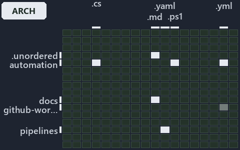

# docs/.assets/explanation/grid/adr-flow-cd-globs--globs-asks-loader-for-context-and-git-for-diff--architecture.grid.md

`Grid minimap: adr-flow-cd-globs--globs-asks-loader-for-context-and-git-for-diff--architecture`

The grid minimap of the slide `adr-flow-cd-globs--globs-asks-loader-for-context-and-git-for-diff--architecture` (architecture lens). The
slide supports [ADR-FLOW-CD-DETECT][1] and [ADR-FLOW-CD-GLOBS][2]; the highlight of those ADR codes selects what is lit, and each reason
below names the code that selects it.

## What the minimap shows

The grid crosses the 16 tracks (rows) with the 18 file languages (columns) of the world map and lights 7 cells, filled in ink. A cell lit
only by passing mentions (citations in body comments, not in a file's header or text) is touched: a lighter ink. Every other cell is idle, a
grey box: it holds files the slide's ADR codes do not select, or no file at all (237 of the 288 cells hold none). The minimap shows where
the slide sits, not how many files a cell holds; the world-map PDFs show the counts.

- .unordered × markdown: 5 lit of 20 files
- automation × csharp: 5 lit of 272 files
- automation × powershell: 44 lit of 1563 files
- automation × yaml: 3 lit of 107 files
- docs × markdown: 40 lit of 1985 files
- github-workflows × yaml: 1 lit of 2 files, touched
- pipelines × pipeline-yaml: 1 lit of 9 files

## Key

A lit row prints its track's name; a lit column prints a short code, the first extension of its file language:

- `.cs`: csharp
- `.md`: markdown
- `.yaml`: pipeline-yaml
- `.ps1`: powershell
- `.yml`: yaml

## Why each cell is lit

### .unordered × markdown (5 lit files)

Placed: the root folder `.unordered/` names the track .unordered ([ADR-DSGN-TRACK#1][3]); the extension `.md` names the file language
markdown ([ADR-DSGN-TRACK#6][4]). Lit ([ADR-DSGN-TRACK#12][5]) by:

- [.unordered/15-10-2026/plan-adr-consistency.md][6]: selected by [ADR-FLOW-CD-GLOBS][2]: the file cites it at line 43 (text), line 96
  (text), line 124 (text) and line 167 (text).
- [.unordered/15-10-2026/plan-adr-pwsh-followups.md][7]: selected by [ADR-FLOW-CD-DETECT][1]: the file cites it at line 111 (text).
- [.unordered/15-10-2026/plan-caf-waf-automation.md][8]: selected by [ADR-FLOW-CD-GLOBS][2]: the file cites it at line 101 (text).
- [.unordered/15-10-2026/plan-concern-axis.md][9]: selected by [ADR-FLOW-CD-DETECT][1]: the file cites it at line 96 (text); selected by
  [ADR-FLOW-CD-GLOBS][2]: the file cites it at line 97 (text).
- [.unordered/15-10-2026/plan-explanation-drift.md][10]: selected by [ADR-FLOW-CD-GLOBS][2]: the file cites it at line 38 (text), line 39
  (text), line 58 (text), line 77 (text), line 103 (text) and line 103 (text).

### automation × csharp (5 lit files)

Placed: the root folder `automation/` names the track automation ([ADR-DSGN-TRACK#1][3]); the extension `.cs` names the file language csharp
([ADR-DSGN-TRACK#6][4]). Lit ([ADR-DSGN-TRACK#12][5]) by:

- [automation/Catzc.Base.Globs/types/Aspect.cs][11]: selected by [ADR-FLOW-CD-GLOBS][2]: the file cites it at line 21 (text).
- [automation/Catzc.Base.Globs/types/DurableHash.cs][12]: selected by [ADR-FLOW-CD-GLOBS][2]: the file cites it at line 19 (text).
- [automation/Catzc.Base.Globs/types/GlobPattern.cs][13]: selected by [ADR-FLOW-CD-GLOBS][2]: the file cites it at line 20 (text), line 46
  (text), line 50 (text), line 54 (text), line 66 (text), line 70 (text) and line 79 (text).
- [automation/Catzc.Base.Globs/types/GlobSet.cs][14]: selected by [ADR-FLOW-CD-GLOBS][2]: the file cites it at line 20 (text) and line 78
  (text).
- [automation/Catzc.Base.Globs/types/GlobsConfig.cs][15]: selected by [ADR-FLOW-CD-GLOBS][2]: the file cites it at line 20 (text), line 97
  (text), line 160 (text), line 164 (text) and line 178 (text).

### automation × powershell (44 lit files)

Placed: the root folder `automation/` names the track automation ([ADR-DSGN-TRACK#1][3]); the extension `.ps1` names the file language
powershell ([ADR-DSGN-TRACK#6][4]). Lit ([ADR-DSGN-TRACK#12][5]) by:

- [automation/Catzc.Azure.DevOps.BuildValidation/Get-AdoBuildValidations.ps1][16]: selected by [ADR-FLOW-CD-GLOBS][2]: the file cites it at
  line 19 (header) and line 29 (header).
- [automation/Catzc.Azure.DevOps.BuildValidation/Register-AdoBuildValidation.ps1][17]: selected by [ADR-FLOW-CD-GLOBS][2]: the file cites it
  at line 21 (header) and line 27 (header).
- [automation/Catzc.Azure.DevOps.BuildValidation/Unregister-AdoBuildValidation.ps1][18]: selected by [ADR-FLOW-CD-GLOBS][2]: the file cites
  it at line 20 (header) and line 25 (header).
- [automation/Catzc.Azure.DevOps.BuildValidation/private/Get-BuildValidationPathFilter.ps1][19]: selected by [ADR-FLOW-CD-GLOBS][2]: the
  file cites it at line 19 (header) and line 27 (header).
- [automation/Catzc.Azure.Templates/Get-BicepDeploymentName.ps1][20]: selected by [ADR-FLOW-CD-DETECT][1]: the file cites it at line 20
  (header).
- [automation/Catzc.Base.Exporter/Get-CatzcContentHash.ps1][21]: selected by [ADR-FLOW-CD-GLOBS][2]: the file cites it at line 20 (header)
  and line 26 (header).
- [automation/Catzc.Base.Globs/Get-ChangedGlobSet.ps1][22]: selected by [ADR-FLOW-CD-GLOBS][2]: the file cites it at line 19 (header) and
  line 25 (header).
- [automation/Catzc.Base.Globs/Get-GlobSet.ps1][23]: selected by [ADR-FLOW-CD-GLOBS][2]: the file cites it at line 19 (header) and line 24
  (header).
- [automation/Catzc.Base.Globs/Get-GlobSetChangeRange.ps1][24]: selected by [ADR-FLOW-CD-DETECT][1]: the file cites it at line 19 (header)
  and line 25 (header).
- [automation/Catzc.Base.Globs/Get-GlobSetFile.ps1][25]: selected by [ADR-FLOW-CD-GLOBS][2]: the file cites it at line 19 (header), line 24
  (header) and line 27 (header).
- [automation/Catzc.Base.Globs/Get-GlobSetHash.ps1][26]: selected by [ADR-FLOW-CD-GLOBS][2]: the file cites it at line 19 (header) and line
  27 (header).
- [automation/Catzc.Base.Globs/Get-GlobSetTrigger.ps1][27]: selected by [ADR-FLOW-CD-GLOBS][2]: the file cites it at line 19 (header) and
  line 24 (header).
- [automation/Catzc.Base.Globs/Get-MarkerBlastRadius.ps1][28]: selected by [ADR-FLOW-CD-GLOBS][2]: the file cites it at line 20 (header) and
  line 26 (header).
- [automation/Catzc.Base.Globs/Get-ModuleGlobSet.ps1][29]: selected by [ADR-FLOW-CD-GLOBS][2]: the file cites it at line 25 (header).
- [automation/Catzc.Base.Globs/Get-TrackedFile.ps1][30]: selected by [ADR-FLOW-CD-GLOBS][2]: the file cites it at line 20 (header) and line
  25 (header).
- [automation/Catzc.Base.Globs/Test-AdoPipelineTriggerGlob.ps1][31]: selected by [ADR-FLOW-CD-GLOBS][2]: the file cites it at line 21
  (header).
- [automation/Catzc.Base.Globs/Test-GitHubWorkflowTriggerGlob.ps1][32]: selected by [ADR-FLOW-CD-GLOBS][2]: the file cites it at line 21
  (header).
- [automation/Catzc.Base.Globs/Test-GlobSetAffected.ps1][33]: selected by [ADR-FLOW-CD-GLOBS][2]: the file cites it at line 21 (header) and
  line 32 (header).
- [automation/Catzc.Base.Globs/Test-GlobSetIndependence.ps1][34]: selected by [ADR-FLOW-CD-GLOBS][2]: the file cites it at line 22 (header),
  line 35 (header) and line 94 (text).
- [automation/Catzc.Base.Globs/Test-GlobSetTriggerCoverage.ps1][35]: selected by [ADR-FLOW-CD-GLOBS][2]: the file cites it at line 21
  (header) and line 27 (header).
- [automation/Catzc.Base.Globs/private/Get-ChangedFile.ps1][36]: selected by [ADR-FLOW-CD-GLOBS][2]: the file cites it at line 20 (header)
  and line 27 (header).
- [automation/Catzc.Base.Globs/private/Get-GlobSetMember.ps1][37]: selected by [ADR-FLOW-CD-GLOBS][2]: the file cites it at line 20 (header)
  and line 25 (header).
- [automation/Catzc.Base.Globs/private/Get-PipelineTrigger.ps1][38]: selected by [ADR-FLOW-CD-GLOBS][2]: the file cites it at line 20
  (header) and line 26 (header).
- [automation/Catzc.Base.Globs/private/Test-GlobListEqual.ps1][39]: selected by [ADR-FLOW-CD-GLOBS][2]: the file cites it at line 20
  (header) and line 30 (header).
- [automation/Catzc.Base.Globs/tests/Get-ChangedFile.Tests.ps1][40]: selected by [ADR-FLOW-CD-GLOBS][2]: the file cites it at line 19
  (header).
- [automation/Catzc.Base.Globs/tests/Get-ChangedGlobSet.Tests.ps1][41]: selected by [ADR-FLOW-CD-GLOBS][2]: the file cites it at line 20
  (header).
- [automation/Catzc.Base.Globs/tests/Get-GlobSetChangeRange.Tests.ps1][42]: selected by [ADR-FLOW-CD-DETECT][1]: the file cites it at line
  19 (header).
- [automation/Catzc.Base.Globs/tests/Get-GlobSetFile.Tests.ps1][43]: selected by [ADR-FLOW-CD-GLOBS][2]: the file cites it at line 19
  (header).
- [automation/Catzc.Base.Globs/tests/Get-GlobSetHash.Tests.ps1][44]: selected by [ADR-FLOW-CD-GLOBS][2]: the file cites it at line 19
  (header).
- [automation/Catzc.Base.Globs/tests/Get-GlobSetMember.Tests.ps1][45]: selected by [ADR-FLOW-CD-GLOBS][2]: the file cites it at line 19
  (header).
- [automation/Catzc.Base.Globs/tests/Get-GlobSetTrigger.Tests.ps1][46]: selected by [ADR-FLOW-CD-GLOBS][2]: the file cites it at line 19
  (header).
- [automation/Catzc.Base.Globs/tests/Get-PipelineTrigger.Tests.ps1][47]: selected by [ADR-FLOW-CD-GLOBS][2]: the file cites it at line 19
  (header).
- [automation/Catzc.Base.Globs/tests/Get-TrackedFile.Tests.ps1][48]: selected by [ADR-FLOW-CD-GLOBS][2]: the file cites it at line 19
  (header).
- [automation/Catzc.Base.Globs/tests/GlobSet-Independence.Tests.ps1][49]: selected by [ADR-FLOW-CD-GLOBS][2]: the file cites it at line 19
  (header), line 24 (text) and line 26 (text).
- [automation/Catzc.Base.Globs/tests/GlobSetTrigger-Coverage.Tests.ps1][50]: selected by [ADR-FLOW-CD-GLOBS][2]: the file cites it at line
  20 (header).
- [automation/Catzc.Base.Globs/tests/PipelineTrigger-Integrity.Tests.ps1][51]: selected by [ADR-FLOW-CD-GLOBS][2]: the file cites it at line
  19 (header).
- [automation/Catzc.Base.Globs/tests/Test-GlobSetIndependence.Tests.ps1][52]: selected by [ADR-FLOW-CD-GLOBS][2]: the file cites it at line
  20 (header).
- [automation/Catzc.Base.Globs/tests/types/GlobPattern.Tests.ps1][53]: selected by [ADR-FLOW-CD-GLOBS][2]: the file cites it at line 19
  (header) and line 80 (text).
- [automation/Catzc.Base.Globs/tests/types/GlobSet.Tests.ps1][54]: selected by [ADR-FLOW-CD-GLOBS][2]: the file cites it at line 19 (header)
  and line 31 (text).
- [automation/Catzc.Base.Globs/tests/types/GlobsConfig.Tests.ps1][55]: selected by [ADR-FLOW-CD-GLOBS][2]: the file cites it at line 21
  (header), line 77 (text), line 90 (text), line 101 (text) and line 113 (text).
- [automation/Catzc.Base.QualityGates/Test-Automation.ps1][56]: selected by [ADR-FLOW-CD-GLOBS][2]: the file cites it at line 22 (header)
  and line 101 (header).
- [automation/Catzc.Base.QualityGates/private/Get-GuidScanFiles.ps1][57]: selected by [ADR-FLOW-CD-GLOBS][2]: the file cites it at line 21
  (header) and line 27 (header).
- [automation/Catzc.Base.QualityGates/private/Get-ModuleProtectionIdentity.ps1][58]: selected by [ADR-FLOW-CD-GLOBS][2]: the file cites it
  at line 22 (header).
- [automation/Catzc.Base.QualityGates/private/Resolve-TestSuite.ps1][59]: selected by [ADR-FLOW-CD-GLOBS][2]: the file cites it at line 21
  (header) and line 30 (header).

### automation × yaml (3 lit files)

Placed: the root folder `automation/` names the track automation ([ADR-DSGN-TRACK#1][3]); the extension `.yml` names the file language yaml
([ADR-DSGN-TRACK#6][4]). Lit ([ADR-DSGN-TRACK#12][5]) by:

- [automation/Catzc.Base.Docs/configs/adrs.yml][60]: selected by [ADR-FLOW-CD-DETECT][1]: the file cites it at line 116 (text); selected by
  [ADR-FLOW-CD-GLOBS][2]: the file cites it at line 118 (text).
- [automation/Catzc.Base.QualityGates/configs/analyzer-adr-map.yml][61]: selected by [ADR-FLOW-CD-DETECT][1]: the file cites it at line 29
  (text).
- [automation/Catzc.Base.QualityGates/configs/terminology.yml][62]: selected by [ADR-FLOW-CD-GLOBS][2]: the file cites it at line 1211
  (text).

### docs × markdown (40 lit files)

Placed: the root folder `docs/` names the track docs ([ADR-DSGN-TRACK#1][3]); the extension `.md` names the file language markdown
([ADR-DSGN-TRACK#6][4]). Lit ([ADR-DSGN-TRACK#12][5]) by:

- [docs/adr/flow/dora-explains.md][63]: selected by [ADR-FLOW-CD-DETECT][1]: the file cites it at line 80 (text); selected by
  [ADR-FLOW-CD-GLOBS][2]: the file cites it at line 123 (text).
- [docs/adr/flow/durable-sha-globs.md][2]: selected by [ADR-FLOW-CD-GLOBS][2]: the ADR's own file.
- [docs/adr/flow/pipeline-detection.md][1]: selected by [ADR-FLOW-CD-DETECT][1]: the ADR's own file.
- [docs/adr/index.md][64]: selected by [ADR-FLOW-CD-DETECT][1]: the file cites it at line 126 (text); selected by [ADR-FLOW-CD-GLOBS][2]:
  the file cites it at line 128 (text).
- [docs/how-to/automation/manual-test-plan/pipelines-and-globs.md][65]: selected by [ADR-FLOW-CD-GLOBS][2]: the file cites it at line 15
  (text) and line 35 (text).
- [docs/references/automation/catzc-azure-devops-buildvalidation/Register-AdoBuildValidation.ps1.md][66]: selected by
  [ADR-FLOW-CD-GLOBS][2]: the file cites it at line 28 (text).
- [docs/references/automation/catzc-azure-devops-buildvalidation/configs/build-validation.yml.md][67]: selected by [ADR-FLOW-CD-GLOBS][2]:
  the file cites it at line 34 (text).
- [docs/references/automation/catzc-azure-templates/Get-BicepDeploymentName.ps1.md][68]: selected by [ADR-FLOW-CD-DETECT][1]: the file cites
  it at line 16 (text) and line 32 (text).
- [docs/references/automation/catzc-base-globs.md][69]: selected by [ADR-FLOW-CD-GLOBS][2]: the file cites it at line 50 (text).
- [docs/references/automation/catzc-base-globs/Get-ModuleGlobSet.ps1.md][70]: selected by [ADR-FLOW-CD-GLOBS][2]: the file cites it at line
  19 (text), line 34 (text), line 37 (text) and line 85 (text).
- [docs/references/automation/catzc-base-globs/Test-GlobSetIndependence.ps1.md][71]: selected by [ADR-FLOW-CD-GLOBS][2]: the file cites it
  at line 16 (text), line 30 (text) and line 40 (text).
- [docs/references/automation/catzc-base-globs/configs/globs.yml.md][72]: selected by [ADR-FLOW-CD-GLOBS][2]: the file cites it at line 17
  (text), line 32 (text), line 37 (text), line 45 (text), line 47 (text), line 61 (text), line 91 (text) and line 105 (text).
- [docs/references/automation/catzc-base-globs/tests/Get-ChangedFile.Tests.ps1.md][73]: selected by [ADR-FLOW-CD-GLOBS][2]: the file cites
  it at line 16 (text) and line 31 (text).
- [docs/references/automation/catzc-base-globs/tests/Get-ChangedGlobSet.Tests.ps1.md][74]: selected by [ADR-FLOW-CD-GLOBS][2]: the file
  cites it at line 17 (text) and line 31 (text).
- [docs/references/automation/catzc-base-globs/tests/Get-GlobSetChangeRange.Tests.ps1.md][75]: selected by [ADR-FLOW-CD-DETECT][1]: the file
  cites it at line 26 (text).
- [docs/references/automation/catzc-base-globs/tests/Get-GlobSetFile.Tests.ps1.md][76]: selected by [ADR-FLOW-CD-GLOBS][2]: the file cites
  it at line 16 (text), line 30 (text) and line 31 (text).
- [docs/references/automation/catzc-base-globs/tests/Get-GlobSetHash.Tests.ps1.md][77]: selected by [ADR-FLOW-CD-GLOBS][2]: the file cites
  it at line 16 (text) and line 31 (text).
- [docs/references/automation/catzc-base-globs/tests/Get-GlobSetMember.Tests.ps1.md][78]: selected by [ADR-FLOW-CD-GLOBS][2]: the file cites
  it at line 16 (text) and line 30 (text).
- [docs/references/automation/catzc-base-globs/tests/Get-GlobSetTrigger.Tests.ps1.md][79]: selected by [ADR-FLOW-CD-GLOBS][2]: the file
  cites it at line 16 (text) and line 30 (text).
- [docs/references/automation/catzc-base-globs/tests/Get-PipelineTrigger.Tests.ps1.md][80]: selected by [ADR-FLOW-CD-GLOBS][2]: the file
  cites it at line 16 (text) and line 30 (text).
- [docs/references/automation/catzc-base-globs/tests/Get-TrackedFile.Tests.ps1.md][81]: selected by [ADR-FLOW-CD-GLOBS][2]: the file cites
  it at line 16 (text) and line 29 (text).
- [docs/references/automation/catzc-base-globs/tests/GlobSet-Independence.Tests.ps1.md][82]: selected by [ADR-FLOW-CD-GLOBS][2]: the file
  cites it at line 16 (text) and line 30 (text).
- [docs/references/automation/catzc-base-globs/tests/GlobSetTrigger-Coverage.Tests.ps1.md][83]: selected by [ADR-FLOW-CD-GLOBS][2]: the file
  cites it at line 17 (text) and line 31 (text).
- [docs/references/automation/catzc-base-globs/tests/PipelineTrigger-Integrity.Tests.ps1.md][84]: selected by [ADR-FLOW-CD-GLOBS][2]: the
  file cites it at line 16 (text) and line 31 (text).
- [docs/references/automation/catzc-base-globs/tests/Test-GlobSetIndependence.Tests.ps1.md][85]: selected by [ADR-FLOW-CD-GLOBS][2]: the
  file cites it at line 17 (text) and line 32 (text).
- [docs/references/automation/catzc-base-globs/tests/types/GlobPattern.Tests.ps1.md][86]: selected by [ADR-FLOW-CD-GLOBS][2]: the file cites
  it at line 16 (text), line 29 (text) and line 31 (text).
- [docs/references/automation/catzc-base-globs/tests/types/GlobSet.Tests.ps1.md][87]: selected by [ADR-FLOW-CD-GLOBS][2]: the file cites it
  at line 16 (text), line 30 (text) and line 32 (text).
- [docs/references/automation/catzc-base-globs/tests/types/GlobsConfig.Tests.ps1.md][88]: selected by [ADR-FLOW-CD-GLOBS][2]: the file cites
  it at line 17 (text), line 33 (text), line 35 (text) and line 44 (text).
- [docs/references/automation/catzc-base-globs/types/Aspect.cs.md][89]: selected by [ADR-FLOW-CD-GLOBS][2]: the file cites it at line 17
  (text) and line 38 (text).
- [docs/references/automation/catzc-base-globs/types/DurableHash.cs.md][90]: selected by [ADR-FLOW-CD-GLOBS][2]: the file cites it at line
  16 (text), line 29 (text) and line 35 (text).
- [docs/references/automation/catzc-base-globs/types/GlobPattern.cs.md][91]: selected by [ADR-FLOW-CD-GLOBS][2]: the file cites it at line
  16 (text), line 35 (text), line 36 (text) and line 37 (text).
- [docs/references/automation/catzc-base-globs/types/GlobSet.cs.md][92]: selected by [ADR-FLOW-CD-GLOBS][2]: the file cites it at line 16
  (text), line 31 (text), line 33 (text), line 34 (text), line 40 (text), line 43 (text), line 45 (text), line 48 (text), line 56 (text),
  line 65 (text), line 83 (text), line 100 (text), line 110 (text), line 134 (text) and line 142 (text).
- [docs/references/automation/catzc-base-globs/types/GlobsConfig.cs.md][93]: selected by [ADR-FLOW-CD-GLOBS][2]: the file cites it at line
  16 (text), line 31 (text), line 35 (text), line 38 (text) and line 57 (text).
- [docs/references/automation/catzc-base-qualitygates/private/Get-ModuleProtectionIdentity.ps1.md][94]: selected by [ADR-FLOW-CD-GLOBS][2]:
  the file cites it at line 16 (text) and line 69 (text).
- [docs/references/pipelines/cd-apex.yaml.md][95]: selected by [ADR-FLOW-CD-GLOBS][2]: the file cites it at line 46 (text).
- [docs/references/pipelines/cd-flux.yaml.md][96]: selected by [ADR-FLOW-CD-GLOBS][2]: the file cites it at line 45 (text).
- [docs/references/pipelines/cd-nova.yaml.md][97]: selected by [ADR-FLOW-CD-GLOBS][2]: the file cites it at line 45 (text).
- [docs/references/pipelines/cd-shared.yaml.md][98]: selected by [ADR-FLOW-CD-GLOBS][2]: the file cites it at line 40 (text).
- [docs/references/pipelines/ci-automation.yaml.md][99]: selected by [ADR-FLOW-CD-GLOBS][2]: the file cites it at line 30 (text).
- [docs/references/pipelines/ci-infrastructure.yaml.md][100]: selected by [ADR-FLOW-CD-GLOBS][2]: the file cites it at line 32 (text).

### github-workflows × yaml (1 lit file, touched)

Placed: the root folder `.github/` names the track github-workflows ([ADR-DSGN-TRACK#1][3]); the extension `.yml` names the file language
yaml ([ADR-DSGN-TRACK#6][4]). Lit ([ADR-DSGN-TRACK#12][5]) by:

- [.github/workflows/ci-automation.yml][101]: selected by [ADR-FLOW-CD-GLOBS][2]: the file cites it at line 19 (body comment) (a passing
  mention only).

### pipelines × pipeline-yaml (1 lit file)

Placed: the root folder `pipelines/` names the track pipelines ([ADR-DSGN-TRACK#1][3]); the extension `.yaml` names the file language
pipeline-yaml ([ADR-DSGN-TRACK#6][4]). Lit ([ADR-DSGN-TRACK#12][5]) by:

- [pipelines/ci-automation.yaml][102]: selected by [ADR-FLOW-CD-DETECT][1]: a pipeline that cites nothing itself carries its globset's
  citations, which cite it at `automation/Catzc.Azure.Templates/Get-BicepDeploymentName.ps1` line 20 (header),
  `automation/Catzc.Base.Docs/configs/adrs.yml` line 116 (text), `automation/Catzc.Base.Globs/Get-GlobSetChangeRange.ps1` line 19 (header),
  `automation/Catzc.Base.Globs/Get-GlobSetChangeRange.ps1` line 25 (header),
  `automation/Catzc.Base.Globs/tests/Get-GlobSetChangeRange.Tests.ps1` line 19 (header) and
  `automation/Catzc.Base.QualityGates/configs/analyzer-adr-map.yml` line 29 (text); selected by [ADR-FLOW-CD-GLOBS][2]: a pipeline that
  cites nothing itself carries its globset's citations, which cite it at
  `automation/Catzc.Azure.DevOps.BuildValidation/Get-AdoBuildValidations.ps1` line 19 (header),
  `automation/Catzc.Azure.DevOps.BuildValidation/Get-AdoBuildValidations.ps1` line 29 (header),
  `automation/Catzc.Azure.DevOps.BuildValidation/Register-AdoBuildValidation.ps1` line 21 (header),
  `automation/Catzc.Azure.DevOps.BuildValidation/Register-AdoBuildValidation.ps1` line 27 (header),
  `automation/Catzc.Azure.DevOps.BuildValidation/Unregister-AdoBuildValidation.ps1` line 20 (header),
  `automation/Catzc.Azure.DevOps.BuildValidation/Unregister-AdoBuildValidation.ps1` line 25 (header),
  `automation/Catzc.Azure.DevOps.BuildValidation/private/Get-BuildValidationPathFilter.ps1` line 19 (header),
  `automation/Catzc.Azure.DevOps.BuildValidation/private/Get-BuildValidationPathFilter.ps1` line 27 (header),
  `automation/Catzc.Base.Docs/configs/adrs.yml` line 118 (text), `automation/Catzc.Base.Exporter/Get-CatzcContentHash.ps1` line 20 (header),
  `automation/Catzc.Base.Exporter/Get-CatzcContentHash.ps1` line 26 (header), `automation/Catzc.Base.Globs/Get-ChangedGlobSet.ps1` line 19
  (header), `automation/Catzc.Base.Globs/Get-ChangedGlobSet.ps1` line 25 (header), `automation/Catzc.Base.Globs/Get-GlobSet.ps1` line 19
  (header), `automation/Catzc.Base.Globs/Get-GlobSet.ps1` line 24 (header), `automation/Catzc.Base.Globs/Get-GlobSetFile.ps1` line 19
  (header), `automation/Catzc.Base.Globs/Get-GlobSetFile.ps1` line 24 (header), `automation/Catzc.Base.Globs/Get-GlobSetFile.ps1` line 27
  (header), `automation/Catzc.Base.Globs/Get-GlobSetHash.ps1` line 19 (header), `automation/Catzc.Base.Globs/Get-GlobSetHash.ps1` line 27
  (header), `automation/Catzc.Base.Globs/Get-GlobSetTrigger.ps1` line 19 (header), `automation/Catzc.Base.Globs/Get-GlobSetTrigger.ps1` line
  24 (header), `automation/Catzc.Base.Globs/Get-MarkerBlastRadius.ps1` line 20 (header),
  `automation/Catzc.Base.Globs/Get-MarkerBlastRadius.ps1` line 26 (header), `automation/Catzc.Base.Globs/Get-ModuleGlobSet.ps1` line 25
  (header), `automation/Catzc.Base.Globs/Get-TrackedFile.ps1` line 20 (header), `automation/Catzc.Base.Globs/Get-TrackedFile.ps1` line 25
  (header), `automation/Catzc.Base.Globs/Test-AdoPipelineTriggerGlob.ps1` line 21 (header),
  `automation/Catzc.Base.Globs/Test-GitHubWorkflowTriggerGlob.ps1` line 21 (header), `automation/Catzc.Base.Globs/Test-GlobSetAffected.ps1`
  line 21 (header), `automation/Catzc.Base.Globs/Test-GlobSetAffected.ps1` line 32 (header),
  `automation/Catzc.Base.Globs/Test-GlobSetIndependence.ps1` line 22 (header), `automation/Catzc.Base.Globs/Test-GlobSetIndependence.ps1`
  line 35 (header), `automation/Catzc.Base.Globs/Test-GlobSetIndependence.ps1` line 94 (text),
  `automation/Catzc.Base.Globs/Test-GlobSetTriggerCoverage.ps1` line 21 (header),
  `automation/Catzc.Base.Globs/Test-GlobSetTriggerCoverage.ps1` line 27 (header), `automation/Catzc.Base.Globs/private/Get-ChangedFile.ps1`
  line 20 (header), `automation/Catzc.Base.Globs/private/Get-ChangedFile.ps1` line 27 (header),
  `automation/Catzc.Base.Globs/private/Get-GlobSetMember.ps1` line 20 (header), `automation/Catzc.Base.Globs/private/Get-GlobSetMember.ps1`
  line 25 (header), `automation/Catzc.Base.Globs/private/Get-PipelineTrigger.ps1` line 20 (header),
  `automation/Catzc.Base.Globs/private/Get-PipelineTrigger.ps1` line 26 (header),
  `automation/Catzc.Base.Globs/private/Test-GlobListEqual.ps1` line 20 (header),
  `automation/Catzc.Base.Globs/private/Test-GlobListEqual.ps1` line 30 (header),
  `automation/Catzc.Base.Globs/tests/Get-ChangedFile.Tests.ps1` line 19 (header),
  `automation/Catzc.Base.Globs/tests/Get-ChangedGlobSet.Tests.ps1` line 20 (header),
  `automation/Catzc.Base.Globs/tests/Get-GlobSetFile.Tests.ps1` line 19 (header),
  `automation/Catzc.Base.Globs/tests/Get-GlobSetHash.Tests.ps1` line 19 (header),
  `automation/Catzc.Base.Globs/tests/Get-GlobSetMember.Tests.ps1` line 19 (header),
  `automation/Catzc.Base.Globs/tests/Get-GlobSetTrigger.Tests.ps1` line 19 (header),
  `automation/Catzc.Base.Globs/tests/Get-PipelineTrigger.Tests.ps1` line 19 (header),
  `automation/Catzc.Base.Globs/tests/Get-TrackedFile.Tests.ps1` line 19 (header),
  `automation/Catzc.Base.Globs/tests/GlobSet-Independence.Tests.ps1` line 19 (header),
  `automation/Catzc.Base.Globs/tests/GlobSet-Independence.Tests.ps1` line 24 (text),
  `automation/Catzc.Base.Globs/tests/GlobSet-Independence.Tests.ps1` line 26 (text),
  `automation/Catzc.Base.Globs/tests/GlobSetTrigger-Coverage.Tests.ps1` line 20 (header),
  `automation/Catzc.Base.Globs/tests/PipelineTrigger-Integrity.Tests.ps1` line 19 (header),
  `automation/Catzc.Base.Globs/tests/Test-GlobSetIndependence.Tests.ps1` line 20 (header),
  `automation/Catzc.Base.Globs/tests/types/GlobPattern.Tests.ps1` line 19 (header),
  `automation/Catzc.Base.Globs/tests/types/GlobPattern.Tests.ps1` line 80 (text),
  `automation/Catzc.Base.Globs/tests/types/GlobSet.Tests.ps1` line 19 (header), `automation/Catzc.Base.Globs/tests/types/GlobSet.Tests.ps1`
  line 31 (text), `automation/Catzc.Base.Globs/tests/types/GlobsConfig.Tests.ps1` line 21 (header),
  `automation/Catzc.Base.Globs/tests/types/GlobsConfig.Tests.ps1` line 77 (text),
  `automation/Catzc.Base.Globs/tests/types/GlobsConfig.Tests.ps1` line 90 (text),
  `automation/Catzc.Base.Globs/tests/types/GlobsConfig.Tests.ps1` line 101 (text),
  `automation/Catzc.Base.Globs/tests/types/GlobsConfig.Tests.ps1` line 113 (text), `automation/Catzc.Base.Globs/types/Aspect.cs` line 21
  (text), `automation/Catzc.Base.Globs/types/DurableHash.cs` line 19 (text), `automation/Catzc.Base.Globs/types/GlobPattern.cs` line 20
  (text), `automation/Catzc.Base.Globs/types/GlobPattern.cs` line 46 (text), `automation/Catzc.Base.Globs/types/GlobPattern.cs` line 50
  (text), `automation/Catzc.Base.Globs/types/GlobPattern.cs` line 54 (text), `automation/Catzc.Base.Globs/types/GlobPattern.cs` line 66
  (text), `automation/Catzc.Base.Globs/types/GlobPattern.cs` line 70 (text), `automation/Catzc.Base.Globs/types/GlobPattern.cs` line 79
  (text), `automation/Catzc.Base.Globs/types/GlobSet.cs` line 20 (text), `automation/Catzc.Base.Globs/types/GlobSet.cs` line 78 (text),
  `automation/Catzc.Base.Globs/types/GlobsConfig.cs` line 20 (text), `automation/Catzc.Base.Globs/types/GlobsConfig.cs` line 97 (text),
  `automation/Catzc.Base.Globs/types/GlobsConfig.cs` line 160 (text), `automation/Catzc.Base.Globs/types/GlobsConfig.cs` line 164 (text),
  `automation/Catzc.Base.Globs/types/GlobsConfig.cs` line 178 (text), `automation/Catzc.Base.QualityGates/Test-Automation.ps1` line 22
  (header), `automation/Catzc.Base.QualityGates/Test-Automation.ps1` line 101 (header),
  `automation/Catzc.Base.QualityGates/configs/terminology.yml` line 1211 (text),
  `automation/Catzc.Base.QualityGates/private/Get-GuidScanFiles.ps1` line 21 (header),
  `automation/Catzc.Base.QualityGates/private/Get-GuidScanFiles.ps1` line 27 (header),
  `automation/Catzc.Base.QualityGates/private/Get-ModuleProtectionIdentity.ps1` line 22 (header),
  `automation/Catzc.Base.QualityGates/private/Resolve-TestSuite.ps1` line 21 (header) and
  `automation/Catzc.Base.QualityGates/private/Resolve-TestSuite.ps1` line 30 (header).

## Keywords

- [world map][103]
- [track][104]
- [file language][105]
- [cell][106]
- [lit cell][107]
- [.unordered][108]: a track
- [automation][108]: a track
- [docs][108]: a track
- [github-workflows][108]: a track
- [pipelines][108]: a track
- [csharp][109]: a file language
- [markdown][109]: a file language
- [pipeline-yaml][109]: a file language
- [powershell][109]: a file language
- [yaml][109]: a file language

[1]: ../../../adr/flow/pipeline-detection.md
[2]: ../../../adr/flow/durable-sha-globs.md
[3]: ../../../adr/design/tracks.md#rule-adr-dsgn-track1
[4]: ../../../adr/design/tracks.md#rule-adr-dsgn-track6
[5]: ../../../adr/design/tracks.md#rule-adr-dsgn-track12
[6]: ../../../../.unordered/15-10-2026/plan-adr-consistency.md
[7]: ../../../../.unordered/15-10-2026/plan-adr-pwsh-followups.md
[8]: ../../../../.unordered/15-10-2026/plan-caf-waf-automation.md
[9]: ../../../../.unordered/15-10-2026/plan-concern-axis.md
[10]: ../../../../.unordered/15-10-2026/plan-explanation-drift.md
[11]: ../../../../automation/Catzc.Base.Globs/types/Aspect.cs
[12]: ../../../../automation/Catzc.Base.Globs/types/DurableHash.cs
[13]: ../../../../automation/Catzc.Base.Globs/types/GlobPattern.cs
[14]: ../../../../automation/Catzc.Base.Globs/types/GlobSet.cs
[15]: ../../../../automation/Catzc.Base.Globs/types/GlobsConfig.cs
[16]: ../../../../automation/Catzc.Azure.DevOps.BuildValidation/Get-AdoBuildValidations.ps1
[17]: ../../../../automation/Catzc.Azure.DevOps.BuildValidation/Register-AdoBuildValidation.ps1
[18]: ../../../../automation/Catzc.Azure.DevOps.BuildValidation/Unregister-AdoBuildValidation.ps1
[19]: ../../../../automation/Catzc.Azure.DevOps.BuildValidation/private/Get-BuildValidationPathFilter.ps1
[20]: ../../../../automation/Catzc.Azure.Templates/Get-BicepDeploymentName.ps1
[21]: ../../../../automation/Catzc.Base.Exporter/Get-CatzcContentHash.ps1
[22]: ../../../../automation/Catzc.Base.Globs/Get-ChangedGlobSet.ps1
[23]: ../../../../automation/Catzc.Base.Globs/Get-GlobSet.ps1
[24]: ../../../../automation/Catzc.Base.Globs/Get-GlobSetChangeRange.ps1
[25]: ../../../../automation/Catzc.Base.Globs/Get-GlobSetFile.ps1
[26]: ../../../../automation/Catzc.Base.Globs/Get-GlobSetHash.ps1
[27]: ../../../../automation/Catzc.Base.Globs/Get-GlobSetTrigger.ps1
[28]: ../../../../automation/Catzc.Base.Globs/Get-MarkerBlastRadius.ps1
[29]: ../../../../automation/Catzc.Base.Globs/Get-ModuleGlobSet.ps1
[30]: ../../../../automation/Catzc.Base.Globs/Get-TrackedFile.ps1
[31]: ../../../../automation/Catzc.Base.Globs/Test-AdoPipelineTriggerGlob.ps1
[32]: ../../../../automation/Catzc.Base.Globs/Test-GitHubWorkflowTriggerGlob.ps1
[33]: ../../../../automation/Catzc.Base.Globs/Test-GlobSetAffected.ps1
[34]: ../../../../automation/Catzc.Base.Globs/Test-GlobSetIndependence.ps1
[35]: ../../../../automation/Catzc.Base.Globs/Test-GlobSetTriggerCoverage.ps1
[36]: ../../../../automation/Catzc.Base.Globs/private/Get-ChangedFile.ps1
[37]: ../../../../automation/Catzc.Base.Globs/private/Get-GlobSetMember.ps1
[38]: ../../../../automation/Catzc.Base.Globs/private/Get-PipelineTrigger.ps1
[39]: ../../../../automation/Catzc.Base.Globs/private/Test-GlobListEqual.ps1
[40]: ../../../../automation/Catzc.Base.Globs/tests/Get-ChangedFile.Tests.ps1
[41]: ../../../../automation/Catzc.Base.Globs/tests/Get-ChangedGlobSet.Tests.ps1
[42]: ../../../../automation/Catzc.Base.Globs/tests/Get-GlobSetChangeRange.Tests.ps1
[43]: ../../../../automation/Catzc.Base.Globs/tests/Get-GlobSetFile.Tests.ps1
[44]: ../../../../automation/Catzc.Base.Globs/tests/Get-GlobSetHash.Tests.ps1
[45]: ../../../../automation/Catzc.Base.Globs/tests/Get-GlobSetMember.Tests.ps1
[46]: ../../../../automation/Catzc.Base.Globs/tests/Get-GlobSetTrigger.Tests.ps1
[47]: ../../../../automation/Catzc.Base.Globs/tests/Get-PipelineTrigger.Tests.ps1
[48]: ../../../../automation/Catzc.Base.Globs/tests/Get-TrackedFile.Tests.ps1
[49]: ../../../../automation/Catzc.Base.Globs/tests/GlobSet-Independence.Tests.ps1
[50]: ../../../../automation/Catzc.Base.Globs/tests/GlobSetTrigger-Coverage.Tests.ps1
[51]: ../../../../automation/Catzc.Base.Globs/tests/PipelineTrigger-Integrity.Tests.ps1
[52]: ../../../../automation/Catzc.Base.Globs/tests/Test-GlobSetIndependence.Tests.ps1
[53]: ../../../../automation/Catzc.Base.Globs/tests/types/GlobPattern.Tests.ps1
[54]: ../../../../automation/Catzc.Base.Globs/tests/types/GlobSet.Tests.ps1
[55]: ../../../../automation/Catzc.Base.Globs/tests/types/GlobsConfig.Tests.ps1
[56]: ../../../../automation/Catzc.Base.QualityGates/Test-Automation.ps1
[57]: ../../../../automation/Catzc.Base.QualityGates/private/Get-GuidScanFiles.ps1
[58]: ../../../../automation/Catzc.Base.QualityGates/private/Get-ModuleProtectionIdentity.ps1
[59]: ../../../../automation/Catzc.Base.QualityGates/private/Resolve-TestSuite.ps1
[60]: ../../../../automation/Catzc.Base.Docs/configs/adrs.yml
[61]: ../../../../automation/Catzc.Base.QualityGates/configs/analyzer-adr-map.yml
[62]: ../../../../automation/Catzc.Base.QualityGates/configs/terminology.yml
[63]: ../../../adr/flow/dora-explains.md
[64]: ../../../adr/index.md
[65]: ../../../how-to/automation/manual-test-plan/pipelines-and-globs.md
[66]: ../../../references/automation/catzc-azure-devops-buildvalidation/Register-AdoBuildValidation.ps1.md
[67]: ../../../references/automation/catzc-azure-devops-buildvalidation/configs/build-validation.yml.md
[68]: ../../../references/automation/catzc-azure-templates/Get-BicepDeploymentName.ps1.md
[69]: ../../../references/automation/catzc-base-globs.md
[70]: ../../../references/automation/catzc-base-globs/Get-ModuleGlobSet.ps1.md
[71]: ../../../references/automation/catzc-base-globs/Test-GlobSetIndependence.ps1.md
[72]: ../../../references/automation/catzc-base-globs/configs/globs.yml.md
[73]: ../../../references/automation/catzc-base-globs/tests/Get-ChangedFile.Tests.ps1.md
[74]: ../../../references/automation/catzc-base-globs/tests/Get-ChangedGlobSet.Tests.ps1.md
[75]: ../../../references/automation/catzc-base-globs/tests/Get-GlobSetChangeRange.Tests.ps1.md
[76]: ../../../references/automation/catzc-base-globs/tests/Get-GlobSetFile.Tests.ps1.md
[77]: ../../../references/automation/catzc-base-globs/tests/Get-GlobSetHash.Tests.ps1.md
[78]: ../../../references/automation/catzc-base-globs/tests/Get-GlobSetMember.Tests.ps1.md
[79]: ../../../references/automation/catzc-base-globs/tests/Get-GlobSetTrigger.Tests.ps1.md
[80]: ../../../references/automation/catzc-base-globs/tests/Get-PipelineTrigger.Tests.ps1.md
[81]: ../../../references/automation/catzc-base-globs/tests/Get-TrackedFile.Tests.ps1.md
[82]: ../../../references/automation/catzc-base-globs/tests/GlobSet-Independence.Tests.ps1.md
[83]: ../../../references/automation/catzc-base-globs/tests/GlobSetTrigger-Coverage.Tests.ps1.md
[84]: ../../../references/automation/catzc-base-globs/tests/PipelineTrigger-Integrity.Tests.ps1.md
[85]: ../../../references/automation/catzc-base-globs/tests/Test-GlobSetIndependence.Tests.ps1.md
[86]: ../../../references/automation/catzc-base-globs/tests/types/GlobPattern.Tests.ps1.md
[87]: ../../../references/automation/catzc-base-globs/tests/types/GlobSet.Tests.ps1.md
[88]: ../../../references/automation/catzc-base-globs/tests/types/GlobsConfig.Tests.ps1.md
[89]: ../../../references/automation/catzc-base-globs/types/Aspect.cs.md
[90]: ../../../references/automation/catzc-base-globs/types/DurableHash.cs.md
[91]: ../../../references/automation/catzc-base-globs/types/GlobPattern.cs.md
[92]: ../../../references/automation/catzc-base-globs/types/GlobSet.cs.md
[93]: ../../../references/automation/catzc-base-globs/types/GlobsConfig.cs.md
[94]: ../../../references/automation/catzc-base-qualitygates/private/Get-ModuleProtectionIdentity.ps1.md
[95]: ../../../references/pipelines/cd-apex.yaml.md
[96]: ../../../references/pipelines/cd-flux.yaml.md
[97]: ../../../references/pipelines/cd-nova.yaml.md
[98]: ../../../references/pipelines/cd-shared.yaml.md
[99]: ../../../references/pipelines/ci-automation.yaml.md
[100]: ../../../references/pipelines/ci-infrastructure.yaml.md
[101]: ../../../../.github/workflows/ci-automation.yml
[102]: ../../../../pipelines/ci-automation.yaml
[103]: ../../../adr/glossary.md#world-map
[104]: ../../../adr/glossary.md#track
[105]: ../../../adr/glossary.md#file-language
[106]: ../../../adr/glossary.md#cell
[107]: ../../../adr/glossary.md#lit-cell
[108]: ../../../../automation/Catzc.Base.Variants/configs/variants.yml
[109]: ../../../../automation/Catzc.Base.Languages/configs/languages.yml
