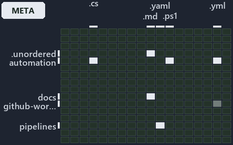

# docs/.assets/explanation/grid/adr-flow-cd-globs--three-views-derived-live-from-one-program--meta.grid.md

`Grid minimap: adr-flow-cd-globs--three-views-derived-live-from-one-program--meta`

The grid minimap of the slide `adr-flow-cd-globs--three-views-derived-live-from-one-program--meta` (meta lens). The slide supports
[ADR-FLOW-CD-GLOBS][1]; the highlight of those ADR codes selects what is lit, and each reason below names the code that selects it.

## What the minimap shows

The grid crosses the 16 tracks (rows) with the 18 file languages (columns) of the world map and lights 7 cells, filled in ink. A cell lit
only by passing mentions (citations in body comments, not in a file's header or text) is touched: a lighter ink. Every other cell is idle, a
grey box: it holds files the slide's ADR codes do not select, or no file at all (237 of the 288 cells hold none). The minimap shows where
the slide sits, not how many files a cell holds; the world-map PDFs show the counts.

- .unordered × markdown: 4 lit of 20 files
- automation × csharp: 5 lit of 274 files
- automation × powershell: 41 lit of 1579 files
- automation × yaml: 2 lit of 109 files
- docs × markdown: 37 lit of 2165 files
- github-workflows × yaml: 1 lit of 2 files, touched
- pipelines × pipeline-yaml: 1 lit of 9 files

## Key

A lit row prints its track's name; a lit column prints a short code, the first extension of its file language:

- `.cs`: csharp
- `.md`: markdown
- `.yaml`: pipeline-yaml
- `.ps1`: powershell
- `.yml`: yaml

## Why each cell is lit

### .unordered × markdown (4 lit files)

Placed: the root folder `.unordered/` names the track .unordered ([ADR-DSGN-TRACK#1][2]); the extension `.md` names the file language
markdown ([ADR-DSGN-TRACK#6][3]). Lit ([ADR-DSGN-TRACK#12][4]) by:

- [.unordered/15-10-2026/plan-adr-consistency.md][5]: selected by [ADR-FLOW-CD-GLOBS][1]: the file cites it at line 43 (text), line 96
  (text), line 124 (text) and line 167 (text).
- [.unordered/15-10-2026/plan-caf-waf-automation.md][6]: selected by [ADR-FLOW-CD-GLOBS][1]: the file cites it at line 101 (text).
- [.unordered/15-10-2026/plan-concern-axis.md][7]: selected by [ADR-FLOW-CD-GLOBS][1]: the file cites it at line 97 (text).
- [.unordered/15-10-2026/plan-explanation-drift.md][8]: selected by [ADR-FLOW-CD-GLOBS][1]: the file cites it at line 38 (text), line 39
  (text), line 58 (text), line 77 (text), line 103 (text) and line 103 (text).

### automation × csharp (5 lit files)

Placed: the root folder `automation/` names the track automation ([ADR-DSGN-TRACK#1][2]); the extension `.cs` names the file language csharp
([ADR-DSGN-TRACK#6][3]). Lit ([ADR-DSGN-TRACK#12][4]) by:

- [automation/Catzc.Base.Globs/types/Aspect.cs][9]: selected by [ADR-FLOW-CD-GLOBS][1]: the file cites it at line 22 (text).
- [automation/Catzc.Base.Globs/types/DurableHash.cs][10]: selected by [ADR-FLOW-CD-GLOBS][1]: the file cites it at line 20 (text).
- [automation/Catzc.Base.Globs/types/GlobPattern.cs][11]: selected by [ADR-FLOW-CD-GLOBS][1]: the file cites it at line 21 (text), line 47
  (text), line 51 (text), line 55 (text), line 67 (text), line 71 (text) and line 80 (text).
- [automation/Catzc.Base.Globs/types/GlobSet.cs][12]: selected by [ADR-FLOW-CD-GLOBS][1]: the file cites it at line 21 (text) and line 79
  (text).
- [automation/Catzc.Base.Globs/types/GlobsConfig.cs][13]: selected by [ADR-FLOW-CD-GLOBS][1]: the file cites it at line 21 (text), line 98
  (text), line 161 (text), line 165 (text) and line 179 (text).

### automation × powershell (41 lit files)

Placed: the root folder `automation/` names the track automation ([ADR-DSGN-TRACK#1][2]); the extension `.ps1` names the file language
powershell ([ADR-DSGN-TRACK#6][3]). Lit ([ADR-DSGN-TRACK#12][4]) by:

- [automation/Catzc.Azure.DevOps.BuildValidation/Get-AdoBuildValidations.ps1][14]: selected by [ADR-FLOW-CD-GLOBS][1]: the file cites it at
  line 20 (header) and line 30 (header).
- [automation/Catzc.Azure.DevOps.BuildValidation/Register-AdoBuildValidation.ps1][15]: selected by [ADR-FLOW-CD-GLOBS][1]: the file cites it
  at line 22 (header) and line 28 (header).
- [automation/Catzc.Azure.DevOps.BuildValidation/Unregister-AdoBuildValidation.ps1][16]: selected by [ADR-FLOW-CD-GLOBS][1]: the file cites
  it at line 21 (header) and line 26 (header).
- [automation/Catzc.Azure.DevOps.BuildValidation/private/Get-BuildValidationPathFilter.ps1][17]: selected by [ADR-FLOW-CD-GLOBS][1]: the
  file cites it at line 20 (header) and line 28 (header).
- [automation/Catzc.Base.Exporter/Get-CatzcContentHash.ps1][18]: selected by [ADR-FLOW-CD-GLOBS][1]: the file cites it at line 21 (header)
  and line 27 (header).
- [automation/Catzc.Base.Globs/Get-ChangedGlobSet.ps1][19]: selected by [ADR-FLOW-CD-GLOBS][1]: the file cites it at line 20 (header) and
  line 26 (header).
- [automation/Catzc.Base.Globs/Get-GlobSet.ps1][20]: selected by [ADR-FLOW-CD-GLOBS][1]: the file cites it at line 20 (header) and line 25
  (header).
- [automation/Catzc.Base.Globs/Get-GlobSetFile.ps1][21]: selected by [ADR-FLOW-CD-GLOBS][1]: the file cites it at line 20 (header), line 25
  (header) and line 28 (header).
- [automation/Catzc.Base.Globs/Get-GlobSetHash.ps1][22]: selected by [ADR-FLOW-CD-GLOBS][1]: the file cites it at line 20 (header) and line
  28 (header).
- [automation/Catzc.Base.Globs/Get-GlobSetTrigger.ps1][23]: selected by [ADR-FLOW-CD-GLOBS][1]: the file cites it at line 20 (header) and
  line 25 (header).
- [automation/Catzc.Base.Globs/Get-MarkerBlastRadius.ps1][24]: selected by [ADR-FLOW-CD-GLOBS][1]: the file cites it at line 21 (header) and
  line 27 (header).
- [automation/Catzc.Base.Globs/Get-ModuleGlobSet.ps1][25]: selected by [ADR-FLOW-CD-GLOBS][1]: the file cites it at line 26 (header).
- [automation/Catzc.Base.Globs/Get-TrackedFile.ps1][26]: selected by [ADR-FLOW-CD-GLOBS][1]: the file cites it at line 21 (header) and line
  26 (header).
- [automation/Catzc.Base.Globs/Test-AdoPipelineTriggerGlob.ps1][27]: selected by [ADR-FLOW-CD-GLOBS][1]: the file cites it at line 22
  (header).
- [automation/Catzc.Base.Globs/Test-GitHubWorkflowTriggerGlob.ps1][28]: selected by [ADR-FLOW-CD-GLOBS][1]: the file cites it at line 22
  (header).
- [automation/Catzc.Base.Globs/Test-GlobSetAffected.ps1][29]: selected by [ADR-FLOW-CD-GLOBS][1]: the file cites it at line 22 (header) and
  line 33 (header).
- [automation/Catzc.Base.Globs/Test-GlobSetIndependence.ps1][30]: selected by [ADR-FLOW-CD-GLOBS][1]: the file cites it at line 23 (header),
  line 36 (header) and line 95 (text).
- [automation/Catzc.Base.Globs/Test-GlobSetTriggerCoverage.ps1][31]: selected by [ADR-FLOW-CD-GLOBS][1]: the file cites it at line 22
  (header) and line 28 (header).
- [automation/Catzc.Base.Globs/private/Get-ChangedFile.ps1][32]: selected by [ADR-FLOW-CD-GLOBS][1]: the file cites it at line 21 (header)
  and line 28 (header).
- [automation/Catzc.Base.Globs/private/Get-GlobSetMember.ps1][33]: selected by [ADR-FLOW-CD-GLOBS][1]: the file cites it at line 21 (header)
  and line 26 (header).
- [automation/Catzc.Base.Globs/private/Get-PipelineTrigger.ps1][34]: selected by [ADR-FLOW-CD-GLOBS][1]: the file cites it at line 21
  (header) and line 27 (header).
- [automation/Catzc.Base.Globs/private/Test-GlobListEqual.ps1][35]: selected by [ADR-FLOW-CD-GLOBS][1]: the file cites it at line 21
  (header) and line 31 (header).
- [automation/Catzc.Base.Globs/tests/Get-ChangedFile.Tests.ps1][36]: selected by [ADR-FLOW-CD-GLOBS][1]: the file cites it at line 20
  (header).
- [automation/Catzc.Base.Globs/tests/Get-ChangedGlobSet.Tests.ps1][37]: selected by [ADR-FLOW-CD-GLOBS][1]: the file cites it at line 21
  (header).
- [automation/Catzc.Base.Globs/tests/Get-GlobSetFile.Tests.ps1][38]: selected by [ADR-FLOW-CD-GLOBS][1]: the file cites it at line 20
  (header).
- [automation/Catzc.Base.Globs/tests/Get-GlobSetHash.Tests.ps1][39]: selected by [ADR-FLOW-CD-GLOBS][1]: the file cites it at line 20
  (header).
- [automation/Catzc.Base.Globs/tests/Get-GlobSetMember.Tests.ps1][40]: selected by [ADR-FLOW-CD-GLOBS][1]: the file cites it at line 20
  (header).
- [automation/Catzc.Base.Globs/tests/Get-GlobSetTrigger.Tests.ps1][41]: selected by [ADR-FLOW-CD-GLOBS][1]: the file cites it at line 20
  (header).
- [automation/Catzc.Base.Globs/tests/Get-PipelineTrigger.Tests.ps1][42]: selected by [ADR-FLOW-CD-GLOBS][1]: the file cites it at line 20
  (header).
- [automation/Catzc.Base.Globs/tests/Get-TrackedFile.Tests.ps1][43]: selected by [ADR-FLOW-CD-GLOBS][1]: the file cites it at line 20
  (header).
- [automation/Catzc.Base.Globs/tests/GlobSet-Independence.Tests.ps1][44]: selected by [ADR-FLOW-CD-GLOBS][1]: the file cites it at line 20
  (header), line 25 (text) and line 27 (text).
- [automation/Catzc.Base.Globs/tests/GlobSetTrigger-Coverage.Tests.ps1][45]: selected by [ADR-FLOW-CD-GLOBS][1]: the file cites it at line
  21 (header).
- [automation/Catzc.Base.Globs/tests/PipelineTrigger-Integrity.Tests.ps1][46]: selected by [ADR-FLOW-CD-GLOBS][1]: the file cites it at line
  20 (header).
- [automation/Catzc.Base.Globs/tests/Test-GlobSetIndependence.Tests.ps1][47]: selected by [ADR-FLOW-CD-GLOBS][1]: the file cites it at line
  21 (header).
- [automation/Catzc.Base.Globs/tests/types/GlobPattern.Tests.ps1][48]: selected by [ADR-FLOW-CD-GLOBS][1]: the file cites it at line 20
  (header) and line 81 (text).
- [automation/Catzc.Base.Globs/tests/types/GlobSet.Tests.ps1][49]: selected by [ADR-FLOW-CD-GLOBS][1]: the file cites it at line 20 (header)
  and line 32 (text).
- [automation/Catzc.Base.Globs/tests/types/GlobsConfig.Tests.ps1][50]: selected by [ADR-FLOW-CD-GLOBS][1]: the file cites it at line 22
  (header), line 78 (text), line 91 (text), line 102 (text) and line 114 (text).
- [automation/Catzc.Base.QualityGates/Test-Automation.ps1][51]: selected by [ADR-FLOW-CD-GLOBS][1]: the file cites it at line 23 (header)
  and line 102 (header).
- [automation/Catzc.Base.QualityGates/private/Get-GuidScanFiles.ps1][52]: selected by [ADR-FLOW-CD-GLOBS][1]: the file cites it at line 22
  (header) and line 28 (header).
- [automation/Catzc.Base.QualityGates/private/Get-ModuleProtectionIdentity.ps1][53]: selected by [ADR-FLOW-CD-GLOBS][1]: the file cites it
  at line 23 (header).
- [automation/Catzc.Base.QualityGates/private/Resolve-TestSuite.ps1][54]: selected by [ADR-FLOW-CD-GLOBS][1]: the file cites it at line 22
  (header) and line 31 (header).

### automation × yaml (2 lit files)

Placed: the root folder `automation/` names the track automation ([ADR-DSGN-TRACK#1][2]); the extension `.yml` names the file language yaml
([ADR-DSGN-TRACK#6][3]). Lit ([ADR-DSGN-TRACK#12][4]) by:

- [automation/Catzc.Base.Docs/configs/adrs.yml][55]: selected by [ADR-FLOW-CD-GLOBS][1]: the file cites it at line 119 (text).
- [automation/Catzc.Base.QualityGates/configs/terminology.yml][56]: selected by [ADR-FLOW-CD-GLOBS][1]: the file cites it at line 1212
  (text).

### docs × markdown (37 lit files)

Placed: the root folder `docs/` names the track docs ([ADR-DSGN-TRACK#1][2]); the extension `.md` names the file language markdown
([ADR-DSGN-TRACK#6][3]). Lit ([ADR-DSGN-TRACK#12][4]) by:

- [docs/adr/flow/dora-explains.md][57]: selected by [ADR-FLOW-CD-GLOBS][1]: the file cites it at line 124 (text).
- [docs/adr/flow/durable-sha-globs.md][1]: selected by [ADR-FLOW-CD-GLOBS][1]: the ADR's own file.
- [docs/adr/index.md][58]: selected by [ADR-FLOW-CD-GLOBS][1]: the file cites it at line 131 (text).
- [docs/how-to/automation/manual-test-plan/pipelines-and-globs.md][59]: selected by [ADR-FLOW-CD-GLOBS][1]: the file cites it at line 16
  (text) and line 36 (text).
- [docs/references/automation/catzc-azure-devops-buildvalidation/Register-AdoBuildValidation.ps1.md][60]: selected by
  [ADR-FLOW-CD-GLOBS][1]: the file cites it at line 29 (text).
- [docs/references/automation/catzc-azure-devops-buildvalidation/configs/build-validation.yml.md][61]: selected by [ADR-FLOW-CD-GLOBS][1]:
  the file cites it at line 35 (text).
- [docs/references/automation/catzc-base-globs.md][62]: selected by [ADR-FLOW-CD-GLOBS][1]: the file cites it at line 51 (text).
- [docs/references/automation/catzc-base-globs/Get-ModuleGlobSet.ps1.md][63]: selected by [ADR-FLOW-CD-GLOBS][1]: the file cites it at line
  20 (text), line 35 (text), line 38 (text) and line 86 (text).
- [docs/references/automation/catzc-base-globs/Test-GlobSetIndependence.ps1.md][64]: selected by [ADR-FLOW-CD-GLOBS][1]: the file cites it
  at line 17 (text), line 31 (text) and line 41 (text).
- [docs/references/automation/catzc-base-globs/configs/globs.yml.md][65]: selected by [ADR-FLOW-CD-GLOBS][1]: the file cites it at line 18
  (text), line 33 (text), line 38 (text), line 46 (text), line 48 (text), line 62 (text), line 92 (text) and line 106 (text).
- [docs/references/automation/catzc-base-globs/tests/Get-ChangedFile.Tests.ps1.md][66]: selected by [ADR-FLOW-CD-GLOBS][1]: the file cites
  it at line 17 (text) and line 32 (text).
- [docs/references/automation/catzc-base-globs/tests/Get-ChangedGlobSet.Tests.ps1.md][67]: selected by [ADR-FLOW-CD-GLOBS][1]: the file
  cites it at line 18 (text) and line 32 (text).
- [docs/references/automation/catzc-base-globs/tests/Get-GlobSetFile.Tests.ps1.md][68]: selected by [ADR-FLOW-CD-GLOBS][1]: the file cites
  it at line 17 (text), line 31 (text) and line 32 (text).
- [docs/references/automation/catzc-base-globs/tests/Get-GlobSetHash.Tests.ps1.md][69]: selected by [ADR-FLOW-CD-GLOBS][1]: the file cites
  it at line 17 (text) and line 32 (text).
- [docs/references/automation/catzc-base-globs/tests/Get-GlobSetMember.Tests.ps1.md][70]: selected by [ADR-FLOW-CD-GLOBS][1]: the file cites
  it at line 17 (text) and line 31 (text).
- [docs/references/automation/catzc-base-globs/tests/Get-GlobSetTrigger.Tests.ps1.md][71]: selected by [ADR-FLOW-CD-GLOBS][1]: the file
  cites it at line 17 (text) and line 31 (text).
- [docs/references/automation/catzc-base-globs/tests/Get-PipelineTrigger.Tests.ps1.md][72]: selected by [ADR-FLOW-CD-GLOBS][1]: the file
  cites it at line 17 (text) and line 31 (text).
- [docs/references/automation/catzc-base-globs/tests/Get-TrackedFile.Tests.ps1.md][73]: selected by [ADR-FLOW-CD-GLOBS][1]: the file cites
  it at line 17 (text) and line 30 (text).
- [docs/references/automation/catzc-base-globs/tests/GlobSet-Independence.Tests.ps1.md][74]: selected by [ADR-FLOW-CD-GLOBS][1]: the file
  cites it at line 17 (text) and line 31 (text).
- [docs/references/automation/catzc-base-globs/tests/GlobSetTrigger-Coverage.Tests.ps1.md][75]: selected by [ADR-FLOW-CD-GLOBS][1]: the file
  cites it at line 18 (text) and line 32 (text).
- [docs/references/automation/catzc-base-globs/tests/PipelineTrigger-Integrity.Tests.ps1.md][76]: selected by [ADR-FLOW-CD-GLOBS][1]: the
  file cites it at line 17 (text) and line 32 (text).
- [docs/references/automation/catzc-base-globs/tests/Test-GlobSetIndependence.Tests.ps1.md][77]: selected by [ADR-FLOW-CD-GLOBS][1]: the
  file cites it at line 18 (text) and line 33 (text).
- [docs/references/automation/catzc-base-globs/tests/types/GlobPattern.Tests.ps1.md][78]: selected by [ADR-FLOW-CD-GLOBS][1]: the file cites
  it at line 17 (text), line 30 (text) and line 32 (text).
- [docs/references/automation/catzc-base-globs/tests/types/GlobSet.Tests.ps1.md][79]: selected by [ADR-FLOW-CD-GLOBS][1]: the file cites it
  at line 17 (text), line 31 (text) and line 33 (text).
- [docs/references/automation/catzc-base-globs/tests/types/GlobsConfig.Tests.ps1.md][80]: selected by [ADR-FLOW-CD-GLOBS][1]: the file cites
  it at line 18 (text), line 34 (text), line 36 (text) and line 45 (text).
- [docs/references/automation/catzc-base-globs/types/Aspect.cs.md][81]: selected by [ADR-FLOW-CD-GLOBS][1]: the file cites it at line 18
  (text) and line 39 (text).
- [docs/references/automation/catzc-base-globs/types/DurableHash.cs.md][82]: selected by [ADR-FLOW-CD-GLOBS][1]: the file cites it at line
  17 (text), line 30 (text) and line 36 (text).
- [docs/references/automation/catzc-base-globs/types/GlobPattern.cs.md][83]: selected by [ADR-FLOW-CD-GLOBS][1]: the file cites it at line
  17 (text), line 36 (text), line 37 (text) and line 38 (text).
- [docs/references/automation/catzc-base-globs/types/GlobSet.cs.md][84]: selected by [ADR-FLOW-CD-GLOBS][1]: the file cites it at line 17
  (text), line 32 (text), line 34 (text), line 35 (text), line 41 (text), line 44 (text), line 46 (text), line 49 (text), line 57 (text),
  line 66 (text), line 84 (text), line 101 (text), line 111 (text), line 135 (text) and line 143 (text).
- [docs/references/automation/catzc-base-globs/types/GlobsConfig.cs.md][85]: selected by [ADR-FLOW-CD-GLOBS][1]: the file cites it at line
  17 (text), line 32 (text), line 36 (text), line 39 (text) and line 58 (text).
- [docs/references/automation/catzc-base-qualitygates/private/Get-ModuleProtectionIdentity.ps1.md][86]: selected by [ADR-FLOW-CD-GLOBS][1]:
  the file cites it at line 17 (text) and line 70 (text).
- [docs/references/pipelines/cd-apex.yaml.md][87]: selected by [ADR-FLOW-CD-GLOBS][1]: the file cites it at line 47 (text).
- [docs/references/pipelines/cd-flux.yaml.md][88]: selected by [ADR-FLOW-CD-GLOBS][1]: the file cites it at line 46 (text).
- [docs/references/pipelines/cd-nova.yaml.md][89]: selected by [ADR-FLOW-CD-GLOBS][1]: the file cites it at line 46 (text).
- [docs/references/pipelines/cd-shared.yaml.md][90]: selected by [ADR-FLOW-CD-GLOBS][1]: the file cites it at line 41 (text).
- [docs/references/pipelines/ci-automation.yaml.md][91]: selected by [ADR-FLOW-CD-GLOBS][1]: the file cites it at line 31 (text).
- [docs/references/pipelines/ci-infrastructure.yaml.md][92]: selected by [ADR-FLOW-CD-GLOBS][1]: the file cites it at line 33 (text).

### github-workflows × yaml (1 lit file, touched)

Placed: the root folder `.github/` names the track github-workflows ([ADR-DSGN-TRACK#1][2]); the extension `.yml` names the file language
yaml ([ADR-DSGN-TRACK#6][3]). Lit ([ADR-DSGN-TRACK#12][4]) by:

- [.github/workflows/ci-automation.yml][93]: selected by [ADR-FLOW-CD-GLOBS][1]: the file cites it at line 20 (body comment) (a passing
  mention only).

### pipelines × pipeline-yaml (1 lit file)

Placed: the root folder `pipelines/` names the track pipelines ([ADR-DSGN-TRACK#1][2]); the extension `.yaml` names the file language
pipeline-yaml ([ADR-DSGN-TRACK#6][3]). Lit ([ADR-DSGN-TRACK#12][4]) by:

- [pipelines/ci-automation.yaml][94]: selected by [ADR-FLOW-CD-GLOBS][1]: a pipeline that cites nothing itself carries its globset's
  citations, which cite it at `automation/Catzc.Azure.DevOps.BuildValidation/Get-AdoBuildValidations.ps1` line 20 (header),
  `automation/Catzc.Azure.DevOps.BuildValidation/Get-AdoBuildValidations.ps1` line 30 (header),
  `automation/Catzc.Azure.DevOps.BuildValidation/Register-AdoBuildValidation.ps1` line 22 (header),
  `automation/Catzc.Azure.DevOps.BuildValidation/Register-AdoBuildValidation.ps1` line 28 (header),
  `automation/Catzc.Azure.DevOps.BuildValidation/Unregister-AdoBuildValidation.ps1` line 21 (header),
  `automation/Catzc.Azure.DevOps.BuildValidation/Unregister-AdoBuildValidation.ps1` line 26 (header),
  `automation/Catzc.Azure.DevOps.BuildValidation/private/Get-BuildValidationPathFilter.ps1` line 20 (header),
  `automation/Catzc.Azure.DevOps.BuildValidation/private/Get-BuildValidationPathFilter.ps1` line 28 (header),
  `automation/Catzc.Base.Docs/configs/adrs.yml` line 119 (text), `automation/Catzc.Base.Exporter/Get-CatzcContentHash.ps1` line 21 (header),
  `automation/Catzc.Base.Exporter/Get-CatzcContentHash.ps1` line 27 (header), `automation/Catzc.Base.Globs/Get-ChangedGlobSet.ps1` line 20
  (header), `automation/Catzc.Base.Globs/Get-ChangedGlobSet.ps1` line 26 (header), `automation/Catzc.Base.Globs/Get-GlobSet.ps1` line 20
  (header), `automation/Catzc.Base.Globs/Get-GlobSet.ps1` line 25 (header), `automation/Catzc.Base.Globs/Get-GlobSetFile.ps1` line 20
  (header), `automation/Catzc.Base.Globs/Get-GlobSetFile.ps1` line 25 (header), `automation/Catzc.Base.Globs/Get-GlobSetFile.ps1` line 28
  (header), `automation/Catzc.Base.Globs/Get-GlobSetHash.ps1` line 20 (header), `automation/Catzc.Base.Globs/Get-GlobSetHash.ps1` line 28
  (header), `automation/Catzc.Base.Globs/Get-GlobSetTrigger.ps1` line 20 (header), `automation/Catzc.Base.Globs/Get-GlobSetTrigger.ps1` line
  25 (header), `automation/Catzc.Base.Globs/Get-MarkerBlastRadius.ps1` line 21 (header),
  `automation/Catzc.Base.Globs/Get-MarkerBlastRadius.ps1` line 27 (header), `automation/Catzc.Base.Globs/Get-ModuleGlobSet.ps1` line 26
  (header), `automation/Catzc.Base.Globs/Get-TrackedFile.ps1` line 21 (header), `automation/Catzc.Base.Globs/Get-TrackedFile.ps1` line 26
  (header), `automation/Catzc.Base.Globs/Test-AdoPipelineTriggerGlob.ps1` line 22 (header),
  `automation/Catzc.Base.Globs/Test-GitHubWorkflowTriggerGlob.ps1` line 22 (header), `automation/Catzc.Base.Globs/Test-GlobSetAffected.ps1`
  line 22 (header), `automation/Catzc.Base.Globs/Test-GlobSetAffected.ps1` line 33 (header),
  `automation/Catzc.Base.Globs/Test-GlobSetIndependence.ps1` line 23 (header), `automation/Catzc.Base.Globs/Test-GlobSetIndependence.ps1`
  line 36 (header), `automation/Catzc.Base.Globs/Test-GlobSetIndependence.ps1` line 95 (text),
  `automation/Catzc.Base.Globs/Test-GlobSetTriggerCoverage.ps1` line 22 (header),
  `automation/Catzc.Base.Globs/Test-GlobSetTriggerCoverage.ps1` line 28 (header), `automation/Catzc.Base.Globs/private/Get-ChangedFile.ps1`
  line 21 (header), `automation/Catzc.Base.Globs/private/Get-ChangedFile.ps1` line 28 (header),
  `automation/Catzc.Base.Globs/private/Get-GlobSetMember.ps1` line 21 (header), `automation/Catzc.Base.Globs/private/Get-GlobSetMember.ps1`
  line 26 (header), `automation/Catzc.Base.Globs/private/Get-PipelineTrigger.ps1` line 21 (header),
  `automation/Catzc.Base.Globs/private/Get-PipelineTrigger.ps1` line 27 (header),
  `automation/Catzc.Base.Globs/private/Test-GlobListEqual.ps1` line 21 (header),
  `automation/Catzc.Base.Globs/private/Test-GlobListEqual.ps1` line 31 (header),
  `automation/Catzc.Base.Globs/tests/Get-ChangedFile.Tests.ps1` line 20 (header),
  `automation/Catzc.Base.Globs/tests/Get-ChangedGlobSet.Tests.ps1` line 21 (header),
  `automation/Catzc.Base.Globs/tests/Get-GlobSetFile.Tests.ps1` line 20 (header),
  `automation/Catzc.Base.Globs/tests/Get-GlobSetHash.Tests.ps1` line 20 (header),
  `automation/Catzc.Base.Globs/tests/Get-GlobSetMember.Tests.ps1` line 20 (header),
  `automation/Catzc.Base.Globs/tests/Get-GlobSetTrigger.Tests.ps1` line 20 (header),
  `automation/Catzc.Base.Globs/tests/Get-PipelineTrigger.Tests.ps1` line 20 (header),
  `automation/Catzc.Base.Globs/tests/Get-TrackedFile.Tests.ps1` line 20 (header),
  `automation/Catzc.Base.Globs/tests/GlobSet-Independence.Tests.ps1` line 20 (header),
  `automation/Catzc.Base.Globs/tests/GlobSet-Independence.Tests.ps1` line 25 (text),
  `automation/Catzc.Base.Globs/tests/GlobSet-Independence.Tests.ps1` line 27 (text),
  `automation/Catzc.Base.Globs/tests/GlobSetTrigger-Coverage.Tests.ps1` line 21 (header),
  `automation/Catzc.Base.Globs/tests/PipelineTrigger-Integrity.Tests.ps1` line 20 (header),
  `automation/Catzc.Base.Globs/tests/Test-GlobSetIndependence.Tests.ps1` line 21 (header),
  `automation/Catzc.Base.Globs/tests/types/GlobPattern.Tests.ps1` line 20 (header),
  `automation/Catzc.Base.Globs/tests/types/GlobPattern.Tests.ps1` line 81 (text),
  `automation/Catzc.Base.Globs/tests/types/GlobSet.Tests.ps1` line 20 (header), `automation/Catzc.Base.Globs/tests/types/GlobSet.Tests.ps1`
  line 32 (text), `automation/Catzc.Base.Globs/tests/types/GlobsConfig.Tests.ps1` line 22 (header),
  `automation/Catzc.Base.Globs/tests/types/GlobsConfig.Tests.ps1` line 78 (text),
  `automation/Catzc.Base.Globs/tests/types/GlobsConfig.Tests.ps1` line 91 (text),
  `automation/Catzc.Base.Globs/tests/types/GlobsConfig.Tests.ps1` line 102 (text),
  `automation/Catzc.Base.Globs/tests/types/GlobsConfig.Tests.ps1` line 114 (text), `automation/Catzc.Base.Globs/types/Aspect.cs` line 22
  (text), `automation/Catzc.Base.Globs/types/DurableHash.cs` line 20 (text), `automation/Catzc.Base.Globs/types/GlobPattern.cs` line 21
  (text), `automation/Catzc.Base.Globs/types/GlobPattern.cs` line 47 (text), `automation/Catzc.Base.Globs/types/GlobPattern.cs` line 51
  (text), `automation/Catzc.Base.Globs/types/GlobPattern.cs` line 55 (text), `automation/Catzc.Base.Globs/types/GlobPattern.cs` line 67
  (text), `automation/Catzc.Base.Globs/types/GlobPattern.cs` line 71 (text), `automation/Catzc.Base.Globs/types/GlobPattern.cs` line 80
  (text), `automation/Catzc.Base.Globs/types/GlobSet.cs` line 21 (text), `automation/Catzc.Base.Globs/types/GlobSet.cs` line 79 (text),
  `automation/Catzc.Base.Globs/types/GlobsConfig.cs` line 21 (text), `automation/Catzc.Base.Globs/types/GlobsConfig.cs` line 98 (text),
  `automation/Catzc.Base.Globs/types/GlobsConfig.cs` line 161 (text), `automation/Catzc.Base.Globs/types/GlobsConfig.cs` line 165 (text),
  `automation/Catzc.Base.Globs/types/GlobsConfig.cs` line 179 (text), `automation/Catzc.Base.QualityGates/Test-Automation.ps1` line 23
  (header), `automation/Catzc.Base.QualityGates/Test-Automation.ps1` line 102 (header),
  `automation/Catzc.Base.QualityGates/configs/terminology.yml` line 1212 (text),
  `automation/Catzc.Base.QualityGates/private/Get-GuidScanFiles.ps1` line 22 (header),
  `automation/Catzc.Base.QualityGates/private/Get-GuidScanFiles.ps1` line 28 (header),
  `automation/Catzc.Base.QualityGates/private/Get-ModuleProtectionIdentity.ps1` line 23 (header),
  `automation/Catzc.Base.QualityGates/private/Resolve-TestSuite.ps1` line 22 (header) and
  `automation/Catzc.Base.QualityGates/private/Resolve-TestSuite.ps1` line 31 (header).

## Keywords

- [world map][95]
- [track][96]
- [file language][97]
- [cell][98]
- [lit cell][99]
- [.unordered][100]: a track
- [automation][100]: a track
- [docs][100]: a track
- [github-workflows][100]: a track
- [pipelines][100]: a track
- [csharp][101]: a file language
- [markdown][101]: a file language
- [pipeline-yaml][101]: a file language
- [powershell][101]: a file language
- [yaml][101]: a file language

[1]: ../../../adr/flow/durable-sha-globs.md
[2]: ../../../adr/design/tracks.md#rule-adr-dsgn-track1
[3]: ../../../adr/design/tracks.md#rule-adr-dsgn-track6
[4]: ../../../adr/design/tracks.md#rule-adr-dsgn-track12
[5]: ../../../../.unordered/15-10-2026/plan-adr-consistency.md
[6]: ../../../../.unordered/15-10-2026/plan-caf-waf-automation.md
[7]: ../../../../.unordered/15-10-2026/plan-concern-axis.md
[8]: ../../../../.unordered/15-10-2026/plan-explanation-drift.md
[9]: ../../../../automation/Catzc.Base.Globs/types/Aspect.cs
[10]: ../../../../automation/Catzc.Base.Globs/types/DurableHash.cs
[11]: ../../../../automation/Catzc.Base.Globs/types/GlobPattern.cs
[12]: ../../../../automation/Catzc.Base.Globs/types/GlobSet.cs
[13]: ../../../../automation/Catzc.Base.Globs/types/GlobsConfig.cs
[14]: ../../../../automation/Catzc.Azure.DevOps.BuildValidation/Get-AdoBuildValidations.ps1
[15]: ../../../../automation/Catzc.Azure.DevOps.BuildValidation/Register-AdoBuildValidation.ps1
[16]: ../../../../automation/Catzc.Azure.DevOps.BuildValidation/Unregister-AdoBuildValidation.ps1
[17]: ../../../../automation/Catzc.Azure.DevOps.BuildValidation/private/Get-BuildValidationPathFilter.ps1
[18]: ../../../../automation/Catzc.Base.Exporter/Get-CatzcContentHash.ps1
[19]: ../../../../automation/Catzc.Base.Globs/Get-ChangedGlobSet.ps1
[20]: ../../../../automation/Catzc.Base.Globs/Get-GlobSet.ps1
[21]: ../../../../automation/Catzc.Base.Globs/Get-GlobSetFile.ps1
[22]: ../../../../automation/Catzc.Base.Globs/Get-GlobSetHash.ps1
[23]: ../../../../automation/Catzc.Base.Globs/Get-GlobSetTrigger.ps1
[24]: ../../../../automation/Catzc.Base.Globs/Get-MarkerBlastRadius.ps1
[25]: ../../../../automation/Catzc.Base.Globs/Get-ModuleGlobSet.ps1
[26]: ../../../../automation/Catzc.Base.Globs/Get-TrackedFile.ps1
[27]: ../../../../automation/Catzc.Base.Globs/Test-AdoPipelineTriggerGlob.ps1
[28]: ../../../../automation/Catzc.Base.Globs/Test-GitHubWorkflowTriggerGlob.ps1
[29]: ../../../../automation/Catzc.Base.Globs/Test-GlobSetAffected.ps1
[30]: ../../../../automation/Catzc.Base.Globs/Test-GlobSetIndependence.ps1
[31]: ../../../../automation/Catzc.Base.Globs/Test-GlobSetTriggerCoverage.ps1
[32]: ../../../../automation/Catzc.Base.Globs/private/Get-ChangedFile.ps1
[33]: ../../../../automation/Catzc.Base.Globs/private/Get-GlobSetMember.ps1
[34]: ../../../../automation/Catzc.Base.Globs/private/Get-PipelineTrigger.ps1
[35]: ../../../../automation/Catzc.Base.Globs/private/Test-GlobListEqual.ps1
[36]: ../../../../automation/Catzc.Base.Globs/tests/Get-ChangedFile.Tests.ps1
[37]: ../../../../automation/Catzc.Base.Globs/tests/Get-ChangedGlobSet.Tests.ps1
[38]: ../../../../automation/Catzc.Base.Globs/tests/Get-GlobSetFile.Tests.ps1
[39]: ../../../../automation/Catzc.Base.Globs/tests/Get-GlobSetHash.Tests.ps1
[40]: ../../../../automation/Catzc.Base.Globs/tests/Get-GlobSetMember.Tests.ps1
[41]: ../../../../automation/Catzc.Base.Globs/tests/Get-GlobSetTrigger.Tests.ps1
[42]: ../../../../automation/Catzc.Base.Globs/tests/Get-PipelineTrigger.Tests.ps1
[43]: ../../../../automation/Catzc.Base.Globs/tests/Get-TrackedFile.Tests.ps1
[44]: ../../../../automation/Catzc.Base.Globs/tests/GlobSet-Independence.Tests.ps1
[45]: ../../../../automation/Catzc.Base.Globs/tests/GlobSetTrigger-Coverage.Tests.ps1
[46]: ../../../../automation/Catzc.Base.Globs/tests/PipelineTrigger-Integrity.Tests.ps1
[47]: ../../../../automation/Catzc.Base.Globs/tests/Test-GlobSetIndependence.Tests.ps1
[48]: ../../../../automation/Catzc.Base.Globs/tests/types/GlobPattern.Tests.ps1
[49]: ../../../../automation/Catzc.Base.Globs/tests/types/GlobSet.Tests.ps1
[50]: ../../../../automation/Catzc.Base.Globs/tests/types/GlobsConfig.Tests.ps1
[51]: ../../../../automation/Catzc.Base.QualityGates/Test-Automation.ps1
[52]: ../../../../automation/Catzc.Base.QualityGates/private/Get-GuidScanFiles.ps1
[53]: ../../../../automation/Catzc.Base.QualityGates/private/Get-ModuleProtectionIdentity.ps1
[54]: ../../../../automation/Catzc.Base.QualityGates/private/Resolve-TestSuite.ps1
[55]: ../../../../automation/Catzc.Base.Docs/configs/adrs.yml
[56]: ../../../../automation/Catzc.Base.QualityGates/configs/terminology.yml
[57]: ../../../adr/flow/dora-explains.md
[58]: ../../../adr/index.md
[59]: ../../../how-to/automation/manual-test-plan/pipelines-and-globs.md
[60]: ../../../references/automation/catzc-azure-devops-buildvalidation/Register-AdoBuildValidation.ps1.md
[61]: ../../../references/automation/catzc-azure-devops-buildvalidation/configs/build-validation.yml.md
[62]: ../../../references/automation/catzc-base-globs.md
[63]: ../../../references/automation/catzc-base-globs/Get-ModuleGlobSet.ps1.md
[64]: ../../../references/automation/catzc-base-globs/Test-GlobSetIndependence.ps1.md
[65]: ../../../references/automation/catzc-base-globs/configs/globs.yml.md
[66]: ../../../references/automation/catzc-base-globs/tests/Get-ChangedFile.Tests.ps1.md
[67]: ../../../references/automation/catzc-base-globs/tests/Get-ChangedGlobSet.Tests.ps1.md
[68]: ../../../references/automation/catzc-base-globs/tests/Get-GlobSetFile.Tests.ps1.md
[69]: ../../../references/automation/catzc-base-globs/tests/Get-GlobSetHash.Tests.ps1.md
[70]: ../../../references/automation/catzc-base-globs/tests/Get-GlobSetMember.Tests.ps1.md
[71]: ../../../references/automation/catzc-base-globs/tests/Get-GlobSetTrigger.Tests.ps1.md
[72]: ../../../references/automation/catzc-base-globs/tests/Get-PipelineTrigger.Tests.ps1.md
[73]: ../../../references/automation/catzc-base-globs/tests/Get-TrackedFile.Tests.ps1.md
[74]: ../../../references/automation/catzc-base-globs/tests/GlobSet-Independence.Tests.ps1.md
[75]: ../../../references/automation/catzc-base-globs/tests/GlobSetTrigger-Coverage.Tests.ps1.md
[76]: ../../../references/automation/catzc-base-globs/tests/PipelineTrigger-Integrity.Tests.ps1.md
[77]: ../../../references/automation/catzc-base-globs/tests/Test-GlobSetIndependence.Tests.ps1.md
[78]: ../../../references/automation/catzc-base-globs/tests/types/GlobPattern.Tests.ps1.md
[79]: ../../../references/automation/catzc-base-globs/tests/types/GlobSet.Tests.ps1.md
[80]: ../../../references/automation/catzc-base-globs/tests/types/GlobsConfig.Tests.ps1.md
[81]: ../../../references/automation/catzc-base-globs/types/Aspect.cs.md
[82]: ../../../references/automation/catzc-base-globs/types/DurableHash.cs.md
[83]: ../../../references/automation/catzc-base-globs/types/GlobPattern.cs.md
[84]: ../../../references/automation/catzc-base-globs/types/GlobSet.cs.md
[85]: ../../../references/automation/catzc-base-globs/types/GlobsConfig.cs.md
[86]: ../../../references/automation/catzc-base-qualitygates/private/Get-ModuleProtectionIdentity.ps1.md
[87]: ../../../references/pipelines/cd-apex.yaml.md
[88]: ../../../references/pipelines/cd-flux.yaml.md
[89]: ../../../references/pipelines/cd-nova.yaml.md
[90]: ../../../references/pipelines/cd-shared.yaml.md
[91]: ../../../references/pipelines/ci-automation.yaml.md
[92]: ../../../references/pipelines/ci-infrastructure.yaml.md
[93]: ../../../../.github/workflows/ci-automation.yml
[94]: ../../../../pipelines/ci-automation.yaml
[95]: ../../../adr/glossary.md#world-map
[96]: ../../../adr/glossary.md#track
[97]: ../../../adr/glossary.md#file-language
[98]: ../../../adr/glossary.md#cell
[99]: ../../../adr/glossary.md#lit-cell
[100]: ../../../../automation/Catzc.Base.Variants/configs/variants.yml
[101]: ../../../../automation/Catzc.Base.Languages/configs/languages.yml
