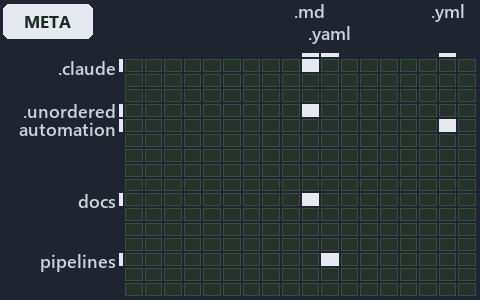

# docs/.assets/explanation/grid/adr-flow-cd-runner--a-step-only-names-a-command--meta.grid.md

`Grid minimap: adr-flow-cd-runner--a-step-only-names-a-command--meta`

The grid minimap of the slide `adr-flow-cd-runner--a-step-only-names-a-command--meta` (meta lens). The slide supports
[ADR-FLOW-CD-RUNNER][1]; the highlight of those ADR codes selects what is lit, and each reason below names the code that selects it.

## What the minimap shows

The grid crosses the 16 tracks (rows) with the 18 file languages (columns) of the world map and lights 5 cells, filled in ink. A cell lit
only by passing mentions (citations in body comments, not in a file's header or text) is touched: a lighter ink. Every other cell is idle, a
grey box: it holds files the slide's ADR codes do not select, or no file at all (237 of the 288 cells hold none). The minimap shows where
the slide sits, not how many files a cell holds; the world-map PDFs show the counts.

- .claude × markdown: 1 lit of 71 files
- .unordered × markdown: 5 lit of 20 files
- automation × yaml: 1 lit of 109 files
- docs × markdown: 4 lit of 2165 files
- pipelines × pipeline-yaml: 1 lit of 9 files

## Key

A lit row prints its track's name; a lit column prints a short code, the first extension of its file language:

- `.md`: markdown
- `.yaml`: pipeline-yaml
- `.yml`: yaml

## Why each cell is lit

### .claude × markdown (1 lit file)

Placed: the root folder `.claude/` names the track .claude ([ADR-DSGN-TRACK#1][2]); the extension `.md` names the file language markdown
([ADR-DSGN-TRACK#6][3]). Lit ([ADR-DSGN-TRACK#12][4]) by:

- [.claude/CLAUDE.md][5]: selected by [ADR-FLOW-CD-RUNNER][1]: the file cites it at line 51 (text).

### .unordered × markdown (5 lit files)

Placed: the root folder `.unordered/` names the track .unordered ([ADR-DSGN-TRACK#1][2]); the extension `.md` names the file language
markdown ([ADR-DSGN-TRACK#6][3]). Lit ([ADR-DSGN-TRACK#12][4]) by:

- [.unordered/15-10-2026/plan-adr-consistency.md][6]: selected by [ADR-FLOW-CD-RUNNER][1]: the file cites it at line 109 (text).
- [.unordered/15-10-2026/plan-built-bundle.md][7]: selected by [ADR-FLOW-CD-RUNNER][1]: the file cites it at line 13 (text), line 254 (text)
  and line 277 (text).
- [.unordered/15-10-2026/plan-caf-code-segments.md][8]: selected by [ADR-FLOW-CD-RUNNER][1]: the file cites it at line 55 (text).
- [.unordered/15-10-2026/plan-concern-axis.md][9]: selected by [ADR-FLOW-CD-RUNNER][1]: the file cites it at line 95 (text).
- [.unordered/15-10-2026/plan-explanation-drift.md][10]: selected by [ADR-FLOW-CD-RUNNER][1]: the file cites it at line 79 (text) and line
  106 (text).

### automation × yaml (1 lit file)

Placed: the root folder `automation/` names the track automation ([ADR-DSGN-TRACK#1][2]); the extension `.yml` names the file language yaml
([ADR-DSGN-TRACK#6][3]). Lit ([ADR-DSGN-TRACK#12][4]) by:

- [automation/Catzc.Base.Docs/configs/adrs.yml][11]: selected by [ADR-FLOW-CD-RUNNER][1]: the file cites it at line 116 (text).

### docs × markdown (4 lit files)

Placed: the root folder `docs/` names the track docs ([ADR-DSGN-TRACK#1][2]); the extension `.md` names the file language markdown
([ADR-DSGN-TRACK#6][3]). Lit ([ADR-DSGN-TRACK#12][4]) by:

- [docs/adr/flow/dora-explains.md][12]: selected by [ADR-FLOW-CD-RUNNER][1]: the file cites it at line 63 (text).
- [docs/adr/flow/pipeline-runner-pattern.md][1]: selected by [ADR-FLOW-CD-RUNNER][1]: the ADR's own file.
- [docs/adr/index.md][13]: selected by [ADR-FLOW-CD-RUNNER][1]: the file cites it at line 128 (text).
- [docs/references/pipelines/steps/invoke-automation.yaml.md][14]: selected by [ADR-FLOW-CD-RUNNER][1]: the file cites it at line 44 (text).

### pipelines × pipeline-yaml (1 lit file)

Placed: the root folder `pipelines/` names the track pipelines ([ADR-DSGN-TRACK#1][2]); the extension `.yaml` names the file language
pipeline-yaml ([ADR-DSGN-TRACK#6][3]). Lit ([ADR-DSGN-TRACK#12][4]) by:

- [pipelines/ci-automation.yaml][15]: selected by [ADR-FLOW-CD-RUNNER][1]: a pipeline that cites nothing itself carries its globset's
  citations, which cite it at `automation/Catzc.Base.Docs/configs/adrs.yml` line 116 (text).

## Keywords

- [world map][16]
- [track][17]
- [file language][18]
- [cell][19]
- [lit cell][20]
- [.claude][21]: a track
- [.unordered][21]: a track
- [automation][21]: a track
- [docs][21]: a track
- [pipelines][21]: a track
- [markdown][22]: a file language
- [pipeline-yaml][22]: a file language
- [yaml][22]: a file language

[1]: ../../../adr/flow/pipeline-runner-pattern.md
[2]: ../../../adr/design/tracks.md#rule-adr-dsgn-track1
[3]: ../../../adr/design/tracks.md#rule-adr-dsgn-track6
[4]: ../../../adr/design/tracks.md#rule-adr-dsgn-track12
[5]: ../../../../.claude/CLAUDE.md
[6]: ../../../../.unordered/15-10-2026/plan-adr-consistency.md
[7]: ../../../../.unordered/15-10-2026/plan-built-bundle.md
[8]: ../../../../.unordered/15-10-2026/plan-caf-code-segments.md
[9]: ../../../../.unordered/15-10-2026/plan-concern-axis.md
[10]: ../../../../.unordered/15-10-2026/plan-explanation-drift.md
[11]: ../../../../automation/Catzc.Base.Docs/configs/adrs.yml
[12]: ../../../adr/flow/dora-explains.md
[13]: ../../../adr/index.md
[14]: ../../../references/pipelines/steps/invoke-automation.yaml.md
[15]: ../../../../pipelines/ci-automation.yaml
[16]: ../../../adr/glossary.md#world-map
[17]: ../../../adr/glossary.md#track
[18]: ../../../adr/glossary.md#file-language
[19]: ../../../adr/glossary.md#cell
[20]: ../../../adr/glossary.md#lit-cell
[21]: ../../../../automation/Catzc.Base.Variants/configs/variants.yml
[22]: ../../../../automation/Catzc.Base.Languages/configs/languages.yml
