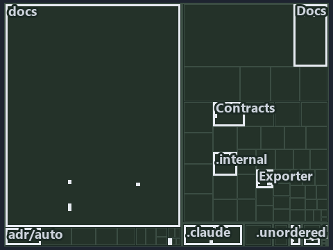

# docs/.assets/explanation/tree/adr-auto-bundle--build-verify-then-copy-the-folder--implementation.tree.md

`Tree minimap: adr-auto-bundle--build-verify-then-copy-the-folder--implementation`

The tree minimap of the slide `adr-auto-bundle--build-verify-then-copy-the-folder--implementation` (implementation lens). The slide supports
[ADR-AUTO-BUNDLE][1]; the highlight of those ADR codes selects what is lit, and each reason below names the code that selects it.

## What the minimap shows

The tree draws every file of the world map as a tile, grouped by top-level folder (under `automation/` by module, under `docs/adr/` by ADR
domain), and lights 32 files in 12 groups, filled in ink. A lit ADR file has a white rim; a file lit only by passing mentions is a lighter
ink. Every other tile is idle, a grey box: a file the slide's ADR codes do not select.

- Exporter (automation/Catzc.Base.Exporter): 9 lit files
- .claude: 4 lit files
- .unordered: 4 lit files
- docs (docs/ outside docs/adr/): 4 lit files
- Docs (automation/Catzc.Base.Docs): 2 lit files
- adr/* (the files directly in docs/adr/): 2 lit files
- adr/auto (docs/adr/automation): 2 lit files
- Root files: 1 lit file
- .github: 1 lit file
- .internal (automation/.internal): 1 lit file
- Contracts (automation/Catzc.Base.Contracts): 1 lit file
- pipelines: 1 lit file

## Why each group is lit

### Exporter (automation/Catzc.Base.Exporter, 9 lit files)

The group holds the files of automation/Catzc.Base.Exporter; each sits in its world-map cell and is lit by:

- [automation/Catzc.Base.Exporter/Assert-CatzcBundle.ps1][2], in the cell automation × powershell: selected by [ADR-AUTO-BUNDLE][1]: the
  file cites it at line 22 (header) and line 29 (header).
- [automation/Catzc.Base.Exporter/Build-Modules.ps1][3], in the cell automation × powershell: selected by [ADR-AUTO-BUNDLE][1]: the file
  cites it at line 22 (header), line 27 (header) and line 73 (text).
- [automation/Catzc.Base.Exporter/Export-Catzc.ps1][4], in the cell automation × powershell: selected by [ADR-AUTO-BUNDLE][1]: the file
  cites it at line 20 (header) and line 26 (header).
- [automation/Catzc.Base.Exporter/Install-Catzc.ps1][5], in the cell automation × powershell: selected by [ADR-AUTO-BUNDLE][1]: the file
  cites it at line 21 (header) and line 29 (header).
- [automation/Catzc.Base.Exporter/Resolve-CatzcBuildVersion.ps1][6], in the cell automation × powershell: selected by [ADR-AUTO-BUNDLE][1]:
  the file cites it at line 20 (header) and line 28 (header).
- [automation/Catzc.Base.Exporter/private/Assert-BundleFootprint.ps1][7], in the cell automation × powershell: selected by
  [ADR-AUTO-BUNDLE][1]: the file cites it at line 22 (header) and line 28 (header).
- [automation/Catzc.Base.Exporter/private/New-CatzcNuGetPackage.ps1][8], in the cell automation × powershell: selected by
  [ADR-AUTO-BUNDLE][1]: the file cites it at line 21 (header) and line 26 (header).
- [automation/Catzc.Base.Exporter/types/ExporterBundle.cs][9], in the cell automation × csharp: selected by [ADR-AUTO-BUNDLE][1]: the file
  cites it at line 20 (text).
- [automation/Catzc.Base.Exporter/types/ExporterConfig.cs][10], in the cell automation × csharp: selected by [ADR-AUTO-BUNDLE][1]: the file
  cites it at line 21 (text).

### .claude (4 lit files)

The group holds the files of .claude; each sits in its world-map cell and is lit by:

- [.claude/plans/plan-format-step-moves-comments.md][11], in the cell .claude × markdown: selected by [ADR-AUTO-BUNDLE][1]: the file cites
  it at line 120 (text).
- [.claude/plans/plan-layers-vocabulary-rename-contracts.md][12], in the cell .claude × markdown: selected by [ADR-AUTO-BUNDLE][1]: the file
  cites it at line 25 (text), line 464 (text), line 526 (text) and line 891 (text).
- [.claude/plans/plan-module-kinds-tracks.md][13], in the cell .claude × markdown: selected by [ADR-AUTO-BUNDLE][1]: the file cites it at
  line 348 (text).
- [.claude/plans/prompt-module-model-1-prepare.md][14], in the cell .claude × markdown: selected by [ADR-AUTO-BUNDLE][1]: the file cites it
  at line 42 (text).

### .unordered (4 lit files)

The group holds the files of .unordered; each sits in its world-map cell and is lit by:

- [.unordered/15-10-2026/plan-built-bundle.md][15], in the cell .unordered × markdown: selected by [ADR-AUTO-BUNDLE][1]: the file cites it
  at line 12 (text), line 41 (text), line 271 (text), line 306 (text), line 309 (text) and line 312 (text).
- [.unordered/15-10-2026/plan-concern-axis.md][16], in the cell .unordered × markdown: selected by [ADR-AUTO-BUNDLE][1]: the file cites it
  at line 104 (text).
- [.unordered/15-10-2026/plan-contracts.md][17], in the cell .unordered × markdown: selected by [ADR-AUTO-BUNDLE][1]: the file cites it at
  line 99 (text).
- [.unordered/15-10-2026/plan-explanation-drift.md][18], in the cell .unordered × markdown: selected by [ADR-AUTO-BUNDLE][1]: the file cites
  it at line 70 (text) and line 71 (text).

### docs (docs/ outside docs/adr/, 4 lit files)

The group holds the files of docs/ outside docs/adr/; each sits in its world-map cell and is lit by:

- [docs/references/automation/catzc-base-exporter/configs/exporter.yml.md][19], in the cell docs × markdown: selected by
  [ADR-AUTO-BUNDLE][1]: the file cites it at line 33 (text).
- [docs/references/automation/catzc-base-exporter/types/ExporterBundle.cs.md][20], in the cell docs × markdown: selected by
  [ADR-AUTO-BUNDLE][1]: the file cites it at line 32 (text).
- [docs/references/automation/catzc-base-exporter/types/ExporterConfig.cs.md][21], in the cell docs × markdown: selected by
  [ADR-AUTO-BUNDLE][1]: the file cites it at line 31 (text).
- [docs/references/automation/internal/Catzc.Internal.Builder.psm1.md][22], in the cell docs × markdown: selected by [ADR-AUTO-BUNDLE][1]:
  the file cites it at line 34 (text).

### Docs (automation/Catzc.Base.Docs, 2 lit files)

The group holds the files of automation/Catzc.Base.Docs; each sits in its world-map cell and is lit by:

- [automation/Catzc.Base.Docs/configs/adrs.yml][23], in the cell automation × yaml: selected by [ADR-AUTO-BUNDLE][1]: the file cites it at
  line 158 (text).
- [automation/Catzc.Base.Docs/configs/glossary.yml][24], in the cell automation × yaml: selected by [ADR-AUTO-BUNDLE][1]: the file cites it
  at line 490 (text).

### adr/* (the files directly in docs/adr/, 2 lit files)

The group holds the files of the files directly in docs/adr/; each sits in its world-map cell and is lit by:

- [docs/adr/glossary.md][25], in the cell docs × markdown: selected by [ADR-AUTO-BUNDLE][1]: the file cites it at line 501 (text).
- [docs/adr/index.md][26], in the cell docs × markdown: selected by [ADR-AUTO-BUNDLE][1]: the file cites it at line 169 (text).

### adr/auto (docs/adr/automation, 2 lit files)

The group holds the files of docs/adr/automation; each sits in its world-map cell and is lit by:

- [docs/adr/automation/dora-explains.md][27], in the cell docs × markdown: selected by [ADR-AUTO-BUNDLE][1]: the file cites it at line 487
  (text).
- [docs/adr/automation/platform-bundle.md][1], in the cell docs × markdown: selected by [ADR-AUTO-BUNDLE][1]: the ADR's own file.

### Root files (1 lit file)

The group holds the files of Root files; each sits in its world-map cell and is lit by:

- [importer.ps1][28], in the cell Root files × powershell: selected by [ADR-AUTO-BUNDLE][1]: a root file carries the citations of its owner
  module's files (files.yml), which cite it at `automation/.internal/assets/Import-Catzc.ps1` line 20 (header).

### .github (1 lit file)

The group holds the files of .github; each sits in its world-map cell and is lit by:

- [.github/workflows/ci-automation.yml][29], in the cell github-workflows × yaml: selected by [ADR-AUTO-BUNDLE][1]: the file cites it at
  line 64 (body comment) (a passing mention only).

### .internal (automation/.internal, 1 lit file)

The group holds the files of automation/.internal; each sits in its world-map cell and is lit by:

- [automation/.internal/assets/Import-Catzc.ps1][30], in the cell automation × powershell: selected by [ADR-AUTO-BUNDLE][1]: the file cites
  it at line 20 (header).

### Contracts (automation/Catzc.Base.Contracts, 1 lit file)

The group holds the files of automation/Catzc.Base.Contracts; each sits in its world-map cell and is lit by:

- [automation/Catzc.Base.Contracts/Publish-ContractRelease.ps1][31], in the cell automation × powershell: selected by [ADR-AUTO-BUNDLE][1]:
  the file cites it at line 21 (header) and line 36 (header).

### pipelines (1 lit file)

The group holds the files of pipelines; each sits in its world-map cell and is lit by:

- [pipelines/ci-automation.yaml][32], in the cell pipelines × pipeline-yaml: selected by [ADR-AUTO-BUNDLE][1]: a pipeline that cites nothing
  itself carries its globset's citations, which cite it at `automation/.internal/assets/Import-Catzc.ps1` line 20 (header),
  `automation/Catzc.Base.Contracts/Publish-ContractRelease.ps1` line 21 (header),
  `automation/Catzc.Base.Contracts/Publish-ContractRelease.ps1` line 36 (header), `automation/Catzc.Base.Docs/configs/adrs.yml` line 158
  (text), `automation/Catzc.Base.Docs/configs/glossary.yml` line 490 (text), `automation/Catzc.Base.Exporter/Assert-CatzcBundle.ps1` line 22
  (header), `automation/Catzc.Base.Exporter/Assert-CatzcBundle.ps1` line 29 (header), `automation/Catzc.Base.Exporter/Build-Modules.ps1`
  line 22 (header), `automation/Catzc.Base.Exporter/Build-Modules.ps1` line 27 (header), `automation/Catzc.Base.Exporter/Build-Modules.ps1`
  line 73 (text), `automation/Catzc.Base.Exporter/Export-Catzc.ps1` line 20 (header), `automation/Catzc.Base.Exporter/Export-Catzc.ps1` line
  26 (header), `automation/Catzc.Base.Exporter/Install-Catzc.ps1` line 21 (header), `automation/Catzc.Base.Exporter/Install-Catzc.ps1` line
  29 (header), `automation/Catzc.Base.Exporter/Resolve-CatzcBuildVersion.ps1` line 20 (header),
  `automation/Catzc.Base.Exporter/Resolve-CatzcBuildVersion.ps1` line 28 (header),
  `automation/Catzc.Base.Exporter/private/Assert-BundleFootprint.ps1` line 22 (header),
  `automation/Catzc.Base.Exporter/private/Assert-BundleFootprint.ps1` line 28 (header),
  `automation/Catzc.Base.Exporter/private/New-CatzcNuGetPackage.ps1` line 21 (header),
  `automation/Catzc.Base.Exporter/private/New-CatzcNuGetPackage.ps1` line 26 (header),
  `automation/Catzc.Base.Exporter/types/ExporterBundle.cs` line 20 (text) and `automation/Catzc.Base.Exporter/types/ExporterConfig.cs` line
  21 (text).

## Keywords

- [world map][33]
- [track][34]
- [file language][35]
- [cell][36]
- [lit cell][37]
- [root file][38]
- [.claude][39]: a track
- [.unordered][39]: a track
- [automation][39]: a track
- [docs][39]: a track
- [github-workflows][39]: a track
- [pipelines][39]: a track
- [csharp][40]: a file language
- [markdown][40]: a file language
- [pipeline-yaml][40]: a file language
- [powershell][40]: a file language
- [yaml][40]: a file language

Terms the cited ADRs define:

- [bundle][41], defined by [ADR-AUTO-BUNDLE#1][42]

[1]: ../../../adr/automation/platform-bundle.md
[2]: ../../../../automation/Catzc.Base.Exporter/Assert-CatzcBundle.ps1
[3]: ../../../../automation/Catzc.Base.Exporter/Build-Modules.ps1
[4]: ../../../../automation/Catzc.Base.Exporter/Export-Catzc.ps1
[5]: ../../../../automation/Catzc.Base.Exporter/Install-Catzc.ps1
[6]: ../../../../automation/Catzc.Base.Exporter/Resolve-CatzcBuildVersion.ps1
[7]: ../../../../automation/Catzc.Base.Exporter/private/Assert-BundleFootprint.ps1
[8]: ../../../../automation/Catzc.Base.Exporter/private/New-CatzcNuGetPackage.ps1
[9]: ../../../../automation/Catzc.Base.Exporter/types/ExporterBundle.cs
[10]: ../../../../automation/Catzc.Base.Exporter/types/ExporterConfig.cs
[11]: ../../../../.claude/plans/plan-format-step-moves-comments.md
[12]: ../../../../.claude/plans/plan-layers-vocabulary-rename-contracts.md
[13]: ../../../../.claude/plans/plan-module-kinds-tracks.md
[14]: ../../../../.claude/plans/prompt-module-model-1-prepare.md
[15]: ../../../../.unordered/15-10-2026/plan-built-bundle.md
[16]: ../../../../.unordered/15-10-2026/plan-concern-axis.md
[17]: ../../../../.unordered/15-10-2026/plan-contracts.md
[18]: ../../../../.unordered/15-10-2026/plan-explanation-drift.md
[19]: ../../../references/automation/catzc-base-exporter/configs/exporter.yml.md
[20]: ../../../references/automation/catzc-base-exporter/types/ExporterBundle.cs.md
[21]: ../../../references/automation/catzc-base-exporter/types/ExporterConfig.cs.md
[22]: ../../../references/automation/internal/Catzc.Internal.Builder.psm1.md
[23]: ../../../../automation/Catzc.Base.Docs/configs/adrs.yml
[24]: ../../../../automation/Catzc.Base.Docs/configs/glossary.yml
[25]: ../../../adr/glossary.md
[26]: ../../../adr/index.md
[27]: ../../../adr/automation/dora-explains.md
[28]: ../../../../importer.ps1
[29]: ../../../../.github/workflows/ci-automation.yml
[30]: ../../../../automation/.internal/assets/Import-Catzc.ps1
[31]: ../../../../automation/Catzc.Base.Contracts/Publish-ContractRelease.ps1
[32]: ../../../../pipelines/ci-automation.yaml
[33]: ../../../adr/glossary.md#world-map
[34]: ../../../adr/glossary.md#track
[35]: ../../../adr/glossary.md#file-language
[36]: ../../../adr/glossary.md#cell
[37]: ../../../adr/glossary.md#lit-cell
[38]: ../../../adr/glossary.md#root-file
[39]: ../../../../automation/Catzc.Base.Variants/configs/variants.yml
[40]: ../../../../automation/Catzc.Base.Languages/configs/languages.yml
[41]: ../../../adr/glossary.md#bundle
[42]: ../../../adr/automation/platform-bundle.md#rule-adr-auto-bundle1
