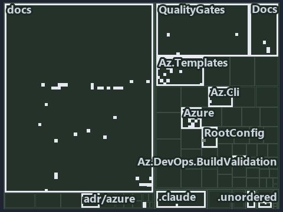

# docs/.assets/explanation/tree/adr-az-datamod--coordinate-resolved-file-by-file-at-discovery--implementation.tree.md

`Tree minimap: adr-az-datamod--coordinate-resolved-file-by-file-at-discovery--implementation`

The tree minimap of the slide `adr-az-datamod--coordinate-resolved-file-by-file-at-discovery--implementation` (implementation lens). The
slide supports [ADR-AZ-CUSTOMER][1] and [ADR-AZ-DATAMOD][2]; the highlight of those ADR codes selects what is lit, and each reason below
names the code that selects it.

## What the minimap shows

The tree draws every file of the world map as a tile, grouped by top-level folder (under `automation/` by module, under `docs/adr/` by ADR
domain), and lights 93 files in 13 groups, filled in ink. A lit ADR file has a white rim; a file lit only by passing mentions is a lighter
ink. Every other tile is idle, a grey box: a file the slide's ADR codes do not select.

- docs (docs/ outside docs/adr/): 33 lit files
- Az.Templates (automation/Catzc.Azure.Templates): 20 lit files
- Azure (automation/Catzc.Azure): 12 lit files
- .unordered: 5 lit files
- Docs (automation/Catzc.Base.Docs): 5 lit files
- QualityGates (automation/Catzc.Base.QualityGates): 4 lit files
- Az.Cli (automation/Catzc.Azure.Cli): 3 lit files
- adr/azure (docs/adr/azure): 3 lit files
- .claude: 2 lit files
- Az.DevOps.BuildValidation (automation/Catzc.Azure.DevOps.BuildValidation): 2 lit files
- adr/* (the files directly in docs/adr/): 2 lit files
- RootConfig (automation/Catzc.Base.RootConfig): 1 lit file
- pipelines: 1 lit file

## Why each group is lit

### docs (docs/ outside docs/adr/, 33 lit files)

The group holds the files of docs/ outside docs/adr/; each sits in its world-map cell and is lit by:

- [docs/how-to/automation/manual-test-plan/azure.md][3], in the cell docs × markdown: selected by [ADR-AZ-DATAMOD][2]: the file cites it at
  line 17 (text), line 37 (text) and line 80 (text).
- [docs/references/automation/catzc-azure-devops-buildvalidation/configs/build-validation.yml.md][4], in the cell docs × markdown: selected
  by [ADR-AZ-CUSTOMER][1]: the file cites it at line 17 (text) and line 44 (text).
- [docs/references/automation/catzc-azure-devops-buildvalidation/tests/types/BuildValidationConfig.Tests.ps1.md][5], in the cell docs ×
  markdown: selected by [ADR-AZ-CUSTOMER][1]: the file cites it at line 18 (text) and line 33 (text).
- [docs/references/automation/catzc-azure-devops-buildvalidation/types/BuildValidationEntry.cs.md][6], in the cell docs × markdown: selected
  by [ADR-AZ-CUSTOMER][1]: the file cites it at line 18 (text) and line 41 (text).
- [docs/references/automation/catzc-azure-templates/Assert-BicepTemplate.ps1.md][7], in the cell docs × markdown: selected by
  [ADR-AZ-DATAMOD][2]: the file cites it at line 17 (text) and line 59 (text).
- [docs/references/automation/catzc-azure-templates/Build-Bicep.ps1.md][8], in the cell docs × markdown: selected by [ADR-AZ-DATAMOD][2]:
  the file cites it at line 17 (text) and line 80 (text).
- [docs/references/automation/catzc-azure-templates/Deploy-Bicep.ps1.md][9], in the cell docs × markdown: selected by [ADR-AZ-DATAMOD][2]:
  the file cites it at line 42 (text).
- [docs/references/automation/catzc-azure-templates/Get-BicepTemplates.ps1.md][10], in the cell docs × markdown: selected by
  [ADR-AZ-CUSTOMER][1]: the file cites it at line 90 (text); selected by [ADR-AZ-DATAMOD][2]: the file cites it at line 79 (text).
- [docs/references/automation/catzc-azure-templates/tests/Get-BicepParameterModel.Shipped.Tests.ps1.md][11], in the cell docs × markdown:
  selected by [ADR-AZ-DATAMOD][2]: the file cites it at line 18 (text) and line 33 (text).
- [docs/references/automation/catzc-azure-templates/types/BicepTemplate.cs.md][12], in the cell docs × markdown: selected by
  [ADR-AZ-CUSTOMER][1]: the file cites it at line 43 (text).
- [docs/references/automation/catzc-azure/Get-AzureSubscription.ps1.md][13], in the cell docs × markdown: selected by [ADR-AZ-CUSTOMER][1]:
  the file cites it at line 29 (text).
- [docs/references/automation/catzc-azure/configs/azure.yml.md][14], in the cell docs × markdown: selected by [ADR-AZ-CUSTOMER][1]: the file
  cites it at line 85 (text); selected by [ADR-AZ-DATAMOD][2]: the file cites it at line 17 (text), line 75 (text) and line 120 (text).
- [docs/references/automation/catzc-azure/configs/customer.yml.md][15], in the cell docs × markdown: selected by [ADR-AZ-CUSTOMER][1]: the
  file cites it at line 28 (text).
- [docs/references/automation/catzc-azure/tests/types/AzureConfig.Tests.ps1.md][16], in the cell docs × markdown: selected by
  [ADR-AZ-CUSTOMER][1]: the file cites it at line 45 (text); selected by [ADR-AZ-DATAMOD][2]: the file cites it at line 49 (text).
- [docs/references/automation/catzc-azure/types/AzureConfig.cs.md][17], in the cell docs × markdown: selected by [ADR-AZ-CUSTOMER][1]: the
  file cites it at line 19 (text) and line 63 (text); selected by [ADR-AZ-DATAMOD][2]: the file cites it at line 20 (text), line 34 (text),
  line 49 (text), line 59 (text) and line 65 (text).
- [docs/references/automation/catzc-azure/types/AzureCustomer.cs.md][18], in the cell docs × markdown: selected by [ADR-AZ-CUSTOMER][1]: the
  file cites it at line 30 (text).
- [docs/references/automation/catzc-azure/types/AzureEnvironmentRecord.cs.md][19], in the cell docs × markdown: selected by
  [ADR-AZ-DATAMOD][2]: the file cites it at line 30 (text).
- [docs/references/automation/catzc-azure/types/AzureSubscriptionRecord.cs.md][20], in the cell docs × markdown: selected by
  [ADR-AZ-CUSTOMER][1]: the file cites it at line 18 (text) and line 42 (text); selected by [ADR-AZ-DATAMOD][2]: the file cites it at line
  31 (text).
- [docs/references/automation/catzc-azure/types/AzureTenantRecord.cs.md][21], in the cell docs × markdown: selected by [ADR-AZ-DATAMOD][2]:
  the file cites it at line 30 (text).
- [docs/references/automation/catzc-azure/types/CustomerConfig.cs.md][22], in the cell docs × markdown: selected by [ADR-AZ-CUSTOMER][1]:
  the file cites it at line 18 (text), line 31 (text), line 43 (text) and line 45 (text).
- [docs/references/automation/catzc-base-docs/types/AdrsConfig.cs.md][23], in the cell docs × markdown: selected by [ADR-AZ-CUSTOMER][1]:
  the file cites it at line 19 (text) and line 43 (text).
- [docs/references/automation/catzc-base-docs/types/GlossaryConcept.cs.md][24], in the cell docs × markdown: selected by
  [ADR-AZ-CUSTOMER][1]: the file cites it at line 19 (text) and line 47 (text).
- [docs/references/automation/catzc-base-docs/types/GlossaryConfig.cs.md][25], in the cell docs × markdown: selected by
  [ADR-AZ-CUSTOMER][1]: the file cites it at line 17 (text) and line 46 (text).
- [docs/references/automation/catzc-base-qualitygates/configs/analyzer-adr-map.yml.md][26], in the cell docs × markdown: selected by
  [ADR-AZ-CUSTOMER][1]: the file cites it at line 17 (text) and line 40 (text).
- [docs/references/automation/catzc-base-qualitygates/private/Get-TerminologyCorpus.ps1.md][27], in the cell docs × markdown: selected by
  [ADR-AZ-DATAMOD][2]: the file cites it at line 42 (text).
- [docs/references/automation/catzc-base-qualitygates/types/AnalyzerAdrMapConfig.cs.md][28], in the cell docs × markdown: selected by
  [ADR-AZ-CUSTOMER][1]: the file cites it at line 18 (text) and line 45 (text).
- [docs/references/automation/catzc-base-variants/configs/variants.yml.md][29], in the cell docs × markdown: selected by
  [ADR-AZ-CUSTOMER][1]: the file cites it at line 70 (text).
- [docs/references/infrastructure/templates/discovery/options.yml.md][30], in the cell docs × markdown: selected by [ADR-AZ-DATAMOD][2]: the
  file cites it at line 30 (text).
- [docs/references/infrastructure/templates/expedition/options.yml.md][31], in the cell docs × markdown: selected by [ADR-AZ-DATAMOD][2]:
  the file cites it at line 31 (text).
- [docs/references/infrastructure/templates/foundation/options.yml.md][32], in the cell docs × markdown: selected by [ADR-AZ-DATAMOD][2]:
  the file cites it at line 30 (text).
- [docs/references/pipelines/cd-shared.yaml.md][33], in the cell docs × markdown: selected by [ADR-AZ-DATAMOD][2]: the file cites it at line
  32 (text).
- [docs/references/pipelines/ci-infrastructure.yaml.md][34], in the cell docs × markdown: selected by [ADR-AZ-DATAMOD][2]: the file cites it
  at line 18 (text) and line 44 (text).
- [docs/references/pipelines/extends/cd-customer.yaml.md][35], in the cell docs × markdown: selected by [ADR-AZ-DATAMOD][2]: the file cites
  it at line 39 (text).

### Az.Templates (automation/Catzc.Azure.Templates, 20 lit files)

The group holds the files of automation/Catzc.Azure.Templates; each sits in its world-map cell and is lit by:

- [automation/Catzc.Azure.Templates/Assert-BicepTemplate.ps1][36], in the cell automation × powershell: selected by [ADR-AZ-DATAMOD][2]: the
  file cites it at line 22 (header).
- [automation/Catzc.Azure.Templates/Build-Bicep.ps1][37], in the cell automation × powershell: selected by [ADR-AZ-DATAMOD][2]: the file
  cites it at line 22 (header).
- [automation/Catzc.Azure.Templates/Deploy-Bicep.ps1][38], in the cell automation × powershell: selected by [ADR-AZ-DATAMOD][2]: the file
  cites it at line 22 (header) and line 34 (header).
- [automation/Catzc.Azure.Templates/Get-AzureBicepEnvironmentKinds.ps1][39], in the cell automation × powershell: selected by
  [ADR-AZ-DATAMOD][2]: the file cites it at line 20 (header) and line 28 (header).
- [automation/Catzc.Azure.Templates/Get-BicepDeploymentContext.ps1][40], in the cell automation × powershell: selected by
  [ADR-AZ-DATAMOD][2]: the file cites it at line 21 (header) and line 46 (header).
- [automation/Catzc.Azure.Templates/Get-BicepTemplateConfiguration.ps1][41], in the cell automation × powershell: selected by
  [ADR-AZ-DATAMOD][2]: the file cites it at line 21 (header) and line 30 (header).
- [automation/Catzc.Azure.Templates/Get-BicepTemplates.ps1][42], in the cell automation × powershell: selected by [ADR-AZ-CUSTOMER][1]: the
  file cites it at line 22 (header); selected by [ADR-AZ-DATAMOD][2]: the file cites it at line 23 (header), line 35 (header) and line 61
  (header).
- [automation/Catzc.Azure.Templates/Set-BicepTemplateConfiguration.ps1][43], in the cell automation × powershell: selected by
  [ADR-AZ-DATAMOD][2]: the file cites it at line 22 (header).
- [automation/Catzc.Azure.Templates/configs/glossary.yml][44], in the cell automation × yaml: selected by [ADR-AZ-DATAMOD][2]: the file
  cites it at line 24 (text) and line 116 (text).
- [automation/Catzc.Azure.Templates/private/Get-BicepConfigClassViolations.ps1][45], in the cell automation × powershell: selected by
  [ADR-AZ-DATAMOD][2]: the file cites it at line 20 (header).
- [automation/Catzc.Azure.Templates/private/Get-BicepConfigName.ps1][46], in the cell automation × powershell: selected by
  [ADR-AZ-DATAMOD][2]: the file cites it at line 20 (header) and line 27 (header).
- [automation/Catzc.Azure.Templates/private/Get-BicepConfigSubscriptionCandidates.ps1][47], in the cell automation × powershell: selected by
  [ADR-AZ-DATAMOD][2]: the file cites it at line 21 (header) and line 26 (header).
- [automation/Catzc.Azure.Templates/private/Get-BicepCustomerClassViolations.ps1][48], in the cell automation × powershell: selected by
  [ADR-AZ-CUSTOMER][1]: the file cites it at line 21 (header).
- [automation/Catzc.Azure.Templates/private/Get-BicepParametersFileName.ps1][49], in the cell automation × powershell: selected by
  [ADR-AZ-DATAMOD][2]: the file cites it at line 21 (header) and line 34 (header).
- [automation/Catzc.Azure.Templates/private/Get-BicepSubscriptionConfigViolations.ps1][50], in the cell automation × powershell: selected by
  [ADR-AZ-DATAMOD][2]: the file cites it at line 21 (header).
- [automation/Catzc.Azure.Templates/private/Resolve-BicepConfigName.ps1][51], in the cell automation × powershell: selected by
  [ADR-AZ-DATAMOD][2]: the file cites it at line 20 (header) and line 28 (header).
- [automation/Catzc.Azure.Templates/private/Resolve-BicepParameterAddresses.ps1][52], in the cell automation × powershell: selected by
  [ADR-AZ-DATAMOD][2]: the file cites it at line 21 (header) and line 28 (header).
- [automation/Catzc.Azure.Templates/tests/Get-BicepParameterModel.Shipped.Tests.ps1][53], in the cell automation × powershell: selected by
  [ADR-AZ-DATAMOD][2]: the file cites it at line 21 (header) and line 30 (text).
- [automation/Catzc.Azure.Templates/tests/Resolve-BicepParameterAddresses.Tests.ps1][54], in the cell automation × powershell: selected by
  [ADR-AZ-DATAMOD][2]: the file cites it at line 21 (header), line 49 (text), line 55 (text), line 72 (text), line 78 (text), line 83
  (text), line 89 (text), line 126 (text), line 130 (text), line 130 (body comment), line 135 (text) and line 139 (text).
- [automation/Catzc.Azure.Templates/types/BicepTemplate.cs][55], in the cell automation × csharp: selected by [ADR-AZ-CUSTOMER][1]: the file
  cites it at line 20 (text).

### Azure (automation/Catzc.Azure, 12 lit files)

The group holds the files of automation/Catzc.Azure; each sits in its world-map cell and is lit by:

- [automation/Catzc.Azure/Get-AzureCustomers.ps1][56], in the cell automation × powershell: selected by [ADR-AZ-CUSTOMER][1]: the file cites
  it at line 20 (header) and line 27 (header).
- [automation/Catzc.Azure/Get-AzureEnvironment.ps1][57], in the cell automation × powershell: selected by [ADR-AZ-DATAMOD][2]: the file
  cites it at line 20 (header) and line 29 (header).
- [automation/Catzc.Azure/Get-AzureSubscription.ps1][58], in the cell automation × powershell: selected by [ADR-AZ-CUSTOMER][1]: the file
  cites it at line 21 (header) and line 33 (header); selected by [ADR-AZ-DATAMOD][2]: the file cites it at line 22 (header) and line 32
  (header).
- [automation/Catzc.Azure/Get-AzureSubscriptionEnvironment.ps1][59], in the cell automation × powershell: selected by [ADR-AZ-DATAMOD][2]:
  the file cites it at line 20 (header) and line 25 (header).
- [automation/Catzc.Azure/tests/types/AzureConfig.Tests.ps1][60], in the cell automation × powershell: selected by [ADR-AZ-CUSTOMER][1]: the
  file cites it at line 21 (header); selected by [ADR-AZ-DATAMOD][2]: the file cites it at line 22 (header), line 250 (text), line 285
  (text), line 291 (text), line 299 (text), line 307 (text), line 313 (text) and line 321 (text).
- [automation/Catzc.Azure/tests/types/CustomerConfig.Tests.ps1][61], in the cell automation × powershell: selected by [ADR-AZ-CUSTOMER][1]:
  the file cites it at line 19 (header) and line 79 (text).
- [automation/Catzc.Azure/types/AzureConfig.cs][62], in the cell automation × csharp: selected by [ADR-AZ-CUSTOMER][1]: the file cites it at
  line 23 (text); selected by [ADR-AZ-DATAMOD][2]: the file cites it at line 24 (text).
- [automation/Catzc.Azure/types/AzureCustomer.cs][63], in the cell automation × csharp: selected by [ADR-AZ-CUSTOMER][1]: the file cites it
  at line 21 (text).
- [automation/Catzc.Azure/types/AzureEnvironmentRecord.cs][64], in the cell automation × csharp: selected by [ADR-AZ-DATAMOD][2]: the file
  cites it at line 21 (text).
- [automation/Catzc.Azure/types/AzureSubscriptionRecord.cs][65], in the cell automation × csharp: selected by [ADR-AZ-CUSTOMER][1]: the file
  cites it at line 21 (text); selected by [ADR-AZ-DATAMOD][2]: the file cites it at line 22 (text).
- [automation/Catzc.Azure/types/AzureTenantRecord.cs][66], in the cell automation × csharp: selected by [ADR-AZ-DATAMOD][2]: the file cites
  it at line 21 (text).
- [automation/Catzc.Azure/types/CustomerConfig.cs][67], in the cell automation × csharp: selected by [ADR-AZ-CUSTOMER][1]: the file cites it
  at line 22 (text).

### .unordered (5 lit files)

The group holds the files of .unordered; each sits in its world-map cell and is lit by:

- [.unordered/15-10-2026/plan-adr-consistency.md][68], in the cell .unordered × markdown: selected by [ADR-AZ-DATAMOD][2]: the file cites it
  at line 72 (text).
- [.unordered/15-10-2026/plan-caf-code-segments.md][69], in the cell .unordered × markdown: selected by [ADR-AZ-DATAMOD][2]: the file cites
  it at line 66 (text).
- [.unordered/15-10-2026/plan-caf-waf-automation.md][70], in the cell .unordered × markdown: selected by [ADR-AZ-DATAMOD][2]: the file cites
  it at line 20 (text) and line 28 (text).
- [.unordered/15-10-2026/plan-concern-axis.md][71], in the cell .unordered × markdown: selected by [ADR-AZ-DATAMOD][2]: the file cites it at
  line 110 (text).
- [.unordered/15-10-2026/plan-diagram-wave-8.md][72], in the cell .unordered × markdown: selected by [ADR-AZ-DATAMOD][2]: the file cites it
  at line 17 (text) and line 18 (text).

### Docs (automation/Catzc.Base.Docs, 5 lit files)

The group holds the files of automation/Catzc.Base.Docs; each sits in its world-map cell and is lit by:

- [automation/Catzc.Base.Docs/Build-AdrIndex.ps1][73], in the cell automation × powershell: selected by [ADR-AZ-DATAMOD][2]: the file cites
  it at line 24 (header) and line 134 (text).
- [automation/Catzc.Base.Docs/configs/adrs.yml][74], in the cell automation × yaml: selected by [ADR-AZ-CUSTOMER][1]: the file cites it at
  line 274 (text); selected by [ADR-AZ-DATAMOD][2]: the file cites it at line 269 (text).
- [automation/Catzc.Base.Docs/types/AdrsConfig.cs][75], in the cell automation × csharp: selected by [ADR-AZ-CUSTOMER][1]: the file cites it
  at line 23 (text).
- [automation/Catzc.Base.Docs/types/GlossaryConcept.cs][76], in the cell automation × csharp: selected by [ADR-AZ-CUSTOMER][1]: the file
  cites it at line 22 (text).
- [automation/Catzc.Base.Docs/types/GlossaryConfig.cs][77], in the cell automation × csharp: selected by [ADR-AZ-CUSTOMER][1]: the file
  cites it at line 21 (text).

### QualityGates (automation/Catzc.Base.QualityGates, 4 lit files)

The group holds the files of automation/Catzc.Base.QualityGates; each sits in its world-map cell and is lit by:

- [automation/Catzc.Base.QualityGates/configs/terminology.yml][78], in the cell automation × yaml: selected by [ADR-AZ-DATAMOD][2]: the file
  cites it at line 627 (text).
- [automation/Catzc.Base.QualityGates/private/Get-MarkdownHeadingFinding.ps1][79], in the cell automation × powershell: selected by
  [ADR-AZ-DATAMOD][2]: the file cites it at line 22 (header) and line 28 (header).
- [automation/Catzc.Base.QualityGates/private/Get-TerminologyCorpus.ps1][80], in the cell automation × powershell: selected by
  [ADR-AZ-DATAMOD][2]: the file cites it at line 21 (header).
- [automation/Catzc.Base.QualityGates/types/AnalyzerAdrMapConfig.cs][81], in the cell automation × csharp: selected by [ADR-AZ-CUSTOMER][1]:
  the file cites it at line 22 (text).

### Az.Cli (automation/Catzc.Azure.Cli, 3 lit files)

The group holds the files of automation/Catzc.Azure.Cli; each sits in its world-map cell and is lit by:

- [automation/Catzc.Azure.Cli/Assert-AzCliCanAccess.ps1][82], in the cell automation × powershell: selected by [ADR-AZ-DATAMOD][2]: the file
  cites it at line 22 (header) and line 35 (header).
- [automation/Catzc.Azure.Cli/Assert-AzCliIsConnected.ps1][83], in the cell automation × powershell: selected by [ADR-AZ-DATAMOD][2]: the
  file cites it at line 21 (header) and line 29 (header).
- [automation/Catzc.Azure.Cli/Test-AzCliCanAccess.ps1][84], in the cell automation × powershell: selected by [ADR-AZ-DATAMOD][2]: the file
  cites it at line 22 (header) and line 34 (header).

### adr/azure (docs/adr/azure, 3 lit files)

The group holds the files of docs/adr/azure; each sits in its world-map cell and is lit by:

- [docs/adr/azure/azure-customer-model.md][1], in the cell docs × markdown: selected by [ADR-AZ-CUSTOMER][1]: the ADR's own file.
- [docs/adr/azure/azure-data-model.md][2], in the cell docs × markdown: selected by [ADR-AZ-DATAMOD][2]: the ADR's own file.
- [docs/adr/azure/dora-explains.md][85], in the cell docs × markdown: selected by [ADR-AZ-CUSTOMER][1]: the file cites it at line 92 (text);
  selected by [ADR-AZ-DATAMOD][2]: the file cites it at line 41 (text).

### .claude (2 lit files)

The group holds the files of .claude; each sits in its world-map cell and is lit by:

- [.claude/plans/plan-adr-link-cleanup-prose-to-pages.md][86], in the cell .claude × markdown: selected by [ADR-AZ-DATAMOD][2]: the file
  cites it at line 27 (text) and line 175 (text).
- [.claude/plans/plan-module-kinds-tracks.md][87], in the cell .claude × markdown: selected by [ADR-AZ-DATAMOD][2]: the file cites it at
  line 175 (text).

### Az.DevOps.BuildValidation (automation/Catzc.Azure.DevOps.BuildValidation, 2 lit files)

The group holds the files of automation/Catzc.Azure.DevOps.BuildValidation; each sits in its world-map cell and is lit by:

- [automation/Catzc.Azure.DevOps.BuildValidation/tests/types/BuildValidationConfig.Tests.ps1][88], in the cell automation × powershell:
  selected by [ADR-AZ-CUSTOMER][1]: the file cites it at line 21 (header).
- [automation/Catzc.Azure.DevOps.BuildValidation/types/BuildValidationEntry.cs][89], in the cell automation × csharp: selected by
  [ADR-AZ-CUSTOMER][1]: the file cites it at line 21 (text).

### adr/* (the files directly in docs/adr/, 2 lit files)

The group holds the files of the files directly in docs/adr/; each sits in its world-map cell and is lit by:

- [docs/adr/glossary.md][90], in the cell docs × markdown: selected by [ADR-AZ-DATAMOD][2]: the file cites it at line 784 (text) and line
  829 (text).
- [docs/adr/index.md][91], in the cell docs × markdown: selected by [ADR-AZ-CUSTOMER][1]: the file cites it at line 279 (text); selected by
  [ADR-AZ-DATAMOD][2]: the file cites it at line 274 (text) and line 394 (text).

### RootConfig (automation/Catzc.Base.RootConfig, 1 lit file)

The group holds the files of automation/Catzc.Base.RootConfig; each sits in its world-map cell and is lit by:

- [automation/Catzc.Base.RootConfig/assets/root/cspell.yml][92], in the cell automation × yaml: selected by [ADR-AZ-DATAMOD][2]: the file
  cites it at line 21 (body comment) (a passing mention only).

### pipelines (1 lit file)

The group holds the files of pipelines; each sits in its world-map cell and is lit by:

- [pipelines/ci-automation.yaml][93], in the cell pipelines × pipeline-yaml: selected by [ADR-AZ-CUSTOMER][1]: a pipeline that cites nothing
  itself carries its globset's citations, which cite it at
  `automation/Catzc.Azure.DevOps.BuildValidation/tests/types/BuildValidationConfig.Tests.ps1` line 21 (header),
  `automation/Catzc.Azure.DevOps.BuildValidation/types/BuildValidationEntry.cs` line 21 (text),
  `automation/Catzc.Azure.Templates/Get-BicepTemplates.ps1` line 22 (header),
  `automation/Catzc.Azure.Templates/private/Get-BicepCustomerClassViolations.ps1` line 21 (header),
  `automation/Catzc.Azure.Templates/types/BicepTemplate.cs` line 20 (text), `automation/Catzc.Azure/Get-AzureCustomers.ps1` line 20
  (header), `automation/Catzc.Azure/Get-AzureCustomers.ps1` line 27 (header), `automation/Catzc.Azure/Get-AzureSubscription.ps1` line 21
  (header), `automation/Catzc.Azure/Get-AzureSubscription.ps1` line 33 (header), `automation/Catzc.Azure/tests/types/AzureConfig.Tests.ps1`
  line 21 (header), `automation/Catzc.Azure/tests/types/CustomerConfig.Tests.ps1` line 19 (header),
  `automation/Catzc.Azure/tests/types/CustomerConfig.Tests.ps1` line 79 (text), `automation/Catzc.Azure/types/AzureConfig.cs` line 23
  (text), `automation/Catzc.Azure/types/AzureCustomer.cs` line 21 (text), `automation/Catzc.Azure/types/AzureSubscriptionRecord.cs` line 21
  (text), `automation/Catzc.Azure/types/CustomerConfig.cs` line 22 (text), `automation/Catzc.Base.Docs/configs/adrs.yml` line 274 (text),
  `automation/Catzc.Base.Docs/types/AdrsConfig.cs` line 23 (text), `automation/Catzc.Base.Docs/types/GlossaryConcept.cs` line 22 (text),
  `automation/Catzc.Base.Docs/types/GlossaryConfig.cs` line 21 (text) and `automation/Catzc.Base.QualityGates/types/AnalyzerAdrMapConfig.cs`
  line 22 (text); selected by [ADR-AZ-DATAMOD][2]: a pipeline that cites nothing itself carries its globset's citations, which cite it at
  `automation/Catzc.Azure.Cli/Assert-AzCliCanAccess.ps1` line 22 (header), `automation/Catzc.Azure.Cli/Assert-AzCliCanAccess.ps1` line 35
  (header), `automation/Catzc.Azure.Cli/Assert-AzCliIsConnected.ps1` line 21 (header),
  `automation/Catzc.Azure.Cli/Assert-AzCliIsConnected.ps1` line 29 (header), `automation/Catzc.Azure.Cli/Test-AzCliCanAccess.ps1` line 22
  (header), `automation/Catzc.Azure.Cli/Test-AzCliCanAccess.ps1` line 34 (header),
  `automation/Catzc.Azure.Templates/Assert-BicepTemplate.ps1` line 22 (header), `automation/Catzc.Azure.Templates/Build-Bicep.ps1` line 22
  (header), `automation/Catzc.Azure.Templates/Deploy-Bicep.ps1` line 22 (header), `automation/Catzc.Azure.Templates/Deploy-Bicep.ps1` line
  34 (header), `automation/Catzc.Azure.Templates/Get-AzureBicepEnvironmentKinds.ps1` line 20 (header),
  `automation/Catzc.Azure.Templates/Get-AzureBicepEnvironmentKinds.ps1` line 28 (header),
  `automation/Catzc.Azure.Templates/Get-BicepDeploymentContext.ps1` line 21 (header),
  `automation/Catzc.Azure.Templates/Get-BicepDeploymentContext.ps1` line 46 (header),
  `automation/Catzc.Azure.Templates/Get-BicepTemplateConfiguration.ps1` line 21 (header),
  `automation/Catzc.Azure.Templates/Get-BicepTemplateConfiguration.ps1` line 30 (header),
  `automation/Catzc.Azure.Templates/Get-BicepTemplates.ps1` line 23 (header), `automation/Catzc.Azure.Templates/Get-BicepTemplates.ps1` line
  35 (header), `automation/Catzc.Azure.Templates/Get-BicepTemplates.ps1` line 61 (header),
  `automation/Catzc.Azure.Templates/Set-BicepTemplateConfiguration.ps1` line 22 (header),
  `automation/Catzc.Azure.Templates/configs/glossary.yml` line 24 (text), `automation/Catzc.Azure.Templates/configs/glossary.yml` line 116
  (text), `automation/Catzc.Azure.Templates/private/Get-BicepConfigClassViolations.ps1` line 20 (header),
  `automation/Catzc.Azure.Templates/private/Get-BicepConfigName.ps1` line 20 (header),
  `automation/Catzc.Azure.Templates/private/Get-BicepConfigName.ps1` line 27 (header),
  `automation/Catzc.Azure.Templates/private/Get-BicepConfigSubscriptionCandidates.ps1` line 21 (header),
  `automation/Catzc.Azure.Templates/private/Get-BicepConfigSubscriptionCandidates.ps1` line 26 (header),
  `automation/Catzc.Azure.Templates/private/Get-BicepParametersFileName.ps1` line 21 (header),
  `automation/Catzc.Azure.Templates/private/Get-BicepParametersFileName.ps1` line 34 (header),
  `automation/Catzc.Azure.Templates/private/Get-BicepSubscriptionConfigViolations.ps1` line 21 (header),
  `automation/Catzc.Azure.Templates/private/Resolve-BicepConfigName.ps1` line 20 (header),
  `automation/Catzc.Azure.Templates/private/Resolve-BicepConfigName.ps1` line 28 (header),
  `automation/Catzc.Azure.Templates/private/Resolve-BicepParameterAddresses.ps1` line 21 (header),
  `automation/Catzc.Azure.Templates/private/Resolve-BicepParameterAddresses.ps1` line 28 (header),
  `automation/Catzc.Azure.Templates/tests/Get-BicepParameterModel.Shipped.Tests.ps1` line 21 (header),
  `automation/Catzc.Azure.Templates/tests/Get-BicepParameterModel.Shipped.Tests.ps1` line 30 (text),
  `automation/Catzc.Azure.Templates/tests/Resolve-BicepParameterAddresses.Tests.ps1` line 21 (header),
  `automation/Catzc.Azure.Templates/tests/Resolve-BicepParameterAddresses.Tests.ps1` line 49 (text),
  `automation/Catzc.Azure.Templates/tests/Resolve-BicepParameterAddresses.Tests.ps1` line 55 (text),
  `automation/Catzc.Azure.Templates/tests/Resolve-BicepParameterAddresses.Tests.ps1` line 72 (text),
  `automation/Catzc.Azure.Templates/tests/Resolve-BicepParameterAddresses.Tests.ps1` line 78 (text),
  `automation/Catzc.Azure.Templates/tests/Resolve-BicepParameterAddresses.Tests.ps1` line 83 (text),
  `automation/Catzc.Azure.Templates/tests/Resolve-BicepParameterAddresses.Tests.ps1` line 89 (text),
  `automation/Catzc.Azure.Templates/tests/Resolve-BicepParameterAddresses.Tests.ps1` line 126 (text),
  `automation/Catzc.Azure.Templates/tests/Resolve-BicepParameterAddresses.Tests.ps1` line 130 (text),
  `automation/Catzc.Azure.Templates/tests/Resolve-BicepParameterAddresses.Tests.ps1` line 130 (body comment),
  `automation/Catzc.Azure.Templates/tests/Resolve-BicepParameterAddresses.Tests.ps1` line 135 (text),
  `automation/Catzc.Azure.Templates/tests/Resolve-BicepParameterAddresses.Tests.ps1` line 139 (text),
  `automation/Catzc.Azure/Get-AzureEnvironment.ps1` line 20 (header), `automation/Catzc.Azure/Get-AzureEnvironment.ps1` line 29 (header),
  `automation/Catzc.Azure/Get-AzureSubscription.ps1` line 22 (header), `automation/Catzc.Azure/Get-AzureSubscription.ps1` line 32 (header),
  `automation/Catzc.Azure/Get-AzureSubscriptionEnvironment.ps1` line 20 (header),
  `automation/Catzc.Azure/Get-AzureSubscriptionEnvironment.ps1` line 25 (header), `automation/Catzc.Azure/tests/types/AzureConfig.Tests.ps1`
  line 22 (header), `automation/Catzc.Azure/tests/types/AzureConfig.Tests.ps1` line 250 (text),
  `automation/Catzc.Azure/tests/types/AzureConfig.Tests.ps1` line 285 (text), `automation/Catzc.Azure/tests/types/AzureConfig.Tests.ps1`
  line 291 (text), `automation/Catzc.Azure/tests/types/AzureConfig.Tests.ps1` line 299 (text),
  `automation/Catzc.Azure/tests/types/AzureConfig.Tests.ps1` line 307 (text), `automation/Catzc.Azure/tests/types/AzureConfig.Tests.ps1`
  line 313 (text), `automation/Catzc.Azure/tests/types/AzureConfig.Tests.ps1` line 321 (text), `automation/Catzc.Azure/types/AzureConfig.cs`
  line 24 (text), `automation/Catzc.Azure/types/AzureEnvironmentRecord.cs` line 21 (text),
  `automation/Catzc.Azure/types/AzureSubscriptionRecord.cs` line 22 (text), `automation/Catzc.Azure/types/AzureTenantRecord.cs` line 21
  (text), `automation/Catzc.Base.Docs/Build-AdrIndex.ps1` line 24 (header), `automation/Catzc.Base.Docs/Build-AdrIndex.ps1` line 134 (text),
  `automation/Catzc.Base.Docs/configs/adrs.yml` line 269 (text), `automation/Catzc.Base.QualityGates/configs/terminology.yml` line 627
  (text), `automation/Catzc.Base.QualityGates/private/Get-MarkdownHeadingFinding.ps1` line 22 (header),
  `automation/Catzc.Base.QualityGates/private/Get-MarkdownHeadingFinding.ps1` line 28 (header),
  `automation/Catzc.Base.QualityGates/private/Get-TerminologyCorpus.ps1` line 21 (header) and
  `automation/Catzc.Base.RootConfig/assets/root/cspell.yml` line 21 (body comment).

## Keywords

- [world map][94]
- [track][95]
- [file language][96]
- [cell][97]
- [lit cell][98]
- [.claude][99]: a track
- [.unordered][99]: a track
- [automation][99]: a track
- [docs][99]: a track
- [pipelines][99]: a track
- [csharp][100]: a file language
- [markdown][100]: a file language
- [pipeline-yaml][100]: a file language
- [powershell][100]: a file language
- [yaml][100]: a file language

Terms the cited ADRs define:

- [environment class][101], defined by [ADR-AZ-DATAMOD#11][102]
- [slot][103], defined by [ADR-AZ-DATAMOD#2][104]

[1]: ../../../adr/azure/azure-customer-model.md
[2]: ../../../adr/azure/azure-data-model.md
[3]: ../../../how-to/automation/manual-test-plan/azure.md
[4]: ../../../references/automation/catzc-azure-devops-buildvalidation/configs/build-validation.yml.md
[5]: ../../../references/automation/catzc-azure-devops-buildvalidation/tests/types/BuildValidationConfig.Tests.ps1.md
[6]: ../../../references/automation/catzc-azure-devops-buildvalidation/types/BuildValidationEntry.cs.md
[7]: ../../../references/automation/catzc-azure-templates/Assert-BicepTemplate.ps1.md
[8]: ../../../references/automation/catzc-azure-templates/Build-Bicep.ps1.md
[9]: ../../../references/automation/catzc-azure-templates/Deploy-Bicep.ps1.md
[10]: ../../../references/automation/catzc-azure-templates/Get-BicepTemplates.ps1.md
[11]: ../../../references/automation/catzc-azure-templates/tests/Get-BicepParameterModel.Shipped.Tests.ps1.md
[12]: ../../../references/automation/catzc-azure-templates/types/BicepTemplate.cs.md
[13]: ../../../references/automation/catzc-azure/Get-AzureSubscription.ps1.md
[14]: ../../../references/automation/catzc-azure/configs/azure.yml.md
[15]: ../../../references/automation/catzc-azure/configs/customer.yml.md
[16]: ../../../references/automation/catzc-azure/tests/types/AzureConfig.Tests.ps1.md
[17]: ../../../references/automation/catzc-azure/types/AzureConfig.cs.md
[18]: ../../../references/automation/catzc-azure/types/AzureCustomer.cs.md
[19]: ../../../references/automation/catzc-azure/types/AzureEnvironmentRecord.cs.md
[20]: ../../../references/automation/catzc-azure/types/AzureSubscriptionRecord.cs.md
[21]: ../../../references/automation/catzc-azure/types/AzureTenantRecord.cs.md
[22]: ../../../references/automation/catzc-azure/types/CustomerConfig.cs.md
[23]: ../../../references/automation/catzc-base-docs/types/AdrsConfig.cs.md
[24]: ../../../references/automation/catzc-base-docs/types/GlossaryConcept.cs.md
[25]: ../../../references/automation/catzc-base-docs/types/GlossaryConfig.cs.md
[26]: ../../../references/automation/catzc-base-qualitygates/configs/analyzer-adr-map.yml.md
[27]: ../../../references/automation/catzc-base-qualitygates/private/Get-TerminologyCorpus.ps1.md
[28]: ../../../references/automation/catzc-base-qualitygates/types/AnalyzerAdrMapConfig.cs.md
[29]: ../../../references/automation/catzc-base-variants/configs/variants.yml.md
[30]: ../../../references/infrastructure/templates/discovery/options.yml.md
[31]: ../../../references/infrastructure/templates/expedition/options.yml.md
[32]: ../../../references/infrastructure/templates/foundation/options.yml.md
[33]: ../../../references/pipelines/cd-shared.yaml.md
[34]: ../../../references/pipelines/ci-infrastructure.yaml.md
[35]: ../../../references/pipelines/extends/cd-customer.yaml.md
[36]: ../../../../automation/Catzc.Azure.Templates/Assert-BicepTemplate.ps1
[37]: ../../../../automation/Catzc.Azure.Templates/Build-Bicep.ps1
[38]: ../../../../automation/Catzc.Azure.Templates/Deploy-Bicep.ps1
[39]: ../../../../automation/Catzc.Azure.Templates/Get-AzureBicepEnvironmentKinds.ps1
[40]: ../../../../automation/Catzc.Azure.Templates/Get-BicepDeploymentContext.ps1
[41]: ../../../../automation/Catzc.Azure.Templates/Get-BicepTemplateConfiguration.ps1
[42]: ../../../../automation/Catzc.Azure.Templates/Get-BicepTemplates.ps1
[43]: ../../../../automation/Catzc.Azure.Templates/Set-BicepTemplateConfiguration.ps1
[44]: ../../../../automation/Catzc.Azure.Templates/configs/glossary.yml
[45]: ../../../../automation/Catzc.Azure.Templates/private/Get-BicepConfigClassViolations.ps1
[46]: ../../../../automation/Catzc.Azure.Templates/private/Get-BicepConfigName.ps1
[47]: ../../../../automation/Catzc.Azure.Templates/private/Get-BicepConfigSubscriptionCandidates.ps1
[48]: ../../../../automation/Catzc.Azure.Templates/private/Get-BicepCustomerClassViolations.ps1
[49]: ../../../../automation/Catzc.Azure.Templates/private/Get-BicepParametersFileName.ps1
[50]: ../../../../automation/Catzc.Azure.Templates/private/Get-BicepSubscriptionConfigViolations.ps1
[51]: ../../../../automation/Catzc.Azure.Templates/private/Resolve-BicepConfigName.ps1
[52]: ../../../../automation/Catzc.Azure.Templates/private/Resolve-BicepParameterAddresses.ps1
[53]: ../../../../automation/Catzc.Azure.Templates/tests/Get-BicepParameterModel.Shipped.Tests.ps1
[54]: ../../../../automation/Catzc.Azure.Templates/tests/Resolve-BicepParameterAddresses.Tests.ps1
[55]: ../../../../automation/Catzc.Azure.Templates/types/BicepTemplate.cs
[56]: ../../../../automation/Catzc.Azure/Get-AzureCustomers.ps1
[57]: ../../../../automation/Catzc.Azure/Get-AzureEnvironment.ps1
[58]: ../../../../automation/Catzc.Azure/Get-AzureSubscription.ps1
[59]: ../../../../automation/Catzc.Azure/Get-AzureSubscriptionEnvironment.ps1
[60]: ../../../../automation/Catzc.Azure/tests/types/AzureConfig.Tests.ps1
[61]: ../../../../automation/Catzc.Azure/tests/types/CustomerConfig.Tests.ps1
[62]: ../../../../automation/Catzc.Azure/types/AzureConfig.cs
[63]: ../../../../automation/Catzc.Azure/types/AzureCustomer.cs
[64]: ../../../../automation/Catzc.Azure/types/AzureEnvironmentRecord.cs
[65]: ../../../../automation/Catzc.Azure/types/AzureSubscriptionRecord.cs
[66]: ../../../../automation/Catzc.Azure/types/AzureTenantRecord.cs
[67]: ../../../../automation/Catzc.Azure/types/CustomerConfig.cs
[68]: ../../../../.unordered/15-10-2026/plan-adr-consistency.md
[69]: ../../../../.unordered/15-10-2026/plan-caf-code-segments.md
[70]: ../../../../.unordered/15-10-2026/plan-caf-waf-automation.md
[71]: ../../../../.unordered/15-10-2026/plan-concern-axis.md
[72]: ../../../../.unordered/15-10-2026/plan-diagram-wave-8.md
[73]: ../../../../automation/Catzc.Base.Docs/Build-AdrIndex.ps1
[74]: ../../../../automation/Catzc.Base.Docs/configs/adrs.yml
[75]: ../../../../automation/Catzc.Base.Docs/types/AdrsConfig.cs
[76]: ../../../../automation/Catzc.Base.Docs/types/GlossaryConcept.cs
[77]: ../../../../automation/Catzc.Base.Docs/types/GlossaryConfig.cs
[78]: ../../../../automation/Catzc.Base.QualityGates/configs/terminology.yml
[79]: ../../../../automation/Catzc.Base.QualityGates/private/Get-MarkdownHeadingFinding.ps1
[80]: ../../../../automation/Catzc.Base.QualityGates/private/Get-TerminologyCorpus.ps1
[81]: ../../../../automation/Catzc.Base.QualityGates/types/AnalyzerAdrMapConfig.cs
[82]: ../../../../automation/Catzc.Azure.Cli/Assert-AzCliCanAccess.ps1
[83]: ../../../../automation/Catzc.Azure.Cli/Assert-AzCliIsConnected.ps1
[84]: ../../../../automation/Catzc.Azure.Cli/Test-AzCliCanAccess.ps1
[85]: ../../../adr/azure/dora-explains.md
[86]: ../../../../.claude/plans/plan-adr-link-cleanup-prose-to-pages.md
[87]: ../../../../.claude/plans/plan-module-kinds-tracks.md
[88]: ../../../../automation/Catzc.Azure.DevOps.BuildValidation/tests/types/BuildValidationConfig.Tests.ps1
[89]: ../../../../automation/Catzc.Azure.DevOps.BuildValidation/types/BuildValidationEntry.cs
[90]: ../../../adr/glossary.md
[91]: ../../../adr/index.md
[92]: ../../../../automation/Catzc.Base.RootConfig/assets/root/cspell.yml
[93]: ../../../../pipelines/ci-automation.yaml
[94]: ../../../adr/glossary.md#world-map
[95]: ../../../adr/glossary.md#track
[96]: ../../../adr/glossary.md#file-language
[97]: ../../../adr/glossary.md#cell
[98]: ../../../adr/glossary.md#lit-cell
[99]: ../../../../automation/Catzc.Base.Variants/configs/variants.yml
[100]: ../../../../automation/Catzc.Base.Languages/configs/languages.yml
[101]: ../../../adr/glossary.md#environment-class
[102]: ../../../adr/azure/azure-data-model.md#rule-adr-az-datamod11
[103]: ../../../adr/glossary.md#slot
[104]: ../../../adr/azure/azure-data-model.md#rule-adr-az-datamod2
