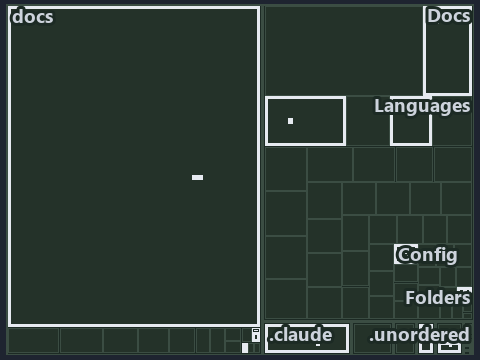

# docs/.assets/explanation/tree/adr-conf-addressing--an-address-is-a-read-only-walk--meta.tree.md

`Tree minimap: adr-conf-addressing--an-address-is-a-read-only-walk--meta`

The tree minimap of the slide `adr-conf-addressing--an-address-is-a-read-only-walk--meta` (meta lens). The slide supports
[ADR-CONF-ADDRESSING][1]; the highlight of those ADR codes selects what is lit, and each reason below names the code that selects it.

## What the minimap shows

The tree draws every file of the world map as a tile, grouped by top-level folder (under `automation/` by module, under `docs/adr/` by ADR
domain), and lights 17 files in 11 groups, filled in ink. A lit ADR file has a white rim; a file lit only by passing mentions is a lighter
ink. Every other tile is idle, a grey box: a file the slide's ADR codes do not select.

- Config (automation/Catzc.Base.Config): 3 lit files
- .claude: 2 lit files
- Languages (automation/Catzc.Base.Languages): 2 lit files
- adr/conf (docs/adr/configuration): 2 lit files
- docs (docs/ outside docs/adr/): 2 lit files
- .unordered: 1 lit file
- Az.Templates (automation/Catzc.Azure.Templates): 1 lit file
- Docs (automation/Catzc.Base.Docs): 1 lit file
- Folders (automation/Catzc.Base.Folders): 1 lit file
- adr/* (the files directly in docs/adr/): 1 lit file
- pipelines: 1 lit file

## Why each group is lit

### Config (automation/Catzc.Base.Config, 3 lit files)

The group holds the files of automation/Catzc.Base.Config; each sits in its world-map cell and is lit by:

- [automation/Catzc.Base.Config/Get-ConfigValue.ps1][2], in the cell automation × powershell: selected by [ADR-CONF-ADDRESSING][1]: the file
  cites it at line 21 (header), line 38 (header), line 41 (header) and line 44 (header).
- [automation/Catzc.Base.Config/private/Resolve-ConfigKeyPath.ps1][3], in the cell automation × powershell: selected by
  [ADR-CONF-ADDRESSING][1]: the file cites it at line 20 (header), line 30 (header), line 32 (header) and line 37 (header).
- [automation/Catzc.Base.Config/tests/Get-ConfigValue.Tests.ps1][4], in the cell automation × powershell: selected by
  [ADR-CONF-ADDRESSING][1]: the file cites it at line 21 (header), line 62 (text) and line 91 (text).

### .claude (2 lit files)

The group holds the files of .claude; each sits in its world-map cell and is lit by:

- [.claude/plans/plan-bounded-folder-enumeration.md][5], in the cell .claude × markdown: selected by [ADR-CONF-ADDRESSING][1]: the file
  cites it at line 29 (text) and line 304 (text).
- [.claude/plans/prompt-bounded-folder-enumeration-continue.md][6], in the cell .claude × markdown: selected by [ADR-CONF-ADDRESSING][1]:
  the file cites it at line 20 (text) and line 41 (text).

### Languages (automation/Catzc.Base.Languages, 2 lit files)

The group holds the files of automation/Catzc.Base.Languages; each sits in its world-map cell and is lit by:

- [automation/Catzc.Base.Languages/New-GoWorkspace.ps1][7], in the cell automation × powershell: selected by [ADR-CONF-ADDRESSING][1]: the
  file cites it at line 22 (header).
- [automation/Catzc.Base.Languages/New-PythonProject.ps1][8], in the cell automation × powershell: selected by [ADR-CONF-ADDRESSING][1]: the
  file cites it at line 23 (header).

### adr/conf (docs/adr/configuration, 2 lit files)

The group holds the files of docs/adr/configuration; each sits in its world-map cell and is lit by:

- [docs/adr/configuration/config-value-addressing.md][1], in the cell docs × markdown: selected by [ADR-CONF-ADDRESSING][1]: the ADR's own
  file.
- [docs/adr/configuration/dora-explains.md][9], in the cell docs × markdown: selected by [ADR-CONF-ADDRESSING][1]: the file cites it at line
  53 (text).

### docs (docs/ outside docs/adr/, 2 lit files)

The group holds the files of docs/ outside docs/adr/; each sits in its world-map cell and is lit by:

- [docs/references/automation/catzc-base-languages/New-GoWorkspace.ps1.md][10], in the cell docs × markdown: selected by
  [ADR-CONF-ADDRESSING][1]: the file cites it at line 28 (text).
- [docs/references/automation/catzc-base-languages/New-PythonProject.ps1.md][11], in the cell docs × markdown: selected by
  [ADR-CONF-ADDRESSING][1]: the file cites it at line 28 (text).

### .unordered (1 lit file)

The group holds the files of .unordered; each sits in its world-map cell and is lit by:

- [.unordered/15-10-2026/plan-diagram-wave-8.md][12], in the cell .unordered × markdown: selected by [ADR-CONF-ADDRESSING][1]: the file
  cites it at line 19 (text).

### Az.Templates (automation/Catzc.Azure.Templates, 1 lit file)

The group holds the files of automation/Catzc.Azure.Templates; each sits in its world-map cell and is lit by:

- [automation/Catzc.Azure.Templates/private/Resolve-BicepParameterAddresses.ps1][13], in the cell automation × powershell: selected by
  [ADR-CONF-ADDRESSING][1]: the file cites it at line 22 (header), line 30 (header) and line 35 (header).

### Docs (automation/Catzc.Base.Docs, 1 lit file)

The group holds the files of automation/Catzc.Base.Docs; each sits in its world-map cell and is lit by:

- [automation/Catzc.Base.Docs/configs/adrs.yml][14], in the cell automation × yaml: selected by [ADR-CONF-ADDRESSING][1]: the file cites it
  at line 223 (text).

### Folders (automation/Catzc.Base.Folders, 1 lit file)

The group holds the files of automation/Catzc.Base.Folders; each sits in its world-map cell and is lit by:

- [automation/Catzc.Base.Folders/tests/types/FolderWalkConfig.Tests.ps1][15], in the cell automation × powershell: selected by
  [ADR-CONF-ADDRESSING][1]: the file cites it at line 21 (header) and line 78 (text).

### adr/* (the files directly in docs/adr/, 1 lit file)

The group holds the files of the files directly in docs/adr/; each sits in its world-map cell and is lit by:

- [docs/adr/index.md][16], in the cell docs × markdown: selected by [ADR-CONF-ADDRESSING][1]: the file cites it at line 231 (text).

### pipelines (1 lit file)

The group holds the files of pipelines; each sits in its world-map cell and is lit by:

- [pipelines/ci-automation.yaml][17], in the cell pipelines × pipeline-yaml: selected by [ADR-CONF-ADDRESSING][1]: a pipeline that cites
  nothing itself carries its globset's citations, which cite it at
  `automation/Catzc.Azure.Templates/private/Resolve-BicepParameterAddresses.ps1` line 22 (header),
  `automation/Catzc.Azure.Templates/private/Resolve-BicepParameterAddresses.ps1` line 30 (header),
  `automation/Catzc.Azure.Templates/private/Resolve-BicepParameterAddresses.ps1` line 35 (header),
  `automation/Catzc.Base.Config/Get-ConfigValue.ps1` line 21 (header), `automation/Catzc.Base.Config/Get-ConfigValue.ps1` line 38 (header),
  `automation/Catzc.Base.Config/Get-ConfigValue.ps1` line 41 (header), `automation/Catzc.Base.Config/Get-ConfigValue.ps1` line 44 (header),
  `automation/Catzc.Base.Config/private/Resolve-ConfigKeyPath.ps1` line 20 (header),
  `automation/Catzc.Base.Config/private/Resolve-ConfigKeyPath.ps1` line 30 (header),
  `automation/Catzc.Base.Config/private/Resolve-ConfigKeyPath.ps1` line 32 (header),
  `automation/Catzc.Base.Config/private/Resolve-ConfigKeyPath.ps1` line 37 (header),
  `automation/Catzc.Base.Config/tests/Get-ConfigValue.Tests.ps1` line 21 (header),
  `automation/Catzc.Base.Config/tests/Get-ConfigValue.Tests.ps1` line 62 (text),
  `automation/Catzc.Base.Config/tests/Get-ConfigValue.Tests.ps1` line 91 (text), `automation/Catzc.Base.Docs/configs/adrs.yml` line 223
  (text), `automation/Catzc.Base.Folders/tests/types/FolderWalkConfig.Tests.ps1` line 21 (header),
  `automation/Catzc.Base.Folders/tests/types/FolderWalkConfig.Tests.ps1` line 78 (text),
  `automation/Catzc.Base.Languages/New-GoWorkspace.ps1` line 22 (header) and `automation/Catzc.Base.Languages/New-PythonProject.ps1` line 23
  (header).

## Keywords

- [world map][18]
- [track][19]
- [file language][20]
- [cell][21]
- [lit cell][22]
- [.claude][23]: a track
- [.unordered][23]: a track
- [automation][23]: a track
- [docs][23]: a track
- [pipelines][23]: a track
- [markdown][24]: a file language
- [pipeline-yaml][24]: a file language
- [powershell][24]: a file language
- [yaml][24]: a file language

[1]: ../../../adr/configuration/config-value-addressing.md
[2]: ../../../../automation/Catzc.Base.Config/Get-ConfigValue.ps1
[3]: ../../../../automation/Catzc.Base.Config/private/Resolve-ConfigKeyPath.ps1
[4]: ../../../../automation/Catzc.Base.Config/tests/Get-ConfigValue.Tests.ps1
[5]: ../../../../.claude/plans/plan-bounded-folder-enumeration.md
[6]: ../../../../.claude/plans/prompt-bounded-folder-enumeration-continue.md
[7]: ../../../../automation/Catzc.Base.Languages/New-GoWorkspace.ps1
[8]: ../../../../automation/Catzc.Base.Languages/New-PythonProject.ps1
[9]: ../../../adr/configuration/dora-explains.md
[10]: ../../../references/automation/catzc-base-languages/New-GoWorkspace.ps1.md
[11]: ../../../references/automation/catzc-base-languages/New-PythonProject.ps1.md
[12]: ../../../../.unordered/15-10-2026/plan-diagram-wave-8.md
[13]: ../../../../automation/Catzc.Azure.Templates/private/Resolve-BicepParameterAddresses.ps1
[14]: ../../../../automation/Catzc.Base.Docs/configs/adrs.yml
[15]: ../../../../automation/Catzc.Base.Folders/tests/types/FolderWalkConfig.Tests.ps1
[16]: ../../../adr/index.md
[17]: ../../../../pipelines/ci-automation.yaml
[18]: ../../../adr/glossary.md#world-map
[19]: ../../../adr/glossary.md#track
[20]: ../../../adr/glossary.md#file-language
[21]: ../../../adr/glossary.md#cell
[22]: ../../../adr/glossary.md#lit-cell
[23]: ../../../../automation/Catzc.Base.Variants/configs/variants.yml
[24]: ../../../../automation/Catzc.Base.Languages/configs/languages.yml
