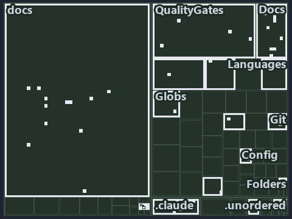

# docs/.assets/explanation/tree/adr-conf-loading--ask-by-name-get-the-cached-object--operations.tree.md

`Tree minimap: adr-conf-loading--ask-by-name-get-the-cached-object--operations`

The tree minimap of the slide `adr-conf-loading--ask-by-name-get-the-cached-object--operations` (operations lens). The slide supports
[ADR-CONF-ADDRESSING][1] and [ADR-CONF-LOADING][2]; the highlight of those ADR codes selects what is lit, and each reason below names the
code that selects it.

## What the minimap shows

The tree draws every file of the world map as a tile, grouped by top-level folder (under `automation/` by module, under `docs/adr/` by ADR
domain), and lights 49 files in 17 groups, filled in ink. A lit ADR file has a white rim; a file lit only by passing mentions is a lighter
ink. Every other tile is idle, a grey box: a file the slide's ADR codes do not select.

- docs (docs/ outside docs/adr/): 12 lit files
- Docs (automation/Catzc.Base.Docs): 9 lit files
- .claude: 5 lit files
- QualityGates (automation/Catzc.Base.QualityGates): 4 lit files
- Config (automation/Catzc.Base.Config): 3 lit files
- adr/conf (docs/adr/configuration): 3 lit files
- Git (automation/Catzc.Base.Git): 2 lit files
- Languages (automation/Catzc.Base.Languages): 2 lit files
- .unordered: 1 lit file
- Az.Templates (automation/Catzc.Azure.Templates): 1 lit file
- Execution (automation/Catzc.Base.Execution): 1 lit file
- Folders (automation/Catzc.Base.Folders): 1 lit file
- Globs (automation/Catzc.Base.Globs): 1 lit file
- ModuleSystem (automation/Catzc.Base.ModuleSystem): 1 lit file
- RootConfig (automation/Catzc.Base.RootConfig): 1 lit file
- adr/* (the files directly in docs/adr/): 1 lit file
- pipelines: 1 lit file

## Why each group is lit

### docs (docs/ outside docs/adr/, 12 lit files)

The group holds the files of docs/ outside docs/adr/; each sits in its world-map cell and is lit by:

- [docs/how-to/automation/manual-test-plan/configs.md][3], in the cell docs × markdown: selected by [ADR-CONF-LOADING][2]: the file cites it
  at line 15 (text), line 65 (text) and line 84 (text).
- [docs/how-to/getting-started/automation/add-a-module.md][4], in the cell docs × markdown: selected by [ADR-CONF-LOADING][2]: the file
  cites it at line 15 (text) and line 97 (text).
- [docs/references/automation/catzc-base-config/tests/Get-ConfigValue.Tests.ps1.md][5], in the cell docs × markdown: selected by
  [ADR-CONF-LOADING][2]: the file cites it at line 17 (text) and line 31 (text).
- [docs/references/automation/catzc-base-docs/types/AdrChecksConfig.cs.md][6], in the cell docs × markdown: selected by
  [ADR-CONF-LOADING][2]: the file cites it at line 19 (text) and line 38 (text).
- [docs/references/automation/catzc-base-docs/types/AdrsConfig.cs.md][7], in the cell docs × markdown: selected by [ADR-CONF-LOADING][2]:
  the file cites it at line 19 (text) and line 37 (text).
- [docs/references/automation/catzc-base-docs/types/AgentsConfig.cs.md][8], in the cell docs × markdown: selected by [ADR-CONF-LOADING][2]:
  the file cites it at line 17 (text) and line 36 (text).
- [docs/references/automation/catzc-base-docs/types/DocsConfig.cs.md][9], in the cell docs × markdown: selected by [ADR-CONF-LOADING][2]:
  the file cites it at line 31 (text).
- [docs/references/automation/catzc-base-git/types/GitIgnoreConfig.cs.md][10], in the cell docs × markdown: selected by
  [ADR-CONF-LOADING][2]: the file cites it at line 30 (text).
- [docs/references/automation/catzc-base-languages/New-GoWorkspace.ps1.md][11], in the cell docs × markdown: selected by
  [ADR-CONF-ADDRESSING][1]: the file cites it at line 27 (text).
- [docs/references/automation/catzc-base-languages/New-PythonProject.ps1.md][12], in the cell docs × markdown: selected by
  [ADR-CONF-ADDRESSING][1]: the file cites it at line 27 (text).
- [docs/references/automation/catzc-base-qualitygates/types/FileMetaConfig.cs.md][13], in the cell docs × markdown: selected by
  [ADR-CONF-LOADING][2]: the file cites it at line 16 (text) and line 32 (text).
- [docs/references/automation/catzc-base-rootconfig/types/RootConfigFiles.cs.md][14], in the cell docs × markdown: selected by
  [ADR-CONF-LOADING][2]: the file cites it at line 30 (text).

### Docs (automation/Catzc.Base.Docs, 9 lit files)

The group holds the files of automation/Catzc.Base.Docs; each sits in its world-map cell and is lit by:

- [automation/Catzc.Base.Docs/Build-Readme.ps1][15], in the cell automation × powershell: selected by [ADR-CONF-LOADING][2]: the file cites
  it at line 22 (header) and line 44 (header).
- [automation/Catzc.Base.Docs/configs/adrs.yml][16], in the cell automation × yaml: selected by [ADR-CONF-ADDRESSING][1]: the file cites it
  at line 221 (text); selected by [ADR-CONF-LOADING][2]: the file cites it at line 220 (text).
- [automation/Catzc.Base.Docs/private/Get-CatsRuleEnforcers.ps1][17], in the cell automation × powershell: selected by
  [ADR-CONF-LOADING][2]: the file cites it at line 22 (header) and line 38 (header).
- [automation/Catzc.Base.Docs/private/Get-GlossarySources.ps1][18], in the cell automation × powershell: selected by [ADR-CONF-LOADING][2]:
  the file cites it at line 20 (header) and line 29 (header).
- [automation/Catzc.Base.Docs/tests/Get-AdrRuleSet.Tests.ps1][19], in the cell automation × powershell: selected by [ADR-CONF-LOADING][2]:
  the file cites it at line 20 (header) and line 61 (text).
- [automation/Catzc.Base.Docs/types/AdrChecksConfig.cs][20], in the cell automation × csharp: selected by [ADR-CONF-LOADING][2]: the file
  cites it at line 23 (text).
- [automation/Catzc.Base.Docs/types/AdrsConfig.cs][21], in the cell automation × csharp: selected by [ADR-CONF-LOADING][2]: the file cites
  it at line 23 (text).
- [automation/Catzc.Base.Docs/types/AgentsConfig.cs][22], in the cell automation × csharp: selected by [ADR-CONF-LOADING][2]: the file cites
  it at line 21 (text).
- [automation/Catzc.Base.Docs/types/DocsConfig.cs][23], in the cell automation × csharp: selected by [ADR-CONF-LOADING][2]: the file cites
  it at line 20 (text).

### .claude (5 lit files)

The group holds the files of .claude; each sits in its world-map cell and is lit by:

- [.claude/plans/plan-bounded-folder-enumeration.md][24], in the cell .claude × markdown: selected by [ADR-CONF-ADDRESSING][1]: the file
  cites it at line 200 (text); selected by [ADR-CONF-LOADING][2]: the file cites it at line 148 (text).
- [.claude/plans/plan-config-defaults.md][25], in the cell .claude × markdown: selected by [ADR-CONF-LOADING][2]: the file cites it at line
  62 (text), line 138 (text) and line 223 (text).
- [.claude/plans/plan-minimal-robots.md][26], in the cell .claude × markdown: selected by [ADR-CONF-LOADING][2]: the file cites it at line
  51 (text).
- [.claude/plans/prompt-bounded-folder-enumeration-continue.md][27], in the cell .claude × markdown: selected by [ADR-CONF-ADDRESSING][1]:
  the file cites it at line 17 (text).
- [.claude/plans/prompt-config-defaults-continue.md][28], in the cell .claude × markdown: selected by [ADR-CONF-LOADING][2]: the file cites
  it at line 16 (text) and line 32 (text).

### QualityGates (automation/Catzc.Base.QualityGates, 4 lit files)

The group holds the files of automation/Catzc.Base.QualityGates; each sits in its world-map cell and is lit by:

- [automation/Catzc.Base.QualityGates/Test-ShippedConfigs.ps1][29], in the cell automation × powershell: selected by [ADR-CONF-LOADING][2]:
  the file cites it at line 21 (header) and line 26 (header).
- [automation/Catzc.Base.QualityGates/private/Get-LiveIdentityTokens.ps1][30], in the cell automation × powershell: selected by
  [ADR-CONF-LOADING][2]: the file cites it at line 22 (header) and line 36 (header).
- [automation/Catzc.Base.QualityGates/tests/types/CommentsConfig.Tests.ps1][31], in the cell automation × powershell: selected by
  [ADR-CONF-LOADING][2]: the file cites it at line 20 (header) and line 157 (text).
- [automation/Catzc.Base.QualityGates/types/FileMetaConfig.cs][32], in the cell automation × csharp: selected by [ADR-CONF-LOADING][2]: the
  file cites it at line 20 (text).

### Config (automation/Catzc.Base.Config, 3 lit files)

The group holds the files of automation/Catzc.Base.Config; each sits in its world-map cell and is lit by:

- [automation/Catzc.Base.Config/Get-ConfigValue.ps1][33], in the cell automation × powershell: selected by [ADR-CONF-ADDRESSING][1]: the
  file cites it at line 20 (header), line 37 (header), line 40 (header) and line 43 (header); selected by [ADR-CONF-LOADING][2]: the file
  cites it at line 21 (header), line 28 (header) and line 34 (header).
- [automation/Catzc.Base.Config/private/Resolve-ConfigKeyPath.ps1][34], in the cell automation × powershell: selected by
  [ADR-CONF-ADDRESSING][1]: the file cites it at line 19 (header), line 29 (header), line 31 (header) and line 36 (header).
- [automation/Catzc.Base.Config/tests/Get-ConfigValue.Tests.ps1][35], in the cell automation × powershell: selected by
  [ADR-CONF-ADDRESSING][1]: the file cites it at line 20 (header), line 61 (text) and line 90 (text); selected by [ADR-CONF-LOADING][2]: the
  file cites it at line 21 (header).

### adr/conf (docs/adr/configuration, 3 lit files)

The group holds the files of docs/adr/configuration; each sits in its world-map cell and is lit by:

- [docs/adr/configuration/config-value-addressing.md][1], in the cell docs × markdown: selected by [ADR-CONF-ADDRESSING][1]: the ADR's own
  file.
- [docs/adr/configuration/dora-explains.md][36], in the cell docs × markdown: selected by [ADR-CONF-ADDRESSING][1]: the file cites it at
  line 52 (text); selected by [ADR-CONF-LOADING][2]: the file cites it at line 35 (text).
- [docs/adr/configuration/module-config-loading.md][2], in the cell docs × markdown: selected by [ADR-CONF-LOADING][2]: the ADR's own file.

### Git (automation/Catzc.Base.Git, 2 lit files)

The group holds the files of automation/Catzc.Base.Git; each sits in its world-map cell and is lit by:

- [automation/Catzc.Base.Git/private/Get-AutoControlledGlobs.ps1][37], in the cell automation × powershell: selected by
  [ADR-CONF-LOADING][2]: the file cites it at line 21 (header) and line 33 (header).
- [automation/Catzc.Base.Git/types/GitIgnoreConfig.cs][38], in the cell automation × csharp: selected by [ADR-CONF-LOADING][2]: the file
  cites it at line 20 (text).

### Languages (automation/Catzc.Base.Languages, 2 lit files)

The group holds the files of automation/Catzc.Base.Languages; each sits in its world-map cell and is lit by:

- [automation/Catzc.Base.Languages/New-GoWorkspace.ps1][39], in the cell automation × powershell: selected by [ADR-CONF-ADDRESSING][1]: the
  file cites it at line 21 (header).
- [automation/Catzc.Base.Languages/New-PythonProject.ps1][40], in the cell automation × powershell: selected by [ADR-CONF-ADDRESSING][1]:
  the file cites it at line 22 (header).

### .unordered (1 lit file)

The group holds the files of .unordered; each sits in its world-map cell and is lit by:

- [.unordered/15-10-2026/plan-diagram-wave-8.md][41], in the cell .unordered × markdown: selected by [ADR-CONF-ADDRESSING][1]: the file
  cites it at line 19 (text).

### Az.Templates (automation/Catzc.Azure.Templates, 1 lit file)

The group holds the files of automation/Catzc.Azure.Templates; each sits in its world-map cell and is lit by:

- [automation/Catzc.Azure.Templates/private/Resolve-BicepParameterAddresses.ps1][42], in the cell automation × powershell: selected by
  [ADR-CONF-ADDRESSING][1]: the file cites it at line 21 (header), line 29 (header) and line 34 (header).

### Execution (automation/Catzc.Base.Execution, 1 lit file)

The group holds the files of automation/Catzc.Base.Execution; each sits in its world-map cell and is lit by:

- [automation/Catzc.Base.Execution/Resolve-ToolExecutable.ps1][43], in the cell automation × powershell: selected by [ADR-CONF-LOADING][2]:
  the file cites it at line 19 (header) and line 28 (header).

### Folders (automation/Catzc.Base.Folders, 1 lit file)

The group holds the files of automation/Catzc.Base.Folders; each sits in its world-map cell and is lit by:

- [automation/Catzc.Base.Folders/tests/types/FolderWalkConfig.Tests.ps1][44], in the cell automation × powershell: selected by
  [ADR-CONF-ADDRESSING][1]: the file cites it at line 20 (header) and line 77 (text).

### Globs (automation/Catzc.Base.Globs, 1 lit file)

The group holds the files of automation/Catzc.Base.Globs; each sits in its world-map cell and is lit by:

- [automation/Catzc.Base.Globs/types/FileKindsConfig.cs][45], in the cell automation × csharp: selected by [ADR-CONF-LOADING][2]: the file
  cites it at line 20 (text).

### ModuleSystem (automation/Catzc.Base.ModuleSystem, 1 lit file)

The group holds the files of automation/Catzc.Base.ModuleSystem; each sits in its world-map cell and is lit by:

- [automation/Catzc.Base.ModuleSystem/Copy-Automation.ps1][46], in the cell automation × powershell: selected by [ADR-CONF-LOADING][2]: the
  file cites it at line 22 (header) and line 52 (header).

### RootConfig (automation/Catzc.Base.RootConfig, 1 lit file)

The group holds the files of automation/Catzc.Base.RootConfig; each sits in its world-map cell and is lit by:

- [automation/Catzc.Base.RootConfig/types/RootConfigFiles.cs][47], in the cell automation × csharp: selected by [ADR-CONF-LOADING][2]: the
  file cites it at line 20 (text).

### adr/* (the files directly in docs/adr/, 1 lit file)

The group holds the files of the files directly in docs/adr/; each sits in its world-map cell and is lit by:

- [docs/adr/index.md][48], in the cell docs × markdown: selected by [ADR-CONF-ADDRESSING][1]: the file cites it at line 227 (text); selected
  by [ADR-CONF-LOADING][2]: the file cites it at line 226 (text).

### pipelines (1 lit file)

The group holds the files of pipelines; each sits in its world-map cell and is lit by:

- [pipelines/ci-automation.yaml][49], in the cell pipelines × pipeline-yaml: selected by [ADR-CONF-ADDRESSING][1]: a pipeline that cites
  nothing itself carries its globset's citations, which cite it at
  `automation/Catzc.Azure.Templates/private/Resolve-BicepParameterAddresses.ps1` line 21 (header),
  `automation/Catzc.Azure.Templates/private/Resolve-BicepParameterAddresses.ps1` line 29 (header),
  `automation/Catzc.Azure.Templates/private/Resolve-BicepParameterAddresses.ps1` line 34 (header),
  `automation/Catzc.Base.Config/Get-ConfigValue.ps1` line 20 (header), `automation/Catzc.Base.Config/Get-ConfigValue.ps1` line 37 (header),
  `automation/Catzc.Base.Config/Get-ConfigValue.ps1` line 40 (header), `automation/Catzc.Base.Config/Get-ConfigValue.ps1` line 43 (header),
  `automation/Catzc.Base.Config/private/Resolve-ConfigKeyPath.ps1` line 19 (header),
  `automation/Catzc.Base.Config/private/Resolve-ConfigKeyPath.ps1` line 29 (header),
  `automation/Catzc.Base.Config/private/Resolve-ConfigKeyPath.ps1` line 31 (header),
  `automation/Catzc.Base.Config/private/Resolve-ConfigKeyPath.ps1` line 36 (header),
  `automation/Catzc.Base.Config/tests/Get-ConfigValue.Tests.ps1` line 20 (header),
  `automation/Catzc.Base.Config/tests/Get-ConfigValue.Tests.ps1` line 61 (text),
  `automation/Catzc.Base.Config/tests/Get-ConfigValue.Tests.ps1` line 90 (text), `automation/Catzc.Base.Docs/configs/adrs.yml` line 221
  (text), `automation/Catzc.Base.Folders/tests/types/FolderWalkConfig.Tests.ps1` line 20 (header),
  `automation/Catzc.Base.Folders/tests/types/FolderWalkConfig.Tests.ps1` line 77 (text),
  `automation/Catzc.Base.Languages/New-GoWorkspace.ps1` line 21 (header) and `automation/Catzc.Base.Languages/New-PythonProject.ps1` line 22
  (header); selected by [ADR-CONF-LOADING][2]: a pipeline that cites nothing itself carries its globset's citations, which cite it at
  `automation/Catzc.Base.Config/Get-ConfigValue.ps1` line 21 (header), `automation/Catzc.Base.Config/Get-ConfigValue.ps1` line 28 (header),
  `automation/Catzc.Base.Config/Get-ConfigValue.ps1` line 34 (header), `automation/Catzc.Base.Config/tests/Get-ConfigValue.Tests.ps1` line
  21 (header), `automation/Catzc.Base.Docs/Build-Readme.ps1` line 22 (header), `automation/Catzc.Base.Docs/Build-Readme.ps1` line 44
  (header), `automation/Catzc.Base.Docs/configs/adrs.yml` line 220 (text), `automation/Catzc.Base.Docs/private/Get-CatsRuleEnforcers.ps1`
  line 22 (header), `automation/Catzc.Base.Docs/private/Get-CatsRuleEnforcers.ps1` line 38 (header),
  `automation/Catzc.Base.Docs/private/Get-GlossarySources.ps1` line 20 (header),
  `automation/Catzc.Base.Docs/private/Get-GlossarySources.ps1` line 29 (header), `automation/Catzc.Base.Docs/tests/Get-AdrRuleSet.Tests.ps1`
  line 20 (header), `automation/Catzc.Base.Docs/tests/Get-AdrRuleSet.Tests.ps1` line 61 (text),
  `automation/Catzc.Base.Docs/types/AdrChecksConfig.cs` line 23 (text), `automation/Catzc.Base.Docs/types/AdrsConfig.cs` line 23 (text),
  `automation/Catzc.Base.Docs/types/AgentsConfig.cs` line 21 (text), `automation/Catzc.Base.Docs/types/DocsConfig.cs` line 20 (text),
  `automation/Catzc.Base.Execution/Resolve-ToolExecutable.ps1` line 19 (header),
  `automation/Catzc.Base.Execution/Resolve-ToolExecutable.ps1` line 28 (header),
  `automation/Catzc.Base.Git/private/Get-AutoControlledGlobs.ps1` line 21 (header),
  `automation/Catzc.Base.Git/private/Get-AutoControlledGlobs.ps1` line 33 (header), `automation/Catzc.Base.Git/types/GitIgnoreConfig.cs`
  line 20 (text), `automation/Catzc.Base.Globs/types/FileKindsConfig.cs` line 20 (text),
  `automation/Catzc.Base.ModuleSystem/Copy-Automation.ps1` line 22 (header), `automation/Catzc.Base.ModuleSystem/Copy-Automation.ps1` line
  52 (header), `automation/Catzc.Base.QualityGates/Test-ShippedConfigs.ps1` line 21 (header),
  `automation/Catzc.Base.QualityGates/Test-ShippedConfigs.ps1` line 26 (header),
  `automation/Catzc.Base.QualityGates/private/Get-LiveIdentityTokens.ps1` line 22 (header),
  `automation/Catzc.Base.QualityGates/private/Get-LiveIdentityTokens.ps1` line 36 (header),
  `automation/Catzc.Base.QualityGates/tests/types/CommentsConfig.Tests.ps1` line 20 (header),
  `automation/Catzc.Base.QualityGates/tests/types/CommentsConfig.Tests.ps1` line 157 (text),
  `automation/Catzc.Base.QualityGates/types/FileMetaConfig.cs` line 20 (text) and
  `automation/Catzc.Base.RootConfig/types/RootConfigFiles.cs` line 20 (text).

## Keywords

- [world map][50]
- [track][51]
- [file language][52]
- [cell][53]
- [lit cell][54]
- [.claude][55]: a track
- [.unordered][55]: a track
- [automation][55]: a track
- [docs][55]: a track
- [pipelines][55]: a track
- [csharp][56]: a file language
- [markdown][56]: a file language
- [pipeline-yaml][56]: a file language
- [powershell][56]: a file language
- [yaml][56]: a file language

[1]: ../../../adr/configuration/config-value-addressing.md
[2]: ../../../adr/configuration/module-config-loading.md
[3]: ../../../how-to/automation/manual-test-plan/configs.md
[4]: ../../../how-to/getting-started/automation/add-a-module.md
[5]: ../../../references/automation/catzc-base-config/tests/Get-ConfigValue.Tests.ps1.md
[6]: ../../../references/automation/catzc-base-docs/types/AdrChecksConfig.cs.md
[7]: ../../../references/automation/catzc-base-docs/types/AdrsConfig.cs.md
[8]: ../../../references/automation/catzc-base-docs/types/AgentsConfig.cs.md
[9]: ../../../references/automation/catzc-base-docs/types/DocsConfig.cs.md
[10]: ../../../references/automation/catzc-base-git/types/GitIgnoreConfig.cs.md
[11]: ../../../references/automation/catzc-base-languages/New-GoWorkspace.ps1.md
[12]: ../../../references/automation/catzc-base-languages/New-PythonProject.ps1.md
[13]: ../../../references/automation/catzc-base-qualitygates/types/FileMetaConfig.cs.md
[14]: ../../../references/automation/catzc-base-rootconfig/types/RootConfigFiles.cs.md
[15]: ../../../../automation/Catzc.Base.Docs/Build-Readme.ps1
[16]: ../../../../automation/Catzc.Base.Docs/configs/adrs.yml
[17]: ../../../../automation/Catzc.Base.Docs/private/Get-CatsRuleEnforcers.ps1
[18]: ../../../../automation/Catzc.Base.Docs/private/Get-GlossarySources.ps1
[19]: ../../../../automation/Catzc.Base.Docs/tests/Get-AdrRuleSet.Tests.ps1
[20]: ../../../../automation/Catzc.Base.Docs/types/AdrChecksConfig.cs
[21]: ../../../../automation/Catzc.Base.Docs/types/AdrsConfig.cs
[22]: ../../../../automation/Catzc.Base.Docs/types/AgentsConfig.cs
[23]: ../../../../automation/Catzc.Base.Docs/types/DocsConfig.cs
[24]: ../../../../.claude/plans/plan-bounded-folder-enumeration.md
[25]: ../../../../.claude/plans/plan-config-defaults.md
[26]: ../../../../.claude/plans/plan-minimal-robots.md
[27]: ../../../../.claude/plans/prompt-bounded-folder-enumeration-continue.md
[28]: ../../../../.claude/plans/prompt-config-defaults-continue.md
[29]: ../../../../automation/Catzc.Base.QualityGates/Test-ShippedConfigs.ps1
[30]: ../../../../automation/Catzc.Base.QualityGates/private/Get-LiveIdentityTokens.ps1
[31]: ../../../../automation/Catzc.Base.QualityGates/tests/types/CommentsConfig.Tests.ps1
[32]: ../../../../automation/Catzc.Base.QualityGates/types/FileMetaConfig.cs
[33]: ../../../../automation/Catzc.Base.Config/Get-ConfigValue.ps1
[34]: ../../../../automation/Catzc.Base.Config/private/Resolve-ConfigKeyPath.ps1
[35]: ../../../../automation/Catzc.Base.Config/tests/Get-ConfigValue.Tests.ps1
[36]: ../../../adr/configuration/dora-explains.md
[37]: ../../../../automation/Catzc.Base.Git/private/Get-AutoControlledGlobs.ps1
[38]: ../../../../automation/Catzc.Base.Git/types/GitIgnoreConfig.cs
[39]: ../../../../automation/Catzc.Base.Languages/New-GoWorkspace.ps1
[40]: ../../../../automation/Catzc.Base.Languages/New-PythonProject.ps1
[41]: ../../../../.unordered/15-10-2026/plan-diagram-wave-8.md
[42]: ../../../../automation/Catzc.Azure.Templates/private/Resolve-BicepParameterAddresses.ps1
[43]: ../../../../automation/Catzc.Base.Execution/Resolve-ToolExecutable.ps1
[44]: ../../../../automation/Catzc.Base.Folders/tests/types/FolderWalkConfig.Tests.ps1
[45]: ../../../../automation/Catzc.Base.Globs/types/FileKindsConfig.cs
[46]: ../../../../automation/Catzc.Base.ModuleSystem/Copy-Automation.ps1
[47]: ../../../../automation/Catzc.Base.RootConfig/types/RootConfigFiles.cs
[48]: ../../../adr/index.md
[49]: ../../../../pipelines/ci-automation.yaml
[50]: ../../../adr/glossary.md#world-map
[51]: ../../../adr/glossary.md#track
[52]: ../../../adr/glossary.md#file-language
[53]: ../../../adr/glossary.md#cell
[54]: ../../../adr/glossary.md#lit-cell
[55]: ../../../../automation/Catzc.Base.Variants/configs/variants.yml
[56]: ../../../../automation/Catzc.Base.Languages/configs/languages.yml
