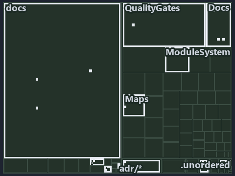

# docs/.assets/explanation/tree/adr-dsgn-life--integrators-depend-on-an-occupant--architecture.tree.md

`Tree minimap: adr-dsgn-life--integrators-depend-on-an-occupant--architecture`

The tree minimap of the slide `adr-dsgn-life--integrators-depend-on-an-occupant--architecture` (architecture lens). The slide supports
[ADR-DSGN-LIFE][1] and [ADR-FLOW-CD][2]; the highlight of those ADR codes selects what is lit, and each reason below names the code that
selects it.

## What the minimap shows

The tree draws every file of the world map as a tile, grouped by top-level folder (under `automation/` by module, under `docs/adr/` by ADR
domain), and lights 25 files in 11 groups, filled in ink. A lit ADR file has a white rim; a file lit only by passing mentions is a lighter
ink. Every other tile is idle, a grey box: a file the slide's ADR codes do not select.

- .unordered: 6 lit files
- Docs (automation/Catzc.Base.Docs): 3 lit files
- Maps (automation/Catzc.Base.Maps): 3 lit files
- docs (docs/ outside docs/adr/): 3 lit files
- adr/* (the files directly in docs/adr/): 2 lit files
- adr/dsgn (docs/adr/design): 2 lit files
- adr/flow (docs/adr/flow): 2 lit files
- .claude: 1 lit file
- ModuleSystem (automation/Catzc.Base.ModuleSystem): 1 lit file
- QualityGates (automation/Catzc.Base.QualityGates): 1 lit file
- pipelines: 1 lit file

## Why each group is lit

### .unordered (6 lit files)

The group holds the files of .unordered; each sits in its world-map cell and is lit by:

- [.unordered/15-10-2026/plan-adr-consistency.md][3], in the cell .unordered × markdown: selected by [ADR-DSGN-LIFE][1]: the file cites it
  at line 100 (text), line 183 (text) and line 268 (text); selected by [ADR-FLOW-CD][2]: the file cites it at line 44 (text), line 99
  (text), line 152 (text), line 173 (text), line 178 (text), line 183 (text), line 291 (text) and line 291 (text).
- [.unordered/15-10-2026/plan-built-bundle.md][4], in the cell .unordered × markdown: selected by [ADR-FLOW-CD][2]: the file cites it at
  line 13 (text), line 255 (text) and line 277 (text).
- [.unordered/15-10-2026/plan-caf-waf-automation.md][5], in the cell .unordered × markdown: selected by [ADR-FLOW-CD][2]: the file cites it
  at line 16 (text).
- [.unordered/15-10-2026/plan-concern-axis.md][6], in the cell .unordered × markdown: selected by [ADR-DSGN-LIFE][1]: the file cites it at
  line 91 (text).
- [.unordered/15-10-2026/plan-diagram-wave-8.md][7], in the cell .unordered × markdown: selected by [ADR-FLOW-CD][2]: the file cites it at
  line 22 (text), line 23 (text) and line 24 (text).
- [.unordered/15-10-2026/plan-explanation-drift.md][8], in the cell .unordered × markdown: selected by [ADR-DSGN-LIFE][1]: the file cites it
  at line 84 (text), line 86 (text), line 86 (text), line 97 (text), line 99 (text), line 101 (text) and line 101 (text); selected by
  [ADR-FLOW-CD][2]: the file cites it at line 97 (text).

### Docs (automation/Catzc.Base.Docs, 3 lit files)

The group holds the files of automation/Catzc.Base.Docs; each sits in its world-map cell and is lit by:

- [automation/Catzc.Base.Docs/configs/adrs.yml][9], in the cell automation × yaml: selected by [ADR-DSGN-LIFE][1]: the file cites it at line
  95 (text); selected by [ADR-FLOW-CD][2]: the file cites it at line 114 (text).
- [automation/Catzc.Base.Docs/types/AdrsConfig.cs][10], in the cell automation × csharp: selected by [ADR-FLOW-CD][2]: the file cites it at
  line 25 (text).
- [automation/Catzc.Base.Docs/types/GlossaryConcept.cs][11], in the cell automation × csharp: selected by [ADR-FLOW-CD][2]: the file cites
  it at line 22 (text).

### Maps (automation/Catzc.Base.Maps, 3 lit files)

The group holds the files of automation/Catzc.Base.Maps; each sits in its world-map cell and is lit by:

- [automation/Catzc.Base.Maps/Get-ValueChainHighlight.ps1][12], in the cell automation × powershell: selected by [ADR-FLOW-CD][2]: the file
  cites it at line 21 (header) and line 40 (header).
- [automation/Catzc.Base.Maps/Get-WorldMapHighlight.ps1][13], in the cell automation × powershell: selected by [ADR-FLOW-CD][2]: the file
  cites it at line 20 (header) and line 48 (header).
- [automation/Catzc.Base.Maps/tests/Get-WorldMapHighlight.Tests.ps1][14], in the cell automation × powershell: selected by [ADR-FLOW-CD][2]:
  the file cites it at line 19 (header), line 92 (text) and line 93 (text).

### docs (docs/ outside docs/adr/, 3 lit files)

The group holds the files of docs/ outside docs/adr/; each sits in its world-map cell and is lit by:

- [docs/references/automation/catzc-base-docs/configs/adrs.yml.md][15], in the cell docs × markdown: selected by [ADR-FLOW-CD][2]: the file
  cites it at line 57 (text).
- [docs/references/automation/catzc-base-docs/types/AdrsConfig.cs.md][16], in the cell docs × markdown: selected by [ADR-FLOW-CD][2]: the
  file cites it at line 49 (text), line 50 (text), line 78 (text) and line 79 (text).
- [docs/references/automation/catzc-base-docs/types/GlossaryConcept.cs.md][17], in the cell docs × markdown: selected by [ADR-FLOW-CD][2]:
  the file cites it at line 19 (text) and line 56 (text).

### adr/* (the files directly in docs/adr/, 2 lit files)

The group holds the files of the files directly in docs/adr/; each sits in its world-map cell and is lit by:

- [docs/adr/glossary.md][18], in the cell docs × markdown: selected by [ADR-DSGN-LIFE][1]: the file cites it at line 201 (text); selected by
  [ADR-FLOW-CD][2]: the file cites it at line 397 (text) and line 410 (text).
- [docs/adr/index.md][19], in the cell docs × markdown: selected by [ADR-DSGN-LIFE][1]: the file cites it at line 107 (text); selected by
  [ADR-FLOW-CD][2]: the file cites it at line 124 (text).

### adr/dsgn (docs/adr/design, 2 lit files)

The group holds the files of docs/adr/design; each sits in its world-map cell and is lit by:

- [docs/adr/design/commit-lifecycle.md][1], in the cell docs × markdown: selected by [ADR-DSGN-LIFE][1]: the ADR's own file.
- [docs/adr/design/dora-explains.md][20], in the cell docs × markdown: selected by [ADR-DSGN-LIFE][1]: the file cites it at line 121 (text).

### adr/flow (docs/adr/flow, 2 lit files)

The group holds the files of docs/adr/flow; each sits in its world-map cell and is lit by:

- [docs/adr/flow/cd-discipline-and-promotion-flow.md][2], in the cell docs × markdown: selected by [ADR-FLOW-CD][2]: the ADR's own file.
- [docs/adr/flow/dora-explains.md][21], in the cell docs × markdown: selected by [ADR-FLOW-CD][2]: the file cites it at line 42 (text).

### .claude (1 lit file)

The group holds the files of .claude; each sits in its world-map cell and is lit by:

- [.claude/CLAUDE.md][22], in the cell .claude × markdown: selected by [ADR-FLOW-CD][2]: the file cites it at line 50 (text).

### ModuleSystem (automation/Catzc.Base.ModuleSystem, 1 lit file)

The group holds the files of automation/Catzc.Base.ModuleSystem; each sits in its world-map cell and is lit by:

- [automation/Catzc.Base.ModuleSystem/configs/glossary.yml][23], in the cell automation × yaml: selected by [ADR-DSGN-LIFE][1]: the file
  cites it at line 68 (text); selected by [ADR-FLOW-CD][2]: the file cites it at line 37 (text).

### QualityGates (automation/Catzc.Base.QualityGates, 1 lit file)

The group holds the files of automation/Catzc.Base.QualityGates; each sits in its world-map cell and is lit by:

- [automation/Catzc.Base.QualityGates/configs/glossary.yml][24], in the cell automation × yaml: selected by [ADR-FLOW-CD][2]: the file cites
  it at line 76 (text).

### pipelines (1 lit file)

The group holds the files of pipelines; each sits in its world-map cell and is lit by:

- [pipelines/ci-automation.yaml][25], in the cell pipelines × pipeline-yaml: selected by [ADR-DSGN-LIFE][1]: a pipeline that cites nothing
  itself carries its globset's citations, which cite it at `automation/Catzc.Base.Docs/configs/adrs.yml` line 95 (text) and
  `automation/Catzc.Base.ModuleSystem/configs/glossary.yml` line 68 (text); selected by [ADR-FLOW-CD][2]: a pipeline that cites nothing
  itself carries its globset's citations, which cite it at `automation/Catzc.Base.Docs/configs/adrs.yml` line 114 (text),
  `automation/Catzc.Base.Docs/types/AdrsConfig.cs` line 25 (text), `automation/Catzc.Base.Docs/types/GlossaryConcept.cs` line 22 (text),
  `automation/Catzc.Base.Maps/Get-ValueChainHighlight.ps1` line 21 (header), `automation/Catzc.Base.Maps/Get-ValueChainHighlight.ps1` line
  40 (header), `automation/Catzc.Base.Maps/Get-WorldMapHighlight.ps1` line 20 (header),
  `automation/Catzc.Base.Maps/Get-WorldMapHighlight.ps1` line 48 (header),
  `automation/Catzc.Base.Maps/tests/Get-WorldMapHighlight.Tests.ps1` line 19 (header),
  `automation/Catzc.Base.Maps/tests/Get-WorldMapHighlight.Tests.ps1` line 92 (text),
  `automation/Catzc.Base.Maps/tests/Get-WorldMapHighlight.Tests.ps1` line 93 (text),
  `automation/Catzc.Base.ModuleSystem/configs/glossary.yml` line 37 (text) and `automation/Catzc.Base.QualityGates/configs/glossary.yml`
  line 76 (text).

## Keywords

- [world map][26]
- [track][27]
- [file language][28]
- [cell][29]
- [lit cell][30]
- [.claude][31]: a track
- [.unordered][31]: a track
- [automation][31]: a track
- [docs][31]: a track
- [pipelines][31]: a track
- [csharp][32]: a file language
- [markdown][32]: a file language
- [pipeline-yaml][32]: a file language
- [powershell][32]: a file language
- [yaml][32]: a file language

Terms the cited ADRs define:

- [gate][33], defined by [ADR-FLOW-CD#13][34]
- [occupant][35], defined by [ADR-DSGN-LIFE#5][36]
- [release candidate][37], defined by [ADR-FLOW-CD#14][38]

[1]: ../../../adr/design/commit-lifecycle.md
[2]: ../../../adr/flow/cd-discipline-and-promotion-flow.md
[3]: ../../../../.unordered/15-10-2026/plan-adr-consistency.md
[4]: ../../../../.unordered/15-10-2026/plan-built-bundle.md
[5]: ../../../../.unordered/15-10-2026/plan-caf-waf-automation.md
[6]: ../../../../.unordered/15-10-2026/plan-concern-axis.md
[7]: ../../../../.unordered/15-10-2026/plan-diagram-wave-8.md
[8]: ../../../../.unordered/15-10-2026/plan-explanation-drift.md
[9]: ../../../../automation/Catzc.Base.Docs/configs/adrs.yml
[10]: ../../../../automation/Catzc.Base.Docs/types/AdrsConfig.cs
[11]: ../../../../automation/Catzc.Base.Docs/types/GlossaryConcept.cs
[12]: ../../../../automation/Catzc.Base.Maps/Get-ValueChainHighlight.ps1
[13]: ../../../../automation/Catzc.Base.Maps/Get-WorldMapHighlight.ps1
[14]: ../../../../automation/Catzc.Base.Maps/tests/Get-WorldMapHighlight.Tests.ps1
[15]: ../../../references/automation/catzc-base-docs/configs/adrs.yml.md
[16]: ../../../references/automation/catzc-base-docs/types/AdrsConfig.cs.md
[17]: ../../../references/automation/catzc-base-docs/types/GlossaryConcept.cs.md
[18]: ../../../adr/glossary.md
[19]: ../../../adr/index.md
[20]: ../../../adr/design/dora-explains.md
[21]: ../../../adr/flow/dora-explains.md
[22]: ../../../../.claude/CLAUDE.md
[23]: ../../../../automation/Catzc.Base.ModuleSystem/configs/glossary.yml
[24]: ../../../../automation/Catzc.Base.QualityGates/configs/glossary.yml
[25]: ../../../../pipelines/ci-automation.yaml
[26]: ../../../adr/glossary.md#world-map
[27]: ../../../adr/glossary.md#track
[28]: ../../../adr/glossary.md#file-language
[29]: ../../../adr/glossary.md#cell
[30]: ../../../adr/glossary.md#lit-cell
[31]: ../../../../automation/Catzc.Base.Variants/configs/variants.yml
[32]: ../../../../automation/Catzc.Base.Languages/configs/languages.yml
[33]: ../../../adr/glossary.md#gate
[34]: ../../../adr/flow/cd-discipline-and-promotion-flow.md#rule-adr-flow-cd13
[35]: ../../../adr/glossary.md#occupant
[36]: ../../../adr/design/commit-lifecycle.md#rule-adr-dsgn-life5
[37]: ../../../adr/glossary.md#release-candidate
[38]: ../../../adr/flow/cd-discipline-and-promotion-flow.md#rule-adr-flow-cd14
