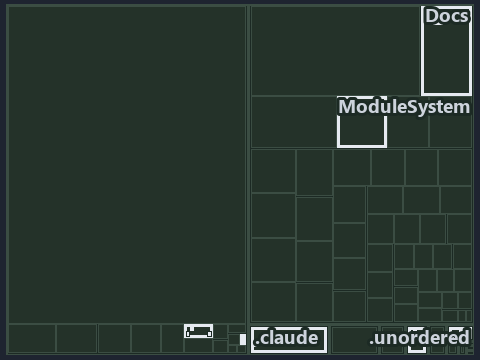

# docs/.assets/explanation/tree/adr-dsgn-life--out-of-band-deploy-is-adr-only--governance.tree.md

`Tree minimap: adr-dsgn-life--out-of-band-deploy-is-adr-only--governance`

The tree minimap of the slide `adr-dsgn-life--out-of-band-deploy-is-adr-only--governance` (governance lens). The slide supports
[ADR-DSGN-LIFE][1] and [ADR-DSGN-VISUAL][2]; the highlight of those ADR codes selects what is lit, and each reason below names the code that
selects it.

## What the minimap shows

The tree draws every file of the world map as a tile, grouped by top-level folder (under `automation/` by module, under `docs/adr/` by ADR
domain), and lights 16 files in 7 groups, filled in ink. A lit ADR file has a white rim; a file lit only by passing mentions is a lighter
ink. Every other tile is idle, a grey box: a file the slide's ADR codes do not select.

- .unordered: 4 lit files
- .claude: 3 lit files
- adr/dsgn (docs/adr/design): 3 lit files
- Docs (automation/Catzc.Base.Docs): 2 lit files
- adr/* (the files directly in docs/adr/): 2 lit files
- ModuleSystem (automation/Catzc.Base.ModuleSystem): 1 lit file
- pipelines: 1 lit file

## Why each group is lit

### .unordered (4 lit files)

The group holds the files of .unordered; each sits in its world-map cell and is lit by:

- [.unordered/15-10-2026/plan-adr-consistency.md][3], in the cell .unordered × markdown: selected by [ADR-DSGN-LIFE][1]: the file cites it
  at line 100 (text), line 183 (text) and line 268 (text); selected by [ADR-DSGN-VISUAL][2]: the file cites it at line 46 (text), line 108
  (text), line 184 (text) and line 268 (text).
- [.unordered/15-10-2026/plan-concern-axis.md][4], in the cell .unordered × markdown: selected by [ADR-DSGN-LIFE][1]: the file cites it at
  line 91 (text); selected by [ADR-DSGN-VISUAL][2]: the file cites it at line 90 (text).
- [.unordered/15-10-2026/plan-diagram-wave-7.md][5], in the cell .unordered × markdown: selected by [ADR-DSGN-VISUAL][2]: the file cites it
  at line 25 (text).
- [.unordered/15-10-2026/plan-explanation-drift.md][6], in the cell .unordered × markdown: selected by [ADR-DSGN-LIFE][1]: the file cites it
  at line 84 (text), line 86 (text), line 86 (text), line 97 (text), line 99 (text), line 101 (text) and line 101 (text); selected by
  [ADR-DSGN-VISUAL][2]: the file cites it at line 83 (text), line 83 (text), line 102 (text) and line 102 (text).

### .claude (3 lit files)

The group holds the files of .claude; each sits in its world-map cell and is lit by:

- [.claude/agents/drawio-diagram-waves.md][7], in the cell .claude × markdown: selected by [ADR-DSGN-VISUAL][2]: the file cites it at line
  26 (text) and line 67 (text).
- [.claude/plans/plan-minimal-robots-agents.md][8], in the cell .claude × markdown: selected by [ADR-DSGN-VISUAL][2]: the file cites it at
  line 39 (text).
- [.claude/plans/plan-minimal-robots-capabilities.md][9], in the cell .claude × markdown: selected by [ADR-DSGN-VISUAL][2]: the file cites
  it at line 60 (text) and line 103 (text).

### adr/dsgn (docs/adr/design, 3 lit files)

The group holds the files of docs/adr/design; each sits in its world-map cell and is lit by:

- [docs/adr/design/commit-lifecycle.md][1], in the cell docs × markdown: selected by [ADR-DSGN-LIFE][1]: the ADR's own file.
- [docs/adr/design/dora-explains.md][10], in the cell docs × markdown: selected by [ADR-DSGN-LIFE][1]: the file cites it at line 121 (text);
  selected by [ADR-DSGN-VISUAL][2]: the file cites it at line 102 (text).
- [docs/adr/design/visual-design.md][2], in the cell docs × markdown: selected by [ADR-DSGN-VISUAL][2]: the ADR's own file.

### Docs (automation/Catzc.Base.Docs, 2 lit files)

The group holds the files of automation/Catzc.Base.Docs; each sits in its world-map cell and is lit by:

- [automation/Catzc.Base.Docs/configs/adrs.yml][11], in the cell automation × yaml: selected by [ADR-DSGN-LIFE][1]: the file cites it at
  line 95 (text); selected by [ADR-DSGN-VISUAL][2]: the file cites it at line 94 (text).
- [automation/Catzc.Base.Docs/configs/agents.yml][12], in the cell automation × yaml: selected by [ADR-DSGN-VISUAL][2]: the file cites it at
  line 39 (text), line 39 (body comment), line 44 (text) and line 49 (text).

### adr/* (the files directly in docs/adr/, 2 lit files)

The group holds the files of the files directly in docs/adr/; each sits in its world-map cell and is lit by:

- [docs/adr/glossary.md][13], in the cell docs × markdown: selected by [ADR-DSGN-LIFE][1]: the file cites it at line 201 (text).
- [docs/adr/index.md][14], in the cell docs × markdown: selected by [ADR-DSGN-LIFE][1]: the file cites it at line 107 (text); selected by
  [ADR-DSGN-VISUAL][2]: the file cites it at line 106 (text).

### ModuleSystem (automation/Catzc.Base.ModuleSystem, 1 lit file)

The group holds the files of automation/Catzc.Base.ModuleSystem; each sits in its world-map cell and is lit by:

- [automation/Catzc.Base.ModuleSystem/configs/glossary.yml][15], in the cell automation × yaml: selected by [ADR-DSGN-LIFE][1]: the file
  cites it at line 68 (text).

### pipelines (1 lit file)

The group holds the files of pipelines; each sits in its world-map cell and is lit by:

- [pipelines/ci-automation.yaml][16], in the cell pipelines × pipeline-yaml: selected by [ADR-DSGN-LIFE][1]: a pipeline that cites nothing
  itself carries its globset's citations, which cite it at `automation/Catzc.Base.Docs/configs/adrs.yml` line 95 (text) and
  `automation/Catzc.Base.ModuleSystem/configs/glossary.yml` line 68 (text); selected by [ADR-DSGN-VISUAL][2]: a pipeline that cites nothing
  itself carries its globset's citations, which cite it at `automation/Catzc.Base.Docs/configs/adrs.yml` line 94 (text),
  `automation/Catzc.Base.Docs/configs/agents.yml` line 39 (text), `automation/Catzc.Base.Docs/configs/agents.yml` line 39 (body comment),
  `automation/Catzc.Base.Docs/configs/agents.yml` line 44 (text) and `automation/Catzc.Base.Docs/configs/agents.yml` line 49 (text).

## Keywords

- [world map][17]
- [track][18]
- [file language][19]
- [cell][20]
- [lit cell][21]
- [.claude][22]: a track
- [.unordered][22]: a track
- [automation][22]: a track
- [docs][22]: a track
- [pipelines][22]: a track
- [markdown][23]: a file language
- [pipeline-yaml][23]: a file language
- [yaml][23]: a file language

Terms the cited ADRs define:

- [occupant][24], defined by [ADR-DSGN-LIFE#5][25]

[1]: ../../../adr/design/commit-lifecycle.md
[2]: ../../../adr/design/visual-design.md
[3]: ../../../../.unordered/15-10-2026/plan-adr-consistency.md
[4]: ../../../../.unordered/15-10-2026/plan-concern-axis.md
[5]: ../../../../.unordered/15-10-2026/plan-diagram-wave-7.md
[6]: ../../../../.unordered/15-10-2026/plan-explanation-drift.md
[7]: ../../../../.claude/agents/drawio-diagram-waves.md
[8]: ../../../../.claude/plans/plan-minimal-robots-agents.md
[9]: ../../../../.claude/plans/plan-minimal-robots-capabilities.md
[10]: ../../../adr/design/dora-explains.md
[11]: ../../../../automation/Catzc.Base.Docs/configs/adrs.yml
[12]: ../../../../automation/Catzc.Base.Docs/configs/agents.yml
[13]: ../../../adr/glossary.md
[14]: ../../../adr/index.md
[15]: ../../../../automation/Catzc.Base.ModuleSystem/configs/glossary.yml
[16]: ../../../../pipelines/ci-automation.yaml
[17]: ../../../adr/glossary.md#world-map
[18]: ../../../adr/glossary.md#track
[19]: ../../../adr/glossary.md#file-language
[20]: ../../../adr/glossary.md#cell
[21]: ../../../adr/glossary.md#lit-cell
[22]: ../../../../automation/Catzc.Base.Variants/configs/variants.yml
[23]: ../../../../automation/Catzc.Base.Languages/configs/languages.yml
[24]: ../../../adr/glossary.md#occupant
[25]: ../../../adr/design/commit-lifecycle.md#rule-adr-dsgn-life5
