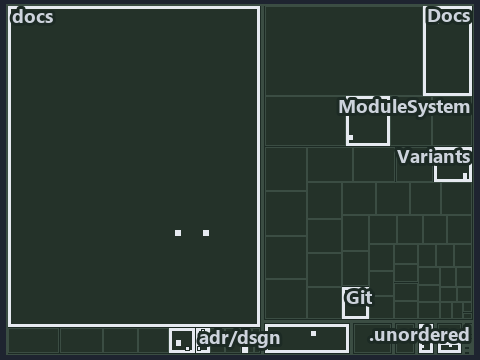

# docs/.assets/explanation/tree/adr-dsgn-remote--ingress-gated-the-rest-by-review--governance.tree.md

`Tree minimap: adr-dsgn-remote--ingress-gated-the-rest-by-review--governance`

The tree minimap of the slide `adr-dsgn-remote--ingress-gated-the-rest-by-review--governance` (governance lens). The slide supports
[ADR-DSGN-LIFE][1], [ADR-DSGN-REMOTE][2] and [ADR-REPO-VARIANT][3]; the highlight of those ADR codes selects what is lit, and each reason
below names the code that selects it.

## What the minimap shows

The tree draws every file of the world map as a tile, grouped by top-level folder (under `automation/` by module, under `docs/adr/` by ADR
domain), and lights 20 files in 11 groups, filled in ink. A lit ADR file has a white rim; a file lit only by passing mentions is a lighter
ink. Every other tile is idle, a grey box: a file the slide's ADR codes do not select.

- .unordered: 4 lit files
- adr/dsgn (docs/adr/design): 3 lit files
- ModuleSystem (automation/Catzc.Base.ModuleSystem): 2 lit files
- adr/* (the files directly in docs/adr/): 2 lit files
- adr/repo (docs/adr/repository): 2 lit files
- docs (docs/ outside docs/adr/): 2 lit files
- .claude: 1 lit file
- Docs (automation/Catzc.Base.Docs): 1 lit file
- Git (automation/Catzc.Base.Git): 1 lit file
- Variants (automation/Catzc.Base.Variants): 1 lit file
- pipelines: 1 lit file

## Why each group is lit

### .unordered (4 lit files)

The group holds the files of .unordered; each sits in its world-map cell and is lit by:

- [.unordered/15-10-2026/plan-adr-consistency.md][4], in the cell .unordered × markdown: selected by [ADR-DSGN-LIFE][1]: the file cites it
  at line 100 (text), line 183 (text) and line 268 (text); selected by [ADR-REPO-VARIANT][3]: the file cites it at line 106 (text) and line
  257 (text).
- [.unordered/15-10-2026/plan-concern-axis.md][5], in the cell .unordered × markdown: selected by [ADR-DSGN-LIFE][1]: the file cites it at
  line 91 (text); selected by [ADR-DSGN-REMOTE][2]: the file cites it at line 92 (text).
- [.unordered/15-10-2026/plan-diagram-wave-8.md][6], in the cell .unordered × markdown: selected by [ADR-REPO-VARIANT][3]: the file cites it
  at line 25 (text).
- [.unordered/15-10-2026/plan-explanation-drift.md][7], in the cell .unordered × markdown: selected by [ADR-DSGN-LIFE][1]: the file cites it
  at line 84 (text), line 86 (text), line 86 (text), line 97 (text), line 99 (text), line 101 (text) and line 101 (text); selected by
  [ADR-DSGN-REMOTE][2]: the file cites it at line 100 (text).

### adr/dsgn (docs/adr/design, 3 lit files)

The group holds the files of docs/adr/design; each sits in its world-map cell and is lit by:

- [docs/adr/design/commit-lifecycle.md][1], in the cell docs × markdown: selected by [ADR-DSGN-LIFE][1]: the ADR's own file.
- [docs/adr/design/dora-explains.md][8], in the cell docs × markdown: selected by [ADR-DSGN-LIFE][1]: the file cites it at line 122 (text);
  selected by [ADR-DSGN-REMOTE][2]: the file cites it at line 143 (text).
- [docs/adr/design/server-remote-integration.md][2], in the cell docs × markdown: selected by [ADR-DSGN-REMOTE][2]: the ADR's own file.

### ModuleSystem (automation/Catzc.Base.ModuleSystem, 2 lit files)

The group holds the files of automation/Catzc.Base.ModuleSystem; each sits in its world-map cell and is lit by:

- [automation/Catzc.Base.ModuleSystem/Sync-GeneratedFile.ps1][9], in the cell automation × powershell: selected by [ADR-REPO-VARIANT][3]:
  the file cites it at line 24 (header), line 52 (header) and line 125 (text).
- [automation/Catzc.Base.ModuleSystem/configs/glossary.yml][10], in the cell automation × yaml: selected by [ADR-DSGN-LIFE][1]: the file
  cites it at line 69 (text).

### adr/* (the files directly in docs/adr/, 2 lit files)

The group holds the files of the files directly in docs/adr/; each sits in its world-map cell and is lit by:

- [docs/adr/glossary.md][11], in the cell docs × markdown: selected by [ADR-DSGN-LIFE][1]: the file cites it at line 218 (text).
- [docs/adr/index.md][12], in the cell docs × markdown: selected by [ADR-DSGN-LIFE][1]: the file cites it at line 110 (text); selected by
  [ADR-DSGN-REMOTE][2]: the file cites it at line 111 (text); selected by [ADR-REPO-VARIANT][3]: the file cites it at line 320 (text).

### adr/repo (docs/adr/repository, 2 lit files)

The group holds the files of docs/adr/repository; each sits in its world-map cell and is lit by:

- [docs/adr/repository/dora-explains.md][13], in the cell docs × markdown: selected by [ADR-REPO-VARIANT][3]: the file cites it at line 198
  (text).
- [docs/adr/repository/repo-variants.md][3], in the cell docs × markdown: selected by [ADR-REPO-VARIANT][3]: the ADR's own file.

### docs (docs/ outside docs/adr/, 2 lit files)

The group holds the files of docs/ outside docs/adr/; each sits in its world-map cell and is lit by:

- [docs/references/automation/catzc-base-variants/configs/variants.yml.md][14], in the cell docs × markdown: selected by
  [ADR-REPO-VARIANT][3]: the file cites it at line 30 (text).
- [docs/references/automation/catzc-base-variants/types/VariantsConfig.cs.md][15], in the cell docs × markdown: selected by
  [ADR-REPO-VARIANT][3]: the file cites it at line 31 (text).

### .claude (1 lit file)

The group holds the files of .claude; each sits in its world-map cell and is lit by:

- [.claude/plans/plan-module-kinds-tracks.md][16], in the cell .claude × markdown: selected by [ADR-REPO-VARIANT][3]: the file cites it at
  line 886 (text) and line 940 (text).

### Docs (automation/Catzc.Base.Docs, 1 lit file)

The group holds the files of automation/Catzc.Base.Docs; each sits in its world-map cell and is lit by:

- [automation/Catzc.Base.Docs/configs/adrs.yml][17], in the cell automation × yaml: selected by [ADR-DSGN-LIFE][1]: the file cites it at
  line 96 (text); selected by [ADR-DSGN-REMOTE][2]: the file cites it at line 97 (text); selected by [ADR-REPO-VARIANT][3]: the file cites
  it at line 316 (text).

### Git (automation/Catzc.Base.Git, 1 lit file)

The group holds the files of automation/Catzc.Base.Git; each sits in its world-map cell and is lit by:

- [automation/Catzc.Base.Git/Push-Dirty.ps1][18], in the cell automation × powershell: selected by [ADR-DSGN-LIFE][1]: the file cites it at
  line 21 (header) and line 26 (header).

### Variants (automation/Catzc.Base.Variants, 1 lit file)

The group holds the files of automation/Catzc.Base.Variants; each sits in its world-map cell and is lit by:

- [automation/Catzc.Base.Variants/types/VariantsConfig.cs][19], in the cell automation × csharp: selected by [ADR-REPO-VARIANT][3]: the file
  cites it at line 24 (text).

### pipelines (1 lit file)

The group holds the files of pipelines; each sits in its world-map cell and is lit by:

- [pipelines/ci-automation.yaml][20], in the cell pipelines × pipeline-yaml: selected by [ADR-DSGN-LIFE][1]: a pipeline that cites nothing
  itself carries its globset's citations, which cite it at `automation/Catzc.Base.Docs/configs/adrs.yml` line 96 (text),
  `automation/Catzc.Base.Git/Push-Dirty.ps1` line 21 (header), `automation/Catzc.Base.Git/Push-Dirty.ps1` line 26 (header) and
  `automation/Catzc.Base.ModuleSystem/configs/glossary.yml` line 69 (text); selected by [ADR-DSGN-REMOTE][2]: a pipeline that cites nothing
  itself carries its globset's citations, which cite it at `automation/Catzc.Base.Docs/configs/adrs.yml` line 97 (text); selected by
  [ADR-REPO-VARIANT][3]: a pipeline that cites nothing itself carries its globset's citations, which cite it at
  `automation/Catzc.Base.Docs/configs/adrs.yml` line 316 (text), `automation/Catzc.Base.ModuleSystem/Sync-GeneratedFile.ps1` line 24
  (header), `automation/Catzc.Base.ModuleSystem/Sync-GeneratedFile.ps1` line 52 (header),
  `automation/Catzc.Base.ModuleSystem/Sync-GeneratedFile.ps1` line 125 (text) and `automation/Catzc.Base.Variants/types/VariantsConfig.cs`
  line 24 (text).

## Keywords

- [world map][21]
- [track][22]
- [file language][23]
- [cell][24]
- [lit cell][25]
- [.claude][26]: a track
- [.unordered][26]: a track
- [automation][26]: a track
- [docs][26]: a track
- [pipelines][26]: a track
- [csharp][27]: a file language
- [markdown][27]: a file language
- [pipeline-yaml][27]: a file language
- [powershell][27]: a file language
- [yaml][27]: a file language

Terms the cited ADRs define:

- [occupant][28], defined by [ADR-DSGN-LIFE#5][29]

[1]: ../../../adr/design/commit-lifecycle.md
[2]: ../../../adr/design/server-remote-integration.md
[3]: ../../../adr/repository/repo-variants.md
[4]: ../../../../.unordered/15-10-2026/plan-adr-consistency.md
[5]: ../../../../.unordered/15-10-2026/plan-concern-axis.md
[6]: ../../../../.unordered/15-10-2026/plan-diagram-wave-8.md
[7]: ../../../../.unordered/15-10-2026/plan-explanation-drift.md
[8]: ../../../adr/design/dora-explains.md
[9]: ../../../../automation/Catzc.Base.ModuleSystem/Sync-GeneratedFile.ps1
[10]: ../../../../automation/Catzc.Base.ModuleSystem/configs/glossary.yml
[11]: ../../../adr/glossary.md
[12]: ../../../adr/index.md
[13]: ../../../adr/repository/dora-explains.md
[14]: ../../../references/automation/catzc-base-variants/configs/variants.yml.md
[15]: ../../../references/automation/catzc-base-variants/types/VariantsConfig.cs.md
[16]: ../../../../.claude/plans/plan-module-kinds-tracks.md
[17]: ../../../../automation/Catzc.Base.Docs/configs/adrs.yml
[18]: ../../../../automation/Catzc.Base.Git/Push-Dirty.ps1
[19]: ../../../../automation/Catzc.Base.Variants/types/VariantsConfig.cs
[20]: ../../../../pipelines/ci-automation.yaml
[21]: ../../../adr/glossary.md#world-map
[22]: ../../../adr/glossary.md#track
[23]: ../../../adr/glossary.md#file-language
[24]: ../../../adr/glossary.md#cell
[25]: ../../../adr/glossary.md#lit-cell
[26]: ../../../../automation/Catzc.Base.Variants/configs/variants.yml
[27]: ../../../../automation/Catzc.Base.Languages/configs/languages.yml
[28]: ../../../adr/glossary.md#occupant
[29]: ../../../adr/design/commit-lifecycle.md#rule-adr-dsgn-life5
