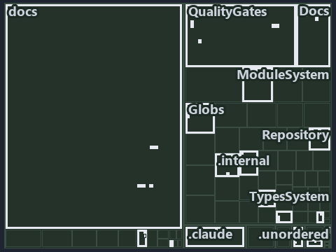

# docs/.assets/explanation/tree/adr-dsgn-runmode--where-code-loads-from-decides-the-mode--meta.tree.md

`Tree minimap: adr-dsgn-runmode--where-code-loads-from-decides-the-mode--meta`

The tree minimap of the slide `adr-dsgn-runmode--where-code-loads-from-decides-the-mode--meta` (meta lens). The slide supports
[ADR-DSGN-RUNMODE][1]; the highlight of those ADR codes selects what is lit, and each reason below names the code that selects it.

## What the minimap shows

The tree draws every file of the world map as a tile, grouped by top-level folder (under `automation/` by module, under `docs/adr/` by ADR
domain), and lights 47 files in 17 groups, filled in ink. A lit ADR file has a white rim; a file lit only by passing mentions is a lighter
ink. Every other tile is idle, a grey box: a file the slide's ADR codes do not select.

- ModuleSystem (automation/Catzc.Base.ModuleSystem): 7 lit files
- .unordered: 5 lit files
- QualityGates (automation/Catzc.Base.QualityGates): 5 lit files
- docs (docs/ outside docs/adr/): 5 lit files
- TypesSystem (automation/Catzc.Base.TypesSystem): 4 lit files
- Root files: 3 lit files
- Repository (automation/Catzc.Base.Repository): 3 lit files
- .claude: 2 lit files
- .internal (automation/.internal): 2 lit files
- Docs (automation/Catzc.Base.Docs): 2 lit files
- Vendor (automation/Catzc.Base.Vendor): 2 lit files
- adr/dsgn (docs/adr/design): 2 lit files
- ConfigExtensions (automation/Catzc.Base.ConfigExtensions): 1 lit file
- Globs (automation/Catzc.Base.Globs): 1 lit file
- RootConfig (automation/Catzc.Base.RootConfig): 1 lit file
- adr/* (the files directly in docs/adr/): 1 lit file
- pipelines: 1 lit file

## Why each group is lit

### ModuleSystem (automation/Catzc.Base.ModuleSystem, 7 lit files)

The group holds the files of automation/Catzc.Base.ModuleSystem; each sits in its world-map cell and is lit by:

- [automation/Catzc.Base.ModuleSystem/Copy-Automation.ps1][2], in the cell automation × powershell: selected by [ADR-DSGN-RUNMODE][1]: the
  file cites it at line 24 (header) and line 52 (header).
- [automation/Catzc.Base.ModuleSystem/Get-AutomationFunctions.ps1][3], in the cell automation × powershell: selected by
  [ADR-DSGN-RUNMODE][1]: the file cites it at line 20 (header) and line 32 (header).
- [automation/Catzc.Base.ModuleSystem/Get-FunctionDependency.ps1][4], in the cell automation × powershell: selected by
  [ADR-DSGN-RUNMODE][1]: the file cites it at line 23 (header) and line 34 (header).
- [automation/Catzc.Base.ModuleSystem/Get-InternalAssetDependency.ps1][5], in the cell automation × powershell: selected by
  [ADR-DSGN-RUNMODE][1]: the file cites it at line 22 (header) and line 49 (header).
- [automation/Catzc.Base.ModuleSystem/New-Importer.ps1][6], in the cell automation × powershell: selected by [ADR-DSGN-RUNMODE][1]: the file
  cites it at line 23 (header) and line 39 (header).
- [automation/Catzc.Base.ModuleSystem/Sync-GeneratedFile.ps1][7], in the cell automation × powershell: selected by [ADR-DSGN-RUNMODE][1]:
  the file cites it at line 23 (header) and line 40 (header).
- [automation/Catzc.Base.ModuleSystem/Test-FunctionDependency.ps1][8], in the cell automation × powershell: selected by
  [ADR-DSGN-RUNMODE][1]: the file cites it at line 23 (header) and line 44 (header).

### .unordered (5 lit files)

The group holds the files of .unordered; each sits in its world-map cell and is lit by:

- [.unordered/15-10-2026/plan-adr-consistency.md][9], in the cell .unordered × markdown: selected by [ADR-DSGN-RUNMODE][1]: the file cites
  it at line 195 (text).
- [.unordered/15-10-2026/plan-built-bundle.md][10], in the cell .unordered × markdown: selected by [ADR-DSGN-RUNMODE][1]: the file cites it
  at line 12 (text), line 32 (text), line 261 (text) and line 272 (text).
- [.unordered/15-10-2026/plan-concern-axis.md][11], in the cell .unordered × markdown: selected by [ADR-DSGN-RUNMODE][1]: the file cites it
  at line 93 (text).
- [.unordered/15-10-2026/plan-diagram-wave-9.md][12], in the cell .unordered × markdown: selected by [ADR-DSGN-RUNMODE][1]: the file cites
  it at line 124 (text).
- [.unordered/15-10-2026/plan-explanation-drift.md][13], in the cell .unordered × markdown: selected by [ADR-DSGN-RUNMODE][1]: the file
  cites it at line 71 (text) and line 96 (text).

### QualityGates (automation/Catzc.Base.QualityGates, 5 lit files)

The group holds the files of automation/Catzc.Base.QualityGates; each sits in its world-map cell and is lit by:

- [automation/Catzc.Base.QualityGates/Test-BuildArtifact.ps1][14], in the cell automation × powershell: selected by [ADR-DSGN-RUNMODE][1]:
  the file cites it at line 22 (header) and line 46 (header).
- [automation/Catzc.Base.QualityGates/Test-CatzcBuild.ps1][15], in the cell automation × powershell: selected by [ADR-DSGN-RUNMODE][1]: the
  file cites it at line 23 (header) and line 29 (header).
- [automation/Catzc.Base.QualityGates/configs/terminology.yml][16], in the cell automation × yaml: selected by [ADR-DSGN-RUNMODE][1]: the
  file cites it at line 591 (text).
- [automation/Catzc.Base.QualityGates/tests/Test-CatzcBuild.Parity.Tests.ps1][17], in the cell automation × powershell: selected by
  [ADR-DSGN-RUNMODE][1]: the file cites it at line 20 (header) and line 24 (text).
- [automation/Catzc.Base.QualityGates/tests/Test-CatzcBuild.ScopeIsolation.Tests.ps1][18], in the cell automation × powershell: selected by
  [ADR-DSGN-RUNMODE][1]: the file cites it at line 20 (header) and line 24 (text).

### docs (docs/ outside docs/adr/, 5 lit files)

The group holds the files of docs/ outside docs/adr/; each sits in its world-map cell and is lit by:

- [docs/references/automation/catzc-base-qualitygates/tests/Test-CatzcBuild.Parity.Tests.ps1.md][19], in the cell docs × markdown: selected
  by [ADR-DSGN-RUNMODE][1]: the file cites it at line 17 (text) and line 30 (text).
- [docs/references/automation/catzc-base-qualitygates/tests/Test-CatzcBuild.ScopeIsolation.Tests.ps1.md][20], in the cell docs × markdown:
  selected by [ADR-DSGN-RUNMODE][1]: the file cites it at line 17 (text), line 27 (text) and line 30 (text).
- [docs/references/automation/internal/Catzc.Internal.Builder.psm1.md][21], in the cell docs × markdown: selected by [ADR-DSGN-RUNMODE][1]:
  the file cites it at line 35 (text).
- [docs/references/automation/internal/Catzc.Internal.Importer.psm1.md][22], in the cell docs × markdown: selected by [ADR-DSGN-RUNMODE][1]:
  the file cites it at line 18 (text) and line 223 (text).
- [docs/references/automation/internal/Catzc.Internal.TestKit.psm1.md][23], in the cell docs × markdown: selected by [ADR-DSGN-RUNMODE][1]:
  the file cites it at line 17 (text) and line 77 (text).

### TypesSystem (automation/Catzc.Base.TypesSystem, 4 lit files)

The group holds the files of automation/Catzc.Base.TypesSystem; each sits in its world-map cell and is lit by:

- [automation/Catzc.Base.TypesSystem/Build-BashTimeoutHook.ps1][24], in the cell automation × powershell: selected by [ADR-DSGN-RUNMODE][1]:
  the file cites it at line 23 (header) and line 37 (header).
- [automation/Catzc.Base.TypesSystem/Clear-ModuleTypeCache.ps1][25], in the cell automation × powershell: selected by [ADR-DSGN-RUNMODE][1]:
  the file cites it at line 22 (header) and line 51 (header).
- [automation/Catzc.Base.TypesSystem/Get-CSharpTypeDependency.ps1][26], in the cell automation × powershell: selected by
  [ADR-DSGN-RUNMODE][1]: the file cites it at line 21 (header) and line 45 (header).
- [automation/Catzc.Base.TypesSystem/Invoke-BuildForVSCode.ps1][27], in the cell automation × powershell: selected by [ADR-DSGN-RUNMODE][1]:
  the file cites it at line 22 (header) and line 44 (header).

### Root files (3 lit files)

The group holds the files of Root files; each sits in its world-map cell and is lit by:

- [.gitattributes][28], in the cell Root files × Unlisted files: selected by [ADR-DSGN-RUNMODE][1]: a root file carries the citations of its
  owner module's files (files.yml), which cite it at `automation/Catzc.Base.Repository/Assert-SourceTree.ps1` line 21 (header),
  `automation/Catzc.Base.Repository/Assert-SourceTree.ps1` line 28 (header), `automation/Catzc.Base.Repository/Get-CatzcModuleRoot.ps1` line
  22 (header), `automation/Catzc.Base.Repository/Get-CatzcModuleRoot.ps1` line 31 (header),
  `automation/Catzc.Base.Repository/Get-CatzcRunMode.ps1` line 20 (header) and `automation/Catzc.Base.Repository/Get-CatzcRunMode.ps1` line
  25 (header).
- [.gitignore][29], in the cell Root files × Unlisted files: selected by [ADR-DSGN-RUNMODE][1]: a root file carries the citations of its
  owner module's files (files.yml), which cite it at `automation/Catzc.Base.Repository/Assert-SourceTree.ps1` line 21 (header),
  `automation/Catzc.Base.Repository/Assert-SourceTree.ps1` line 28 (header), `automation/Catzc.Base.Repository/Get-CatzcModuleRoot.ps1` line
  22 (header), `automation/Catzc.Base.Repository/Get-CatzcModuleRoot.ps1` line 31 (header),
  `automation/Catzc.Base.Repository/Get-CatzcRunMode.ps1` line 20 (header) and `automation/Catzc.Base.Repository/Get-CatzcRunMode.ps1` line
  25 (header).
- [importer.ps1][30], in the cell Root files × powershell: selected by [ADR-DSGN-RUNMODE][1]: a root file carries the citations of its owner
  module's files (files.yml), which cite it at `automation/.internal/assets/Import-Catzc.ps1` line 19 (header),
  `automation/.internal/tests/New-FakeRepositoryRoot.Tests.ps1` line 18 (header) and
  `automation/.internal/tests/New-FakeRepositoryRoot.Tests.ps1` line 22 (text).

### Repository (automation/Catzc.Base.Repository, 3 lit files)

The group holds the files of automation/Catzc.Base.Repository; each sits in its world-map cell and is lit by:

- [automation/Catzc.Base.Repository/Assert-SourceTree.ps1][31], in the cell automation × powershell: selected by [ADR-DSGN-RUNMODE][1]: the
  file cites it at line 21 (header) and line 28 (header).
- [automation/Catzc.Base.Repository/Get-CatzcModuleRoot.ps1][32], in the cell automation × powershell: selected by [ADR-DSGN-RUNMODE][1]:
  the file cites it at line 22 (header) and line 31 (header).
- [automation/Catzc.Base.Repository/Get-CatzcRunMode.ps1][33], in the cell automation × powershell: selected by [ADR-DSGN-RUNMODE][1]: the
  file cites it at line 20 (header) and line 25 (header).

### .claude (2 lit files)

The group holds the files of .claude; each sits in its world-map cell and is lit by:

- [.claude/plans/plan-layers-vocabulary-rename-contracts.md][34], in the cell .claude × markdown: selected by [ADR-DSGN-RUNMODE][1]: the
  file cites it at line 31 (text), line 464 (text), line 526 (text) and line 889 (text).
- [.claude/plans/plan-lazy-types-load.md][35], in the cell .claude × markdown: selected by [ADR-DSGN-RUNMODE][1]: the file cites it at line
  180 (text).

### .internal (automation/.internal, 2 lit files)

The group holds the files of automation/.internal; each sits in its world-map cell and is lit by:

- [automation/.internal/assets/Import-Catzc.ps1][36], in the cell automation × powershell: selected by [ADR-DSGN-RUNMODE][1]: the file cites
  it at line 19 (header).
- [automation/.internal/tests/New-FakeRepositoryRoot.Tests.ps1][37], in the cell automation × powershell: selected by [ADR-DSGN-RUNMODE][1]:
  the file cites it at line 18 (header) and line 22 (text).

### Docs (automation/Catzc.Base.Docs, 2 lit files)

The group holds the files of automation/Catzc.Base.Docs; each sits in its world-map cell and is lit by:

- [automation/Catzc.Base.Docs/configs/adrs.yml][38], in the cell automation × yaml: selected by [ADR-DSGN-RUNMODE][1]: the file cites it at
  line 98 (text).
- [automation/Catzc.Base.Docs/private/Get-CatsModules.ps1][39], in the cell automation × powershell: selected by [ADR-DSGN-RUNMODE][1]: the
  file cites it at line 22 (header) and line 33 (header).

### Vendor (automation/Catzc.Base.Vendor, 2 lit files)

The group holds the files of automation/Catzc.Base.Vendor; each sits in its world-map cell and is lit by:

- [automation/Catzc.Base.Vendor/Install-VendorModule.ps1][40], in the cell automation × powershell: selected by [ADR-DSGN-RUNMODE][1]: the
  file cites it at line 21 (header) and line 32 (header).
- [automation/Catzc.Base.Vendor/Remove-VendorModules.ps1][41], in the cell automation × powershell: selected by [ADR-DSGN-RUNMODE][1]: the
  file cites it at line 20 (header) and line 37 (header).

### adr/dsgn (docs/adr/design, 2 lit files)

The group holds the files of docs/adr/design; each sits in its world-map cell and is lit by:

- [docs/adr/design/dora-explains.md][42], in the cell docs × markdown: selected by [ADR-DSGN-RUNMODE][1]: the file cites it at line 163
  (text).
- [docs/adr/design/run-modes.md][1], in the cell docs × markdown: selected by [ADR-DSGN-RUNMODE][1]: the ADR's own file.

### ConfigExtensions (automation/Catzc.Base.ConfigExtensions, 1 lit file)

The group holds the files of automation/Catzc.Base.ConfigExtensions; each sits in its world-map cell and is lit by:

- [automation/Catzc.Base.ConfigExtensions/Test-ConfigValidators.ps1][43], in the cell automation × powershell: selected by
  [ADR-DSGN-RUNMODE][1]: the file cites it at line 22 (header) and line 33 (header).

### Globs (automation/Catzc.Base.Globs, 1 lit file)

The group holds the files of automation/Catzc.Base.Globs; each sits in its world-map cell and is lit by:

- [automation/Catzc.Base.Globs/Get-ModuleGlobSet.ps1][44], in the cell automation × powershell: selected by [ADR-DSGN-RUNMODE][1]: the file
  cites it at line 25 (header) and line 54 (header).

### RootConfig (automation/Catzc.Base.RootConfig, 1 lit file)

The group holds the files of automation/Catzc.Base.RootConfig; each sits in its world-map cell and is lit by:

- [automation/Catzc.Base.RootConfig/Build-RootConfig.ps1][45], in the cell automation × powershell: selected by [ADR-DSGN-RUNMODE][1]: the
  file cites it at line 23 (header) and line 48 (header).

### adr/* (the files directly in docs/adr/, 1 lit file)

The group holds the files of the files directly in docs/adr/; each sits in its world-map cell and is lit by:

- [docs/adr/index.md][46], in the cell docs × markdown: selected by [ADR-DSGN-RUNMODE][1]: the file cites it at line 112 (text).

### pipelines (1 lit file)

The group holds the files of pipelines; each sits in its world-map cell and is lit by:

- [pipelines/ci-automation.yaml][47], in the cell pipelines × pipeline-yaml: selected by [ADR-DSGN-RUNMODE][1]: a pipeline that cites
  nothing itself carries its globset's citations, which cite it at `automation/.internal/assets/Import-Catzc.ps1` line 19 (header),
  `automation/.internal/tests/New-FakeRepositoryRoot.Tests.ps1` line 18 (header),
  `automation/.internal/tests/New-FakeRepositoryRoot.Tests.ps1` line 22 (text),
  `automation/Catzc.Base.ConfigExtensions/Test-ConfigValidators.ps1` line 22 (header),
  `automation/Catzc.Base.ConfigExtensions/Test-ConfigValidators.ps1` line 33 (header), `automation/Catzc.Base.Docs/configs/adrs.yml` line 98
  (text), `automation/Catzc.Base.Docs/private/Get-CatsModules.ps1` line 22 (header),
  `automation/Catzc.Base.Docs/private/Get-CatsModules.ps1` line 33 (header), `automation/Catzc.Base.Globs/Get-ModuleGlobSet.ps1` line 25
  (header), `automation/Catzc.Base.Globs/Get-ModuleGlobSet.ps1` line 54 (header), `automation/Catzc.Base.ModuleSystem/Copy-Automation.ps1`
  line 24 (header), `automation/Catzc.Base.ModuleSystem/Copy-Automation.ps1` line 52 (header),
  `automation/Catzc.Base.ModuleSystem/Get-AutomationFunctions.ps1` line 20 (header),
  `automation/Catzc.Base.ModuleSystem/Get-AutomationFunctions.ps1` line 32 (header),
  `automation/Catzc.Base.ModuleSystem/Get-FunctionDependency.ps1` line 23 (header),
  `automation/Catzc.Base.ModuleSystem/Get-FunctionDependency.ps1` line 34 (header),
  `automation/Catzc.Base.ModuleSystem/Get-InternalAssetDependency.ps1` line 22 (header),
  `automation/Catzc.Base.ModuleSystem/Get-InternalAssetDependency.ps1` line 49 (header),
  `automation/Catzc.Base.ModuleSystem/New-Importer.ps1` line 23 (header), `automation/Catzc.Base.ModuleSystem/New-Importer.ps1` line 39
  (header), `automation/Catzc.Base.ModuleSystem/Sync-GeneratedFile.ps1` line 23 (header),
  `automation/Catzc.Base.ModuleSystem/Sync-GeneratedFile.ps1` line 40 (header),
  `automation/Catzc.Base.ModuleSystem/Test-FunctionDependency.ps1` line 23 (header),
  `automation/Catzc.Base.ModuleSystem/Test-FunctionDependency.ps1` line 44 (header),
  `automation/Catzc.Base.QualityGates/Test-BuildArtifact.ps1` line 22 (header), `automation/Catzc.Base.QualityGates/Test-BuildArtifact.ps1`
  line 46 (header), `automation/Catzc.Base.QualityGates/Test-CatzcBuild.ps1` line 23 (header),
  `automation/Catzc.Base.QualityGates/Test-CatzcBuild.ps1` line 29 (header), `automation/Catzc.Base.QualityGates/configs/terminology.yml`
  line 591 (text), `automation/Catzc.Base.QualityGates/tests/Test-CatzcBuild.Parity.Tests.ps1` line 20 (header),
  `automation/Catzc.Base.QualityGates/tests/Test-CatzcBuild.Parity.Tests.ps1` line 24 (text),
  `automation/Catzc.Base.QualityGates/tests/Test-CatzcBuild.ScopeIsolation.Tests.ps1` line 20 (header),
  `automation/Catzc.Base.QualityGates/tests/Test-CatzcBuild.ScopeIsolation.Tests.ps1` line 24 (text),
  `automation/Catzc.Base.Repository/Assert-SourceTree.ps1` line 21 (header), `automation/Catzc.Base.Repository/Assert-SourceTree.ps1` line
  28 (header), `automation/Catzc.Base.Repository/Get-CatzcModuleRoot.ps1` line 22 (header),
  `automation/Catzc.Base.Repository/Get-CatzcModuleRoot.ps1` line 31 (header), `automation/Catzc.Base.Repository/Get-CatzcRunMode.ps1` line
  20 (header), `automation/Catzc.Base.Repository/Get-CatzcRunMode.ps1` line 25 (header),
  `automation/Catzc.Base.RootConfig/Build-RootConfig.ps1` line 23 (header), `automation/Catzc.Base.RootConfig/Build-RootConfig.ps1` line 48
  (header), `automation/Catzc.Base.TypesSystem/Build-BashTimeoutHook.ps1` line 23 (header),
  `automation/Catzc.Base.TypesSystem/Build-BashTimeoutHook.ps1` line 37 (header),
  `automation/Catzc.Base.TypesSystem/Clear-ModuleTypeCache.ps1` line 22 (header),
  `automation/Catzc.Base.TypesSystem/Clear-ModuleTypeCache.ps1` line 51 (header),
  `automation/Catzc.Base.TypesSystem/Get-CSharpTypeDependency.ps1` line 21 (header),
  `automation/Catzc.Base.TypesSystem/Get-CSharpTypeDependency.ps1` line 45 (header),
  `automation/Catzc.Base.TypesSystem/Invoke-BuildForVSCode.ps1` line 22 (header),
  `automation/Catzc.Base.TypesSystem/Invoke-BuildForVSCode.ps1` line 44 (header), `automation/Catzc.Base.Vendor/Install-VendorModule.ps1`
  line 21 (header), `automation/Catzc.Base.Vendor/Install-VendorModule.ps1` line 32 (header),
  `automation/Catzc.Base.Vendor/Remove-VendorModules.ps1` line 20 (header) and `automation/Catzc.Base.Vendor/Remove-VendorModules.ps1` line
  37 (header).

## Keywords

- [world map][48]
- [track][49]
- [file language][50]
- [cell][51]
- [lit cell][52]
- [root file][53]
- [unlisted file][54]
- [.claude][55]: a track
- [.unordered][55]: a track
- [automation][55]: a track
- [docs][55]: a track
- [pipelines][55]: a track
- [markdown][56]: a file language
- [pipeline-yaml][56]: a file language
- [powershell][56]: a file language
- [yaml][56]: a file language

[1]: ../../../adr/design/run-modes.md
[2]: ../../../../automation/Catzc.Base.ModuleSystem/Copy-Automation.ps1
[3]: ../../../../automation/Catzc.Base.ModuleSystem/Get-AutomationFunctions.ps1
[4]: ../../../../automation/Catzc.Base.ModuleSystem/Get-FunctionDependency.ps1
[5]: ../../../../automation/Catzc.Base.ModuleSystem/Get-InternalAssetDependency.ps1
[6]: ../../../../automation/Catzc.Base.ModuleSystem/New-Importer.ps1
[7]: ../../../../automation/Catzc.Base.ModuleSystem/Sync-GeneratedFile.ps1
[8]: ../../../../automation/Catzc.Base.ModuleSystem/Test-FunctionDependency.ps1
[9]: ../../../../.unordered/15-10-2026/plan-adr-consistency.md
[10]: ../../../../.unordered/15-10-2026/plan-built-bundle.md
[11]: ../../../../.unordered/15-10-2026/plan-concern-axis.md
[12]: ../../../../.unordered/15-10-2026/plan-diagram-wave-9.md
[13]: ../../../../.unordered/15-10-2026/plan-explanation-drift.md
[14]: ../../../../automation/Catzc.Base.QualityGates/Test-BuildArtifact.ps1
[15]: ../../../../automation/Catzc.Base.QualityGates/Test-CatzcBuild.ps1
[16]: ../../../../automation/Catzc.Base.QualityGates/configs/terminology.yml
[17]: ../../../../automation/Catzc.Base.QualityGates/tests/Test-CatzcBuild.Parity.Tests.ps1
[18]: ../../../../automation/Catzc.Base.QualityGates/tests/Test-CatzcBuild.ScopeIsolation.Tests.ps1
[19]: ../../../references/automation/catzc-base-qualitygates/tests/Test-CatzcBuild.Parity.Tests.ps1.md
[20]: ../../../references/automation/catzc-base-qualitygates/tests/Test-CatzcBuild.ScopeIsolation.Tests.ps1.md
[21]: ../../../references/automation/internal/Catzc.Internal.Builder.psm1.md
[22]: ../../../references/automation/internal/Catzc.Internal.Importer.psm1.md
[23]: ../../../references/automation/internal/Catzc.Internal.TestKit.psm1.md
[24]: ../../../../automation/Catzc.Base.TypesSystem/Build-BashTimeoutHook.ps1
[25]: ../../../../automation/Catzc.Base.TypesSystem/Clear-ModuleTypeCache.ps1
[26]: ../../../../automation/Catzc.Base.TypesSystem/Get-CSharpTypeDependency.ps1
[27]: ../../../../automation/Catzc.Base.TypesSystem/Invoke-BuildForVSCode.ps1
[28]: ../../../../.gitattributes
[29]: ../../../../.gitignore
[30]: ../../../../importer.ps1
[31]: ../../../../automation/Catzc.Base.Repository/Assert-SourceTree.ps1
[32]: ../../../../automation/Catzc.Base.Repository/Get-CatzcModuleRoot.ps1
[33]: ../../../../automation/Catzc.Base.Repository/Get-CatzcRunMode.ps1
[34]: ../../../../.claude/plans/plan-layers-vocabulary-rename-contracts.md
[35]: ../../../../.claude/plans/plan-lazy-types-load.md
[36]: ../../../../automation/.internal/assets/Import-Catzc.ps1
[37]: ../../../../automation/.internal/tests/New-FakeRepositoryRoot.Tests.ps1
[38]: ../../../../automation/Catzc.Base.Docs/configs/adrs.yml
[39]: ../../../../automation/Catzc.Base.Docs/private/Get-CatsModules.ps1
[40]: ../../../../automation/Catzc.Base.Vendor/Install-VendorModule.ps1
[41]: ../../../../automation/Catzc.Base.Vendor/Remove-VendorModules.ps1
[42]: ../../../adr/design/dora-explains.md
[43]: ../../../../automation/Catzc.Base.ConfigExtensions/Test-ConfigValidators.ps1
[44]: ../../../../automation/Catzc.Base.Globs/Get-ModuleGlobSet.ps1
[45]: ../../../../automation/Catzc.Base.RootConfig/Build-RootConfig.ps1
[46]: ../../../adr/index.md
[47]: ../../../../pipelines/ci-automation.yaml
[48]: ../../../adr/glossary.md#world-map
[49]: ../../../adr/glossary.md#track
[50]: ../../../adr/glossary.md#file-language
[51]: ../../../adr/glossary.md#cell
[52]: ../../../adr/glossary.md#lit-cell
[53]: ../../../adr/glossary.md#root-file
[54]: ../../../adr/glossary.md#unlisted-file
[55]: ../../../../automation/Catzc.Base.Variants/configs/variants.yml
[56]: ../../../../automation/Catzc.Base.Languages/configs/languages.yml
