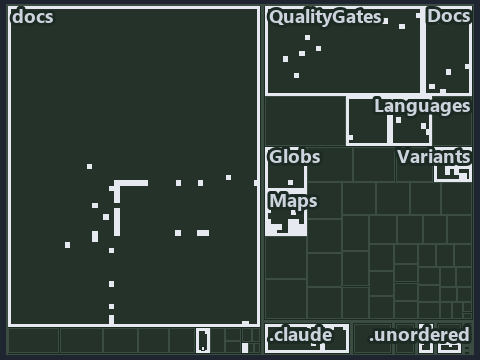

# docs/.assets/explanation/tree/adr-dsgn-track--globs-yml-pipeline-field-is-the-binding--implementation.tree.md

`Tree minimap: adr-dsgn-track--globs-yml-pipeline-field-is-the-binding--implementation`

The tree minimap of the slide `adr-dsgn-track--globs-yml-pipeline-field-is-the-binding--implementation` (implementation lens). The slide
supports [ADR-DSGN-TRACK][1]; the highlight of those ADR codes selects what is lit, and each reason below names the code that selects it.

## What the minimap shows

The tree draws every file of the world map as a tile, grouped by top-level folder (under `automation/` by module, under `docs/adr/` by ADR
domain), and lights 113 files in 13 groups, filled in ink. A lit ADR file has a white rim; a file lit only by passing mentions is a lighter
ink. Every other tile is idle, a grey box: a file the slide's ADR codes do not select.

- docs (docs/ outside docs/adr/): 34 lit files
- Maps (automation/Catzc.Base.Maps): 28 lit files
- Variants (automation/Catzc.Base.Variants): 11 lit files
- .claude: 9 lit files
- QualityGates (automation/Catzc.Base.QualityGates): 8 lit files
- Languages (automation/Catzc.Base.Languages): 7 lit files
- Docs (automation/Catzc.Base.Docs): 5 lit files
- .unordered: 4 lit files
- adr/* (the files directly in docs/adr/): 2 lit files
- adr/dsgn (docs/adr/design): 2 lit files
- Globs (automation/Catzc.Base.Globs): 1 lit file
- ModuleSystem (automation/Catzc.Base.ModuleSystem): 1 lit file
- pipelines: 1 lit file

## Why each group is lit

### docs (docs/ outside docs/adr/, 34 lit files)

The group holds the files of docs/ outside docs/adr/; each sits in its world-map cell and is lit by:

- [docs/how-to/automation/manual-test-plan/repository-conventions.md][2], in the cell docs × markdown: selected by [ADR-DSGN-TRACK][1]: the
  file cites it at line 16 (text), line 39 (text), line 45 (text), line 45 (text), line 48 (text), line 48 (text), line 50 (text), line 50
  (text), line 50 (text), line 51 (text), line 52 (text) and line 54 (text).
- [docs/references/automation/catzc-base-docs/configs/adrs.yml.md][3], in the cell docs × markdown: selected by [ADR-DSGN-TRACK][1]: the
  file cites it at line 17 (text), line 40 (text) and line 41 (text).
- [docs/references/automation/catzc-base-docs/types/AdrDomain.cs.md][4], in the cell docs × markdown: selected by [ADR-DSGN-TRACK][1]: the
  file cites it at line 18 (text), line 36 (text) and line 37 (text).
- [docs/references/automation/catzc-base-docs/types/AdrRuleSet.cs.md][5], in the cell docs × markdown: selected by [ADR-DSGN-TRACK][1]: the
  file cites it at line 18 (text) and line 38 (text).
- [docs/references/automation/catzc-base-docs/types/AdrsConfig.cs.md][6], in the cell docs × markdown: selected by [ADR-DSGN-TRACK][1]: the
  file cites it at line 21 (text), line 54 (text), line 57 (text) and line 69 (text).
- [docs/references/automation/catzc-base-globs/configs/globs.yml.md][7], in the cell docs × markdown: selected by [ADR-DSGN-TRACK][1]: the
  file cites it at line 17 (text) and line 126 (text).
- [docs/references/automation/catzc-base-languages/configs/languages.yml.md][8], in the cell docs × markdown: selected by
  [ADR-DSGN-TRACK][1]: the file cites it at line 18 (text) and line 35 (text).
- [docs/references/automation/catzc-base-languages/tests/Get-FileLanguage.Tests.ps1.md][9], in the cell docs × markdown: selected by
  [ADR-DSGN-TRACK][1]: the file cites it at line 17 (text) and line 32 (text).
- [docs/references/automation/catzc-base-languages/types/FileLanguage.cs.md][10], in the cell docs × markdown: selected by
  [ADR-DSGN-TRACK][1]: the file cites it at line 18 (text) and line 32 (text).
- [docs/references/automation/catzc-base-languages/types/LanguagesConfig.cs.md][11], in the cell docs × markdown: selected by
  [ADR-DSGN-TRACK][1]: the file cites it at line 19 (text) and line 35 (text).
- [docs/references/automation/catzc-base-maps.md][12], in the cell docs × markdown: selected by [ADR-DSGN-TRACK][1]: the file cites it at
  line 16 (text), line 97 (text), line 99 (text) and line 111 (text).
- [docs/references/automation/catzc-base-maps/configs/maps.yml.md][13], in the cell docs × markdown: selected by [ADR-DSGN-TRACK][1]: the
  file cites it at line 18 (text), line 57 (text), line 63 (text), line 65 (text) and line 70 (text).
- [docs/references/automation/catzc-base-maps/tests/Get-ValueChainHighlight.Tests.ps1.md][14], in the cell docs × markdown: selected by
  [ADR-DSGN-TRACK][1]: the file cites it at line 18 (text), line 32 (text) and line 33 (text).
- [docs/references/automation/catzc-base-maps/tests/Get-ValueChainMap.Tests.ps1.md][15], in the cell docs × markdown: selected by
  [ADR-DSGN-TRACK][1]: the file cites it at line 18 (text) and line 32 (text).
- [docs/references/automation/catzc-base-maps/tests/Get-WorldMap.Tests.ps1.md][16], in the cell docs × markdown: selected by
  [ADR-DSGN-TRACK][1]: the file cites it at line 17 (text) and line 31 (text).
- [docs/references/automation/catzc-base-maps/tests/Test-ValueChainMap.Tests.ps1.md][17], in the cell docs × markdown: selected by
  [ADR-DSGN-TRACK][1]: the file cites it at line 18 (text), line 32 (text), line 33 (text) and line 34 (text).
- [docs/references/automation/catzc-base-maps/tests/Test-WorldMap.Tests.ps1.md][18], in the cell docs × markdown: selected by
  [ADR-DSGN-TRACK][1]: the file cites it at line 18 (text), line 32 (text) and line 33 (text).
- [docs/references/automation/catzc-base-maps/tests/types/ValueChainHighlight.Tests.ps1.md][19], in the cell docs × markdown: selected by
  [ADR-DSGN-TRACK][1]: the file cites it at line 18 (text), line 32 (text) and line 33 (text).
- [docs/references/automation/catzc-base-maps/tests/types/ValueChainMap.Tests.ps1.md][20], in the cell docs × markdown: selected by
  [ADR-DSGN-TRACK][1]: the file cites it at line 18 (text) and line 32 (text).
- [docs/references/automation/catzc-base-maps/types/MapCell.cs.md][21], in the cell docs × markdown: selected by [ADR-DSGN-TRACK][1]: the
  file cites it at line 18 (text), line 32 (text), line 33 (text) and line 34 (text).
- [docs/references/automation/catzc-base-maps/types/MapsLabels.cs.md][22], in the cell docs × markdown: selected by [ADR-DSGN-TRACK][1]: the
  file cites it at line 19 (text), line 36 (text), line 37 (text) and line 41 (text).
- [docs/references/automation/catzc-base-maps/types/ValueChainCell.cs.md][23], in the cell docs × markdown: selected by [ADR-DSGN-TRACK][1]:
  the file cites it at line 18 (text), line 32 (text) and line 33 (text).
- [docs/references/automation/catzc-base-maps/types/ValueChainHighlight.cs.md][24], in the cell docs × markdown: selected by
  [ADR-DSGN-TRACK][1]: the file cites it at line 17 (text), line 32 (text) and line 33 (text).
- [docs/references/automation/catzc-base-maps/types/ValueChainMap.cs.md][25], in the cell docs × markdown: selected by [ADR-DSGN-TRACK][1]:
  the file cites it at line 17 (text), line 32 (text), line 33 (text) and line 35 (text).
- [docs/references/automation/catzc-base-maps/types/ValueChainReason.cs.md][26], in the cell docs × markdown: selected by
  [ADR-DSGN-TRACK][1]: the file cites it at line 18 (text), line 32 (text) and line 34 (text).
- [docs/references/automation/catzc-base-maps/types/WorldMap.cs.md][27], in the cell docs × markdown: selected by [ADR-DSGN-TRACK][1]: the
  file cites it at line 17 (text), line 33 (text) and line 34 (text).
- [docs/references/automation/catzc-base-maps/types/WorldMapBuilder.cs.md][28], in the cell docs × markdown: selected by
  [ADR-DSGN-TRACK][1]: the file cites it at line 18 (text), line 38 (text), line 39 (text) and line 42 (text).
- [docs/references/automation/catzc-base-maps/types/WorldMapGridLayout.cs.md][29], in the cell docs × markdown: selected by
  [ADR-DSGN-TRACK][1]: the file cites it at line 18 (text), line 33 (text) and line 34 (text).
- [docs/references/automation/catzc-base-maps/types/WorldMapHighlight.cs.md][30], in the cell docs × markdown: selected by
  [ADR-DSGN-TRACK][1]: the file cites it at line 17 (text) and line 32 (text).
- [docs/references/automation/catzc-base-maps/types/WorldMapPdf.cs.md][31], in the cell docs × markdown: selected by [ADR-DSGN-TRACK][1]:
  the file cites it at line 17 (text), line 33 (text), line 34 (text) and line 35 (text).
- [docs/references/automation/catzc-base-variants/configs/variants.yml.md][32], in the cell docs × markdown: selected by
  [ADR-DSGN-TRACK][1]: the file cites it at line 17 (text), line 94 (text), line 97 (text) and line 99 (text).
- [docs/references/automation/catzc-base-variants/types/VariantTrack.cs.md][33], in the cell docs × markdown: selected by
  [ADR-DSGN-TRACK][1]: the file cites it at line 18 (text), line 31 (text) and line 33 (text).
- [docs/references/automation/catzc-base-variants/types/VariantsConfig.cs.md][34], in the cell docs × markdown: selected by
  [ADR-DSGN-TRACK][1]: the file cites it at line 18 (text), line 52 (text), line 55 (text) and line 57 (text).
- [docs/references/pipelines/ci-automation.yaml.md][35], in the cell docs × markdown: selected by [ADR-DSGN-TRACK][1]: the file cites it at
  line 17 (text) and line 32 (text).

### Maps (automation/Catzc.Base.Maps, 28 lit files)

The group holds the files of automation/Catzc.Base.Maps; each sits in its world-map cell and is lit by:

- [automation/Catzc.Base.Maps/Export-WorldMapPdf.ps1][36], in the cell automation × powershell: selected by [ADR-DSGN-TRACK][1]: the file
  cites it at line 20 (header), line 30 (header), line 31 (header), line 33 (header) and line 49 (header).
- [automation/Catzc.Base.Maps/Get-ValueChainHighlight.ps1][37], in the cell automation × powershell: selected by [ADR-DSGN-TRACK][1]: the
  file cites it at line 21 (header), line 30 (header), line 31 (header) and line 42 (header).
- [automation/Catzc.Base.Maps/Get-ValueChainMap.ps1][38], in the cell automation × powershell: selected by [ADR-DSGN-TRACK][1]: the file
  cites it at line 20 (header), line 27 (header), line 29 (header) and line 31 (header).
- [automation/Catzc.Base.Maps/Get-WorldMap.ps1][39], in the cell automation × powershell: selected by [ADR-DSGN-TRACK][1]: the file cites it
  at line 23 (header), line 30 (header), line 31 (header) and line 43 (header).
- [automation/Catzc.Base.Maps/Get-WorldMapHighlight.ps1][40], in the cell automation × powershell: selected by [ADR-DSGN-TRACK][1]: the file
  cites it at line 20 (header), line 33 (header) and line 50 (header).
- [automation/Catzc.Base.Maps/Test-ValueChainMap.ps1][41], in the cell automation × powershell: selected by [ADR-DSGN-TRACK][1]: the file
  cites it at line 23 (header), line 37 (header), line 39 (header), line 42 (header), line 46 (header), line 77 (text), line 78 (text), line
  88 (text), line 91 (text) and line 108 (text).
- [automation/Catzc.Base.Maps/Test-WorldMap.ps1][42], in the cell automation × powershell: selected by [ADR-DSGN-TRACK][1]: the file cites
  it at line 22 (header), line 34 (header), line 37 (header), line 41 (header), line 46 (header), line 47 (header), line 90 (text), line 109
  (text), line 126 (text), line 130 (text) and line 131 (text).
- [automation/Catzc.Base.Maps/private/Resolve-MapLabelTerm.ps1][43], in the cell automation × powershell: selected by [ADR-DSGN-TRACK][1]:
  the file cites it at line 21 (header), line 29 (header) and line 30 (header).
- [automation/Catzc.Base.Maps/tests/Get-ValueChainHighlight.Tests.ps1][44], in the cell automation × powershell: selected by
  [ADR-DSGN-TRACK][1]: the file cites it at line 21 (header), line 42 (text), line 48 (text) and line 67 (text).
- [automation/Catzc.Base.Maps/tests/Get-ValueChainMap.Tests.ps1][45], in the cell automation × powershell: selected by [ADR-DSGN-TRACK][1]:
  the file cites it at line 21 (header), line 42 (text), line 61 (text) and line 61 (body comment).
- [automation/Catzc.Base.Maps/tests/Get-WorldMap.Tests.ps1][46], in the cell automation × powershell: selected by [ADR-DSGN-TRACK][1]: the
  file cites it at line 20 (header) and line 112 (text).
- [automation/Catzc.Base.Maps/tests/Get-WorldMapHighlight.Tests.ps1][47], in the cell automation × powershell: selected by
  [ADR-DSGN-TRACK][1]: the file cites it at line 19 (header) and line 97 (text).
- [automation/Catzc.Base.Maps/tests/Test-ValueChainMap.Tests.ps1][48], in the cell automation × powershell: selected by [ADR-DSGN-TRACK][1]:
  the file cites it at line 21 (header), line 73 (text), line 73 (body comment), line 77 (text), line 78 (text), line 79 (text), line 80
  (text), line 84 (text), line 87 (text), line 104 (text), line 104 (body comment) and line 104 (body comment).
- [automation/Catzc.Base.Maps/tests/Test-WorldMap.Tests.ps1][49], in the cell automation × powershell: selected by [ADR-DSGN-TRACK][1]: the
  file cites it at line 21 (header), line 81 (text), line 85 (text), line 88 (text), line 92 (text), line 93 (text), line 97 (text), line
  106 (text), line 107 (text), line 111 (text), line 115 (text), line 116 (text), line 135 (text), line 135 (body comment) and line 135
  (body comment).
- [automation/Catzc.Base.Maps/tests/types/ValueChainHighlight.Tests.ps1][50], in the cell automation × powershell: selected by
  [ADR-DSGN-TRACK][1]: the file cites it at line 21 (header), line 40 (text), line 47 (text), line 53 (text), line 70 (text) and line 70
  (body comment).
- [automation/Catzc.Base.Maps/tests/types/ValueChainMap.Tests.ps1][51], in the cell automation × powershell: selected by
  [ADR-DSGN-TRACK][1]: the file cites it at line 21 (header), line 42 (text), line 51 (text), line 56 (text) and line 64 (text).
- [automation/Catzc.Base.Maps/tests/types/WorldMapHighlight.Tests.ps1][52], in the cell automation × powershell: selected by
  [ADR-DSGN-TRACK][1]: the file cites it at line 19 (header), line 91 (text), line 135 (text) and line 149 (text).
- [automation/Catzc.Base.Maps/types/MapCell.cs][53], in the cell automation × csharp: selected by [ADR-DSGN-TRACK][1]: the file cites it at
  line 21 (text).
- [automation/Catzc.Base.Maps/types/MapsLabels.cs][54], in the cell automation × csharp: selected by [ADR-DSGN-TRACK][1]: the file cites it
  at line 22 (text).
- [automation/Catzc.Base.Maps/types/ValueChainCell.cs][55], in the cell automation × csharp: selected by [ADR-DSGN-TRACK][1]: the file cites
  it at line 21 (text), line 33 (body comment) and line 36 (body comment).
- [automation/Catzc.Base.Maps/types/ValueChainHighlight.cs][56], in the cell automation × csharp: selected by [ADR-DSGN-TRACK][1]: the file
  cites it at line 21 (text).
- [automation/Catzc.Base.Maps/types/ValueChainMap.cs][57], in the cell automation × csharp: selected by [ADR-DSGN-TRACK][1]: the file cites
  it at line 21 (text).
- [automation/Catzc.Base.Maps/types/ValueChainReason.cs][58], in the cell automation × csharp: selected by [ADR-DSGN-TRACK][1]: the file
  cites it at line 21 (text).
- [automation/Catzc.Base.Maps/types/WorldMap.cs][59], in the cell automation × csharp: selected by [ADR-DSGN-TRACK][1]: the file cites it at
  line 20 (text).
- [automation/Catzc.Base.Maps/types/WorldMapBuilder.cs][60], in the cell automation × csharp: selected by [ADR-DSGN-TRACK][1]: the file
  cites it at line 22 (text) and line 164 (body comment).
- [automation/Catzc.Base.Maps/types/WorldMapGridLayout.cs][61], in the cell automation × csharp: selected by [ADR-DSGN-TRACK][1]: the file
  cites it at line 21 (text).
- [automation/Catzc.Base.Maps/types/WorldMapHighlight.cs][62], in the cell automation × csharp: selected by [ADR-DSGN-TRACK][1]: the file
  cites it at line 21 (text).
- [automation/Catzc.Base.Maps/types/WorldMapPdf.cs][63], in the cell automation × csharp: selected by [ADR-DSGN-TRACK][1]: the file cites it
  at line 21 (text).

### Variants (automation/Catzc.Base.Variants, 11 lit files)

The group holds the files of automation/Catzc.Base.Variants; each sits in its world-map cell and is lit by:

- [automation/Catzc.Base.Variants/Get-PathModule.ps1][64], in the cell automation × powershell: selected by [ADR-DSGN-TRACK][1]: the file
  cites it at line 20 (header) and line 25 (header).
- [automation/Catzc.Base.Variants/Get-Track.ps1][65], in the cell automation × powershell: selected by [ADR-DSGN-TRACK][1]: the file cites
  it at line 20 (header), line 24 (header), line 27 (header) and line 31 (header).
- [automation/Catzc.Base.Variants/tests/Get-PathModule.Tests.ps1][66], in the cell automation × powershell: selected by [ADR-DSGN-TRACK][1]:
  the file cites it at line 19 (header), line 23 (text) and line 74 (text).
- [automation/Catzc.Base.Variants/tests/Get-Track.Tests.ps1][67], in the cell automation × powershell: selected by [ADR-DSGN-TRACK][1]: the
  file cites it at line 19 (header) and line 98 (text).
- [automation/Catzc.Base.Variants/tests/types/ModuleTypesConfig.Tests.ps1][68], in the cell automation × powershell: selected by
  [ADR-DSGN-TRACK][1]: the file cites it at line 19 (header) and line 23 (text).
- [automation/Catzc.Base.Variants/types/ModulePlace.cs][69], in the cell automation × csharp: selected by [ADR-DSGN-TRACK][1]: the file
  cites it at line 20 (text).
- [automation/Catzc.Base.Variants/types/ModuleTypeEntry.cs][70], in the cell automation × csharp: selected by [ADR-DSGN-TRACK][1]: the file
  cites it at line 19 (text).
- [automation/Catzc.Base.Variants/types/ModuleTypesConfig.cs][71], in the cell automation × csharp: selected by [ADR-DSGN-TRACK][1]: the
  file cites it at line 21 (text).
- [automation/Catzc.Base.Variants/types/PathModule.cs][72], in the cell automation × csharp: selected by [ADR-DSGN-TRACK][1]: the file cites
  it at line 19 (text).
- [automation/Catzc.Base.Variants/types/VariantTrack.cs][73], in the cell automation × csharp: selected by [ADR-DSGN-TRACK][1]: the file
  cites it at line 21 (text).
- [automation/Catzc.Base.Variants/types/VariantsConfig.cs][74], in the cell automation × csharp: selected by [ADR-DSGN-TRACK][1]: the file
  cites it at line 23 (text) and line 266 (text).

### .claude (9 lit files)

The group holds the files of .claude; each sits in its world-map cell and is lit by:

- [.claude/plans/decisions-2026-10-16.md][75], in the cell .claude × markdown: selected by [ADR-DSGN-TRACK][1]: the file cites it at line 28
  (text), line 51 (text), line 58 (text), line 77 (text), line 85 (text), line 148 (text), line 149 (text), line 153 (text), line 153
  (text), line 155 (text), line 161 (text), line 163 (text) and line 208 (text).
- [.claude/plans/plan-layers-vocabulary-rename-contracts.md][76], in the cell .claude × markdown: selected by [ADR-DSGN-TRACK][1]: the file
  cites it at line 32 (text), line 162 (text), line 406 (text), line 447 (text), line 472 (text), line 552 (text), line 754 (text), line 781
  (text), line 889 (text) and line 894 (text).
- [.claude/plans/plan-module-kinds-tracks.md][77], in the cell .claude × markdown: selected by [ADR-DSGN-TRACK][1]: the file cites it at
  line 39 (text), line 74 (text), line 78 (text), line 104 (text), line 110 (text), line 135 (text), line 153 (text), line 154 (text), line
  175 (text), line 195 (text), line 243 (text), line 356 (text), line 365 (text), line 510 (text), line 524 (text), line 555 (text), line
  560 (text), line 606 (text), line 622 (text), line 622 (text), line 648 (text), line 650 (text), line 652 (text), line 662 (text), line
  670 (text), line 671 (text), line 681 (text), line 700 (text), line 810 (text), line 822 (text), line 827 (text), line 829 (text), line
  858 (text), line 865 (text), line 887 (text), line 926 (text), line 945 (text), line 954 (text), line 995 (text) and line 1050 (text).
- [.claude/plans/plan-plans-body-sha-landing-zone.md][78], in the cell .claude × markdown: selected by [ADR-DSGN-TRACK][1]: the file cites
  it at line 25 (text), line 54 (text) and line 162 (text).
- [.claude/plans/prompt-k8s-kinds-1-prepare.md][79], in the cell .claude × markdown: selected by [ADR-DSGN-TRACK][1]: the file cites it at
  line 24 (text), line 40 (text), line 51 (text) and line 76 (text).
- [.claude/plans/prompt-k8s-kinds-2-implement.md][80], in the cell .claude × markdown: selected by [ADR-DSGN-TRACK][1]: the file cites it at
  line 57 (text).
- [.claude/plans/prompt-module-model-1-prepare.md][81], in the cell .claude × markdown: selected by [ADR-DSGN-TRACK][1]: the file cites it
  at line 24 (text), line 40 (text), line 52 (text), line 53 (text), line 92 (text) and line 101 (text).
- [.claude/plans/prompt-module-model-2-implement.md][82], in the cell .claude × markdown: selected by [ADR-DSGN-TRACK][1]: the file cites it
  at line 29 (text), line 47 (text) and line 59 (text).
- [.claude/plans/questionnaire-fundamental-2-2026-10-16.md][83], in the cell .claude × markdown: selected by [ADR-DSGN-TRACK][1]: the file
  cites it at line 46 (text).

### QualityGates (automation/Catzc.Base.QualityGates, 8 lit files)

The group holds the files of automation/Catzc.Base.QualityGates; each sits in its world-map cell and is lit by:

- [automation/Catzc.Base.QualityGates/configs/terminology.yml][84], in the cell automation × yaml: selected by [ADR-DSGN-TRACK][1]: the file
  cites it at line 313 (text) and line 316 (text).
- [automation/Catzc.Base.QualityGates/private/Get-FileTypeFileMetaFact.ps1][85], in the cell automation × powershell: selected by
  [ADR-DSGN-TRACK][1]: the file cites it at line 22 (header) and line 26 (header).
- [automation/Catzc.Base.QualityGates/private/Get-LanguageTestFolders.ps1][86], in the cell automation × powershell: selected by
  [ADR-DSGN-TRACK][1]: the file cites it at line 25 (header) and line 32 (header).
- [automation/Catzc.Base.QualityGates/private/Get-ModuleTypeFileMetaFact.ps1][87], in the cell automation × powershell: selected by
  [ADR-DSGN-TRACK][1]: the file cites it at line 22 (header) and line 26 (header).
- [automation/Catzc.Base.QualityGates/private/Get-TrackFileMetaFact.ps1][88], in the cell automation × powershell: selected by
  [ADR-DSGN-TRACK][1]: the file cites it at line 22 (header) and line 27 (header).
- [automation/Catzc.Base.QualityGates/tests/Get-FileTypeFileMetaFact.Tests.ps1][89], in the cell automation × powershell: selected by
  [ADR-DSGN-TRACK][1]: the file cites it at line 19 (header) and line 23 (text).
- [automation/Catzc.Base.QualityGates/tests/Get-ModuleTypeFileMetaFact.Tests.ps1][90], in the cell automation × powershell: selected by
  [ADR-DSGN-TRACK][1]: the file cites it at line 19 (header) and line 23 (text).
- [automation/Catzc.Base.QualityGates/tests/Get-TrackFileMetaFact.Tests.ps1][91], in the cell automation × powershell: selected by
  [ADR-DSGN-TRACK][1]: the file cites it at line 19 (header) and line 23 (text).

### Languages (automation/Catzc.Base.Languages, 7 lit files)

The group holds the files of automation/Catzc.Base.Languages; each sits in its world-map cell and is lit by:

- [automation/Catzc.Base.Languages/Get-FileLanguage.ps1][92], in the cell automation × powershell: selected by [ADR-DSGN-TRACK][1]: the file
  cites it at line 20 (header) and line 25 (header).
- [automation/Catzc.Base.Languages/Get-PathFileType.ps1][93], in the cell automation × powershell: selected by [ADR-DSGN-TRACK][1]: the file
  cites it at line 20 (header) and line 27 (header).
- [automation/Catzc.Base.Languages/configs/glossary.yml][94], in the cell automation × yaml: selected by [ADR-DSGN-TRACK][1]: the file cites
  it at line 24 (text).
- [automation/Catzc.Base.Languages/tests/Get-FileLanguage.Tests.ps1][95], in the cell automation × powershell: selected by
  [ADR-DSGN-TRACK][1]: the file cites it at line 20 (header), line 134 (text), line 146 (text) and line 184 (text).
- [automation/Catzc.Base.Languages/tests/Get-PathFileType.Tests.ps1][96], in the cell automation × powershell: selected by
  [ADR-DSGN-TRACK][1]: the file cites it at line 19 (header) and line 23 (text).
- [automation/Catzc.Base.Languages/types/FileLanguage.cs][97], in the cell automation × csharp: selected by [ADR-DSGN-TRACK][1]: the file
  cites it at line 22 (text).
- [automation/Catzc.Base.Languages/types/LanguagesConfig.cs][98], in the cell automation × csharp: selected by [ADR-DSGN-TRACK][1]: the file
  cites it at line 24 (text).

### Docs (automation/Catzc.Base.Docs, 5 lit files)

The group holds the files of automation/Catzc.Base.Docs; each sits in its world-map cell and is lit by:

- [automation/Catzc.Base.Docs/configs/adrs.yml][99], in the cell automation × yaml: selected by [ADR-DSGN-TRACK][1]: the file cites it at
  line 92 (text).
- [automation/Catzc.Base.Docs/tests/types/AdrsConfig.Tests.ps1][100], in the cell automation × powershell: selected by [ADR-DSGN-TRACK][1]:
  the file cites it at line 21 (header), line 120 (text) and line 120 (body comment).
- [automation/Catzc.Base.Docs/types/AdrDomain.cs][101], in the cell automation × csharp: selected by [ADR-DSGN-TRACK][1]: the file cites it
  at line 21 (text).
- [automation/Catzc.Base.Docs/types/AdrRuleSet.cs][102], in the cell automation × csharp: selected by [ADR-DSGN-TRACK][1]: the file cites it
  at line 21 (text).
- [automation/Catzc.Base.Docs/types/AdrsConfig.cs][103], in the cell automation × csharp: selected by [ADR-DSGN-TRACK][1]: the file cites it
  at line 25 (text) and line 44 (body comment).

### .unordered (4 lit files)

The group holds the files of .unordered; each sits in its world-map cell and is lit by:

- [.unordered/15-10-2026/plan-adr-consistency.md][104], in the cell .unordered × markdown: selected by [ADR-DSGN-TRACK][1]: the file cites
  it at line 90 (text) and line 248 (text).
- [.unordered/15-10-2026/plan-concern-axis.md][105], in the cell .unordered × markdown: selected by [ADR-DSGN-TRACK][1]: the file cites it
  at line 32 (text), line 50 (text), line 51 (text), line 51 (text), line 54 (text), line 162 (text) and line 187 (text).
- [.unordered/15-10-2026/plan-diagram-wave-7.md][106], in the cell .unordered × markdown: selected by [ADR-DSGN-TRACK][1]: the file cites it
  at line 101 (text) and line 102 (text).
- [.unordered/15-10-2026/plan-explanation-assets-source.md][107], in the cell .unordered × markdown: selected by [ADR-DSGN-TRACK][1]: the
  file cites it at line 29 (text), line 39 (text), line 41 (text), line 54 (text), line 56 (text) and line 110 (text).

### adr/* (the files directly in docs/adr/, 2 lit files)

The group holds the files of the files directly in docs/adr/; each sits in its world-map cell and is lit by:

- [docs/adr/glossary.md][108], in the cell docs × markdown: selected by [ADR-DSGN-TRACK][1]: the file cites it at line 106 (text), line 133
  (text), line 150 (text), line 179 (text), line 236 (text), line 246 (text), line 256 (text), line 258 (text), line 273 (text), line 313
  (text), line 327 (text), line 341 (text), line 354 (text), line 388 (text) and line 400 (text).
- [docs/adr/index.md][109], in the cell docs × markdown: selected by [ADR-DSGN-TRACK][1]: the file cites it at line 106 (text).

### adr/dsgn (docs/adr/design, 2 lit files)

The group holds the files of docs/adr/design; each sits in its world-map cell and is lit by:

- [docs/adr/design/dora-explains.md][110], in the cell docs × markdown: selected by [ADR-DSGN-TRACK][1]: the file cites it at line 51
  (text).
- [docs/adr/design/tracks.md][1], in the cell docs × markdown: selected by [ADR-DSGN-TRACK][1]: the ADR's own file.

### Globs (automation/Catzc.Base.Globs, 1 lit file)

The group holds the files of automation/Catzc.Base.Globs; each sits in its world-map cell and is lit by:

- [automation/Catzc.Base.Globs/tests/types/GlobsConfig.Tests.ps1][111], in the cell automation × powershell: selected by
  [ADR-DSGN-TRACK][1]: the file cites it at line 21 (header) and line 66 (text).

### ModuleSystem (automation/Catzc.Base.ModuleSystem, 1 lit file)

The group holds the files of automation/Catzc.Base.ModuleSystem; each sits in its world-map cell and is lit by:

- [automation/Catzc.Base.ModuleSystem/configs/glossary.yml][112], in the cell automation × yaml: selected by [ADR-DSGN-TRACK][1]: the file
  cites it at line 24 (text), line 82 (text), line 166 (text), line 174 (text), line 185 (text), line 202 (text), line 215 (text), line 229
  (text), line 244 (text), line 257 (text), line 269 (text), line 282 (text), line 284 (text) and line 296 (text).

### pipelines (1 lit file)

The group holds the files of pipelines; each sits in its world-map cell and is lit by:

- [pipelines/ci-automation.yaml][113], in the cell pipelines × pipeline-yaml: selected by [ADR-DSGN-TRACK][1]: a pipeline that cites nothing
  itself carries its globset's citations, which cite it at `automation/Catzc.Base.Docs/configs/adrs.yml` line 92 (text),
  `automation/Catzc.Base.Docs/tests/types/AdrsConfig.Tests.ps1` line 21 (header),
  `automation/Catzc.Base.Docs/tests/types/AdrsConfig.Tests.ps1` line 120 (text),
  `automation/Catzc.Base.Docs/tests/types/AdrsConfig.Tests.ps1` line 120 (body comment), `automation/Catzc.Base.Docs/types/AdrDomain.cs`
  line 21 (text), `automation/Catzc.Base.Docs/types/AdrRuleSet.cs` line 21 (text), `automation/Catzc.Base.Docs/types/AdrsConfig.cs` line 25
  (text), `automation/Catzc.Base.Docs/types/AdrsConfig.cs` line 44 (body comment),
  `automation/Catzc.Base.Globs/tests/types/GlobsConfig.Tests.ps1` line 21 (header),
  `automation/Catzc.Base.Globs/tests/types/GlobsConfig.Tests.ps1` line 66 (text), `automation/Catzc.Base.Languages/Get-FileLanguage.ps1`
  line 20 (header), `automation/Catzc.Base.Languages/Get-FileLanguage.ps1` line 25 (header),
  `automation/Catzc.Base.Languages/Get-PathFileType.ps1` line 20 (header), `automation/Catzc.Base.Languages/Get-PathFileType.ps1` line 27
  (header), `automation/Catzc.Base.Languages/configs/glossary.yml` line 24 (text),
  `automation/Catzc.Base.Languages/tests/Get-FileLanguage.Tests.ps1` line 20 (header),
  `automation/Catzc.Base.Languages/tests/Get-FileLanguage.Tests.ps1` line 134 (text),
  `automation/Catzc.Base.Languages/tests/Get-FileLanguage.Tests.ps1` line 146 (text),
  `automation/Catzc.Base.Languages/tests/Get-FileLanguage.Tests.ps1` line 184 (text),
  `automation/Catzc.Base.Languages/tests/Get-PathFileType.Tests.ps1` line 19 (header),
  `automation/Catzc.Base.Languages/tests/Get-PathFileType.Tests.ps1` line 23 (text), `automation/Catzc.Base.Languages/types/FileLanguage.cs`
  line 22 (text), `automation/Catzc.Base.Languages/types/LanguagesConfig.cs` line 24 (text),
  `automation/Catzc.Base.Maps/Export-WorldMapPdf.ps1` line 20 (header), `automation/Catzc.Base.Maps/Export-WorldMapPdf.ps1` line 30
  (header), `automation/Catzc.Base.Maps/Export-WorldMapPdf.ps1` line 31 (header), `automation/Catzc.Base.Maps/Export-WorldMapPdf.ps1` line
  33 (header), `automation/Catzc.Base.Maps/Export-WorldMapPdf.ps1` line 49 (header),
  `automation/Catzc.Base.Maps/Get-ValueChainHighlight.ps1` line 21 (header), `automation/Catzc.Base.Maps/Get-ValueChainHighlight.ps1` line
  30 (header), `automation/Catzc.Base.Maps/Get-ValueChainHighlight.ps1` line 31 (header),
  `automation/Catzc.Base.Maps/Get-ValueChainHighlight.ps1` line 42 (header), `automation/Catzc.Base.Maps/Get-ValueChainMap.ps1` line 20
  (header), `automation/Catzc.Base.Maps/Get-ValueChainMap.ps1` line 27 (header), `automation/Catzc.Base.Maps/Get-ValueChainMap.ps1` line 29
  (header), `automation/Catzc.Base.Maps/Get-ValueChainMap.ps1` line 31 (header), `automation/Catzc.Base.Maps/Get-WorldMap.ps1` line 23
  (header), `automation/Catzc.Base.Maps/Get-WorldMap.ps1` line 30 (header), `automation/Catzc.Base.Maps/Get-WorldMap.ps1` line 31 (header),
  `automation/Catzc.Base.Maps/Get-WorldMap.ps1` line 43 (header), `automation/Catzc.Base.Maps/Get-WorldMapHighlight.ps1` line 20 (header),
  `automation/Catzc.Base.Maps/Get-WorldMapHighlight.ps1` line 33 (header), `automation/Catzc.Base.Maps/Get-WorldMapHighlight.ps1` line 50
  (header), `automation/Catzc.Base.Maps/Test-ValueChainMap.ps1` line 23 (header), `automation/Catzc.Base.Maps/Test-ValueChainMap.ps1` line
  37 (header), `automation/Catzc.Base.Maps/Test-ValueChainMap.ps1` line 39 (header), `automation/Catzc.Base.Maps/Test-ValueChainMap.ps1`
  line 42 (header), `automation/Catzc.Base.Maps/Test-ValueChainMap.ps1` line 46 (header),
  `automation/Catzc.Base.Maps/Test-ValueChainMap.ps1` line 77 (text), `automation/Catzc.Base.Maps/Test-ValueChainMap.ps1` line 78 (text),
  `automation/Catzc.Base.Maps/Test-ValueChainMap.ps1` line 88 (text), `automation/Catzc.Base.Maps/Test-ValueChainMap.ps1` line 91 (text),
  `automation/Catzc.Base.Maps/Test-ValueChainMap.ps1` line 108 (text), `automation/Catzc.Base.Maps/Test-WorldMap.ps1` line 22 (header),
  `automation/Catzc.Base.Maps/Test-WorldMap.ps1` line 34 (header), `automation/Catzc.Base.Maps/Test-WorldMap.ps1` line 37 (header),
  `automation/Catzc.Base.Maps/Test-WorldMap.ps1` line 41 (header), `automation/Catzc.Base.Maps/Test-WorldMap.ps1` line 46 (header),
  `automation/Catzc.Base.Maps/Test-WorldMap.ps1` line 47 (header), `automation/Catzc.Base.Maps/Test-WorldMap.ps1` line 90 (text),
  `automation/Catzc.Base.Maps/Test-WorldMap.ps1` line 109 (text), `automation/Catzc.Base.Maps/Test-WorldMap.ps1` line 126 (text),
  `automation/Catzc.Base.Maps/Test-WorldMap.ps1` line 130 (text), `automation/Catzc.Base.Maps/Test-WorldMap.ps1` line 131 (text),
  `automation/Catzc.Base.Maps/private/Resolve-MapLabelTerm.ps1` line 21 (header),
  `automation/Catzc.Base.Maps/private/Resolve-MapLabelTerm.ps1` line 29 (header),
  `automation/Catzc.Base.Maps/private/Resolve-MapLabelTerm.ps1` line 30 (header),
  `automation/Catzc.Base.Maps/tests/Get-ValueChainHighlight.Tests.ps1` line 21 (header),
  `automation/Catzc.Base.Maps/tests/Get-ValueChainHighlight.Tests.ps1` line 42 (text),
  `automation/Catzc.Base.Maps/tests/Get-ValueChainHighlight.Tests.ps1` line 48 (text),
  `automation/Catzc.Base.Maps/tests/Get-ValueChainHighlight.Tests.ps1` line 67 (text),
  `automation/Catzc.Base.Maps/tests/Get-ValueChainMap.Tests.ps1` line 21 (header),
  `automation/Catzc.Base.Maps/tests/Get-ValueChainMap.Tests.ps1` line 42 (text),
  `automation/Catzc.Base.Maps/tests/Get-ValueChainMap.Tests.ps1` line 61 (text),
  `automation/Catzc.Base.Maps/tests/Get-ValueChainMap.Tests.ps1` line 61 (body comment),
  `automation/Catzc.Base.Maps/tests/Get-WorldMap.Tests.ps1` line 20 (header), `automation/Catzc.Base.Maps/tests/Get-WorldMap.Tests.ps1` line
  112 (text), `automation/Catzc.Base.Maps/tests/Get-WorldMapHighlight.Tests.ps1` line 19 (header),
  `automation/Catzc.Base.Maps/tests/Get-WorldMapHighlight.Tests.ps1` line 97 (text),
  `automation/Catzc.Base.Maps/tests/Test-ValueChainMap.Tests.ps1` line 21 (header),
  `automation/Catzc.Base.Maps/tests/Test-ValueChainMap.Tests.ps1` line 73 (text),
  `automation/Catzc.Base.Maps/tests/Test-ValueChainMap.Tests.ps1` line 73 (body comment),
  `automation/Catzc.Base.Maps/tests/Test-ValueChainMap.Tests.ps1` line 77 (text),
  `automation/Catzc.Base.Maps/tests/Test-ValueChainMap.Tests.ps1` line 78 (text),
  `automation/Catzc.Base.Maps/tests/Test-ValueChainMap.Tests.ps1` line 79 (text),
  `automation/Catzc.Base.Maps/tests/Test-ValueChainMap.Tests.ps1` line 80 (text),
  `automation/Catzc.Base.Maps/tests/Test-ValueChainMap.Tests.ps1` line 84 (text),
  `automation/Catzc.Base.Maps/tests/Test-ValueChainMap.Tests.ps1` line 87 (text),
  `automation/Catzc.Base.Maps/tests/Test-ValueChainMap.Tests.ps1` line 104 (text),
  `automation/Catzc.Base.Maps/tests/Test-ValueChainMap.Tests.ps1` line 104 (body comment),
  `automation/Catzc.Base.Maps/tests/Test-ValueChainMap.Tests.ps1` line 104 (body comment),
  `automation/Catzc.Base.Maps/tests/Test-WorldMap.Tests.ps1` line 21 (header), `automation/Catzc.Base.Maps/tests/Test-WorldMap.Tests.ps1`
  line 81 (text), `automation/Catzc.Base.Maps/tests/Test-WorldMap.Tests.ps1` line 85 (text),
  `automation/Catzc.Base.Maps/tests/Test-WorldMap.Tests.ps1` line 88 (text), `automation/Catzc.Base.Maps/tests/Test-WorldMap.Tests.ps1` line
  92 (text), `automation/Catzc.Base.Maps/tests/Test-WorldMap.Tests.ps1` line 93 (text),
  `automation/Catzc.Base.Maps/tests/Test-WorldMap.Tests.ps1` line 97 (text), `automation/Catzc.Base.Maps/tests/Test-WorldMap.Tests.ps1` line
  106 (text), `automation/Catzc.Base.Maps/tests/Test-WorldMap.Tests.ps1` line 107 (text),
  `automation/Catzc.Base.Maps/tests/Test-WorldMap.Tests.ps1` line 111 (text), `automation/Catzc.Base.Maps/tests/Test-WorldMap.Tests.ps1`
  line 115 (text), `automation/Catzc.Base.Maps/tests/Test-WorldMap.Tests.ps1` line 116 (text),
  `automation/Catzc.Base.Maps/tests/Test-WorldMap.Tests.ps1` line 135 (text), `automation/Catzc.Base.Maps/tests/Test-WorldMap.Tests.ps1`
  line 135 (body comment), `automation/Catzc.Base.Maps/tests/Test-WorldMap.Tests.ps1` line 135 (body comment),
  `automation/Catzc.Base.Maps/tests/types/ValueChainHighlight.Tests.ps1` line 21 (header),
  `automation/Catzc.Base.Maps/tests/types/ValueChainHighlight.Tests.ps1` line 40 (text),
  `automation/Catzc.Base.Maps/tests/types/ValueChainHighlight.Tests.ps1` line 47 (text),
  `automation/Catzc.Base.Maps/tests/types/ValueChainHighlight.Tests.ps1` line 53 (text),
  `automation/Catzc.Base.Maps/tests/types/ValueChainHighlight.Tests.ps1` line 70 (text),
  `automation/Catzc.Base.Maps/tests/types/ValueChainHighlight.Tests.ps1` line 70 (body comment),
  `automation/Catzc.Base.Maps/tests/types/ValueChainMap.Tests.ps1` line 21 (header),
  `automation/Catzc.Base.Maps/tests/types/ValueChainMap.Tests.ps1` line 42 (text),
  `automation/Catzc.Base.Maps/tests/types/ValueChainMap.Tests.ps1` line 51 (text),
  `automation/Catzc.Base.Maps/tests/types/ValueChainMap.Tests.ps1` line 56 (text),
  `automation/Catzc.Base.Maps/tests/types/ValueChainMap.Tests.ps1` line 64 (text),
  `automation/Catzc.Base.Maps/tests/types/WorldMapHighlight.Tests.ps1` line 19 (header),
  `automation/Catzc.Base.Maps/tests/types/WorldMapHighlight.Tests.ps1` line 91 (text),
  `automation/Catzc.Base.Maps/tests/types/WorldMapHighlight.Tests.ps1` line 135 (text),
  `automation/Catzc.Base.Maps/tests/types/WorldMapHighlight.Tests.ps1` line 149 (text), `automation/Catzc.Base.Maps/types/MapCell.cs` line
  21 (text), `automation/Catzc.Base.Maps/types/MapsLabels.cs` line 22 (text), `automation/Catzc.Base.Maps/types/ValueChainCell.cs` line 21
  (text), `automation/Catzc.Base.Maps/types/ValueChainCell.cs` line 33 (body comment), `automation/Catzc.Base.Maps/types/ValueChainCell.cs`
  line 36 (body comment), `automation/Catzc.Base.Maps/types/ValueChainHighlight.cs` line 21 (text),
  `automation/Catzc.Base.Maps/types/ValueChainMap.cs` line 21 (text), `automation/Catzc.Base.Maps/types/ValueChainReason.cs` line 21 (text),
  `automation/Catzc.Base.Maps/types/WorldMap.cs` line 20 (text), `automation/Catzc.Base.Maps/types/WorldMapBuilder.cs` line 22 (text),
  `automation/Catzc.Base.Maps/types/WorldMapBuilder.cs` line 164 (body comment), `automation/Catzc.Base.Maps/types/WorldMapGridLayout.cs`
  line 21 (text), `automation/Catzc.Base.Maps/types/WorldMapHighlight.cs` line 21 (text), `automation/Catzc.Base.Maps/types/WorldMapPdf.cs`
  line 21 (text), `automation/Catzc.Base.ModuleSystem/configs/glossary.yml` line 24 (text),
  `automation/Catzc.Base.ModuleSystem/configs/glossary.yml` line 82 (text), `automation/Catzc.Base.ModuleSystem/configs/glossary.yml` line
  166 (text), `automation/Catzc.Base.ModuleSystem/configs/glossary.yml` line 174 (text),
  `automation/Catzc.Base.ModuleSystem/configs/glossary.yml` line 185 (text), `automation/Catzc.Base.ModuleSystem/configs/glossary.yml` line
  202 (text), `automation/Catzc.Base.ModuleSystem/configs/glossary.yml` line 215 (text),
  `automation/Catzc.Base.ModuleSystem/configs/glossary.yml` line 229 (text), `automation/Catzc.Base.ModuleSystem/configs/glossary.yml` line
  244 (text), `automation/Catzc.Base.ModuleSystem/configs/glossary.yml` line 257 (text),
  `automation/Catzc.Base.ModuleSystem/configs/glossary.yml` line 269 (text), `automation/Catzc.Base.ModuleSystem/configs/glossary.yml` line
  282 (text), `automation/Catzc.Base.ModuleSystem/configs/glossary.yml` line 284 (text),
  `automation/Catzc.Base.ModuleSystem/configs/glossary.yml` line 296 (text), `automation/Catzc.Base.QualityGates/configs/terminology.yml`
  line 313 (text), `automation/Catzc.Base.QualityGates/configs/terminology.yml` line 316 (text),
  `automation/Catzc.Base.QualityGates/private/Get-FileTypeFileMetaFact.ps1` line 22 (header),
  `automation/Catzc.Base.QualityGates/private/Get-FileTypeFileMetaFact.ps1` line 26 (header),
  `automation/Catzc.Base.QualityGates/private/Get-LanguageTestFolders.ps1` line 25 (header),
  `automation/Catzc.Base.QualityGates/private/Get-LanguageTestFolders.ps1` line 32 (header),
  `automation/Catzc.Base.QualityGates/private/Get-ModuleTypeFileMetaFact.ps1` line 22 (header),
  `automation/Catzc.Base.QualityGates/private/Get-ModuleTypeFileMetaFact.ps1` line 26 (header),
  `automation/Catzc.Base.QualityGates/private/Get-TrackFileMetaFact.ps1` line 22 (header),
  `automation/Catzc.Base.QualityGates/private/Get-TrackFileMetaFact.ps1` line 27 (header),
  `automation/Catzc.Base.QualityGates/tests/Get-FileTypeFileMetaFact.Tests.ps1` line 19 (header),
  `automation/Catzc.Base.QualityGates/tests/Get-FileTypeFileMetaFact.Tests.ps1` line 23 (text),
  `automation/Catzc.Base.QualityGates/tests/Get-ModuleTypeFileMetaFact.Tests.ps1` line 19 (header),
  `automation/Catzc.Base.QualityGates/tests/Get-ModuleTypeFileMetaFact.Tests.ps1` line 23 (text),
  `automation/Catzc.Base.QualityGates/tests/Get-TrackFileMetaFact.Tests.ps1` line 19 (header),
  `automation/Catzc.Base.QualityGates/tests/Get-TrackFileMetaFact.Tests.ps1` line 23 (text),
  `automation/Catzc.Base.Variants/Get-PathModule.ps1` line 20 (header), `automation/Catzc.Base.Variants/Get-PathModule.ps1` line 25
  (header), `automation/Catzc.Base.Variants/Get-Track.ps1` line 20 (header), `automation/Catzc.Base.Variants/Get-Track.ps1` line 24
  (header), `automation/Catzc.Base.Variants/Get-Track.ps1` line 27 (header), `automation/Catzc.Base.Variants/Get-Track.ps1` line 31
  (header), `automation/Catzc.Base.Variants/tests/Get-PathModule.Tests.ps1` line 19 (header),
  `automation/Catzc.Base.Variants/tests/Get-PathModule.Tests.ps1` line 23 (text),
  `automation/Catzc.Base.Variants/tests/Get-PathModule.Tests.ps1` line 74 (text), `automation/Catzc.Base.Variants/tests/Get-Track.Tests.ps1`
  line 19 (header), `automation/Catzc.Base.Variants/tests/Get-Track.Tests.ps1` line 98 (text),
  `automation/Catzc.Base.Variants/tests/types/ModuleTypesConfig.Tests.ps1` line 19 (header),
  `automation/Catzc.Base.Variants/tests/types/ModuleTypesConfig.Tests.ps1` line 23 (text),
  `automation/Catzc.Base.Variants/types/ModulePlace.cs` line 20 (text), `automation/Catzc.Base.Variants/types/ModuleTypeEntry.cs` line 19
  (text), `automation/Catzc.Base.Variants/types/ModuleTypesConfig.cs` line 21 (text), `automation/Catzc.Base.Variants/types/PathModule.cs`
  line 19 (text), `automation/Catzc.Base.Variants/types/VariantTrack.cs` line 21 (text),
  `automation/Catzc.Base.Variants/types/VariantsConfig.cs` line 23 (text) and `automation/Catzc.Base.Variants/types/VariantsConfig.cs` line
  266 (text).

## Keywords

- [world map][114]
- [track][115]
- [file language][116]
- [cell][117]
- [lit cell][118]
- [.claude][119]: a track
- [.unordered][119]: a track
- [automation][119]: a track
- [docs][119]: a track
- [pipelines][119]: a track
- [csharp][120]: a file language
- [markdown][120]: a file language
- [pipeline-yaml][120]: a file language
- [powershell][120]: a file language
- [yaml][120]: a file language

Terms the cited ADRs define:

- [cell][117], defined by [ADR-DSGN-TRACK#10][121]
- [deployable-unit][122], defined by [ADR-DSGN-TRACK#5][123]
- [file language][116], defined by [ADR-DSGN-TRACK#6][124]
- [lit cell][118], defined by [ADR-DSGN-TRACK#12][125]
- [place][126], defined by [ADR-DSGN-TRACK#1][127]
- [root file][128], defined by [ADR-DSGN-TRACK#7][129]
- [stack violation][130], defined by [ADR-DSGN-TRACK#11][131]
- [track][115], defined by [ADR-DSGN-TRACK#1][127]
- [unlisted file][132], defined by [ADR-DSGN-TRACK#8][133]
- [value-chain concern][134], defined by [ADR-DSGN-TRACK#15][135]
- [value-chain map][136], defined by [ADR-DSGN-TRACK#16][137]
- [value-chain stack][138], defined by [ADR-DSGN-TRACK#14][139]
- [verification track][140], defined by [ADR-DSGN-TRACK#2][141]
- [world map][114], defined by [ADR-DSGN-TRACK#9][142]

[1]: ../../../adr/design/tracks.md
[2]: ../../../how-to/automation/manual-test-plan/repository-conventions.md
[3]: ../../../references/automation/catzc-base-docs/configs/adrs.yml.md
[4]: ../../../references/automation/catzc-base-docs/types/AdrDomain.cs.md
[5]: ../../../references/automation/catzc-base-docs/types/AdrRuleSet.cs.md
[6]: ../../../references/automation/catzc-base-docs/types/AdrsConfig.cs.md
[7]: ../../../references/automation/catzc-base-globs/configs/globs.yml.md
[8]: ../../../references/automation/catzc-base-languages/configs/languages.yml.md
[9]: ../../../references/automation/catzc-base-languages/tests/Get-FileLanguage.Tests.ps1.md
[10]: ../../../references/automation/catzc-base-languages/types/FileLanguage.cs.md
[11]: ../../../references/automation/catzc-base-languages/types/LanguagesConfig.cs.md
[12]: ../../../references/automation/catzc-base-maps.md
[13]: ../../../references/automation/catzc-base-maps/configs/maps.yml.md
[14]: ../../../references/automation/catzc-base-maps/tests/Get-ValueChainHighlight.Tests.ps1.md
[15]: ../../../references/automation/catzc-base-maps/tests/Get-ValueChainMap.Tests.ps1.md
[16]: ../../../references/automation/catzc-base-maps/tests/Get-WorldMap.Tests.ps1.md
[17]: ../../../references/automation/catzc-base-maps/tests/Test-ValueChainMap.Tests.ps1.md
[18]: ../../../references/automation/catzc-base-maps/tests/Test-WorldMap.Tests.ps1.md
[19]: ../../../references/automation/catzc-base-maps/tests/types/ValueChainHighlight.Tests.ps1.md
[20]: ../../../references/automation/catzc-base-maps/tests/types/ValueChainMap.Tests.ps1.md
[21]: ../../../references/automation/catzc-base-maps/types/MapCell.cs.md
[22]: ../../../references/automation/catzc-base-maps/types/MapsLabels.cs.md
[23]: ../../../references/automation/catzc-base-maps/types/ValueChainCell.cs.md
[24]: ../../../references/automation/catzc-base-maps/types/ValueChainHighlight.cs.md
[25]: ../../../references/automation/catzc-base-maps/types/ValueChainMap.cs.md
[26]: ../../../references/automation/catzc-base-maps/types/ValueChainReason.cs.md
[27]: ../../../references/automation/catzc-base-maps/types/WorldMap.cs.md
[28]: ../../../references/automation/catzc-base-maps/types/WorldMapBuilder.cs.md
[29]: ../../../references/automation/catzc-base-maps/types/WorldMapGridLayout.cs.md
[30]: ../../../references/automation/catzc-base-maps/types/WorldMapHighlight.cs.md
[31]: ../../../references/automation/catzc-base-maps/types/WorldMapPdf.cs.md
[32]: ../../../references/automation/catzc-base-variants/configs/variants.yml.md
[33]: ../../../references/automation/catzc-base-variants/types/VariantTrack.cs.md
[34]: ../../../references/automation/catzc-base-variants/types/VariantsConfig.cs.md
[35]: ../../../references/pipelines/ci-automation.yaml.md
[36]: ../../../../automation/Catzc.Base.Maps/Export-WorldMapPdf.ps1
[37]: ../../../../automation/Catzc.Base.Maps/Get-ValueChainHighlight.ps1
[38]: ../../../../automation/Catzc.Base.Maps/Get-ValueChainMap.ps1
[39]: ../../../../automation/Catzc.Base.Maps/Get-WorldMap.ps1
[40]: ../../../../automation/Catzc.Base.Maps/Get-WorldMapHighlight.ps1
[41]: ../../../../automation/Catzc.Base.Maps/Test-ValueChainMap.ps1
[42]: ../../../../automation/Catzc.Base.Maps/Test-WorldMap.ps1
[43]: ../../../../automation/Catzc.Base.Maps/private/Resolve-MapLabelTerm.ps1
[44]: ../../../../automation/Catzc.Base.Maps/tests/Get-ValueChainHighlight.Tests.ps1
[45]: ../../../../automation/Catzc.Base.Maps/tests/Get-ValueChainMap.Tests.ps1
[46]: ../../../../automation/Catzc.Base.Maps/tests/Get-WorldMap.Tests.ps1
[47]: ../../../../automation/Catzc.Base.Maps/tests/Get-WorldMapHighlight.Tests.ps1
[48]: ../../../../automation/Catzc.Base.Maps/tests/Test-ValueChainMap.Tests.ps1
[49]: ../../../../automation/Catzc.Base.Maps/tests/Test-WorldMap.Tests.ps1
[50]: ../../../../automation/Catzc.Base.Maps/tests/types/ValueChainHighlight.Tests.ps1
[51]: ../../../../automation/Catzc.Base.Maps/tests/types/ValueChainMap.Tests.ps1
[52]: ../../../../automation/Catzc.Base.Maps/tests/types/WorldMapHighlight.Tests.ps1
[53]: ../../../../automation/Catzc.Base.Maps/types/MapCell.cs
[54]: ../../../../automation/Catzc.Base.Maps/types/MapsLabels.cs
[55]: ../../../../automation/Catzc.Base.Maps/types/ValueChainCell.cs
[56]: ../../../../automation/Catzc.Base.Maps/types/ValueChainHighlight.cs
[57]: ../../../../automation/Catzc.Base.Maps/types/ValueChainMap.cs
[58]: ../../../../automation/Catzc.Base.Maps/types/ValueChainReason.cs
[59]: ../../../../automation/Catzc.Base.Maps/types/WorldMap.cs
[60]: ../../../../automation/Catzc.Base.Maps/types/WorldMapBuilder.cs
[61]: ../../../../automation/Catzc.Base.Maps/types/WorldMapGridLayout.cs
[62]: ../../../../automation/Catzc.Base.Maps/types/WorldMapHighlight.cs
[63]: ../../../../automation/Catzc.Base.Maps/types/WorldMapPdf.cs
[64]: ../../../../automation/Catzc.Base.Variants/Get-PathModule.ps1
[65]: ../../../../automation/Catzc.Base.Variants/Get-Track.ps1
[66]: ../../../../automation/Catzc.Base.Variants/tests/Get-PathModule.Tests.ps1
[67]: ../../../../automation/Catzc.Base.Variants/tests/Get-Track.Tests.ps1
[68]: ../../../../automation/Catzc.Base.Variants/tests/types/ModuleTypesConfig.Tests.ps1
[69]: ../../../../automation/Catzc.Base.Variants/types/ModulePlace.cs
[70]: ../../../../automation/Catzc.Base.Variants/types/ModuleTypeEntry.cs
[71]: ../../../../automation/Catzc.Base.Variants/types/ModuleTypesConfig.cs
[72]: ../../../../automation/Catzc.Base.Variants/types/PathModule.cs
[73]: ../../../../automation/Catzc.Base.Variants/types/VariantTrack.cs
[74]: ../../../../automation/Catzc.Base.Variants/types/VariantsConfig.cs
[75]: ../../../../.claude/plans/decisions-2026-10-16.md
[76]: ../../../../.claude/plans/plan-layers-vocabulary-rename-contracts.md
[77]: ../../../../.claude/plans/plan-module-kinds-tracks.md
[78]: ../../../../.claude/plans/plan-plans-body-sha-landing-zone.md
[79]: ../../../../.claude/plans/prompt-k8s-kinds-1-prepare.md
[80]: ../../../../.claude/plans/prompt-k8s-kinds-2-implement.md
[81]: ../../../../.claude/plans/prompt-module-model-1-prepare.md
[82]: ../../../../.claude/plans/prompt-module-model-2-implement.md
[83]: ../../../../.claude/plans/questionnaire-fundamental-2-2026-10-16.md
[84]: ../../../../automation/Catzc.Base.QualityGates/configs/terminology.yml
[85]: ../../../../automation/Catzc.Base.QualityGates/private/Get-FileTypeFileMetaFact.ps1
[86]: ../../../../automation/Catzc.Base.QualityGates/private/Get-LanguageTestFolders.ps1
[87]: ../../../../automation/Catzc.Base.QualityGates/private/Get-ModuleTypeFileMetaFact.ps1
[88]: ../../../../automation/Catzc.Base.QualityGates/private/Get-TrackFileMetaFact.ps1
[89]: ../../../../automation/Catzc.Base.QualityGates/tests/Get-FileTypeFileMetaFact.Tests.ps1
[90]: ../../../../automation/Catzc.Base.QualityGates/tests/Get-ModuleTypeFileMetaFact.Tests.ps1
[91]: ../../../../automation/Catzc.Base.QualityGates/tests/Get-TrackFileMetaFact.Tests.ps1
[92]: ../../../../automation/Catzc.Base.Languages/Get-FileLanguage.ps1
[93]: ../../../../automation/Catzc.Base.Languages/Get-PathFileType.ps1
[94]: ../../../../automation/Catzc.Base.Languages/configs/glossary.yml
[95]: ../../../../automation/Catzc.Base.Languages/tests/Get-FileLanguage.Tests.ps1
[96]: ../../../../automation/Catzc.Base.Languages/tests/Get-PathFileType.Tests.ps1
[97]: ../../../../automation/Catzc.Base.Languages/types/FileLanguage.cs
[98]: ../../../../automation/Catzc.Base.Languages/types/LanguagesConfig.cs
[99]: ../../../../automation/Catzc.Base.Docs/configs/adrs.yml
[100]: ../../../../automation/Catzc.Base.Docs/tests/types/AdrsConfig.Tests.ps1
[101]: ../../../../automation/Catzc.Base.Docs/types/AdrDomain.cs
[102]: ../../../../automation/Catzc.Base.Docs/types/AdrRuleSet.cs
[103]: ../../../../automation/Catzc.Base.Docs/types/AdrsConfig.cs
[104]: ../../../../.unordered/15-10-2026/plan-adr-consistency.md
[105]: ../../../../.unordered/15-10-2026/plan-concern-axis.md
[106]: ../../../../.unordered/15-10-2026/plan-diagram-wave-7.md
[107]: ../../../../.unordered/15-10-2026/plan-explanation-assets-source.md
[108]: ../../../adr/glossary.md
[109]: ../../../adr/index.md
[110]: ../../../adr/design/dora-explains.md
[111]: ../../../../automation/Catzc.Base.Globs/tests/types/GlobsConfig.Tests.ps1
[112]: ../../../../automation/Catzc.Base.ModuleSystem/configs/glossary.yml
[113]: ../../../../pipelines/ci-automation.yaml
[114]: ../../../adr/glossary.md#world-map
[115]: ../../../adr/glossary.md#track
[116]: ../../../adr/glossary.md#file-language
[117]: ../../../adr/glossary.md#cell
[118]: ../../../adr/glossary.md#lit-cell
[119]: ../../../../automation/Catzc.Base.Variants/configs/variants.yml
[120]: ../../../../automation/Catzc.Base.Languages/configs/languages.yml
[121]: ../../../adr/design/tracks.md#rule-adr-dsgn-track10
[122]: ../../../adr/glossary.md#deployable-unit
[123]: ../../../adr/design/tracks.md#rule-adr-dsgn-track5
[124]: ../../../adr/design/tracks.md#rule-adr-dsgn-track6
[125]: ../../../adr/design/tracks.md#rule-adr-dsgn-track12
[126]: ../../../adr/glossary.md#place
[127]: ../../../adr/design/tracks.md#rule-adr-dsgn-track1
[128]: ../../../adr/glossary.md#root-file
[129]: ../../../adr/design/tracks.md#rule-adr-dsgn-track7
[130]: ../../../adr/glossary.md#stack-violation
[131]: ../../../adr/design/tracks.md#rule-adr-dsgn-track11
[132]: ../../../adr/glossary.md#unlisted-file
[133]: ../../../adr/design/tracks.md#rule-adr-dsgn-track8
[134]: ../../../adr/glossary.md#value-chain-concern
[135]: ../../../adr/design/tracks.md#rule-adr-dsgn-track15
[136]: ../../../adr/glossary.md#value-chain-map
[137]: ../../../adr/design/tracks.md#rule-adr-dsgn-track16
[138]: ../../../adr/glossary.md#value-chain-stack
[139]: ../../../adr/design/tracks.md#rule-adr-dsgn-track14
[140]: ../../../adr/glossary.md#verification-track
[141]: ../../../adr/design/tracks.md#rule-adr-dsgn-track2
[142]: ../../../adr/design/tracks.md#rule-adr-dsgn-track9
