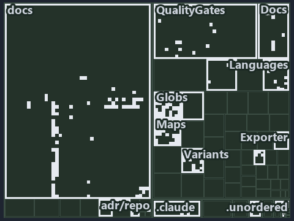

# docs/.assets/explanation/tree/adr-dsgn-track--unit-to-pipeline-rule-is-review-only--governance.tree.md

`Tree minimap: adr-dsgn-track--unit-to-pipeline-rule-is-review-only--governance`

The tree minimap of the slide `adr-dsgn-track--unit-to-pipeline-rule-is-review-only--governance` (governance lens). The slide supports
[ADR-DSGN-TRACK][1], [ADR-FLOW-CD-GLOBS][2] and [ADR-REPO-FOLDERS][3]; the highlight of those ADR codes selects what is lit, and each reason
below names the code that selects it.

## What the minimap shows

The tree draws every file of the world map as a tile, grouped by top-level folder (under `automation/` by module, under `docs/adr/` by ADR
domain), and lights 211 files in 19 groups, filled in ink. A lit ADR file has a white rim; a file lit only by passing mentions is a lighter
ink. Every other tile is idle, a grey box: a file the slide's ADR codes do not select.

- docs (docs/ outside docs/adr/): 71 lit files
- Globs (automation/Catzc.Base.Globs): 37 lit files
- Maps (automation/Catzc.Base.Maps): 28 lit files
- QualityGates (automation/Catzc.Base.QualityGates): 12 lit files
- Variants (automation/Catzc.Base.Variants): 11 lit files
- Languages (automation/Catzc.Base.Languages): 10 lit files
- .claude: 8 lit files
- .unordered: 8 lit files
- Docs (automation/Catzc.Base.Docs): 8 lit files
- Az.DevOps.BuildValidation (automation/Catzc.Azure.DevOps.BuildValidation): 4 lit files
- ModuleSystem (automation/Catzc.Base.ModuleSystem): 2 lit files
- adr/* (the files directly in docs/adr/): 2 lit files
- adr/dsgn (docs/adr/design): 2 lit files
- adr/flow (docs/adr/flow): 2 lit files
- adr/repo (docs/adr/repository): 2 lit files
- .github: 1 lit file
- Contracts (automation/Catzc.Base.Contracts): 1 lit file
- Exporter (automation/Catzc.Base.Exporter): 1 lit file
- pipelines: 1 lit file

## Why each group is lit

### docs (docs/ outside docs/adr/, 71 lit files)

The group holds the files of docs/ outside docs/adr/; each sits in its world-map cell and is lit by:

- [docs/how-to/automation/manual-test-plan/pipelines-and-globs.md][4], in the cell docs × markdown: selected by [ADR-FLOW-CD-GLOBS][2]: the
  file cites it at line 15 (text) and line 35 (text).
- [docs/how-to/automation/manual-test-plan/repository-conventions.md][5], in the cell docs × markdown: selected by [ADR-DSGN-TRACK][1]: the
  file cites it at line 15 (text), line 38 (text), line 44 (text), line 44 (text), line 47 (text), line 47 (text), line 49 (text), line 49
  (text), line 49 (text), line 50 (text), line 51 (text) and line 53 (text).
- [docs/references/automation/catzc-azure-devops-buildvalidation/Register-AdoBuildValidation.ps1.md][6], in the cell docs × markdown:
  selected by [ADR-FLOW-CD-GLOBS][2]: the file cites it at line 28 (text).
- [docs/references/automation/catzc-azure-devops-buildvalidation/configs/build-validation.yml.md][7], in the cell docs × markdown: selected
  by [ADR-FLOW-CD-GLOBS][2]: the file cites it at line 34 (text).
- [docs/references/automation/catzc-base-docs/configs/adrs.yml.md][8], in the cell docs × markdown: selected by [ADR-DSGN-TRACK][1]: the
  file cites it at line 16 (text), line 39 (text) and line 40 (text).
- [docs/references/automation/catzc-base-docs/types/AdrDomain.cs.md][9], in the cell docs × markdown: selected by [ADR-DSGN-TRACK][1]: the
  file cites it at line 17 (text), line 35 (text) and line 36 (text).
- [docs/references/automation/catzc-base-docs/types/AdrRuleSet.cs.md][10], in the cell docs × markdown: selected by [ADR-DSGN-TRACK][1]: the
  file cites it at line 17 (text) and line 37 (text).
- [docs/references/automation/catzc-base-docs/types/AdrsConfig.cs.md][11], in the cell docs × markdown: selected by [ADR-DSGN-TRACK][1]: the
  file cites it at line 20 (text), line 53 (text), line 56 (text) and line 68 (text).
- [docs/references/automation/catzc-base-globs.md][12], in the cell docs × markdown: selected by [ADR-FLOW-CD-GLOBS][2]: the file cites it
  at line 50 (text).
- [docs/references/automation/catzc-base-globs/Get-ModuleGlobSet.ps1.md][13], in the cell docs × markdown: selected by
  [ADR-FLOW-CD-GLOBS][2]: the file cites it at line 19 (text), line 34 (text), line 37 (text) and line 85 (text).
- [docs/references/automation/catzc-base-globs/Test-GlobSetIndependence.ps1.md][14], in the cell docs × markdown: selected by
  [ADR-FLOW-CD-GLOBS][2]: the file cites it at line 16 (text), line 30 (text) and line 40 (text).
- [docs/references/automation/catzc-base-globs/configs/globs.yml.md][15], in the cell docs × markdown: selected by [ADR-DSGN-TRACK][1]: the
  file cites it at line 16 (text) and line 125 (text); selected by [ADR-FLOW-CD-GLOBS][2]: the file cites it at line 17 (text), line 32
  (text), line 37 (text), line 45 (text), line 47 (text), line 61 (text), line 91 (text) and line 105 (text).
- [docs/references/automation/catzc-base-globs/tests/Get-ChangedFile.Tests.ps1.md][16], in the cell docs × markdown: selected by
  [ADR-FLOW-CD-GLOBS][2]: the file cites it at line 16 (text) and line 31 (text).
- [docs/references/automation/catzc-base-globs/tests/Get-ChangedGlobSet.Tests.ps1.md][17], in the cell docs × markdown: selected by
  [ADR-FLOW-CD-GLOBS][2]: the file cites it at line 17 (text) and line 31 (text).
- [docs/references/automation/catzc-base-globs/tests/Get-GlobSetFile.Tests.ps1.md][18], in the cell docs × markdown: selected by
  [ADR-FLOW-CD-GLOBS][2]: the file cites it at line 16 (text), line 30 (text) and line 31 (text).
- [docs/references/automation/catzc-base-globs/tests/Get-GlobSetHash.Tests.ps1.md][19], in the cell docs × markdown: selected by
  [ADR-FLOW-CD-GLOBS][2]: the file cites it at line 16 (text) and line 31 (text).
- [docs/references/automation/catzc-base-globs/tests/Get-GlobSetMember.Tests.ps1.md][20], in the cell docs × markdown: selected by
  [ADR-FLOW-CD-GLOBS][2]: the file cites it at line 16 (text) and line 30 (text).
- [docs/references/automation/catzc-base-globs/tests/Get-GlobSetTrigger.Tests.ps1.md][21], in the cell docs × markdown: selected by
  [ADR-FLOW-CD-GLOBS][2]: the file cites it at line 16 (text) and line 30 (text).
- [docs/references/automation/catzc-base-globs/tests/Get-PipelineTrigger.Tests.ps1.md][22], in the cell docs × markdown: selected by
  [ADR-FLOW-CD-GLOBS][2]: the file cites it at line 16 (text) and line 30 (text).
- [docs/references/automation/catzc-base-globs/tests/Get-TrackedFile.Tests.ps1.md][23], in the cell docs × markdown: selected by
  [ADR-FLOW-CD-GLOBS][2]: the file cites it at line 16 (text) and line 29 (text).
- [docs/references/automation/catzc-base-globs/tests/GlobSet-Independence.Tests.ps1.md][24], in the cell docs × markdown: selected by
  [ADR-FLOW-CD-GLOBS][2]: the file cites it at line 16 (text) and line 30 (text).
- [docs/references/automation/catzc-base-globs/tests/GlobSetTrigger-Coverage.Tests.ps1.md][25], in the cell docs × markdown: selected by
  [ADR-FLOW-CD-GLOBS][2]: the file cites it at line 17 (text) and line 31 (text).
- [docs/references/automation/catzc-base-globs/tests/PipelineTrigger-Integrity.Tests.ps1.md][26], in the cell docs × markdown: selected by
  [ADR-FLOW-CD-GLOBS][2]: the file cites it at line 16 (text) and line 31 (text).
- [docs/references/automation/catzc-base-globs/tests/Test-GlobSetIndependence.Tests.ps1.md][27], in the cell docs × markdown: selected by
  [ADR-FLOW-CD-GLOBS][2]: the file cites it at line 17 (text) and line 32 (text).
- [docs/references/automation/catzc-base-globs/tests/types/GlobPattern.Tests.ps1.md][28], in the cell docs × markdown: selected by
  [ADR-FLOW-CD-GLOBS][2]: the file cites it at line 16 (text), line 29 (text) and line 31 (text).
- [docs/references/automation/catzc-base-globs/tests/types/GlobSet.Tests.ps1.md][29], in the cell docs × markdown: selected by
  [ADR-FLOW-CD-GLOBS][2]: the file cites it at line 16 (text), line 30 (text) and line 32 (text).
- [docs/references/automation/catzc-base-globs/tests/types/GlobsConfig.Tests.ps1.md][30], in the cell docs × markdown: selected by
  [ADR-FLOW-CD-GLOBS][2]: the file cites it at line 17 (text), line 33 (text), line 35 (text) and line 44 (text).
- [docs/references/automation/catzc-base-globs/types/Aspect.cs.md][31], in the cell docs × markdown: selected by [ADR-FLOW-CD-GLOBS][2]: the
  file cites it at line 17 (text) and line 38 (text).
- [docs/references/automation/catzc-base-globs/types/DurableHash.cs.md][32], in the cell docs × markdown: selected by
  [ADR-FLOW-CD-GLOBS][2]: the file cites it at line 16 (text), line 29 (text) and line 35 (text).
- [docs/references/automation/catzc-base-globs/types/GlobPattern.cs.md][33], in the cell docs × markdown: selected by
  [ADR-FLOW-CD-GLOBS][2]: the file cites it at line 16 (text), line 35 (text), line 36 (text) and line 37 (text).
- [docs/references/automation/catzc-base-globs/types/GlobSet.cs.md][34], in the cell docs × markdown: selected by [ADR-FLOW-CD-GLOBS][2]:
  the file cites it at line 16 (text), line 31 (text), line 33 (text), line 34 (text), line 40 (text), line 43 (text), line 45 (text), line
  48 (text), line 56 (text), line 65 (text), line 83 (text), line 100 (text), line 110 (text), line 134 (text) and line 142 (text).
- [docs/references/automation/catzc-base-globs/types/GlobsConfig.cs.md][35], in the cell docs × markdown: selected by
  [ADR-FLOW-CD-GLOBS][2]: the file cites it at line 16 (text), line 31 (text), line 35 (text), line 38 (text) and line 57 (text).
- [docs/references/automation/catzc-base-languages.md][36], in the cell docs × markdown: selected by [ADR-REPO-FOLDERS][3]: the file cites
  it at line 78 (text) and line 108 (text).
- [docs/references/automation/catzc-base-languages/configs/languages.yml.md][37], in the cell docs × markdown: selected by
  [ADR-DSGN-TRACK][1]: the file cites it at line 17 (text) and line 34 (text).
- [docs/references/automation/catzc-base-languages/tests/Get-FileLanguage.Tests.ps1.md][38], in the cell docs × markdown: selected by
  [ADR-DSGN-TRACK][1]: the file cites it at line 16 (text) and line 31 (text).
- [docs/references/automation/catzc-base-languages/types/BashConfig.cs.md][39], in the cell docs × markdown: selected by
  [ADR-REPO-FOLDERS][3]: the file cites it at line 17 (text) and line 41 (text).
- [docs/references/automation/catzc-base-languages/types/FileLanguage.cs.md][40], in the cell docs × markdown: selected by
  [ADR-DSGN-TRACK][1]: the file cites it at line 17 (text) and line 31 (text).
- [docs/references/automation/catzc-base-languages/types/GoConfig.cs.md][41], in the cell docs × markdown: selected by
  [ADR-REPO-FOLDERS][3]: the file cites it at line 18 (text) and line 45 (text).
- [docs/references/automation/catzc-base-languages/types/LanguagesConfig.cs.md][42], in the cell docs × markdown: selected by
  [ADR-DSGN-TRACK][1]: the file cites it at line 18 (text) and line 34 (text).
- [docs/references/automation/catzc-base-languages/types/PythonConfig.cs.md][43], in the cell docs × markdown: selected by
  [ADR-REPO-FOLDERS][3]: the file cites it at line 17 (text) and line 44 (text).
- [docs/references/automation/catzc-base-maps.md][44], in the cell docs × markdown: selected by [ADR-DSGN-TRACK][1]: the file cites it at
  line 15 (text), line 96 (text), line 98 (text) and line 110 (text).
- [docs/references/automation/catzc-base-maps/configs/maps.yml.md][45], in the cell docs × markdown: selected by [ADR-DSGN-TRACK][1]: the
  file cites it at line 17 (text), line 56 (text), line 62 (text), line 64 (text) and line 69 (text).
- [docs/references/automation/catzc-base-maps/tests/Get-ValueChainHighlight.Tests.ps1.md][46], in the cell docs × markdown: selected by
  [ADR-DSGN-TRACK][1]: the file cites it at line 17 (text), line 31 (text) and line 32 (text).
- [docs/references/automation/catzc-base-maps/tests/Get-ValueChainMap.Tests.ps1.md][47], in the cell docs × markdown: selected by
  [ADR-DSGN-TRACK][1]: the file cites it at line 17 (text) and line 31 (text).
- [docs/references/automation/catzc-base-maps/tests/Get-WorldMap.Tests.ps1.md][48], in the cell docs × markdown: selected by
  [ADR-DSGN-TRACK][1]: the file cites it at line 16 (text) and line 30 (text).
- [docs/references/automation/catzc-base-maps/tests/Test-ValueChainMap.Tests.ps1.md][49], in the cell docs × markdown: selected by
  [ADR-DSGN-TRACK][1]: the file cites it at line 17 (text), line 31 (text), line 32 (text) and line 33 (text).
- [docs/references/automation/catzc-base-maps/tests/Test-WorldMap.Tests.ps1.md][50], in the cell docs × markdown: selected by
  [ADR-DSGN-TRACK][1]: the file cites it at line 17 (text), line 31 (text) and line 32 (text).
- [docs/references/automation/catzc-base-maps/tests/types/ValueChainHighlight.Tests.ps1.md][51], in the cell docs × markdown: selected by
  [ADR-DSGN-TRACK][1]: the file cites it at line 17 (text), line 31 (text) and line 32 (text).
- [docs/references/automation/catzc-base-maps/tests/types/ValueChainMap.Tests.ps1.md][52], in the cell docs × markdown: selected by
  [ADR-DSGN-TRACK][1]: the file cites it at line 17 (text) and line 31 (text).
- [docs/references/automation/catzc-base-maps/types/MapCell.cs.md][53], in the cell docs × markdown: selected by [ADR-DSGN-TRACK][1]: the
  file cites it at line 17 (text), line 31 (text), line 32 (text) and line 33 (text).
- [docs/references/automation/catzc-base-maps/types/MapsLabels.cs.md][54], in the cell docs × markdown: selected by [ADR-DSGN-TRACK][1]: the
  file cites it at line 18 (text), line 35 (text), line 36 (text) and line 40 (text).
- [docs/references/automation/catzc-base-maps/types/ValueChainCell.cs.md][55], in the cell docs × markdown: selected by [ADR-DSGN-TRACK][1]:
  the file cites it at line 17 (text), line 31 (text) and line 32 (text).
- [docs/references/automation/catzc-base-maps/types/ValueChainHighlight.cs.md][56], in the cell docs × markdown: selected by
  [ADR-DSGN-TRACK][1]: the file cites it at line 16 (text), line 31 (text) and line 32 (text).
- [docs/references/automation/catzc-base-maps/types/ValueChainMap.cs.md][57], in the cell docs × markdown: selected by [ADR-DSGN-TRACK][1]:
  the file cites it at line 16 (text), line 31 (text), line 32 (text) and line 34 (text).
- [docs/references/automation/catzc-base-maps/types/ValueChainReason.cs.md][58], in the cell docs × markdown: selected by
  [ADR-DSGN-TRACK][1]: the file cites it at line 17 (text), line 31 (text) and line 33 (text).
- [docs/references/automation/catzc-base-maps/types/WorldMap.cs.md][59], in the cell docs × markdown: selected by [ADR-DSGN-TRACK][1]: the
  file cites it at line 16 (text), line 32 (text) and line 33 (text).
- [docs/references/automation/catzc-base-maps/types/WorldMapBuilder.cs.md][60], in the cell docs × markdown: selected by
  [ADR-DSGN-TRACK][1]: the file cites it at line 17 (text), line 37 (text), line 38 (text) and line 41 (text).
- [docs/references/automation/catzc-base-maps/types/WorldMapGridLayout.cs.md][61], in the cell docs × markdown: selected by
  [ADR-DSGN-TRACK][1]: the file cites it at line 17 (text), line 32 (text) and line 33 (text).
- [docs/references/automation/catzc-base-maps/types/WorldMapHighlight.cs.md][62], in the cell docs × markdown: selected by
  [ADR-DSGN-TRACK][1]: the file cites it at line 16 (text) and line 31 (text).
- [docs/references/automation/catzc-base-maps/types/WorldMapPdf.cs.md][63], in the cell docs × markdown: selected by [ADR-DSGN-TRACK][1]:
  the file cites it at line 16 (text), line 32 (text), line 33 (text) and line 34 (text).
- [docs/references/automation/catzc-base-modulesystem/Test-FolderConventions.ps1.md][64], in the cell docs × markdown: selected by
  [ADR-REPO-FOLDERS][3]: the file cites it at line 16 (text) and line 39 (text).
- [docs/references/automation/catzc-base-qualitygates/private/Get-ModuleProtectionIdentity.ps1.md][65], in the cell docs × markdown:
  selected by [ADR-FLOW-CD-GLOBS][2]: the file cites it at line 16 (text) and line 69 (text).
- [docs/references/automation/catzc-base-variants/configs/variants.yml.md][66], in the cell docs × markdown: selected by
  [ADR-DSGN-TRACK][1]: the file cites it at line 16 (text), line 93 (text), line 96 (text) and line 98 (text).
- [docs/references/automation/catzc-base-variants/types/VariantTrack.cs.md][67], in the cell docs × markdown: selected by
  [ADR-DSGN-TRACK][1]: the file cites it at line 17 (text), line 30 (text) and line 32 (text).
- [docs/references/automation/catzc-base-variants/types/VariantsConfig.cs.md][68], in the cell docs × markdown: selected by
  [ADR-DSGN-TRACK][1]: the file cites it at line 17 (text), line 51 (text), line 54 (text) and line 56 (text).
- [docs/references/pipelines/cd-apex.yaml.md][69], in the cell docs × markdown: selected by [ADR-FLOW-CD-GLOBS][2]: the file cites it at
  line 46 (text).
- [docs/references/pipelines/cd-flux.yaml.md][70], in the cell docs × markdown: selected by [ADR-FLOW-CD-GLOBS][2]: the file cites it at
  line 45 (text).
- [docs/references/pipelines/cd-nova.yaml.md][71], in the cell docs × markdown: selected by [ADR-FLOW-CD-GLOBS][2]: the file cites it at
  line 45 (text).
- [docs/references/pipelines/cd-shared.yaml.md][72], in the cell docs × markdown: selected by [ADR-FLOW-CD-GLOBS][2]: the file cites it at
  line 40 (text).
- [docs/references/pipelines/ci-automation.yaml.md][73], in the cell docs × markdown: selected by [ADR-DSGN-TRACK][1]: the file cites it at
  line 16 (text) and line 31 (text); selected by [ADR-FLOW-CD-GLOBS][2]: the file cites it at line 30 (text).
- [docs/references/pipelines/ci-infrastructure.yaml.md][74], in the cell docs × markdown: selected by [ADR-FLOW-CD-GLOBS][2]: the file cites
  it at line 32 (text).

### Globs (automation/Catzc.Base.Globs, 37 lit files)

The group holds the files of automation/Catzc.Base.Globs; each sits in its world-map cell and is lit by:

- [automation/Catzc.Base.Globs/Get-ChangedGlobSet.ps1][75], in the cell automation × powershell: selected by [ADR-FLOW-CD-GLOBS][2]: the
  file cites it at line 19 (header) and line 25 (header).
- [automation/Catzc.Base.Globs/Get-GlobSet.ps1][76], in the cell automation × powershell: selected by [ADR-FLOW-CD-GLOBS][2]: the file cites
  it at line 19 (header) and line 24 (header).
- [automation/Catzc.Base.Globs/Get-GlobSetFile.ps1][77], in the cell automation × powershell: selected by [ADR-FLOW-CD-GLOBS][2]: the file
  cites it at line 19 (header), line 24 (header) and line 27 (header).
- [automation/Catzc.Base.Globs/Get-GlobSetHash.ps1][78], in the cell automation × powershell: selected by [ADR-FLOW-CD-GLOBS][2]: the file
  cites it at line 19 (header) and line 27 (header).
- [automation/Catzc.Base.Globs/Get-GlobSetTrigger.ps1][79], in the cell automation × powershell: selected by [ADR-FLOW-CD-GLOBS][2]: the
  file cites it at line 19 (header) and line 24 (header).
- [automation/Catzc.Base.Globs/Get-MarkerBlastRadius.ps1][80], in the cell automation × powershell: selected by [ADR-FLOW-CD-GLOBS][2]: the
  file cites it at line 20 (header) and line 26 (header).
- [automation/Catzc.Base.Globs/Get-ModuleGlobSet.ps1][81], in the cell automation × powershell: selected by [ADR-FLOW-CD-GLOBS][2]: the file
  cites it at line 25 (header).
- [automation/Catzc.Base.Globs/Get-TrackedFile.ps1][82], in the cell automation × powershell: selected by [ADR-FLOW-CD-GLOBS][2]: the file
  cites it at line 20 (header) and line 25 (header).
- [automation/Catzc.Base.Globs/Test-AdoPipelineTriggerGlob.ps1][83], in the cell automation × powershell: selected by
  [ADR-FLOW-CD-GLOBS][2]: the file cites it at line 21 (header).
- [automation/Catzc.Base.Globs/Test-GitHubWorkflowTriggerGlob.ps1][84], in the cell automation × powershell: selected by
  [ADR-FLOW-CD-GLOBS][2]: the file cites it at line 21 (header).
- [automation/Catzc.Base.Globs/Test-GlobSetAffected.ps1][85], in the cell automation × powershell: selected by [ADR-FLOW-CD-GLOBS][2]: the
  file cites it at line 21 (header) and line 32 (header).
- [automation/Catzc.Base.Globs/Test-GlobSetIndependence.ps1][86], in the cell automation × powershell: selected by [ADR-FLOW-CD-GLOBS][2]:
  the file cites it at line 22 (header), line 35 (header) and line 94 (text).
- [automation/Catzc.Base.Globs/Test-GlobSetTriggerCoverage.ps1][87], in the cell automation × powershell: selected by
  [ADR-FLOW-CD-GLOBS][2]: the file cites it at line 21 (header) and line 27 (header).
- [automation/Catzc.Base.Globs/private/Get-ChangedFile.ps1][88], in the cell automation × powershell: selected by [ADR-FLOW-CD-GLOBS][2]:
  the file cites it at line 20 (header) and line 27 (header).
- [automation/Catzc.Base.Globs/private/Get-GlobSetMember.ps1][89], in the cell automation × powershell: selected by [ADR-FLOW-CD-GLOBS][2]:
  the file cites it at line 20 (header) and line 25 (header).
- [automation/Catzc.Base.Globs/private/Get-PipelineTrigger.ps1][90], in the cell automation × powershell: selected by
  [ADR-FLOW-CD-GLOBS][2]: the file cites it at line 20 (header) and line 26 (header).
- [automation/Catzc.Base.Globs/private/Test-GlobListEqual.ps1][91], in the cell automation × powershell: selected by [ADR-FLOW-CD-GLOBS][2]:
  the file cites it at line 20 (header) and line 30 (header).
- [automation/Catzc.Base.Globs/tests/Get-ChangedFile.Tests.ps1][92], in the cell automation × powershell: selected by
  [ADR-FLOW-CD-GLOBS][2]: the file cites it at line 19 (header).
- [automation/Catzc.Base.Globs/tests/Get-ChangedGlobSet.Tests.ps1][93], in the cell automation × powershell: selected by
  [ADR-FLOW-CD-GLOBS][2]: the file cites it at line 20 (header).
- [automation/Catzc.Base.Globs/tests/Get-GlobSetFile.Tests.ps1][94], in the cell automation × powershell: selected by
  [ADR-FLOW-CD-GLOBS][2]: the file cites it at line 19 (header).
- [automation/Catzc.Base.Globs/tests/Get-GlobSetHash.Tests.ps1][95], in the cell automation × powershell: selected by
  [ADR-FLOW-CD-GLOBS][2]: the file cites it at line 19 (header).
- [automation/Catzc.Base.Globs/tests/Get-GlobSetMember.Tests.ps1][96], in the cell automation × powershell: selected by
  [ADR-FLOW-CD-GLOBS][2]: the file cites it at line 19 (header).
- [automation/Catzc.Base.Globs/tests/Get-GlobSetTrigger.Tests.ps1][97], in the cell automation × powershell: selected by
  [ADR-FLOW-CD-GLOBS][2]: the file cites it at line 19 (header).
- [automation/Catzc.Base.Globs/tests/Get-PipelineTrigger.Tests.ps1][98], in the cell automation × powershell: selected by
  [ADR-FLOW-CD-GLOBS][2]: the file cites it at line 19 (header).
- [automation/Catzc.Base.Globs/tests/Get-TrackedFile.Tests.ps1][99], in the cell automation × powershell: selected by
  [ADR-FLOW-CD-GLOBS][2]: the file cites it at line 19 (header).
- [automation/Catzc.Base.Globs/tests/GlobSet-Independence.Tests.ps1][100], in the cell automation × powershell: selected by
  [ADR-FLOW-CD-GLOBS][2]: the file cites it at line 19 (header), line 24 (text) and line 26 (text).
- [automation/Catzc.Base.Globs/tests/GlobSetTrigger-Coverage.Tests.ps1][101], in the cell automation × powershell: selected by
  [ADR-FLOW-CD-GLOBS][2]: the file cites it at line 20 (header).
- [automation/Catzc.Base.Globs/tests/PipelineTrigger-Integrity.Tests.ps1][102], in the cell automation × powershell: selected by
  [ADR-FLOW-CD-GLOBS][2]: the file cites it at line 19 (header).
- [automation/Catzc.Base.Globs/tests/Test-GlobSetIndependence.Tests.ps1][103], in the cell automation × powershell: selected by
  [ADR-FLOW-CD-GLOBS][2]: the file cites it at line 20 (header).
- [automation/Catzc.Base.Globs/tests/types/GlobPattern.Tests.ps1][104], in the cell automation × powershell: selected by
  [ADR-FLOW-CD-GLOBS][2]: the file cites it at line 19 (header) and line 80 (text).
- [automation/Catzc.Base.Globs/tests/types/GlobSet.Tests.ps1][105], in the cell automation × powershell: selected by [ADR-FLOW-CD-GLOBS][2]:
  the file cites it at line 19 (header) and line 31 (text).
- [automation/Catzc.Base.Globs/tests/types/GlobsConfig.Tests.ps1][106], in the cell automation × powershell: selected by
  [ADR-DSGN-TRACK][1]: the file cites it at line 20 (header) and line 65 (text); selected by [ADR-FLOW-CD-GLOBS][2]: the file cites it at
  line 21 (header), line 77 (text), line 90 (text), line 101 (text) and line 113 (text).
- [automation/Catzc.Base.Globs/types/Aspect.cs][107], in the cell automation × csharp: selected by [ADR-FLOW-CD-GLOBS][2]: the file cites it
  at line 21 (text).
- [automation/Catzc.Base.Globs/types/DurableHash.cs][108], in the cell automation × csharp: selected by [ADR-FLOW-CD-GLOBS][2]: the file
  cites it at line 19 (text).
- [automation/Catzc.Base.Globs/types/GlobPattern.cs][109], in the cell automation × csharp: selected by [ADR-FLOW-CD-GLOBS][2]: the file
  cites it at line 20 (text), line 46 (text), line 50 (text), line 54 (text), line 66 (text), line 70 (text) and line 79 (text).
- [automation/Catzc.Base.Globs/types/GlobSet.cs][110], in the cell automation × csharp: selected by [ADR-FLOW-CD-GLOBS][2]: the file cites
  it at line 20 (text) and line 78 (text).
- [automation/Catzc.Base.Globs/types/GlobsConfig.cs][111], in the cell automation × csharp: selected by [ADR-FLOW-CD-GLOBS][2]: the file
  cites it at line 20 (text), line 97 (text), line 160 (text), line 164 (text) and line 178 (text).

### Maps (automation/Catzc.Base.Maps, 28 lit files)

The group holds the files of automation/Catzc.Base.Maps; each sits in its world-map cell and is lit by:

- [automation/Catzc.Base.Maps/Export-WorldMapPdf.ps1][112], in the cell automation × powershell: selected by [ADR-DSGN-TRACK][1]: the file
  cites it at line 19 (header), line 29 (header), line 30 (header), line 32 (header) and line 48 (header).
- [automation/Catzc.Base.Maps/Get-ValueChainHighlight.ps1][113], in the cell automation × powershell: selected by [ADR-DSGN-TRACK][1]: the
  file cites it at line 20 (header), line 29 (header), line 30 (header) and line 41 (header).
- [automation/Catzc.Base.Maps/Get-ValueChainMap.ps1][114], in the cell automation × powershell: selected by [ADR-DSGN-TRACK][1]: the file
  cites it at line 19 (header), line 26 (header), line 28 (header) and line 30 (header).
- [automation/Catzc.Base.Maps/Get-WorldMap.ps1][115], in the cell automation × powershell: selected by [ADR-DSGN-TRACK][1]: the file cites
  it at line 22 (header), line 29 (header), line 30 (header) and line 42 (header).
- [automation/Catzc.Base.Maps/Get-WorldMapHighlight.ps1][116], in the cell automation × powershell: selected by [ADR-DSGN-TRACK][1]: the
  file cites it at line 19 (header), line 32 (header) and line 49 (header).
- [automation/Catzc.Base.Maps/Test-ValueChainMap.ps1][117], in the cell automation × powershell: selected by [ADR-DSGN-TRACK][1]: the file
  cites it at line 22 (header), line 36 (header), line 38 (header), line 41 (header), line 45 (header), line 76 (text), line 77 (text), line
  87 (text), line 90 (text) and line 107 (text).
- [automation/Catzc.Base.Maps/Test-WorldMap.ps1][118], in the cell automation × powershell: selected by [ADR-DSGN-TRACK][1]: the file cites
  it at line 21 (header), line 33 (header), line 36 (header), line 40 (header), line 45 (header), line 46 (header), line 89 (text), line 108
  (text), line 125 (text), line 129 (text) and line 130 (text).
- [automation/Catzc.Base.Maps/private/Resolve-MapLabelTerm.ps1][119], in the cell automation × powershell: selected by [ADR-DSGN-TRACK][1]:
  the file cites it at line 20 (header), line 28 (header) and line 29 (header).
- [automation/Catzc.Base.Maps/tests/Get-ValueChainHighlight.Tests.ps1][120], in the cell automation × powershell: selected by
  [ADR-DSGN-TRACK][1]: the file cites it at line 20 (header), line 41 (text), line 47 (text) and line 66 (text).
- [automation/Catzc.Base.Maps/tests/Get-ValueChainMap.Tests.ps1][121], in the cell automation × powershell: selected by [ADR-DSGN-TRACK][1]:
  the file cites it at line 20 (header), line 41 (text), line 60 (text) and line 60 (body comment).
- [automation/Catzc.Base.Maps/tests/Get-WorldMap.Tests.ps1][122], in the cell automation × powershell: selected by [ADR-DSGN-TRACK][1]: the
  file cites it at line 19 (header) and line 111 (text).
- [automation/Catzc.Base.Maps/tests/Get-WorldMapHighlight.Tests.ps1][123], in the cell automation × powershell: selected by
  [ADR-DSGN-TRACK][1]: the file cites it at line 18 (header) and line 96 (text).
- [automation/Catzc.Base.Maps/tests/Test-ValueChainMap.Tests.ps1][124], in the cell automation × powershell: selected by
  [ADR-DSGN-TRACK][1]: the file cites it at line 20 (header), line 72 (text), line 72 (body comment), line 76 (text), line 77 (text), line
  78 (text), line 79 (text), line 83 (text), line 86 (text), line 103 (text), line 103 (body comment) and line 103 (body comment).
- [automation/Catzc.Base.Maps/tests/Test-WorldMap.Tests.ps1][125], in the cell automation × powershell: selected by [ADR-DSGN-TRACK][1]: the
  file cites it at line 20 (header), line 80 (text), line 84 (text), line 87 (text), line 91 (text), line 92 (text), line 96 (text), line
  105 (text), line 106 (text), line 110 (text), line 114 (text), line 115 (text), line 134 (text), line 134 (body comment) and line 134
  (body comment).
- [automation/Catzc.Base.Maps/tests/types/ValueChainHighlight.Tests.ps1][126], in the cell automation × powershell: selected by
  [ADR-DSGN-TRACK][1]: the file cites it at line 20 (header), line 39 (text), line 46 (text), line 52 (text), line 69 (text) and line 69
  (body comment).
- [automation/Catzc.Base.Maps/tests/types/ValueChainMap.Tests.ps1][127], in the cell automation × powershell: selected by
  [ADR-DSGN-TRACK][1]: the file cites it at line 20 (header), line 41 (text), line 50 (text), line 55 (text) and line 63 (text).
- [automation/Catzc.Base.Maps/tests/types/WorldMapHighlight.Tests.ps1][128], in the cell automation × powershell: selected by
  [ADR-DSGN-TRACK][1]: the file cites it at line 18 (header), line 90 (text), line 134 (text) and line 148 (text).
- [automation/Catzc.Base.Maps/types/MapCell.cs][129], in the cell automation × csharp: selected by [ADR-DSGN-TRACK][1]: the file cites it at
  line 20 (text).
- [automation/Catzc.Base.Maps/types/MapsLabels.cs][130], in the cell automation × csharp: selected by [ADR-DSGN-TRACK][1]: the file cites it
  at line 21 (text).
- [automation/Catzc.Base.Maps/types/ValueChainCell.cs][131], in the cell automation × csharp: selected by [ADR-DSGN-TRACK][1]: the file
  cites it at line 20 (text), line 32 (body comment) and line 35 (body comment).
- [automation/Catzc.Base.Maps/types/ValueChainHighlight.cs][132], in the cell automation × csharp: selected by [ADR-DSGN-TRACK][1]: the file
  cites it at line 20 (text).
- [automation/Catzc.Base.Maps/types/ValueChainMap.cs][133], in the cell automation × csharp: selected by [ADR-DSGN-TRACK][1]: the file cites
  it at line 20 (text).
- [automation/Catzc.Base.Maps/types/ValueChainReason.cs][134], in the cell automation × csharp: selected by [ADR-DSGN-TRACK][1]: the file
  cites it at line 20 (text).
- [automation/Catzc.Base.Maps/types/WorldMap.cs][135], in the cell automation × csharp: selected by [ADR-DSGN-TRACK][1]: the file cites it
  at line 19 (text).
- [automation/Catzc.Base.Maps/types/WorldMapBuilder.cs][136], in the cell automation × csharp: selected by [ADR-DSGN-TRACK][1]: the file
  cites it at line 21 (text) and line 163 (body comment).
- [automation/Catzc.Base.Maps/types/WorldMapGridLayout.cs][137], in the cell automation × csharp: selected by [ADR-DSGN-TRACK][1]: the file
  cites it at line 20 (text).
- [automation/Catzc.Base.Maps/types/WorldMapHighlight.cs][138], in the cell automation × csharp: selected by [ADR-DSGN-TRACK][1]: the file
  cites it at line 20 (text).
- [automation/Catzc.Base.Maps/types/WorldMapPdf.cs][139], in the cell automation × csharp: selected by [ADR-DSGN-TRACK][1]: the file cites
  it at line 20 (text).

### QualityGates (automation/Catzc.Base.QualityGates, 12 lit files)

The group holds the files of automation/Catzc.Base.QualityGates; each sits in its world-map cell and is lit by:

- [automation/Catzc.Base.QualityGates/Test-Automation.ps1][140], in the cell automation × powershell: selected by [ADR-FLOW-CD-GLOBS][2]:
  the file cites it at line 22 (header) and line 101 (header).
- [automation/Catzc.Base.QualityGates/configs/terminology.yml][141], in the cell automation × yaml: selected by [ADR-DSGN-TRACK][1]: the
  file cites it at line 312 (text) and line 315 (text); selected by [ADR-FLOW-CD-GLOBS][2]: the file cites it at line 1211 (text).
- [automation/Catzc.Base.QualityGates/private/Get-FileTypeFileMetaFact.ps1][142], in the cell automation × powershell: selected by
  [ADR-DSGN-TRACK][1]: the file cites it at line 21 (header) and line 25 (header).
- [automation/Catzc.Base.QualityGates/private/Get-GuidScanFiles.ps1][143], in the cell automation × powershell: selected by
  [ADR-FLOW-CD-GLOBS][2]: the file cites it at line 21 (header) and line 27 (header).
- [automation/Catzc.Base.QualityGates/private/Get-LanguageTestFolders.ps1][144], in the cell automation × powershell: selected by
  [ADR-DSGN-TRACK][1]: the file cites it at line 24 (header) and line 31 (header).
- [automation/Catzc.Base.QualityGates/private/Get-ModuleProtectionIdentity.ps1][145], in the cell automation × powershell: selected by
  [ADR-FLOW-CD-GLOBS][2]: the file cites it at line 22 (header).
- [automation/Catzc.Base.QualityGates/private/Get-ModuleTypeFileMetaFact.ps1][146], in the cell automation × powershell: selected by
  [ADR-DSGN-TRACK][1]: the file cites it at line 21 (header) and line 25 (header).
- [automation/Catzc.Base.QualityGates/private/Get-TrackFileMetaFact.ps1][147], in the cell automation × powershell: selected by
  [ADR-DSGN-TRACK][1]: the file cites it at line 21 (header) and line 26 (header).
- [automation/Catzc.Base.QualityGates/private/Resolve-TestSuite.ps1][148], in the cell automation × powershell: selected by
  [ADR-FLOW-CD-GLOBS][2]: the file cites it at line 21 (header) and line 30 (header).
- [automation/Catzc.Base.QualityGates/tests/Get-FileTypeFileMetaFact.Tests.ps1][149], in the cell automation × powershell: selected by
  [ADR-DSGN-TRACK][1]: the file cites it at line 18 (header) and line 22 (text).
- [automation/Catzc.Base.QualityGates/tests/Get-ModuleTypeFileMetaFact.Tests.ps1][150], in the cell automation × powershell: selected by
  [ADR-DSGN-TRACK][1]: the file cites it at line 18 (header) and line 22 (text).
- [automation/Catzc.Base.QualityGates/tests/Get-TrackFileMetaFact.Tests.ps1][151], in the cell automation × powershell: selected by
  [ADR-DSGN-TRACK][1]: the file cites it at line 18 (header) and line 22 (text).

### Variants (automation/Catzc.Base.Variants, 11 lit files)

The group holds the files of automation/Catzc.Base.Variants; each sits in its world-map cell and is lit by:

- [automation/Catzc.Base.Variants/Get-PathModule.ps1][152], in the cell automation × powershell: selected by [ADR-DSGN-TRACK][1]: the file
  cites it at line 19 (header) and line 24 (header).
- [automation/Catzc.Base.Variants/Get-Track.ps1][153], in the cell automation × powershell: selected by [ADR-DSGN-TRACK][1]: the file cites
  it at line 19 (header), line 23 (header), line 26 (header) and line 30 (header).
- [automation/Catzc.Base.Variants/tests/Get-PathModule.Tests.ps1][154], in the cell automation × powershell: selected by
  [ADR-DSGN-TRACK][1]: the file cites it at line 18 (header), line 22 (text) and line 73 (text).
- [automation/Catzc.Base.Variants/tests/Get-Track.Tests.ps1][155], in the cell automation × powershell: selected by [ADR-DSGN-TRACK][1]: the
  file cites it at line 18 (header) and line 97 (text).
- [automation/Catzc.Base.Variants/tests/types/ModuleTypesConfig.Tests.ps1][156], in the cell automation × powershell: selected by
  [ADR-DSGN-TRACK][1]: the file cites it at line 18 (header) and line 22 (text).
- [automation/Catzc.Base.Variants/types/ModulePlace.cs][157], in the cell automation × csharp: selected by [ADR-DSGN-TRACK][1]: the file
  cites it at line 19 (text).
- [automation/Catzc.Base.Variants/types/ModuleTypeEntry.cs][158], in the cell automation × csharp: selected by [ADR-DSGN-TRACK][1]: the file
  cites it at line 18 (text).
- [automation/Catzc.Base.Variants/types/ModuleTypesConfig.cs][159], in the cell automation × csharp: selected by [ADR-DSGN-TRACK][1]: the
  file cites it at line 20 (text).
- [automation/Catzc.Base.Variants/types/PathModule.cs][160], in the cell automation × csharp: selected by [ADR-DSGN-TRACK][1]: the file
  cites it at line 18 (text).
- [automation/Catzc.Base.Variants/types/VariantTrack.cs][161], in the cell automation × csharp: selected by [ADR-DSGN-TRACK][1]: the file
  cites it at line 20 (text).
- [automation/Catzc.Base.Variants/types/VariantsConfig.cs][162], in the cell automation × csharp: selected by [ADR-DSGN-TRACK][1]: the file
  cites it at line 22 (text) and line 265 (text).

### Languages (automation/Catzc.Base.Languages, 10 lit files)

The group holds the files of automation/Catzc.Base.Languages; each sits in its world-map cell and is lit by:

- [automation/Catzc.Base.Languages/Get-FileLanguage.ps1][163], in the cell automation × powershell: selected by [ADR-DSGN-TRACK][1]: the
  file cites it at line 19 (header) and line 24 (header).
- [automation/Catzc.Base.Languages/Get-PathFileType.ps1][164], in the cell automation × powershell: selected by [ADR-DSGN-TRACK][1]: the
  file cites it at line 19 (header) and line 26 (header).
- [automation/Catzc.Base.Languages/configs/glossary.yml][165], in the cell automation × yaml: selected by [ADR-DSGN-TRACK][1]: the file
  cites it at line 23 (text).
- [automation/Catzc.Base.Languages/tests/Get-FileLanguage.Tests.ps1][166], in the cell automation × powershell: selected by
  [ADR-DSGN-TRACK][1]: the file cites it at line 19 (header), line 133 (text), line 145 (text) and line 183 (text).
- [automation/Catzc.Base.Languages/tests/Get-PathFileType.Tests.ps1][167], in the cell automation × powershell: selected by
  [ADR-DSGN-TRACK][1]: the file cites it at line 18 (header) and line 22 (text).
- [automation/Catzc.Base.Languages/types/BashConfig.cs][168], in the cell automation × csharp: selected by [ADR-REPO-FOLDERS][3]: the file
  cites it at line 21 (text).
- [automation/Catzc.Base.Languages/types/FileLanguage.cs][169], in the cell automation × csharp: selected by [ADR-DSGN-TRACK][1]: the file
  cites it at line 20 (text).
- [automation/Catzc.Base.Languages/types/GoConfig.cs][170], in the cell automation × csharp: selected by [ADR-REPO-FOLDERS][3]: the file
  cites it at line 22 (text).
- [automation/Catzc.Base.Languages/types/LanguagesConfig.cs][171], in the cell automation × csharp: selected by [ADR-DSGN-TRACK][1]: the
  file cites it at line 22 (text).
- [automation/Catzc.Base.Languages/types/PythonConfig.cs][172], in the cell automation × csharp: selected by [ADR-REPO-FOLDERS][3]: the file
  cites it at line 21 (text).

### .claude (8 lit files)

The group holds the files of .claude; each sits in its world-map cell and is lit by:

- [.claude/plans/decisions-2026-10-16.md][173], in the cell .claude × markdown: selected by [ADR-DSGN-TRACK][1]: the file cites it at line
  51 (text).
- [.claude/plans/plan-layers-vocabulary-rename-contracts.md][174], in the cell .claude × markdown: selected by [ADR-DSGN-TRACK][1]: the file
  cites it at line 123 (text), line 344 (text), line 384 (text), line 408 (text), line 482 (text), line 677 (text), line 700 (text), line
  796 (text) and line 800 (text); selected by [ADR-REPO-FOLDERS][3]: the file cites it at line 796 (text).
- [.claude/plans/plan-minimal-robots-agents.md][175], in the cell .claude × markdown: selected by [ADR-REPO-FOLDERS][3]: the file cites it
  at line 39 (text).
- [.claude/plans/plan-module-kinds-tracks.md][176], in the cell .claude × markdown: selected by [ADR-DSGN-TRACK][1]: the file cites it at
  line 36 (text), line 56 (text), line 74 (text), line 137 (text), line 254 (text), line 374 (text), line 388 (text), line 419 (text), line
  424 (text), line 472 (text), line 489 (text), line 489 (text), line 514 (text), line 516 (text), line 518 (text), line 528 (text), line
  536 (text), line 537 (text), line 547 (text), line 566 (text), line 677 (text), line 689 (text), line 694 (text), line 697 (text), line
  725 (text), line 733 (text), line 755 (text), line 793 (text), line 812 (text), line 821 (text), line 863 (text) and line 918 (text).
- [.claude/plans/plan-plans-body-sha-landing-zone.md][177], in the cell .claude × markdown: selected by [ADR-DSGN-TRACK][1]: the file cites
  it at line 30 (text) and line 130 (text).
- [.claude/plans/prompt-k8s-kinds-1-prepare.md][178], in the cell .claude × markdown: selected by [ADR-DSGN-TRACK][1]: the file cites it at
  line 18 (text) and line 45 (text).
- [.claude/plans/prompt-k8s-kinds-2-implement.md][179], in the cell .claude × markdown: selected by [ADR-DSGN-TRACK][1]: the file cites it
  at line 32 (text).
- [.claude/plans/prompt-module-model-1-prepare.md][180], in the cell .claude × markdown: selected by [ADR-DSGN-TRACK][1]: the file cites it
  at line 18 (text).

### .unordered (8 lit files)

The group holds the files of .unordered; each sits in its world-map cell and is lit by:

- [.unordered/15-10-2026/plan-adr-consistency.md][181], in the cell .unordered × markdown: selected by [ADR-DSGN-TRACK][1]: the file cites
  it at line 90 (text) and line 248 (text); selected by [ADR-FLOW-CD-GLOBS][2]: the file cites it at line 43 (text), line 96 (text), line
  124 (text) and line 167 (text); selected by [ADR-REPO-FOLDERS][3]: the file cites it at line 105 (text), line 117 (text), line 248 (text)
  and line 324 (text).
- [.unordered/15-10-2026/plan-caf-waf-automation.md][182], in the cell .unordered × markdown: selected by [ADR-FLOW-CD-GLOBS][2]: the file
  cites it at line 101 (text).
- [.unordered/15-10-2026/plan-concern-axis.md][183], in the cell .unordered × markdown: selected by [ADR-DSGN-TRACK][1]: the file cites it
  at line 32 (text), line 50 (text), line 51 (text), line 51 (text), line 54 (text), line 162 (text) and line 187 (text); selected by
  [ADR-FLOW-CD-GLOBS][2]: the file cites it at line 97 (text).
- [.unordered/15-10-2026/plan-contracts.md][184], in the cell .unordered × markdown: selected by [ADR-REPO-FOLDERS][3]: the file cites it at
  line 23 (text), line 76 (text), line 122 (text) and line 294 (text).
- [.unordered/15-10-2026/plan-diagram-wave-7.md][185], in the cell .unordered × markdown: selected by [ADR-DSGN-TRACK][1]: the file cites it
  at line 101 (text) and line 102 (text); selected by [ADR-REPO-FOLDERS][3]: the file cites it at line 31 (text).
- [.unordered/15-10-2026/plan-diagram-wave-9.md][186], in the cell .unordered × markdown: selected by [ADR-REPO-FOLDERS][3]: the file cites
  it at line 45 (text), line 74 (text) and line 150 (text).
- [.unordered/15-10-2026/plan-explanation-assets-source.md][187], in the cell .unordered × markdown: selected by [ADR-DSGN-TRACK][1]: the
  file cites it at line 29 (text), line 39 (text), line 41 (text), line 54 (text), line 56 (text) and line 110 (text); selected by
  [ADR-REPO-FOLDERS][3]: the file cites it at line 74 (text) and line 101 (text).
- [.unordered/15-10-2026/plan-explanation-drift.md][188], in the cell .unordered × markdown: selected by [ADR-FLOW-CD-GLOBS][2]: the file
  cites it at line 38 (text), line 39 (text), line 58 (text), line 77 (text), line 103 (text) and line 103 (text); selected by
  [ADR-REPO-FOLDERS][3]: the file cites it at line 63 (text), line 63 (text), line 78 (text) and line 78 (text).

### Docs (automation/Catzc.Base.Docs, 8 lit files)

The group holds the files of automation/Catzc.Base.Docs; each sits in its world-map cell and is lit by:

- [automation/Catzc.Base.Docs/configs/adrs.yml][189], in the cell automation × yaml: selected by [ADR-DSGN-TRACK][1]: the file cites it at
  line 91 (text); selected by [ADR-FLOW-CD-GLOBS][2]: the file cites it at line 118 (text); selected by [ADR-REPO-FOLDERS][3]: the file
  cites it at line 306 (text).
- [automation/Catzc.Base.Docs/configs/agents.yml][190], in the cell automation × yaml: selected by [ADR-REPO-FOLDERS][3]: the file cites it
  at line 39 (body comment), line 44 (body comment) and line 49 (body comment) (a passing mention only).
- [automation/Catzc.Base.Docs/configs/glossary.yml][191], in the cell automation × yaml: selected by [ADR-REPO-FOLDERS][3]: the file cites
  it at line 39 (text).
- [automation/Catzc.Base.Docs/private/Get-CatsModules.ps1][192], in the cell automation × powershell: selected by [ADR-REPO-FOLDERS][3]: the
  file cites it at line 22 (header) and line 28 (header).
- [automation/Catzc.Base.Docs/tests/types/AdrsConfig.Tests.ps1][193], in the cell automation × powershell: selected by [ADR-DSGN-TRACK][1]:
  the file cites it at line 20 (header), line 119 (text) and line 119 (body comment).
- [automation/Catzc.Base.Docs/types/AdrDomain.cs][194], in the cell automation × csharp: selected by [ADR-DSGN-TRACK][1]: the file cites it
  at line 20 (text).
- [automation/Catzc.Base.Docs/types/AdrRuleSet.cs][195], in the cell automation × csharp: selected by [ADR-DSGN-TRACK][1]: the file cites it
  at line 20 (text).
- [automation/Catzc.Base.Docs/types/AdrsConfig.cs][196], in the cell automation × csharp: selected by [ADR-DSGN-TRACK][1]: the file cites it
  at line 24 (text) and line 43 (body comment).

### Az.DevOps.BuildValidation (automation/Catzc.Azure.DevOps.BuildValidation, 4 lit files)

The group holds the files of automation/Catzc.Azure.DevOps.BuildValidation; each sits in its world-map cell and is lit by:

- [automation/Catzc.Azure.DevOps.BuildValidation/Get-AdoBuildValidations.ps1][197], in the cell automation × powershell: selected by
  [ADR-FLOW-CD-GLOBS][2]: the file cites it at line 19 (header) and line 29 (header).
- [automation/Catzc.Azure.DevOps.BuildValidation/Register-AdoBuildValidation.ps1][198], in the cell automation × powershell: selected by
  [ADR-FLOW-CD-GLOBS][2]: the file cites it at line 21 (header) and line 27 (header).
- [automation/Catzc.Azure.DevOps.BuildValidation/Unregister-AdoBuildValidation.ps1][199], in the cell automation × powershell: selected by
  [ADR-FLOW-CD-GLOBS][2]: the file cites it at line 20 (header) and line 25 (header).
- [automation/Catzc.Azure.DevOps.BuildValidation/private/Get-BuildValidationPathFilter.ps1][200], in the cell automation × powershell:
  selected by [ADR-FLOW-CD-GLOBS][2]: the file cites it at line 19 (header) and line 27 (header).

### ModuleSystem (automation/Catzc.Base.ModuleSystem, 2 lit files)

The group holds the files of automation/Catzc.Base.ModuleSystem; each sits in its world-map cell and is lit by:

- [automation/Catzc.Base.ModuleSystem/Test-FolderConventions.ps1][201], in the cell automation × powershell: selected by
  [ADR-REPO-FOLDERS][3]: the file cites it at line 22 (header) and line 29 (header).
- [automation/Catzc.Base.ModuleSystem/configs/glossary.yml][202], in the cell automation × yaml: selected by [ADR-DSGN-TRACK][1]: the file
  cites it at line 23 (text), line 81 (text), line 147 (text), line 155 (text), line 166 (text), line 183 (text), line 196 (text), line 210
  (text), line 225 (text), line 238 (text), line 250 (text), line 263 (text), line 265 (text) and line 277 (text).

### adr/* (the files directly in docs/adr/, 2 lit files)

The group holds the files of the files directly in docs/adr/; each sits in its world-map cell and is lit by:

- [docs/adr/glossary.md][203], in the cell docs × markdown: selected by [ADR-DSGN-TRACK][1]: the file cites it at line 103 (text), line 130
  (text), line 147 (text), line 176 (text), line 219 (text), line 229 (text), line 239 (text), line 241 (text), line 256 (text), line 295
  (text), line 309 (text), line 323 (text), line 336 (text), line 370 (text) and line 382 (text); selected by [ADR-REPO-FOLDERS][3]: the
  file cites it at line 900 (text).
- [docs/adr/index.md][204], in the cell docs × markdown: selected by [ADR-DSGN-TRACK][1]: the file cites it at line 103 (text); selected by
  [ADR-FLOW-CD-GLOBS][2]: the file cites it at line 128 (text); selected by [ADR-REPO-FOLDERS][3]: the file cites it at line 308 (text).

### adr/dsgn (docs/adr/design, 2 lit files)

The group holds the files of docs/adr/design; each sits in its world-map cell and is lit by:

- [docs/adr/design/dora-explains.md][205], in the cell docs × markdown: selected by [ADR-DSGN-TRACK][1]: the file cites it at line 50
  (text).
- [docs/adr/design/tracks.md][1], in the cell docs × markdown: selected by [ADR-DSGN-TRACK][1]: the ADR's own file.

### adr/flow (docs/adr/flow, 2 lit files)

The group holds the files of docs/adr/flow; each sits in its world-map cell and is lit by:

- [docs/adr/flow/dora-explains.md][206], in the cell docs × markdown: selected by [ADR-FLOW-CD-GLOBS][2]: the file cites it at line 123
  (text).
- [docs/adr/flow/durable-sha-globs.md][2], in the cell docs × markdown: selected by [ADR-FLOW-CD-GLOBS][2]: the ADR's own file.

### adr/repo (docs/adr/repository, 2 lit files)

The group holds the files of docs/adr/repository; each sits in its world-map cell and is lit by:

- [docs/adr/repository/conventional-folders.md][3], in the cell docs × markdown: selected by [ADR-REPO-FOLDERS][3]: the ADR's own file.
- [docs/adr/repository/dora-explains.md][207], in the cell docs × markdown: selected by [ADR-REPO-FOLDERS][3]: the file cites it at line 61
  (text).

### .github (1 lit file)

The group holds the files of .github; each sits in its world-map cell and is lit by:

- [.github/workflows/ci-automation.yml][208], in the cell github-workflows × yaml: selected by [ADR-FLOW-CD-GLOBS][2]: the file cites it at
  line 19 (body comment) (a passing mention only).

### Contracts (automation/Catzc.Base.Contracts, 1 lit file)

The group holds the files of automation/Catzc.Base.Contracts; each sits in its world-map cell and is lit by:

- [automation/Catzc.Base.Contracts/private/Get-ContractDotFolderFindings.ps1][209], in the cell automation × powershell: selected by
  [ADR-REPO-FOLDERS][3]: the file cites it at line 22 (header) and line 28 (header).

### Exporter (automation/Catzc.Base.Exporter, 1 lit file)

The group holds the files of automation/Catzc.Base.Exporter; each sits in its world-map cell and is lit by:

- [automation/Catzc.Base.Exporter/Get-CatzcContentHash.ps1][210], in the cell automation × powershell: selected by [ADR-FLOW-CD-GLOBS][2]:
  the file cites it at line 20 (header) and line 26 (header).

### pipelines (1 lit file)

The group holds the files of pipelines; each sits in its world-map cell and is lit by:

- [pipelines/ci-automation.yaml][211], in the cell pipelines × pipeline-yaml: selected by [ADR-DSGN-TRACK][1]: a pipeline that cites nothing
  itself carries its globset's citations, which cite it at `automation/Catzc.Base.Docs/configs/adrs.yml` line 91 (text),
  `automation/Catzc.Base.Docs/tests/types/AdrsConfig.Tests.ps1` line 20 (header),
  `automation/Catzc.Base.Docs/tests/types/AdrsConfig.Tests.ps1` line 119 (text),
  `automation/Catzc.Base.Docs/tests/types/AdrsConfig.Tests.ps1` line 119 (body comment), `automation/Catzc.Base.Docs/types/AdrDomain.cs`
  line 20 (text), `automation/Catzc.Base.Docs/types/AdrRuleSet.cs` line 20 (text), `automation/Catzc.Base.Docs/types/AdrsConfig.cs` line 24
  (text), `automation/Catzc.Base.Docs/types/AdrsConfig.cs` line 43 (body comment),
  `automation/Catzc.Base.Globs/tests/types/GlobsConfig.Tests.ps1` line 20 (header),
  `automation/Catzc.Base.Globs/tests/types/GlobsConfig.Tests.ps1` line 65 (text), `automation/Catzc.Base.Languages/Get-FileLanguage.ps1`
  line 19 (header), `automation/Catzc.Base.Languages/Get-FileLanguage.ps1` line 24 (header),
  `automation/Catzc.Base.Languages/Get-PathFileType.ps1` line 19 (header), `automation/Catzc.Base.Languages/Get-PathFileType.ps1` line 26
  (header), `automation/Catzc.Base.Languages/configs/glossary.yml` line 23 (text),
  `automation/Catzc.Base.Languages/tests/Get-FileLanguage.Tests.ps1` line 19 (header),
  `automation/Catzc.Base.Languages/tests/Get-FileLanguage.Tests.ps1` line 133 (text),
  `automation/Catzc.Base.Languages/tests/Get-FileLanguage.Tests.ps1` line 145 (text),
  `automation/Catzc.Base.Languages/tests/Get-FileLanguage.Tests.ps1` line 183 (text),
  `automation/Catzc.Base.Languages/tests/Get-PathFileType.Tests.ps1` line 18 (header),
  `automation/Catzc.Base.Languages/tests/Get-PathFileType.Tests.ps1` line 22 (text), `automation/Catzc.Base.Languages/types/FileLanguage.cs`
  line 20 (text), `automation/Catzc.Base.Languages/types/LanguagesConfig.cs` line 22 (text),
  `automation/Catzc.Base.Maps/Export-WorldMapPdf.ps1` line 19 (header), `automation/Catzc.Base.Maps/Export-WorldMapPdf.ps1` line 29
  (header), `automation/Catzc.Base.Maps/Export-WorldMapPdf.ps1` line 30 (header), `automation/Catzc.Base.Maps/Export-WorldMapPdf.ps1` line
  32 (header), `automation/Catzc.Base.Maps/Export-WorldMapPdf.ps1` line 48 (header),
  `automation/Catzc.Base.Maps/Get-ValueChainHighlight.ps1` line 20 (header), `automation/Catzc.Base.Maps/Get-ValueChainHighlight.ps1` line
  29 (header), `automation/Catzc.Base.Maps/Get-ValueChainHighlight.ps1` line 30 (header),
  `automation/Catzc.Base.Maps/Get-ValueChainHighlight.ps1` line 41 (header), `automation/Catzc.Base.Maps/Get-ValueChainMap.ps1` line 19
  (header), `automation/Catzc.Base.Maps/Get-ValueChainMap.ps1` line 26 (header), `automation/Catzc.Base.Maps/Get-ValueChainMap.ps1` line 28
  (header), `automation/Catzc.Base.Maps/Get-ValueChainMap.ps1` line 30 (header), `automation/Catzc.Base.Maps/Get-WorldMap.ps1` line 22
  (header), `automation/Catzc.Base.Maps/Get-WorldMap.ps1` line 29 (header), `automation/Catzc.Base.Maps/Get-WorldMap.ps1` line 30 (header),
  `automation/Catzc.Base.Maps/Get-WorldMap.ps1` line 42 (header), `automation/Catzc.Base.Maps/Get-WorldMapHighlight.ps1` line 19 (header),
  `automation/Catzc.Base.Maps/Get-WorldMapHighlight.ps1` line 32 (header), `automation/Catzc.Base.Maps/Get-WorldMapHighlight.ps1` line 49
  (header), `automation/Catzc.Base.Maps/Test-ValueChainMap.ps1` line 22 (header), `automation/Catzc.Base.Maps/Test-ValueChainMap.ps1` line
  36 (header), `automation/Catzc.Base.Maps/Test-ValueChainMap.ps1` line 38 (header), `automation/Catzc.Base.Maps/Test-ValueChainMap.ps1`
  line 41 (header), `automation/Catzc.Base.Maps/Test-ValueChainMap.ps1` line 45 (header),
  `automation/Catzc.Base.Maps/Test-ValueChainMap.ps1` line 76 (text), `automation/Catzc.Base.Maps/Test-ValueChainMap.ps1` line 77 (text),
  `automation/Catzc.Base.Maps/Test-ValueChainMap.ps1` line 87 (text), `automation/Catzc.Base.Maps/Test-ValueChainMap.ps1` line 90 (text),
  `automation/Catzc.Base.Maps/Test-ValueChainMap.ps1` line 107 (text), `automation/Catzc.Base.Maps/Test-WorldMap.ps1` line 21 (header),
  `automation/Catzc.Base.Maps/Test-WorldMap.ps1` line 33 (header), `automation/Catzc.Base.Maps/Test-WorldMap.ps1` line 36 (header),
  `automation/Catzc.Base.Maps/Test-WorldMap.ps1` line 40 (header), `automation/Catzc.Base.Maps/Test-WorldMap.ps1` line 45 (header),
  `automation/Catzc.Base.Maps/Test-WorldMap.ps1` line 46 (header), `automation/Catzc.Base.Maps/Test-WorldMap.ps1` line 89 (text),
  `automation/Catzc.Base.Maps/Test-WorldMap.ps1` line 108 (text), `automation/Catzc.Base.Maps/Test-WorldMap.ps1` line 125 (text),
  `automation/Catzc.Base.Maps/Test-WorldMap.ps1` line 129 (text), `automation/Catzc.Base.Maps/Test-WorldMap.ps1` line 130 (text),
  `automation/Catzc.Base.Maps/private/Resolve-MapLabelTerm.ps1` line 20 (header),
  `automation/Catzc.Base.Maps/private/Resolve-MapLabelTerm.ps1` line 28 (header),
  `automation/Catzc.Base.Maps/private/Resolve-MapLabelTerm.ps1` line 29 (header),
  `automation/Catzc.Base.Maps/tests/Get-ValueChainHighlight.Tests.ps1` line 20 (header),
  `automation/Catzc.Base.Maps/tests/Get-ValueChainHighlight.Tests.ps1` line 41 (text),
  `automation/Catzc.Base.Maps/tests/Get-ValueChainHighlight.Tests.ps1` line 47 (text),
  `automation/Catzc.Base.Maps/tests/Get-ValueChainHighlight.Tests.ps1` line 66 (text),
  `automation/Catzc.Base.Maps/tests/Get-ValueChainMap.Tests.ps1` line 20 (header),
  `automation/Catzc.Base.Maps/tests/Get-ValueChainMap.Tests.ps1` line 41 (text),
  `automation/Catzc.Base.Maps/tests/Get-ValueChainMap.Tests.ps1` line 60 (text),
  `automation/Catzc.Base.Maps/tests/Get-ValueChainMap.Tests.ps1` line 60 (body comment),
  `automation/Catzc.Base.Maps/tests/Get-WorldMap.Tests.ps1` line 19 (header), `automation/Catzc.Base.Maps/tests/Get-WorldMap.Tests.ps1` line
  111 (text), `automation/Catzc.Base.Maps/tests/Get-WorldMapHighlight.Tests.ps1` line 18 (header),
  `automation/Catzc.Base.Maps/tests/Get-WorldMapHighlight.Tests.ps1` line 96 (text),
  `automation/Catzc.Base.Maps/tests/Test-ValueChainMap.Tests.ps1` line 20 (header),
  `automation/Catzc.Base.Maps/tests/Test-ValueChainMap.Tests.ps1` line 72 (text),
  `automation/Catzc.Base.Maps/tests/Test-ValueChainMap.Tests.ps1` line 72 (body comment),
  `automation/Catzc.Base.Maps/tests/Test-ValueChainMap.Tests.ps1` line 76 (text),
  `automation/Catzc.Base.Maps/tests/Test-ValueChainMap.Tests.ps1` line 77 (text),
  `automation/Catzc.Base.Maps/tests/Test-ValueChainMap.Tests.ps1` line 78 (text),
  `automation/Catzc.Base.Maps/tests/Test-ValueChainMap.Tests.ps1` line 79 (text),
  `automation/Catzc.Base.Maps/tests/Test-ValueChainMap.Tests.ps1` line 83 (text),
  `automation/Catzc.Base.Maps/tests/Test-ValueChainMap.Tests.ps1` line 86 (text),
  `automation/Catzc.Base.Maps/tests/Test-ValueChainMap.Tests.ps1` line 103 (text),
  `automation/Catzc.Base.Maps/tests/Test-ValueChainMap.Tests.ps1` line 103 (body comment),
  `automation/Catzc.Base.Maps/tests/Test-ValueChainMap.Tests.ps1` line 103 (body comment),
  `automation/Catzc.Base.Maps/tests/Test-WorldMap.Tests.ps1` line 20 (header), `automation/Catzc.Base.Maps/tests/Test-WorldMap.Tests.ps1`
  line 80 (text), `automation/Catzc.Base.Maps/tests/Test-WorldMap.Tests.ps1` line 84 (text),
  `automation/Catzc.Base.Maps/tests/Test-WorldMap.Tests.ps1` line 87 (text), `automation/Catzc.Base.Maps/tests/Test-WorldMap.Tests.ps1` line
  91 (text), `automation/Catzc.Base.Maps/tests/Test-WorldMap.Tests.ps1` line 92 (text),
  `automation/Catzc.Base.Maps/tests/Test-WorldMap.Tests.ps1` line 96 (text), `automation/Catzc.Base.Maps/tests/Test-WorldMap.Tests.ps1` line
  105 (text), `automation/Catzc.Base.Maps/tests/Test-WorldMap.Tests.ps1` line 106 (text),
  `automation/Catzc.Base.Maps/tests/Test-WorldMap.Tests.ps1` line 110 (text), `automation/Catzc.Base.Maps/tests/Test-WorldMap.Tests.ps1`
  line 114 (text), `automation/Catzc.Base.Maps/tests/Test-WorldMap.Tests.ps1` line 115 (text),
  `automation/Catzc.Base.Maps/tests/Test-WorldMap.Tests.ps1` line 134 (text), `automation/Catzc.Base.Maps/tests/Test-WorldMap.Tests.ps1`
  line 134 (body comment), `automation/Catzc.Base.Maps/tests/Test-WorldMap.Tests.ps1` line 134 (body comment),
  `automation/Catzc.Base.Maps/tests/types/ValueChainHighlight.Tests.ps1` line 20 (header),
  `automation/Catzc.Base.Maps/tests/types/ValueChainHighlight.Tests.ps1` line 39 (text),
  `automation/Catzc.Base.Maps/tests/types/ValueChainHighlight.Tests.ps1` line 46 (text),
  `automation/Catzc.Base.Maps/tests/types/ValueChainHighlight.Tests.ps1` line 52 (text),
  `automation/Catzc.Base.Maps/tests/types/ValueChainHighlight.Tests.ps1` line 69 (text),
  `automation/Catzc.Base.Maps/tests/types/ValueChainHighlight.Tests.ps1` line 69 (body comment),
  `automation/Catzc.Base.Maps/tests/types/ValueChainMap.Tests.ps1` line 20 (header),
  `automation/Catzc.Base.Maps/tests/types/ValueChainMap.Tests.ps1` line 41 (text),
  `automation/Catzc.Base.Maps/tests/types/ValueChainMap.Tests.ps1` line 50 (text),
  `automation/Catzc.Base.Maps/tests/types/ValueChainMap.Tests.ps1` line 55 (text),
  `automation/Catzc.Base.Maps/tests/types/ValueChainMap.Tests.ps1` line 63 (text),
  `automation/Catzc.Base.Maps/tests/types/WorldMapHighlight.Tests.ps1` line 18 (header),
  `automation/Catzc.Base.Maps/tests/types/WorldMapHighlight.Tests.ps1` line 90 (text),
  `automation/Catzc.Base.Maps/tests/types/WorldMapHighlight.Tests.ps1` line 134 (text),
  `automation/Catzc.Base.Maps/tests/types/WorldMapHighlight.Tests.ps1` line 148 (text), `automation/Catzc.Base.Maps/types/MapCell.cs` line
  20 (text), `automation/Catzc.Base.Maps/types/MapsLabels.cs` line 21 (text), `automation/Catzc.Base.Maps/types/ValueChainCell.cs` line 20
  (text), `automation/Catzc.Base.Maps/types/ValueChainCell.cs` line 32 (body comment), `automation/Catzc.Base.Maps/types/ValueChainCell.cs`
  line 35 (body comment), `automation/Catzc.Base.Maps/types/ValueChainHighlight.cs` line 20 (text),
  `automation/Catzc.Base.Maps/types/ValueChainMap.cs` line 20 (text), `automation/Catzc.Base.Maps/types/ValueChainReason.cs` line 20 (text),
  `automation/Catzc.Base.Maps/types/WorldMap.cs` line 19 (text), `automation/Catzc.Base.Maps/types/WorldMapBuilder.cs` line 21 (text),
  `automation/Catzc.Base.Maps/types/WorldMapBuilder.cs` line 163 (body comment), `automation/Catzc.Base.Maps/types/WorldMapGridLayout.cs`
  line 20 (text), `automation/Catzc.Base.Maps/types/WorldMapHighlight.cs` line 20 (text), `automation/Catzc.Base.Maps/types/WorldMapPdf.cs`
  line 20 (text), `automation/Catzc.Base.ModuleSystem/configs/glossary.yml` line 23 (text),
  `automation/Catzc.Base.ModuleSystem/configs/glossary.yml` line 81 (text), `automation/Catzc.Base.ModuleSystem/configs/glossary.yml` line
  147 (text), `automation/Catzc.Base.ModuleSystem/configs/glossary.yml` line 155 (text),
  `automation/Catzc.Base.ModuleSystem/configs/glossary.yml` line 166 (text), `automation/Catzc.Base.ModuleSystem/configs/glossary.yml` line
  183 (text), `automation/Catzc.Base.ModuleSystem/configs/glossary.yml` line 196 (text),
  `automation/Catzc.Base.ModuleSystem/configs/glossary.yml` line 210 (text), `automation/Catzc.Base.ModuleSystem/configs/glossary.yml` line
  225 (text), `automation/Catzc.Base.ModuleSystem/configs/glossary.yml` line 238 (text),
  `automation/Catzc.Base.ModuleSystem/configs/glossary.yml` line 250 (text), `automation/Catzc.Base.ModuleSystem/configs/glossary.yml` line
  263 (text), `automation/Catzc.Base.ModuleSystem/configs/glossary.yml` line 265 (text),
  `automation/Catzc.Base.ModuleSystem/configs/glossary.yml` line 277 (text), `automation/Catzc.Base.QualityGates/configs/terminology.yml`
  line 312 (text), `automation/Catzc.Base.QualityGates/configs/terminology.yml` line 315 (text),
  `automation/Catzc.Base.QualityGates/private/Get-FileTypeFileMetaFact.ps1` line 21 (header),
  `automation/Catzc.Base.QualityGates/private/Get-FileTypeFileMetaFact.ps1` line 25 (header),
  `automation/Catzc.Base.QualityGates/private/Get-LanguageTestFolders.ps1` line 24 (header),
  `automation/Catzc.Base.QualityGates/private/Get-LanguageTestFolders.ps1` line 31 (header),
  `automation/Catzc.Base.QualityGates/private/Get-ModuleTypeFileMetaFact.ps1` line 21 (header),
  `automation/Catzc.Base.QualityGates/private/Get-ModuleTypeFileMetaFact.ps1` line 25 (header),
  `automation/Catzc.Base.QualityGates/private/Get-TrackFileMetaFact.ps1` line 21 (header),
  `automation/Catzc.Base.QualityGates/private/Get-TrackFileMetaFact.ps1` line 26 (header),
  `automation/Catzc.Base.QualityGates/tests/Get-FileTypeFileMetaFact.Tests.ps1` line 18 (header),
  `automation/Catzc.Base.QualityGates/tests/Get-FileTypeFileMetaFact.Tests.ps1` line 22 (text),
  `automation/Catzc.Base.QualityGates/tests/Get-ModuleTypeFileMetaFact.Tests.ps1` line 18 (header),
  `automation/Catzc.Base.QualityGates/tests/Get-ModuleTypeFileMetaFact.Tests.ps1` line 22 (text),
  `automation/Catzc.Base.QualityGates/tests/Get-TrackFileMetaFact.Tests.ps1` line 18 (header),
  `automation/Catzc.Base.QualityGates/tests/Get-TrackFileMetaFact.Tests.ps1` line 22 (text),
  `automation/Catzc.Base.Variants/Get-PathModule.ps1` line 19 (header), `automation/Catzc.Base.Variants/Get-PathModule.ps1` line 24
  (header), `automation/Catzc.Base.Variants/Get-Track.ps1` line 19 (header), `automation/Catzc.Base.Variants/Get-Track.ps1` line 23
  (header), `automation/Catzc.Base.Variants/Get-Track.ps1` line 26 (header), `automation/Catzc.Base.Variants/Get-Track.ps1` line 30
  (header), `automation/Catzc.Base.Variants/tests/Get-PathModule.Tests.ps1` line 18 (header),
  `automation/Catzc.Base.Variants/tests/Get-PathModule.Tests.ps1` line 22 (text),
  `automation/Catzc.Base.Variants/tests/Get-PathModule.Tests.ps1` line 73 (text), `automation/Catzc.Base.Variants/tests/Get-Track.Tests.ps1`
  line 18 (header), `automation/Catzc.Base.Variants/tests/Get-Track.Tests.ps1` line 97 (text),
  `automation/Catzc.Base.Variants/tests/types/ModuleTypesConfig.Tests.ps1` line 18 (header),
  `automation/Catzc.Base.Variants/tests/types/ModuleTypesConfig.Tests.ps1` line 22 (text),
  `automation/Catzc.Base.Variants/types/ModulePlace.cs` line 19 (text), `automation/Catzc.Base.Variants/types/ModuleTypeEntry.cs` line 18
  (text), `automation/Catzc.Base.Variants/types/ModuleTypesConfig.cs` line 20 (text), `automation/Catzc.Base.Variants/types/PathModule.cs`
  line 18 (text), `automation/Catzc.Base.Variants/types/VariantTrack.cs` line 20 (text),
  `automation/Catzc.Base.Variants/types/VariantsConfig.cs` line 22 (text) and `automation/Catzc.Base.Variants/types/VariantsConfig.cs` line
  265 (text); selected by [ADR-FLOW-CD-GLOBS][2]: a pipeline that cites nothing itself carries its globset's citations, which cite it at
  `automation/Catzc.Azure.DevOps.BuildValidation/Get-AdoBuildValidations.ps1` line 19 (header),
  `automation/Catzc.Azure.DevOps.BuildValidation/Get-AdoBuildValidations.ps1` line 29 (header),
  `automation/Catzc.Azure.DevOps.BuildValidation/Register-AdoBuildValidation.ps1` line 21 (header),
  `automation/Catzc.Azure.DevOps.BuildValidation/Register-AdoBuildValidation.ps1` line 27 (header),
  `automation/Catzc.Azure.DevOps.BuildValidation/Unregister-AdoBuildValidation.ps1` line 20 (header),
  `automation/Catzc.Azure.DevOps.BuildValidation/Unregister-AdoBuildValidation.ps1` line 25 (header),
  `automation/Catzc.Azure.DevOps.BuildValidation/private/Get-BuildValidationPathFilter.ps1` line 19 (header),
  `automation/Catzc.Azure.DevOps.BuildValidation/private/Get-BuildValidationPathFilter.ps1` line 27 (header),
  `automation/Catzc.Base.Docs/configs/adrs.yml` line 118 (text), `automation/Catzc.Base.Exporter/Get-CatzcContentHash.ps1` line 20 (header),
  `automation/Catzc.Base.Exporter/Get-CatzcContentHash.ps1` line 26 (header), `automation/Catzc.Base.Globs/Get-ChangedGlobSet.ps1` line 19
  (header), `automation/Catzc.Base.Globs/Get-ChangedGlobSet.ps1` line 25 (header), `automation/Catzc.Base.Globs/Get-GlobSet.ps1` line 19
  (header), `automation/Catzc.Base.Globs/Get-GlobSet.ps1` line 24 (header), `automation/Catzc.Base.Globs/Get-GlobSetFile.ps1` line 19
  (header), `automation/Catzc.Base.Globs/Get-GlobSetFile.ps1` line 24 (header), `automation/Catzc.Base.Globs/Get-GlobSetFile.ps1` line 27
  (header), `automation/Catzc.Base.Globs/Get-GlobSetHash.ps1` line 19 (header), `automation/Catzc.Base.Globs/Get-GlobSetHash.ps1` line 27
  (header), `automation/Catzc.Base.Globs/Get-GlobSetTrigger.ps1` line 19 (header), `automation/Catzc.Base.Globs/Get-GlobSetTrigger.ps1` line
  24 (header), `automation/Catzc.Base.Globs/Get-MarkerBlastRadius.ps1` line 20 (header),
  `automation/Catzc.Base.Globs/Get-MarkerBlastRadius.ps1` line 26 (header), `automation/Catzc.Base.Globs/Get-ModuleGlobSet.ps1` line 25
  (header), `automation/Catzc.Base.Globs/Get-TrackedFile.ps1` line 20 (header), `automation/Catzc.Base.Globs/Get-TrackedFile.ps1` line 25
  (header), `automation/Catzc.Base.Globs/Test-AdoPipelineTriggerGlob.ps1` line 21 (header),
  `automation/Catzc.Base.Globs/Test-GitHubWorkflowTriggerGlob.ps1` line 21 (header), `automation/Catzc.Base.Globs/Test-GlobSetAffected.ps1`
  line 21 (header), `automation/Catzc.Base.Globs/Test-GlobSetAffected.ps1` line 32 (header),
  `automation/Catzc.Base.Globs/Test-GlobSetIndependence.ps1` line 22 (header), `automation/Catzc.Base.Globs/Test-GlobSetIndependence.ps1`
  line 35 (header), `automation/Catzc.Base.Globs/Test-GlobSetIndependence.ps1` line 94 (text),
  `automation/Catzc.Base.Globs/Test-GlobSetTriggerCoverage.ps1` line 21 (header),
  `automation/Catzc.Base.Globs/Test-GlobSetTriggerCoverage.ps1` line 27 (header), `automation/Catzc.Base.Globs/private/Get-ChangedFile.ps1`
  line 20 (header), `automation/Catzc.Base.Globs/private/Get-ChangedFile.ps1` line 27 (header),
  `automation/Catzc.Base.Globs/private/Get-GlobSetMember.ps1` line 20 (header), `automation/Catzc.Base.Globs/private/Get-GlobSetMember.ps1`
  line 25 (header), `automation/Catzc.Base.Globs/private/Get-PipelineTrigger.ps1` line 20 (header),
  `automation/Catzc.Base.Globs/private/Get-PipelineTrigger.ps1` line 26 (header),
  `automation/Catzc.Base.Globs/private/Test-GlobListEqual.ps1` line 20 (header),
  `automation/Catzc.Base.Globs/private/Test-GlobListEqual.ps1` line 30 (header),
  `automation/Catzc.Base.Globs/tests/Get-ChangedFile.Tests.ps1` line 19 (header),
  `automation/Catzc.Base.Globs/tests/Get-ChangedGlobSet.Tests.ps1` line 20 (header),
  `automation/Catzc.Base.Globs/tests/Get-GlobSetFile.Tests.ps1` line 19 (header),
  `automation/Catzc.Base.Globs/tests/Get-GlobSetHash.Tests.ps1` line 19 (header),
  `automation/Catzc.Base.Globs/tests/Get-GlobSetMember.Tests.ps1` line 19 (header),
  `automation/Catzc.Base.Globs/tests/Get-GlobSetTrigger.Tests.ps1` line 19 (header),
  `automation/Catzc.Base.Globs/tests/Get-PipelineTrigger.Tests.ps1` line 19 (header),
  `automation/Catzc.Base.Globs/tests/Get-TrackedFile.Tests.ps1` line 19 (header),
  `automation/Catzc.Base.Globs/tests/GlobSet-Independence.Tests.ps1` line 19 (header),
  `automation/Catzc.Base.Globs/tests/GlobSet-Independence.Tests.ps1` line 24 (text),
  `automation/Catzc.Base.Globs/tests/GlobSet-Independence.Tests.ps1` line 26 (text),
  `automation/Catzc.Base.Globs/tests/GlobSetTrigger-Coverage.Tests.ps1` line 20 (header),
  `automation/Catzc.Base.Globs/tests/PipelineTrigger-Integrity.Tests.ps1` line 19 (header),
  `automation/Catzc.Base.Globs/tests/Test-GlobSetIndependence.Tests.ps1` line 20 (header),
  `automation/Catzc.Base.Globs/tests/types/GlobPattern.Tests.ps1` line 19 (header),
  `automation/Catzc.Base.Globs/tests/types/GlobPattern.Tests.ps1` line 80 (text),
  `automation/Catzc.Base.Globs/tests/types/GlobSet.Tests.ps1` line 19 (header), `automation/Catzc.Base.Globs/tests/types/GlobSet.Tests.ps1`
  line 31 (text), `automation/Catzc.Base.Globs/tests/types/GlobsConfig.Tests.ps1` line 21 (header),
  `automation/Catzc.Base.Globs/tests/types/GlobsConfig.Tests.ps1` line 77 (text),
  `automation/Catzc.Base.Globs/tests/types/GlobsConfig.Tests.ps1` line 90 (text),
  `automation/Catzc.Base.Globs/tests/types/GlobsConfig.Tests.ps1` line 101 (text),
  `automation/Catzc.Base.Globs/tests/types/GlobsConfig.Tests.ps1` line 113 (text), `automation/Catzc.Base.Globs/types/Aspect.cs` line 21
  (text), `automation/Catzc.Base.Globs/types/DurableHash.cs` line 19 (text), `automation/Catzc.Base.Globs/types/GlobPattern.cs` line 20
  (text), `automation/Catzc.Base.Globs/types/GlobPattern.cs` line 46 (text), `automation/Catzc.Base.Globs/types/GlobPattern.cs` line 50
  (text), `automation/Catzc.Base.Globs/types/GlobPattern.cs` line 54 (text), `automation/Catzc.Base.Globs/types/GlobPattern.cs` line 66
  (text), `automation/Catzc.Base.Globs/types/GlobPattern.cs` line 70 (text), `automation/Catzc.Base.Globs/types/GlobPattern.cs` line 79
  (text), `automation/Catzc.Base.Globs/types/GlobSet.cs` line 20 (text), `automation/Catzc.Base.Globs/types/GlobSet.cs` line 78 (text),
  `automation/Catzc.Base.Globs/types/GlobsConfig.cs` line 20 (text), `automation/Catzc.Base.Globs/types/GlobsConfig.cs` line 97 (text),
  `automation/Catzc.Base.Globs/types/GlobsConfig.cs` line 160 (text), `automation/Catzc.Base.Globs/types/GlobsConfig.cs` line 164 (text),
  `automation/Catzc.Base.Globs/types/GlobsConfig.cs` line 178 (text), `automation/Catzc.Base.QualityGates/Test-Automation.ps1` line 22
  (header), `automation/Catzc.Base.QualityGates/Test-Automation.ps1` line 101 (header),
  `automation/Catzc.Base.QualityGates/configs/terminology.yml` line 1211 (text),
  `automation/Catzc.Base.QualityGates/private/Get-GuidScanFiles.ps1` line 21 (header),
  `automation/Catzc.Base.QualityGates/private/Get-GuidScanFiles.ps1` line 27 (header),
  `automation/Catzc.Base.QualityGates/private/Get-ModuleProtectionIdentity.ps1` line 22 (header),
  `automation/Catzc.Base.QualityGates/private/Resolve-TestSuite.ps1` line 21 (header) and
  `automation/Catzc.Base.QualityGates/private/Resolve-TestSuite.ps1` line 30 (header); selected by [ADR-REPO-FOLDERS][3]: a pipeline that
  cites nothing itself carries its globset's citations, which cite it at
  `automation/Catzc.Base.Contracts/private/Get-ContractDotFolderFindings.ps1` line 22 (header),
  `automation/Catzc.Base.Contracts/private/Get-ContractDotFolderFindings.ps1` line 28 (header),
  `automation/Catzc.Base.Docs/configs/adrs.yml` line 306 (text), `automation/Catzc.Base.Docs/configs/agents.yml` line 39 (body comment),
  `automation/Catzc.Base.Docs/configs/agents.yml` line 44 (body comment), `automation/Catzc.Base.Docs/configs/agents.yml` line 49 (body
  comment), `automation/Catzc.Base.Docs/configs/glossary.yml` line 39 (text), `automation/Catzc.Base.Docs/private/Get-CatsModules.ps1` line
  22 (header), `automation/Catzc.Base.Docs/private/Get-CatsModules.ps1` line 28 (header),
  `automation/Catzc.Base.Languages/types/BashConfig.cs` line 21 (text), `automation/Catzc.Base.Languages/types/GoConfig.cs` line 22 (text),
  `automation/Catzc.Base.Languages/types/PythonConfig.cs` line 21 (text), `automation/Catzc.Base.ModuleSystem/Test-FolderConventions.ps1`
  line 22 (header) and `automation/Catzc.Base.ModuleSystem/Test-FolderConventions.ps1` line 29 (header).

## Keywords

- [world map][212]
- [track][213]
- [file language][214]
- [cell][215]
- [lit cell][216]
- [.claude][217]: a track
- [.unordered][217]: a track
- [automation][217]: a track
- [docs][217]: a track
- [github-workflows][217]: a track
- [pipelines][217]: a track
- [csharp][218]: a file language
- [markdown][218]: a file language
- [pipeline-yaml][218]: a file language
- [powershell][218]: a file language
- [yaml][218]: a file language

Terms the cited ADRs define:

- [cell][215], defined by [ADR-DSGN-TRACK#10][219]
- [deployable-unit][220], defined by [ADR-DSGN-TRACK#5][221]
- [domain][222], defined by [ADR-REPO-FOLDERS#5][223]
- [file language][214], defined by [ADR-DSGN-TRACK#6][224]
- [lit cell][216], defined by [ADR-DSGN-TRACK#12][225]
- [place][226], defined by [ADR-DSGN-TRACK#1][227]
- [root file][228], defined by [ADR-DSGN-TRACK#7][229]
- [stack violation][230], defined by [ADR-DSGN-TRACK#11][231]
- [track][213], defined by [ADR-DSGN-TRACK#1][227]
- [unlisted file][232], defined by [ADR-DSGN-TRACK#8][233]
- [value-chain concern][234], defined by [ADR-DSGN-TRACK#15][235]
- [value-chain map][236], defined by [ADR-DSGN-TRACK#16][237]
- [value-chain stack][238], defined by [ADR-DSGN-TRACK#14][239]
- [verification track][240], defined by [ADR-DSGN-TRACK#2][241]
- [world map][212], defined by [ADR-DSGN-TRACK#9][242]

[1]: ../../../adr/design/tracks.md
[2]: ../../../adr/flow/durable-sha-globs.md
[3]: ../../../adr/repository/conventional-folders.md
[4]: ../../../how-to/automation/manual-test-plan/pipelines-and-globs.md
[5]: ../../../how-to/automation/manual-test-plan/repository-conventions.md
[6]: ../../../references/automation/catzc-azure-devops-buildvalidation/Register-AdoBuildValidation.ps1.md
[7]: ../../../references/automation/catzc-azure-devops-buildvalidation/configs/build-validation.yml.md
[8]: ../../../references/automation/catzc-base-docs/configs/adrs.yml.md
[9]: ../../../references/automation/catzc-base-docs/types/AdrDomain.cs.md
[10]: ../../../references/automation/catzc-base-docs/types/AdrRuleSet.cs.md
[11]: ../../../references/automation/catzc-base-docs/types/AdrsConfig.cs.md
[12]: ../../../references/automation/catzc-base-globs.md
[13]: ../../../references/automation/catzc-base-globs/Get-ModuleGlobSet.ps1.md
[14]: ../../../references/automation/catzc-base-globs/Test-GlobSetIndependence.ps1.md
[15]: ../../../references/automation/catzc-base-globs/configs/globs.yml.md
[16]: ../../../references/automation/catzc-base-globs/tests/Get-ChangedFile.Tests.ps1.md
[17]: ../../../references/automation/catzc-base-globs/tests/Get-ChangedGlobSet.Tests.ps1.md
[18]: ../../../references/automation/catzc-base-globs/tests/Get-GlobSetFile.Tests.ps1.md
[19]: ../../../references/automation/catzc-base-globs/tests/Get-GlobSetHash.Tests.ps1.md
[20]: ../../../references/automation/catzc-base-globs/tests/Get-GlobSetMember.Tests.ps1.md
[21]: ../../../references/automation/catzc-base-globs/tests/Get-GlobSetTrigger.Tests.ps1.md
[22]: ../../../references/automation/catzc-base-globs/tests/Get-PipelineTrigger.Tests.ps1.md
[23]: ../../../references/automation/catzc-base-globs/tests/Get-TrackedFile.Tests.ps1.md
[24]: ../../../references/automation/catzc-base-globs/tests/GlobSet-Independence.Tests.ps1.md
[25]: ../../../references/automation/catzc-base-globs/tests/GlobSetTrigger-Coverage.Tests.ps1.md
[26]: ../../../references/automation/catzc-base-globs/tests/PipelineTrigger-Integrity.Tests.ps1.md
[27]: ../../../references/automation/catzc-base-globs/tests/Test-GlobSetIndependence.Tests.ps1.md
[28]: ../../../references/automation/catzc-base-globs/tests/types/GlobPattern.Tests.ps1.md
[29]: ../../../references/automation/catzc-base-globs/tests/types/GlobSet.Tests.ps1.md
[30]: ../../../references/automation/catzc-base-globs/tests/types/GlobsConfig.Tests.ps1.md
[31]: ../../../references/automation/catzc-base-globs/types/Aspect.cs.md
[32]: ../../../references/automation/catzc-base-globs/types/DurableHash.cs.md
[33]: ../../../references/automation/catzc-base-globs/types/GlobPattern.cs.md
[34]: ../../../references/automation/catzc-base-globs/types/GlobSet.cs.md
[35]: ../../../references/automation/catzc-base-globs/types/GlobsConfig.cs.md
[36]: ../../../references/automation/catzc-base-languages.md
[37]: ../../../references/automation/catzc-base-languages/configs/languages.yml.md
[38]: ../../../references/automation/catzc-base-languages/tests/Get-FileLanguage.Tests.ps1.md
[39]: ../../../references/automation/catzc-base-languages/types/BashConfig.cs.md
[40]: ../../../references/automation/catzc-base-languages/types/FileLanguage.cs.md
[41]: ../../../references/automation/catzc-base-languages/types/GoConfig.cs.md
[42]: ../../../references/automation/catzc-base-languages/types/LanguagesConfig.cs.md
[43]: ../../../references/automation/catzc-base-languages/types/PythonConfig.cs.md
[44]: ../../../references/automation/catzc-base-maps.md
[45]: ../../../references/automation/catzc-base-maps/configs/maps.yml.md
[46]: ../../../references/automation/catzc-base-maps/tests/Get-ValueChainHighlight.Tests.ps1.md
[47]: ../../../references/automation/catzc-base-maps/tests/Get-ValueChainMap.Tests.ps1.md
[48]: ../../../references/automation/catzc-base-maps/tests/Get-WorldMap.Tests.ps1.md
[49]: ../../../references/automation/catzc-base-maps/tests/Test-ValueChainMap.Tests.ps1.md
[50]: ../../../references/automation/catzc-base-maps/tests/Test-WorldMap.Tests.ps1.md
[51]: ../../../references/automation/catzc-base-maps/tests/types/ValueChainHighlight.Tests.ps1.md
[52]: ../../../references/automation/catzc-base-maps/tests/types/ValueChainMap.Tests.ps1.md
[53]: ../../../references/automation/catzc-base-maps/types/MapCell.cs.md
[54]: ../../../references/automation/catzc-base-maps/types/MapsLabels.cs.md
[55]: ../../../references/automation/catzc-base-maps/types/ValueChainCell.cs.md
[56]: ../../../references/automation/catzc-base-maps/types/ValueChainHighlight.cs.md
[57]: ../../../references/automation/catzc-base-maps/types/ValueChainMap.cs.md
[58]: ../../../references/automation/catzc-base-maps/types/ValueChainReason.cs.md
[59]: ../../../references/automation/catzc-base-maps/types/WorldMap.cs.md
[60]: ../../../references/automation/catzc-base-maps/types/WorldMapBuilder.cs.md
[61]: ../../../references/automation/catzc-base-maps/types/WorldMapGridLayout.cs.md
[62]: ../../../references/automation/catzc-base-maps/types/WorldMapHighlight.cs.md
[63]: ../../../references/automation/catzc-base-maps/types/WorldMapPdf.cs.md
[64]: ../../../references/automation/catzc-base-modulesystem/Test-FolderConventions.ps1.md
[65]: ../../../references/automation/catzc-base-qualitygates/private/Get-ModuleProtectionIdentity.ps1.md
[66]: ../../../references/automation/catzc-base-variants/configs/variants.yml.md
[67]: ../../../references/automation/catzc-base-variants/types/VariantTrack.cs.md
[68]: ../../../references/automation/catzc-base-variants/types/VariantsConfig.cs.md
[69]: ../../../references/pipelines/cd-apex.yaml.md
[70]: ../../../references/pipelines/cd-flux.yaml.md
[71]: ../../../references/pipelines/cd-nova.yaml.md
[72]: ../../../references/pipelines/cd-shared.yaml.md
[73]: ../../../references/pipelines/ci-automation.yaml.md
[74]: ../../../references/pipelines/ci-infrastructure.yaml.md
[75]: ../../../../automation/Catzc.Base.Globs/Get-ChangedGlobSet.ps1
[76]: ../../../../automation/Catzc.Base.Globs/Get-GlobSet.ps1
[77]: ../../../../automation/Catzc.Base.Globs/Get-GlobSetFile.ps1
[78]: ../../../../automation/Catzc.Base.Globs/Get-GlobSetHash.ps1
[79]: ../../../../automation/Catzc.Base.Globs/Get-GlobSetTrigger.ps1
[80]: ../../../../automation/Catzc.Base.Globs/Get-MarkerBlastRadius.ps1
[81]: ../../../../automation/Catzc.Base.Globs/Get-ModuleGlobSet.ps1
[82]: ../../../../automation/Catzc.Base.Globs/Get-TrackedFile.ps1
[83]: ../../../../automation/Catzc.Base.Globs/Test-AdoPipelineTriggerGlob.ps1
[84]: ../../../../automation/Catzc.Base.Globs/Test-GitHubWorkflowTriggerGlob.ps1
[85]: ../../../../automation/Catzc.Base.Globs/Test-GlobSetAffected.ps1
[86]: ../../../../automation/Catzc.Base.Globs/Test-GlobSetIndependence.ps1
[87]: ../../../../automation/Catzc.Base.Globs/Test-GlobSetTriggerCoverage.ps1
[88]: ../../../../automation/Catzc.Base.Globs/private/Get-ChangedFile.ps1
[89]: ../../../../automation/Catzc.Base.Globs/private/Get-GlobSetMember.ps1
[90]: ../../../../automation/Catzc.Base.Globs/private/Get-PipelineTrigger.ps1
[91]: ../../../../automation/Catzc.Base.Globs/private/Test-GlobListEqual.ps1
[92]: ../../../../automation/Catzc.Base.Globs/tests/Get-ChangedFile.Tests.ps1
[93]: ../../../../automation/Catzc.Base.Globs/tests/Get-ChangedGlobSet.Tests.ps1
[94]: ../../../../automation/Catzc.Base.Globs/tests/Get-GlobSetFile.Tests.ps1
[95]: ../../../../automation/Catzc.Base.Globs/tests/Get-GlobSetHash.Tests.ps1
[96]: ../../../../automation/Catzc.Base.Globs/tests/Get-GlobSetMember.Tests.ps1
[97]: ../../../../automation/Catzc.Base.Globs/tests/Get-GlobSetTrigger.Tests.ps1
[98]: ../../../../automation/Catzc.Base.Globs/tests/Get-PipelineTrigger.Tests.ps1
[99]: ../../../../automation/Catzc.Base.Globs/tests/Get-TrackedFile.Tests.ps1
[100]: ../../../../automation/Catzc.Base.Globs/tests/GlobSet-Independence.Tests.ps1
[101]: ../../../../automation/Catzc.Base.Globs/tests/GlobSetTrigger-Coverage.Tests.ps1
[102]: ../../../../automation/Catzc.Base.Globs/tests/PipelineTrigger-Integrity.Tests.ps1
[103]: ../../../../automation/Catzc.Base.Globs/tests/Test-GlobSetIndependence.Tests.ps1
[104]: ../../../../automation/Catzc.Base.Globs/tests/types/GlobPattern.Tests.ps1
[105]: ../../../../automation/Catzc.Base.Globs/tests/types/GlobSet.Tests.ps1
[106]: ../../../../automation/Catzc.Base.Globs/tests/types/GlobsConfig.Tests.ps1
[107]: ../../../../automation/Catzc.Base.Globs/types/Aspect.cs
[108]: ../../../../automation/Catzc.Base.Globs/types/DurableHash.cs
[109]: ../../../../automation/Catzc.Base.Globs/types/GlobPattern.cs
[110]: ../../../../automation/Catzc.Base.Globs/types/GlobSet.cs
[111]: ../../../../automation/Catzc.Base.Globs/types/GlobsConfig.cs
[112]: ../../../../automation/Catzc.Base.Maps/Export-WorldMapPdf.ps1
[113]: ../../../../automation/Catzc.Base.Maps/Get-ValueChainHighlight.ps1
[114]: ../../../../automation/Catzc.Base.Maps/Get-ValueChainMap.ps1
[115]: ../../../../automation/Catzc.Base.Maps/Get-WorldMap.ps1
[116]: ../../../../automation/Catzc.Base.Maps/Get-WorldMapHighlight.ps1
[117]: ../../../../automation/Catzc.Base.Maps/Test-ValueChainMap.ps1
[118]: ../../../../automation/Catzc.Base.Maps/Test-WorldMap.ps1
[119]: ../../../../automation/Catzc.Base.Maps/private/Resolve-MapLabelTerm.ps1
[120]: ../../../../automation/Catzc.Base.Maps/tests/Get-ValueChainHighlight.Tests.ps1
[121]: ../../../../automation/Catzc.Base.Maps/tests/Get-ValueChainMap.Tests.ps1
[122]: ../../../../automation/Catzc.Base.Maps/tests/Get-WorldMap.Tests.ps1
[123]: ../../../../automation/Catzc.Base.Maps/tests/Get-WorldMapHighlight.Tests.ps1
[124]: ../../../../automation/Catzc.Base.Maps/tests/Test-ValueChainMap.Tests.ps1
[125]: ../../../../automation/Catzc.Base.Maps/tests/Test-WorldMap.Tests.ps1
[126]: ../../../../automation/Catzc.Base.Maps/tests/types/ValueChainHighlight.Tests.ps1
[127]: ../../../../automation/Catzc.Base.Maps/tests/types/ValueChainMap.Tests.ps1
[128]: ../../../../automation/Catzc.Base.Maps/tests/types/WorldMapHighlight.Tests.ps1
[129]: ../../../../automation/Catzc.Base.Maps/types/MapCell.cs
[130]: ../../../../automation/Catzc.Base.Maps/types/MapsLabels.cs
[131]: ../../../../automation/Catzc.Base.Maps/types/ValueChainCell.cs
[132]: ../../../../automation/Catzc.Base.Maps/types/ValueChainHighlight.cs
[133]: ../../../../automation/Catzc.Base.Maps/types/ValueChainMap.cs
[134]: ../../../../automation/Catzc.Base.Maps/types/ValueChainReason.cs
[135]: ../../../../automation/Catzc.Base.Maps/types/WorldMap.cs
[136]: ../../../../automation/Catzc.Base.Maps/types/WorldMapBuilder.cs
[137]: ../../../../automation/Catzc.Base.Maps/types/WorldMapGridLayout.cs
[138]: ../../../../automation/Catzc.Base.Maps/types/WorldMapHighlight.cs
[139]: ../../../../automation/Catzc.Base.Maps/types/WorldMapPdf.cs
[140]: ../../../../automation/Catzc.Base.QualityGates/Test-Automation.ps1
[141]: ../../../../automation/Catzc.Base.QualityGates/configs/terminology.yml
[142]: ../../../../automation/Catzc.Base.QualityGates/private/Get-FileTypeFileMetaFact.ps1
[143]: ../../../../automation/Catzc.Base.QualityGates/private/Get-GuidScanFiles.ps1
[144]: ../../../../automation/Catzc.Base.QualityGates/private/Get-LanguageTestFolders.ps1
[145]: ../../../../automation/Catzc.Base.QualityGates/private/Get-ModuleProtectionIdentity.ps1
[146]: ../../../../automation/Catzc.Base.QualityGates/private/Get-ModuleTypeFileMetaFact.ps1
[147]: ../../../../automation/Catzc.Base.QualityGates/private/Get-TrackFileMetaFact.ps1
[148]: ../../../../automation/Catzc.Base.QualityGates/private/Resolve-TestSuite.ps1
[149]: ../../../../automation/Catzc.Base.QualityGates/tests/Get-FileTypeFileMetaFact.Tests.ps1
[150]: ../../../../automation/Catzc.Base.QualityGates/tests/Get-ModuleTypeFileMetaFact.Tests.ps1
[151]: ../../../../automation/Catzc.Base.QualityGates/tests/Get-TrackFileMetaFact.Tests.ps1
[152]: ../../../../automation/Catzc.Base.Variants/Get-PathModule.ps1
[153]: ../../../../automation/Catzc.Base.Variants/Get-Track.ps1
[154]: ../../../../automation/Catzc.Base.Variants/tests/Get-PathModule.Tests.ps1
[155]: ../../../../automation/Catzc.Base.Variants/tests/Get-Track.Tests.ps1
[156]: ../../../../automation/Catzc.Base.Variants/tests/types/ModuleTypesConfig.Tests.ps1
[157]: ../../../../automation/Catzc.Base.Variants/types/ModulePlace.cs
[158]: ../../../../automation/Catzc.Base.Variants/types/ModuleTypeEntry.cs
[159]: ../../../../automation/Catzc.Base.Variants/types/ModuleTypesConfig.cs
[160]: ../../../../automation/Catzc.Base.Variants/types/PathModule.cs
[161]: ../../../../automation/Catzc.Base.Variants/types/VariantTrack.cs
[162]: ../../../../automation/Catzc.Base.Variants/types/VariantsConfig.cs
[163]: ../../../../automation/Catzc.Base.Languages/Get-FileLanguage.ps1
[164]: ../../../../automation/Catzc.Base.Languages/Get-PathFileType.ps1
[165]: ../../../../automation/Catzc.Base.Languages/configs/glossary.yml
[166]: ../../../../automation/Catzc.Base.Languages/tests/Get-FileLanguage.Tests.ps1
[167]: ../../../../automation/Catzc.Base.Languages/tests/Get-PathFileType.Tests.ps1
[168]: ../../../../automation/Catzc.Base.Languages/types/BashConfig.cs
[169]: ../../../../automation/Catzc.Base.Languages/types/FileLanguage.cs
[170]: ../../../../automation/Catzc.Base.Languages/types/GoConfig.cs
[171]: ../../../../automation/Catzc.Base.Languages/types/LanguagesConfig.cs
[172]: ../../../../automation/Catzc.Base.Languages/types/PythonConfig.cs
[173]: ../../../../.claude/plans/decisions-2026-10-16.md
[174]: ../../../../.claude/plans/plan-layers-vocabulary-rename-contracts.md
[175]: ../../../../.claude/plans/plan-minimal-robots-agents.md
[176]: ../../../../.claude/plans/plan-module-kinds-tracks.md
[177]: ../../../../.claude/plans/plan-plans-body-sha-landing-zone.md
[178]: ../../../../.claude/plans/prompt-k8s-kinds-1-prepare.md
[179]: ../../../../.claude/plans/prompt-k8s-kinds-2-implement.md
[180]: ../../../../.claude/plans/prompt-module-model-1-prepare.md
[181]: ../../../../.unordered/15-10-2026/plan-adr-consistency.md
[182]: ../../../../.unordered/15-10-2026/plan-caf-waf-automation.md
[183]: ../../../../.unordered/15-10-2026/plan-concern-axis.md
[184]: ../../../../.unordered/15-10-2026/plan-contracts.md
[185]: ../../../../.unordered/15-10-2026/plan-diagram-wave-7.md
[186]: ../../../../.unordered/15-10-2026/plan-diagram-wave-9.md
[187]: ../../../../.unordered/15-10-2026/plan-explanation-assets-source.md
[188]: ../../../../.unordered/15-10-2026/plan-explanation-drift.md
[189]: ../../../../automation/Catzc.Base.Docs/configs/adrs.yml
[190]: ../../../../automation/Catzc.Base.Docs/configs/agents.yml
[191]: ../../../../automation/Catzc.Base.Docs/configs/glossary.yml
[192]: ../../../../automation/Catzc.Base.Docs/private/Get-CatsModules.ps1
[193]: ../../../../automation/Catzc.Base.Docs/tests/types/AdrsConfig.Tests.ps1
[194]: ../../../../automation/Catzc.Base.Docs/types/AdrDomain.cs
[195]: ../../../../automation/Catzc.Base.Docs/types/AdrRuleSet.cs
[196]: ../../../../automation/Catzc.Base.Docs/types/AdrsConfig.cs
[197]: ../../../../automation/Catzc.Azure.DevOps.BuildValidation/Get-AdoBuildValidations.ps1
[198]: ../../../../automation/Catzc.Azure.DevOps.BuildValidation/Register-AdoBuildValidation.ps1
[199]: ../../../../automation/Catzc.Azure.DevOps.BuildValidation/Unregister-AdoBuildValidation.ps1
[200]: ../../../../automation/Catzc.Azure.DevOps.BuildValidation/private/Get-BuildValidationPathFilter.ps1
[201]: ../../../../automation/Catzc.Base.ModuleSystem/Test-FolderConventions.ps1
[202]: ../../../../automation/Catzc.Base.ModuleSystem/configs/glossary.yml
[203]: ../../../adr/glossary.md
[204]: ../../../adr/index.md
[205]: ../../../adr/design/dora-explains.md
[206]: ../../../adr/flow/dora-explains.md
[207]: ../../../adr/repository/dora-explains.md
[208]: ../../../../.github/workflows/ci-automation.yml
[209]: ../../../../automation/Catzc.Base.Contracts/private/Get-ContractDotFolderFindings.ps1
[210]: ../../../../automation/Catzc.Base.Exporter/Get-CatzcContentHash.ps1
[211]: ../../../../pipelines/ci-automation.yaml
[212]: ../../../adr/glossary.md#world-map
[213]: ../../../adr/glossary.md#track
[214]: ../../../adr/glossary.md#file-language
[215]: ../../../adr/glossary.md#cell
[216]: ../../../adr/glossary.md#lit-cell
[217]: ../../../../automation/Catzc.Base.Variants/configs/variants.yml
[218]: ../../../../automation/Catzc.Base.Languages/configs/languages.yml
[219]: ../../../adr/design/tracks.md#rule-adr-dsgn-track10
[220]: ../../../adr/glossary.md#deployable-unit
[221]: ../../../adr/design/tracks.md#rule-adr-dsgn-track5
[222]: ../../../adr/glossary.md#domain
[223]: ../../../adr/repository/conventional-folders.md#rule-adr-repo-folders5
[224]: ../../../adr/design/tracks.md#rule-adr-dsgn-track6
[225]: ../../../adr/design/tracks.md#rule-adr-dsgn-track12
[226]: ../../../adr/glossary.md#place
[227]: ../../../adr/design/tracks.md#rule-adr-dsgn-track1
[228]: ../../../adr/glossary.md#root-file
[229]: ../../../adr/design/tracks.md#rule-adr-dsgn-track7
[230]: ../../../adr/glossary.md#stack-violation
[231]: ../../../adr/design/tracks.md#rule-adr-dsgn-track11
[232]: ../../../adr/glossary.md#unlisted-file
[233]: ../../../adr/design/tracks.md#rule-adr-dsgn-track8
[234]: ../../../adr/glossary.md#value-chain-concern
[235]: ../../../adr/design/tracks.md#rule-adr-dsgn-track15
[236]: ../../../adr/glossary.md#value-chain-map
[237]: ../../../adr/design/tracks.md#rule-adr-dsgn-track16
[238]: ../../../adr/glossary.md#value-chain-stack
[239]: ../../../adr/design/tracks.md#rule-adr-dsgn-track14
[240]: ../../../adr/glossary.md#verification-track
[241]: ../../../adr/design/tracks.md#rule-adr-dsgn-track2
[242]: ../../../adr/design/tracks.md#rule-adr-dsgn-track9
