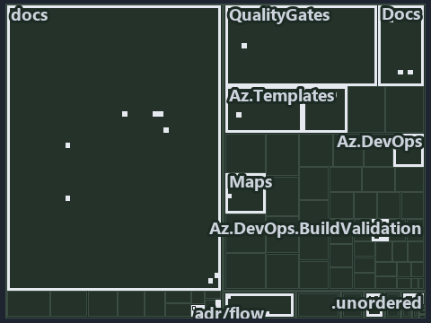

# docs/.assets/explanation/tree/adr-flow-cd--ci-budget-is-the-only-quality-gate--governance.tree.md

`Tree minimap: adr-flow-cd--ci-budget-is-the-only-quality-gate--governance`

The tree minimap of the slide `adr-flow-cd--ci-budget-is-the-only-quality-gate--governance` (governance lens). The slide supports
[ADR-FLOW-CD][1] and [ADR-FLOW-CD-TYPE][2]; the highlight of those ADR codes selects what is lit, and each reason below names the code that
selects it.

## What the minimap shows

The tree draws every file of the world map as a tile, grouped by top-level folder (under `automation/` by module, under `docs/adr/` by ADR
domain), and lights 36 files in 13 groups, filled in ink. A lit ADR file has a white rim; a file lit only by passing mentions is a lighter
ink. Every other tile is idle, a grey box: a file the slide's ADR codes do not select.

- docs (docs/ outside docs/adr/): 8 lit files
- .unordered: 5 lit files
- Az.DevOps.BuildValidation (automation/Catzc.Azure.DevOps.BuildValidation): 5 lit files
- Docs (automation/Catzc.Base.Docs): 3 lit files
- Maps (automation/Catzc.Base.Maps): 3 lit files
- adr/flow (docs/adr/flow): 3 lit files
- .claude: 2 lit files
- adr/* (the files directly in docs/adr/): 2 lit files
- Az.DevOps (automation/Catzc.Azure.DevOps): 1 lit file
- Az.Templates (automation/Catzc.Azure.Templates): 1 lit file
- ModuleSystem (automation/Catzc.Base.ModuleSystem): 1 lit file
- QualityGates (automation/Catzc.Base.QualityGates): 1 lit file
- pipelines: 1 lit file

## Why each group is lit

### docs (docs/ outside docs/adr/, 8 lit files)

The group holds the files of docs/ outside docs/adr/; each sits in its world-map cell and is lit by:

- [docs/references/automation/catzc-azure-devops-buildvalidation/configs/build-validation.yml.md][3], in the cell docs × markdown: selected
  by [ADR-FLOW-CD-TYPE][2]: the file cites it at line 17 (text) and line 31 (text).
- [docs/references/automation/catzc-azure-devops-buildvalidation/types/BuildValidationConfig.cs.md][4], in the cell docs × markdown:
  selected by [ADR-FLOW-CD-TYPE][2]: the file cites it at line 17 (text) and line 32 (text).
- [docs/references/automation/catzc-azure-devops-buildvalidation/types/BuildValidationEntry.cs.md][5], in the cell docs × markdown: selected
  by [ADR-FLOW-CD-TYPE][2]: the file cites it at line 18 (text) and line 32 (text).
- [docs/references/automation/catzc-base-docs/configs/adrs.yml.md][6], in the cell docs × markdown: selected by [ADR-FLOW-CD][1]: the file
  cites it at line 57 (text).
- [docs/references/automation/catzc-base-docs/types/AdrsConfig.cs.md][7], in the cell docs × markdown: selected by [ADR-FLOW-CD][1]: the
  file cites it at line 49 (text), line 50 (text), line 78 (text) and line 79 (text).
- [docs/references/automation/catzc-base-docs/types/GlossaryConcept.cs.md][8], in the cell docs × markdown: selected by [ADR-FLOW-CD][1]:
  the file cites it at line 19 (text) and line 56 (text).
- [docs/references/pipelines/cd-shared.yaml.md][9], in the cell docs × markdown: selected by [ADR-FLOW-CD-TYPE][2]: the file cites it at
  line 30 (text).
- [docs/references/pipelines/ci-infrastructure.yaml.md][10], in the cell docs × markdown: selected by [ADR-FLOW-CD-TYPE][2]: the file cites
  it at line 31 (text).

### .unordered (5 lit files)

The group holds the files of .unordered; each sits in its world-map cell and is lit by:

- [.unordered/15-10-2026/plan-adr-consistency.md][11], in the cell .unordered × markdown: selected by [ADR-FLOW-CD][1]: the file cites it at
  line 44 (text), line 99 (text), line 152 (text), line 173 (text), line 178 (text), line 183 (text), line 291 (text) and line 291 (text);
  selected by [ADR-FLOW-CD-TYPE][2]: the file cites it at line 174 (text) and line 294 (text).
- [.unordered/15-10-2026/plan-built-bundle.md][12], in the cell .unordered × markdown: selected by [ADR-FLOW-CD][1]: the file cites it at
  line 13 (text), line 255 (text) and line 277 (text).
- [.unordered/15-10-2026/plan-caf-waf-automation.md][13], in the cell .unordered × markdown: selected by [ADR-FLOW-CD][1]: the file cites it
  at line 16 (text).
- [.unordered/15-10-2026/plan-diagram-wave-8.md][14], in the cell .unordered × markdown: selected by [ADR-FLOW-CD][1]: the file cites it at
  line 22 (text), line 23 (text) and line 24 (text).
- [.unordered/15-10-2026/plan-explanation-drift.md][15], in the cell .unordered × markdown: selected by [ADR-FLOW-CD][1]: the file cites it
  at line 97 (text).

### Az.DevOps.BuildValidation (automation/Catzc.Azure.DevOps.BuildValidation, 5 lit files)

The group holds the files of automation/Catzc.Azure.DevOps.BuildValidation; each sits in its world-map cell and is lit by:

- [automation/Catzc.Azure.DevOps.BuildValidation/Get-AdoBuildValidations.ps1][16], in the cell automation × powershell: selected by
  [ADR-FLOW-CD-TYPE][2]: the file cites it at line 20 (header) and line 26 (header).
- [automation/Catzc.Azure.DevOps.BuildValidation/Register-AdoBuildValidation.ps1][17], in the cell automation × powershell: selected by
  [ADR-FLOW-CD-TYPE][2]: the file cites it at line 22 (header) and line 30 (header).
- [automation/Catzc.Azure.DevOps.BuildValidation/private/Get-BuildValidationPathFilter.ps1][18], in the cell automation × powershell:
  selected by [ADR-FLOW-CD-TYPE][2]: the file cites it at line 20 (header) and line 31 (header).
- [automation/Catzc.Azure.DevOps.BuildValidation/types/BuildValidationConfig.cs][19], in the cell automation × csharp: selected by
  [ADR-FLOW-CD-TYPE][2]: the file cites it at line 21 (text).
- [automation/Catzc.Azure.DevOps.BuildValidation/types/BuildValidationEntry.cs][20], in the cell automation × csharp: selected by
  [ADR-FLOW-CD-TYPE][2]: the file cites it at line 21 (text).

### Docs (automation/Catzc.Base.Docs, 3 lit files)

The group holds the files of automation/Catzc.Base.Docs; each sits in its world-map cell and is lit by:

- [automation/Catzc.Base.Docs/configs/adrs.yml][21], in the cell automation × yaml: selected by [ADR-FLOW-CD][1]: the file cites it at line
  114 (text); selected by [ADR-FLOW-CD-TYPE][2]: the file cites it at line 117 (text).
- [automation/Catzc.Base.Docs/types/AdrsConfig.cs][22], in the cell automation × csharp: selected by [ADR-FLOW-CD][1]: the file cites it at
  line 25 (text).
- [automation/Catzc.Base.Docs/types/GlossaryConcept.cs][23], in the cell automation × csharp: selected by [ADR-FLOW-CD][1]: the file cites
  it at line 22 (text).

### Maps (automation/Catzc.Base.Maps, 3 lit files)

The group holds the files of automation/Catzc.Base.Maps; each sits in its world-map cell and is lit by:

- [automation/Catzc.Base.Maps/Get-ValueChainHighlight.ps1][24], in the cell automation × powershell: selected by [ADR-FLOW-CD][1]: the file
  cites it at line 21 (header) and line 40 (header).
- [automation/Catzc.Base.Maps/Get-WorldMapHighlight.ps1][25], in the cell automation × powershell: selected by [ADR-FLOW-CD][1]: the file
  cites it at line 20 (header) and line 48 (header).
- [automation/Catzc.Base.Maps/tests/Get-WorldMapHighlight.Tests.ps1][26], in the cell automation × powershell: selected by [ADR-FLOW-CD][1]:
  the file cites it at line 19 (header), line 92 (text) and line 93 (text).

### adr/flow (docs/adr/flow, 3 lit files)

The group holds the files of docs/adr/flow; each sits in its world-map cell and is lit by:

- [docs/adr/flow/cd-discipline-and-promotion-flow.md][1], in the cell docs × markdown: selected by [ADR-FLOW-CD][1]: the ADR's own file.
- [docs/adr/flow/dora-explains.md][27], in the cell docs × markdown: selected by [ADR-FLOW-CD][1]: the file cites it at line 42 (text);
  selected by [ADR-FLOW-CD-TYPE][2]: the file cites it at line 98 (text).
- [docs/adr/flow/pipeline-types.md][2], in the cell docs × markdown: selected by [ADR-FLOW-CD-TYPE][2]: the ADR's own file.

### .claude (2 lit files)

The group holds the files of .claude; each sits in its world-map cell and is lit by:

- [.claude/CLAUDE.md][28], in the cell .claude × markdown: selected by [ADR-FLOW-CD][1]: the file cites it at line 50 (text).
- [.claude/plans/plan-module-kinds-tracks.md][29], in the cell .claude × markdown: selected by [ADR-FLOW-CD-TYPE][2]: the file cites it at
  line 419 (text) and line 422 (text).

### adr/* (the files directly in docs/adr/, 2 lit files)

The group holds the files of the files directly in docs/adr/; each sits in its world-map cell and is lit by:

- [docs/adr/glossary.md][30], in the cell docs × markdown: selected by [ADR-FLOW-CD][1]: the file cites it at line 397 (text) and line 410
  (text).
- [docs/adr/index.md][31], in the cell docs × markdown: selected by [ADR-FLOW-CD][1]: the file cites it at line 124 (text); selected by
  [ADR-FLOW-CD-TYPE][2]: the file cites it at line 127 (text).

### Az.DevOps (automation/Catzc.Azure.DevOps, 1 lit file)

The group holds the files of automation/Catzc.Azure.DevOps; each sits in its world-map cell and is lit by:

- [automation/Catzc.Azure.DevOps/New-AdoPullRequest.ps1][32], in the cell automation × powershell: selected by [ADR-FLOW-CD-TYPE][2]: the
  file cites it at line 21 (header) and line 25 (header).

### Az.Templates (automation/Catzc.Azure.Templates, 1 lit file)

The group holds the files of automation/Catzc.Azure.Templates; each sits in its world-map cell and is lit by:

- [automation/Catzc.Azure.Templates/Set-BicepTemplateConfiguration.ps1][33], in the cell automation × powershell: selected by
  [ADR-FLOW-CD-TYPE][2]: the file cites it at line 22 (header).

### ModuleSystem (automation/Catzc.Base.ModuleSystem, 1 lit file)

The group holds the files of automation/Catzc.Base.ModuleSystem; each sits in its world-map cell and is lit by:

- [automation/Catzc.Base.ModuleSystem/configs/glossary.yml][34], in the cell automation × yaml: selected by [ADR-FLOW-CD][1]: the file cites
  it at line 37 (text).

### QualityGates (automation/Catzc.Base.QualityGates, 1 lit file)

The group holds the files of automation/Catzc.Base.QualityGates; each sits in its world-map cell and is lit by:

- [automation/Catzc.Base.QualityGates/configs/glossary.yml][35], in the cell automation × yaml: selected by [ADR-FLOW-CD][1]: the file cites
  it at line 76 (text).

### pipelines (1 lit file)

The group holds the files of pipelines; each sits in its world-map cell and is lit by:

- [pipelines/ci-automation.yaml][36], in the cell pipelines × pipeline-yaml: selected by [ADR-FLOW-CD][1]: a pipeline that cites nothing
  itself carries its globset's citations, which cite it at `automation/Catzc.Base.Docs/configs/adrs.yml` line 114 (text),
  `automation/Catzc.Base.Docs/types/AdrsConfig.cs` line 25 (text), `automation/Catzc.Base.Docs/types/GlossaryConcept.cs` line 22 (text),
  `automation/Catzc.Base.Maps/Get-ValueChainHighlight.ps1` line 21 (header), `automation/Catzc.Base.Maps/Get-ValueChainHighlight.ps1` line
  40 (header), `automation/Catzc.Base.Maps/Get-WorldMapHighlight.ps1` line 20 (header),
  `automation/Catzc.Base.Maps/Get-WorldMapHighlight.ps1` line 48 (header),
  `automation/Catzc.Base.Maps/tests/Get-WorldMapHighlight.Tests.ps1` line 19 (header),
  `automation/Catzc.Base.Maps/tests/Get-WorldMapHighlight.Tests.ps1` line 92 (text),
  `automation/Catzc.Base.Maps/tests/Get-WorldMapHighlight.Tests.ps1` line 93 (text),
  `automation/Catzc.Base.ModuleSystem/configs/glossary.yml` line 37 (text) and `automation/Catzc.Base.QualityGates/configs/glossary.yml`
  line 76 (text); selected by [ADR-FLOW-CD-TYPE][2]: a pipeline that cites nothing itself carries its globset's citations, which cite it at
  `automation/Catzc.Azure.DevOps.BuildValidation/Get-AdoBuildValidations.ps1` line 20 (header),
  `automation/Catzc.Azure.DevOps.BuildValidation/Get-AdoBuildValidations.ps1` line 26 (header),
  `automation/Catzc.Azure.DevOps.BuildValidation/Register-AdoBuildValidation.ps1` line 22 (header),
  `automation/Catzc.Azure.DevOps.BuildValidation/Register-AdoBuildValidation.ps1` line 30 (header),
  `automation/Catzc.Azure.DevOps.BuildValidation/private/Get-BuildValidationPathFilter.ps1` line 20 (header),
  `automation/Catzc.Azure.DevOps.BuildValidation/private/Get-BuildValidationPathFilter.ps1` line 31 (header),
  `automation/Catzc.Azure.DevOps.BuildValidation/types/BuildValidationConfig.cs` line 21 (text),
  `automation/Catzc.Azure.DevOps.BuildValidation/types/BuildValidationEntry.cs` line 21 (text),
  `automation/Catzc.Azure.DevOps/New-AdoPullRequest.ps1` line 21 (header), `automation/Catzc.Azure.DevOps/New-AdoPullRequest.ps1` line 25
  (header), `automation/Catzc.Azure.Templates/Set-BicepTemplateConfiguration.ps1` line 22 (header) and
  `automation/Catzc.Base.Docs/configs/adrs.yml` line 117 (text).

## Keywords

- [world map][37]
- [track][38]
- [file language][39]
- [cell][40]
- [lit cell][41]
- [.claude][42]: a track
- [.unordered][42]: a track
- [automation][42]: a track
- [docs][42]: a track
- [pipelines][42]: a track
- [csharp][43]: a file language
- [markdown][43]: a file language
- [pipeline-yaml][43]: a file language
- [powershell][43]: a file language
- [yaml][43]: a file language

Terms the cited ADRs define:

- [gate][44], defined by [ADR-FLOW-CD#13][45]
- [release candidate][46], defined by [ADR-FLOW-CD#14][47]

[1]: ../../../adr/flow/cd-discipline-and-promotion-flow.md
[2]: ../../../adr/flow/pipeline-types.md
[3]: ../../../references/automation/catzc-azure-devops-buildvalidation/configs/build-validation.yml.md
[4]: ../../../references/automation/catzc-azure-devops-buildvalidation/types/BuildValidationConfig.cs.md
[5]: ../../../references/automation/catzc-azure-devops-buildvalidation/types/BuildValidationEntry.cs.md
[6]: ../../../references/automation/catzc-base-docs/configs/adrs.yml.md
[7]: ../../../references/automation/catzc-base-docs/types/AdrsConfig.cs.md
[8]: ../../../references/automation/catzc-base-docs/types/GlossaryConcept.cs.md
[9]: ../../../references/pipelines/cd-shared.yaml.md
[10]: ../../../references/pipelines/ci-infrastructure.yaml.md
[11]: ../../../../.unordered/15-10-2026/plan-adr-consistency.md
[12]: ../../../../.unordered/15-10-2026/plan-built-bundle.md
[13]: ../../../../.unordered/15-10-2026/plan-caf-waf-automation.md
[14]: ../../../../.unordered/15-10-2026/plan-diagram-wave-8.md
[15]: ../../../../.unordered/15-10-2026/plan-explanation-drift.md
[16]: ../../../../automation/Catzc.Azure.DevOps.BuildValidation/Get-AdoBuildValidations.ps1
[17]: ../../../../automation/Catzc.Azure.DevOps.BuildValidation/Register-AdoBuildValidation.ps1
[18]: ../../../../automation/Catzc.Azure.DevOps.BuildValidation/private/Get-BuildValidationPathFilter.ps1
[19]: ../../../../automation/Catzc.Azure.DevOps.BuildValidation/types/BuildValidationConfig.cs
[20]: ../../../../automation/Catzc.Azure.DevOps.BuildValidation/types/BuildValidationEntry.cs
[21]: ../../../../automation/Catzc.Base.Docs/configs/adrs.yml
[22]: ../../../../automation/Catzc.Base.Docs/types/AdrsConfig.cs
[23]: ../../../../automation/Catzc.Base.Docs/types/GlossaryConcept.cs
[24]: ../../../../automation/Catzc.Base.Maps/Get-ValueChainHighlight.ps1
[25]: ../../../../automation/Catzc.Base.Maps/Get-WorldMapHighlight.ps1
[26]: ../../../../automation/Catzc.Base.Maps/tests/Get-WorldMapHighlight.Tests.ps1
[27]: ../../../adr/flow/dora-explains.md
[28]: ../../../../.claude/CLAUDE.md
[29]: ../../../../.claude/plans/plan-module-kinds-tracks.md
[30]: ../../../adr/glossary.md
[31]: ../../../adr/index.md
[32]: ../../../../automation/Catzc.Azure.DevOps/New-AdoPullRequest.ps1
[33]: ../../../../automation/Catzc.Azure.Templates/Set-BicepTemplateConfiguration.ps1
[34]: ../../../../automation/Catzc.Base.ModuleSystem/configs/glossary.yml
[35]: ../../../../automation/Catzc.Base.QualityGates/configs/glossary.yml
[36]: ../../../../pipelines/ci-automation.yaml
[37]: ../../../adr/glossary.md#world-map
[38]: ../../../adr/glossary.md#track
[39]: ../../../adr/glossary.md#file-language
[40]: ../../../adr/glossary.md#cell
[41]: ../../../adr/glossary.md#lit-cell
[42]: ../../../../automation/Catzc.Base.Variants/configs/variants.yml
[43]: ../../../../automation/Catzc.Base.Languages/configs/languages.yml
[44]: ../../../adr/glossary.md#gate
[45]: ../../../adr/flow/cd-discipline-and-promotion-flow.md#rule-adr-flow-cd13
[46]: ../../../adr/glossary.md#release-candidate
[47]: ../../../adr/flow/cd-discipline-and-promotion-flow.md#rule-adr-flow-cd14
