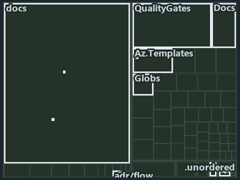

# docs/.assets/explanation/tree/adr-flow-cd-detect--the-analyzer-names-the-raw-read--operations.tree.md

`Tree minimap: adr-flow-cd-detect--the-analyzer-names-the-raw-read--operations`

The tree minimap of the slide `adr-flow-cd-detect--the-analyzer-names-the-raw-read--operations` (operations lens). The slide supports
[ADR-FLOW-CD-DETECT][1]; the highlight of those ADR codes selects what is lit, and each reason below names the code that selects it.

## What the minimap shows

The tree draws every file of the world map as a tile, grouped by top-level folder (under `automation/` by module, under `docs/adr/` by ADR
domain), and lights 13 files in 9 groups, filled in ink. A lit ADR file has a white rim; a file lit only by passing mentions is a lighter
ink. Every other tile is idle, a grey box: a file the slide's ADR codes do not select.

- .unordered: 2 lit files
- Globs (automation/Catzc.Base.Globs): 2 lit files
- adr/flow (docs/adr/flow): 2 lit files
- docs (docs/ outside docs/adr/): 2 lit files
- Az.Templates (automation/Catzc.Azure.Templates): 1 lit file
- Docs (automation/Catzc.Base.Docs): 1 lit file
- QualityGates (automation/Catzc.Base.QualityGates): 1 lit file
- adr/* (the files directly in docs/adr/): 1 lit file
- pipelines: 1 lit file

## Why each group is lit

### .unordered (2 lit files)

The group holds the files of .unordered; each sits in its world-map cell and is lit by:

- [.unordered/15-10-2026/plan-adr-pwsh-followups.md][2], in the cell .unordered × markdown: selected by [ADR-FLOW-CD-DETECT][1]: the file
  cites it at line 111 (text).
- [.unordered/15-10-2026/plan-concern-axis.md][3], in the cell .unordered × markdown: selected by [ADR-FLOW-CD-DETECT][1]: the file cites it
  at line 96 (text).

### Globs (automation/Catzc.Base.Globs, 2 lit files)

The group holds the files of automation/Catzc.Base.Globs; each sits in its world-map cell and is lit by:

- [automation/Catzc.Base.Globs/Get-GlobSetChangeRange.ps1][4], in the cell automation × powershell: selected by [ADR-FLOW-CD-DETECT][1]: the
  file cites it at line 20 (header) and line 26 (header).
- [automation/Catzc.Base.Globs/tests/Get-GlobSetChangeRange.Tests.ps1][5], in the cell automation × powershell: selected by
  [ADR-FLOW-CD-DETECT][1]: the file cites it at line 20 (header).

### adr/flow (docs/adr/flow, 2 lit files)

The group holds the files of docs/adr/flow; each sits in its world-map cell and is lit by:

- [docs/adr/flow/dora-explains.md][6], in the cell docs × markdown: selected by [ADR-FLOW-CD-DETECT][1]: the file cites it at line 81
  (text).
- [docs/adr/flow/pipeline-detection.md][1], in the cell docs × markdown: selected by [ADR-FLOW-CD-DETECT][1]: the ADR's own file.

### docs (docs/ outside docs/adr/, 2 lit files)

The group holds the files of docs/ outside docs/adr/; each sits in its world-map cell and is lit by:

- [docs/references/automation/catzc-azure-templates/Get-BicepDeploymentName.ps1.md][7], in the cell docs × markdown: selected by
  [ADR-FLOW-CD-DETECT][1]: the file cites it at line 17 (text) and line 33 (text).
- [docs/references/automation/catzc-base-globs/tests/Get-GlobSetChangeRange.Tests.ps1.md][8], in the cell docs × markdown: selected by
  [ADR-FLOW-CD-DETECT][1]: the file cites it at line 27 (text).

### Az.Templates (automation/Catzc.Azure.Templates, 1 lit file)

The group holds the files of automation/Catzc.Azure.Templates; each sits in its world-map cell and is lit by:

- [automation/Catzc.Azure.Templates/Get-BicepDeploymentName.ps1][9], in the cell automation × powershell: selected by
  [ADR-FLOW-CD-DETECT][1]: the file cites it at line 21 (header).

### Docs (automation/Catzc.Base.Docs, 1 lit file)

The group holds the files of automation/Catzc.Base.Docs; each sits in its world-map cell and is lit by:

- [automation/Catzc.Base.Docs/configs/adrs.yml][10], in the cell automation × yaml: selected by [ADR-FLOW-CD-DETECT][1]: the file cites it
  at line 117 (text).

### QualityGates (automation/Catzc.Base.QualityGates, 1 lit file)

The group holds the files of automation/Catzc.Base.QualityGates; each sits in its world-map cell and is lit by:

- [automation/Catzc.Base.QualityGates/configs/analyzer-adr-map.yml][11], in the cell automation × yaml: selected by [ADR-FLOW-CD-DETECT][1]:
  the file cites it at line 30 (text).

### adr/* (the files directly in docs/adr/, 1 lit file)

The group holds the files of the files directly in docs/adr/; each sits in its world-map cell and is lit by:

- [docs/adr/index.md][12], in the cell docs × markdown: selected by [ADR-FLOW-CD-DETECT][1]: the file cites it at line 129 (text).

### pipelines (1 lit file)

The group holds the files of pipelines; each sits in its world-map cell and is lit by:

- [pipelines/ci-automation.yaml][13], in the cell pipelines × pipeline-yaml: selected by [ADR-FLOW-CD-DETECT][1]: a pipeline that cites
  nothing itself carries its globset's citations, which cite it at `automation/Catzc.Azure.Templates/Get-BicepDeploymentName.ps1` line 21
  (header), `automation/Catzc.Base.Docs/configs/adrs.yml` line 117 (text), `automation/Catzc.Base.Globs/Get-GlobSetChangeRange.ps1` line 20
  (header), `automation/Catzc.Base.Globs/Get-GlobSetChangeRange.ps1` line 26 (header),
  `automation/Catzc.Base.Globs/tests/Get-GlobSetChangeRange.Tests.ps1` line 20 (header) and
  `automation/Catzc.Base.QualityGates/configs/analyzer-adr-map.yml` line 30 (text).

## Keywords

- [world map][14]
- [track][15]
- [file language][16]
- [cell][17]
- [lit cell][18]
- [.unordered][19]: a track
- [automation][19]: a track
- [docs][19]: a track
- [pipelines][19]: a track
- [markdown][20]: a file language
- [pipeline-yaml][20]: a file language
- [powershell][20]: a file language
- [yaml][20]: a file language

[1]: ../../../adr/flow/pipeline-detection.md
[2]: ../../../../.unordered/15-10-2026/plan-adr-pwsh-followups.md
[3]: ../../../../.unordered/15-10-2026/plan-concern-axis.md
[4]: ../../../../automation/Catzc.Base.Globs/Get-GlobSetChangeRange.ps1
[5]: ../../../../automation/Catzc.Base.Globs/tests/Get-GlobSetChangeRange.Tests.ps1
[6]: ../../../adr/flow/dora-explains.md
[7]: ../../../references/automation/catzc-azure-templates/Get-BicepDeploymentName.ps1.md
[8]: ../../../references/automation/catzc-base-globs/tests/Get-GlobSetChangeRange.Tests.ps1.md
[9]: ../../../../automation/Catzc.Azure.Templates/Get-BicepDeploymentName.ps1
[10]: ../../../../automation/Catzc.Base.Docs/configs/adrs.yml
[11]: ../../../../automation/Catzc.Base.QualityGates/configs/analyzer-adr-map.yml
[12]: ../../../adr/index.md
[13]: ../../../../pipelines/ci-automation.yaml
[14]: ../../../adr/glossary.md#world-map
[15]: ../../../adr/glossary.md#track
[16]: ../../../adr/glossary.md#file-language
[17]: ../../../adr/glossary.md#cell
[18]: ../../../adr/glossary.md#lit-cell
[19]: ../../../../automation/Catzc.Base.Variants/configs/variants.yml
[20]: ../../../../automation/Catzc.Base.Languages/configs/languages.yml
