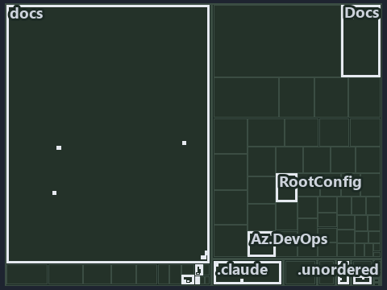

# docs/.assets/explanation/tree/adr-flow-cd-runner--no-gate-checks-rules-one-and-four--governance.tree.md

`Tree minimap: adr-flow-cd-runner--no-gate-checks-rules-one-and-four--governance`

The tree minimap of the slide `adr-flow-cd-runner--no-gate-checks-rules-one-and-four--governance` (governance lens). The slide supports
[ADR-FLOW-CD-RUNNER][1] and [ADR-PIPE-NAME][2]; the highlight of those ADR codes selects what is lit, and each reason below names the code
that selects it.

## What the minimap shows

The tree draws every file of the world map as a tile, grouped by top-level folder (under `automation/` by module, under `docs/adr/` by ADR
domain), and lights 25 files in 10 groups, filled in ink. A lit ADR file has a white rim; a file lit only by passing mentions is a lighter
ink. Every other tile is idle, a grey box: a file the slide's ADR codes do not select.

- .unordered: 5 lit files
- docs (docs/ outside docs/adr/): 5 lit files
- .claude: 3 lit files
- Az.DevOps (automation/Catzc.Azure.DevOps): 3 lit files
- RootConfig (automation/Catzc.Base.RootConfig): 2 lit files
- adr/flow (docs/adr/flow): 2 lit files
- adr/pipe (docs/adr/pipelines): 2 lit files
- Docs (automation/Catzc.Base.Docs): 1 lit file
- adr/* (the files directly in docs/adr/): 1 lit file
- pipelines: 1 lit file

## Why each group is lit

### .unordered (5 lit files)

The group holds the files of .unordered; each sits in its world-map cell and is lit by:

- [.unordered/15-10-2026/plan-adr-consistency.md][3], in the cell .unordered × markdown: selected by [ADR-FLOW-CD-RUNNER][1]: the file cites
  it at line 109 (text).
- [.unordered/15-10-2026/plan-built-bundle.md][4], in the cell .unordered × markdown: selected by [ADR-FLOW-CD-RUNNER][1]: the file cites it
  at line 13 (text), line 254 (text) and line 277 (text).
- [.unordered/15-10-2026/plan-caf-code-segments.md][5], in the cell .unordered × markdown: selected by [ADR-FLOW-CD-RUNNER][1]: the file
  cites it at line 55 (text).
- [.unordered/15-10-2026/plan-concern-axis.md][6], in the cell .unordered × markdown: selected by [ADR-FLOW-CD-RUNNER][1]: the file cites it
  at line 95 (text).
- [.unordered/15-10-2026/plan-explanation-drift.md][7], in the cell .unordered × markdown: selected by [ADR-FLOW-CD-RUNNER][1]: the file
  cites it at line 79 (text) and line 106 (text).

### docs (docs/ outside docs/adr/, 5 lit files)

The group holds the files of docs/ outside docs/adr/; each sits in its world-map cell and is lit by:

- [docs/how-to/automation/manual-test-plan/pipelines-and-globs.md][8], in the cell docs × markdown: selected by [ADR-PIPE-NAME][2]: the file
  cites it at line 34 (text).
- [docs/references/automation/catzc-azure-devops/Test-Pipelines.ps1.md][9], in the cell docs × markdown: selected by [ADR-PIPE-NAME][2]: the
  file cites it at line 17 (text), line 30 (text), line 40 (text), line 50 (text), line 59 (text), line 68 (text) and line 77 (text).
- [docs/references/automation/catzc-base-languages/configs/languages.yml.md][10], in the cell docs × markdown: selected by
  [ADR-PIPE-NAME][2]: the file cites it at line 19 (text) and line 68 (text).
- [docs/references/pipelines/extends/cd-customer.yaml.md][11], in the cell docs × markdown: selected by [ADR-PIPE-NAME][2]: the file cites
  it at line 32 (text).
- [docs/references/pipelines/steps/invoke-automation.yaml.md][12], in the cell docs × markdown: selected by [ADR-FLOW-CD-RUNNER][1]: the
  file cites it at line 44 (text).

### .claude (3 lit files)

The group holds the files of .claude; each sits in its world-map cell and is lit by:

- [.claude/CLAUDE.md][13], in the cell .claude × markdown: selected by [ADR-FLOW-CD-RUNNER][1]: the file cites it at line 51 (text).
- [.claude/plans/plan-adr-link-cleanup-prose-to-pages.md][14], in the cell .claude × markdown: selected by [ADR-PIPE-NAME][2]: the file
  cites it at line 299 (text).
- [.claude/plans/prompt-adr-links-and-plans-continue.md][15], in the cell .claude × markdown: selected by [ADR-PIPE-NAME][2]: the file cites
  it at line 19 (text), line 75 (text) and line 75 (text).

### Az.DevOps (automation/Catzc.Azure.DevOps, 3 lit files)

The group holds the files of automation/Catzc.Azure.DevOps; each sits in its world-map cell and is lit by:

- [automation/Catzc.Azure.DevOps/Test-Pipelines.ps1][16], in the cell automation × powershell: selected by [ADR-PIPE-NAME][2]: the file
  cites it at line 23 (header), line 28 (header), line 35 (header), line 38 (header), line 42 (header), line 45 (header), line 47 (header),
  line 52 (header), line 115 (text), line 120 (text), line 127 (text), line 132 (text), line 135 (text), line 139 (text), line 142 (text)
  and line 149 (text).
- [automation/Catzc.Azure.DevOps/private/Get-PipelineTemplateReference.ps1][17], in the cell automation × powershell: selected by
  [ADR-PIPE-NAME][2]: the file cites it at line 21 (header).
- [automation/Catzc.Azure.DevOps/tests/Test-Pipelines.Tests.ps1][18], in the cell automation × powershell: selected by [ADR-PIPE-NAME][2]:
  the file cites it at line 21 (header), line 72 (text), line 73 (text), line 82 (text), line 85 (text), line 89 (text), line 97 (text),
  line 99 (text), line 102 (text), line 104 (text), line 107 (text), line 109 (text), line 112 (text), line 114 (text), line 117 (text),
  line 119 (text), line 127 (text), line 130 (text), line 141 (text) and line 146 (text).

### RootConfig (automation/Catzc.Base.RootConfig, 2 lit files)

The group holds the files of automation/Catzc.Base.RootConfig; each sits in its world-map cell and is lit by:

- [automation/Catzc.Base.RootConfig/assets/root/.markdownlint.yml][19], in the cell automation × yaml: selected by [ADR-PIPE-NAME][2]: the
  file cites it at line 9 (header).
- [automation/Catzc.Base.RootConfig/assets/root/.prettierrc.yml][20], in the cell automation × yaml: selected by [ADR-PIPE-NAME][2]: the
  file cites it at line 8 (header).

### adr/flow (docs/adr/flow, 2 lit files)

The group holds the files of docs/adr/flow; each sits in its world-map cell and is lit by:

- [docs/adr/flow/dora-explains.md][21], in the cell docs × markdown: selected by [ADR-FLOW-CD-RUNNER][1]: the file cites it at line 63
  (text).
- [docs/adr/flow/pipeline-runner-pattern.md][1], in the cell docs × markdown: selected by [ADR-FLOW-CD-RUNNER][1]: the ADR's own file.

### adr/pipe (docs/adr/pipelines, 2 lit files)

The group holds the files of docs/adr/pipelines; each sits in its world-map cell and is lit by:

- [docs/adr/pipelines/dora-explains.md][22], in the cell docs × markdown: selected by [ADR-PIPE-NAME][2]: the file cites it at line 74
  (text).
- [docs/adr/pipelines/pipeline-naming-and-placement.md][2], in the cell docs × markdown: selected by [ADR-PIPE-NAME][2]: the ADR's own file.

### Docs (automation/Catzc.Base.Docs, 1 lit file)

The group holds the files of automation/Catzc.Base.Docs; each sits in its world-map cell and is lit by:

- [automation/Catzc.Base.Docs/configs/adrs.yml][23], in the cell automation × yaml: selected by [ADR-FLOW-CD-RUNNER][1]: the file cites it
  at line 116 (text); selected by [ADR-PIPE-NAME][2]: the file cites it at line 239 (text).

### adr/* (the files directly in docs/adr/, 1 lit file)

The group holds the files of the files directly in docs/adr/; each sits in its world-map cell and is lit by:

- [docs/adr/index.md][24], in the cell docs × markdown: selected by [ADR-FLOW-CD-RUNNER][1]: the file cites it at line 128 (text); selected
  by [ADR-PIPE-NAME][2]: the file cites it at line 246 (text).

### pipelines (1 lit file)

The group holds the files of pipelines; each sits in its world-map cell and is lit by:

- [pipelines/ci-automation.yaml][25], in the cell pipelines × pipeline-yaml: selected by [ADR-FLOW-CD-RUNNER][1]: a pipeline that cites
  nothing itself carries its globset's citations, which cite it at `automation/Catzc.Base.Docs/configs/adrs.yml` line 116 (text); selected
  by [ADR-PIPE-NAME][2]: a pipeline that cites nothing itself carries its globset's citations, which cite it at
  `automation/Catzc.Azure.DevOps/Test-Pipelines.ps1` line 23 (header), `automation/Catzc.Azure.DevOps/Test-Pipelines.ps1` line 28 (header),
  `automation/Catzc.Azure.DevOps/Test-Pipelines.ps1` line 35 (header), `automation/Catzc.Azure.DevOps/Test-Pipelines.ps1` line 38 (header),
  `automation/Catzc.Azure.DevOps/Test-Pipelines.ps1` line 42 (header), `automation/Catzc.Azure.DevOps/Test-Pipelines.ps1` line 45 (header),
  `automation/Catzc.Azure.DevOps/Test-Pipelines.ps1` line 47 (header), `automation/Catzc.Azure.DevOps/Test-Pipelines.ps1` line 52 (header),
  `automation/Catzc.Azure.DevOps/Test-Pipelines.ps1` line 115 (text), `automation/Catzc.Azure.DevOps/Test-Pipelines.ps1` line 120 (text),
  `automation/Catzc.Azure.DevOps/Test-Pipelines.ps1` line 127 (text), `automation/Catzc.Azure.DevOps/Test-Pipelines.ps1` line 132 (text),
  `automation/Catzc.Azure.DevOps/Test-Pipelines.ps1` line 135 (text), `automation/Catzc.Azure.DevOps/Test-Pipelines.ps1` line 139 (text),
  `automation/Catzc.Azure.DevOps/Test-Pipelines.ps1` line 142 (text), `automation/Catzc.Azure.DevOps/Test-Pipelines.ps1` line 149 (text),
  `automation/Catzc.Azure.DevOps/private/Get-PipelineTemplateReference.ps1` line 21 (header),
  `automation/Catzc.Azure.DevOps/tests/Test-Pipelines.Tests.ps1` line 21 (header),
  `automation/Catzc.Azure.DevOps/tests/Test-Pipelines.Tests.ps1` line 72 (text),
  `automation/Catzc.Azure.DevOps/tests/Test-Pipelines.Tests.ps1` line 73 (text),
  `automation/Catzc.Azure.DevOps/tests/Test-Pipelines.Tests.ps1` line 82 (text),
  `automation/Catzc.Azure.DevOps/tests/Test-Pipelines.Tests.ps1` line 85 (text),
  `automation/Catzc.Azure.DevOps/tests/Test-Pipelines.Tests.ps1` line 89 (text),
  `automation/Catzc.Azure.DevOps/tests/Test-Pipelines.Tests.ps1` line 97 (text),
  `automation/Catzc.Azure.DevOps/tests/Test-Pipelines.Tests.ps1` line 99 (text),
  `automation/Catzc.Azure.DevOps/tests/Test-Pipelines.Tests.ps1` line 102 (text),
  `automation/Catzc.Azure.DevOps/tests/Test-Pipelines.Tests.ps1` line 104 (text),
  `automation/Catzc.Azure.DevOps/tests/Test-Pipelines.Tests.ps1` line 107 (text),
  `automation/Catzc.Azure.DevOps/tests/Test-Pipelines.Tests.ps1` line 109 (text),
  `automation/Catzc.Azure.DevOps/tests/Test-Pipelines.Tests.ps1` line 112 (text),
  `automation/Catzc.Azure.DevOps/tests/Test-Pipelines.Tests.ps1` line 114 (text),
  `automation/Catzc.Azure.DevOps/tests/Test-Pipelines.Tests.ps1` line 117 (text),
  `automation/Catzc.Azure.DevOps/tests/Test-Pipelines.Tests.ps1` line 119 (text),
  `automation/Catzc.Azure.DevOps/tests/Test-Pipelines.Tests.ps1` line 127 (text),
  `automation/Catzc.Azure.DevOps/tests/Test-Pipelines.Tests.ps1` line 130 (text),
  `automation/Catzc.Azure.DevOps/tests/Test-Pipelines.Tests.ps1` line 141 (text),
  `automation/Catzc.Azure.DevOps/tests/Test-Pipelines.Tests.ps1` line 146 (text), `automation/Catzc.Base.Docs/configs/adrs.yml` line 239
  (text), `automation/Catzc.Base.RootConfig/assets/root/.markdownlint.yml` line 9 (header) and
  `automation/Catzc.Base.RootConfig/assets/root/.prettierrc.yml` line 8 (header).

## Keywords

- [world map][26]
- [track][27]
- [file language][28]
- [cell][29]
- [lit cell][30]
- [.claude][31]: a track
- [.unordered][31]: a track
- [automation][31]: a track
- [docs][31]: a track
- [pipelines][31]: a track
- [markdown][32]: a file language
- [pipeline-yaml][32]: a file language
- [powershell][32]: a file language
- [yaml][32]: a file language

[1]: ../../../adr/flow/pipeline-runner-pattern.md
[2]: ../../../adr/pipelines/pipeline-naming-and-placement.md
[3]: ../../../../.unordered/15-10-2026/plan-adr-consistency.md
[4]: ../../../../.unordered/15-10-2026/plan-built-bundle.md
[5]: ../../../../.unordered/15-10-2026/plan-caf-code-segments.md
[6]: ../../../../.unordered/15-10-2026/plan-concern-axis.md
[7]: ../../../../.unordered/15-10-2026/plan-explanation-drift.md
[8]: ../../../how-to/automation/manual-test-plan/pipelines-and-globs.md
[9]: ../../../references/automation/catzc-azure-devops/Test-Pipelines.ps1.md
[10]: ../../../references/automation/catzc-base-languages/configs/languages.yml.md
[11]: ../../../references/pipelines/extends/cd-customer.yaml.md
[12]: ../../../references/pipelines/steps/invoke-automation.yaml.md
[13]: ../../../../.claude/CLAUDE.md
[14]: ../../../../.claude/plans/plan-adr-link-cleanup-prose-to-pages.md
[15]: ../../../../.claude/plans/prompt-adr-links-and-plans-continue.md
[16]: ../../../../automation/Catzc.Azure.DevOps/Test-Pipelines.ps1
[17]: ../../../../automation/Catzc.Azure.DevOps/private/Get-PipelineTemplateReference.ps1
[18]: ../../../../automation/Catzc.Azure.DevOps/tests/Test-Pipelines.Tests.ps1
[19]: ../../../../automation/Catzc.Base.RootConfig/assets/root/.markdownlint.yml
[20]: ../../../../automation/Catzc.Base.RootConfig/assets/root/.prettierrc.yml
[21]: ../../../adr/flow/dora-explains.md
[22]: ../../../adr/pipelines/dora-explains.md
[23]: ../../../../automation/Catzc.Base.Docs/configs/adrs.yml
[24]: ../../../adr/index.md
[25]: ../../../../pipelines/ci-automation.yaml
[26]: ../../../adr/glossary.md#world-map
[27]: ../../../adr/glossary.md#track
[28]: ../../../adr/glossary.md#file-language
[29]: ../../../adr/glossary.md#cell
[30]: ../../../adr/glossary.md#lit-cell
[31]: ../../../../automation/Catzc.Base.Variants/configs/variants.yml
[32]: ../../../../automation/Catzc.Base.Languages/configs/languages.yml
