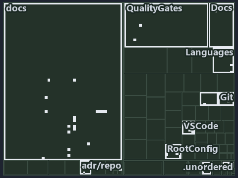

# docs/.assets/explanation/tree/adr-repo-rootcfg--opted-in-then-link-copy-or-render--implementation.tree.md

`Tree minimap: adr-repo-rootcfg--opted-in-then-link-copy-or-render--implementation`

The tree minimap of the slide `adr-repo-rootcfg--opted-in-then-link-copy-or-render--implementation` (implementation lens). The slide
supports [ADR-REPO-ROOTCFG][1]; the highlight of those ADR codes selects what is lit, and each reason below names the code that selects it.

## What the minimap shows

The tree draws every file of the world map as a tile, grouped by top-level folder (under `automation/` by module, under `docs/adr/` by ADR
domain), and lights 48 files in 12 groups, filled in ink. A lit ADR file has a white rim; a file lit only by passing mentions is a lighter
ink. Every other tile is idle, a grey box: a file the slide's ADR codes do not select.

- docs (docs/ outside docs/adr/): 18 lit files
- VSCode (automation/Catzc.Base.VSCode): 8 lit files
- RootConfig (automation/Catzc.Base.RootConfig): 7 lit files
- Languages (automation/Catzc.Base.Languages): 3 lit files
- .unordered: 2 lit files
- Git (automation/Catzc.Base.Git): 2 lit files
- QualityGates (automation/Catzc.Base.QualityGates): 2 lit files
- adr/repo (docs/adr/repository): 2 lit files
- Docs (automation/Catzc.Base.Docs): 1 lit file
- Files (automation/Catzc.Base.Files): 1 lit file
- adr/* (the files directly in docs/adr/): 1 lit file
- pipelines: 1 lit file

## Why each group is lit

### docs (docs/ outside docs/adr/, 18 lit files)

The group holds the files of docs/ outside docs/adr/; each sits in its world-map cell and is lit by:

- [docs/references/automation/catzc-base-git/configs/gitignore.yml.md][2], in the cell docs × markdown: selected by [ADR-REPO-ROOTCFG][1]:
  the file cites it at line 28 (text).
- [docs/references/automation/catzc-base-git/types/GitIgnoreConfig.cs.md][3], in the cell docs × markdown: selected by
  [ADR-REPO-ROOTCFG][1]: the file cites it at line 31 (text).
- [docs/references/automation/catzc-base-languages.md][4], in the cell docs × markdown: selected by [ADR-REPO-ROOTCFG][1]: the file cites it
  at line 41 (text).
- [docs/references/automation/catzc-base-languages/types/GoWorkspaceFile.cs.md][5], in the cell docs × markdown: selected by
  [ADR-REPO-ROOTCFG][1]: the file cites it at line 32 (text).
- [docs/references/automation/catzc-base-languages/types/PythonWorkspaceFile.cs.md][6], in the cell docs × markdown: selected by
  [ADR-REPO-ROOTCFG][1]: the file cites it at line 32 (text).
- [docs/references/automation/catzc-base-rootconfig.md][7], in the cell docs × markdown: selected by [ADR-REPO-ROOTCFG][1]: the file cites
  it at line 16 (text), line 68 (text) and line 77 (text).
- [docs/references/automation/catzc-base-rootconfig/configs/rootconfig.yml.md][8], in the cell docs × markdown: selected by
  [ADR-REPO-ROOTCFG][1]: the file cites it at line 45 (text).
- [docs/references/automation/catzc-base-rootconfig/tests/Test-RootConfigIntegrity.Tests.ps1.md][9], in the cell docs × markdown: selected
  by [ADR-REPO-ROOTCFG][1]: the file cites it at line 40 (text).
- [docs/references/automation/catzc-base-rootconfig/types/RootConfigFiles.cs.md][10], in the cell docs × markdown: selected by
  [ADR-REPO-ROOTCFG][1]: the file cites it at line 31 (text).
- [docs/references/automation/catzc-base-vscode/configs/vscode-extensions.yml.md][11], in the cell docs × markdown: selected by
  [ADR-REPO-ROOTCFG][1]: the file cites it at line 35 (text).
- [docs/references/automation/catzc-base-vscode/configs/vscode-launch.yml.md][12], in the cell docs × markdown: selected by
  [ADR-REPO-ROOTCFG][1]: the file cites it at line 28 (text).
- [docs/references/automation/catzc-base-vscode/configs/vscode-pipeline-schema.yml.md][13], in the cell docs × markdown: selected by
  [ADR-REPO-ROOTCFG][1]: the file cites it at line 30 (text).
- [docs/references/automation/catzc-base-vscode/configs/vscode-settings.yml.md][14], in the cell docs × markdown: selected by
  [ADR-REPO-ROOTCFG][1]: the file cites it at line 34 (text).
- [docs/references/automation/catzc-base-vscode/types/VscodeExtensionsConfig.cs.md][15], in the cell docs × markdown: selected by
  [ADR-REPO-ROOTCFG][1]: the file cites it at line 31 (text).
- [docs/references/automation/catzc-base-vscode/types/VscodeLaunchConfig.cs.md][16], in the cell docs × markdown: selected by
  [ADR-REPO-ROOTCFG][1]: the file cites it at line 30 (text).
- [docs/references/automation/catzc-base-vscode/types/VscodePipelineSchemaConfig.cs.md][17], in the cell docs × markdown: selected by
  [ADR-REPO-ROOTCFG][1]: the file cites it at line 28 (text).
- [docs/references/automation/catzc-base-vscode/types/VscodeSettingsConfig.cs.md][18], in the cell docs × markdown: selected by
  [ADR-REPO-ROOTCFG][1]: the file cites it at line 31 (text).
- [docs/references/automation/internal/Catzc.Internal.Importer.psm1.md][19], in the cell docs × markdown: selected by [ADR-REPO-ROOTCFG][1]:
  the file cites it at line 427 (text).

### VSCode (automation/Catzc.Base.VSCode, 8 lit files)

The group holds the files of automation/Catzc.Base.VSCode; each sits in its world-map cell and is lit by:

- [automation/Catzc.Base.VSCode/New-VSCodeExtensions.ps1][20], in the cell automation × powershell: selected by [ADR-REPO-ROOTCFG][1]: the
  file cites it at line 21 (header) and line 35 (header).
- [automation/Catzc.Base.VSCode/New-VSCodeLaunch.ps1][21], in the cell automation × powershell: selected by [ADR-REPO-ROOTCFG][1]: the file
  cites it at line 20 (header) and line 34 (header).
- [automation/Catzc.Base.VSCode/New-VSCodePipelineSchema.ps1][22], in the cell automation × powershell: selected by [ADR-REPO-ROOTCFG][1]:
  the file cites it at line 21 (header) and line 39 (header).
- [automation/Catzc.Base.VSCode/New-VSCodeSettings.ps1][23], in the cell automation × powershell: selected by [ADR-REPO-ROOTCFG][1]: the
  file cites it at line 22 (header) and line 42 (header).
- [automation/Catzc.Base.VSCode/types/VscodeExtensionsConfig.cs][24], in the cell automation × csharp: selected by [ADR-REPO-ROOTCFG][1]:
  the file cites it at line 21 (text).
- [automation/Catzc.Base.VSCode/types/VscodeLaunchConfig.cs][25], in the cell automation × csharp: selected by [ADR-REPO-ROOTCFG][1]: the
  file cites it at line 21 (text).
- [automation/Catzc.Base.VSCode/types/VscodePipelineSchemaConfig.cs][26], in the cell automation × csharp: selected by
  [ADR-REPO-ROOTCFG][1]: the file cites it at line 20 (text).
- [automation/Catzc.Base.VSCode/types/VscodeSettingsConfig.cs][27], in the cell automation × csharp: selected by [ADR-REPO-ROOTCFG][1]: the
  file cites it at line 21 (text).

### RootConfig (automation/Catzc.Base.RootConfig, 7 lit files)

The group holds the files of automation/Catzc.Base.RootConfig; each sits in its world-map cell and is lit by:

- [automation/Catzc.Base.RootConfig/Build-RootConfig.ps1][28], in the cell automation × powershell: selected by [ADR-REPO-ROOTCFG][1]: the
  file cites it at line 23 (header) and line 44 (header).
- [automation/Catzc.Base.RootConfig/Test-RootAnalyzerSettings.ps1][29], in the cell automation × powershell: selected by
  [ADR-REPO-ROOTCFG][1]: the file cites it at line 21 (header) and line 26 (header).
- [automation/Catzc.Base.RootConfig/Test-RootConfigFiles.ps1][30], in the cell automation × powershell: selected by [ADR-REPO-ROOTCFG][1]:
  the file cites it at line 21 (header) and line 28 (header).
- [automation/Catzc.Base.RootConfig/private/Get-RootConfigRenderedFile.ps1][31], in the cell automation × powershell: selected by
  [ADR-REPO-ROOTCFG][1]: the file cites it at line 20 (header) and line 35 (header).
- [automation/Catzc.Base.RootConfig/private/Get-RootConfigTargets.ps1][32], in the cell automation × powershell: selected by
  [ADR-REPO-ROOTCFG][1]: the file cites it at line 20 (header) and line 27 (header).
- [automation/Catzc.Base.RootConfig/tests/Test-RootConfigIntegrity.Tests.ps1][33], in the cell automation × powershell: selected by
  [ADR-REPO-ROOTCFG][1]: the file cites it at line 20 (header).
- [automation/Catzc.Base.RootConfig/types/RootConfigFiles.cs][34], in the cell automation × csharp: selected by [ADR-REPO-ROOTCFG][1]: the
  file cites it at line 21 (text).

### Languages (automation/Catzc.Base.Languages, 3 lit files)

The group holds the files of automation/Catzc.Base.Languages; each sits in its world-map cell and is lit by:

- [automation/Catzc.Base.Languages/New-GoWorkspace.ps1][35], in the cell automation × powershell: selected by [ADR-REPO-ROOTCFG][1]: the
  file cites it at line 22 (header) and line 47 (header).
- [automation/Catzc.Base.Languages/types/GoWorkspaceFile.cs][36], in the cell automation × csharp: selected by [ADR-REPO-ROOTCFG][1]: the
  file cites it at line 21 (text).
- [automation/Catzc.Base.Languages/types/PythonWorkspaceFile.cs][37], in the cell automation × csharp: selected by [ADR-REPO-ROOTCFG][1]:
  the file cites it at line 20 (text).

### .unordered (2 lit files)

The group holds the files of .unordered; each sits in its world-map cell and is lit by:

- [.unordered/15-10-2026/plan-concern-axis.md][38], in the cell .unordered × markdown: selected by [ADR-REPO-ROOTCFG][1]: the file cites it
  at line 136 (text) and line 153 (text).
- [.unordered/15-10-2026/plan-diagram-wave-8.md][39], in the cell .unordered × markdown: selected by [ADR-REPO-ROOTCFG][1]: the file cites
  it at line 20 (text).

### Git (automation/Catzc.Base.Git, 2 lit files)

The group holds the files of automation/Catzc.Base.Git; each sits in its world-map cell and is lit by:

- [automation/Catzc.Base.Git/New-GitIgnore.ps1][40], in the cell automation × powershell: selected by [ADR-REPO-ROOTCFG][1]: the file cites
  it at line 21 (header) and line 38 (header).
- [automation/Catzc.Base.Git/types/GitIgnoreConfig.cs][41], in the cell automation × csharp: selected by [ADR-REPO-ROOTCFG][1]: the file
  cites it at line 21 (text).

### QualityGates (automation/Catzc.Base.QualityGates, 2 lit files)

The group holds the files of automation/Catzc.Base.QualityGates; each sits in its world-map cell and is lit by:

- [automation/Catzc.Base.QualityGates/configs/terminology.yml][42], in the cell automation × yaml: selected by [ADR-REPO-ROOTCFG][1]: the
  file cites it at line 616 (text).
- [automation/Catzc.Base.QualityGates/private/Get-ContentExemptPath.ps1][43], in the cell automation × powershell: selected by
  [ADR-REPO-ROOTCFG][1]: the file cites it at line 21 (header) and line 32 (header).

### adr/repo (docs/adr/repository, 2 lit files)

The group holds the files of docs/adr/repository; each sits in its world-map cell and is lit by:

- [docs/adr/repository/dora-explains.md][44], in the cell docs × markdown: selected by [ADR-REPO-ROOTCFG][1]: the file cites it at line 163
  (text).
- [docs/adr/repository/generated-root-configs.md][1], in the cell docs × markdown: selected by [ADR-REPO-ROOTCFG][1]: the ADR's own file.

### Docs (automation/Catzc.Base.Docs, 1 lit file)

The group holds the files of automation/Catzc.Base.Docs; each sits in its world-map cell and is lit by:

- [automation/Catzc.Base.Docs/configs/adrs.yml][45], in the cell automation × yaml: selected by [ADR-REPO-ROOTCFG][1]: the file cites it at
  line 312 (text).

### Files (automation/Catzc.Base.Files, 1 lit file)

The group holds the files of automation/Catzc.Base.Files; each sits in its world-map cell and is lit by:

- [automation/Catzc.Base.Files/Set-FileLink.ps1][46], in the cell automation × powershell: selected by [ADR-REPO-ROOTCFG][1]: the file cites
  it at line 22 (header) and line 38 (header).

### adr/* (the files directly in docs/adr/, 1 lit file)

The group holds the files of the files directly in docs/adr/; each sits in its world-map cell and is lit by:

- [docs/adr/index.md][47], in the cell docs × markdown: selected by [ADR-REPO-ROOTCFG][1]: the file cites it at line 314 (text).

### pipelines (1 lit file)

The group holds the files of pipelines; each sits in its world-map cell and is lit by:

- [pipelines/ci-automation.yaml][48], in the cell pipelines × pipeline-yaml: selected by [ADR-REPO-ROOTCFG][1]: a pipeline that cites
  nothing itself carries its globset's citations, which cite it at `automation/Catzc.Base.Docs/configs/adrs.yml` line 312 (text),
  `automation/Catzc.Base.Files/Set-FileLink.ps1` line 22 (header), `automation/Catzc.Base.Files/Set-FileLink.ps1` line 38 (header),
  `automation/Catzc.Base.Git/New-GitIgnore.ps1` line 21 (header), `automation/Catzc.Base.Git/New-GitIgnore.ps1` line 38 (header),
  `automation/Catzc.Base.Git/types/GitIgnoreConfig.cs` line 21 (text), `automation/Catzc.Base.Languages/New-GoWorkspace.ps1` line 22
  (header), `automation/Catzc.Base.Languages/New-GoWorkspace.ps1` line 47 (header),
  `automation/Catzc.Base.Languages/types/GoWorkspaceFile.cs` line 21 (text), `automation/Catzc.Base.Languages/types/PythonWorkspaceFile.cs`
  line 20 (text), `automation/Catzc.Base.QualityGates/configs/terminology.yml` line 616 (text),
  `automation/Catzc.Base.QualityGates/private/Get-ContentExemptPath.ps1` line 21 (header),
  `automation/Catzc.Base.QualityGates/private/Get-ContentExemptPath.ps1` line 32 (header),
  `automation/Catzc.Base.RootConfig/Build-RootConfig.ps1` line 23 (header), `automation/Catzc.Base.RootConfig/Build-RootConfig.ps1` line 44
  (header), `automation/Catzc.Base.RootConfig/Test-RootAnalyzerSettings.ps1` line 21 (header),
  `automation/Catzc.Base.RootConfig/Test-RootAnalyzerSettings.ps1` line 26 (header),
  `automation/Catzc.Base.RootConfig/Test-RootConfigFiles.ps1` line 21 (header), `automation/Catzc.Base.RootConfig/Test-RootConfigFiles.ps1`
  line 28 (header), `automation/Catzc.Base.RootConfig/private/Get-RootConfigRenderedFile.ps1` line 20 (header),
  `automation/Catzc.Base.RootConfig/private/Get-RootConfigRenderedFile.ps1` line 35 (header),
  `automation/Catzc.Base.RootConfig/private/Get-RootConfigTargets.ps1` line 20 (header),
  `automation/Catzc.Base.RootConfig/private/Get-RootConfigTargets.ps1` line 27 (header),
  `automation/Catzc.Base.RootConfig/tests/Test-RootConfigIntegrity.Tests.ps1` line 20 (header),
  `automation/Catzc.Base.RootConfig/types/RootConfigFiles.cs` line 21 (text), `automation/Catzc.Base.VSCode/New-VSCodeExtensions.ps1` line
  21 (header), `automation/Catzc.Base.VSCode/New-VSCodeExtensions.ps1` line 35 (header), `automation/Catzc.Base.VSCode/New-VSCodeLaunch.ps1`
  line 20 (header), `automation/Catzc.Base.VSCode/New-VSCodeLaunch.ps1` line 34 (header),
  `automation/Catzc.Base.VSCode/New-VSCodePipelineSchema.ps1` line 21 (header), `automation/Catzc.Base.VSCode/New-VSCodePipelineSchema.ps1`
  line 39 (header), `automation/Catzc.Base.VSCode/New-VSCodeSettings.ps1` line 22 (header),
  `automation/Catzc.Base.VSCode/New-VSCodeSettings.ps1` line 42 (header), `automation/Catzc.Base.VSCode/types/VscodeExtensionsConfig.cs`
  line 21 (text), `automation/Catzc.Base.VSCode/types/VscodeLaunchConfig.cs` line 21 (text),
  `automation/Catzc.Base.VSCode/types/VscodePipelineSchemaConfig.cs` line 20 (text) and
  `automation/Catzc.Base.VSCode/types/VscodeSettingsConfig.cs` line 21 (text).

## Keywords

- [world map][49]
- [track][50]
- [file language][51]
- [cell][52]
- [lit cell][53]
- [.unordered][54]: a track
- [automation][54]: a track
- [docs][54]: a track
- [pipelines][54]: a track
- [csharp][55]: a file language
- [markdown][55]: a file language
- [pipeline-yaml][55]: a file language
- [powershell][55]: a file language
- [yaml][55]: a file language

[1]: ../../../adr/repository/generated-root-configs.md
[2]: ../../../references/automation/catzc-base-git/configs/gitignore.yml.md
[3]: ../../../references/automation/catzc-base-git/types/GitIgnoreConfig.cs.md
[4]: ../../../references/automation/catzc-base-languages.md
[5]: ../../../references/automation/catzc-base-languages/types/GoWorkspaceFile.cs.md
[6]: ../../../references/automation/catzc-base-languages/types/PythonWorkspaceFile.cs.md
[7]: ../../../references/automation/catzc-base-rootconfig.md
[8]: ../../../references/automation/catzc-base-rootconfig/configs/rootconfig.yml.md
[9]: ../../../references/automation/catzc-base-rootconfig/tests/Test-RootConfigIntegrity.Tests.ps1.md
[10]: ../../../references/automation/catzc-base-rootconfig/types/RootConfigFiles.cs.md
[11]: ../../../references/automation/catzc-base-vscode/configs/vscode-extensions.yml.md
[12]: ../../../references/automation/catzc-base-vscode/configs/vscode-launch.yml.md
[13]: ../../../references/automation/catzc-base-vscode/configs/vscode-pipeline-schema.yml.md
[14]: ../../../references/automation/catzc-base-vscode/configs/vscode-settings.yml.md
[15]: ../../../references/automation/catzc-base-vscode/types/VscodeExtensionsConfig.cs.md
[16]: ../../../references/automation/catzc-base-vscode/types/VscodeLaunchConfig.cs.md
[17]: ../../../references/automation/catzc-base-vscode/types/VscodePipelineSchemaConfig.cs.md
[18]: ../../../references/automation/catzc-base-vscode/types/VscodeSettingsConfig.cs.md
[19]: ../../../references/automation/internal/Catzc.Internal.Importer.psm1.md
[20]: ../../../../automation/Catzc.Base.VSCode/New-VSCodeExtensions.ps1
[21]: ../../../../automation/Catzc.Base.VSCode/New-VSCodeLaunch.ps1
[22]: ../../../../automation/Catzc.Base.VSCode/New-VSCodePipelineSchema.ps1
[23]: ../../../../automation/Catzc.Base.VSCode/New-VSCodeSettings.ps1
[24]: ../../../../automation/Catzc.Base.VSCode/types/VscodeExtensionsConfig.cs
[25]: ../../../../automation/Catzc.Base.VSCode/types/VscodeLaunchConfig.cs
[26]: ../../../../automation/Catzc.Base.VSCode/types/VscodePipelineSchemaConfig.cs
[27]: ../../../../automation/Catzc.Base.VSCode/types/VscodeSettingsConfig.cs
[28]: ../../../../automation/Catzc.Base.RootConfig/Build-RootConfig.ps1
[29]: ../../../../automation/Catzc.Base.RootConfig/Test-RootAnalyzerSettings.ps1
[30]: ../../../../automation/Catzc.Base.RootConfig/Test-RootConfigFiles.ps1
[31]: ../../../../automation/Catzc.Base.RootConfig/private/Get-RootConfigRenderedFile.ps1
[32]: ../../../../automation/Catzc.Base.RootConfig/private/Get-RootConfigTargets.ps1
[33]: ../../../../automation/Catzc.Base.RootConfig/tests/Test-RootConfigIntegrity.Tests.ps1
[34]: ../../../../automation/Catzc.Base.RootConfig/types/RootConfigFiles.cs
[35]: ../../../../automation/Catzc.Base.Languages/New-GoWorkspace.ps1
[36]: ../../../../automation/Catzc.Base.Languages/types/GoWorkspaceFile.cs
[37]: ../../../../automation/Catzc.Base.Languages/types/PythonWorkspaceFile.cs
[38]: ../../../../.unordered/15-10-2026/plan-concern-axis.md
[39]: ../../../../.unordered/15-10-2026/plan-diagram-wave-8.md
[40]: ../../../../automation/Catzc.Base.Git/New-GitIgnore.ps1
[41]: ../../../../automation/Catzc.Base.Git/types/GitIgnoreConfig.cs
[42]: ../../../../automation/Catzc.Base.QualityGates/configs/terminology.yml
[43]: ../../../../automation/Catzc.Base.QualityGates/private/Get-ContentExemptPath.ps1
[44]: ../../../adr/repository/dora-explains.md
[45]: ../../../../automation/Catzc.Base.Docs/configs/adrs.yml
[46]: ../../../../automation/Catzc.Base.Files/Set-FileLink.ps1
[47]: ../../../adr/index.md
[48]: ../../../../pipelines/ci-automation.yaml
[49]: ../../../adr/glossary.md#world-map
[50]: ../../../adr/glossary.md#track
[51]: ../../../adr/glossary.md#file-language
[52]: ../../../adr/glossary.md#cell
[53]: ../../../adr/glossary.md#lit-cell
[54]: ../../../../automation/Catzc.Base.Variants/configs/variants.yml
[55]: ../../../../automation/Catzc.Base.Languages/configs/languages.yml
