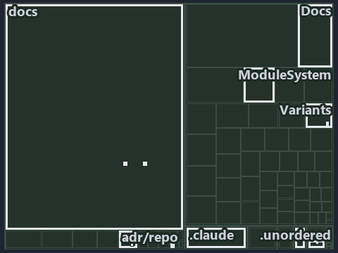

# docs/.assets/explanation/tree/adr-repo-variant--a-base-module-between-config-and-its-callers--architecture.tree.md

`Tree minimap: adr-repo-variant--a-base-module-between-config-and-its-callers--architecture`

The tree minimap of the slide `adr-repo-variant--a-base-module-between-config-and-its-callers--architecture` (architecture lens). The slide
supports [ADR-REPO-VARIANT][1]; the highlight of those ADR codes selects what is lit, and each reason below names the code that selects it.

## What the minimap shows

The tree draws every file of the world map as a tile, grouped by top-level folder (under `automation/` by module, under `docs/adr/` by ADR
domain), and lights 12 files in 9 groups, filled in ink. A lit ADR file has a white rim; a file lit only by passing mentions is a lighter
ink. Every other tile is idle, a grey box: a file the slide's ADR codes do not select.

- .unordered: 2 lit files
- adr/repo (docs/adr/repository): 2 lit files
- docs (docs/ outside docs/adr/): 2 lit files
- .claude: 1 lit file
- Docs (automation/Catzc.Base.Docs): 1 lit file
- ModuleSystem (automation/Catzc.Base.ModuleSystem): 1 lit file
- Variants (automation/Catzc.Base.Variants): 1 lit file
- adr/* (the files directly in docs/adr/): 1 lit file
- pipelines: 1 lit file

## Why each group is lit

### .unordered (2 lit files)

The group holds the files of .unordered; each sits in its world-map cell and is lit by:

- [.unordered/15-10-2026/plan-adr-consistency.md][2], in the cell .unordered × markdown: selected by [ADR-REPO-VARIANT][1]: the file cites
  it at line 106 (text) and line 257 (text).
- [.unordered/15-10-2026/plan-diagram-wave-8.md][3], in the cell .unordered × markdown: selected by [ADR-REPO-VARIANT][1]: the file cites it
  at line 25 (text).

### adr/repo (docs/adr/repository, 2 lit files)

The group holds the files of docs/adr/repository; each sits in its world-map cell and is lit by:

- [docs/adr/repository/dora-explains.md][4], in the cell docs × markdown: selected by [ADR-REPO-VARIANT][1]: the file cites it at line 198
  (text).
- [docs/adr/repository/repo-variants.md][1], in the cell docs × markdown: selected by [ADR-REPO-VARIANT][1]: the ADR's own file.

### docs (docs/ outside docs/adr/, 2 lit files)

The group holds the files of docs/ outside docs/adr/; each sits in its world-map cell and is lit by:

- [docs/references/automation/catzc-base-variants/configs/variants.yml.md][5], in the cell docs × markdown: selected by
  [ADR-REPO-VARIANT][1]: the file cites it at line 30 (text).
- [docs/references/automation/catzc-base-variants/types/VariantsConfig.cs.md][6], in the cell docs × markdown: selected by
  [ADR-REPO-VARIANT][1]: the file cites it at line 31 (text).

### .claude (1 lit file)

The group holds the files of .claude; each sits in its world-map cell and is lit by:

- [.claude/plans/plan-module-kinds-tracks.md][7], in the cell .claude × markdown: selected by [ADR-REPO-VARIANT][1]: the file cites it at
  line 886 (text) and line 940 (text).

### Docs (automation/Catzc.Base.Docs, 1 lit file)

The group holds the files of automation/Catzc.Base.Docs; each sits in its world-map cell and is lit by:

- [automation/Catzc.Base.Docs/configs/adrs.yml][8], in the cell automation × yaml: selected by [ADR-REPO-VARIANT][1]: the file cites it at
  line 316 (text).

### ModuleSystem (automation/Catzc.Base.ModuleSystem, 1 lit file)

The group holds the files of automation/Catzc.Base.ModuleSystem; each sits in its world-map cell and is lit by:

- [automation/Catzc.Base.ModuleSystem/Sync-GeneratedFile.ps1][9], in the cell automation × powershell: selected by [ADR-REPO-VARIANT][1]:
  the file cites it at line 24 (header), line 52 (header) and line 125 (text).

### Variants (automation/Catzc.Base.Variants, 1 lit file)

The group holds the files of automation/Catzc.Base.Variants; each sits in its world-map cell and is lit by:

- [automation/Catzc.Base.Variants/types/VariantsConfig.cs][10], in the cell automation × csharp: selected by [ADR-REPO-VARIANT][1]: the file
  cites it at line 24 (text).

### adr/* (the files directly in docs/adr/, 1 lit file)

The group holds the files of the files directly in docs/adr/; each sits in its world-map cell and is lit by:

- [docs/adr/index.md][11], in the cell docs × markdown: selected by [ADR-REPO-VARIANT][1]: the file cites it at line 320 (text).

### pipelines (1 lit file)

The group holds the files of pipelines; each sits in its world-map cell and is lit by:

- [pipelines/ci-automation.yaml][12], in the cell pipelines × pipeline-yaml: selected by [ADR-REPO-VARIANT][1]: a pipeline that cites
  nothing itself carries its globset's citations, which cite it at `automation/Catzc.Base.Docs/configs/adrs.yml` line 316 (text),
  `automation/Catzc.Base.ModuleSystem/Sync-GeneratedFile.ps1` line 24 (header), `automation/Catzc.Base.ModuleSystem/Sync-GeneratedFile.ps1`
  line 52 (header), `automation/Catzc.Base.ModuleSystem/Sync-GeneratedFile.ps1` line 125 (text) and
  `automation/Catzc.Base.Variants/types/VariantsConfig.cs` line 24 (text).

## Keywords

- [world map][13]
- [track][14]
- [file language][15]
- [cell][16]
- [lit cell][17]
- [.claude][18]: a track
- [.unordered][18]: a track
- [automation][18]: a track
- [docs][18]: a track
- [pipelines][18]: a track
- [csharp][19]: a file language
- [markdown][19]: a file language
- [pipeline-yaml][19]: a file language
- [powershell][19]: a file language
- [yaml][19]: a file language

[1]: ../../../adr/repository/repo-variants.md
[2]: ../../../../.unordered/15-10-2026/plan-adr-consistency.md
[3]: ../../../../.unordered/15-10-2026/plan-diagram-wave-8.md
[4]: ../../../adr/repository/dora-explains.md
[5]: ../../../references/automation/catzc-base-variants/configs/variants.yml.md
[6]: ../../../references/automation/catzc-base-variants/types/VariantsConfig.cs.md
[7]: ../../../../.claude/plans/plan-module-kinds-tracks.md
[8]: ../../../../automation/Catzc.Base.Docs/configs/adrs.yml
[9]: ../../../../automation/Catzc.Base.ModuleSystem/Sync-GeneratedFile.ps1
[10]: ../../../../automation/Catzc.Base.Variants/types/VariantsConfig.cs
[11]: ../../../adr/index.md
[12]: ../../../../pipelines/ci-automation.yaml
[13]: ../../../adr/glossary.md#world-map
[14]: ../../../adr/glossary.md#track
[15]: ../../../adr/glossary.md#file-language
[16]: ../../../adr/glossary.md#cell
[17]: ../../../adr/glossary.md#lit-cell
[18]: ../../../../automation/Catzc.Base.Variants/configs/variants.yml
[19]: ../../../../automation/Catzc.Base.Languages/configs/languages.yml
