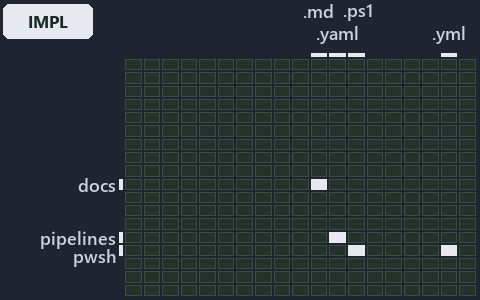

---
catzc:
  immutable:
    with_body_sha: f1e97779c93c
    repo_status: locked
    path: docs/adr/azure/.assets/azure-name-assembly/grid.md
    source: docs/adr/azure/.assets/azure-name-assembly/diagram.drawio.png
    role: adr
    language: markdown
    filetype: md
    track: docs
    tracktype: documentation
---

# ADR: Azure resource naming standard: the world-map minimap

```text
Where the files that cite ADR-AZ-NAMING sit in the repository: tracks down, file languages across.
4 of 342 cells lit, holding 25 files.
```



This is the world-map minimap in the sidebar of the implementation diagram of [ADR: Azure resource naming standard][1], which explains
[ADR-AZ-NAMING][1]. It lights every cell of the world map that holds a file citing those codes, so it shows where the decision lives in the
repository. Each lit cell has its reason below, naming the code that selects it.

## What the minimap shows

The grid crosses the 18 tracks (rows) with the 19 file languages (columns) of the world map and lights 4 cells, filled in ink. A cell lit
only by passing mentions (citations in body comments, not in a file's header or text) is touched: a lighter ink. Every other cell is idle, a
grey box: it holds files the slide's ADR codes do not select, or no file at all (288 of the 342 cells hold none). The minimap shows where
the slide sits, not how many files a cell holds; the world-map PDFs show the counts.

- docs × markdown: 21 lit of 2775 files
- pipelines × pipeline-yaml: 1 lit of 14 files
- pwsh × powershell: 1 lit of 1653 files
- pwsh × yaml: 2 lit of 115 files

## Key

A lit row prints its track's name; a lit column prints a short code, the first extension of its file language:

- `.md`: markdown
- `.yaml`: pipeline-yaml
- `.ps1`: powershell
- `.yml`: yaml

## Why each cell is lit

### docs × markdown (21 lit files)

Placed: the root folder `docs/` names the track docs ([ADR-DSGN-TRACK-TRACKISPLACEDCLUSTER][2]); the extension `.md` names the file language
markdown ([ADR-DSGN-TRACK-FILELANGUAGE][2]). Lit ([ADR-DSGN-TRACK-LITCELL][2]) by:

- [docs/adr/azure/.assets/azure-name-assembly/chain.md][3]: selected by [ADR-AZ-NAMING][1]: the file cites it at line 18 (text), line 25
  (text), line 58 (text) and line 58 (text).
- [docs/adr/azure/.assets/azure-name-assembly/grid.md][4]: selected by [ADR-AZ-NAMING][1]: the file cites it at line 18 (text), line 25
  (text), line 56 (text), line 57 (text), line 58 (text), line 59 (text), line 60 (text), line 62 (text), line 64 (text), line 66 (text),
  line 68 (text), line 70 (text), line 72 (text), line 74 (text), line 76 (text), line 78 (text), line 80 (text), line 81 (text), line 82
  (text), line 84 (text), line 92 (text), line 101 (text), line 109 (text) and line 110 (text).
- [docs/adr/azure/.assets/azure-name-assembly/tree.md][5]: selected by [ADR-AZ-NAMING][1]: the file cites it at line 18 (text), line 25
  (text), line 47 (text), line 50 (text), line 52 (text), line 54 (text), line 55 (text), line 58 (text), line 59 (text), line 61 (text),
  line 64 (text), line 65 (text), line 67 (text), line 69 (text), line 71 (text), line 73 (text), line 75 (text), line 82 (text), line 83
  (text), line 89 (text), line 91 (text), line 98 (text), line 105 (text) and line 113 (text).
- [docs/adr/azure/azure-naming-standard.md][1]: selected by [ADR-AZ-NAMING][1]: the ADR's own file.
- [docs/adr/azure/dora-explains.md][6]: selected by [ADR-AZ-NAMING][1]: the file cites it at line 43 (text).
- [docs/adr/index.md][7]: selected by [ADR-AZ-NAMING][1]: the file cites it at line 32 (text) and line 282 (text).
- [docs/how-to/getting-started/automation/add-a-doc-chapter.md][8]: selected by [ADR-AZ-NAMING][1]: the file cites it at line 67 (text).
- [docs/references/pwsh/.assets/azure-identity-resolves-from-config/diagram.drawio.verify.md][9]: selected by [ADR-AZ-NAMING][1]: the file
  cites it at line 54 (text).
- [docs/references/pwsh/.assets/bicep-template-is-a-folder/diagram.drawio.md][10]: selected by [ADR-AZ-NAMING][1]: the file cites it at line
  28 (text), line 28 (text), line 94 (text) and line 94 (text).
- [docs/references/pwsh/.assets/bicep-template-is-a-folder/diagram.drawio.verify.md][11]: selected by [ADR-AZ-NAMING][1]: the file cites it
  at line 43 (text) and line 43 (text).
- [docs/references/pwsh/catzc-azure-templates/Get-AzureResourceName.ps1.md][12]: selected by [ADR-AZ-NAMING][1]: the file cites it at line
  97 (text), line 108 (text) and line 127 (text).
- [docs/references/pwsh/catzc-azure-templates/Get-AzureResourceTypeSet.ps1.md][13]: selected by [ADR-AZ-NAMING][1]: the file cites it at
  line 29 (text) and line 32 (text).
- [docs/references/pwsh/catzc-azure-templates/Get-BicepResourceName.ps1.md][14]: selected by [ADR-AZ-NAMING][1]: the file cites it at line
  75 (text).
- [docs/references/pwsh/catzc-azure-templates/Get-BicepTemplates.ps1.md][15]: selected by [ADR-AZ-NAMING][1]: the file cites it at line 142
  (text).
- [docs/references/pwsh/catzc-azure-templates/tests/types/BicepShortName.Tests.ps1.md][16]: selected by [ADR-AZ-NAMING][1]: the file cites
  it at line 14 (text).
- [docs/references/pwsh/catzc-azure-templates/types/BicepShortName.cs.md][17]: selected by [ADR-AZ-NAMING][1]: the file cites it at line 12
  (text), line 32 (text) and line 64 (text).
- [docs/references/pwsh/catzc-azure/configs/azure.yml.md][18]: selected by [ADR-AZ-NAMING][1]: the file cites it at line 32 (text), line 77
  (text) and line 111 (text).
- [docs/references/pwsh/catzc-azure/configs/customer.yml.md][19]: selected by [ADR-AZ-NAMING][1]: the file cites it at line 19 (text).
- [docs/references/pwsh/catzc-azure/types/AzureConfig.cs.md][20]: selected by [ADR-AZ-NAMING][1]: the file cites it at line 28 (text).
- [docs/references/pwsh/catzc-azure/types/AzureEnvironmentRecord.cs.md][21]: selected by [ADR-AZ-NAMING][1]: the file cites it at line 12
  (text).
- [docs/references/pwsh/catzc-base-variants/configs/variants.yml.md][22]: selected by [ADR-AZ-NAMING][1]: the file cites it at line 23
  (text).

### pipelines × pipeline-yaml (1 lit file)

Placed: the root folder `pipelines/` names the track pipelines ([ADR-DSGN-TRACK-TRACKISPLACEDCLUSTER][2]); the extension `.yaml` names the
file language pipeline-yaml ([ADR-DSGN-TRACK-FILELANGUAGE][2]). Lit ([ADR-DSGN-TRACK-LITCELL][2]) by:

- [pipelines/ci-automation.yaml][23]: selected by [ADR-AZ-NAMING][1]: a pipeline that cites nothing itself carries its globset's citations,
  which cite it at `pwsh/Catzc.Azure.Templates/tests/Build-Bicep.Integrity.Tests.ps1` line 46 (text),
  `pwsh/Catzc.Base.Docs/configs/adr-index.yml` line 17 (text) and `pwsh/Catzc.Base.Docs/configs/adrs.yml` line 257 (text).

### pwsh × powershell (1 lit file)

Placed: the root folder `pwsh/` names the track pwsh ([ADR-DSGN-TRACK-TRACKISPLACEDCLUSTER][2]); the extension `.ps1` names the file
language powershell ([ADR-DSGN-TRACK-FILELANGUAGE][2]). Lit ([ADR-DSGN-TRACK-LITCELL][2]) by:

- [pwsh/Catzc.Azure.Templates/tests/Build-Bicep.Integrity.Tests.ps1][24]: selected by [ADR-AZ-NAMING][1]: the file cites it at line 46
  (text).

### pwsh × yaml (2 lit files)

Placed: the root folder `pwsh/` names the track pwsh ([ADR-DSGN-TRACK-TRACKISPLACEDCLUSTER][2]); the extension `.yml` names the file
language yaml ([ADR-DSGN-TRACK-FILELANGUAGE][2]). Lit ([ADR-DSGN-TRACK-LITCELL][2]) by:

- [pwsh/Catzc.Base.Docs/configs/adr-index.yml][25]: selected by [ADR-AZ-NAMING][1]: the file cites it at line 17 (text).
- [pwsh/Catzc.Base.Docs/configs/adrs.yml][26]: selected by [ADR-AZ-NAMING][1]: the file cites it at line 257 (text).

## Keywords

- [world map][27]
- [track][28]
- [file language][29]
- [cell][30]
- [lit cell][31]
- [docs][32]: a track
- [pipelines][32]: a track
- [pwsh][32]: a track
- [markdown][33]: a file language
- [pipeline-yaml][33]: a file language
- [powershell][33]: a file language
- [yaml][33]: a file language

[1]: ../../azure-naming-standard.md
[2]: ../../../design/tracks.md
[3]: chain.md
[4]: grid.md
[5]: tree.md
[6]: ../../dora-explains.md
[7]: ../../../index.md
[8]: ../../../../how-to/getting-started/automation/add-a-doc-chapter.md
[9]: ../../../../references/pwsh/.assets/azure-identity-resolves-from-config/diagram.drawio.verify.md
[10]: ../../../../references/pwsh/.assets/bicep-template-is-a-folder/diagram.drawio.md
[11]: ../../../../references/pwsh/.assets/bicep-template-is-a-folder/diagram.drawio.verify.md
[12]: ../../../../references/pwsh/catzc-azure-templates/Get-AzureResourceName.ps1.md
[13]: ../../../../references/pwsh/catzc-azure-templates/Get-AzureResourceTypeSet.ps1.md
[14]: ../../../../references/pwsh/catzc-azure-templates/Get-BicepResourceName.ps1.md
[15]: ../../../../references/pwsh/catzc-azure-templates/Get-BicepTemplates.ps1.md
[16]: ../../../../references/pwsh/catzc-azure-templates/tests/types/BicepShortName.Tests.ps1.md
[17]: ../../../../references/pwsh/catzc-azure-templates/types/BicepShortName.cs.md
[18]: ../../../../references/pwsh/catzc-azure/configs/azure.yml.md
[19]: ../../../../references/pwsh/catzc-azure/configs/customer.yml.md
[20]: ../../../../references/pwsh/catzc-azure/types/AzureConfig.cs.md
[21]: ../../../../references/pwsh/catzc-azure/types/AzureEnvironmentRecord.cs.md
[22]: ../../../../references/pwsh/catzc-base-variants/configs/variants.yml.md
[23]: ../../../../../pipelines/ci-automation.yaml
[24]: ../../../../../pwsh/Catzc.Azure.Templates/tests/Build-Bicep.Integrity.Tests.ps1
[25]: ../../../../../pwsh/Catzc.Base.Docs/configs/adr-index.yml
[26]: ../../../../../pwsh/Catzc.Base.Docs/configs/adrs.yml
[27]: ../../../glossary.md#world-map
[28]: ../../../glossary.md#track
[29]: ../../../glossary.md#file-language
[30]: ../../../glossary.md#cell
[31]: ../../../glossary.md#lit-cell
[32]: ../../../../../pwsh/Catzc.Base.Variants/configs/variants.yml
[33]: ../../../../../pwsh/Catzc.Base.Languages/configs/languages.yml
