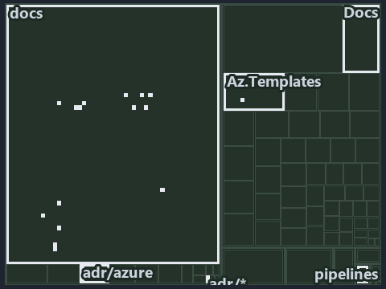

---
catzc:
  immutable:
    with_body_sha: "9ec13b3864a7"
    repo_status: locked
    path: docs/adr/azure/.assets/azure-name-assembly/tree.md
    source: docs/adr/azure/.assets/azure-name-assembly/diagram.drawio.png
    role: adr
    language: markdown
    filetype: md
    track: docs
    tracktype: documentation
---

# ADR: Azure resource naming standard: the tree minimap

```text
Which files cite ADR-AZ-NAMING: every file of the world map is a tile, grouped by top-level folder.
25 files lit in 6 groups.
```



This is the tree minimap in the sidebar of the implementation diagram of [ADR: Azure resource naming standard][1], which explains
[ADR-AZ-NAMING][1]. It lights every file that cites those codes, grouped by folder, so it shows which files carry the decision. Each lit
group has its reason below, naming the code that selects it.

## What the minimap shows

The tree draws every file of the world map as a tile, grouped by top-level folder (under `pwsh/` by module, under `docs/adr/` by ADR
domain), and lights 25 files in 6 groups, filled in ink. A lit ADR file has a white rim; a file lit only by passing mentions is a lighter
ink. Every other tile is idle, a grey box: a file the slide's ADR codes do not select.

- docs (docs/ outside docs/adr/): 15 lit files
- adr/azure (docs/adr/azure): 5 lit files
- Docs (pwsh/Catzc.Base.Docs): 2 lit files
- adr/* (the files directly in docs/adr/): 1 lit file
- pipelines: 1 lit file
- Az.Templates (pwsh/Catzc.Azure.Templates): 1 lit file

## Why each group is lit

### docs (docs/ outside docs/adr/, 15 lit files)

The group holds the files of docs/ outside docs/adr/; each sits in its world-map cell and is lit by:

- [docs/how-to/getting-started/automation/add-a-doc-chapter.md][2], in the cell docs × markdown: selected by [ADR-AZ-NAMING][1]: the file
  cites it at line 67 (text).
- [docs/references/pwsh/.assets/azure-identity-resolves-from-config/diagram.drawio.verify.md][3], in the cell docs × markdown: selected by
  [ADR-AZ-NAMING][1]: the file cites it at line 54 (text).
- [docs/references/pwsh/.assets/bicep-template-is-a-folder/diagram.drawio.md][4], in the cell docs × markdown: selected by
  [ADR-AZ-NAMING][1]: the file cites it at line 28 (text), line 28 (text), line 94 (text) and line 94 (text).
- [docs/references/pwsh/.assets/bicep-template-is-a-folder/diagram.drawio.verify.md][5], in the cell docs × markdown: selected by
  [ADR-AZ-NAMING][1]: the file cites it at line 43 (text) and line 43 (text).
- [docs/references/pwsh/catzc-azure-templates/Get-AzureResourceName.ps1.md][6], in the cell docs × markdown: selected by [ADR-AZ-NAMING][1]:
  the file cites it at line 97 (text), line 108 (text) and line 127 (text).
- [docs/references/pwsh/catzc-azure-templates/Get-AzureResourceTypeSet.ps1.md][7], in the cell docs × markdown: selected by
  [ADR-AZ-NAMING][1]: the file cites it at line 29 (text) and line 32 (text).
- [docs/references/pwsh/catzc-azure-templates/Get-BicepResourceName.ps1.md][8], in the cell docs × markdown: selected by [ADR-AZ-NAMING][1]:
  the file cites it at line 75 (text).
- [docs/references/pwsh/catzc-azure-templates/Get-BicepTemplates.ps1.md][9], in the cell docs × markdown: selected by [ADR-AZ-NAMING][1]:
  the file cites it at line 142 (text).
- [docs/references/pwsh/catzc-azure-templates/tests/types/BicepShortName.Tests.ps1.md][10], in the cell docs × markdown: selected by
  [ADR-AZ-NAMING][1]: the file cites it at line 14 (text).
- [docs/references/pwsh/catzc-azure-templates/types/BicepShortName.cs.md][11], in the cell docs × markdown: selected by [ADR-AZ-NAMING][1]:
  the file cites it at line 12 (text), line 32 (text) and line 64 (text).
- [docs/references/pwsh/catzc-azure/configs/azure.yml.md][12], in the cell docs × markdown: selected by [ADR-AZ-NAMING][1]: the file cites
  it at line 32 (text), line 77 (text) and line 111 (text).
- [docs/references/pwsh/catzc-azure/configs/customer.yml.md][13], in the cell docs × markdown: selected by [ADR-AZ-NAMING][1]: the file
  cites it at line 19 (text).
- [docs/references/pwsh/catzc-azure/types/AzureConfig.cs.md][14], in the cell docs × markdown: selected by [ADR-AZ-NAMING][1]: the file
  cites it at line 28 (text).
- [docs/references/pwsh/catzc-azure/types/AzureEnvironmentRecord.cs.md][15], in the cell docs × markdown: selected by [ADR-AZ-NAMING][1]:
  the file cites it at line 12 (text).
- [docs/references/pwsh/catzc-base-variants/configs/variants.yml.md][16], in the cell docs × markdown: selected by [ADR-AZ-NAMING][1]: the
  file cites it at line 23 (text).

### adr/azure (docs/adr/azure, 5 lit files)

The group holds the files of docs/adr/azure; each sits in its world-map cell and is lit by:

- [docs/adr/azure/.assets/azure-name-assembly/chain.md][17], in the cell docs × markdown: selected by [ADR-AZ-NAMING][1]: the file cites it
  at line 18 (text), line 25 (text), line 58 (text) and line 58 (text).
- [docs/adr/azure/.assets/azure-name-assembly/grid.md][18], in the cell docs × markdown: selected by [ADR-AZ-NAMING][1]: the file cites it
  at line 18 (text), line 25 (text), line 56 (text), line 57 (text), line 58 (text), line 59 (text), line 60 (text), line 62 (text), line 64
  (text), line 66 (text), line 68 (text), line 70 (text), line 72 (text), line 74 (text), line 76 (text), line 78 (text), line 80 (text),
  line 81 (text), line 82 (text), line 84 (text), line 92 (text), line 101 (text), line 109 (text) and line 110 (text).
- [docs/adr/azure/.assets/azure-name-assembly/tree.md][19], in the cell docs × markdown: selected by [ADR-AZ-NAMING][1]: the file cites it
  at line 18 (text), line 25 (text), line 47 (text), line 50 (text), line 52 (text), line 54 (text), line 55 (text), line 58 (text), line 59
  (text), line 61 (text), line 64 (text), line 65 (text), line 67 (text), line 69 (text), line 71 (text), line 73 (text), line 75 (text),
  line 82 (text), line 83 (text), line 89 (text), line 91 (text), line 98 (text), line 105 (text) and line 113 (text).
- [docs/adr/azure/azure-naming-standard.md][1], in the cell docs × markdown: selected by [ADR-AZ-NAMING][1]: the ADR's own file.
- [docs/adr/azure/dora-explains.md][20], in the cell docs × markdown: selected by [ADR-AZ-NAMING][1]: the file cites it at line 43 (text).

### Docs (pwsh/Catzc.Base.Docs, 2 lit files)

The group holds the files of pwsh/Catzc.Base.Docs; each sits in its world-map cell and is lit by:

- [pwsh/Catzc.Base.Docs/configs/adr-index.yml][21], in the cell pwsh × yaml: selected by [ADR-AZ-NAMING][1]: the file cites it at line 17
  (text).
- [pwsh/Catzc.Base.Docs/configs/adrs.yml][22], in the cell pwsh × yaml: selected by [ADR-AZ-NAMING][1]: the file cites it at line 257
  (text).

### adr/* (the files directly in docs/adr/, 1 lit file)

The group holds the files of the files directly in docs/adr/; each sits in its world-map cell and is lit by:

- [docs/adr/index.md][23], in the cell docs × markdown: selected by [ADR-AZ-NAMING][1]: the file cites it at line 32 (text) and line 282
  (text).

### pipelines (1 lit file)

The group holds the files of pipelines; each sits in its world-map cell and is lit by:

- [pipelines/ci-automation.yaml][24], in the cell pipelines × pipeline-yaml: selected by [ADR-AZ-NAMING][1]: a pipeline that cites nothing
  itself carries its globset's citations, which cite it at `pwsh/Catzc.Azure.Templates/tests/Build-Bicep.Integrity.Tests.ps1` line 46
  (text), `pwsh/Catzc.Base.Docs/configs/adr-index.yml` line 17 (text) and `pwsh/Catzc.Base.Docs/configs/adrs.yml` line 257 (text).

### Az.Templates (pwsh/Catzc.Azure.Templates, 1 lit file)

The group holds the files of pwsh/Catzc.Azure.Templates; each sits in its world-map cell and is lit by:

- [pwsh/Catzc.Azure.Templates/tests/Build-Bicep.Integrity.Tests.ps1][25], in the cell pwsh × powershell: selected by [ADR-AZ-NAMING][1]: the
  file cites it at line 46 (text).

## Keywords

- [world map][26]
- [track][27]
- [file language][28]
- [cell][29]
- [lit cell][30]
- [docs][31]: a track
- [pipelines][31]: a track
- [pwsh][31]: a track
- [markdown][32]: a file language
- [pipeline-yaml][32]: a file language
- [powershell][32]: a file language
- [yaml][32]: a file language

[1]: ../../azure-naming-standard.md
[2]: ../../../../how-to/getting-started/automation/add-a-doc-chapter.md
[3]: ../../../../references/pwsh/.assets/azure-identity-resolves-from-config/diagram.drawio.verify.md
[4]: ../../../../references/pwsh/.assets/bicep-template-is-a-folder/diagram.drawio.md
[5]: ../../../../references/pwsh/.assets/bicep-template-is-a-folder/diagram.drawio.verify.md
[6]: ../../../../references/pwsh/catzc-azure-templates/Get-AzureResourceName.ps1.md
[7]: ../../../../references/pwsh/catzc-azure-templates/Get-AzureResourceTypeSet.ps1.md
[8]: ../../../../references/pwsh/catzc-azure-templates/Get-BicepResourceName.ps1.md
[9]: ../../../../references/pwsh/catzc-azure-templates/Get-BicepTemplates.ps1.md
[10]: ../../../../references/pwsh/catzc-azure-templates/tests/types/BicepShortName.Tests.ps1.md
[11]: ../../../../references/pwsh/catzc-azure-templates/types/BicepShortName.cs.md
[12]: ../../../../references/pwsh/catzc-azure/configs/azure.yml.md
[13]: ../../../../references/pwsh/catzc-azure/configs/customer.yml.md
[14]: ../../../../references/pwsh/catzc-azure/types/AzureConfig.cs.md
[15]: ../../../../references/pwsh/catzc-azure/types/AzureEnvironmentRecord.cs.md
[16]: ../../../../references/pwsh/catzc-base-variants/configs/variants.yml.md
[17]: chain.md
[18]: grid.md
[19]: tree.md
[20]: ../../dora-explains.md
[21]: ../../../../../pwsh/Catzc.Base.Docs/configs/adr-index.yml
[22]: ../../../../../pwsh/Catzc.Base.Docs/configs/adrs.yml
[23]: ../../../index.md
[24]: ../../../../../pipelines/ci-automation.yaml
[25]: ../../../../../pwsh/Catzc.Azure.Templates/tests/Build-Bicep.Integrity.Tests.ps1
[26]: ../../../glossary.md#world-map
[27]: ../../../glossary.md#track
[28]: ../../../glossary.md#file-language
[29]: ../../../glossary.md#cell
[30]: ../../../glossary.md#lit-cell
[31]: ../../../../../pwsh/Catzc.Base.Variants/configs/variants.yml
[32]: ../../../../../pwsh/Catzc.Base.Languages/configs/languages.yml
