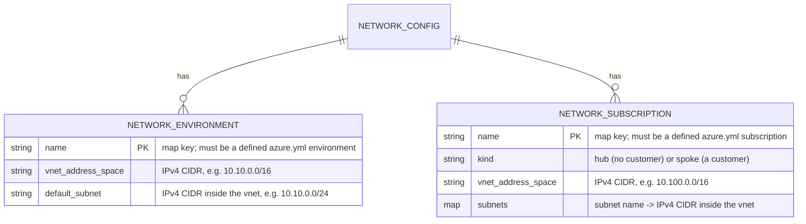

---
catzc:
  immutable:
    repo_status: clean
    path: docs/adr/azure/azure-network-model.md
    folder: docs/adr/azure
    name: azure-network-model
    filetype: md
    kind: adr
    language: markdown
    track: docs
    tracktype: documentation
  edges:
    defines:
      - ADR-AZ-NETWORK#{1-6}
    cites:
      - ADR-AUTO-TEST#35
      - ADR-CONF-LOADING#4
    links:
      - docs/adr/automation/test-automation.md
      - docs/adr/azure/azure-data-model.md
      - docs/adr/azure/azure-naming-standard.md
      - docs/adr/configuration/config-value-addressing.md
      - docs/adr/configuration/module-config-loading.md#rule-adr-conf-loading4
      - docs/adr/pwsh/prepost-extension-modules.md
---

# ADR: Network model (network.yml)

This ADR covers the cross-cutting IP plan, which the data model deliberately leaves out of its two layers.

Pairs with [`data-model`](azure-data-model.md) (identity + templating) and [`naming-standard`](azure-naming-standard.md).

## Rules: ADR-AZ-NETWORK

### Rule ADR-AZ-NETWORK:1

The IP plan lives only in `network.yml` — never duplicate vnet/subnet ranges into a template's per-slot config. A template that needs ranges
reads them from `network.yml` at build time — in its prepare hook (`Get-Config -Config network`), or through a config address in its
parameter file — and never copies them.

> **Status.** The asset, its config type, and the prepare-hook range-merge mechanism are built and exercised by a fixture test (the
> `sample-with-prepost` template merges `vnet_address_space` / `default_subnet` into its parameter set).

- [The asset](#the-asset)

### Rule ADR-AZ-NETWORK:2

Key the plan by environment name, matching `azure.yml`; the two assets stay in sync through a quality gate, `Test-AzureNetworkPlan`, not by
convention alone. Each config type checks only its own file; the join of the two is the gate's.

- [Validation (`NetworkConfig`)](#validation)

### Rule ADR-AZ-NETWORK:3

One address space per environment — multi-region-per-environment is out of scope (each environment maps to one region).

- [The asset](#the-asset)

### Rule ADR-AZ-NETWORK:4

Per-subscription envs (`nsub`/`psub`) need no network entry — they carry no vnet, so the standard-env requirement skips them (a
`nsub`/`psub` entry is not forbidden, just pointless).

- [Validation (`NetworkConfig`)](#validation)

### Rule ADR-AZ-NETWORK:5

Every `azure.yml` subscription has one network in the plan's `subscriptions` block, keyed by the subscription name, and its kind follows
from the subscription: a **hub** when the subscription has no `customer`, a **spoke** when it has one. A hub carries exactly `GatewaySubnet`
and `AzureFirewallSubnet` (reserved: nothing is deployed into them) and `shared-services`. A spoke carries `private-endpoints` plus one
workload subnet per standard environment its subscription serves, named for that environment, and no other. The kind's subnet set is the
type's check; which kind a subscription needs, and which environments it serves, are the gate's join.

- [The subscription networks](#the-subscription-networks)
- [Validation (`NetworkConfig`)](#validation)

### Rule ADR-AZ-NETWORK:6

No two networks in the plan overlap — every environment's and every subscription's vnet address space is disjoint from every other. Every
range is an aligned IPv4 CIDR (no host bits set), every subnet lies inside its vnet, and no two subnets of one vnet overlap. `NetworkConfig`
checks all of it when the file loads.

- [Validation (`NetworkConfig`)](#validation)

## Context

A template that creates a virtual network needs an address space and subnet ranges. Those ranges are **global, cross-cutting state**: every
environment must get a non-overlapping block, and the same block must be referenced identically by every template that touches that
environment's network. If the ranges lived in each template's per-slot `configuration/[<customer>/]<env>.yml`, the plan would be duplicated
across templates and drift — the exact failure [the data model](azure-data-model.md) avoids by giving every fact one source of truth.

So the IP plan is a **single source of truth** sitting beside `azure.yml`: `automation/Catzc.Azure/configs/network.yml`. A template reads
the right ranges at build time — through its PrePost prepare hook (see [`prepost-extension-modules`](../pwsh/prepost-extension-modules.md))
or a config address in its parameter file — so the central plan is read, never copied.

The subscriptions add a second kind of network: one per subscription, in a hub-and-spoke topology. The shared subscriptions each hold a hub,
every customer subscription holds a spoke that peers to its hub, and a workload's private endpoints land in its spoke. Those ranges are the
same kind of global state, so they live in the same file, and one overlap check covers both kinds: two networks that may ever be peered or
routed together must never share an address.

This is a third global asset, distinct from the two layers in [`data-model`](azure-data-model.md): it is not identity
(tenant/customer/environment/subscription) and not templating (template/options/slot). It is pure topology — the network plan keyed by
environment and by subscription.

## Decision

### The asset

`configs/network.yml` declares two entities — a per-environment IP plan, keyed by environment **name** (the same keys as `azure.yml`'s
`environments`), and a per-subscription network, keyed by subscription **name** (the same keys as `azure.yml`'s `subscriptions`). It is
loaded by `Get-Config -Config network`, which constructs its C# config type, `NetworkConfig` (every shipped config has one,
[ADR-CONF-LOADING#4](../configuration/module-config-loading.md#rule-adr-conf-loading4)), so a bad file throws at read time. A template's
parameter file can reach the same ranges through a config address ([config-value-addressing](../configuration/config-value-addressing.md))
instead of a prepare hook.



```yaml
# configs/network.yml
environments:
  dev:
    vnet_address_space: 10.10.0.0/16
    default_subnet: 10.10.0.0/24
  # … one entry per standard environment
subscriptions:
  shared_nonprod:
    kind: hub
    vnet_address_space: 10.0.0.0/16
    subnets:
      GatewaySubnet: 10.0.0.0/27
      AzureFirewallSubnet: 10.0.0.64/26
      shared-services: 10.0.1.0/24
  apex_nonprod:
    kind: spoke
    vnet_address_space: 10.100.0.0/16
    subnets:
      private-endpoints: 10.100.0.0/24
      dev: 10.100.1.0/24
      test: 10.100.2.0/24
  # … one entry per azure.yml subscription
```

### The subscription networks

The `subscriptions` block is the IP plan of the hub-and-spoke topology the subscriptions deploy.

- **A hub** belongs to a shared subscription (no `customer` in `azure.yml`). It carries exactly three subnets. `GatewaySubnet` and
  `AzureFirewallSubnet` are the names Azure requires for a VPN or ExpressRoute gateway and for Azure Firewall; the plan reserves them so
  that adding either later needs no renumbering, and nothing is deployed into them. `shared-services` holds what the shared platform runs in
  the hub.
- **A spoke** belongs to a customer subscription. It carries `private-endpoints`, where every workload in the spoke places its private
  endpoints, and one workload subnet per standard environment the subscription serves, named for that environment (`dev`, `test`, …), so a
  workload finds its subnet from its own environment with no lookup table. The per-subscription identity environment (`nsub`/`psub`) gets no
  workload subnet, for the same reason it gets no environment entry ([ADR-AZ-NETWORK#4](#rule-adr-az-network4)).
- **The kind is declared** (`kind: hub` or `kind: spoke`), even though it follows from `azure.yml`. A template reads it from the plan alone,
  and the gate checks that it agrees with the subscription, so the two can never silently disagree.

### Validation

`NetworkConfig`

- **Required shape.** Top-level `environments` map; each entry has `vnet_address_space` and `default_subnet`. An optional top-level
  `subscriptions` map; each entry has `kind`, `vnet_address_space`, and a non-empty `subnets` map. No other key at any level.
- **Format.** Each environment and subscription name is a valid lower-snake_case identifier (`^[a-z][a-z0-9_]*$`); each range is an aligned
  IPv4 CIDR (`a.b.c.d/n`, `0 ≤ n ≤ 32`, no host bits set, because Azure rejects an address prefix with host bits set), validated with
  `[System.Net.IPAddress]`.
- **Containment and overlap** ([ADR-AZ-NETWORK#6](#rule-adr-az-network6)). An environment's default subnet and every subscription subnet lie
  inside their vnet; no two subnets of one vnet overlap; no two networks in the file overlap, whether environment or subscription.
- **Kind** ([ADR-AZ-NETWORK#5](#rule-adr-az-network5)). A hub carries exactly `GatewaySubnet`, `AzureFirewallSubnet`, and `shared-services`;
  a spoke carries `private-endpoints`, and every other spoke subnet is named as an environment (a lower-snake_case identifier).
- **Cross-asset integrity with `azure.yml`** (the join, checked by the quality gate `Test-AzureNetworkPlan`, not by the type):
  - every network environment is a **defined `azure.yml` environment** (no ghost entries);
  - every **standard** `azure.yml` environment has a network entry;
  - **per-subscription** environments (`per_subscription: true` — `nsub`/`psub`) are **exempt**: they identify a subscription's foundation
    (Log Analytics + Key Vault) and carry no vnet, so they need no IP plan;
  - every network subscription is a **defined `azure.yml` subscription**, and every `azure.yml` subscription has a network of the right kind
    — a hub without a `customer`, a spoke with one;
  - a spoke has a workload subnet for **each standard environment its subscription serves**, and none for another.
- All violations are collected and thrown together (fail with the full list, not the first error).

The `subscriptions` block is optional in the type, so a fixture plan that exercises only environment ranges stays small; the gate is what
requires an entry for every subscription of the shipped `azure.yml`.

### How this is enforced

- `Get-Config -Config network` loads and validates the file through its registered config type, `NetworkConfig`.
- `NetworkConfig` (with `NetworkEnvironment` and `NetworkSubscription` for each entry, and `NetworkCidr` for the range arithmetic) performs
  the shape, format, containment, overlap, and kind checks above, on `network.yml` alone.
- `Test-AzureNetworkPlan` (a quality gate, [`test-automation`](../automation/test-automation.md) `ADR-AUTO-TEST#35`) performs the
  cross-asset join over the two loaded configs and lists every violation; its integrity test runs it over the shipped files.
- The shipped `network.yml` is exercised by the same integrity discipline as `azure.yml` (see
  [`test-automation`](../automation/test-automation.md)).

## Consequences

- The IP plan has one home; templates reference it, so ranges cannot drift across templates.
- Adding an environment to `azure.yml` forces a matching `network.yml` entry (or the standard-env rule fails) — the two assets cannot
  silently diverge.
- Adding a subscription to `azure.yml` forces a matching hub or spoke, and adding an environment to a customer subscription forces a
  workload subnet in its spoke.
- No two networks in the plan can overlap, so any hub can peer to any spoke without renumbering.
- Per-subscription identity environments stay network-free by design.
- The network plan is a separate, self-contained asset — extending it (new env, new subscription, new range) is a one-file change, validated
  on load.
