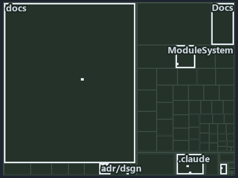

---
catzc:
  immutable:
    with_body_sha: de8519a5c786
    repo_status: locked
    path: docs/adr/design/.assets/sync-point/tree.md
    source: docs/adr/design/.assets/sync-point/diagram.drawio.png
    role: adr
    language: markdown
    filetype: md
    track: docs
    tracktype: documentation
---

# ADR: The commit lifecycle — states, environment occupancy, and the stable sync point: the tree minimap

```text
Which files cite ADR-DSGN-LIFE: every file of the world map is a tile, grouped by top-level folder.
15 files lit in 7 groups.
```



This is the tree minimap in the sidebar of the architecture diagram of [ADR: The commit lifecycle — states, environment occupancy, and the
stable sync point][1], which explains [ADR-DSGN-LIFE][1]. It lights every file that cites those codes, grouped by folder, so it shows which
files carry the decision. Each lit group has its reason below, naming the code that selects it.

## What the minimap shows

The tree draws every file of the world map as a tile, grouped by top-level folder (under `pwsh/` by module, under `docs/adr/` by ADR
domain), and lights 15 files in 7 groups, filled in ink. A lit ADR file has a white rim; a file lit only by passing mentions is a lighter
ink. Every other tile is idle, a grey box: a file the slide's ADR codes do not select.

- adr/dsgn (docs/adr/design): 5 lit files
- .claude: 3 lit files
- adr/* (the files directly in docs/adr/): 2 lit files
- Docs (pwsh/Catzc.Base.Docs): 2 lit files
- docs (docs/ outside docs/adr/): 1 lit file
- pipelines: 1 lit file
- ModuleSystem (pwsh/Catzc.Base.ModuleSystem): 1 lit file

## Why each group is lit

### adr/dsgn (docs/adr/design, 5 lit files)

The group holds the files of docs/adr/design; each sits in its world-map cell and is lit by:

- [docs/adr/design/.assets/sync-point/chain.md][2], in the cell docs × markdown: selected by [ADR-DSGN-LIFE][1]: the file cites it at line
  18 (text), line 25 (text), line 61 (text), line 61 (text), line 69 (text), line 69 (text), line 77 (text) and line 77 (text).
- [docs/adr/design/.assets/sync-point/grid.md][3], in the cell docs × markdown: selected by [ADR-DSGN-LIFE][1]: the file cites it at line 18
  (text), line 25 (text), line 55 (text), line 56 (text), line 57 (text), line 64 (text), line 66 (text), line 69 (text), line 72 (text),
  line 73 (text), line 74 (text), line 75 (text), line 76 (text), line 83 (text), line 92 (text), line 93 (text) and line 94 (text).
- [docs/adr/design/.assets/sync-point/tree.md][4], in the cell docs × markdown: selected by [ADR-DSGN-LIFE][1]: the file cites it at line 18
  (text), line 25 (text), line 48 (text), line 50 (text), line 53 (text), line 56 (text), line 57 (text), line 63 (text), line 65 (text),
  line 67 (text), line 73 (text), line 75 (text), line 81 (text), line 82 (text), line 89 (text), line 96 (text) and line 104 (text).
- [docs/adr/design/commit-lifecycle.md][1], in the cell docs × markdown: selected by [ADR-DSGN-LIFE][1]: the ADR's own file.
- [docs/adr/design/dora-explains.md][5], in the cell docs × markdown: selected by [ADR-DSGN-LIFE][1]: the file cites it at line 82 (text).

### .claude (3 lit files)

The group holds the files of .claude; each sits in its world-map cell and is lit by:

- [.claude/plans/plan-fast-push-followups.md][6], in the cell .claude × markdown: selected by [ADR-DSGN-LIFE][1]: the file cites it at line
  13 (text) and line 18 (text).
- [.claude/plans/plan-promotion-ladder.md][7], in the cell .claude × markdown: selected by [ADR-DSGN-LIFE][1]: the file cites it at line 11
  (text) and line 38 (text).
- [.claude/plans/value-of-plan.md][8], in the cell .claude × markdown: selected by [ADR-DSGN-LIFE][1]: the file cites it at line 33 (text).

### adr/* (the files directly in docs/adr/, 2 lit files)

The group holds the files of the files directly in docs/adr/; each sits in its world-map cell and is lit by:

- [docs/adr/glossary.md][9], in the cell docs × markdown: selected by [ADR-DSGN-LIFE][1]: the file cites it at line 272 (text) and line 346
  (text).
- [docs/adr/index.md][10], in the cell docs × markdown: selected by [ADR-DSGN-LIFE][1]: the file cites it at line 112 (text).

### Docs (pwsh/Catzc.Base.Docs, 2 lit files)

The group holds the files of pwsh/Catzc.Base.Docs; each sits in its world-map cell and is lit by:

- [pwsh/Catzc.Base.Docs/configs/adrs.yml][11], in the cell pwsh × yaml: selected by [ADR-DSGN-LIFE][1]: the file cites it at line 78 (text).
- [pwsh/Catzc.Base.Docs/configs/glossary.yml][12], in the cell pwsh × yaml: selected by [ADR-DSGN-LIFE][1]: the file cites it at line 484
  (text).

### docs (docs/ outside docs/adr/, 1 lit file)

The group holds the files of docs/ outside docs/adr/; each sits in its world-map cell and is lit by:

- [docs/references/pwsh/catzc-base-git/Push-Dirty.ps1.md][13], in the cell docs × markdown: selected by [ADR-DSGN-LIFE][1]: the file cites
  it at line 14 (text).

### pipelines (1 lit file)

The group holds the files of pipelines; each sits in its world-map cell and is lit by:

- [pipelines/ci-automation.yaml][14], in the cell pipelines × pipeline-yaml: selected by [ADR-DSGN-LIFE][1]: a pipeline that cites nothing
  itself carries its globset's citations, which cite it at `pwsh/Catzc.Base.Docs/configs/adrs.yml` line 78 (text),
  `pwsh/Catzc.Base.Docs/configs/glossary.yml` line 484 (text) and `pwsh/Catzc.Base.ModuleSystem/configs/glossary.yml` line 49 (text).

### ModuleSystem (pwsh/Catzc.Base.ModuleSystem, 1 lit file)

The group holds the files of pwsh/Catzc.Base.ModuleSystem; each sits in its world-map cell and is lit by:

- [pwsh/Catzc.Base.ModuleSystem/configs/glossary.yml][15], in the cell pwsh × yaml: selected by [ADR-DSGN-LIFE][1]: the file cites it at
  line 49 (text).

## Keywords

- [world map][16]
- [track][17]
- [file language][18]
- [cell][19]
- [lit cell][20]
- [.claude][21]: a track
- [docs][21]: a track
- [pipelines][21]: a track
- [pwsh][21]: a track
- [markdown][22]: a file language
- [pipeline-yaml][22]: a file language
- [yaml][22]: a file language

[1]: ../../commit-lifecycle.md
[2]: chain.md
[3]: grid.md
[4]: tree.md
[5]: ../../dora-explains.md
[6]: ../../../../../.claude/plans/plan-fast-push-followups.md
[7]: ../../../../../.claude/plans/plan-promotion-ladder.md
[8]: ../../../../../.claude/plans/value-of-plan.md
[9]: ../../../glossary.md
[10]: ../../../index.md
[11]: ../../../../../pwsh/Catzc.Base.Docs/configs/adrs.yml
[12]: ../../../../../pwsh/Catzc.Base.Docs/configs/glossary.yml
[13]: ../../../../references/pwsh/catzc-base-git/Push-Dirty.ps1.md
[14]: ../../../../../pipelines/ci-automation.yaml
[15]: ../../../../../pwsh/Catzc.Base.ModuleSystem/configs/glossary.yml
[16]: ../../../glossary.md#world-map
[17]: ../../../glossary.md#track
[18]: ../../../glossary.md#file-language
[19]: ../../../glossary.md#cell
[20]: ../../../glossary.md#lit-cell
[21]: ../../../../../pwsh/Catzc.Base.Variants/configs/variants.yml
[22]: ../../../../../pwsh/Catzc.Base.Languages/configs/languages.yml
