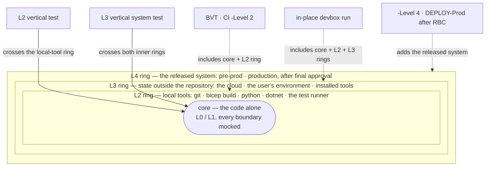

# Automation: Test automation — logic tests vs integrity tests, and how to isolate

## Rules: ADR-AUTO-TEST

### Rule ADR-AUTO-TEST-ONECATEGORY

Classify every test into one **category**, logic or integrity, and carry it as a mandatory `logic`/`integrity` tag (see
ADR-AUTO-TEST-TWOMANDATORYTAGS). A logic test must not read a shipped asset; an integrity test exists precisely to read them. A single test
is one or the other — a test file needing both puts each kind in its own group of tests, each group tagged.

- [Logic vs integrity tests](#logic-vs-integrity-tests)

### Rule ADR-AUTO-TEST-DISTINCTFIXTURES

Fixtures own their inputs and use deliberately distinct identities under `tests/assets/` (envs `alpha`/`beta`, customers `acme`/`globex`,
org `fxo`) so they cannot collide with production.

- [Isolation through seams](#isolation-through-seams)

### Rule ADR-AUTO-TEST-SAFESEAMSWAPS

Seam swaps are safe because the config reader and template discovery key their session caches on the resolved path/root, so a fixture path
and the real path get separate cache entries. A test varies a cached function's behaviour by replacing the whole function, never its
internals, because a warm cache ignores a replaced dependency; only a test that exercises cache behaviour itself resets the cache, and it
resets the one entry it exercises.

- [How this is enforced](#how-this-is-enforced)

### Rule ADR-AUTO-TEST-NOOVERMOCKING

Do not mock the unit under test, and do not over-mock. Let the pure logic run for real; mock only the genuine boundaries (filesystem
location, external CLIs, git, pipeline detection).

- [Isolation through seams](#isolation-through-seams)

### Rule ADR-AUTO-TEST-CATEGORYORTHOGONALTOTIER

The category (`logic`/`integrity`) is orthogonal to the L0–L4 tier — an L2 test may be either — and there is no required pairing of one
integrity test per logic test. Pure-logic tests use fixtures via the seams; tests that deliberately read the shipped assets to verify real
templates are legitimate and stay on the shipped files — but they bind to the template _set_, never to a named template
(ADR-AUTO-TEST-GENERICTEMPLATETESTS).

- [Test tiers: the test onion](#test-tiers-the-test-onion)

### Rule ADR-AUTO-TEST-TAGBYOUTERMOSTRING

Tag the vertical tests by their outermost ring (ADR-AUTO-TEST-ONIONOFRINGS) — local-tool tests `L2`, system tests `L3`
(ADR-AUTO-TEST-SYSTEMTESTSATLTHREE) — each in its own group of tests, and make both skip themselves, with a recorded reason, when the tool,
the platform, or cloud access is missing. The reason is a **constrained skip key** — lowercase alnum segments joined by `_`, never free
prose — so the skip report groups by a stable, sortable vocabulary: platform skips are `<os>_<only|not>_<detail>` (os = `windows`|`unix`;
`only` = runs only there, `not` = cannot run there), tool skips are `tool_<name>_missing`. The `Test-SourceConventions` quality gate
enforces the key grammar.

- [Test tiers: the test onion](#test-tiers-the-test-onion)

### Rule ADR-AUTO-TEST-NOCLOUDBELOWLTHREE

No test below L3 may depend on cloud connectivity or change state outside the repository (the user's environment, installed tools). Unit
tests mock those boundaries; L2 needs only the local CLI tool. A test failing because `az` was not connected is a mis-tiered test, not a
flake. `git` is such a local tool: a test that asks git about the repository — its tracked files, index, status, or history — is L2, and git
is a prerequisite of every source-tree L2 run rather than a tool its tests skip without.

- [Test tiers: the test onion](#test-tiers-the-test-onion)

### Rule ADR-AUTO-TEST-PROCESSTRIPWIRE

A runtime tripwire enforces "L0/L1 launches no real process": the one test entry sets a block-real-process environment variable and the
process seam throws instead of launching, in every run and for each test container by the tier of its outermost Describe, so a mock that
fails to intercept fails loudly.

- [How this is enforced](#how-this-is-enforced)

### Rule ADR-AUTO-TEST-TWOMANDATORYTAGS

Every test carries two mandatory, orthogonal tags, resolved through the groups that enclose it (the nearest contributing group wins):
exactly one **tier** `L0|L1|L2|L3|L4` and exactly one category `logic|integrity`. There is no default for either — a test resolving to zero,
or to two of the same axis, is a violation. Put both on the outermost group for a uniform test file; override on an inner group where the
file mixes tiers or categories — never two tags of the same axis on one group. On the category axis, `logic` verifies a function's logic on
mocks and/or its own fixtures, independent of shipped config; `integrity` verifies the actual repository contents (shipped
`azure.yml`/`network.yml`/`tools.yml`/…, real templates, the module/type/function graph, checked-in binaries, file/folder conventions).

- [Two mandatory tag axes](#mandatory-tag-axes)

### Rule ADR-AUTO-TEST-TAGSENFORCED

The one test entry enforces ADR-AUTO-TEST-TWOMANDATORYTAGS on every invocation: a discovery-only pass, which finds every test without
running any, inspects every test regardless of `-Level`, and the run throws if any test is missing — or ambiguous on — a tier or category
tag.

- [How this is enforced](#how-this-is-enforced)

### Rule ADR-AUTO-TEST-INTEGRITYREADSFILES

An integrity test derives its fact by reading the repository's files directly — enumerate and parse them (a syntax tree, or a file name) —
never by booting the importer or inspecting a loaded session. A static property of the files on disk is checked by reading the files.

- [Integrity tests read files](#integrity-tests-read-files)

### Rule ADR-AUTO-TEST-GENERICTEMPLATETESTS

An integrity test that exercises shipped templates must be **generic**: discover the set through the template discovery and assert
invariants that hold for _every_ template. It must **never** bind to a specific production template name, nor assert a production-derived
magic value (a rendered secret name, resource name, or parameter-file name). Binding a test to a production identity makes that test veto
the identity's rename or removal — a test must never block a production refactor. Positive, template-specific behaviour (e.g. a PrePost hook
injecting a particular Key Vault reference) is verified as a **logic** test against a **fixture** template (ADR-AUTO-TEST-DISTINCTFIXTURES),
not against the shipped one; the generic integrity test asserts only the structural invariant — "any reference present is well-formed" —
across all shipped templates.

- [Generic integrity tests](#generic-integrity-tests)

### Rule ADR-AUTO-TEST-SETUPONCE

Do expensive setup once, not per test. Discovery and config caches key on the resolved root/path (ADR-AUTO-TEST-SAFESEAMSWAPS), so a
per-test setup that hands each test a fresh root or clears a config cache forces a cold re-derive on every test. Copy the fixture tree and
reset the cache **once** for the group of tests that shares them; share one warm import across tests that do not conflict (read-only, or
each writing a distinct path), and give a fresh root only to tests that mutate-and-collide.

- [Fast logic tests](#fast-logic-tests)

### Rule ADR-AUTO-TEST-ONEIMPORTPERCASE

When the unit is a pure function of the filesystem (the importer; discovery), spawn one import per distinct tree shape, not per assertion.
Capture a rich observation from a single import and assert it across separate tests. Minimize the spawn count — a test file's tests run one
after another, and the harness parallelizes at whole-file granularity (test files sharded across worker processes), so splitting a stateful
narrative into more tests in one file parallelizes nothing; fewer, richer imports is the only lever.

- [Fast logic tests](#fast-logic-tests)

### Rule ADR-AUTO-TEST-MEASUREFIRST

Measure before optimizing a slow test, and compare like workloads. Mock interception is cheap (about a millisecond per call), so "slow
because of mocks" is almost always wrong — time the sub-steps, count the calls through the mocks, and make sure A/B variants do the same
work (a redirect that silently falls through to the real tree is measuring a smaller, different workload).

- [Fast logic tests](#fast-logic-tests)

### Rule ADR-AUTO-TEST-COLLAPSEINPUTCLUSTERS

A cluster of slow integration tests that differ only by input — each re-proving the _same_ cross-boundary wiring for a different case — is a
design signal, not a cost to accept: **push the per-case assertions left** into fast, deterministic, mocked **L0** logic tests, and leave
the integration tier a thin walking skeleton. The thing under test is **the-state-of-this-commit** — everything-as-code (IaC templates, the
`*.yml` configs, the module/type/function graph; see [everything-as-code](../principles/everything-as-code.md)) is a static, hermetic
property of the committed artifacts — so the per-case behaviour is pure logic provable on mocks, and the default test run is a fast check on
those artifacts rather than a slow tool or cloud round-trip.

- [Shift checks left](#shift-checks-left)

### Rule ADR-AUTO-TEST-FEWINTEGRATIONTESTS

Keep **a very few** integration tests (L2/L3) — one per _distinct_ integration concern, a capability the mock necessarily fakes away (a real
compiler resolving and inlining a referenced module, a subscription-scoped template actually compiling, a CLI's exit-code contract) —
**never one per input case**. Pick the broadest single thread that exercises the wiring, prove the boundary connects once, and let the input
variations live at L0. Two tests that drive the boundary the same way and differ only in rendered values are one walking skeleton plus a
redundant copy; collapse them.

- [Shift checks left](#shift-checks-left)

### Rule ADR-AUTO-TEST-BUILDVERIFICATIONTEST

The **Build Verification Test** (BVT) is the verification that precedes every promotion and every creation of release artifacts, and the
verification the commit gate runs, with one aggregate verdict: it runs every selected test up to the target level together with the
built-artifact checks of `Test-BuildArtifact` — the build itself plus its `Types`, `Load`, `Parity`, and `Manifest` facets. A commit reaches
master only when its BVT is green, and the canonical module-manifest artifact a passing build produces is the BVT's gold output.

- [Build Verification Test](#build-verification-test)

### Rule ADR-AUTO-TEST-FILEPARALLELISM

The one test entry parallelizes at whole-file granularity across worker **processes**: the run's test files are sharded across workers
(pooled live output — one worker's stream live while later workers buffer and replay in order), each worker loads the modules through its
run's entry script, runs its shard, writes its own results file, and reduces its **live** result to plain per-test rows
(`ConvertTo-TestAutomationRowSet` — tier/category resolution walks the live chain of groups, which does not survive a process boundary) into
a `rows-shard-<N>.json` sidecar. The parent aggregates rows — never a test framework's object across a boundary — and every run report
(tests.csv, summary.md, the timing check, the skip report) consumes rows. A worker exits 0/1; any other exit code, or a missing sidecar, is
a worker crash the parent surfaces loudly. Workers run tests **under strict mode**, set before any test runs, matching the module code under
test, which runs strict in its own module scope; a test that genuinely needs non-strict semantics opts out locally, in its own body. A
worker never outlives the process that started it: it watches its parent (`WorkerParentWatch`, by PID and start time) and kills itself when
the parent is gone. A run whose owning process dies before its terminal `run.json` stamp is recorded `abandoned` by the next run in the same
report folder (`Set-AbandonedTestRun`), never left `running`.

- [Parallel harness](#parallel-harness)

### Rule ADR-AUTO-TEST-ONESCHEDULINGPOOL

A **phase** is one of a test run's three scheduling stages: the parallel shards and the greedy phase share one worker pool, and the serial
phase runs after both. Two phase tags, both optional (block-chain resolution like the two mandatory axes, via `Get-TestBlockTag`), name
tests that must not share the machine with the parallel pool; `Split-TestAutomationFiles` owns the split, and a file is the scheduling unit,
so one tagged test moves its whole file (serial wins over greedy):

- **`serial`** — the test mutates state shared across worker processes: the per-machine types build, a fixed `out/` path two files both
  write (e.g. the `out/template/<name>` build folders). Its file runs in the final **one-worker phase**, strictly alone, one file after
  another.
- **`greedy`** — the test consumes the machine beyond its own process (`Test-ScriptAnalyzer`'s background-process pool, tests that spawn
  importer-loading pwsh workers) but shares no mutable state with other files. Its file runs in the **greedy phase**, a single-file shard
  queued in the same pool beside the parallel shards: the pool holds one slot per parallel shard and up to `greedy_group_size` slots more,
  so the longest greedy files (heaviest measured duration first, and an unmeasured file before every measured one, since sorted last it
  never starts in a run that overruns and so is never measured) start with the run and overlap the shards, and the serial phase waits for
  them. The measured durations live in `durations.json` beside the runs; a run that ends saves its files' durations there, and so does the
  next run for one whose owner died (`Save-AbandonedRunDurationHistory`, from the shards that finished), so a run killed at its roof still
  teaches the dealing. At most `greedy_group_size` greedy files run at once, and of the files `greedy_apart` names (the ones that run real
  builds) one at a time, both in `test-policy.yml` with their defaults on `TestPolicyConfig`. A greedy file can overlap the last parallel
  shards and inflate their L0/L1 timings, so over-limit timings stay report-only in a full run.

A test that changes state outside the repository is not a phase concern: it is an L3 vertical system test, and the run's location decides
whether it runs (ADR-AUTO-TEST-SYSTEMTESTSATLTHREE).

A parallel-run flake root-caused to a shared resource is fixed by tagging it serial (or removing the sharing) — never by retrying
(ADR-AUTO-RETRY-NEVERINTESTS).

- [Parallel harness](#parallel-harness)

### Rule ADR-AUTO-TEST-PROVENANCETAGS

An **optional third, provenance dimension**: a test MAY carry `ADR-<CODE>#<n>` citation tags naming the DRS rule(s) it enforces — the
`docs/drs/index.md` `#` citation form, so the rule-code marker greps to both a rule's prose and its enforcing tests. Absence is never a
violation. A **present** citation is validated (`Get-TestTagViolations`): it must be well-formed and resolve to a real rule
(`Get-DrsRuleIds`), or the run fails — so a rule renumber breaks its stale tag loudly. Unlike the single-valued tier and category axes
(nearest contributing group wins), provenance is **set-valued and additive**: `Get-TestRuleTags` **unions** the citations across a test's
own tags and every group that encloses it, so a broad rule on the outermost group and a specific rule on one test both count.

- [Provenance and rule coverage](#provenance-and-rule-coverage)

### Rule ADR-AUTO-TEST-COVERAGEREPORTEDONLY

Rule-enforcement **coverage is reported and never blocks a run**, and counts **two enforcer kinds run in the same `Test-Automation`
invocation**: a test tagged with the rule's citation (the `Rules` column of `tests.csv` is the backtrack table, filterable by a citation to
find every enforcing test), and an analyzer rule mapped to the rule, which the analyzer quality gate runs at L2 on every build.
`Write-TestAutomationRuleCoverage` writes `rule-coverage.md`/`.csv` — each rule's enforcers and the genuinely-uncovered list. It is
report-only because a rule may be enforced structurally or by review, so "no mechanical enforcer" is information, not a defect.

- [Provenance and rule coverage](#provenance-and-rule-coverage)

### Rule ADR-AUTO-TEST-SAMETESTSBOTHRUNS

The same tests run in two kinds of test run (ADR-AUTO-TEST-TESTRUN), one per run mode ([run-modes](../design/run-modes.md)): the source run
(the one test entry) loads the modules from the code root through the source entry script, and the build run (`Test-CatzcBuild`) builds the
selected modules and loads them through the build's entry script. Both run the same test files of every module at every tier their location
allows by default (ADR-AUTO-TEST-SYSTEMTESTSATLTHREE), with the same discovery, tag checks, sharding, and reports — the build run swaps only
the entry script each shard worker loads, and writes its reports to `out/test-catzc-build/`. No test is copied or rewritten for the build
run.

- [Source and build runs](#source-and-build-runs)

### Rule ADR-AUTO-TEST-SOURCEONLYTAG

**`source-only`** is the one tag by which a test opts out of the build run. It marks a test whose answer cannot differ between the modes —
an integrity test that reads only the repository's files (folder conventions, syntax-tree scans, globsets, the DRS registry, managed GUIDs,
spelling) — or a logic test of a source-tree tool that needs per-function files. It is optional, resolved along the chain of groups like
`serial`/`greedy`, and validated by the discovery-only tag pass; the build run counts and lists every test it excludes this way, so the
exclusion is visible, never silent. A test that inspects the loaded code — exports resolve, configs validate through the config reader,
types and accelerators load, an internal asset is read
([internal-asset-dependencies](internal-asset-dependencies.md#rule-adr-auto-assetdep-coveredbyrealtest)) — is never `source-only`.

- [Source and build runs](#source-and-build-runs)

### Rule ADR-AUTO-TEST-RUNSNEVERWAIT

A test run never waits for another. The first run owns the working folder and runs in place; a run that starts while another holds it runs
in a **verified snapshot** of the working folder instead — HEAD plus every uncommitted change, staged and unstaged, plus the untracked files
git does not ignore, byte-identical, checked by `git status` equality before anything runs, and primed by one import that materialises the
generated files. Both entry points (`Test-Automation`, `Invoke-TestFile`) claim their location the same way (`Enter-TestRunLocation`), a
busy working folder is announced together with the run that holds it, the report lands in the working folder's `out/` either way, and
`run.json` records where the run executed. `-Isolated` asks for a snapshot up front. State outside the repository, which no snapshot
isolates, is the L3 tier's, and only the run that owns the working folder runs L3 (ADR-AUTO-TEST-SYSTEMTESTSATLTHREE).

- [Working folder and snapshots](#working-folder-and-snapshots)

### Rule ADR-AUTO-TEST-SYSTEMTESTSATLTHREE

**L3 holds the vertical system tests**: a test that changes or depends on state outside the repository — the cloud, the user's environment
(the user `PATH`, other persistent environment variables, the registry), installed tools — is L3, and only the run that owns the working
folder (the in-place location) **and** the user's system-test lock (`Enter-SystemTestLock`, one per user account, taken without waiting)
runs L3. A run's top tier defaults to 2, so L3 runs only when asked with `-MaxLevel 3`, by a pipeline step or by hand
(ADR-AUTO-NET-TESTSOFFLINE), and its location caps it (`Resolve-TestRunMaxLevel`): in place with the lock every requested tier runs; a
snapshot run, or an in-place run while another checkout's run holds the lock, skips L3 — an explicit `-MaxLevel 3` and `-Isolated` included
— and says so, naming who holds the working folder or the lock; a run that asks only for L3 when it cannot run it fails with that reason.
Every L3 test keeps its logic covered below it: the code it drives reaches the outside state through a mockable seam, and an L1 test mocks
that seam.

- [System tests](#system-tests)

### Rule ADR-AUTO-TEST-TESTRUN

A **test run** is one invocation of a test entry point — `Test-Automation`, `Test-CatzcBuild`, or `Invoke-TestFile` — over one selection of
test files (by module, tier, and category): it claims one location (ADR-AUTO-TEST-RUNSNEVERWAIT), runs the selection once, and records it in
one report under `out/`. A test run in source mode is a **source run** (`Test-Automation`, `Invoke-TestFile`); one in build mode is a
**build run** (`Test-CatzcBuild`). The test files at rest are not a run: a run is the act of executing them. A run states its **context** —
entry point and code root, location and why, the tiers asked for and running (and why they differ), the actor, which local tools are
present, and the selection — in a block under its banner and under `context` in `run.json`, so neither a reader nor a later run infers it.

- [Source and build runs](#source-and-build-runs)

### Rule ADR-AUTO-TEST-QUALITYGATE

A **quality gate** is a gate, decided automatically, that checks one property of the whole repository (or its declared scope): one public
`Test-<subject>` function that collects every issue, writes its report through `Write-QualityGateReport` (`out/test-<subject>/`, settings in
`reports.yml`), and throws once listing them all; `-PassThru` returns the result instead. Every repository check is a quality gate — a
generator's drift (`Test-GeneratedFiles`), formatting (`Test-Formatting`), the shipped configs (`Test-ShippedConfigs`), and the built
artifact (`Test-BuildArtifact`) included — and an integrity test runs it at its tier, so every default test run and every CI run
(`-Level 2`, the BVT) includes it; a gate whose answer cannot differ by run mode is `source-only`, and the tag axes are the run's own check.
No gate runs at import: the import stays cheap, so a gate's cost — a full call-graph scan for `Test-ModuleDependency` — is paid in a test
run, never on every load. A gate that checked nothing, a scope that matched no file or a tool output it cannot count, reports that as a
finding, never a pass. A `Test-*`/`Assert-*` pair over **one value or session state** (`Test-IsGuid`, `Test-AzCliConnected`) is not a
quality gate: its `Test-*` answers a bool and its `Assert-*` throws.

- [Build Verification Test](#build-verification-test)

### Rule ADR-AUTO-TEST-ALLTESTS

**All tests** means every test in the repository: every test file of every module, at every tier and category. It is what a test run selects
at its defaults (a source run, less only the tiers its location cannot run, ADR-AUTO-TEST-SYSTEMTESTSATLTHREE), and what "every test passes"
claims; a narrower selection — some modules, some tiers, one test file — is named by what it selects, never called all tests.

- [Source and build runs](#source-and-build-runs)

### Rule ADR-AUTO-TEST-TESTSUITE

A **test suite** is a named, declared selection of tests that runs as one unit: a set of modules and a top tier, declared in configuration
rather than typed at a prompt. A test suite is a globset's `verify:` scope in `globs.yml` (`modules` + `level`, the globset's test
blast-radius scope), named by its globset and run with `Test-Automation -Suite <globset>`; a pipeline runs it when that set changes. A test
suite is configuration at rest: executing it is a test run (ADR-AUTO-TEST-TESTRUN), and it is narrower than all tests
(ADR-AUTO-TEST-ALLTESTS) unless it names every module. Not every test run executes a test suite: an ad-hoc selection is named by what it
selects.

- [Source and build runs](#source-and-build-runs)

### Rule ADR-AUTO-TEST-ONIONOFRINGS

Tests sit in an onion of rings around the code. The **core** is the code alone — L0/L1, every boundary mocked; the L2 ring adds the local
tools the code drives (`git`, `bicep build`, `python`, `dotnet`, the test runner); the L3 ring adds the state outside the repository (the
cloud, the user's environment, installed tools); the L4 ring is the released system itself (ADR-AUTO-TEST-TESTINGINPRODUCTION). A **vertical
test** cuts from an outer ring through to the core: an L2 vertical test crosses the local-tool ring, an L3 vertical system test crosses both
inner rings. A test's tier is its outermost ring, and a run's top tier is the outermost ring it includes — the BVT includes the core and the
L2 ring, the in-place devbox run the core and the L2 and L3 rings, and only a run that asks for L4 includes the released system.

- [Test tiers: the test onion](#test-tiers-the-test-onion)

### Rule ADR-AUTO-TEST-NAMEDSCRATCHRESOURCES

An L3 test names every scratch resource it creates outside the repository per run — a variable, a registry value, a file in the user's
profile, a cloud resource — with a suffix no other run shares (`CATZC_L3_WIDGET_<guid>`), and removes it whatever happens. A fixed name is
shared by every run on the machine, so the test passes or fails depending on what else ran.

- [System tests](#system-tests)

### Rule ADR-AUTO-TEST-LANGUAGETESTMODULES

A Go test module ([go-test-artifacts](go/go-test-artifacts.md#rule-adr-auto-go-gotestmodule)), a Python test folder
([python-test-artifacts](python/python-test-artifacts.md#rule-adr-auto-py-pytestfolder)) and a Bash test folder
([bash-test-artifacts](bash/bash-test-artifacts.md#rule-adr-auto-bash-bashtestfolder)) are the second kind of test file, beside a module's
own test files, under the same tiers, categories, and run model. Discovery maps each to its catzc module, so module selection, test suites,
ordering, protection, both runs, and the report treat its tests as that module's; one shared bridge, the language bridge, runs them all
inside the test run, and every test they hold is one test with both mandatory tags — `L2`, and a category from its name
(ADR-AUTO-TESTLANG-BRIDGE).

- [Go test modules](#go-test-modules)

### Rule ADR-AUTO-TEST-TESTINGINPRODUCTION

**Testing in production** is the L4 tier: tests of the released system itself, after final approval — the release-candidate artifact that
cleared the RBC gate, where it runs: pre-prod, then production once activated. It is the only tier that reaches a serving environment, and
it creates nothing of its own there: an L4 test observes the system, or, where `test-policy.yml` lets that environment take them, drives
synthetic transactions the system is built to accept and clean up (`read-only` is the default). L4 is opt-in: a run includes it only when
asked (`-Level 4`). It may run anywhere — the only limit is the security context of the console running it — so each L4 test self-skips
through `Get-TestTargetSkipReason` when the console cannot reach its target or the target does not allow the mode the test needs
(ADR-AUTO-TEST-TAGBYOUTERMOSTRING). A gate exists only in a pipeline: an L4 run from a console is a run of that gate outside its pipeline,
and its result is information, never a gate verdict.

- [Test tiers: the test onion](#test-tiers-the-test-onion)

### Rule ADR-AUTO-TEST-TEST

A **test** is the smallest unit of verification that passes or fails on its own: the one every report row, rule citation, skip, and timing
counts, and the one that carries the two mandatory tags (ADR-AUTO-TEST-TWOMANDATORYTAGS). Every test language maps its own smallest unit to
one test, so a run counts tests the same way whatever language they are written in (ADR-AUTO-TEST-LANGUAGETESTMODULES).

- [Tests and test files](#tests-and-test-files)

### Rule ADR-AUTO-TEST-TESTFILE

A **test file** is one file of tests that discovery maps to one catzc module — a module's own test file under its `tests/` folder, or a test
folder of another test language (ADR-AUTO-TEST-LANGUAGETESTMODULES). It is the unit a test run schedules: sharded whole, never split across
workers (ADR-AUTO-TEST-FILEPARALLELISM), and moved whole to the phase any of its tests asks for (ADR-AUTO-TEST-ONESCHEDULINGPOOL). Its test
language decides its name and form.

- [Tests and test files](#tests-and-test-files)

### Rule ADR-AUTO-TEST-DEVBOXRUNBUDGET

A devbox run must fit its whole-run budget: `Test-Automation` fails a devbox run whose workers take longer than `tests.run_seconds` in
`timeouts.yml`, and names the run's time and the budget. The budget is a roof, never raised to make a run pass; a run over it is fixed by
making its slowest test files faster (ADR-AUTO-FAILFAST-BOUNDEVERYWAIT). A pipeline run is bounded by its stage's own limit instead.

- [The whole-run budget](#the-whole-run-budget)

## Context

[Fail fast with inline assertions](fail-fast-with-asserts.md) makes the case that automation code is mostly _impure_ — it orchestrates
external systems — so assertions and integration runs catch the failure modes that matter, and **mock-heavy tests are fragile and
misleading**. That record is about where confidence comes from; this record is about the tests that remain. There is real _pure_ logic in
this codebase — name assembly (`Get-AzureResourceName`), config resolution (`Get-AzureSubscription`, `Resolve-BicepConfigName`), discovery
shaping (`Get-BicepTemplates`), the cross-layer joins — and it deserves fast, deterministic tests. The question here is **what those tests
may depend on**.

### Logic vs integrity tests

`Two kinds of test with opposite dependencies`

A test is one of two things, and conflating them is the mistake to avoid:

- **Logic / unit test** — verifies what a _function_ does. It must be **isolated from the shipped configuration**: editing
  `configs/azure.yml` (renaming an environment, dropping a customer, changing a shortcode) must never change the outcome of a test for
  `Get-AzureSubscription` or `Get-BicepResourceName`. A logic test that reads production config is really testing the config, by accident,
  and becomes a tripwire that fires on unrelated edits.

- **Integrity test** — verifies that the _shipped assets and templates are internally consistent_: that `azure.yml`/`network.yml` validate,
  that every real template references a defined environment and customer. It must bind to the **real files** — that is its entire purpose —
  and **nothing else may depend on it**.

The coupling to eliminate is one file serving as both production identity _and_ implicit test fixture: `azure.yml` is production identity
only, and a logic test reads its own fixtures.

### Integrity tests read files

`An integrity test reads the files, not the importer`

An integrity test verifies a _static_ property of the repository — the file/folder conventions, the module/type/function graph, that every
function name is unique, that a shipped asset validates. It must establish that property by reading the repository directly: enumerate the
files and parse them (a syntax tree, or just a file name), build the list, then assert. It must **not** boot the importer, import a module,
or inspect a loaded session to derive a fact that is a pure function of the files on disk — that is slow, indirect, and couples the test to
load mechanics instead of to the thing being checked. The shapes to copy are the `Test-SourceConventions` (global function-name uniqueness)
and `Test-FolderConventions` quality gates: scan the tree, build the list, assert. A _logic_ test that exercises importer behaviour itself —
the bootstrap sandbox cases of the `Import-AllModules` tests — legitimately runs the importer, because there the loader _is_ the unit under
test, not a static fact about the files. Enforced in review.

### Generic integrity tests

`Integrity tests are generic, never name-bound`

An integrity test that builds shipped templates verifies "what we ship actually builds and is internally consistent". That property is about
the template _set_, not any one member — so the test must **discover** the set and assert invariants that hold for every template, never
hardcode a template name or a value derived from one. A test that calls `Build-Bicep <name>` for a specific shipped template and asserts a
magic rendered value (a secret name, a resource name, a parameter-file name) takes production hostage — rename that template, retune its Key
Vault, or delete it, and a green test run turns red for a change that is correct. A test must never be the reason a production refactor
cannot happen.

The design is two-layered, and the split falls out of [ADR-AUTO-TEST-ONECATEGORY](#rule-adr-auto-test-onecategory)'s logic-vs-integrity
line:

- **Generic integrity** (the `Build-Bicep` integrity tests) loops `Get-BicepTemplateNames` and asserts, for _every_ shipped template: it
  builds, it renders one parameter file per slot, each is valid, and **any** Key Vault reference present is well-formed (ARM vault-id shape,
  non-empty secret). It asserts the _shape_ of a reference, never _which_ parameter is one — that is template-specific knowledge it must not
  carry. A template added later is covered with no new test.
- **Positive, per-template behaviour** belongs to a **logic** test on a **fixture**. The reason it cannot be generic is structural: a
  PrePost hook's contract ("`sqlAdminPassword` becomes a reference to `<short>-sql-admin-password` in the foundation vault") lives as
  imperative code in that template's PrePost module, not as data a generic test could read. So the mechanism is proven once, on the
  `sample-with-prepost` fixture, which injects a Key Vault reference whose secret name is derived from the _fixture's_ own `short_name` and
  whose vault id is built from the _fixture's_ resolved subscription — fixture identities (ADR-AUTO-TEST-DISTINCTFIXTURES), asserted against
  the fixture, binding to nothing in production.

This is the same coupling-break as the rest of this record (logic tests own their inputs; integrity tests read reality), applied to the
template _name_ dimension: production identities flow into the generic check as discovered data, never as literals a test pins.

### Isolation through seams

`Isolation comes from seams, not from editing production`

The codebase isolates the _template tree_ behind one mockable root function, so discovery can be redirected to a fixture tree. Config has
its own seam: the config reader finds a config's file by scanning the modules' config folders through a discovery function, so a logic test
isolates a config by **mocking that discovery** to return a fixture entry (name, module, path) pointing at a fixture file (or by mocking the
reader outright). **A seam is a single function that names _where_ an input comes from**, with one production answer and a test override; it
is the [poka-yoke](../principles/poka-yoke.md) way to isolate without touching production data.

### Mandatory tag axes

`Two mandatory tag axes (tier + category)`

Every test is tagged on **two orthogonal axes**, and `Test-Automation` fails the run if either is missing (see
[How this is enforced](#how-this-is-enforced)):

- **Tier** (`L0`/`L1`/`L2`/`L3`/`L4`) — _what it integrates with_ (below). Mandatory; there is no default.
- **Category** (`logic`/`integrity`) — _what it depends on_ (the two kinds above): `logic` runs on mocks/fixtures and is hermetic;
  `integrity` reads the real repository contents.

The two are independent — an `L2` test can be `logic` (drives a tool on a fixture) or `integrity` (builds a real shipped template). Tags
resolve **nearest contributing group wins**: put both on the outermost group for a uniform test file, or override on an inner group (and tag
each inner group when a file mixes categories). The one rule: never two tags of the same axis on one group.

Each axis is also a run filter on `Test-Automation`: `-Level` bounds the tier (L0–L4, 3 by default), and `-Category logic|integrity` runs a
subset by category (omit it to run both). Both work by excluding the unwanted tags, so a mixed file's per-group category tags filter
correctly — the outermost group carries only the tier.

Beyond the two mandatory axes there are **optional** tags: the phase tags `serial` and `greedy` (ADR-AUTO-TEST-ONESCHEDULINGPOOL), the
provenance citations of the next section, and the `source-only` build-run opt-out (ADR-AUTO-TEST-SOURCEONLYTAG).

### Provenance and rule coverage

`The optional provenance axis and rule-enforcement coverage`

A test may also declare **which DRS rule(s) it enforces**, so the tests are traceable both ways: from a test to the rule behind it, and from
a rule to the tests that pin it. The citation is a tag in the `docs/drs/index.md` `#` form — `ADR-AUTO-CACHE-READONLYVALUES` — chosen so the
one reserved rule-code marker greps uniformly across a rule's prose, the code that cites it, and its tests. This dimension differs from tier
and category in two ways. It is **optional**: a test carries a citation only when it meaningfully enforces a specific rule, and absence is
never a violation — a mandatory citation would pressure forced cites for tests that enforce loose behaviour, the junk-drawer failure the
[spell-out registry](spell-out-names.md) warns against. And it is **set-valued**: a test can enforce several rules, and a rule on the
outermost group and a rule on one inner test both hold, so `Get-TestRuleTags` **unions** the citations across every enclosing group rather
than taking the nearest like the single-valued axes.

What keeps the optional axis honest is that a **present** citation is validated. `Get-TestTagViolations` — the same discovery-pass check
that enforces the mandatory axes — rejects any rule-code tag that is malformed or names a rule absent from `Get-DrsRuleIds` (the flat set
parsed from every record's rule registry). So a citation cannot silently rot: renumbering a rule turns its stale tags red. The check is lazy
— it reads the DRS only when a test actually carries a citation — so a test run with none stays hermetic.

Coverage is the payoff, and it is **reported, never blocking**. `Write-TestAutomationRuleCoverage` writes `rule-coverage.md`/`.csv` beside
the run report, mapping every rule to its enforcers and listing the genuinely-uncovered. Crucially it counts **two** enforcer kinds, because
two mechanisms run inside the one `Test-Automation` invocation: a tagged test (the `tests.csv` `Rules` column is the backtrack table) and an
analyzer rule that enforces the rule on every build. Counting the analyzer rules is what makes the uncovered list honest: a rule like
`ADR-AUTO-NOPWD` reads as covered because its custom analyzer fails the build, not falsely bare for lack of a tagged test. How each kind is
written and mapped for pwsh is the pwsh twin's to say. The report never fails the run — many rules are enforced structurally or by review,
so a missing mechanical enforcer is a prompt, not a defect — but the data is shaped so making it a quality gate is one flag away.

### Test tiers: the test onion

Tests are tagged by **what they integrate with**, not by speed, and what a test integrates with is a ring of an onion around the code
(ADR-AUTO-TEST-ONIONOFRINGS). The core holds the code alone; each ring outward adds a kind of dependency; a vertical test cuts from its
outermost ring through to the core, and a run includes every ring up to its top tier:

- **L0 / L1 — the core.** Pure logic + orchestration wiring, with every external boundary mocked. Deterministic and hermetic. Run on every
  change. (The tier tag is mandatory — there is no default; see ADR-AUTO-TEST-TWOMANDATORYTAGS.)
- **L2 — vertical, through the local-tool ring.** Drives a local tool for real — `git`, `bicep build`, `python`, `dotnet`, `poetry`, the
  test runner, … No cloud. Runs on a devbox **and in fast CI** (where the tools are installed); a test **self-skips** when its specific tool
  is absent. The pipelines pin `-Level 2`; `-Level 1` excludes L2 for a core-only pass.
- **L3 — vertical system tests, through both rings.** Changes or depends on state outside the repository: the real cloud APIs (maybe through
  a CLI tool, e.g. `az deployment create` / `az account show`), the user's persistent environment, installed tools. It **self-skips** when
  its prerequisite (cloud access, the platform) is missing, and runs only in the working folder itself (ADR-AUTO-TEST-SYSTEMTESTSATLTHREE),
  so a devbox run that owns the folder includes it by default. This is the integration sliver that [fail-fast](fail-fast-with-asserts.md)
  argues you cannot rely on alone — kept thin, one test per distinct outside boundary, each a worked example of its kind (the
  persistent-environment seam's real round trip, the `Set-PermanentEnvironmentVariable` test, is one). A test that only drives a local tool
  inside the repository is L2.
- **L4 — the released system, after final approval.** Checks the RBC-cleared artifact where it runs: pre-prod, then production
  (ADR-AUTO-TEST-TESTINGINPRODUCTION), the delivery flow's last stages. L3 creates and removes its own scratch resources; L4 creates nothing
  of its own and only observes, or drives the synthetic transactions `test-policy.yml` allows for that environment. It runs only when a run
  asks for it (`-Level 4`), in the DEPLOY-Prod pipeline after the RBC gate, or from any console whose identity can reach the target. Each
  test self-skips through `Get-TestTargetSkipReason` when it cannot reach its target or the target does not allow its mode. A console run of
  L4 is information, never a gate verdict: gates exist only in pipelines.

### Fast logic tests

`Keeping logic tests fast`

Logic tests run on every change, so their speed compounds. Three effects dominate, and the fixes are cheap:

- **Don't redo expensive setup per test (ADR-AUTO-TEST-SETUPONCE).** Template discovery and the config reader key their session cache on the
  resolved root/path (ADR-AUTO-TEST-SAFESEAMSWAPS). A per-test setup that assigns each test a fresh root, or clears the config cache,
  defeats that cache and pays a full cold re-derive **every test** — on the order of a second per test for template-configuration tests. The
  fixture copy **and** the one-time cache reset run once for the group of tests that shares them, with the few mutating tests pointed at
  distinct config paths so they can share one tree and one warm import. Reset a cache per test only when the test mutates the cached input.

- **One import per input, not per assertion (ADR-AUTO-TEST-ONEIMPORTPERCASE).** When the unit under test re-derives its result from the
  filesystem on each run — the importer, discovery — every distinct tree shape needs its own cold import, but every _assertion_ does not. A
  narrative of many steps over the importer collapses to the few tree shapes that are actually distinct (empty, a populated tree, a
  re-derive-after-add/change/delete, a duplicate-name collision, a vendor shadow), each capturing a rich observation that many tests assert
  against — half the child-process spawns or fewer, with no loss of coverage. Reduce the spawn _count_; splitting the narrative buys no
  concurrency — the harness parallelizes whole test files, never the tests inside one, and these narratives are stateful besides.

- **Measure; mocks are rarely the cause (ADR-AUTO-TEST-MEASUREFIRST).** The instinct to blame slowness on mocking is almost always wrong:
  interception costs about a millisecond per call. An apparent "mock penalty" is usually a measurement artifact — a no-mock comparison that
  silently falls through to a smaller real tree times a different workload. The real cost shows up when the unmocked path is timed step by
  step and the calls through the mocks are counted, and it is usually the filesystem.

How each of these is written in pwsh, and the engine's own filesystem cost, are the pwsh twin's to say. Cold-import isolation is the one
case that legitimately needs a separate **process** rather than an isolated session inside the test's own process: process-global state —
environment variables, loaded assemblies — leaks out of anything less.

### Shift checks left

`Push the rule-checks left; keep a thin walking skeleton`

When a directory of tests drives a boundary the same way and varies only by input — one slow integration test per case, each compiling,
deploying, or shelling out to re-prove the _same_ wiring for a different fixture — the duplication is telling you the per-case behaviour is
pure logic. **Push it left**: the case-by-case assertions become fast **L0** logic tests on mocked boundaries — the rule-checks — and the
integration tier keeps a thin **walking skeleton** that drives the real tool once to prove the wiring connects.

This is sound because the state under test is **the-state-of-this-commit**. Everything here is code — IaC templates, the `*.yml` configs,
the module/type/function graph — so what a test checks is a static, hermetic property of the committed artifacts
([everything-as-code](../principles/everything-as-code.md)), which a mocked L0 test checks in milliseconds. The one thing the real tool
decides that the files do not is the _integration concern itself_ — what the compiler, CLI, or cloud does with those artifacts — and that is
exactly, and only, what the walking skeleton covers. The integration run [fail-fast](fail-fast-with-asserts.md) relies on stays thin, and
everything it does not uniquely prove moves to the fast tiers (ADR-AUTO-TEST-CATEGORYORTHOGONALTOTIER, ADR-AUTO-TEST-TAGBYOUTERMOSTRING),
where [reduce-waste](../principles/reduce-waste.md) points too: the inner loop pays for the slow tier on every change.

The walking-skeleton set is **one test per distinct integration concern, never one per case**. A concern is something the mock necessarily
fakes away — a real `bicep build` resolving and inlining a referenced module, a subscription-scoped template actually compiling, a CLI's
exit-code contract — so each remaining test buys coverage no L0 test can. Cases that drive the boundary identically and differ only in
rendered values are a single skeleton plus redundant copies.

`Build-Bicep` is the worked pattern. The per-template behaviour — parameter-file names, customer prefixes, indexed slots, the vnet ranges
merged by the PrePost seam, the injected Key Vault reference — lives in the `Build-Bicep` sample tests' **L0** blocks, which mock
`Invoke-AzCli` so no real build runs and each assertion is a sub-millisecond check on the rendered artifact. The `Build-Bicep` L2 test file
is the walking skeleton: a very few real-`az` builds, one per distinct compiler concern — a resource-group-scoped build wiring `main.json`
alongside its parameter files, a subscription `targetScope` compiling, a reusable module inlined into `main.json` — not one per sample
template. A new sample that varies only its inputs adds L0 rule-checks and no new real build.

### Parallel harness

`Test-Automation` runs its tests across parallel worker **processes**, not isolated sessions inside one process — the same isolation
doctrine as the analyzer shards and the cold-import case above: process-global state (environment variables, loaded assemblies,
thread-unsafe engines) makes in-process parallelism unsafe, and a child process is fully isolated. The unit of scheduling is the **whole
test file**: files are round-robin sharded across a CPU-capped pool (`-Workers` overrides), each worker imports the repository
(`-SkipJanitors` — and manifest generation writes only on drift, so concurrent worker imports never race the generated manifests), runs its
shard, and streams its output through the pool — the first unfinished worker is live, later workers buffer and replay in submission order,
so the console reads sequentially while the wall clock runs in parallel.

The pool's lifetime is bound to its parent's. The parent kills its workers on a timeout or a throw, but when the parent process itself dies
— a closed terminal, a killed console — nothing runs in it to do that, and an orphaned worker keeps running unobserved, holding open the
files it loaded and blocked on output nobody reads. So each worker carries its parent's PID and start time (the start time tells a reused
PID apart) and watches it on a background thread from the moment the modules are loaded; when the parent is gone, the worker kills itself
rather than exiting through handlers a stuck main thread could block. The same owner identity is stamped into the run's `running` record, so
the next run in that report folder rewrites a run whose owner is gone as `abandoned` — `run.json` stays a truthful record even when its run
could not finish it.

Results cross the process boundary as **rows**, not a test framework's objects: each worker reduces its own live result — where the chain of
groups still exists for tier/category/skip-reason resolution — to plain per-test rows in a JSON sidecar, and the parent aggregates them for
the timing check and every report. Each shard writes its own results file; summary.md and tests.csv are the merged artifacts. How a pwsh
worker does this is the pwsh twin's to say. Files containing a `greedy`-tagged test (ADR-AUTO-TEST-ONESCHEDULINGPOOL) follow the parallel
shards as single-file shards through the pool, one per worker; files containing a `serial`-tagged test run last in a one-worker phase,
alone.

Two deliberate consequences: workers run tests **under strict mode** (parity — the code under test is strict in its module scope, so the
tests that drive it are strict too, and a strict-hostile test opts out only in its own body); and the protected-glob session map is per
worker session, so a protected scan never skips under the harness — it runs concurrently with the other shards instead.

### Working folder and snapshots

`One working folder; concurrent runs in snapshots`

Concurrent test runs on one checkout share real state: the `out/` build folders, the shadow types build (locked while a process has it
loaded), the git index and working tree that the L2 tests drive for real. Two runs in one working folder wipe and lock files under each
other, and every such collision reads as a flaky test. Serialising the runs would protect correctness by spending wall clock — a queue in
which a run waits minutes for another to finish ([queues-cost-money](../process/queues-cost-money.md)). Isolation gives the same correctness
without the wait.

The working folder has one owner at a time: a machine-wide lock keyed on the repository root, tried without waiting. The run that gets it
runs in place, at no extra cost, and writes a lock record (process, entry point, start time, run folder) so a concurrent run can say who
holds the folder — a mutex carries no owner of its own. A run that finds the lock held runs in a snapshot of the working folder as it is at
that moment (`New-RepositorySnapshot`): a shared-object clone carries the history, the source index is copied over so staged-versus-unstaged
state matches, and the tracked and untracked-not-ignored files are copied byte for byte. Copying working-tree bytes keeps the snapshot exact
where a checkout would not — a checkout re-applies line-ending conversion and can write different bytes than the working tree holds. The
snapshot is then **verified**: its `git status` must equal the source's line for line, or the run throws, because a run on a tree that
differs from its source proves nothing about the source.

The snapshot copy carries no ignored content. The claim then seeds it with two outputs that check their own key: the result caches under
`out/cache`, keyed on content and input stamps, and the published agent hooks under `.claude/hooks/bin`, each stamped with its sources'
hash, so the priming import republishes only a hook whose sources differ. Either is redone when its key no longer matches, never trusted
blindly. The generated files the repository ignores — module manifests, READMEs, root configs, dictionaries — are materialised by one
priming import in the snapshot, exactly as a fresh clone's first import does, before any worker starts; workers import without janitors and
nothing is ever auto-committed. Each worker loads the snapshot's own importer, so every path it resolves lands inside the snapshot
([never-depend-on-pwd](never-depend-on-pwd.md)), while the run folder stays in the working folder's `out/` — reports land where a reader
always looks, with row paths mapped back to working-folder paths, and `run.json` records the location and the snapshot's provenance. The
snapshot is removed afterwards unless `-KeepSandbox` keeps it for a post-mortem. Where a run executes is its **location**, one record: the
claim (`Enter-TestRunLocation`) returns it, and the context block, the workers, the report's Location line, and `run.json` all read that
same record.

A snapshot is also frozen: edits made in the working folder while it runs never reach it. `-Isolated` takes the snapshot even when the lock
is free, for a deterministic run against the tree as it was when the run started.

### System tests

`System tests run in the working folder itself`

A snapshot isolates the repository, not the machine or the cloud. A test that changes state outside the repository — the user `PATH` or
another persistent environment variable, installed tools, a cloud resource — collides with the same test in any concurrent run, snapshot or
not. Such a test is an L3 vertical system test, and the run's location decides who may run it: only the run that owns the working folder
runs L3, so the working folder's lock is also the guard for system tests, and no run ever waits. A run in a snapshot skips L3 and says so,
naming who holds the folder, so a missing tier is never silent; the system tests run with the next run that owns the folder.

The tier stays thin because the logic it touches is covered below it. Code reaches outside state only through a mockable seam —
`Set-EnvironmentPath` for the user `PATH`, `Set-PermanentEnvironmentVariable` for other persistent variables — and the logic tests mock the
seam, so an L1 test proves what the code asks for and the one L3 test per seam proves the real round trip. A test below L3 that writes real
outside state is a mis-tiered test (ADR-AUTO-TEST-NOCLOUDBELOWLTHREE): its logic moves to L1 against the seam, and only the real round trip
stays at L3.

The working folder's lock is keyed on the checkout, but the state a system test touches belongs to the user: two clones of the repository,
or a clone and an installed build, each own their own working folder and would run L3 against the same user `PATH` at once. So L3 also needs
the user's **system-test lock** — a machine-wide named mutex keyed on the user account, with a per-user record of who holds it. The run that
takes the working folder tries it without waiting: taken, the run executes L3; held, the run stays in place for every other tier, skips L3,
and names the holder and its checkout. One run per user account runs system tests at a time, and no run ever waits. A system test still
works on state it owns and removes it whatever happens, never on a shared value such as the user's real `JAVA_HOME`: the lock serialises the
system tests the harness starts, not the user's own shell, a direct call of the test runner, or the leftover of a run that died before its
cleanup. So it names each scratch resource per run (ADR-AUTO-TEST-NAMEDSCRATCHRESOURCES) — a fixed name would let one of those meet the
test's own state, and the test would pass or fail depending on what else ran.

### Source and build runs

`Two test runs, one body of tests`

Every module runs in two modes — from its source folder, and merged into the installed build — and both must work. The proof is one body of
tests run twice, not two bodies of tests: duplicated test files would drift from each other, and a drifted copy proves nothing about the
original ([one-living-version](../principles/one-living-version.md)). Running the same files against the build works because a built module
is the same module — same name, same public and private functions, same module state — so every mock target and every module a test reaches
into resolves the same way in both runs.

`Test-CatzcBuild` builds the selected modules into a fresh temporary destination with the `full` vendor policy (so the test and analyzer
tools ship with the build), then runs the parallel harness above unchanged in shape. The single seam is the entry script a shard worker
loads: the repository's source entry for the source run, the build's own entry for the build run. Test files come from the source tree,
limited to the built modules' `tests/`. The `Catzc.Internal.TestKit` build helpers (`New-BuiltCatzcRoot`, `Invoke-InBuiltCatzc`,
`Remove-BuiltCatzcRoot`) give an individual test the same build in a child process — process isolation is mandatory, because loaded
assemblies and environment variables are process-global.

Some tests give the same answer in both modes by construction: an integrity test that reads only the repository's files never touches the
loaded modules. Running it twice is waste ([reduce-waste](../principles/reduce-waste.md)), so it carries `source-only` and the build run
skips it — and lists it, so a reader sees exactly what the build run does not execute. Everything that exercises loaded code runs in both.
Both runs execute in CI on every push, so "works in both modes" is checked before anything merges.

A test suite (ADR-AUTO-TEST-TESTSUITE) is the `verify:` scope a globset declares: the test blast-radius of a change to that globset, the
same scope the pipelines that run it trigger on.

### Go test modules

`A second kind of test file, the same run`

A module's own test file loads the modules and calls them; a Go test module starts the engine as a process and reads what it prints
([go-test-artifacts](go/go-test-artifacts.md)). The two answer different questions, but they are tests of the same modules, so they run in
the same test run rather than in a second harness with its own selection, report, and verdict. Discovery maps `<root>/tests/<module>/` to
its catzc module by the kebab-case name, and from there every selection a test run makes — `-Modules`, `-Suite`, the tiers, the categories,
the protected-glob skip — applies to the Go tests exactly as to that module's own tests. A shared bridge runs each mapped Go test module
once and turns every top-level Go test into one test of the run, so the tag check, the timing check, `tests.csv`, and `run.json` read Go
tests as rows like any other.

The tags follow from what a Go test is. It drives a real toolchain and a real engine, so its tier is `L2`
(ADR-AUTO-TEST-NOCLOUDBELOWLTHREE), always. Its category comes from its name: `TestIntegrity*` reads the shipped artifacts and is
`integrity`, every other Go test is `logic` (ADR-AUTO-TEST-TWOMANDATORYTAGS). When the managed `go` is missing, the bridge skips with
`tool_go_missing`, the same constrained skip key as any other tool skip (ADR-AUTO-TEST-TAGBYOUTERMOSTRING). In a build run the bridge hands
the Go tests the build's entry script, the same single seam the shard workers use (ADR-AUTO-TEST-SAMETESTSBOTHRUNS).

A Python test folder runs the same way through the same bridge ([python-test-artifacts](python/python-test-artifacts.md)): discovery maps
`python/tests/<module>/` to its catzc module, each top-level `test*` function is one test, `test_integrity*` is `integrity` and the rest
`logic`, and without uv or the pinned interpreter the bridge skips with `tool_uv_missing`. A Bash test folder does too
([bash-test-artifacts](bash/bash-test-artifacts.md)): each `@test` is one test, a name starting `integrity:` is `integrity`, the tests run
on the vendored bats under the bash engine only, and without bash the bridge skips with `tool_bash_missing`. The Go and Python tests run
once per execution engine, each title ending in `[pwsh]`, `[bash]` or `[zsh]` ([execution-engines](execution-engines.md)). The bridge is one
mechanism with one entry per language, so a further test language adds an entry, not a second bridge.

### Tests and test files

`The unit that passes or fails, and the unit a run schedules`

Two units carry the whole run model, and every other term is built from them. A test is what passes or fails: the report counts it, a rule
citation names it, a skip and a timing belong to it, and it carries the two mandatory tags (ADR-AUTO-TEST-TEST). Each test language has its
own smallest unit, and each maps that unit to exactly one test, so a run that mixes languages still counts in one currency.

A test file is what a run schedules (ADR-AUTO-TEST-TESTFILE). It belongs to one catzc module, which is how a selection by module reaches it,
and it is never split: a whole file goes to one worker, and a phase tag on any of its tests moves the whole file. A module's own test files
live in its `tests/` folder, one per function; a Go, Python, or Bash test folder counts as one test file of the module it maps to. Between
the two, a test language may group tests inside a file, and the tags resolve along those groups (ADR-AUTO-TEST-TWOMANDATORYTAGS).

### Build Verification Test

The tiers above answer "what does one test integrate with"; the Build Verification Test (BVT) answers "is this commit shippable at all". It
aggregates every selected test up to the target level, plus the built-artifact checks, into one verdict on the-state-of-this-commit.
`Test-BuildArtifact` builds the selected modules once — the build succeeds and passes its own bundle check — and verifies the build facet by
facet (`-Facet` selects): **`Types`** (the committed types contract matches the current build's surface), **`Load`** (the build loads cold
in a fresh process — every module, the types and their accelerators, every shipped config), **`Parity`** (every built module exports exactly
its source folder's public functions and defines exactly its private ones), and **`Manifest`** (every built manifest is formatter-stable, so
a published manifest never churns). The L2 integrity tests run it one facet each, so the BVT includes every facet. Because everything is a
static, hermetic property of the committed artifacts (ADR-AUTO-TEST-COLLAPSEINPUTCLUSTERS), that verdict is reproducible: the same commit
yields the same result on a devbox and in CI.

Each check the BVT includes is a quality gate (ADR-AUTO-TEST-QUALITYGATE): a gate in the delivery flow's sense that a machine decides.

In trunk-based development ([one-living-version](../principles/one-living-version.md#rule-pdr-onelive-trunkbased)) the commit gate runs the
BVT on both sides of master — a change integrates only when its BVT is green, and master stays green because nothing merges that has not
passed it. Its gold output is the canonical module-manifest artifact a passing build produces — the reproducible encapsulation of what the
commit built, byte-identical for a given commit.

### The whole-run budget

`A slow run fails, so it gets fixed rather than waited out`

A devbox run is the loop a person waits on, and it shares a fixed window with the slower work that follows it, so its length is a limit, not
a trend to watch (ADR-AUTO-TEST-DEVBOXRUNBUDGET). The budget is `tests.run_seconds` in `timeouts.yml`, measured over the workers' run — the
wall clock the run reports. A devbox run that takes longer fails like any other gate, naming its time and the budget, and the fix is the
same as for a slow test: measure where the time goes, make the slowest files faster without weakening what they prove, and keep the roof
where it is. The duration history the scheduler keeps (`out/test-automation/durations.json`) names the files to look at first.

A pipeline run is left to its stage's own limit: a hosted agent's speed is not the devbox's, and the pipeline stops a stage that outlives
its timeout.

## Decision

Separate **logic tests** (isolated from shipped config via seams + fixtures) from **integrity tests** (bound to the shipped assets, depended
on by nothing). Mock only at module boundaries, mock whole functions, and let pure logic run for real.

### Language-layer idioms

`The idioms and gotchas are the language layer`

The doctrine above says what a test may depend on and how a run executes it; each test language's twin of this record says how the test is
written: the seam mocks, mocking at module boundaries, testing privates through the module, the file convention, how each rule above is
spelled in its test framework, and the language's gotchas.

### How this is enforced

- **Two mandatory tags per test** — before the run, `Test-Automation` calls `Get-TestTagViolations`, a discovery-only pass that inspects
  every test regardless of `-Level`; the run throws if any test resolves to zero — or more than one — tier (`L0-L4`) or category
  (`logic|integrity`) tag. `Get-TestLevelTag`/`Get-TestCategoryTag` (in `Catzc.Base.QualityGates`) do the nearest-contributing-group
  resolution. The tier list itself is declared once, `[Catzc.Base.Timeouts.TestTiers]`, and every tag check, run filter, and per-tier time
  limit reads it.
- **L4 is opt-in and self-skipping** — `Get-TestExcludeTag` leaves L4 out of every run that does not ask for `-Level 4`, and an L4 test asks
  `Get-TestTargetSkipReason` (reachability through its probe, the mode through `test-policy.yml`) before it touches its target
  (ADR-AUTO-TEST-TESTINGINPRODUCTION).
- **The seams exist** as mockable functions (`Get-BicepTemplatesRoot` for the template tree; `Resolve-ConfigEntry` and `Get-Config` for
  config), so isolation is a mock away and production has a single pristine default. The mock idioms are the pwsh twin's.
- **`Test-SourceConventions`** — the quality gate that validates the test-file conventions and reads every skip reason from the syntax tree,
  failing any reason that is not a constrained skip key (lowercase alnum segments joined by `_`); an integrity test in
  `Test-Automation.Tests.ps1` runs it.
- **Seam-mocking isolates pure-logic tests;** the tests that bind to shipped assets (the cross-layer reference check and the generic
  template-build integrity check) are the sanctioned exceptions — an input-source choice, not a tier — and they bind to the template _set_,
  never to a named template (ADR-AUTO-TEST-GENERICTEMPLATETESTS). The fixtures under `tests/assets/` are the patterns new logic tests copy.
- **Two test runs** — `Test-Automation` and `Test-CatzcBuild` share the harness; `Get-TestTagViolations` accepts and validates `source-only`
  (ADR-AUTO-TEST-SOURCEONLYTAG), and the build run reports the excluded count and list. Each run claims one location and writes one report
  (ADR-AUTO-TEST-TESTRUN).
- **Code review** decides whether a new test verifies _pure logic_ (seam-isolated, hermetic) or _shipped templates_ (binds to assets, only
  external tools mocked), and checks it mocks the right boundaries — not too few, not too many (testing the mock).

## Consequences

- Editing the shipped `azure.yml`/`network.yml`/templates cannot break a _hermetic logic_ test — only the tests that deliberately bind to
  shipped assets (the cross-layer reference check and the generic template-build integrity check), which is exactly where such a change
  _should_ be felt. _Renaming or removing_ a template, however, must not break a test either: the integrity check binds to the template set,
  not to a name (ADR-AUTO-TEST-GENERICTEMPLATETESTS).
- Logic tests are fast and hermetic: no `az`, no network, no dependence on what happens to be in the shipped config. They run on every
  change.
- The shipped configuration has a guardian: the generic integrity tests fail loudly if a real template references an undefined
  environment/customer, stops building/rendering, emits a malformed Key Vault reference, or an asset stops validating — for _every_ shipped
  template, including ones added later, with no per-template test to write.
- One body of tests proves both run modes: a module that breaks only when merged into the build turns the build run red, with no second set
  of tests to keep in step.
- Distinct fixture identities make a test's independence visible — a reviewer sees `alpha`/`acme`/`fxo` and knows nothing production is in
  play.
- The cost: two artifacts to maintain (fixture config + shipped config). They are independent by design; the fixture tracks the test's
  needs, the shipped file tracks reality, and the integrity test guards the latter.
