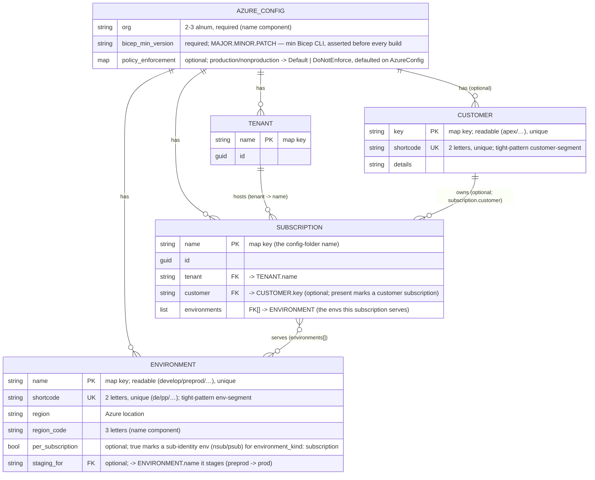
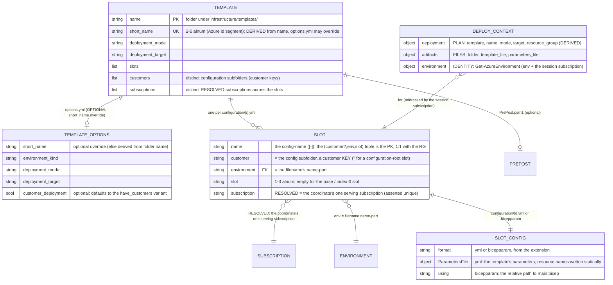

# ADR: Templating data model (azure.yml+infrastructure/**)

Pairs with [`naming-standard`](azure-naming-standard.md), which defines the resource-name components this model feeds.

## Rules: ADR-AZ-DATAMOD

### Rule ADR-AZ-DATAMOD-TWOCONFIGLAYERS

Two config layers — identity (`azure.yml`) and templating (`infrastructure/templates/`) — join through the conventional configuration tree:
a config at the configuration ROOT is a shared-platform deployment, a config under a `configuration/<customer>/` subfolder is that
customer's; the subscription is always RESOLVED from that coordinate, never spelled into a path, and there is no subscription-group entity.

- [Layer 1 — Identity (`azure.yml`)](#layer-1--identity)

### Rule ADR-AZ-DATAMOD-ONEFILEONESUBSCRIPTION

One config file ⟷ one (customer?, env, **slot**) ⟷ one subscription ⟷ one Azure resource group; every config lives at
`configuration/[<customer>/]<env>[-<slot>].yml` or `configuration/[<customer>/]<env>[-<slot>].bicepparam`, never both for one coordinate
(discovery fails on both, naming the coordinate), and listing that tree is the resource-group inventory.

- [Layer 2 — Templating (`infrastructure/templates/<name>/`)](#layer-2--templating)

### Rule ADR-AZ-DATAMOD-NAMEKEYEDMAPS

All named entities in `azure.yml` are maps keyed by name, so duplicate names are structurally impossible. A configuration subfolder is
always a customer KEY (customer.yml), and every config's coordinate must resolve to exactly ONE subscription id: a root config's env is
served by exactly one non-customer subscription; a customer config's env by exactly one of that customer's subscriptions. Asserted per file
at discovery and by integrity tests.

- [Layer 1 — Identity (`azure.yml`)](#layer-1--identity)
- [Layer 2 — Templating (`infrastructure/templates/<name>/`)](#layer-2--templating)

### Rule ADR-AZ-DATAMOD-CUSTOMERAXIS

Customer is a first-class configuration axis — the subfolder — and at deploy time it is derived from the session subscription
(`subscription.customer`), never a deploy arg: a customer-subscription session addresses the customer's subfolder config, a non-customer
session the root config, and the customer renders into resource names.

- [Layer 2 — Templating (`infrastructure/templates/<name>/`)](#layer-2--templating)

### Rule ADR-AZ-DATAMOD-DERIVEDRESOURCEGROUPNAME

The resource-group name is derived by `Get-BicepResourceGroupName`, never hand-typed; the name-component order is the `ado_naming` repo
variant (`Get-AdoNaming`).

- [The name builder](#the-name-builder)

### Rule ADR-AZ-DATAMOD-STATICRESOURCENAMES

Resource names for a template's own parameters are written statically in the per-slot config; the build passes them through unchanged (no
generation or validation).

- [Resource names](#resource-names)

### Rule ADR-AZ-DATAMOD-JOINSINPOWERSHELL

The cross-layer joins live in PowerShell, resolved on demand (`Get-AzureSubscription`, `Get-AzureEnvironment`,
`Get-BicepDeploymentContext`). The deploy-time subscription is determined by the az session — in a pipeline, exactly what the service
connection logged into — reverse-resolved against `azure.yml` (`Get-AzCliSessionSubscription`), and a pipeline deploy must still pin its
target explicitly: `-SubscriptionIdAssertIs <guid>` is MANDATORY in a pipeline (`Deploy-Bicep` throws without it) and optional on a devbox.
The assert is a guard, never a selector — a mismatch means a mis-wired service connection and fails loudly.

- [Runtime resolution (the joins)](#runtime-resolution-the-joins)

### Rule ADR-AZ-DATAMOD-SCHEMAANDINTEGRITY

Per-record shape is schema-validated; cross-record integrity is owned by the `AzureConfig` config type (including per-customer environment
disjointness — no two subscriptions of one customer serve the same env); the cross-layer link (a subfolder is a customer key; every config
coordinate resolves to exactly one subscription) is enforced at discovery by `Get-BicepTemplates` via the shared
`Get-BicepSubscriptionConfigViolations`, and over the shipped tree by integrity tests.

- [Validation](#validation)

### Rule ADR-AZ-DATAMOD-PARAMETERCONTRACT

Every parameters file a template build renders satisfies the parameter contract of the template's compiled `main.json`: each value has the
declared type, lies within its `@allowed` values and its value and length bounds, and names a declared parameter; every parameter without a
default is supplied, by the config or by the template's PrePost hook; and a `secureString`/`secureObject` parameter carries a well-formed
Key Vault reference, never a literal value. A template with a PrePost hook takes no `.bicepparam` slot, since the hook's input is the yml
descriptor; discovery refuses the pair, naming the template and the file.

- [Validation](#validation)

### Rule ADR-AZ-DATAMOD-VALUEBYADDRESS

A template config parameter may name its value by config address, `{ address: global.<config>.<key>… }`, instead of a literal `value` or a
Key Vault `reference`. The build resolves it through `Get-ConfigValue` into `{ value: <resolved> }`, in any template's yml slot; a
`.bicepparam` slot names no address, so shared config reaches a slot only through yml. An address reaches only version-controlled config, so
it never carries a secret; an address set together with `value` or `reference`, or one that does not resolve, fails the build, naming the
config file and the parameter.

- [Config-addressed parameters](#config-addressed-parameters)

### Rule ADR-AZ-DATAMOD-BICEPPARAMSLOT

A **bicepparam slot** is a slot config written in Bicep's own parameters format, `<env>[-<slot>].bicepparam`, in the `bicep` language beside
`main.bicep`. Its `using` names the template's `main.bicep` by relative path, asserted at discovery; it holds literals and
`az.getSecret(...)` only, never a config address; and its template has no PrePost hook. It is edited by hand:
`Set-BicepTemplateConfiguration` edits a yml slot only and throws on a bicepparam slot, naming the file.

- [Slot configs in two formats](#slot-configs-in-two-formats)

### Rule ADR-AZ-DATAMOD-ONEPATHTOPARAMETERS

Every slot reaches the deploy through one path. The build writes each slot as a `.bicepparam` in its output folder — a yml slot rendered by
`ConvertTo-BicepParam` after its addresses resolve and its PrePost hook runs, a bicepparam slot copied with its `using` pointed at the
template's `main.bicep` in the tree — and compiles it with `bicep build-params` to the `parameters.[<customer>.]<config>.json` the parameter
contract and `Deploy-Bicep` read. The render maps a `value` to a Bicep literal, a Key Vault `reference` to `az.getSecret(...)` parsed from
the vault id, and a resolved address to its literal.

- [Slot configs in two formats](#slot-configs-in-two-formats)

### Rule ADR-AZ-DATAMOD-POLICYENFORCEMENTMODE

`azure.yml` carries the repository's policy enforcement mode, `policy_enforcement: { production, nonproduction }` — one entry per
**environment class** — each `Default` or `DoNotEnforce`. The setting is optional; its sensible default,
`{ production: Default, nonproduction: DoNotEnforce }`, is declared once on `AzureConfig`, which fills every key the file omits and rejects
an unknown key or mode. Templates read it by config address.

- [Policy enforcement](#policy-enforcement)

### Rule ADR-AZ-DATAMOD-STAGINGSLOT

An environment may name the environment it stages, `staging_for: <environment>`: it is that environment's **staging slot**, inactive until
activated, inside the same subscriptions (`preprod` stages `prod`). `AzureConfig` rejects a `staging_for` that names no environment, that
involves a per-subscription environment, or whose staging environment is served by a subscription that does not serve its target.

- [Staging slots](#staging-slots)

## Context

`Catzc.Azure.Templates` is configured by **two layers**:

1. **Identity / topology**: its source of truth is `pwsh/Catzc.Azure/configs/azure.yml`, one declarative file; its entities are tenant,
   customer, environment and subscription.
2. **Templating / deployment**: its source of truth is the `infrastructure/templates/<name>/` filesystem, discovered; its entities are
   template, options, slot (per-RG config) and deploy context.

A third global asset, `configs/network.yml`, carries the cross-cutting IP plan (per-environment vnet / subnet ranges) alongside `azure.yml`.
It is a separate concern with its own schema and cross-asset integrity rules — see [`network-model`](azure-network-model.md). This ADR
covers identity (Layer 1) and templating (Layer 2); the network plan is documented there.

The two layers join through the **conventional configuration tree**: a config at the configuration ROOT (`configuration/<env>[-<slot>].yml`)
is a shared-platform deployment, and a config under a subfolder (`configuration/<customer>/<env>[-<slot>].yml`) is that customer's — the
subfolder is always a customer KEY from `customer.yml`. The subscription never appears in a path; it is RESOLVED from the coordinate: a root
config's env must be served by exactly one non-customer subscription, a customer config's env by exactly one of that customer's
subscriptions, and Layer 1 resolves that subscription to its tenant, its serving environments, and (optionally) its customer.

Governing principle:

> **Optimize for ease of configuration and codebase-as-source-of-truth.** A clear, visible mapping between the config and what ends up in
> Azure beats config that is normalized for the code's convenience. **Complex joins / resolution in PowerShell are acceptable.**

## Decision

### Layer 1 — Identity

`azure.yml`

All named entities are **maps keyed by name** (uniform access; duplicate names are structurally impossible). One global — `org` — supplies a
name component. The component _order_ is **not** here — it is the `ado_naming` repo variant, `Get-AdoNaming` (see
[The name builder](#the-name-builder)).

There is **no subscription-group entity**, and no subscription name ever appears in a template path. The configuration tree's two
conventional coordinates — the root (shared platform) and the customer subfolder — resolve to a subscription, so the subscription stays a
pure Layer-1 identity.



A subscription declares its **`tenant`**, the **`environments`** it serves, and — optionally — a **`customer`**, naming a customer defined
in `customer.yml` by its key OR its 2-char shortcode (see [`customer-model`](azure-customer-model.md)). The `customer` field is the single
signal that a subscription belongs to a customer: it makes the subscription a candidate for the customer's `configuration/<customer>/`
configs (and excludes it from root-config resolution), and the customer renders into the resource names of anything deployed there (see
[`naming-standard`](azure-naming-standard.md)).

A **customer** (defined in `customer.yml`) carries two stored identifiers, mirroring an environment: a readable **`key`** (the map key — the
customer-segment of _generous_ resource names) and a 2-char **`shortcode`** (unique, the customer-segment of _restricted_
`kv`/`storage`/`vm` names — so a readable key never costs a tight name a byte).

A subscription's `customer` is read through the single accessor `Get-AzureSubscriptionCustomer`, shared by `Get-AzureSubscription` (naming
resolution) and `Get-BicepConfigSubscriptionCandidates` (config-coordinate resolution) so the two cannot drift.

**Uniqueness is per coordinate, not global.** Different customers' subscriptions — and the shared platform's — may serve the same
environment (e.g. `shared_nonprod` and a customer's `apex_nonprod` both serve `dev`); the customer axis separates them. What must be unique
is the resolution within one coordinate: no two subscriptions of one customer serve the same env (`AzureConfig`, plus the normalized
integrity test), and a root config's env must be served by exactly one non-customer subscription (asserted per config file at discovery —
the "every file resolves to ONE subscription id" rule). Which subscription a deploy targets is the az session's — never an argument.

### Policy enforcement

`One repository-wide mode, defaulted on the type`

Whether the policies a template assigns are enforced or only audited is a property of the repository, not of one template: a stricter
repository enforces them everywhere, a looser one audits them outside production. `azure.yml` holds it once, as `policy_enforcement`, with
one key per environment class — `production` and `nonproduction` — each set to the Azure policy assignment's `enforcementMode`, `Default`
(enforce) or `DoNotEnforce` (audit only).

The setting resolves in the one fixed order of a configurable setting
([sensible-defaults](../automation/sensible-defaults.md#rule-adr-auto-default-oneresolutionorder)): the value in `azure.yml`, else the
sensible default `{ production: Default, nonproduction: DoNotEnforce }`. The default is declared once, on `AzureConfig`, so an omitted map,
a partial map, and a fresh checkout behave alike: the type fills each key the file omits, and every reader sees a complete map. An unknown
key or mode is rejected at load, with every other violation of the file, in one error. A template reads the mode by config address
(`global.azure.policy_enforcement.production`, see [Config-addressed parameters](#config-addressed-parameters)), so no template restates it
and changing it is one edit to `azure.yml`.

### Staging slots

`A staging environment names what it stages`

A release goes live in two moves: the exact artifact is first deployed to a production-grade environment that serves no traffic, then
activated there as production ([cd-discipline-and-promotion-flow](../flow/cd-discipline-and-promotion-flow.md)). That staging environment
lives in the production subscription, so it needs no subscription of its own, and the relation between the two is data: `staging_for` on the
staging environment names the one it stages. Whether the slot is active is a fact of the running deployment, changed by the cutover, so the
config states only which environment stages which. Keeping both environments in the same subscriptions means a staged release meets the same
identity, network and policy as the live one.

### Layer 2 — Templating

`infrastructure/templates/<name>/`

Deployable templates live in `infrastructure/templates/<name>/` (discovered by `Get-BicepTemplates`). Reusable bicep modules live in the
sibling `infrastructure/modules/` — referenced by templates via a relative `module` declaration and inlined by `az bicep build`; they are
**not** discovered as templates and carry no `options.yml` / `configuration/`.

**One config file ⟷ one (customer?, env, slot) ⟷ one subscription ⟷ one Azure resource group.** A config lives at the configuration ROOT —
`infrastructure/templates/<name>/configuration/<env>[-<slot>].yml`, the shared-platform deployment — or under a customer subfolder,
`configuration/<customer>/<env>[-<slot>].yml`, where the folder is always a customer KEY. The filename is `<env-name>[-<slot>]` —
`develop.yml` (the base / index-0 slot) or `develop-blue.yml` (a special slot), or the same name with `.bicepparam` for a bicepparam slot
(ADR-AZ-DATAMOD-BICEPPARAMSLOT). Discovery parses the filename by splitting on the first `-`: the `name` part must be a defined environment,
the remainder is the optional `slot` (≤3 alnum). The subscription is resolved per config from the coordinate and asserted unique
(ADR-AZ-DATAMOD-NAMEKEYEDMAPS).

**Customer is the one path dimension.** A config's customer is its subfolder ('' for a root config) — "is this a customer config?" is
answered by the path alone. Deploy/build name the env and slot as **distinct args** (`-Environment develop [-Slot blue]`); at deploy time
the customer comes from the session subscription (`subscription.customer`), so a customer-subscription session addresses the customer's
subfolder config and a non-customer session the root one. Listing a template's `configuration/` tree _is_ the inventory of its resource
groups.



- `short_name` (the globally-unique Azure id segment) is **derived** from the template folder name (first 5 `[a-z0-9]`, hyphens dropped) by
  `Catzc.Azure.Templates.BicepShortName`; `Get-BicepTemplates` resolves it and enforces uniqueness across all templates. `options.yml` is
  **optional** and, when present, may **override** `short_name` and/or declare `deployment_mode` / `deployment_target` / `environment_kind`
  / `customer_deployment` (strict schema, validated at discovery by `Read-BicepTemplateOptions`; see
  [`customer-model`](azure-customer-model.md)). It does **not** declare which subscriptions the template targets — that follows from its
  configuration coordinates. See [`naming-standard`](azure-naming-standard.md#rule-adr-az-naming-twotemplateidentifiers).
- `environment_kind` (`standard` | `subscription`, default `standard`) is the template's one classification bit: every config's env must
  match it — `subscription` ⇒ a `per_subscription` env (`nsub`/`psub`, deployed once per subscription), `standard` ⇒ an ordinary env
  (`dev`/`test`/…). Enforced per-config by `Get-BicepConfigClassViolations` (shared by discovery and `Assert-BicepTemplate`). The slot is
  NOT a template-level bit — a single template may freely **mix** a base `<env>.yml` and slotted `<env>-<slot>.yml` configs.
- The slot **metadata** is `{ name, environment, slot, subscription, customer }`, parsed from the path (`[<customer>/]<env>[-<slot>]`) by
  `Get-BicepTemplates`; `customer` is the subfolder and `subscription` is resolved from the coordinate
  (`Get-BicepConfigSubscriptionCandidates`, asserted unique). The slot's **config content** carries a `ParametersFile` of the template's
  parameters — including any resource names, written statically (see [Resource names](#resource-names)).

### The name builder

Every Azure name is assembled deterministically by `Get-AzureResourceName` from the component set — the env (its **name** for generous
patterns, its 2-char **shortcode** for the restricted `kv`/`storage`/`vm` patterns), `slot`, region_code, org, short_name, optional
**customer** (likewise its readable **key** for generous patterns, its 2-char **shortcode** for restricted) / `role`, and the resource type
— arranged by the **active order**, the `ado_naming` variant (`Get-AdoNaming`). The **customer that renders is derived from the resolved
subscription** (`subscription.customer`); the subscription itself is **never** a name component. `env` and `slot` are separate segments.
Per-type render pattern (separator + limit) comes from `Get-AzureNamePatternSet` via `Get-AzureResourceTypeSet`; the name is asserted
against the limit.

The **resource-group name** is derived from (env, slot, customer) by `Get-BicepResourceGroupName` (over the builder) and is the single
source for both the deploy target (`Get-BicepDeploymentContext`) and the tracking-tag scope (`Set-BicepTrackingTagSet`), so the two never
drift.

### Resource names

Resource names for a template's own parameters are written **statically** in
`infrastructure/templates/<name>/configuration/[<customer>/]<env>[-<slot>].yml` under `ParametersFile.parameters`. The build passes them
through unchanged — it does not generate or validate them. (Automated generation/validation of in-template names against the builder is
intentionally deferred; the resource-group name above is the only name the system derives.)

### Config-addressed parameters

`A parameter that names its value by config address`

A parameter in `ParametersFile.parameters` takes one of three forms: a literal `value`, an ARM Key Vault `reference`, or a config address.
The address form names a node of a version-controlled config instead of copying its value:

```yaml
ParametersFile:
  parameters:
    enforcementMode:
      address: global.azure.policy_enforcement.production
```

`Build-Bicep` resolves every address through `Get-ConfigValue` before the PrePost hook runs and renders it as `{ "value": <resolved> }`, so
the hook, the parameters file, and the parameter contract (ADR-AZ-DATAMOD-PARAMETERCONTRACT) see only ARM entries. The resolution is
generic: it serves any template and any config, with no per-template code, which is why a repository-wide value needs no PrePost hook to
reach a template. A config value keeps one owner, and every template that needs it reads it there rather than holding a copy that drifts.

An address reaches only committed config, so nothing it names is a secret; a secure parameter takes a Key Vault `reference`, and the
parameter contract rejects any literal for it, addressed or not. The build fails fast, with every violation of a config file in one error
that names the file and each parameter: an `address` set together with `value`, `reference`, or any other key, an address that is not a
string, and an address that does not resolve — an unknown config, a missing key, or a malformed address.

### Slot configs in two formats

`A slot config is yml or bicepparam, and both reach the deploy one way`

A slot config is written in one of two formats, chosen by what it needs. yml is the format for a slot that needs a config address or a
template's PrePost hook, since Bicep's parameters format has no form for either. A `.bicepparam` slot suits a slot of literals and secrets
only: the Bicep compiler checks it against `main.bicep` while it is written, in the editor through the Bicep extension, so a wrong name,
type or `@allowed` value shows up before the build.

The build keeps one path to the deploy for both formats. Every slot becomes a `.bicepparam` in the build output, and `bicep build-params`
compiles it to the ARM parameters JSON the parameter contract and `Deploy-Bicep` read, so nothing downstream of the build depends on the
source format. A Key Vault `reference` and `az.getSecret(...)` compile to the same ARM reference, so the contract's secure-parameter check
holds for both.

### Runtime resolution (the joins)

The config is resolved into runtime objects on demand — where the "complex joins in PowerShell" deliberately live:

- **The deploy target is the az session's subscription.** `Get-AzCliSessionSubscription` (in `Catzc.Azure.Cli`) reverse-resolves the
  session's subscription GUID — in a pipeline, exactly what the service connection logged into — to its declared `azure.yml` identity
  (`{ name, id, customer, tenant }`), throwing when the session targets an undeclared subscription. The session's `customer` picks the slot:
  the customer's `configuration/<customer>/` config, or the configuration-root one. The **`-SubscriptionIdAssertIs <guid>`** guard pins the
  expectation — mandatory in a pipeline (`Deploy-Bicep` throws without it), so a re-wired service connection can never silently retarget an
  existing pipeline's deploy; on a devbox `Connect-AzCli` / `az account set` chooses the target and the guard is optional.
- `Get-AzureSubscription <sub>` → `{ name, id, customer?, tenant: { name, id } }` — a by-name lookup (no join), with the tenant rebuilt from
  the map key.
- `Get-AzureEnvironment <env> -Subscription <sub>` → `{ name, shortcode, region, region_code, subscription }`; asserts the subscription
  serves the env and embeds `Get-AzureSubscription <sub>` — the check that a session cannot deploy an env its subscription does not serve.
- `Get-AzureSubscriptionEnvironment <sub>` → the subscription's per-subscription identity env (nsub/psub), for templates that must locate
  the once-per-subscription foundation in the same sub.
- `Get-BicepDeploymentContext` → three concern-objects: **plan** (`deployment`), **artifacts**, and **identity** (`environment`) — composed
  from the session-determined subscription; the customer that renders into names is read off it.

### Derived accessors

Thin read-only lookups and argument-completers over the two layers (no joins of their own); listed here so the public surface is complete:

| Function                          | Returns / purpose                                                              |
| --------------------------------- | ------------------------------------------------------------------------------ |
| `Get-AzureCustomers`              | the customer keys from `customer.yml`                                          |
| `Get-AzureBicepEnvironmentKinds`  | the allowed `environment_kind` values (`standard`, `subscription`)             |
| `Get-AzureBicepDeploymentModes`   | the allowed `deployment_mode` values for `options.yml` validation              |
| `Get-AzureBicepDeploymentTargets` | the allowed `deployment_target` values for `options.yml` validation            |
| `Get-AzureBicepMinVersion`        | `bicep_min_version` from `azure.yml` (asserted by `Assert-AzCliBicep`)         |
| `Get-BicepTemplateCustomers`      | the distinct customers (configuration subfolders) a template ships (completer) |
| `Get-BicepTemplateSlots`          | each slot a template declares (completer)                                      |

### Validation

- **Per-record shape** (identifiers, GUIDs, enums, formats) is schema-expressible.
- **Cross-record integrity** (FKs, env name/shortcode uniqueness, ≤1 per-subscription env per subscription, per-customer environment
  disjointness by raw token) and the `policy_enforcement` keys and modes are owned by the `AzureConfig` config type, checked at load; the
  `customer` reference into `customer.yml`, the normalized (key-vs-shortcode) per-customer grouping, and the non-customer set's disjointness
  are shipped-asset integrity tests (see [`customer-model`](azure-customer-model.md#rule-adr-az-customer-referencenotvalidatedonload)).
- The **cross-layer** link is enforced at **discovery** (`Get-BicepTemplates`) and collected by `Assert-BicepTemplate`, sharing the
  per-config rule `Get-BicepSubscriptionConfigViolations`: a configuration subfolder is a **defined customer key**, and every config's
  (customer?, env) coordinate resolves to **exactly one subscription id** (`Get-BicepConfigSubscriptionCandidates`).
- The **parameter contract** (ADR-AZ-DATAMOD-PARAMETERCONTRACT) is checked against the compiler's view, not the source text.
  `Get-BicepParameterModel` reads the parameters a template's compiled `main.json` declares — type, default, `@allowed` values, value and
  length bounds — and `Get-BicepParameterViolations` checks every rendered `parameters.[<customer>.]<config>.json` against it, so a value
  the PrePost hook merges in is checked like one the config carries. `Assert-BicepTemplate -Build` reports the violations, and an L2
  integrity test (`Get-BicepParameterModel.Shipped.Tests.ps1`) builds every shipped template and asserts there are none;
  `Test-Automation -Suite infrastructure` runs it, as part of the `infrastructure` globset's verify scope. `Assert-BicepTemplate` without
  `-Build` keeps a fast check that needs no compiler: a config sets only parameters `main.bicep` declares.

## Consequences

- At-a-glance source-of-truth ⟷ Azure mapping: one config file = one resource group; the `configuration/` tree is the RG inventory — the
  root is the shared platform, each subfolder a customer.
- The resource-group name is **derived**, not hand-typed. The name-component **order** is the `ado_naming` repo variant (`Get-AdoNaming`);
  changing it re-spells every derived name.
- Maps keyed by name make duplicate tenant/subscription names structurally impossible.
- No subscription name appears in any path, pipeline, or deploy call — the subscription is a resolved value, and the deploy target follows
  the session (the service connection), pinned by the explicit `-SubscriptionIdAssertIs` guard in pipelines.
- **Customer** is the one path dimension (the subfolder = the customer key) and, at deploy time, a fact of the session subscription
  (`subscription.customer`) — never a deploy arg. It both marks a customer deployment and renders into the names. Like an environment, a
  customer carries a readable **`key`** + a 2-char **`shortcode`** so it stays readable in generous names and cheap (2 bytes) in tight ones.
- Build artifacts mirror the configuration tree (`parameters.[<customer>.]<config>.json`) — uniform and structurally collision-free in the
  shared build folder, with no validation guard to remember.
- Each environment maps to one region; multi-region-per-environment is out of scope (see [`naming-standard`](azure-naming-standard.md)).
  Each env carries a readable, unique **`name`** (the deploy/config handle + relaxed env-segment) and a 2-char **`shortcode`** (the
  restricted env-segment).
- The cost is that a second non-customer platform cannot ship template configs — the configuration root belongs to ONE shared platform
  (every root config must resolve to exactly one non-customer subscription per env). That is the deliberate trade: the conventional tree
  stays two-coordinate (root or customer), with no third naming axis to invent.
