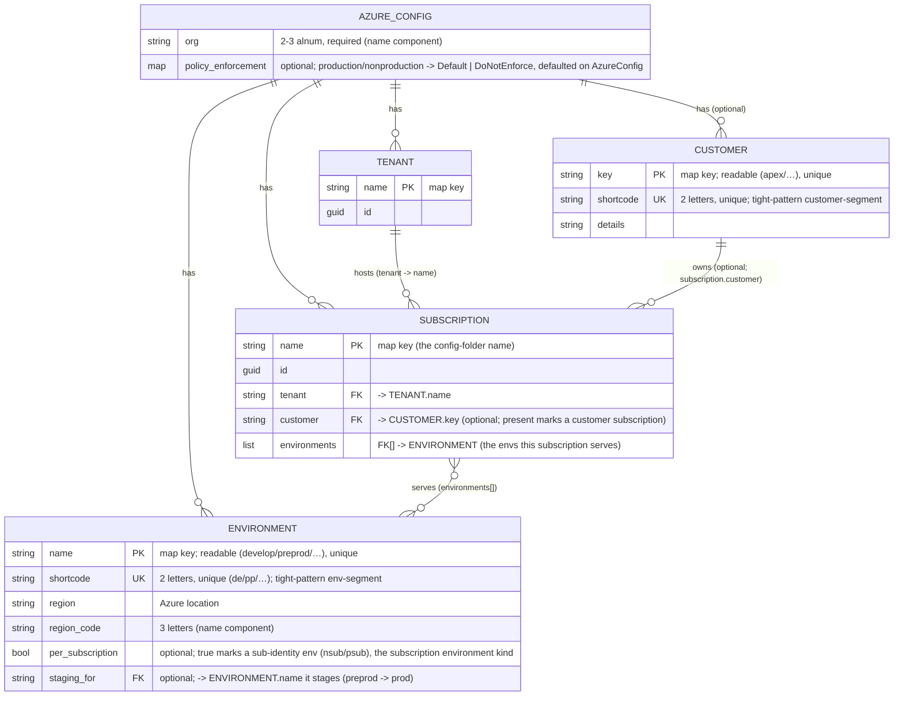
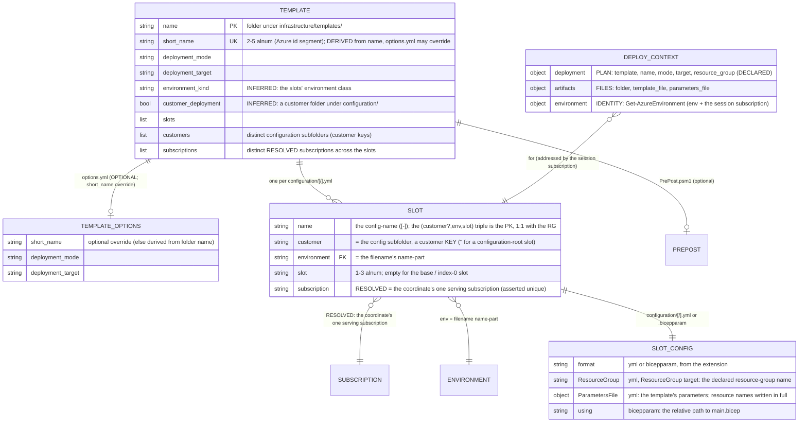

# Azure: Templating data model (azure.yml+infrastructure/**)

Pairs with [`naming-standard`](azure-naming-standard.md), which defines the resource-name components this model feeds.

## Rules: ADR-AZ-DATAMOD

### Rule ADR-AZ-DATAMOD-TWOCONFIGLAYERS

Two config layers — identity (`azure.yml`) and templating (`infrastructure/templates/`) — join through the conventional configuration tree:
a config at the configuration ROOT is a shared-platform deployment, a config under a `configuration/<customer>/` subfolder is that
customer's; the subscription is always RESOLVED from that coordinate, never spelled into a path, and there is no subscription-group entity.

- [Layer 1 — Identity (`azure.yml`)](#layer-1--identity)

### Rule ADR-AZ-DATAMOD-ONEFILEONESUBSCRIPTION

One config file ⟷ one (customer?, env, **slot**) ⟷ one Azure resource group, in the one subscription its coordinate resolves to
(ADR-AZ-DATAMOD-NAMEKEYEDMAPS); every config lives at `configuration/[<customer>/]<env>[-<slot>].yml` or
`configuration/[<customer>/]<env>[-<slot>].bicepparam`; a `<slot>.yml` beside a `<slot>.bicepparam` may hold only `ResourceGroup:` and is
not a slot, and listing that tree is the resource-group inventory.

- [Layer 2 — Templating (`infrastructure/templates/<name>/`)](#layer-2--templating)

### Rule ADR-AZ-DATAMOD-EPHEMERALSLOT

A named slot of a base coordinate needs no file: an **ephemeral slot** deploys its base slot's config under a runtime slot segment, so every
name it derives carries the segment and nothing else differs. It exists for one run (`Build-Bicep -RuntimeSlots <env>-<slot>`, or a
pipeline's own deploy-target list through `-RuntimeSlotsJson`) and is listed nowhere else; a blue/green copy (`dev-blu`) and the L3 test
slot (`l3`) are ephemeral. The resource group it leaves is one no config derives, so `Test-BicepOrphans` reports it until it is removed.

- [Layer 2 — Templating (`infrastructure/templates/<name>/`)](#layer-2--templating)

### Rule ADR-AZ-DATAMOD-NAMEKEYEDMAPS

All named entities in `azure.yml` are maps keyed by name, so duplicate names are structurally impossible. A configuration subfolder is
always a customer KEY (customer.yml), and every config's coordinate must resolve to exactly ONE subscription id: a root config's env is
served by exactly one non-customer subscription; a customer config's env by exactly one of that customer's subscriptions. Asserted per file
at discovery and by integrity tests.

- [Layer 1 — Identity (`azure.yml`)](#layer-1--identity)
- [Layer 2 — Templating (`infrastructure/templates/<name>/`)](#layer-2--templating)

### Rule ADR-AZ-DATAMOD-CUSTOMERAXIS

Customer is a first-class configuration axis — the subfolder — and at deploy time it is derived from the session subscription
(`subscription.customer`), never a deploy arg: a customer-subscription session addresses the customer's subfolder config, a non-customer
session the root config, and the customer renders into resource names. The session's subscription is resolved by the joins of
ADR-AZ-DATAMOD-JOINSINPOWERSHELL.

- [Layer 2 — Templating (`infrastructure/templates/<name>/`)](#layer-2--templating)

### Rule ADR-AZ-DATAMOD-DECLAREDGROUPNAME

A ResourceGroup-target slot declares its resource group in its top-level `ResourceGroup: <name>` key, matched against the canonical form
like every other name ([ADR-AZ-NAMING-DETERMINISTICNAMES](azure-naming-standard.md#rule-adr-az-naming-deterministicnames)); the declared
name is the deploy target and the tracking-tag scope alike. A Subscription-target slot carries no `ResourceGroup:` key, and one that creates
its resource group declares it as an ordinary `*Name` parameter.

- [The name builder](#the-name-builder)

### Rule ADR-AZ-DATAMOD-STATICRESOURCENAMES

Resource names for a template's parameters, its own and those owned by another template, are written statically and in full in the per-slot
config and matched against the canonical form by the name gate; the build passes them through unchanged.

- [Resource names](#resource-names)

### Rule ADR-AZ-DATAMOD-VALUEBYFACT

A template config parameter may name its value by a fact the build derives for the slot, `{ fact: <field> }`, a sibling of the address form
(ADR-AZ-DATAMOD-VALUEBYADDRESS). A fact is a field computed from `azure.yml` and the slot's coordinate that no config address holds:
`policy_enforcement`, `subscription_production`, `production`, `groups`, `module_resource_types` and the environment fields. The build
resolves it into `{ value: <resolved> }`; an unknown field, or a fact set together with `value`, `reference` or `address`, fails the build,
naming the config file and the parameter.

- [Config-addressed parameters](#config-addressed-parameters)

### Rule ADR-AZ-DATAMOD-JOINSINPOWERSHELL

The cross-layer joins live in PowerShell, resolved on demand (`Get-AzureSubscription`, `Get-AzureEnvironment`,
`Get-BicepDeploymentContext`). The deploy-time subscription is determined by the az session — in a pipeline, exactly what the service
connection logged into — reverse-resolved against `azure.yml` (`Get-AzCliSessionSubscription`), and a pipeline deploy must still pin its
target explicitly: `-SubscriptionIdAssertIs <guid>` is MANDATORY in a pipeline (`Deploy-Bicep` throws without it) and optional on a devbox.
The assert is a guard, never a selector — a mismatch means a mis-wired service connection and fails loudly.

- [Runtime resolution (the joins)](#runtime-resolution-the-joins)

### Rule ADR-AZ-DATAMOD-SCHEMAANDINTEGRITY

Per-record shape is schema-validated; cross-record integrity is owned by the `AzureConfig` config type (including per-customer environment
disjointness — no two subscriptions of one customer serve the same env); the cross-layer link (a subfolder is a customer key; every config
coordinate resolves to exactly one subscription) is enforced at discovery by `Get-BicepTemplates` via the shared
`Get-BicepSubscriptionConfigViolations`, and over the shipped tree by integrity tests.

- [Validation](#validation)

### Rule ADR-AZ-DATAMOD-PARAMETERCONTRACT

Every parameters file a template build renders satisfies the parameter contract of the template's compiled `main.json`: each value has the
declared type, lies within its `@allowed` values and its value and length bounds, and names a declared parameter; every parameter without a
default is supplied, by the config or by the template's PrePost hook; and a `secureString`/`secureObject` parameter carries a well-formed
Key Vault reference, never a literal value. A value kept out of the repository that is not a secret, such as an alert's email recipients,
takes the same one deploy-time path: a `@secure()` parameter without a default whose every slot carries a Key Vault reference to
`foundation`'s vault, seeded at deploy time, so the repository holds the reference and never the value. A template with a PrePost hook takes
no `.bicepparam` slot, since the hook's input is the yml descriptor; discovery refuses the pair, naming the template and the file.

- [Validation](#validation)

### Rule ADR-AZ-DATAMOD-VALUEBYADDRESS

A template config parameter may name its value by config address, `{ address: global.<config>.<key>… }`, instead of a literal `value` or a
Key Vault `reference`. The build resolves it through `Get-ConfigValue` into `{ value: <resolved> }`, in any template's yml slot; a
`.bicepparam` slot names no address, so shared config reaches a slot only through yml. An address reaches only version-controlled config, so
it never carries a secret; an address set together with `value` or `reference`, or one that does not resolve, fails the build, naming the
config file and the parameter.

- [Config-addressed parameters](#config-addressed-parameters)

### Rule ADR-AZ-DATAMOD-BICEPPARAMSLOT

A **bicepparam slot** is a slot config written in Bicep's own parameters format, `<env>[-<slot>].bicepparam`, in the `bicep` language beside
`main.bicep`. Its `using` names the template's `main.bicep` by relative path, asserted at discovery; it holds literals and
`az.getSecret(...)` only, never a config address; and its template has no PrePost hook. It is edited by hand:
`Set-BicepTemplateConfiguration` edits a yml slot only and throws on a bicepparam slot, naming the file.

- [Slot configs in two formats](#slot-configs-in-two-formats)

### Rule ADR-AZ-DATAMOD-ONEPATHTOPARAMETERS

Every slot reaches the deploy through one path. The build writes each slot as a `.bicepparam` in its output folder — a yml slot rendered by
`ConvertTo-BicepParam` after its addresses resolve and its PrePost hook runs, a bicepparam slot copied with its `using` pointed at the
template's `main.bicep` in the tree — and compiles it with `bicep build-params` to the `parameters.[<customer>.]<config>.json` the parameter
contract and `Deploy-Bicep` read. The render maps a `value` to a Bicep literal, a Key Vault `reference` to `az.getSecret(...)` parsed from
the vault id, and a resolved address to its literal.

- [Slot configs in two formats](#slot-configs-in-two-formats)

### Rule ADR-AZ-DATAMOD-POLICYENFORCEMENTMODE

`azure.yml` carries the repository's policy enforcement mode, `policy_enforcement: { production, nonproduction }` — one entry per
**environment class** — each `Default` or `DoNotEnforce`. The setting is optional; its sensible default,
`{ production: Default, nonproduction: DoNotEnforce }`, is declared once on `AzureConfig`, which fills every key the file omits and rejects
an unknown key or mode. Templates read it by config address.

- [Policy enforcement](#policy-enforcement)

### Rule ADR-AZ-DATAMOD-STAGINGSLOT

An environment may name the environment it stages, `staging_for: <environment>`: it is that environment's **staging slot**, inactive until
activated, inside the same subscriptions (`preprod` stages `prod`). `AzureConfig` rejects a `staging_for` that names no environment, that
involves a per-subscription environment, or whose staging environment is served by a subscription that does not serve its target.

- [Staging slots](#staging-slots)

### Rule ADR-AZ-DATAMOD-ONETENANT

The repository works in one Entra tenant: `azure.yml` declares it, every subscription names it, every customer lives in it as a pair of
subscriptions, and every deploy proves the session's subscription against the declaration. Billing structure (Enterprise Agreement,
Microsoft Customer Agreement, partner offers), tenant administration (custom names, sign-on, Global Administrators, PIM, Conditional
Access), and cross-tenant tooling (Lighthouse, B2B) sit above the repository and are not its to set.

- [One tenant](#one-tenant)

### Rule ADR-AZ-DATAMOD-SUBSCRIPTIONUNIT

The subscription is the unit of management, and `azure.yml` is its model: one landing zone, one workspace, one Key Vault, one budget, and
its own service connections, one per deployment identity (**subscription vending** is a pull request, not a creation), grouped by customer
and environment class and never under management groups. Production and non-production are separated by subscription, every environment
deploys to one region, and a resource group never mixes regions.

- [The subscription as the unit](#the-subscription-as-the-unit)

### Rule ADR-AZ-DATAMOD-ORPHANSNEEDRESOLVEDNAMES

A resource that a slot's resource group holds and its compiled template no longer declares is removed after the deploy, never by a
`Complete` mode. The comparison covers only what `az resource list` returns: an extension resource (one with a `scope`, such as a role
assignment, a lock or a diagnostic setting) and a child proxy (a child resource without a `location`) are left out, and a resource Azure
creates itself, declared in `orphan-removal.yml`, is skipped. The removal deletes only when every listable resource of the template has a
name that resolves offline, and otherwise deletes nothing, lists the candidates and fails, naming the unresolved resources. `-DryRun` lists
only.

- [Orphan removal](#orphan-removal)

## Context

`Catzc.Azure.Templates` is configured by **two layers**:

1. **Identity / topology**: its source of truth is `pwsh/Azure/configs/azure.yml`, one declarative file; its entities are tenant, customer,
   environment and subscription.
2. **Templating / deployment**: its source of truth is the `infrastructure/templates/<name>/` filesystem, discovered; its entities are
   template, options, slot (per-RG config) and deploy context.

A third global asset, `configs/network.yml`, carries the cross-cutting IP plan (per-environment vnet / subnet ranges) alongside `azure.yml`.
It is a separate concern with its own schema and cross-asset integrity rules — see [`network-model`](azure-network-model.md). This record
covers identity (Layer 1) and templating (Layer 2); the network plan is documented there.

The two layers join through the **conventional configuration tree** (ADR-AZ-DATAMOD-TWOCONFIGLAYERS): the configuration root is the shared
platform, a subfolder is a customer, and Layer 1 resolves each coordinate's one subscription to its tenant, environments, and customer.

Governing principle:

> **Optimize for ease of configuration and codebase-as-source-of-truth.** A clear, visible mapping between the config and what ends up in
> Azure beats config that is normalized for the code's convenience. **Complex joins / resolution in PowerShell are acceptable.**

## Decision

### Layer 1 — Identity

`azure.yml`

All named entities are **maps keyed by name** (uniform access; duplicate names are structurally impossible). One global — `org` — supplies a
name component. The component _order_ is **not** here — it is the `naming` repo variant, `Get-Naming` (see
[The name builder](#the-name-builder)).

There is **no subscription-group entity**, and no subscription name appears in a template path, so the subscription stays a pure Layer-1
identity.



A subscription declares its **`tenant`**, the **`environments`** it serves, and — optionally — a **`customer`**, naming a customer defined
in `customer.yml` by its key OR its 2-char shortcode (see [`customer-model`](azure-customer-model.md)). The `customer` field is the single
signal that a subscription belongs to a customer: it makes the subscription a candidate for the customer's `configuration/<customer>/`
configs (and excludes it from root-config resolution), and the customer renders into the resource names of anything deployed there (see
[`naming-standard`](azure-naming-standard.md)).

A **customer** (defined in `customer.yml`) carries two stored identifiers, mirroring an environment: a readable **`key`** (the map key — the
customer-segment of _generous_ resource names) and a 2-char **`shortcode`** (unique, the customer-segment of _restricted_
`kv`/`storage`/`vm` names — so a readable key never costs a tight name a byte).

A subscription's `customer` is read through the single accessor `Get-AzureSubscriptionCustomer`, shared by `Get-AzureSubscription` (naming
resolution) and `Get-BicepConfigSubscriptionCandidates` (config-coordinate resolution) so the two cannot drift.

**Uniqueness is per coordinate, not global.** Different customers' subscriptions — and the shared platform's — may serve the same
environment (e.g. `shared_nonprod` and a customer's `apex_nonprod` both serve `dev`); the customer axis separates them. What must be unique
is the resolution within one coordinate: no two subscriptions of one customer serve the same env (`AzureConfig`, plus the normalized
integrity test), and a root config's env must be served by exactly one non-customer subscription (asserted per config file at discovery —
the "every file resolves to ONE subscription id" rule). Which subscription a deploy targets is the az session's — never an argument.

### Policy enforcement

`One repository-wide mode, defaulted on the type`

Whether the policies a template assigns are enforced or only audited is a property of the repository, not of one template: a stricter
repository enforces them everywhere, a looser one audits them outside production. `azure.yml` holds it once, as `policy_enforcement`, with
one key per environment class — `production` and `nonproduction` — each set to the Azure policy assignment's `enforcementMode`, `Default`
(enforce) or `DoNotEnforce` (audit only).

The setting resolves in the one fixed order of a configurable setting
([sensible-defaults](../automation/sensible-defaults.md#rule-adr-auto-default-oneresolutionorder)): the value in `azure.yml`, else the
sensible default `{ production: Default, nonproduction: DoNotEnforce }`. The default is declared once, on `AzureConfig`, so an omitted map,
a partial map, and a fresh checkout behave alike: the type fills each key the file omits, and every reader sees a complete map. An unknown
key or mode is rejected at load, with every other violation of the file, in one error. A template takes the mode as a fact the build derives
(the slot value `{ fact: policy_enforcement }`, ADR-AZ-DATAMOD-VALUEBYFACT): the subscription a slot targets is production when it holds a
production environment, so no slot names the class, no template restates the mode, and changing it is one edit to `azure.yml`.

### The subscription as the unit

`azure.yml` is the subscription model: it maps the standard environments onto a non-production and a production subscription per customer
and for the shared platform, and a new subscription is a pull request that adds its entry. The landing zone owns the rest of the decision,
the absence of management groups, how a subscription is cut and vended, and the one region
([The subscription as the unit](landing-zones.md#the-subscription-as-the-unit)).

### One tenant

`azure.yml` holds the tenants as a map keyed by name, and the shipped file declares exactly one, `placeholder`, whose id is a minted GUID
registered in `guids.yml` as `tenant_placeholder`. Every subscription names it in its `tenant` field and `AzureConfig` rejects a
subscription whose tenant is not declared; `ado.yml` names the same tenant as the directory behind the DevOps organisation. The model could
hold more tenants, and a second would need only a second `tenants` entry and the service connections of its subscriptions.

How a deploy proves its subscription, and why it compares the subscription and not the tenant, is the session record's
([One tenant at deploy](az-session-verification.md#one-tenant-at-deploy)); how a customer is isolated inside the one tenant is the customer
record's ([A customer in the one tenant](azure-customer-model.md#a-customer-in-the-one-tenant)); and what above the subscription the
repository leaves to the tenant's administrators is the landing zone's ([Above the subscription](landing-zones.md#above-the-subscription)).

### Staging slots

`A staging environment names what it stages`

A release goes live in two moves: the exact artifact is first deployed to a production-grade environment that serves no traffic, then
activated there as production ([cd-discipline-and-promotion-flow](../flow/cd-discipline-and-promotion-flow.md)). That staging environment
lives in the production subscription, so it needs no subscription of its own, and the relation between the two is data: `staging_for` on the
staging environment names the one it stages. Whether the slot is active is a fact of the running deployment, changed by the cutover, so the
config states only which environment stages which. Keeping both environments in the same subscriptions means a staged release meets the same
identity, network and policy as the live one.

### Layer 2 — Templating

`infrastructure/templates/<name>/`

Deployable templates live in `infrastructure/templates/<name>/` (discovered by `Get-BicepTemplates`). Reusable bicep modules live in the
sibling `infrastructure/modules/` — referenced by templates via a relative `module` declaration and inlined by `bicep build`; they are
**not** discovered as templates and carry no `options.yml` / `configuration/`.

**One config file ⟷ one (customer?, env, slot) ⟷ one subscription ⟷ one Azure resource group.** A config lives at the configuration ROOT —
`infrastructure/templates/<name>/configuration/<env>[-<slot>].yml`, the shared-platform deployment — or under a customer subfolder,
`configuration/<customer>/<env>[-<slot>].yml`, where the folder is always a customer KEY. The filename is `<env-name>[-<slot>]` —
`develop.yml` (the base / index-0 slot) or `develop-blue.yml` (a special slot), or the same name with `.bicepparam` for a bicepparam slot
(ADR-AZ-DATAMOD-BICEPPARAMSLOT). Discovery parses the filename by splitting on the first `-`: the `name` part must be a defined environment,
the remainder is the optional `slot` (≤3 alnum). The subscription is resolved per config from the coordinate and asserted unique
(ADR-AZ-DATAMOD-NAMEKEYEDMAPS).

**Customer is the one path dimension.** A config's customer is its subfolder ('' for a root config) — "is this a customer config?" is
answered by the path alone. Deploy/build name the env and slot as **distinct args** (`-Environment develop [-Slot blue]`); at deploy time
the customer comes from the session subscription (`subscription.customer`), so a customer-subscription session addresses the customer's
subfolder config and a non-customer session the root one. Listing a template's `configuration/` tree _is_ the inventory of its resource
groups.



- `short_name` (the globally-unique Azure id segment) is **derived** from the template folder name (first 5 `[a-z0-9]`, hyphens dropped) by
  `Catzc.Azure.Templates.BicepShortName`; `Get-BicepTemplates` resolves it and enforces uniqueness across all templates. `options.yml` is
  **optional** and, when present, holds only `short_name`, `deployment_mode` and `deployment_target` (strict schema, validated at discovery
  by `Read-BicepTemplateOptions`). It declares no name, fact or address — those live in the slot configs
  ([ADR-AZ-DATAMOD-STATICRESOURCENAMES](#rule-adr-az-datamod-staticresourcenames)) — and not which subscriptions the template targets, which
  follows from its configuration coordinates. See [`naming-standard`](azure-naming-standard.md#rule-adr-az-naming-twotemplateidentifiers).
- `environment_kind` (`standard` | `subscription`) is the template's one classification, **inferred** from its slots' environment class
  (`per_subscription` in `azure.yml`): `subscription` when every slot's env is a `per_subscription` env (`nsub`/`psub`, deployed once per
  subscription), `standard` when every slot's env is an ordinary one (`dev`/`test`/…). A template whose slots mix the two classes is a
  violation, raised by `Get-BicepConfigClassViolations` (shared by discovery and `Assert-BicepTemplate`). The slot is NOT a template-level
  bit — a single template may freely **mix** a base `<env>.yml` and slotted `<env>-<slot>.yml` configs.
- `customer_deployment` is **inferred** from the configuration tree: true when the template has a customer folder under `configuration/`
  (see [`customer-model`](azure-customer-model.md#rule-adr-az-customer-templatefromfolder)).
- The slot **metadata** is `{ name, environment, slot, subscription, customer }`, parsed from the path (`[<customer>/]<env>[-<slot>]`) by
  `Get-BicepTemplates`; `customer` is the subfolder and `subscription` is resolved from the coordinate
  (`Get-BicepConfigSubscriptionCandidates`, asserted unique). The slot's **config content** carries a `ParametersFile` of the template's
  parameters — including any resource names, written statically (see [Resource names](#resource-names)).

### The name builder

Every Azure name is assembled deterministically by `Get-AzureResourceName` from the component set — the env (its **name** for generous
patterns, its 2-char **shortcode** for the restricted `kv`/`storage`/`vm` patterns), `slot`, region_code, org, short_name, optional
**customer** (likewise its readable **key** for generous patterns, its 2-char **shortcode** for restricted) / `role`, and the resource type
— arranged by the **active order**, the `naming` variant (`Get-Naming`). The **customer that renders is derived from the resolved
subscription** (`subscription.customer`); the subscription itself is **never** a name component. `env` and `slot` are separate segments.
Per-type render pattern (separator + limit) comes from `resource-types.yml`, through `Get-AzureNamePatternSet` and
`Get-AzureResourceTypeSet`; the name is asserted against the limit. The builder is the one renderer: the name gate matches every declared
name through it, and an ephemeral slot re-renders its template's own names through it
([ADR-AZ-NAMING-DETERMINISTICNAMES](azure-naming-standard.md#rule-adr-az-naming-deterministicnames)).

The **resource-group name** of a ResourceGroup-target slot is its declared `ResourceGroup:` key, matched like every name, and is the single
source for both the deploy target (`Get-BicepDeploymentContext`) and the tracking-tag scope (`Set-BicepTrackingTagSet`), so the two never
drift.

### Resource names

Resource names are written **statically and in full** in `infrastructure/templates/<name>/configuration/[<customer>/]<env>[-<slot>].yml`
under `ParametersFile.parameters`, a name owned by another template included, so the slot file shows every name it deploys. The build passes
them through unchanged, and the name gate `Test-BicepResourceNames` matches each against the canonical form (see
[Declared names, matched](azure-naming-standard.md#declared-names-matched)); a parameter that keeps a name off the form carries a
`naming_exception` entry ([ADR-AZ-NAMING-EXCEPTIONENTRY](azure-naming-standard.md#rule-adr-az-naming-exceptionentry)). An ephemeral slot is
the one place the build computes a name: it re-renders the base slot's own names with the runtime slot.

### Orphan removal

Every template deploys `Incremental`, so a resource a reverted change takes out of a template stays in its slot's resource group.
`Remove-BicepOrphanResources` compares the group's resources with the compiled template's resources, evaluated offline with the slot's
parameter values, and deletes each one no evaluated resource names. Only the resources `az resource list` can return take part: the listing
never holds an extension resource, which a `scope` attaches to another resource (role assignments, locks, diagnostic settings), nor a child
proxy, a child resource without a `location` that lives inside its parent (a storage account's `blobServices`), so the template's own
resources of those kinds are left out of the comparison. A child Azure creates with its parent, such as a SQL server's `master` database, is
listed but declared by no template; `orphan-removal.yml` names each such type and name, and the command skips them. The comparison is by
name, and a name the evaluator cannot resolve (`format()`, `resourceId()` and the other functions outside its subset) could stand for any
listed resource, so one unresolved name on a listable resource makes every deletion unsafe: the command then deletes nothing, lists the
candidates and fails, naming the unresolved resources. `-DryRun` lists only. The DEPLOY pipelines run it after each resource-group deploy on
the production and rollback paths, the listing first.

### Config-addressed parameters

`A parameter that names its value by config address`

A parameter in `ParametersFile.parameters` takes one of four forms: a literal `value`, an ARM Key Vault `reference`, a config address, or a
derived fact. The address form names a node of a version-controlled config instead of copying its value:

```yaml
ParametersFile:
  parameters:
    enforcementMode:
      address: global.azure.policy_enforcement.production
```

`Build-Bicep` resolves every address through `Get-ConfigValue` before the PrePost hook runs and renders it as `{ "value": <resolved> }`, so
the hook, the parameters file, and the parameter contract (ADR-AZ-DATAMOD-PARAMETERCONTRACT) see only ARM entries. The resolution is
generic: it serves any template and any config, with no per-template code, which is why a repository-wide value needs no PrePost hook to
reach a template. A config value keeps one owner, and every template that needs it reads it there rather than holding a copy that drifts.

An address reaches only committed config, so nothing it names is a secret; a secure parameter takes a Key Vault `reference`, and the
parameter contract rejects any literal for it, addressed or not. The build fails fast, with every violation of a config file in one error
that names the file and each parameter: an `address` set together with `value`, `reference`, or any other key, an address that is not a
string, and an address that does not resolve — an unknown config, a missing key, or a malformed address.

The fact form, `{ fact: <field> }` (ADR-AZ-DATAMOD-VALUEBYFACT), names a value no config holds at an address, because the build computes it
for the slot: whether the slot's subscription holds a production environment, the policy enforcement mode of that class, the Entra groups of
the slot's owner, the resource types the shared modules declare, and the environment's fields. It resolves with the addresses, before the
PrePost hook, so the hook and the parameter contract see only ARM entries, and the slot that uses a fact names its source in place:

```yaml
ParametersFile:
  parameters:
    policyEnforcementMode:
      fact: policy_enforcement
```

### Slot configs in two formats

`A slot config is yml or bicepparam, and both reach the deploy one way`

A slot config is written in one of two formats, chosen by what it needs. yml is the format for a slot that needs a config address or a
template's PrePost hook, since Bicep's parameters format has no form for either. A `.bicepparam` slot suits a slot of literals and secrets
only: the Bicep compiler checks it against `main.bicep` while it is written, in the editor through the Bicep extension, so a wrong name,
type or `@allowed` value shows up before the build.

The build keeps one path to the deploy for both formats. Every slot becomes a `.bicepparam` in the build output, and `bicep build-params`
compiles it to the ARM parameters JSON the parameter contract and `Deploy-Bicep` read, so nothing downstream of the build depends on the
source format. A Key Vault `reference` and `az.getSecret(...)` compile to the same ARM reference, so the contract's secure-parameter check
holds for both.

### Runtime resolution (the joins)

The config is resolved into runtime objects on demand — where the "complex joins in PowerShell" deliberately live:

- **The deploy target is the az session's subscription.** `Get-AzCliSessionSubscription` (in `Catzc.Azure.Cli`) reverse-resolves the
  session's subscription GUID — in a pipeline, exactly what the service connection logged into — to its declared `azure.yml` identity
  (`{ name, id, customer, tenant }`), throwing when the session targets an undeclared subscription. The session's `customer` picks the slot:
  the customer's `configuration/<customer>/` config, or the configuration-root one. The **`-SubscriptionIdAssertIs <guid>`** guard pins the
  expectation — mandatory in a pipeline (`Deploy-Bicep` throws without it), so a re-wired service connection can never silently retarget an
  existing pipeline's deploy; on a devbox `Connect-AzCli` / `az account set` chooses the target and the guard is optional.
- A subscription is a by-name lookup with no join; an environment lookup asserts that the subscription serves the environment, the check
  that a session cannot deploy an environment its subscription does not serve; the per-subscription environment (nsub/psub) locates the
  once-per-subscription foundation in the same subscription.
- The deployment context is three concern-objects, **plan**, **artifacts**, and **identity**, composed from the session-determined
  subscription; the customer that renders into names is read off it.

The lookups, their return shapes, and the thin read-only accessors and argument completers over the two layers are documented with their
modules, `Catzc.Azure` and `Catzc.Azure.Templates`, in their module references.

### Validation

- **Per-record shape** (identifiers, GUIDs, enums, formats) is schema-expressible.
- **Cross-record integrity** (FKs, env name/shortcode uniqueness, ≤1 per-subscription env per subscription, per-customer environment
  disjointness by raw token) and the `policy_enforcement` keys and modes are owned by the `AzureConfig` config type, checked at load; the
  `customer` reference into `customer.yml`, the normalized (key-vs-shortcode) per-customer grouping, and the non-customer set's disjointness
  are shipped-asset integrity tests (see [`customer-model`](azure-customer-model.md#rule-adr-az-customer-referenceunvalidated)).
- The **cross-layer** link is enforced at **discovery** (`Get-BicepTemplates`) and collected by `Assert-BicepTemplate`, sharing the
  per-config rule `Get-BicepSubscriptionConfigViolations`: a configuration subfolder is a **defined customer key**, and every config's
  (customer?, env) coordinate resolves to **exactly one subscription id** (`Get-BicepConfigSubscriptionCandidates`).
- The **parameter contract** (ADR-AZ-DATAMOD-PARAMETERCONTRACT) is checked against the compiler's view, not the source text.
  `Get-BicepParameterModel` reads the parameters a template's compiled `main.json` declares — type, default, `@allowed` values, value and
  length bounds — and `Get-BicepParameterViolations` checks every rendered `parameters.[<customer>.]<config>.json` against it, so a value
  the PrePost hook merges in is checked like one the config carries. `Assert-BicepTemplate -Build` reports the violations, and an L2
  integrity test builds every shipped template and asserts there are none; `Test-Automation -Suite infrastructure` runs it, as part of the
  `infrastructure` globset's verify scope. `Assert-BicepTemplate` without `-Build` keeps a fast check that needs no compiler: a config sets
  only parameters `main.bicep` declares.

## Consequences

The cost is that a second non-customer platform cannot ship template configs: the configuration root belongs to one shared platform (every
root config must resolve to exactly one non-customer subscription per environment). That is the deliberate trade: the conventional tree
stays two-coordinate (root or customer), with no third naming axis to invent.
