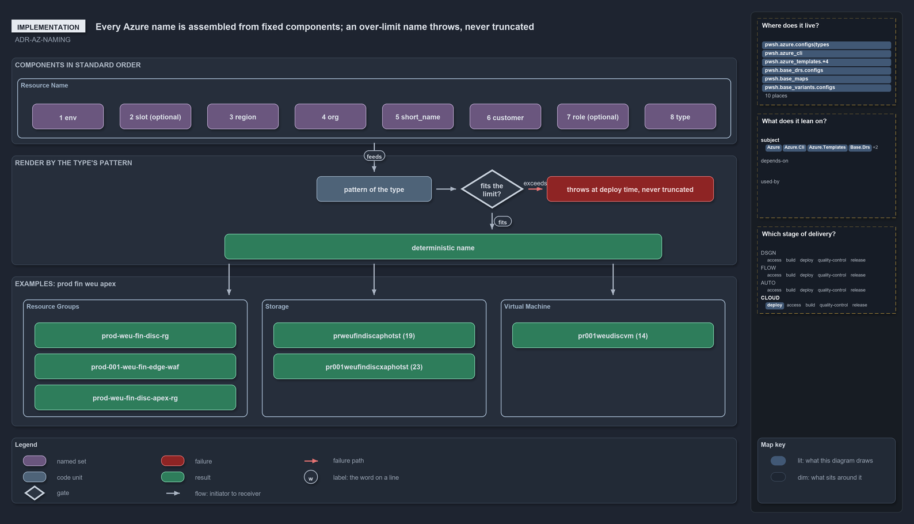

# ADR: Azure resource naming standard

<!-- cspell:ignore weuwkspvm prweufindiscaphotst weufindiscxaphotst weudiscvm etlco -->

Pairs with [`data-model`](azure-data-model.md), which defines how these components are sourced and assembled.

## Rules: ADR-AZ-NAMING

### Rule ADR-AZ-NAMING-DETERMINISTICNAMES

Every Azure name is assembled deterministically from one canonical component set — no random suffixes or hashes — rendered two ways:
hyphenated for relaxed types, concatenated for tight types.

- [Components](#components)

### Rule ADR-AZ-NAMING-TWOTEMPLATEIDENTIFIERS

Each template carries two identifiers: a readable kebab-case folder name and a 2–5 char `short_name`. `short_name` is **derived** from the
folder name (first 5 `[a-z0-9]`, hyphens dropped) by `BicepShortName`, and **optionally overridden** in the template's `options.yml`. All
Azure-facing identifiers use `short_name`, never the folder name.

- [Two identifiers per template](#two-identifiers-per-template)

### Rule ADR-AZ-NAMING-ENVIRONMENTFIRST

Environment is the first segment (env-first sort); env and customer each render readable (name/key) in generous patterns and as a 2-char
shortcode in the restricted `kv`/`storage`/`vm` patterns.

- [Components](#components)

### Rule ADR-AZ-NAMING-PATTERNPERRESOURCETYPE

Each resource type ties to one render/constraint pattern (`long`/`kv`/`storage`/`vm`) from the type registry, which fixes the separator, the
length budget, and which env/customer form is used.

- [Ordering & render forms](#ordering--render-forms)

### Rule ADR-AZ-NAMING-ORDERISVARIANT

Component order is the `ado_naming` repo variant (`Get-AdoNaming`, default `standard`), not a per-name argument; changing it re-spells every
derived name.

- [Ordering & render forms](#ordering--render-forms)

### Rule ADR-AZ-NAMING-LOWERCASECOMPONENTS

All components are lowercase with case-sensitive validation; `org`, `short_name`, `role`, env `name`, and customer `key` must start with a
letter — only `slot` may be all-digit.

- [Character & case rules](#character--case-rules)

### Rule ADR-AZ-NAMING-NEVERTRUNCATE

Never truncate to fit — the namer computes the render and throws at deploy time if it exceeds the type's limit, listing the components that
can be shortened (silent truncation collides on globally-unique types).

- [Length budget](#length-budget)

### Rule ADR-AZ-NAMING-SUBSCRIPTIONNOTCOMPONENT

The subscription is a resolution axis only and is never a name component; the customer that renders is derived from it
(`subscription.customer`).

- [Component sourcing](#component-sourcing)

### Rule ADR-AZ-NAMING-CAFALIGNMENT

The standard follows the CAF naming convention in substance and differs from it in four places on purpose. A name holds only stable facts;
the component set is environment, slot, region, organisation, template `short_name`, customer, role, and type, with the template standing for
CAF's workload and the slot for its instance number; the order puts the environment first and the type last; and the type tokens equal CAF's
abbreviations. Names are generated by `Get-AzureResourceName`, not by Microsoft's naming tool, and hold codes chosen in config, never a
person's name or a secret.

- [CAF alignment](#caf-alignment)

## Context

Every Azure resource name is assembled from one canonical component set, rendered two ways (hyphenated for relaxed types, concatenated for
tight types). Names are **deterministic** — no random suffixes or hashes.

The binding constraint is the **storage account**: 3–24 chars, lowercase letters + digits only, **no hyphens**, globally unique. Any
component that appears in a storage name cannot contain hyphens or uppercase, and the assembled name must stay ≤ 24. Relaxed types (resource
group ≤ 90, most others) never bind.

Two goals shape the standard:

- **Env-first sort.** The environment is the first segment, so listing resources alphabetically groups them by environment.
- **Readable where humans look, tight where bytes bind.** Environments carry a readable **name** (`develop`, `preprod`) used in config
  files, deploy args, and relaxed resource names, plus a 2-char **shortcode** (`de`, `pp`) used only in the restricted (tight-budget)
  patterns — so a long, clear name never costs a storage/vm name a byte. **Customers carry the identical split** — a readable **key**
  (`apex`) for generous names + a 2-char **shortcode** (`ap`) for restricted ones — for the same reason. Likewise template _folders_ are
  readable labels; a separate `short_name` carries their Azure identity.

## Decision

```yml drawio
description:
  An Azure resource name is assembled from eight components in a fixed order; the type's pattern picks the form and the limit, a render past
  the limit throws at deploy time and is never truncated, and three worked examples show the names that come out.
about:
  adrs: [ADR-AZ-NAMING]
  lens: implementation
content:
  title: Every Azure name is assembled from fixed components; an over-limit name throws, never truncated
  kind: reference
  flow: left-to-right
  theme: dark
  bands:
    - { id: band-components, label: COMPONENTS IN STANDARD ORDER }
    - { id: band-render, label: RENDER BY THE TYPE'S PATTERN }
    - { id: band-names, label: "EXAMPLES: prod fin weu apex" }
  groups:
    - { id: grp-name, label: Resource Name, in: band-components }
    - { id: grp-resource-groups, label: Resource Groups, in: band-names }
    - { id: grp-storage, label: Storage, in: band-names }
    - { id: grp-virtual-machine, label: Virtual Machine, in: band-names }
  glyphs:
    - { id: c-env, kind: set, label: 1 env, in: grp-name }
    - { id: c-slot, kind: set, label: 2 slot (optional), in: grp-name }
    - { id: c-region, kind: set, label: 3 region, in: grp-name }
    - { id: c-org, kind: set, label: 4 org, in: grp-name }
    - { id: c-short-name, kind: set, label: 5 short_name, in: grp-name }
    - { id: c-customer, kind: set, label: 6 customer, in: grp-name }
    - { id: c-role, kind: set, label: 7 role (optional), in: grp-name }
    - { id: c-type, kind: set, label: 8 type, in: grp-name }
    - { id: g-pattern, kind: code, label: pattern of the type, in: band-render }
    - { id: g-limit, kind: gate, label: "fits the limit?", in: band-render }
    - { id: f-throws, kind: failure, label: "throws at deploy time, never truncated", in: band-render }
    - { id: r-name, kind: result, label: deterministic name, in: band-render }
    - { id: n-rg-base, kind: result, label: prod-weu-fin-disc-rg, in: grp-resource-groups }
    - { id: n-rg-slot, kind: result, label: prod-001-weu-fin-edge-waf, in: grp-resource-groups }
    - { id: n-rg-customer, kind: result, label: prod-weu-fin-disc-apex-rg, in: grp-resource-groups }
    - { id: n-storage-base, kind: result, label: prweufindiscaphotst (19), in: grp-storage }
    - { id: n-storage-slot, kind: result, label: pr001weufindiscxaphotst (23), in: grp-storage }
    - { id: n-vm, kind: result, label: pr001weudiscvm (14), in: grp-virtual-machine }
  edges:
    - { from: grp-name, to: g-pattern, kind: flow, label: feeds }
    - { from: g-pattern, to: g-limit, kind: flow, label: "" }
    - { from: g-limit, to: r-name, kind: flow, label: fits }
    - { from: g-limit, to: f-throws, kind: fail, label: exceeds }
    - { from: r-name, to: grp-resource-groups, kind: flow, label: "" }
    - { from: r-name, to: grp-storage, kind: flow, label: "" }
    - { from: r-name, to: grp-virtual-machine, kind: flow, label: "" }
  legend: auto
  minimaps: [code-locations, module-neighbourhood, axis]
layout:
  band-components: { x: 20, y: 84, w: 1260, h: 150 }
  band-render: { x: 20, y: 254, w: 1260, h: 190 }
  band-names: { x: 20, y: 464, w: 1260, h: 260 }
  grp-name: { x: 30, y: 120, w: 1240, h: 104 }
  c-env: { x: 56, y: 164, w: 124, h: 44 }
  c-slot: { x: 208, y: 164, w: 124, h: 44 }
  c-region: { x: 360, y: 164, w: 124, h: 44 }
  c-org: { x: 512, y: 164, w: 124, h: 44 }
  c-short-name: { x: 664, y: 164, w: 124, h: 44 }
  c-customer: { x: 816, y: 164, w: 124, h: 44 }
  c-role: { x: 968, y: 164, w: 124, h: 44 }
  c-type: { x: 1120, y: 164, w: 124, h: 44 }
  g-pattern: { x: 550, y: 290, w: 200, h: 44 }
  g-limit: { x: 800, y: 278, w: 110, h: 68 }
  f-throws: { x: 950, y: 290, w: 290, h: 44 }
  r-name: { x: 390, y: 390, w: 760, h: 44 }
  grp-resource-groups: { x: 40, y: 504, w: 390, h: 204 }
  grp-storage: { x: 455, y: 504, w: 390, h: 204 }
  grp-virtual-machine: { x: 870, y: 504, w: 390, h: 204 }
  n-rg-base: { x: 60, y: 544, w: 350, h: 44 }
  n-rg-slot: { x: 60, y: 598, w: 350, h: 44 }
  n-rg-customer: { x: 60, y: 652, w: 350, h: 44 }
  n-storage-base: { x: 475, y: 544, w: 350, h: 44 }
  n-storage-slot: { x: 475, y: 598, w: 350, h: 44 }
  n-vm: { x: 890, y: 544, w: 350, h: 44 }
```



### Two identifiers per template

| Identifier       | Where                                                                   | Form                              | Purpose                                                             |
| ---------------- | ----------------------------------------------------------------------- | --------------------------------- | ------------------------------------------------------------------- |
| **folder name**  | `infrastructure/templates/<folder>/`                                    | kebab-case, e.g. `discovery`      | Human label + discovery key + repo navigation. Not an Azure id.     |
| **`short_name`** | **derived** from `<folder>`; optional `options.yml` override (**opt.**) | 2–5 lowercase-alnum, e.g. `disco` | The Azure identifier segment. Globally unique across all templates. |

`short_name` is **derived** from the folder name — lowercase, keep only `[a-z0-9]` (hyphens/punctuation dropped), take the first 5 chars
(`discovery` → `disco`, `my-template` → `mytem`) — by `Catzc.Azure.Templates.BicepShortName`. A template MAY override it with an explicit
`short_name` in its **optional** `options.yml`; `options.yml` is not required for identity. `BicepShortName` validates both forms
(`^[a-z][a-z0-9]{1,4}$`): a malformed override, or a folder that cannot derive ≥2 valid chars without an override, throws at discovery. All
Azure-facing identifiers (resource names, tracking-tag prefixes, deployment names) use `short_name`, never the folder name.

### Components

| #   | Component    | Req | Len | Charset                                      | Source                                                                                                                                                                                                                                                                                                                       |
| --- | ------------ | --- | --- | -------------------------------------------- | ---------------------------------------------------------------------------------------------------------------------------------------------------------------------------------------------------------------------------------------------------------------------------------------------------------------------------- |
| 1   | `env`        | ✔   | 2+  | name `[a-z][a-z0-9]+` / shortcode `[a-z]{2}` | The environment's identity; first segment → env-grouped sort. **Pattern-chosen render:** generous (`long`) patterns use the readable **name** (`develop`, `prod`); restricted (`kv`/`storage`/`vm`) patterns use the 2-char **shortcode** (`de`, `pr`). From `azure.yml`.                                                    |
| 2   | `slot`       | ✖   | 1–3 | `[a-z0-9]`                                   | Optional special-deployment discriminator **within** an environment (ordinal `001`, blue-green, spoke). A **separate segment** beside `env` (hyphen-joined in relaxed, concatenated in tight). Deploy-time input (`-Slot`); omitted ⇒ the base / index-0 slot.                                                               |
| 3   | `region`     | ✔   | 3   | `[a-z]{3}`                                   | Azure region code (`weu`, `neu`, `eus`). From `azure.yml` env `region_code`.                                                                                                                                                                                                                                                 |
| 4   | `org`        | ✔   | 2–3 | `[a-z][a-z0-9]{1,2}`                         | Vertical / organization. Global, one per repo (`azure.yml`).                                                                                                                                                                                                                                                                 |
| 5   | `short_name` | ✔   | 2–5 | `[a-z][a-z0-9]{1,4}`                         | Template id segment. **Derived** from the template folder name (first 5 `[a-z0-9]`, `BicepShortName`); optional `options.yml` override. Globally unique.                                                                                                                                                                     |
| 6   | `customer`   | ✖   | 2+  | key `[a-z][a-z0-9]+` / shortcode `[a-z]{2}`  | Customer / sub-tenant. **Pattern-chosen render** (like `env`): generous (`long`) patterns use the readable **key** (`apex`); restricted (`kv`/`storage`/`vm`) patterns use the 2-char **shortcode** (`ap`). **Derived** from the deploy's subscription (`subscription.customer` in `azure.yml`), not a deploy arg; optional. |
| 7   | `role`       | ✖   | 2–3 | `[a-z][a-z0-9]{1,2}`                         | **Within a slot**, the sibling discriminator among same-type resources (`hot`/`cool`/`arc`). Bicep author, per resource.                                                                                                                                                                                                     |
| 8   | `type`       | ✔   | 2–5 | `[a-z]{2,5}`                                 | Resource-type abbreviation (`rg`, `st`, `kv`, `sqldb`). The resource being named. Each type ties to a render pattern (`Get-AzureNamePatternSet`); the 5-char form is only for the `long` pattern — the restricted `kv` (≤24), `storage` (concatenated ≤24) and `vm` (≤15) patterns keep a 2–4 char abbreviation.             |

**Three discriminator axes, kept distinct:**

- `slot` = _which deployment of the template_ in this env (horizontal; same for every resource in one deployment; deploy-time `-Slot`,
  omitted ⇒ base slot).
- `region` = _where_ — its own field, so multi-region slots differ automatically without consuming `slot`.
- `role` = _which sibling within one slot_ among same-type resources (vertical).

### Ordering & render forms

Each resource type ties to one of **four render/constraint patterns** (`Get-AzureNamePatternSet`; every type names its pattern in
`Get-AzureResourceTypeSet`):

A pattern fixes the **render separator** and the **length budget**; it also selects the **env form**:

- **`long`** (RG ≤ 90, SQL, most) — hyphen-separated, generous (per-type limit). Uses the env **name**.
- **`kv`** (key vault = 24) — hyphen-separated like `long`, but length-restricted to 24. Uses the **shortcode** (it is restricted-budget, so
  it takes the short env form even though it is hyphenated).
- **`storage`** (storage account = 24, lowercase-alnum, no hyphens) — concatenated. Uses the **shortcode**.
- **`vm`** — the same concatenated render as `storage`, capped at **15** (the Windows computer-name limit). Uses the **shortcode**.

The **`customer`** segment follows the same env-form selection: the readable **key** in `long`, the 2-char **shortcode** in
`kv`/`storage`/`vm`.

`env` and `slot` are **separate segments** — joined by the render separator (a hyphen in relaxed, nothing in tight); the `slot` segment is
dropped when empty. So:

```text
relaxed (long):   <env>-<slot>-<region>-<org>-<short_name>[-<customer>][-<role>]-<type>
tight (storage):  <env><slot><region><org><short_name>[<customer>][<role>]<type>
```

One config file ⟷ one slot ⟷ one resource group. Sort key is `env`, then `slot`, then `region`.

**Component order is the `ado_naming` repo variant**: `Get-AdoNaming` (default `standard`) selects a named order from
`Get-AzureNameOrderSet`; the variant lives in `variants.yml`. An order is pure data — an ordered list of _segments_ — so the assembler
(`Get-AzureResourceName`) is order-agnostic. Two ship:

- `standard` — `<env>-<slot>-<region>-<org>-<short_name>[-<customer>][-<role>]-<type>` (env/slot first, type last).
- `classic` — `<type>-<org>-<short_name>[-<customer>]-<env>-<region>[-<slot>][-<role>]` (type first, CAF-style, slot trailing).

### Length budget

Restricted patterns use the 2-char **shortcode** for _both_ `env` and `customer`, so the tight budget is independent of how long the
readable `name` / customer `key` is. `short_name` is capped at **5**; the worst-case tight name is:

```text
env_sc(2) + slot(3) + region(3) + org(3) + short_name(5) + cust_sc(2) + role(3) + type(2) = 23
```

So the full-house corner (slot + customer + role together) **fits** the 24-char storage limit at 23, with a byte to spare. (The 2-char
customer shortcode is what buys this — a 4-char customer code would push the same name to 25.) The other restricted patterns: `kv`
(hyphenated, 24) carries a customer comfortably (~22) but cannot also take the slot + role segments at `short_name`=5. The **`vm`** pattern
(15) **omits** `org`, `customer`, and `role` (the resource group already encodes them), so it renders
`<env_sc>[<slot>]<region><short_name>vm` — e.g. `de001weuwkspvm` (14) — and fits 15 even with a slot. A customer therefore never appears in
a VM name. The namer computes the render and **throws at deploy time** if it exceeds the target type's limit, listing the components that
can be shortened. Never truncate silently (truncation collides on globally-unique types).

### Character & case rules

- All components lowercase. Validation is **case-sensitive** — `Get-AzureResourceName` checks every component with the case-sensitive
  `-cnotmatch` operator (PowerShell's default `-match`/`-notmatch` is case-insensitive), so the patterns themselves carry no `(?-i)` prefix.
- `org`, `short_name`, `role`, env `name`, customer `key` **start with a letter** (Key Vault and others reject leading digits). Only `slot`
  may be all-digit.
- Key regexes (matched with the case-sensitive `-cmatch`/`-cnotmatch`):
  - `type`: `^[a-z]{2,5}$` (2–5 letters; also guarded by membership in the type registry)
  - `short_name`: `^[a-z][a-z0-9]{1,4}$` (2–5)
  - folder name: `^[a-z][a-z0-9-]*$` (kebab, starts with a letter)
  - `region`: `^[a-z]{3}$`
  - env `name`: `^[a-z][a-z0-9]+$` (the azure.yml key; unique)
  - env `shortcode`: `^[a-z]{2}$` (unique)
  - customer `key`: `^[a-z][a-z0-9]+$` (the customer.yml key; unique)
  - customer `shortcode`: `^[a-z]{2}$` (unique)
  - `slot`: `^[a-z0-9]{1,3}$`

### Component sourcing

| Component    | Resolved from                                                                                                                    |
| ------------ | -------------------------------------------------------------------------------------------------------------------------------- |
| `env`        | deploy `-Environment` name → the env's `name` (relaxed) or 2-char `shortcode` (restricted), `azure.yml`                          |
| `slot`       | deploy-time input (`-Slot`; the special slot being deployed); optional                                                           |
| `region`     | `region_code` of the deploy environment in `azure.yml`                                                                           |
| `org`        | global `org` value in `azure.yml` (one per repo)                                                                                 |
| `short_name` | **derived** from the template folder (first 5 `[a-z0-9]`, `BicepShortName`); overridden by the template's optional `options.yml` |
| `customer`   | the resolved subscription's `customer` → its `key` (generous) or 2-char `shortcode` (restricted), from `customer.yml`; optional  |
| `role`       | the bicep author, per resource inside the template; optional                                                                     |
| `type`       | the resource type being named                                                                                                    |

### Resource-type registry

`Get-AzureResourceTypeSet` defines each type's abbreviation, render **pattern**, length, and any **omitted** components. `long`-pattern
types carry their own per-type `limit` (the Azure max for that type); `kv`/`storage`/`vm` take their cap from the pattern (24/24/15) and
declare no `limit`. A type may also declare `omit` — components it drops from its render because they are encoded elsewhere (only `vm` does
so, dropping org/customer/role). The set is extended in code as consuming repos need; this table mirrors the shipped registry
(`Get-AzureResourceTypeSet`). The **unique in** column is where Azure requires the name to be unique; the registry does not carry it,
because a deterministic name differs wherever its components differ.

| Type                     | abbr    | pattern | limit / cap | omit                | unique in       |
| ------------------------ | ------- | ------- | ----------- | ------------------- | --------------- |
| Resource group           | `rg`    | long    | 90          | —                   | subscription    |
| Storage account          | `st`    | storage | 24 (cap)    | —                   | global          |
| Key Vault                | `kv`    | kv      | 24 (cap)    | —                   | global          |
| Web application firewall | `waf`   | long    | 128         | —                   | resource group  |
| Virtual network          | `vnet`  | long    | 64          | —                   | resource group  |
| SQL logical server       | `sql`   | long    | 63          | —                   | global          |
| SQL database             | `sqldb` | long    | 128         | —                   | SQL server      |
| Virtual machine          | `vm`    | vm      | 15 (cap)    | org, customer, role | resource group  |
| Synapse workspace        | `synw`  | long    | 50          | —                   | global          |
| Data Factory (V2)        | `adf`   | long    | 63          | —                   | global          |
| Log Analytics workspace  | `log`   | long    | 63          | —                   | resource group  |
| Network interface        | `nic`   | long    | 80          | —                   | resource group  |
| Public IP address        | `pip`   | long    | 80          | —                   | resource group  |
| Network security group   | `nsg`   | long    | 80          | —                   | resource group  |
| Subnet                   | `snet`  | long    | 80          | —                   | virtual network |
| Route table              | `rt`    | long    | 80          | —                   | resource group  |
| Virtual network peering  | `peer`  | long    | 80          | —                   | virtual network |
| Private endpoint         | `pep`   | long    | 64          | —                   | resource group  |
| Budget                   | `budg`  | long    | 63          | —                   | subscription    |
| Policy assignment        | `pa`    | long    | 64          | —                   | subscription    |

Every type above accepts the characters a render can produce. The `long` render is lowercase letters, digits, and hyphens, starting with a
letter and ending with a letter or digit, which the most restrictive of these types (the budget: letters, digits, underscores, and hyphens;
the network types: start with a letter or digit, end with a letter, digit, or underscore) all allow. So the registry carries only the
length. The budget abbreviation is `budg` because a `type` is at most 5 letters. A policy assignment at the management-group level would be
capped at 24; the templates assign policies at the subscription only, so `pa` carries the subscription limit, 64.

### CAF alignment

A name holds only facts that never change for the resource, because most names cannot change once the resource exists: environment,
configuration slot, region, organisation, template, customer, role, and type. Owner, cost centre, criticality, and data classification live
in the CAF tags ([ADR-AZ-LZ-CAFTAGS](landing-zones.md#rule-adr-az-lz-caftags)).

The type registry carries each type's length limit and the render pattern its characters, and an over-limit name throws
([ADR-AZ-NAMING-NEVERTRUNCATE](#rule-adr-az-naming-nevertruncate)). A deterministic name differs wherever its components differ, and every
globally unique type carries the organisation and the template; an external collision fails the deploy and is fixed by another special slot
or `short_name`, never by a random suffix. The names written in the template configs are written by hand, so a drift from the namer's render
is caught only when the deploy fails.

The component order is fixed repository-wide by the `ado_naming` variant, and its default puts the environment first and the type last,
unlike CAF's type-first examples, which the `classic` order reproduces. Hyphens appear where the type allows them, with no delimiter in the
`storage` and `vm` patterns, chosen per type by its render pattern. Every type token in `Get-AzureResourceTypeSet` that CAF lists equals CAF's
abbreviation; the two types CAF does not list take `budg` (budget) and `pa` (policy assignment), and a private DNS zone keeps the name Azure
requires. Subnets keep the names of the network plan instead of an `snet` name, and every type in CAF's examples that the templates deploy is
named by the standard, type last and with no instance counter.

### Worked examples

Env `prod` (shortcode `pr`), org `fin`, region `weu`:

Per-customer rows use customer `apex` (shortcode `ap`):

| Scenario                                 | Relaxed (name / key)                                     | Tight (shortcode)                                                                  |
| ---------------------------------------- | -------------------------------------------------------- | ---------------------------------------------------------------------------------- |
| Prod discovery RG, base slot             | `prod-weu-fin-disc-rg`                                   | —                                                                                  |
| WAF in two slots of prod                 | `prod-001-weu-fin-edge-waf`, `prod-002-weu-fin-edge-waf` | —                                                                                  |
| Per-customer RG, base slot               | `prod-weu-fin-disc-apex-rg` (readable key)               | —                                                                                  |
| Per-customer hot storage, base slot      | —                                                        | `prweufindiscaphotst` (19, customer shortcode `ap`)                                |
| Storage, slot + customer + role, short5  | —                                                        | `pr001weufindiscxaphotst` (**23 — fits**, thanks to the 2-char customer shortcode) |
| VM, slot 001 (org/customer/role omitted) | —                                                        | `pr001weudiscvm` (14 — `vm` drops org/customer/role)                               |

## Consequences

- Folders stay readable (`discovery`); `short_name` (2–5) carries Azure identity — no readability tax.
- `short_name` is the Azure id. By default it is **derived** from the folder, so a new template needs no `options.yml` to get a valid id —
  but renaming the folder then re-spells the derived `short_name` and its resources. Pin the id against folder churn by setting an explicit
  `short_name` override in `options.yml` (the derivation and the override are the same one-invariant `BicepShortName`).
- The restricted patterns use the 2-char shortcode for **both env and customer**, so readable env names and customer keys cost nothing in
  tight names; the full-house corner (slot + customer + role) fits storage at 23 ≤ 24. The deploy-time assert still guards any remaining
  over-limit render (e.g. a `kv` carrying customer + slot + role).
- Each environment maps to one region (region is an env attribute). Multi-region-per-environment would need env×region modeling and is out
  of scope.
- Deterministic-only means no entropy for globally-unique types; an external collision fails the deploy and is fixed by adjusting `slot` /
  `short_name` (no auto-hash).
- The **subscription** (the config folder a template deploys to) is a **resolution axis only** — it selects _which subscription_ a deploy
  targets and is **never** a resource-name component. Names are assembled from the components above
  (env/slot/region/org/`short_name`/customer/role/type); the subscription never appears in them. The **customer** that does render is
  _derived_ from that subscription (`subscription.customer`). See [`data-model`](azure-data-model.md).
