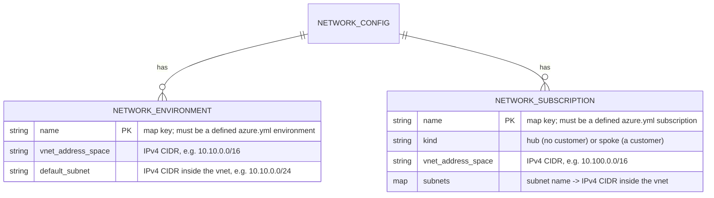

# ADR: Network model (network.yml)

This ADR covers the cross-cutting IP plan, which the data model deliberately leaves out of its two layers.

Pairs with [`data-model`](azure-data-model.md) (identity + templating) and [`naming-standard`](azure-naming-standard.md).

## Rules: ADR-AZ-NETWORK

### Rule ADR-AZ-NETWORK-ONEIPPLAN

The IP plan lives only in `network.yml` — never duplicate vnet/subnet ranges into a template's per-slot config. A template that needs ranges
reads them from `network.yml` at build time — in its prepare hook (`Get-Config -Config network`), or through a config address in its
parameter file — and never copies them.

- [The asset](#the-asset)

### Rule ADR-AZ-NETWORK-KEYEDBYENVIRONMENT

Key the plan by environment name, matching `azure.yml`; the two assets stay in sync through a quality gate, `Test-AzureNetworkPlan`, not by
convention alone. Each config type checks only its own file; the join of the two is the gate's.

- [Validation (`NetworkConfig`)](#validation)

### Rule ADR-AZ-NETWORK-ONEADDRESSSPACE

One address space per environment — multi-region-per-environment is out of scope (each environment maps to one region).

- [The asset](#the-asset)

### Rule ADR-AZ-NETWORK-ENVIRONMENTSNONETWORK

Per-subscription envs (`nsub`/`psub`) need no network entry — they carry no vnet, so the standard-env requirement skips them (a
`nsub`/`psub` entry is not forbidden, just pointless).

- [Validation (`NetworkConfig`)](#validation)

### Rule ADR-AZ-NETWORK-PERSUBSCRIPTION

Every `azure.yml` subscription has one network in the plan's `subscriptions` block, keyed by the subscription name, and its kind follows
from the subscription: a **hub** when the subscription has no `customer`, a **spoke** when it has one. A hub carries exactly `GatewaySubnet`
(reserved: nothing is deployed into it), `AzureFirewallSubnet` and `AzureFirewallManagementSubnet` (the hub's Azure Firewall), and
`shared-services`. A spoke carries `private-endpoints` plus one workload subnet per standard environment its subscription serves, named for
that environment, and no other. The kind's subnet set is the type's check; which kind a subscription needs, and which environments it
serves, are the gate's join.

- [The subscription networks](#the-subscription-networks)
- [Validation (`NetworkConfig`)](#validation)

### Rule ADR-AZ-NETWORK-NOOVERLAP

No two networks in the plan overlap — every environment's and every subscription's vnet address space is disjoint from every other. Every
range is an aligned IPv4 CIDR (no host bits set), every subnet lies inside its vnet, and no two subnets of one vnet overlap. `NetworkConfig`
checks all of it when the file loads.

- [Validation (`NetworkConfig`)](#validation)

### Rule ADR-AZ-NETWORK-CAFPRIVATEACCESS

Data services are reached only through private endpoints, with public network access off. The `privatelink` zones live once per tier, in the
hub, linked to the hub and every spoke it lists, and every record is written by the template that deploys the endpoint, never by a
deploy-if-not-exists policy. Name resolution is Azure-only; service endpoints, network injection, forced tunnelling, and any DNS service of
a workload's own are not used.

- [CAF private access](#caf-private-access)

### Rule ADR-AZ-NETWORK-CAFTOPOLOGY

The network is hub-and-spoke per tier in one region, with `network.yml` as the one IP address management, every range a /16 inside
10.0.0.0/8, IPv4 only, and a security group per workload subnet that denies inbound internet traffic. The hub runs an Azure Firewall, the
next hop of every spoke subnet's default route, and reserves a gateway subnet with nothing deployed, so there is no hybrid link, no
spoke-to-spoke transit the firewall allows, no Virtual WAN, and no Virtual Network Manager.

- [CAF topology](#caf-topology)

### Rule ADR-AZ-NETWORK-CAFCONNECTIVITY

The networks connect no on-premises site and expose no workload to the internet: no template deploys a gateway, Bastion, or a virtual
machine, the only public IP addresses are the hub firewall's own, and data is reached through private endpoints behind a security group per
workload subnet. Egress is filtered: every spoke subnet routes `0.0.0.0/0` to its hub's Azure Firewall, whose policy allows only the service
tags and FQDN tags of `network.yml`'s `firewall_egress` over port 443, and the firewall's logs go to the hub's `foundation` workspace.

- [CAF connectivity](#caf-connectivity)

## Context

A template that creates a virtual network needs an address space and subnet ranges. Those ranges are **global, cross-cutting state**: every
environment must get a non-overlapping block, and the same block must be referenced identically by every template that touches that
environment's network. If the ranges lived in each template's per-slot `configuration/[<customer>/]<env>.yml`, the plan would be duplicated
across templates and drift — the exact failure [the data model](azure-data-model.md) avoids by giving every fact one source of truth.

So the IP plan is a **single source of truth** sitting beside `azure.yml`: `pwsh/Azure/configs/network.yml`. A template reads the right
ranges at build time — through its PrePost prepare hook or a config address in its parameter file — so the central plan is read, never
copied.

The subscriptions add a second kind of network: one per subscription, in a hub-and-spoke topology. The shared subscriptions each hold a hub,
every customer subscription holds a spoke that peers to its hub, and a workload's private endpoints land in its spoke. Those ranges are the
same kind of global state, so they live in the same file, and one overlap check covers both kinds: two networks that may ever be peered or
routed together must never share an address.

This is a third global asset, distinct from the two layers in [`data-model`](azure-data-model.md): it is not identity
(tenant/customer/environment/subscription) and not templating (template/options/slot). It is pure topology — the network plan keyed by
environment and by subscription.

## Decision

### The asset

`configs/network.yml` declares two entities — a per-environment IP plan, keyed by environment **name** (the same keys as `azure.yml`'s
`environments`), and a per-subscription network, keyed by subscription **name** (the same keys as `azure.yml`'s `subscriptions`). It is
loaded by `Get-Config -Config network`, which constructs its C# config type, `NetworkConfig` (every shipped config has one), so a bad file
throws at read time. A template's parameter file can reach the same ranges through a config address instead of a prepare hook.



```yaml
# configs/network.yml
environments:
  dev:
    vnet_address_space: 10.10.0.0/16
    default_subnet: 10.10.0.0/24
  # … one entry per standard environment
subscriptions:
  shared_nonprod:
    kind: hub
    vnet_address_space: 10.0.0.0/16
    subnets:
      GatewaySubnet: 10.0.0.0/27
      AzureFirewallSubnet: 10.0.0.64/26
      AzureFirewallManagementSubnet: 10.0.0.128/26
      shared-services: 10.0.1.0/24
  apex_nonprod:
    kind: spoke
    vnet_address_space: 10.100.0.0/16
    subnets:
      private-endpoints: 10.100.0.0/24
      dev: 10.100.1.0/24
      test: 10.100.2.0/24
  # … one entry per azure.yml subscription
```

### The subscription networks

The `subscriptions` block is the IP plan of the hub-and-spoke topology the subscriptions deploy.

- **A hub** belongs to a shared subscription (no `customer` in `azure.yml`). It carries exactly four subnets. `GatewaySubnet` is the name
  Azure requires for a VPN or ExpressRoute gateway; the plan reserves it so that adding one needs no renumbering, and nothing is deployed
  into it. `AzureFirewallSubnet` and `AzureFirewallManagementSubnet` are the names Azure requires for Azure Firewall and its management
  traffic, and hold the hub's firewall. `shared-services` holds what the shared platform runs in the hub.
- **A spoke** belongs to a customer subscription. It carries `private-endpoints`, where every workload in the spoke places its private
  endpoints, and one workload subnet per standard environment the subscription serves, named for that environment (`dev`, `test`, …), so a
  workload finds its subnet from its own environment with no lookup table. The per-subscription identity environment (`nsub`/`psub`) gets no
  workload subnet, for the same reason it gets no environment entry
  ([ADR-AZ-NETWORK-ENVIRONMENTSNONETWORK](#rule-adr-az-network-environmentsnonetwork)).
- **The kind is declared** (`kind: hub` or `kind: spoke`), even though it follows from `azure.yml`. A template reads it from the plan alone,
  and the gate checks that it agrees with the subscription, so the two can never silently disagree.

### Validation

`NetworkConfig`

- **Required shape.** Top-level `environments` map; each entry has `vnet_address_space` and `default_subnet`. An optional top-level
  `subscriptions` map; each entry has `kind`, `vnet_address_space`, and a non-empty `subnets` map. No other key at any level.
- **Format.** Each environment and subscription name is a valid lower-snake_case identifier (`^[a-z][a-z0-9_]*$`); each range is an aligned
  IPv4 CIDR (`a.b.c.d/n`, `0 ≤ n ≤ 32`, no host bits set, because Azure rejects an address prefix with host bits set), validated with
  `[System.Net.IPAddress]`.
- **Containment and overlap** ([ADR-AZ-NETWORK-NOOVERLAP](#rule-adr-az-network-nooverlap)). An environment's default subnet and every
  subscription subnet lie inside their vnet; no two subnets of one vnet overlap; no two networks in the file overlap, whether environment or
  subscription.
- **Kind** ([ADR-AZ-NETWORK-PERSUBSCRIPTION](#rule-adr-az-network-persubscription)). A hub carries exactly `GatewaySubnet`,
  `AzureFirewallSubnet`, `AzureFirewallManagementSubnet`, and `shared-services`; a spoke carries `private-endpoints`, and every other spoke
  subnet is named as an environment (a lower-snake_case identifier).
- **Cross-asset integrity with `azure.yml`** (the join, checked by the quality gate `Test-AzureNetworkPlan`, not by the type):
  - every network environment is a **defined `azure.yml` environment** (no ghost entries);
  - every **standard** `azure.yml` environment has a network entry;
  - **per-subscription** environments (`per_subscription: true` — `nsub`/`psub`) are **exempt**: they identify a subscription's foundation
    (Log Analytics + Key Vault) and carry no vnet, so they need no IP plan;
  - every network subscription is a **defined `azure.yml` subscription**, and every `azure.yml` subscription has a network of the right kind
    — a hub without a `customer`, a spoke with one;
  - a spoke has a workload subnet for **each standard environment its subscription serves**, and none for another.
- All violations are collected and thrown together (fail with the full list, not the first error).

The `subscriptions` block is optional in the type, so a fixture plan that exercises only environment ranges stays small; the gate is what
requires an entry for every subscription of the shipped `azure.yml`.

### CAF connectivity

The repository connects no on-premises site and no other cloud; the hub reserves `GatewaySubnet` so a gateway can be added without
renumbering, and such a link would land there. So no ExpressRoute circuit, gateway, Direct port, FastPath, Global Reach, VPN connection, or
encryption of a private link exists, and the production and non-production hubs would each take their own circuit if one came.

No workload is reached from the internet or global, so no Application Gateway, Front Door, Traffic Manager, web application firewall, NAT
Gateway, or inbound appliance exists; the first ingress gateway belongs to the workload template, in its spoke, not in a shared hub service.
The only public IP addresses are the hub firewall's two, one for its traffic and one for its management: the landing zone's policy keeps
them off network interfaces, every workload subnet denies inbound internet traffic, and the unused `vm.bicep`, which creates one, is to lose
it. No DDoS Protection plan exists, because no network holds a workload's public endpoint. The landing zone has no perimeter network; each
workload subnet carries its own security group and data is reached through private endpoints. `virtual-network.bicep` turns Azure's default
outbound access off on every subnet, so no subnet reaches the internet but through the firewall.

Egress is filtered at the hub. `discovery` deploys one Azure Firewall per hub into `AzureFirewallSubnet`, its tier from `network.yml`'s
`firewall_sku` (`Basic` in the non-production hub, `Standard` in production, which spreads it over the region's zones) and its private
address from `firewall_private_ip`. Every spoke subnet routes `0.0.0.0/0` to that address, and the hub's `shared-services` subnet routes
each spoke's address space to it, while the firewall and gateway subnets take no route table. The firewall policy allows only the service
tags and FQDN tags of `firewall_egress` over port 443, from the spokes' address spaces, and denies the rest; there is no IP Group, Firewall
Manager, security provider, or partner appliance, and `network.yml` is the one home of every range a rule names. The firewall's logs go to
the hub's workspace. Every landing zone is connected, each spoke peering to the hub of its tier, so none uses a NAT Gateway for a standalone
path.

No template deploys a virtual machine, so there is no Bastion, no jump host, no remote access to protect, no private key for SSH, and no
break-glass path of that kind; a hub Bastion would need an `AzureBastionSubnet` the hub does not reserve, and its diagnostics would follow
every other resource's to `foundation`'s workspace. No traffic flows between virtual machines, and every flow to data is encrypted by TLS
1.2 at minimum, so virtual network encryption is not used. The network security groups and the virtual networks send their diagnostics to
`foundation`'s workspace, and where `foundation` configures a flow-log storage account, `discovery` records a virtual network flow log there
with traffic analytics into the workspace ([ADR-AZ-LZ-CAFMANAGEMENT](landing-zones.md#rule-adr-az-lz-cafmanagement)); a virtual network flow
log leaves no security-group flow log to migrate. Packet capture runs on virtual machines, so none is used, and the repository builds no
traffic mirroring of its own.

### CAF topology

Each tier has one hub in the one region with its spokes peered to it, the hub's resources in one resource group named with the region code
(`nsub-weu-zct-disco-rg`), and each hub lists a handful of spokes, far below the peering limit. A spoke peers only to its hub, whose
firewall allows no spoke-to-spoke flow, so one spoke cannot reach another, and the non-production and production hubs are deliberately not
peered. With no hybrid link ([CAF connectivity](#caf-connectivity)), a spoke's one route sends its egress to the hub firewall, nothing is
dual-homed, no transit needs Route Server, and customers are isolated by subscription and spoke. The hub carries only the reserved gateway
subnet, the firewall's two subnets, `shared-services`, and the private DNS zones; the shared platform's own workload also lands in
`shared-services`, which is more than the minimal set. Every environment deploys to one region, so no cross-region peering, hub routing,
global mesh, or Virtual WAN transit has anything to connect. Network Watcher monitoring is the virtual network flow log.

`network.yml` is the one IP plan and `NetworkConfig` rejects any overlap between its networks
([ADR-AZ-NETWORK-NOOVERLAP](#rule-adr-az-network-nooverlap)); there is no on-premises range to avoid. A virtual network takes its address
space only from `network.yml` by config address, so no network exists without a planned range. The plan is arranged by archetype, hubs in
10.0 and 10.1, the environment networks in 10.10 to 10.40, spokes from 10.100 upward, and every network is a /16, one even step per
subscription, of which the private block holds 256, so the plan has room to spare and no sizes to request. Every range lies inside
10.0.0.0/8, but no check requires a private range or rejects a reserved or public one; a private-range check in `NetworkConfig` would do
both. A subscription removed from `azure.yml` makes `Test-AzureNetworkPlan` fail until its network leaves `network.yml`, which frees its
range; a new subscription reserves its range by pull request, validated on load, and no API reserves one automatically. The hub sizes
`GatewaySubnet`, `AzureFirewallSubnet` and `AzureFirewallManagementSubnet` as those services need, and no template deploys another service
that reserves addresses. The plan is IPv4 only, no workload has IPv6 clients, and so there is no dual-stack network, IPv6 block, route, or
security rule, no translating appliance, and no Front Door.

Every workload subnet has a network security group that allows the flows `network.yml` declares to its role, from its own subnet, the
workload subnets or the hub's `shared-services`, and denies the rest of the virtual network and the internet inbound, so segmentation is a
group per subnet, with the hub firewall between a spoke and everything outside it. The subnets are planned centrally in `network.yml`, not
by the landing zone's owner, and no policy requires a security group. No template deploys a virtual machine, so an application security
group has nothing to group, and no outbound rule is needed because the firewall filters egress. Peerings and security rules are declared in
config and deployed by `discovery`, not managed by Virtual Network Manager, which has no management group or tenant to reach here; the flows
that must hold are the security group rules the landing zone owns, not admin rules above them.

### CAF private access

Private-only access to data is the default. `storage-account.bicep` and `sql-server.bicep` default `publicNetworkAccess` to `'Disabled'`,
the storage network rules deny by default, and `private-endpoint.bicep` gives each service a private endpoint with a DNS zone group that
registers its address in the hub's zone ([ADR-AZ-LZ-WORKLOADOWNSNONE](landing-zones.md#rule-adr-az-lz-workloadownsnone)). A private endpoint
maps one resource, not a whole service, into the network, so a breached workload reaches its own storage account and database and nothing
else of the service. Every private endpoint targets a resource the same template deploys, so a connection to a foreign tenant's resource is
a template change that review sees; no policy in Azure denies it. The hub deploys the zones and the subnets the endpoints sit in,
`private-endpoints` in every spoke and `shared-services` in the hub, and `privateEndpointNetworkPolicies` defaults to `Enabled`, so each
subnet's network security group applies to its endpoints. `expedition` reads the hub's zones and its subnet as `existing` resources, so a
deploy against a missing DNS zone or subnet fails naming it. `foundation`'s Key Vault turns public network access off and takes a private
endpoint in its subscription's endpoint subnet, registered in the hub's `vaultcore` zone, so `foundation` depends on a subnet of `discovery`
and on a zone in the hub; a slot that sets `deployKeyVaultPrivateEndpoint` to false deploys no endpoint. The Log Analytics workspace accepts
public network traffic.

No template deploys a service that is injected into a subnet, so network injection is not used, and `virtual-network.bicep` offers no
service endpoint or custom DNS server field, so no subnet carries a service endpoint: every data service takes a private endpoint, one way
of reaching data for every workload, at Private Link's per-gigabyte charge. The repository has no on-premises connectivity, so there is no
access to PaaS services from on-premises; the spoke route tables' one default route sends internet traffic to the hub firewall, not back
through a gateway.

`expedition` has two private endpoints, `blob` on the storage account and `sqlServer` on the SQL server, in the subnet named by
`privateEndpointSubnetName` (a customer spoke's `private-endpoints`, or the hub's `shared-services` for the shared platform's root configs),
and reads the hub's subscription and resource group by config address (`privateDnsZoneSubscriptionId`, `privateDnsZoneResourceGroupName`). A
hub deploys `privatelink<sqlServerHostname suffix>`, `privatelink.blob.<storage suffix>` and the vault's `privatelink.vaultcore` zone, built
from `environment().suffixes` so the names fit the cloud the template deploys to, and outputs their ids; a spoke deploys none.
`private-dns-zone.bicep` links each zone to the hub's network and to every entry of `spokes`, one link per network, with
`registrationEnabled` off as the `privatelink` zones require. No virtual network sets custom DNS servers.

Every private DNS zone, the `privatelink` zones included, is linked to the hub and to every spoke the hub lists, and the zones live in the
hub of each tier's shared subscription, one set per tier rather than one global set. Each spoke depends on its hub's zones to resolve its
own data services. Name resolution is Azure-provided DNS plus those zones; a custom DNS zone with automatic registration is unused because
no template deploys a virtual machine, and no workload runs a DNS service of its own. Hybrid resolution, a DNS Private Resolver with its two
dedicated subnets and a forwarding ruleset, and Azure Firewall as a DNS proxy are unused because there is no on-premises network and no
workload resolves a name the firewall must see; the hub's address space leaves room for a resolver. Nothing in Azure guards against a
workload that creates its own `privatelink` zone outside a template; review carries that guard.

## Consequences

- The IP plan has one home; templates reference it, so ranges cannot drift across templates.
- Adding an environment to `azure.yml` forces a matching `network.yml` entry (or the standard-env rule fails) — the two assets cannot
  silently diverge.
- Adding a subscription to `azure.yml` forces a matching hub or spoke, and adding an environment to a customer subscription forces a
  workload subnet in its spoke.
- No two networks in the plan can overlap, so any hub can peer to any spoke without renumbering.
- Per-subscription identity environments stay network-free by design.
- The network plan is a separate, self-contained asset — extending it (new env, new subscription, new range) is a one-file change, validated
  on load.
