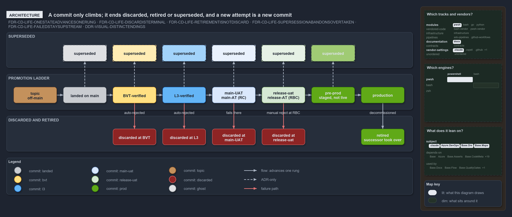
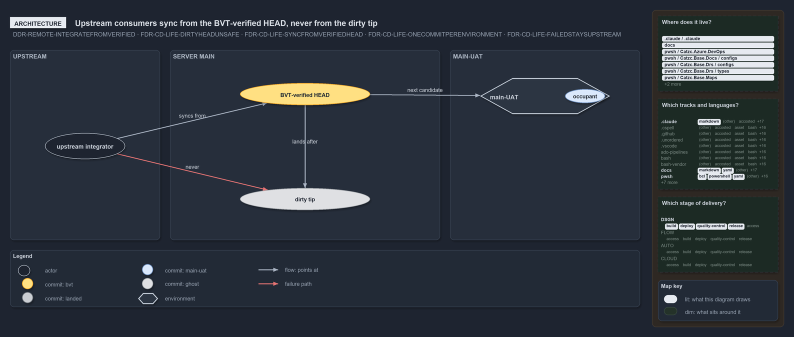

---
catzc:
  warning: "Header is generated by Format-FileMeta via Format-Code; do not change it"
  edges:
    cites:
      - DDR-REMOTE-INTEGRATEFROMVERIFIED
      - DDR-REMOTE-NORECONCILINGTIPS
      - DDR-REMOTE-PULLREQUESTISINGRESS
      - DDR-VISUAL
      - FDR-CD-TWORELEASEGATES
      - FDR-CD-ACCEPTANCETESTINGISNOTUAT
      - FDR-CD-RELEASECANDIDATE
      - FDR-GIT-SYNCPOINT
      - FDR-GIT-FALLBACKISANNOUNCED
    drs_total: 12
---

# Flow: The commit lifecycle — states, environment occupancy, and the stable sync point

The value-chain diagrams under `docs/.assets/commits-quality` — the `value-chain` promotion diagram and its `state-changes` flow-variant
companion — encode more than a promotion ladder: they encode what _happens to a commit_ — how it advances, where it dies, how it retires,
how it is overtaken by a newer commit, which commit an environment currently hosts, and which commit the outside world should integrate
from. This FDR states that lifecycle and integration model. The pipeline _domains_ (CI / CD / DEPLOY, the tagged artifact,
build-once-deploy-many) are owned by [cd-discipline-and-promotion-flow](cd-discipline-and-promotion-flow.md) (`FDR-CD`); the _visual
grammar_ (colours, lanes, ghosts, numbers) by [visual-design](../design/visual-design.md) (`DDR-VISUAL`). This FDR owns the commit's
lifecycle states and the upstream/downstream sync semantics.

## Rules: FDR-CD-LIFE

### Rule FDR-CD-LIFE-ONESTATEADVANCESONERUNG

**A commit holds one lifecycle state at a time; the state advances one rung along the promotion ladder or leaves it, and never moves
backward.** The ladder is: topic (brown) → landed on main (grey) → BVT-verified (yellow) → L3-verified (blue) → main-UAT / main-AT-verified
(light-blue) → release-uat / release-AT-verified (light-green) → **pre-prod** (staged, not yet live) → in production (green). The `main-UAT`
and `release-uat` rungs are reached by clearing their **acceptance testing** — `main-AT` and `release-AT` — at the RC and RBC gates. At any
rung a commit may advance, **hold** as an environment's occupant, or **leave the ladder** into a terminal state (discarded, retired, or
superseded). It never regresses to an earlier rung — a commit is not "re-verified" downward; a new attempt is a new commit.

- [The ladder](#the-ladder)

### Rule FDR-CD-LIFE-DISCARDISTERMINAL

**Discard is terminal rejection at a named stage, and the discarded commit stays in history.** A process rejects a candidate: **BVT** and
**L3** discard automatically, **release-uat** discards through its manual gate (**RBC**), and **main-UAT** can kill a commit that fails
there or hold it at its manual gate (**RC**). A discarded commit is coloured red, remains on the line where it was committed (history is
never rewritten), and can never progress. The diagram records _where_ it died, because "discarded at BVT" and "discarded at release-uat" are
different facts about the same outcome.

- [Discard](#discard)

### Rule FDR-CD-LIFE-RETIREMENTISNOTDISCARD

**Retirement is a successful end-of-life, and it is not a discard.** A commit that reached production, served there, and was then superseded
by a newer production commit is **retired** — it did its job and was decommissioned. Retirement and discard both mean "no longer live", but
they are opposite outcomes: discard is rejection before value was delivered; retirement is graceful hand-off after value was delivered. A
diagram that paints a retired commit the same red as a discarded one erases that difference.

- [Retirement](#retirement)

### Rule FDR-CD-LIFE-SUPERSESSIONABANDONSOVERTAKEN

**Supersession (rollover) abandons a still-valid commit that a newer commit overtook.** When a newer commit rolls over an older one that was
still progressing toward the same environment, the older is **superseded**: it was never rejected — it was valid — but a fresher commit
became the one carried forward, so the older is abandoned in place. Supersession is the third distinct ending, between "rejected" (discard)
and "delivered then retired": valid, but not chosen.

- [Supersession](#supersession)

### Rule FDR-CD-LIFE-ONECOMMITPERENVIRONMENT

**Each always-on environment hosts exactly one commit, plus a history.** `main-UAT`, `release-uat`, `pre-prod`, and `production` are
stateful, not pass-through: at any moment each holds one **occupant** — the commit deployed there, as the release candidate built from it —
and a trail of the commits it held before. Each rung is its own Azure DevOps environment per deployable-unit (`<unit>-main-uat`,
`<unit>-release-uat`), so each has its own occupant and its own deployment history. `pre-prod` is a **staging slot** inside the production
subscription, inactive until it is activated, not a separate subscription. An environment box in the diagram is a neutral container naming
its occupant, drawn in that commit's state colour (DDR-VISUAL-ENVIRONMENTISCONTAINER), so reading the occupant tells you the true state of
that environment right now.

- [One occupant per environment](#one-occupant-per-environment)

### Rule FDR-CD-LIFE-SYNCFROMVERIFIEDHEAD

**The stable integration point is the BVT-verified server head, and upstream integrators sync from it — never from the raw HEAD.** The
BVT-verified server head is the newest commit on the server's main that the BVT has verified and no later stage has failed. It is also the
commit that goes into `main-UAT` first, so once it is deployed it is the `main-UAT` occupant too: the commit synced from and the commit
`main-UAT` takes are one. Nobody syncs from a landed head the BVT has not judged yet (FDR-CD-LIFE-LANDEDUNTILFAILED) or from a dirty HEAD
(FDR-CD-LIFE-DIRTYHEADUNSAFE). While the server marks no BVT-verified head, a topic syncs from the current server HEAD and says so
(FDR-GIT-SYNCPOINT, FDR-GIT-FALLBACKISANNOUNCED).

- [Sync from the verified head](#sync-from-the-verified-head)

### Rule FDR-CD-LIFE-DIRTYHEADUNSAFE

**The dirty HEAD is the latest commit on main and is not a source that is safe to sync or promote from.** HEAD is simply the newest commit;
it may have _failed_ a downstream stage (for example, died in `main-UAT`). Such a commit is the **dirty HEAD**: it is the tip of main, but
it must not be synced from and cannot be promoted downstream. Consumers who naively track HEAD are pointed instead at the BVT-verified
server head (FDR-CD-LIFE-SYNCFROMVERIFIEDHEAD). "Latest" and "safe to build on" are different questions, and the model keeps them separate.
A newest commit that no stage has judged yet is _landed_, not dirty (FDR-CD-LIFE-LANDEDUNTILFAILED).

- [The dirty HEAD](#the-dirty-head)

### Rule FDR-CD-LIFE-FAILEDSTAYSUPSTREAM

**A commit that fails a stage cannot go downstream.** Failure at any environment stops both _promotion_ (it will not advance to a later
environment) and _downstream consumption_ (nothing may build on it). Downstream flow proceeds only from the last successful state, so a
failure is a hard stop, not a soft warning.

- [Failure stops downstream](#failure-stops-downstream)

### Rule FDR-CD-LIFE-TOPICDEPLOYSOUTOFBAND

**A topic commit can be deployed out-of-band by a workflow without integrating into main/master.** A workflow or pipeline may deploy a
commit that still lives on a topic branch — a hotfix or an experiment — even though it has not reached main/master. That deploy is
explicitly **not** an integration: the commit remains off-main until it lands normally, and the out-of-band deploy confers no promotion
state on the mainline.

- [Out-of-band topic deploys](#out-of-band-topic-deploys)

### Rule FDR-CD-LIFE-NUMBERISIDENTITY

**A commit's number is its time-ordered identity, and its terminal appearance is where its story ends.** Numbers run in commit time (`0`
before `1` … before `10`); the same number reappears in each lane in its state-of-the-moment colour, and its last appearance names its
ending — discarded, retired, superseded, in-process, an environment's occupant, or the dirty HEAD. The numbered worked examples are the
canonical encoding of this lifecycle (they render the grammar of
[DDR-VISUAL-ONLYGITLANEISTIME](../design/visual-design.md#rule-ddr-visual-onlygitlaneistime)).

- [One number, one story](#one-number-one-story)

### Rule FDR-CD-LIFE-FASTPUSHLANDS

**In `main-direct`, the client lands a commit by one fast push to main, and a push is never a history change.** Every commit reaches the
server as a single push from the client, carrying the text-field message or `...` when the field is empty. The push fast-forwards the
server's main; a rejected push (main moved) stops and reports, and the client integrates by hand. A force push, an amend of a pushed commit,
and an administrator's history change are not supported (FDR-CD-LIFE-DISCARDISTERMINAL). In `main-via-pr` the push is refused locally while
standing on main/master, the `git_workspace` variant's one stop condition.

- [Fast push to main](#fast-push-to-main)

### Rule FDR-CD-LIFE-LANDEDUNTILFAILED

**A pushed head is _landed_ until a stage fails it; only a failed head is the dirty HEAD.** A head on main that no stage has verified yet is
**landed** (grey, FDR-CD-LIFE-ONESTATEADVANCESONERUNG). It becomes the dirty HEAD (FDR-CD-LIFE-DIRTYHEADUNSAFE) only when a downstream stage
fails it, and the repair is a successor commit that fixes forward, never a rewrite of the failed one.

- [Landed, then dirty](#landed-then-dirty)

## The ladder

`The ladder and its one direction`

Promotion is monotonic because each rung is a stronger claim about the same artifact, and a stronger claim is never un-made by moving a
commit backward. A commit that has reached `main-UAT` is not demoted to "just BVT-verified"; if something is wrong, the commit is discarded
and a _new_ commit carries the fix forward. Modelling the ladder as one-directional is what lets a colour mean a durable fact ("this commit
is L3-verified") rather than a mutable label, and it is why the three ways off the ladder — discard, retirement, supersession — are all
terminal.

The RC and RBC gates and the acceptance testing that clears them belong to the flow model:
[FDR-CD-TWORELEASEGATES](cd-discipline-and-promotion-flow.md#rule-fdr-cd-tworeleasegates) defines the gates, and
[FDR-CD-ACCEPTANCETESTINGISNOTUAT](cd-discipline-and-promotion-flow.md#rule-fdr-cd-acceptancetestingisnotuat) separates the acceptance
testing from the environment it runs in.

```yml drawio
description:
  "The promotion ladder of a commit, left to right and never backward: each rung a state in the locked commit palette, the superseded ghost
  above every rung a newer commit rolled over, and the three terminal endings below, discarded at a named gate or retired once a successor
  took over production."
about:
  adrs:
    - FDR-CD-LIFE-ONESTATEADVANCESONERUNG
    - FDR-CD-LIFE-DISCARDISTERMINAL
    - FDR-CD-LIFE-RETIREMENTISNOTDISCARD
    - FDR-CD-LIFE-SUPERSESSIONABANDONSOVERTAKEN
    - FDR-CD-LIFE-FAILEDSTAYSUPSTREAM
    - DDR-VISUAL-DISTINCTENDINGS
  lens: architecture
content:
  title: A commit only climbs; it ends discarded, retired or superseded, and a new attempt is a new commit
  kind: reference
  flow: left-to-right
  relation: advances one rung
  theme: dark
  bands:
    - { id: band-superseded, label: SUPERSEDED }
    - { id: band-ladder, label: PROMOTION LADDER }
    - { id: band-endings, label: DISCARDED AND RETIRED }
  glyphs:
    - { id: ghost-landed, kind: commit, label: superseded, in: band-superseded, shape: box, state: landed, ghost: true }
    - { id: ghost-bvt, kind: commit, label: superseded, in: band-superseded, shape: box, ghost: true }
    - { id: ghost-l3, kind: commit, label: superseded, in: band-superseded, shape: box, state: l3, ghost: true }
    - { id: ghost-main-uat, kind: commit, label: superseded, in: band-superseded, shape: box, state: main-uat, ghost: true }
    - { id: ghost-release-uat, kind: commit, label: superseded, in: band-superseded, shape: box, state: release-uat, ghost: true }
    - { id: ghost-pre-prod, kind: commit, label: superseded, in: band-superseded, shape: box, state: prod, ghost: true }
    - id: rung-topic
      kind: commit
      label: "topic

        off-main"
      in: band-ladder
      shape: box
      state: topic
    - { id: rung-landed, kind: commit, label: landed on main, in: band-ladder, shape: box, state: landed }
    - { id: rung-bvt, kind: commit, label: BVT-verified, in: band-ladder, shape: box }
    - { id: rung-l3, kind: commit, label: L3-verified, in: band-ladder, shape: box, state: l3 }
    - id: rung-main-uat
      kind: commit
      label: "main-UAT

        main-AT (RC)"
      in: band-ladder
      shape: box
      state: main-uat
    - id: rung-release-uat
      kind: commit
      label: "release-uat

        release-AT (RBC)"
      in: band-ladder
      shape: box
      state: release-uat
    - id: rung-pre-prod
      kind: commit
      label: "pre-prod

        staged, not live"
      in: band-ladder
      shape: box
      state: prod
    - { id: rung-production, kind: commit, label: production, in: band-ladder, shape: box, state: prod }
    - { id: discard-bvt, kind: commit, label: discarded at BVT, in: band-endings, shape: box, state: discarded }
    - { id: discard-l3, kind: commit, label: discarded at L3, in: band-endings, shape: box, state: discarded }
    - { id: discard-main-uat, kind: commit, label: discarded at main-UAT, in: band-endings, shape: box, state: discarded }
    - { id: discard-release-uat, kind: commit, label: discarded at release-uat, in: band-endings, shape: box, state: discarded }
    - id: retired
      kind: commit
      label: "retired

        successor took over"
      in: band-endings
      shape: box
      state: prod
  edges:
    - { from: rung-topic, to: rung-landed, kind: flow, label: "" }
    - { from: rung-landed, to: rung-bvt, kind: flow, label: "" }
    - { from: rung-bvt, to: rung-l3, kind: flow, label: "" }
    - { from: rung-l3, to: rung-main-uat, kind: flow, label: "" }
    - { from: rung-main-uat, to: rung-release-uat, kind: flow, label: "" }
    - { from: rung-release-uat, to: rung-pre-prod, kind: flow, label: "" }
    - { from: rung-pre-prod, to: rung-production, kind: flow, label: "" }
    - { from: rung-landed, to: ghost-landed, kind: adr, label: "" }
    - { from: rung-bvt, to: ghost-bvt, kind: adr, label: "" }
    - { from: rung-l3, to: ghost-l3, kind: adr, label: "" }
    - { from: rung-main-uat, to: ghost-main-uat, kind: adr, label: "" }
    - { from: rung-release-uat, to: ghost-release-uat, kind: adr, label: "" }
    - { from: rung-pre-prod, to: ghost-pre-prod, kind: adr, label: "" }
    - { from: rung-bvt, to: discard-bvt, kind: fail, label: auto-rejected }
    - { from: rung-l3, to: discard-l3, kind: fail, label: auto-rejected }
    - { from: rung-main-uat, to: discard-main-uat, kind: fail, label: fails there }
    - { from: rung-release-uat, to: discard-release-uat, kind: fail, label: manual reject at RBC }
    - { from: rung-production, to: retired, kind: flow, label: decommissioned }
  legend: auto
  minimaps:
    track-placement:
      - cell: modules/pwsh
        by:
          - pwsh/Catzc.Azure.DevOps/Sync-AdoEnvironmentApprovals.ps1
          - pwsh/Catzc.Base.Drs/configs/drs.yml
          - pwsh/Catzc.Base.Drs/types/DrsConfig.cs
          - pwsh/Catzc.Base.Maps/Get-LifecyclePositionMinimapData.ps1
          - pwsh/Catzc.Base.Maps/Get-ValueChainHighlight.ps1
          - pwsh/Catzc.Base.Maps/Get-WorldMapHighlight.ps1
          - pwsh/Catzc.Base.Maps/tests/Get-WorldMapHighlight.Tests.ps1
          - DDR-VISUAL-DISTINCTENDINGS
          - FDR-CD-LIFE-DISCARDISTERMINAL
          - FDR-CD-LIFE-FAILEDSTAYSUPSTREAM
          - FDR-CD-LIFE-ONESTATEADVANCESONERUNG
          - FDR-CD-LIFE-RETIREMENTISNOTDISCARD
          - FDR-CD-LIFE-SUPERSESSIONABANDONSOVERTAKEN
      - cell: documentation/docs
        by:
          - docs/drs/design/dora-explains.md
          - docs/drs/design/visual-design.md
          - docs/drs/flow/commit-lifecycle.md
          - docs/drs/flow/dora-explains.md
          - docs/drs/index.md
          - docs/how-to/automation/apply-environment-approvals.md
          - docs/references/pwsh/catzc-azure-dev-ops/Sync-AdoEnvironmentApprovals.ps1.md
          - docs/references/pwsh/catzc-base-drs/types/DrsConfig.cs.md
          - docs/references/pwsh/catzc-base-maps/Get-LifecyclePositionMinimapData.ps1.md
          - docs/references/pwsh/catzc-base-maps/Get-ValueChainHighlight.ps1.md
          - docs/references/pwsh/catzc-base-maps/Get-WorldMapHighlight.ps1.md
          - DDR-VISUAL-DISTINCTENDINGS
          - FDR-CD-LIFE-DISCARDISTERMINAL
          - FDR-CD-LIFE-FAILEDSTAYSUPSTREAM
          - FDR-CD-LIFE-ONESTATEADVANCESONERUNG
          - FDR-CD-LIFE-RETIREMENTISNOTDISCARD
          - FDR-CD-LIFE-SUPERSESSIONABANDONSOVERTAKEN
      - cell: vendor-settings/.claude
        by:
          - .claude/CLAUDE.md
          - FDR-CD-LIFE-DISCARDISTERMINAL
          - FDR-CD-LIFE-FAILEDSTAYSUPSTREAM
          - FDR-CD-LIFE-ONESTATEADVANCESONERUNG
          - FDR-CD-LIFE-RETIREMENTISNOTDISCARD
          - FDR-CD-LIFE-SUPERSESSIONABANDONSOVERTAKEN
    engine-strip:
      - cell: pwsh/powershell
        by:
          - pwsh/Catzc.Azure.DevOps/Sync-AdoEnvironmentApprovals.ps1
          - pwsh/Catzc.Base.Maps/Get-LifecyclePositionMinimapData.ps1
          - pwsh/Catzc.Base.Maps/Get-ValueChainHighlight.ps1
          - pwsh/Catzc.Base.Maps/Get-WorldMapHighlight.ps1
          - pwsh/Catzc.Base.Maps/tests/Get-WorldMapHighlight.Tests.ps1
          - FDR-CD-LIFE-DISCARDISTERMINAL
          - FDR-CD-LIFE-FAILEDSTAYSUPSTREAM
          - FDR-CD-LIFE-ONESTATEADVANCESONERUNG
          - FDR-CD-LIFE-RETIREMENTISNOTDISCARD
          - FDR-CD-LIFE-SUPERSESSIONABANDONSOVERTAKEN
    module-neighbourhood:
      - cell: subject/.claude
        by:
          - .claude/CLAUDE.md
          - FDR-CD-LIFE-DISCARDISTERMINAL
          - FDR-CD-LIFE-FAILEDSTAYSUPSTREAM
          - FDR-CD-LIFE-ONESTATEADVANCESONERUNG
          - FDR-CD-LIFE-RETIREMENTISNOTDISCARD
          - FDR-CD-LIFE-SUPERSESSIONABANDONSOVERTAKEN
      - cell: subject/Catzc.Azure.DevOps
        by:
          - pwsh/Catzc.Azure.DevOps/Sync-AdoEnvironmentApprovals.ps1
          - FDR-CD-LIFE-DISCARDISTERMINAL
          - FDR-CD-LIFE-FAILEDSTAYSUPSTREAM
          - FDR-CD-LIFE-ONESTATEADVANCESONERUNG
          - FDR-CD-LIFE-RETIREMENTISNOTDISCARD
          - FDR-CD-LIFE-SUPERSESSIONABANDONSOVERTAKEN
      - cell: subject/Catzc.Base.Drs
        by:
          - pwsh/Catzc.Base.Drs/configs/drs.yml
          - pwsh/Catzc.Base.Drs/types/DrsConfig.cs
          - DDR-VISUAL-DISTINCTENDINGS
          - FDR-CD-LIFE-DISCARDISTERMINAL
          - FDR-CD-LIFE-FAILEDSTAYSUPSTREAM
          - FDR-CD-LIFE-ONESTATEADVANCESONERUNG
          - FDR-CD-LIFE-RETIREMENTISNOTDISCARD
          - FDR-CD-LIFE-SUPERSESSIONABANDONSOVERTAKEN
      - cell: subject/Catzc.Base.Maps
        by:
          - pwsh/Catzc.Base.Maps/Get-LifecyclePositionMinimapData.ps1
          - pwsh/Catzc.Base.Maps/Get-ValueChainHighlight.ps1
          - pwsh/Catzc.Base.Maps/Get-WorldMapHighlight.ps1
          - pwsh/Catzc.Base.Maps/tests/Get-WorldMapHighlight.Tests.ps1
          - FDR-CD-LIFE-DISCARDISTERMINAL
          - FDR-CD-LIFE-FAILEDSTAYSUPSTREAM
          - FDR-CD-LIFE-ONESTATEADVANCESONERUNG
          - FDR-CD-LIFE-RETIREMENTISNOTDISCARD
          - FDR-CD-LIFE-SUPERSESSIONABANDONSOVERTAKEN
layout:
  band-superseded: { x: 20, y: 84, w: 1260, h: 110 }
  band-ladder: { x: 20, y: 214, w: 1260, h: 110 }
  band-endings: { x: 20, y: 344, w: 1260, h: 110 }
  ghost-landed: { x: 196, y: 124, w: 134, h: 50 }
  ghost-bvt: { x: 350, y: 124, w: 134, h: 50 }
  ghost-l3: { x: 504, y: 124, w: 134, h: 50 }
  ghost-main-uat: { x: 658, y: 124, w: 134, h: 50 }
  ghost-release-uat: { x: 812, y: 124, w: 134, h: 50 }
  ghost-pre-prod: { x: 966, y: 124, w: 134, h: 50 }
  rung-topic: { x: 42, y: 254, w: 134, h: 50 }
  rung-landed: { x: 196, y: 254, w: 134, h: 50 }
  rung-bvt: { x: 350, y: 254, w: 134, h: 50 }
  rung-l3: { x: 504, y: 254, w: 134, h: 50 }
  rung-main-uat: { x: 658, y: 254, w: 134, h: 50 }
  rung-release-uat: { x: 812, y: 254, w: 134, h: 50 }
  rung-pre-prod: { x: 966, y: 254, w: 134, h: 50 }
  rung-production: { x: 1120, y: 254, w: 134, h: 50 }
  discard-bvt: { x: 350, y: 384, w: 134, h: 50 }
  discard-l3: { x: 504, y: 384, w: 134, h: 50 }
  discard-main-uat: { x: 658, y: 384, w: 134, h: 50 }
  discard-release-uat: { x: 812, y: 384, w: 134, h: 50 }
  retired: { x: 1120, y: 384, w: 134, h: 50 }
```



## Discard

`Discard is rejection, and it is named`

Every gate exists to reject, and the diagram records not just that a commit was rejected but by which gate, because the gate is the
diagnosis. BVT and L3 reject automatically the moment their checks fail; release-uat rejects only when a human opens its manual gate (RBC)
the wrong way; `main-UAT` rejects a commit that cannot stand up on the always-on environment, or that a human holds at its gate (RC).
Keeping the rejection point in the record turns "it was discarded" into "it was discarded at L3", which is the difference between a shrug
and a lead. The RC and RBC gates are defined by [FDR-CD-TWORELEASEGATES](cd-discipline-and-promotion-flow.md#rule-fdr-cd-tworeleasegates).

## Retirement

`Retirement is success, not rejection`

The most consequential distinction in the lifecycle is that leaving production is usually a _win_. A commit reaches production, serves real
traffic, and is eventually replaced by a newer production commit; at that point it retires. Collapsing retirement into discard would make
the diagram claim that a commit which delivered months of value "failed", which is the opposite of the truth. Retirement is drawn as the
production colour moved into the retired lane — the commit keeps the green of what it achieved.

## Supersession

`Supersession abandons without rejecting`

Not every commit that fails to reach production was wrong; some were simply overtaken. When a newer commit rolls over an older one on the
way to an environment, the older commit was valid at the moment it was abandoned — no gate rejected it — but a fresher commit became the one
carried forward. Naming this as its own ending (rather than lumping it with discard) matters because a superseded commit tells you the
pipeline was _moving fast_, whereas a discarded commit tells you the pipeline _caught a defect_; conflating them hides both signals.

## One occupant per environment

`Environments have a single occupant`

An always-on environment is a place, and a place holds one thing at a time. `main-UAT`, `release-uat`, `pre-prod`, and `production` each
have exactly one current commit deployed, and treating them as stateful — occupant plus history — is what makes questions like "what is in
production right now" answerable by pointing at a single dot. A pass-through mental model, where commits merely flow through, cannot answer
those questions; the occupant model can. What is deployed as the occupant is the release candidate built from its commit
([FDR-CD-RELEASECANDIDATE](cd-discipline-and-promotion-flow.md#rule-fdr-cd-releasecandidate)).

## Sync from the verified head

The problem the rule solves is working from a shared dirty head: a tip of main that nobody has judged, or that a stage has failed, hands its
defect to everyone who builds on it. The BVT-verified server head has been proven by the BVT, and it is the newest such commit, so consumers
build on recent work without inheriting what the BVT catches. The same commit is the one `main-UAT` takes next, so the always-on environment
and the consumers stand on one point rather than two that drift apart. When that commit then fails in `main-UAT`, it becomes the dirty
HEAD's case: nobody syncs from it any longer, and a fix-forward commit earns the place once the BVT verifies it.

```yml drawio
description:
  Upstream consumers sync from the latest BVT-verified HEAD of the server's main and never from the dirty tip, a commit that landed after it
  and is not yet judged or failed; the main-UAT occupant is a separate fact, with the verified HEAD queued as its next candidate.
about:
  adrs:
    - DDR-REMOTE-INTEGRATEFROMVERIFIED
    - FDR-CD-LIFE-DIRTYHEADUNSAFE
    - FDR-CD-LIFE-SYNCFROMVERIFIEDHEAD
    - FDR-CD-LIFE-ONECOMMITPERENVIRONMENT
    - FDR-CD-LIFE-FAILEDSTAYSUPSTREAM
  lens: architecture
content:
  title: Upstream consumers sync from the BVT-verified HEAD, never from the dirty tip
  kind: reference
  flow: left-to-right
  relation: points at
  theme: dark
  bands:
    - { id: band-consumers, label: UPSTREAM }
    - { id: band-server, label: SERVER MAIN }
    - { id: band-uat, label: MAIN-UAT }
  glyphs:
    - { id: g-integrator, kind: actor, label: upstream integrator, in: band-consumers }
    - { id: c-verified, kind: commit, label: BVT-verified HEAD, in: band-server }
    - { id: c-tip, kind: commit, label: dirty tip, in: band-server, state: landed, ghost: true }
    - { id: e-main-uat, kind: env, label: main-UAT, in: band-uat }
    - { id: c-occupant, kind: commit, label: occupant, in: e-main-uat, state: main-uat }
  edges:
    - { from: g-integrator, to: c-verified, kind: flow, label: syncs from }
    - { from: g-integrator, to: c-tip, kind: fail, label: never }
    - { from: c-verified, to: e-main-uat, kind: flow, label: next candidate }
    - { from: c-verified, to: c-tip, kind: flow, label: lands after }
  legend: auto
  minimaps:
    code-locations:
      - cell: .claude/.claude/.
        by:
          - .claude/CLAUDE.md
          - FDR-CD-LIFE-DIRTYHEADUNSAFE
          - FDR-CD-LIFE-FAILEDSTAYSUPSTREAM
          - FDR-CD-LIFE-ONECOMMITPERENVIRONMENT
          - FDR-CD-LIFE-SYNCFROMVERIFIEDHEAD
      - cell: docs/-/.
        by:
          - docs/drs/design/dora-explains.md
          - docs/drs/design/server-remote-integration.md
          - docs/drs/flow/commit-lifecycle.md
          - docs/drs/flow/dora-explains.md
          - docs/drs/glossary.md
          - docs/drs/index.md
          - docs/how-to/automation/apply-environment-approvals.md
          - docs/references/pwsh/catzc-azure-dev-ops/Sync-AdoEnvironmentApprovals.ps1.md
          - docs/references/pwsh/catzc-base-drs/types/DrsConfig.cs.md
          - docs/references/pwsh/catzc-base-maps/Get-LifecyclePositionMinimapData.ps1.md
          - docs/references/pwsh/catzc-base-maps/Get-ValueChainHighlight.ps1.md
          - docs/references/pwsh/catzc-base-maps/Get-WorldMapHighlight.ps1.md
          - DDR-REMOTE-INTEGRATEFROMVERIFIED
          - FDR-CD-LIFE-DIRTYHEADUNSAFE
          - FDR-CD-LIFE-FAILEDSTAYSUPSTREAM
          - FDR-CD-LIFE-ONECOMMITPERENVIRONMENT
          - FDR-CD-LIFE-SYNCFROMVERIFIEDHEAD
      - cell: pwsh/Catzc.Azure.DevOps/.
        by:
          - pwsh/Catzc.Azure.DevOps/Sync-AdoEnvironmentApprovals.ps1
          - FDR-CD-LIFE-DIRTYHEADUNSAFE
          - FDR-CD-LIFE-FAILEDSTAYSUPSTREAM
          - FDR-CD-LIFE-ONECOMMITPERENVIRONMENT
          - FDR-CD-LIFE-SYNCFROMVERIFIEDHEAD
      - cell: pwsh/Catzc.Base.Docs/configs
        by: [pwsh/Catzc.Base.Docs/configs/glossary.yml, FDR-CD-LIFE-ONECOMMITPERENVIRONMENT]
      - cell: pwsh/Catzc.Base.Drs/configs
        by:
          - pwsh/Catzc.Base.Drs/configs/drs.yml
          - DDR-REMOTE-INTEGRATEFROMVERIFIED
          - FDR-CD-LIFE-DIRTYHEADUNSAFE
          - FDR-CD-LIFE-FAILEDSTAYSUPSTREAM
          - FDR-CD-LIFE-ONECOMMITPERENVIRONMENT
          - FDR-CD-LIFE-SYNCFROMVERIFIEDHEAD
      - cell: pwsh/Catzc.Base.Drs/types
        by:
          - pwsh/Catzc.Base.Drs/types/DrsConfig.cs
          - FDR-CD-LIFE-DIRTYHEADUNSAFE
          - FDR-CD-LIFE-FAILEDSTAYSUPSTREAM
          - FDR-CD-LIFE-ONECOMMITPERENVIRONMENT
          - FDR-CD-LIFE-SYNCFROMVERIFIEDHEAD
      - cell: pwsh/Catzc.Base.Maps/.
        by:
          - pwsh/Catzc.Base.Maps/Get-LifecyclePositionMinimapData.ps1
          - pwsh/Catzc.Base.Maps/Get-ValueChainHighlight.ps1
          - pwsh/Catzc.Base.Maps/Get-WorldMapHighlight.ps1
          - FDR-CD-LIFE-DIRTYHEADUNSAFE
          - FDR-CD-LIFE-FAILEDSTAYSUPSTREAM
          - FDR-CD-LIFE-ONECOMMITPERENVIRONMENT
          - FDR-CD-LIFE-SYNCFROMVERIFIEDHEAD
      - cell: pwsh/Catzc.Base.Maps/tests
        by:
          - pwsh/Catzc.Base.Maps/tests/Get-WorldMapHighlight.Tests.ps1
          - FDR-CD-LIFE-DIRTYHEADUNSAFE
          - FDR-CD-LIFE-FAILEDSTAYSUPSTREAM
          - FDR-CD-LIFE-ONECOMMITPERENVIRONMENT
          - FDR-CD-LIFE-SYNCFROMVERIFIEDHEAD
      - cell: pwsh/Catzc.Base.ModuleSystem/configs
        by: [pwsh/Catzc.Base.ModuleSystem/configs/glossary.yml, FDR-CD-LIFE-ONECOMMITPERENVIRONMENT]
    grid:
      - cell: .claude/markdown
        by:
          - .claude/CLAUDE.md
          - FDR-CD-LIFE-DIRTYHEADUNSAFE
          - FDR-CD-LIFE-FAILEDSTAYSUPSTREAM
          - FDR-CD-LIFE-ONECOMMITPERENVIRONMENT
          - FDR-CD-LIFE-SYNCFROMVERIFIEDHEAD
      - cell: docs/markdown
        by:
          - docs/drs/design/dora-explains.md
          - docs/drs/design/server-remote-integration.md
          - docs/drs/flow/commit-lifecycle.md
          - docs/drs/flow/dora-explains.md
          - docs/drs/glossary.md
          - docs/drs/index.md
          - docs/how-to/automation/apply-environment-approvals.md
          - docs/references/pwsh/catzc-azure-dev-ops/Sync-AdoEnvironmentApprovals.ps1.md
          - docs/references/pwsh/catzc-base-drs/types/DrsConfig.cs.md
          - docs/references/pwsh/catzc-base-maps/Get-LifecyclePositionMinimapData.ps1.md
          - docs/references/pwsh/catzc-base-maps/Get-ValueChainHighlight.ps1.md
          - docs/references/pwsh/catzc-base-maps/Get-WorldMapHighlight.ps1.md
          - DDR-REMOTE-INTEGRATEFROMVERIFIED
          - FDR-CD-LIFE-DIRTYHEADUNSAFE
          - FDR-CD-LIFE-FAILEDSTAYSUPSTREAM
          - FDR-CD-LIFE-ONECOMMITPERENVIRONMENT
          - FDR-CD-LIFE-SYNCFROMVERIFIEDHEAD
      - cell: pwsh/bcl
        by:
          - pwsh/Catzc.Base.Drs/types/DrsConfig.cs
          - FDR-CD-LIFE-DIRTYHEADUNSAFE
          - FDR-CD-LIFE-FAILEDSTAYSUPSTREAM
          - FDR-CD-LIFE-ONECOMMITPERENVIRONMENT
          - FDR-CD-LIFE-SYNCFROMVERIFIEDHEAD
      - cell: pwsh/powershell
        by:
          - pwsh/Catzc.Azure.DevOps/Sync-AdoEnvironmentApprovals.ps1
          - pwsh/Catzc.Base.Maps/Get-LifecyclePositionMinimapData.ps1
          - pwsh/Catzc.Base.Maps/Get-ValueChainHighlight.ps1
          - pwsh/Catzc.Base.Maps/Get-WorldMapHighlight.ps1
          - pwsh/Catzc.Base.Maps/tests/Get-WorldMapHighlight.Tests.ps1
          - FDR-CD-LIFE-DIRTYHEADUNSAFE
          - FDR-CD-LIFE-FAILEDSTAYSUPSTREAM
          - FDR-CD-LIFE-ONECOMMITPERENVIRONMENT
          - FDR-CD-LIFE-SYNCFROMVERIFIEDHEAD
      - cell: pwsh/yaml
        by:
          - pwsh/Catzc.Base.Docs/configs/glossary.yml
          - pwsh/Catzc.Base.Drs/configs/drs.yml
          - pwsh/Catzc.Base.ModuleSystem/configs/glossary.yml
          - DDR-REMOTE-INTEGRATEFROMVERIFIED
          - FDR-CD-LIFE-DIRTYHEADUNSAFE
          - FDR-CD-LIFE-FAILEDSTAYSUPSTREAM
          - FDR-CD-LIFE-ONECOMMITPERENVIRONMENT
          - FDR-CD-LIFE-SYNCFROMVERIFIEDHEAD
    axis:
      - cell: DSGN/build
        by: [DDR-REMOTE-INTEGRATEFROMVERIFIED]
      - cell: DSGN/quality-control
        by:
          - DDR-REMOTE-INTEGRATEFROMVERIFIED
          - FDR-CD-LIFE-DIRTYHEADUNSAFE
          - FDR-CD-LIFE-FAILEDSTAYSUPSTREAM
          - FDR-CD-LIFE-ONECOMMITPERENVIRONMENT
          - FDR-CD-LIFE-SYNCFROMVERIFIEDHEAD
      - cell: DSGN/release
        by:
          - FDR-CD-LIFE-DIRTYHEADUNSAFE
          - FDR-CD-LIFE-FAILEDSTAYSUPSTREAM
          - FDR-CD-LIFE-ONECOMMITPERENVIRONMENT
          - FDR-CD-LIFE-SYNCFROMVERIFIEDHEAD
      - cell: DSGN/deploy
        by:
          - FDR-CD-LIFE-DIRTYHEADUNSAFE
          - FDR-CD-LIFE-FAILEDSTAYSUPSTREAM
          - FDR-CD-LIFE-ONECOMMITPERENVIRONMENT
          - FDR-CD-LIFE-SYNCFROMVERIFIEDHEAD
layout:
  band-consumers: { x: 20, y: 84, w: 300, h: 380 }
  band-server: { x: 340, y: 84, w: 540, h: 380 }
  band-uat: { x: 900, y: 84, w: 380, h: 380 }
  g-integrator: { x: 90, y: 250, w: 160, h: 52 }
  c-verified: { x: 480, y: 150, w: 260, h: 44 }
  c-tip: { x: 480, y: 360, w: 260, h: 44 }
  e-main-uat: { x: 960, y: 140, w: 260, h: 72 }
  c-occupant: { x: 1130, y: 162, w: 80, h: 28 }
```



## The dirty HEAD

HEAD answers "what is newest", not "what is good", and the two diverge exactly when the newest commit has failed downstream. A commit that
died in `main-UAT` is still the tip of main — the dirty HEAD — and a consumer or a downstream stage that follows HEAD blindly would pick up
a known-bad commit. The model marks the dirty HEAD as unusable for sync and for downstream promotion, and redirects sync to the BVT-verified
server head, so "someone committed something broken to the tip" degrades gracefully instead of propagating.

## Failure stops downstream

Downstream flow is a privilege earned by the last successful state, so a failure withdraws it entirely: a commit that cannot stand up on an
environment neither advances to the next environment nor may be consumed by anything downstream. Making failure a hard stop — rather than a
warning that downstream is free to ignore — is what keeps a single bad commit from leaking into later environments or into upstream
consumers' builds.

## Out-of-band topic deploys

There is a legitimate path that skips integration: a workflow can deploy a topic-branch commit directly, for a hotfix or an experiment,
without that commit having reached main/master. The model treats this honestly — the commit is deployed but _not integrated_, stays off-main
(brown) until it lands normally, and its out-of-band deploy grants it no mainline promotion state. Drawing it as a topic commit that
nonetheless reached an environment captures that a deploy and an integration are separate events.

## One number, one story

A single commit is hard to follow across stage-organised lanes, so each traced commit carries a time-ordered number and the number is the
thread. Because git is the only true left-to-right timeline (DDR-VISUAL-ONLYGITLANEISTIME), the numbers restore both identity and chronology
everywhere else: the same digit appears in each lane at its state-of-the-moment colour, and its final appearance is the verdict. The worked
examples below are the canonical set.

## Fast push to main

`One push lands a commit`

Integration here is continuous, so the cheapest landing wins: the client commits and pushes once, and the BVT and the stages after it judge
the commit after it is on main, not before. That only works if a push can never damage what the server already holds, hence the two
refusals: no force, no amend of a pushed commit. The one sanctioned failure is a rejected push, where another client landed first; the
tooling stops and reports rather than rebasing, because rebasing builds the commit on the server's tip, which may be a dirty HEAD
([DDR-REMOTE-INTEGRATEFROMVERIFIED](../design/server-remote-integration.md#rule-ddr-remote-integratefromverified)). The shortcut belongs to
the solo `main-direct` regime of the `git_workspace` variant; once the repo is `main-via-pr`, the PR is the only ingress
([DDR-REMOTE-PULLREQUESTISINGRESS](../design/server-remote-integration.md#rule-ddr-remote-pullrequestisingress)).

## Landed, then dirty

`Landed is not yet wrong`

Pushing before verifying means the tip of main is often a commit nobody has judged. Calling that commit "dirty" would claim a failure that
has not happened, so the model names it _landed_ and keeps "dirty HEAD" for the commit a stage actually failed. The distinction matters for
the response: a landed head waits for its gate; a dirty head gets a fix-forward commit, and consumers stay on the verified point meanwhile
([DDR-REMOTE-NORECONCILINGTIPS](../design/server-remote-integration.md#rule-ddr-remote-noreconcilingtips)).

## Worked lifecycle examples

These commits are the canonical encoding of the model; each number is one commit's whole journey and its ending.

| #   | Journey                                    | Ending                                                                    |
| --- | ------------------------------------------ | ------------------------------------------------------------------------- |
| 0   | progressed up the ladder to release-uat    | **discarded** — manually rejected at the RBC gate on release-uat          |
| 1   | reached production and served there        | **retired** — decommissioned after a successor took over                  |
| 2   | progressed to L3-vertical on main          | **discarded** — auto-rejected in L3-vertical                              |
| 3   | reached release-uat, valid                 | **superseded** — overtaken by 4's rollover                                |
| 4   | rolled over 3 and shipped                  | **the production occupant**                                               |
| 5   | promoted into release-uat                  | **the release-uat occupant** — the release candidate under test           |
| 6   | promoted onto main-UAT                     | **the main-UAT occupant** — and the BVT-verified head upstream syncs from |
| 7   | entered BVT                                | **discarded** — auto-rejected at BVT                                      |
| 8   | landed on main, entered BVT                | **in-process** — currently being BVT-verified                             |
| 9   | topic commit, deployed by a workflow       | **off-main** — out-of-band deployed, not yet integrated to main/master    |
| 10  | latest commit; entered main-UAT and failed | **dirty HEAD** — tip of main, not a source for sync/downstream (use 6)    |
