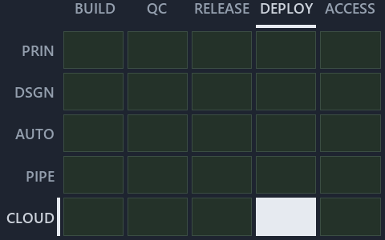

# Nobody types an Azure name: cats derives it, and a bad name stops with an error: the value-chain minimap

```text
Where ADR-AZ-NAMING sit in the value chain: value-chain stack down, value-chain concerns across.
1 of 25 cells lit.
```



This is the value-chain minimap in the sidebar of the operations diagram of [Nobody types an Azure name: cats derives it, and a bad name
stops with an error][5], which explains [ADR-AZ-NAMING][1]. It lights the cells of the value-chain map where the cited ADRs' value-chain
concerns land, so it shows the part of the value chain the decision governs. Each lit cell has its reason below, naming the code that
selects it.

## What the minimap shows

Value-chain map: value-chain stack × value-chain concerns. The grid crosses the 5 rows of the value-chain stack (PRIN, DSGN, AUTO, PIPE,
CLOUD) with the 5 value-chain concerns (build, quality-control, release, deploy, access) and lights 1 cell, filled in ink. Every other cell
is idle, a grey box: it holds ADRs the slide does not cite, or none, because no ADR's value-chain concern lands there (5 of the 25 cells
hold none). The minimap shows where the slide sits, not how many ADRs a cell holds; that count belongs to the full value-chain map.

- CLOUD × deploy: 1 lit of 23 ADRs

## Key

Rows are the value-chain stack and columns the value-chain concerns, each printed as a capital code:

- `PRIN`: the PRIN row of the value-chain stack
- `DSGN`: the DSGN row of the value-chain stack
- `AUTO`: the AUTO row of the value-chain stack
- `PIPE`: the PIPE row of the value-chain stack
- `CLOUD`: the CLOUD row of the value-chain stack
- `BUILD`: build
- `QC`: quality-control
- `RELEASE`: release
- `DEPLOY`: deploy
- `ACCESS`: access

## Why each cell is lit

### CLOUD × deploy (1 ADR)

Lit ([ADR-DSGN-TRACK#12][2]) by:

- [ADR-AZ-NAMING][1]: selected by [ADR-AZ-NAMING][1]; its ADR domain `azure` sits on the CLOUD row of the value-chain stack
  ([ADR-DSGN-TRACK#14][3]); its value-chain concerns (deploy) are its ADR domain's default, so it lights the deploy column
  ([ADR-DSGN-TRACK#15][4]).

## Keywords

- [value-chain map][6]
- [value-chain stack][7]
- [value-chain concern][8]
- [cell][9]
- [lit cell][10]

[1]: ../../../adr/azure/azure-naming-standard.md
[2]: ../../../adr/design/tracks.md#rule-adr-dsgn-track12
[3]: ../../../adr/design/tracks.md#rule-adr-dsgn-track14
[4]: ../../../adr/design/tracks.md#rule-adr-dsgn-track15
[5]: ../../azure/names-are-derived-never-typed.md
[6]: ../../../adr/glossary.md#value-chain-map
[7]: ../../../adr/glossary.md#value-chain-stack
[8]: ../../../adr/glossary.md#value-chain-concern
[9]: ../../../adr/glossary.md#cell
[10]: ../../../adr/glossary.md#lit-cell
