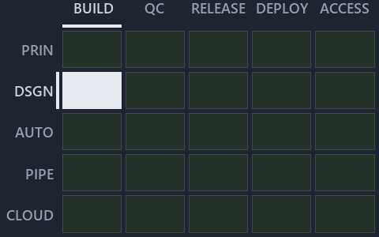

# docs/explanation/.assets/chain/adr-dsgn-aspect--only-automation-compiles-its-aspects--architecture.chain.md

`Value-chain minimap: adr-dsgn-aspect--only-automation-compiles-its-aspects--architecture`

The value-chain minimap of the slide `adr-dsgn-aspect--only-automation-compiles-its-aspects--architecture` (architecture lens). The slide
supports [ADR-DSGN-ASPECT][1]; the highlight of those ADR codes selects what is lit, and each reason below names the code that selects it.

## What the minimap shows

Value-chain map: value-chain stack × value-chain concerns. The grid crosses the 5 rows of the value-chain stack (PRIN, DSGN, AUTO, PIPE,
CLOUD) with the 5 value-chain concerns (build, quality-control, release, deploy, access) and lights 1 cell, filled in ink. Every other cell
is idle, a grey box: it holds ADRs the slide does not cite, or none, because no ADR's value-chain concern lands there (5 of the 25 cells
hold none). The minimap shows where the slide sits, not how many ADRs a cell holds; that count belongs to the full value-chain map.

- DSGN × build: 1 lit of 5 ADRs

## Key

Rows are the value-chain stack and columns the value-chain concerns, each printed as a capital code:

- `PRIN`: the PRIN row of the value-chain stack
- `DSGN`: the DSGN row of the value-chain stack
- `AUTO`: the AUTO row of the value-chain stack
- `PIPE`: the PIPE row of the value-chain stack
- `CLOUD`: the CLOUD row of the value-chain stack
- `BUILD`: build
- `QC`: quality-control
- `RELEASE`: release
- `DEPLOY`: deploy
- `ACCESS`: access

## Why each cell is lit

### DSGN × build (1 ADR)

Lit ([ADR-DSGN-TRACK#12][2]) by:

- [ADR-DSGN-ASPECT][1]: selected by [ADR-DSGN-ASPECT][1]; its ADR domain `design` sits on the DSGN row of the value-chain stack
  ([ADR-DSGN-TRACK#14][3]); its own value-chain concerns (automation and build) override its ADR domain's default (automation), so it lights
  the build column ([ADR-DSGN-TRACK#15][4]).

## Keywords

- [value-chain map][5]
- [value-chain stack][6]
- [value-chain concern][7]
- [cell][8]
- [lit cell][9]

[1]: ../../../adr/design/module-aspects.md
[2]: ../../../adr/design/tracks.md#rule-adr-dsgn-track12
[3]: ../../../adr/design/tracks.md#rule-adr-dsgn-track14
[4]: ../../../adr/design/tracks.md#rule-adr-dsgn-track15
[5]: ../../../adr/glossary.md#value-chain-map
[6]: ../../../adr/glossary.md#value-chain-stack
[7]: ../../../adr/glossary.md#value-chain-concern
[8]: ../../../adr/glossary.md#cell
[9]: ../../../adr/glossary.md#lit-cell
