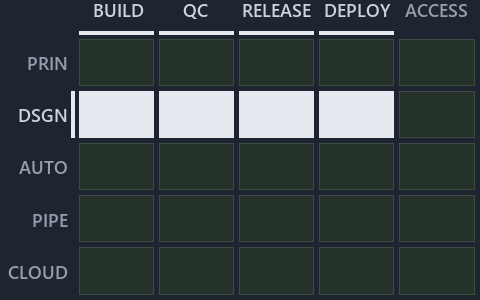

# Only ingress is checked by gates; the source-of-truth and integration rules rest on code review: the value-chain minimap

```text
Where ADR-DSGN-LIFE, ADR-DSGN-REMOTE and ADR-REPO-VARIANT sit in the value chain: value-chain stack down, value-chain concerns across.
4 of 25 cells lit.
```



This is the value-chain minimap in the sidebar of the governance diagram of [Only ingress is checked by gates; the source-of-truth and
integration rules rest on code review][7], which explains [ADR-DSGN-LIFE][1], [ADR-DSGN-REMOTE][2] and [ADR-REPO-VARIANT][3]. It lights the
cells of the value-chain map where the cited ADRs' value-chain concerns land, so it shows the part of the value chain the decision governs.
Each lit cell has its reason below, naming the code that selects it.

## What the minimap shows

Value-chain map: value-chain stack × value-chain concerns. The grid crosses the 5 rows of the value-chain stack (PRIN, DSGN, AUTO, PIPE,
CLOUD) with the 5 value-chain concerns (build, quality-control, release, deploy, access) and lights 4 cells, filled in ink. Every other cell
is idle, a grey box: it holds ADRs the slide does not cite, or none, because no ADR's value-chain concern lands there (5 of the 25 cells
hold none). The minimap shows where the slide sits, not how many ADRs a cell holds; that count belongs to the full value-chain map.

- DSGN × build: 1 lit of 5 ADRs
- DSGN × quality-control: 2 lit of 5 ADRs
- DSGN × release: 1 lit of 4 ADRs
- DSGN × deploy: 1 lit of 6 ADRs

## Key

Rows are the value-chain stack and columns the value-chain concerns, each printed as a capital code:

- `PRIN`: the PRIN row of the value-chain stack
- `DSGN`: the DSGN row of the value-chain stack
- `AUTO`: the AUTO row of the value-chain stack
- `PIPE`: the PIPE row of the value-chain stack
- `CLOUD`: the CLOUD row of the value-chain stack
- `BUILD`: build
- `QC`: quality-control
- `RELEASE`: release
- `DEPLOY`: deploy
- `ACCESS`: access

## Why each cell is lit

### DSGN × build (1 ADR)

Lit ([ADR-DSGN-TRACK#12][4]) by:

- [ADR-DSGN-REMOTE][2]: selected by [ADR-DSGN-REMOTE][2]; its ADR domain `design` sits on the DSGN row of the value-chain stack
  ([ADR-DSGN-TRACK#14][5]); its own value-chain concerns (build and quality-control) override its ADR domain's default (automation), so it
  lights the build column ([ADR-DSGN-TRACK#15][6]).

### DSGN × quality-control (2 ADRs)

Lit ([ADR-DSGN-TRACK#12][4]) by:

- [ADR-DSGN-LIFE][1]: selected by [ADR-DSGN-LIFE][1]; its ADR domain `design` sits on the DSGN row of the value-chain stack
  ([ADR-DSGN-TRACK#14][5]); its own value-chain concerns (quality-control, release and deploy) override its ADR domain's default
  (automation), so it lights the quality-control column ([ADR-DSGN-TRACK#15][6]).
- [ADR-DSGN-REMOTE][2]: selected by [ADR-DSGN-REMOTE][2]; its ADR domain `design` sits on the DSGN row of the value-chain stack
  ([ADR-DSGN-TRACK#14][5]); its own value-chain concerns (build and quality-control) override its ADR domain's default (automation), so it
  lights the quality-control column ([ADR-DSGN-TRACK#15][6]).

### DSGN × release (1 ADR)

Lit ([ADR-DSGN-TRACK#12][4]) by:

- [ADR-DSGN-LIFE][1]: selected by [ADR-DSGN-LIFE][1]; its ADR domain `design` sits on the DSGN row of the value-chain stack
  ([ADR-DSGN-TRACK#14][5]); its own value-chain concerns (quality-control, release and deploy) override its ADR domain's default
  (automation), so it lights the release column ([ADR-DSGN-TRACK#15][6]).

### DSGN × deploy (1 ADR)

Lit ([ADR-DSGN-TRACK#12][4]) by:

- [ADR-DSGN-LIFE][1]: selected by [ADR-DSGN-LIFE][1]; its ADR domain `design` sits on the DSGN row of the value-chain stack
  ([ADR-DSGN-TRACK#14][5]); its own value-chain concerns (quality-control, release and deploy) override its ADR domain's default
  (automation), so it lights the deploy column ([ADR-DSGN-TRACK#15][6]).

## Keywords

- [value-chain map][8]
- [value-chain stack][9]
- [value-chain concern][10]
- [cell][11]
- [lit cell][12]

Terms the cited ADRs define:

- [occupant][13], defined by [ADR-DSGN-LIFE#5][14]

[1]: ../../../adr/design/commit-lifecycle.md
[2]: ../../../adr/design/server-remote-integration.md
[3]: ../../../adr/repository/repo-variants.md
[4]: ../../../adr/design/tracks.md#rule-adr-dsgn-track12
[5]: ../../../adr/design/tracks.md#rule-adr-dsgn-track14
[6]: ../../../adr/design/tracks.md#rule-adr-dsgn-track15
[7]: ../../design/ingress-gated-the-rest-by-review.md
[8]: ../../../adr/glossary.md#value-chain-map
[9]: ../../../adr/glossary.md#value-chain-stack
[10]: ../../../adr/glossary.md#value-chain-concern
[11]: ../../../adr/glossary.md#cell
[12]: ../../../adr/glossary.md#lit-cell
[13]: ../../../adr/glossary.md#occupant
[14]: ../../../adr/design/commit-lifecycle.md#rule-adr-dsgn-life5
