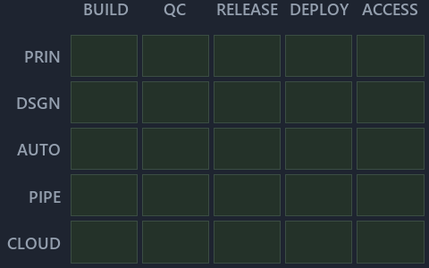

---
catzc:
  immutable:
    with_body_sha: d8eeba9230be
    repo_status: locked
    path: docs/explanation/.assets/chain/adr-dsgn-track--one-unit-one-pipeline--meta.chain.md
    source: docs/explanation/.assets/adr-dsgn-track--one-unit-one-pipeline--meta.drawio.png
    role: asset-description
    language: markdown
    filetype: md
    track: docs
    tracktype: documentation
---

# A track ships through a deployable-unit, and each unit has one pipeline: the value-chain minimap

```text
Where ADR-DSGN-TRACK sits in the value chain: value-chain stack down, value-chain concerns across.
No cell is lit: the cited ADRs land only in the automation concern, which the AUTO row already names.
```



This is the value-chain minimap in the sidebar of the meta diagram of [A track ships through a deployable-unit, and each unit has one
pipeline][2], which explains [ADR-DSGN-TRACK][1]. It lights the cells of the value-chain map where the cited ADRs' value-chain concerns
land, so it shows the part of the value chain the decision governs. Nothing is lit, so no reason follows.

## What the minimap shows

Value-chain map: value-chain stack × value-chain concerns. The grid crosses the 5 rows of the value-chain stack (PRIN, DSGN, AUTO, PIPE,
CLOUD) with the 5 value-chain concerns (build, quality-control, release, deploy, access) and lights 0 cells, filled in ink. Every other cell
is idle, a grey box: it holds ADRs the slide does not cite, or none, because no ADR's value-chain concern lands there (5 of the 25 cells
hold none). The minimap shows where the slide sits, not how many ADRs a cell holds; that count belongs to the full value-chain map.

## Key

Rows are the value-chain stack and columns the value-chain concerns, each printed as a capital code:

- `PRIN`: the PRIN row of the value-chain stack
- `DSGN`: the DSGN row of the value-chain stack
- `AUTO`: the AUTO row of the value-chain stack
- `PIPE`: the PIPE row of the value-chain stack
- `CLOUD`: the CLOUD row of the value-chain stack
- `BUILD`: build
- `QC`: quality-control
- `RELEASE`: release
- `DEPLOY`: deploy
- `ACCESS`: access

## Keywords

- [value-chain map][3]
- [value-chain stack][4]
- [value-chain concern][5]
- [cell][6]
- [lit cell][7]

Terms the cited ADRs define:

- [cell][6], defined by [ADR-DSGN-TRACK#10][8]
- [deployable-unit][9], defined by [ADR-DSGN-TRACK#5][10]
- [file language][11], defined by [ADR-DSGN-TRACK#6][12]
- [import][13], defined by [ADR-DSGN-TRACK#17][14]
- [landing address][15], defined by [ADR-DSGN-TRACK#17][14]
- [lit cell][7], defined by [ADR-DSGN-TRACK#12][16]
- [place][17], defined by [ADR-DSGN-TRACK#1][18]
- [root file][19], defined by [ADR-DSGN-TRACK#7][20]
- [sorting][21], defined by [ADR-DSGN-TRACK#17][14]
- [stack violation][22], defined by [ADR-DSGN-TRACK#11][23]
- [track][24], defined by [ADR-DSGN-TRACK#1][18]
- [unlisted file][25], defined by [ADR-DSGN-TRACK#8][26]
- [unordered track][27], defined by [ADR-DSGN-TRACK#17][14]
- [value-chain concern][5], defined by [ADR-DSGN-TRACK#15][28]
- [value-chain map][3], defined by [ADR-DSGN-TRACK#16][29]
- [value-chain stack][4], defined by [ADR-DSGN-TRACK#14][30]
- [verification track][31], defined by [ADR-DSGN-TRACK#2][32]
- [world map][33], defined by [ADR-DSGN-TRACK#9][34]

[1]: ../../../adr/design/tracks.md
[2]: ../../design/one-unit-one-pipeline.md
[3]: ../../../adr/glossary.md#value-chain-map
[4]: ../../../adr/glossary.md#value-chain-stack
[5]: ../../../adr/glossary.md#value-chain-concern
[6]: ../../../adr/glossary.md#cell
[7]: ../../../adr/glossary.md#lit-cell
[8]: ../../../adr/design/tracks.md#rule-adr-dsgn-track10
[9]: ../../../adr/glossary.md#deployable-unit
[10]: ../../../adr/design/tracks.md#rule-adr-dsgn-track5
[11]: ../../../adr/glossary.md#file-language
[12]: ../../../adr/design/tracks.md#rule-adr-dsgn-track6
[13]: ../../../adr/glossary.md#import
[14]: ../../../adr/design/tracks.md#rule-adr-dsgn-track17
[15]: ../../../adr/glossary.md#landing-address
[16]: ../../../adr/design/tracks.md#rule-adr-dsgn-track12
[17]: ../../../adr/glossary.md#place
[18]: ../../../adr/design/tracks.md#rule-adr-dsgn-track1
[19]: ../../../adr/glossary.md#root-file
[20]: ../../../adr/design/tracks.md#rule-adr-dsgn-track7
[21]: ../../../adr/glossary.md#sorting
[22]: ../../../adr/glossary.md#stack-violation
[23]: ../../../adr/design/tracks.md#rule-adr-dsgn-track11
[24]: ../../../adr/glossary.md#track
[25]: ../../../adr/glossary.md#unlisted-file
[26]: ../../../adr/design/tracks.md#rule-adr-dsgn-track8
[27]: ../../../adr/glossary.md#unordered-track
[28]: ../../../adr/design/tracks.md#rule-adr-dsgn-track15
[29]: ../../../adr/design/tracks.md#rule-adr-dsgn-track16
[30]: ../../../adr/design/tracks.md#rule-adr-dsgn-track14
[31]: ../../../adr/glossary.md#verification-track
[32]: ../../../adr/design/tracks.md#rule-adr-dsgn-track2
[33]: ../../../adr/glossary.md#world-map
[34]: ../../../adr/design/tracks.md#rule-adr-dsgn-track9
