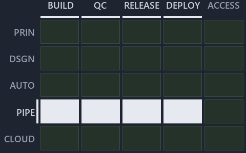

# No gate checks the runner rules 1 or 4, and the step template breaks rule 3: the value-chain minimap

```text
Where ADR-FLOW-CD-RUNNER and ADR-PIPE-NAME sit in the value chain: value-chain stack down, value-chain concerns across.
4 of 25 cells lit.
```



This is the value-chain minimap in the sidebar of the governance diagram of [No gate checks the runner rules 1 or 4, and the step template
breaks rule 3][6], which explains [ADR-FLOW-CD-RUNNER][1] and [ADR-PIPE-NAME][2]. It lights the cells of the value-chain map where the cited
ADRs' value-chain concerns land, so it shows the part of the value chain the decision governs. Each lit cell has its reason below, naming
the code that selects it.

## What the minimap shows

Value-chain map: value-chain stack × value-chain concerns. The grid crosses the 5 rows of the value-chain stack (PRIN, DSGN, AUTO, PIPE,
CLOUD) with the 5 value-chain concerns (build, quality-control, release, deploy, access) and lights 4 cells, filled in ink. Every other cell
is idle, a grey box: it holds ADRs the slide does not cite, or none, because no ADR's value-chain concern lands there (5 of the 25 cells
hold none). The minimap shows where the slide sits, not how many ADRs a cell holds; that count belongs to the full value-chain map.

- PIPE × build: 1 lit of 4 ADRs
- PIPE × quality-control: 1 lit of 3 ADRs
- PIPE × release: 1 lit of 4 ADRs
- PIPE × deploy: 1 lit of 3 ADRs

## Key

Rows are the value-chain stack and columns the value-chain concerns, each printed as a capital code:

- `PRIN`: the PRIN row of the value-chain stack
- `DSGN`: the DSGN row of the value-chain stack
- `AUTO`: the AUTO row of the value-chain stack
- `PIPE`: the PIPE row of the value-chain stack
- `CLOUD`: the CLOUD row of the value-chain stack
- `BUILD`: build
- `QC`: quality-control
- `RELEASE`: release
- `DEPLOY`: deploy
- `ACCESS`: access

## Why each cell is lit

### PIPE × build (1 ADR)

Lit ([ADR-DSGN-TRACK#12][3]) by:

- [ADR-PIPE-NAME][2]: selected by [ADR-PIPE-NAME][2]; its ADR domain `pipelines` sits on the PIPE row of the value-chain stack
  ([ADR-DSGN-TRACK#14][4]); its value-chain concerns (build, quality-control, release and deploy) are its ADR domain's default, so it lights
  the build column ([ADR-DSGN-TRACK#15][5]).

### PIPE × quality-control (1 ADR)

Lit ([ADR-DSGN-TRACK#12][3]) by:

- [ADR-PIPE-NAME][2]: selected by [ADR-PIPE-NAME][2]; its ADR domain `pipelines` sits on the PIPE row of the value-chain stack
  ([ADR-DSGN-TRACK#14][4]); its value-chain concerns (build, quality-control, release and deploy) are its ADR domain's default, so it lights
  the quality-control column ([ADR-DSGN-TRACK#15][5]).

### PIPE × release (1 ADR)

Lit ([ADR-DSGN-TRACK#12][3]) by:

- [ADR-PIPE-NAME][2]: selected by [ADR-PIPE-NAME][2]; its ADR domain `pipelines` sits on the PIPE row of the value-chain stack
  ([ADR-DSGN-TRACK#14][4]); its value-chain concerns (build, quality-control, release and deploy) are its ADR domain's default, so it lights
  the release column ([ADR-DSGN-TRACK#15][5]).

### PIPE × deploy (1 ADR)

Lit ([ADR-DSGN-TRACK#12][3]) by:

- [ADR-PIPE-NAME][2]: selected by [ADR-PIPE-NAME][2]; its ADR domain `pipelines` sits on the PIPE row of the value-chain stack
  ([ADR-DSGN-TRACK#14][4]); its value-chain concerns (build, quality-control, release and deploy) are its ADR domain's default, so it lights
  the deploy column ([ADR-DSGN-TRACK#15][5]).

## Keywords

- [value-chain map][7]
- [value-chain stack][8]
- [value-chain concern][9]
- [cell][10]
- [lit cell][11]

[1]: ../../../adr/flow/pipeline-runner-pattern.md
[2]: ../../../adr/pipelines/pipeline-naming-and-placement.md
[3]: ../../../adr/design/tracks.md#rule-adr-dsgn-track12
[4]: ../../../adr/design/tracks.md#rule-adr-dsgn-track14
[5]: ../../../adr/design/tracks.md#rule-adr-dsgn-track15
[6]: ../../flow/no-gate-checks-rules-one-and-four.md
[7]: ../../../adr/glossary.md#value-chain-map
[8]: ../../../adr/glossary.md#value-chain-stack
[9]: ../../../adr/glossary.md#value-chain-concern
[10]: ../../../adr/glossary.md#cell
[11]: ../../../adr/glossary.md#lit-cell
