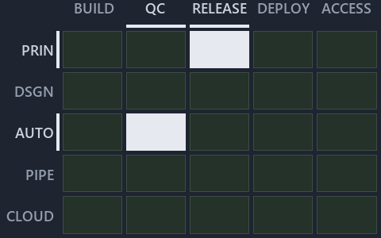

# out/drawio/adr-prin-onelive--a-sibling-is-an-idea-never-a-reference--meta/chain/adr-prin-onelive--a-sibling-is-an-idea-never-a-reference--meta.chain.md

`Value-chain minimap: adr-prin-onelive--a-sibling-is-an-idea-never-a-reference--meta`

The value-chain minimap of the slide `adr-prin-onelive--a-sibling-is-an-idea-never-a-reference--meta` (meta lens). The slide supports
[ADR-AUTO-GO][1] and [ADR-PRIN-ONELIVE][2]; the highlight of those ADR codes selects what is lit, and each reason below names the code that
selects it.

## What the minimap shows

Value-chain map: value-chain stack × value-chain concerns. The grid crosses the 5 rows of the value-chain stack (PRIN, DSGN, AUTO, PIPE,
CLOUD) with the 5 value-chain concerns (build, quality-control, release, deploy, access) and lights 2 cells, filled in ink. Every other cell
is idle, a grey box: it holds ADRs the slide does not cite, or none, because no ADR's value-chain concern lands there (5 of the 25 cells
hold none). The minimap shows where the slide sits, not how many ADRs a cell holds; that count belongs to the full value-chain map.

- PRIN × release: 1 lit of 33 ADRs
- AUTO × quality-control: 1 lit of 16 ADRs

## Key

Rows are the value-chain stack and columns the value-chain concerns, each printed as a capital code:

- `PRIN`: the PRIN row of the value-chain stack
- `DSGN`: the DSGN row of the value-chain stack
- `AUTO`: the AUTO row of the value-chain stack
- `PIPE`: the PIPE row of the value-chain stack
- `CLOUD`: the CLOUD row of the value-chain stack
- `BUILD`: build
- `QC`: quality-control
- `RELEASE`: release
- `DEPLOY`: deploy
- `ACCESS`: access

## Why each cell is lit

### PRIN × release (1 ADR)

Lit ([ADR-DSGN-TRACK#12][3]) by:

- [ADR-PRIN-ONELIVE][2]: selected by [ADR-PRIN-ONELIVE][2]; its ADR domain `principles` sits on the PRIN row of the value-chain stack
  ([ADR-DSGN-TRACK#14][4]); its own value-chain concerns (release) override its ADR domain's default (automation, build, quality-control,
  release, deploy and access), so it lights the release column ([ADR-DSGN-TRACK#15][5]).

### AUTO × quality-control (1 ADR)

Lit ([ADR-DSGN-TRACK#12][3]) by:

- [ADR-AUTO-GO][1]: selected by [ADR-AUTO-GO][1]; its ADR domain `automation` sits on the AUTO row of the value-chain stack
  ([ADR-DSGN-TRACK#14][4]); its own value-chain concerns (quality-control) override its ADR domain's default (automation), so it lights the
  quality-control column ([ADR-DSGN-TRACK#15][5]).

## Keywords

- [value-chain map][6]
- [value-chain stack][7]
- [value-chain concern][8]
- [cell][9]
- [lit cell][10]

Terms the cited ADRs define:

- [go test module][11], defined by [ADR-AUTO-GO#2][12]

[1]: ../../../../docs/adr/automation/go/go-test-artifacts.md
[2]: ../../../../docs/adr/principles/one-living-version.md
[3]: ../../../../docs/adr/design/tracks.md#rule-adr-dsgn-track12
[4]: ../../../../docs/adr/design/tracks.md#rule-adr-dsgn-track14
[5]: ../../../../docs/adr/design/tracks.md#rule-adr-dsgn-track15
[6]: ../../../../docs/adr/glossary.md#value-chain-map
[7]: ../../../../docs/adr/glossary.md#value-chain-stack
[8]: ../../../../docs/adr/glossary.md#value-chain-concern
[9]: ../../../../docs/adr/glossary.md#cell
[10]: ../../../../docs/adr/glossary.md#lit-cell
[11]: ../../../../docs/adr/glossary.md#go-test-module
[12]: ../../../../docs/adr/automation/go/go-test-artifacts.md#rule-adr-auto-go2
